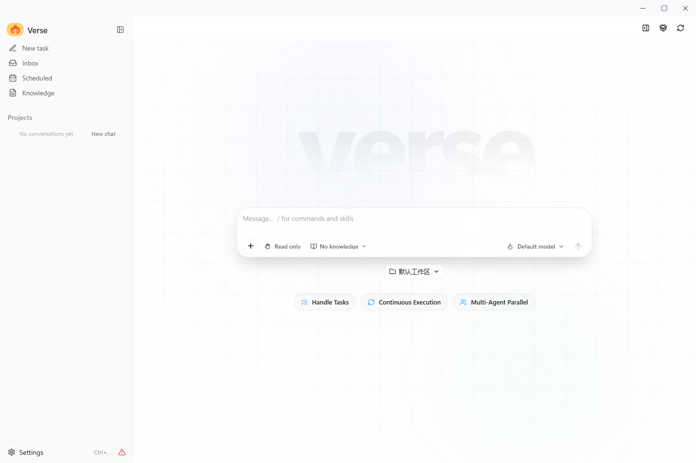
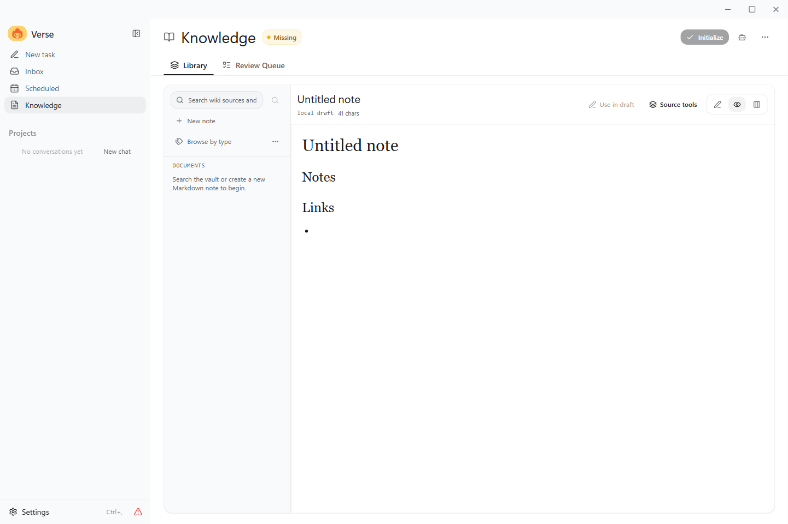
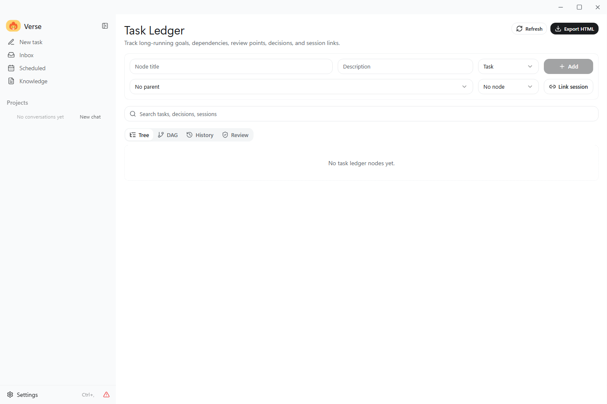
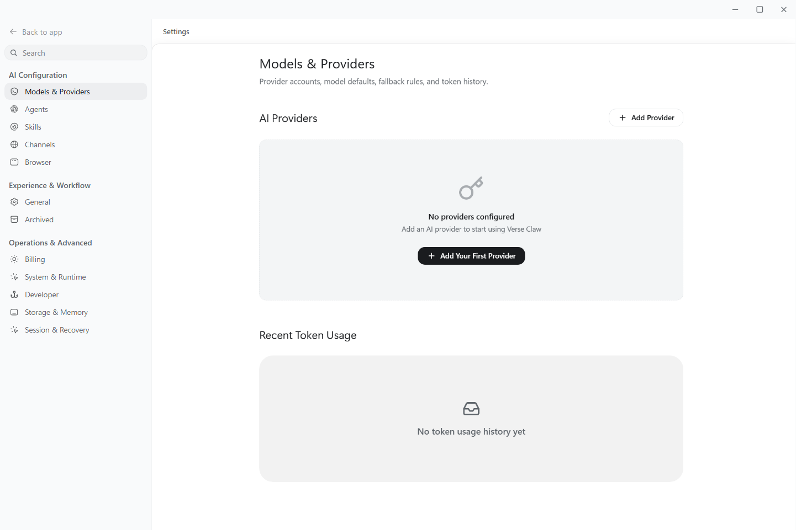
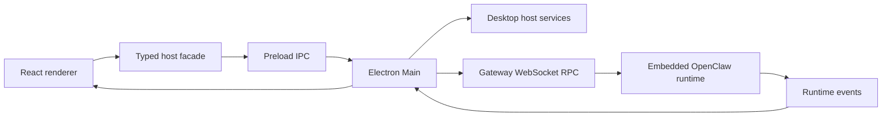

<p align="center">
  
</p>

Review Center の折りたたまれた Change Context は明示的に有効化し、4 種類の比較、ダイジェスト固定コメント、審査判断を表示します。変更適用は既存の承認・Git・Coding journal を使用し、審査承認でタスク完了やマージは行いません。[詳細](docs/modules/workspace-and-coding.md)。 Windows のソースホストでの検証範囲と機能ゲートのロールバックは[段階的有効化](docs/dev/change-context-review-loop/rollout.md)を参照してください。

`runtime.providerBudget` でホスト、プロジェクト、セッションの予算を明示的に設定できます。子の呼び出しはセッション owner の workspace を継承し、予約額と不明な費用は runtime owner が保持します。[リソースと観測](docs/modules/resources-and-observability.md)で対象範囲と精算の制約を確認してください。

# Verse Claw

通常のストリーミングテキストはフレームごとにまとめて更新します。承認、キャンセル、エラー、完了は即時に反映し、返信の生成中も完了済みメッセージを安定して表示します。

長い会話はメッセージの実測高さで表示範囲を選び、DOM 上限内で読み込み済みの古い発言へ移動できます。履歴・プレビュー・投影のキャッシュは 32 MiB の共通予算を使い、削除されたキャッシュ内容は既存の履歴・メディア経路から再読込します。

互換性のあるファイル購読はネイティブ監視を共有し、フィルターと解除ハンドルは個別に保持します。知識ソースのディレクトリ再作成後は監視を再開し、複数ウィンドウは Main の新しい Git 状態を共有します。

管理対象プロセスは終了結果を確認するまで共有 executor の参照を保持します。poll は標準入力とキャンセルの処理枠を残し、出力は合計バイト上限と既存 artifact 参照で扱います。

ターミナルPTYと管理対象プロセスは宣言済みホスト容量を共有します。既知のサーバーポートを起動前に予約し、古い世代からの操作を拒否します。終了結果が不明な場合は予約を保持して復旧時に照合します。[端末リソースの所有権](harness/specs/guides/terminal-resource-ownership.md)。

会話から Git リポジトリを作成し、独立した worktree を選択して下書きを復元できます。`/storage` と **設定 → ストレージ** は、会話ファイル、プロセスメモリ、worktree の使用量を表示する同じページを開きます。[操作と所有権](docs/dev/session-worktree-storage.md)。

Runtime が管理する worktree の所有権、作成段階、マージ意図は SQLite に保存され、再起動後も復元できます。パスの置換、作成未完了、マージ結果不明の場合はリソースを保持し、古い実行資格の使用を拒否します。[登録と復元の契約](harness/specs/guides/execution-domain-registry.md)。

管理対象ツールは実行前にタスクの取得権、セッション世代、永続 checkout writer を共同確認し、既存のマージ・固定・クリーンアップ owner と資源を共有します。writer は呼び出し間も保持され、不明な結果やバックグラウンドプロセスは元の owner が照合します。[書き込み契約](harness/specs/guides/checkout-writer-ownership.md)に移譲・復旧・外部書き込みの境界を記載しています。

自動テストは書き込み完了を確認した後、許可された exec 経路で実行します。書き込みを開始する前に拒否された編集は owner が not-applied と記録し、入力を修正して同じタスクを続行できます。

Chat は同じ会話とタスクを、設定済みの別のチェックアウトへ移行できます。目標と成果物の参照を保持し、元の処理の完了と移行先の所有権を確認します。中断した移行は保存済みの操作から再開できます。

会話の切り替えで読んでいたメッセージ位置と下書きを復元します。バックグラウンド処理の状態が変わっても、ポインターやキーボードで操作中の行は移動しません。未設定の担当者、権限エラー、依存待ちには理由と次の操作を表示し、派発時の計画と現在のキューを区別します。

メッセージの分岐には記録済みの会話境界を使い、利用できない場合は理由を表示します。別の会話へ続ける際は既存の編集可能な引き継ぎプレビューを開き、明示的な作成操作で実行します。

**チャット、コード、知識、Agent 実行を 1 つのデスクトップ作業空間に。**

[English](README.md) · [简体中文](README.zh-CN.md) · [日本語](README.ja-JP.md) · [Русский](README.ru-RU.md)

[モジュール詳細（中国語）](docs/modules/README.md) · [はじめに](#getting-started) · [アーキテクチャ](#architecture) · [開発](#development) · [トラブルシューティング](#troubleshooting) · [ドキュメント](#documentation)

Verse Claw は、組み込み OpenClaw Runtime 上に構築された Electron デスクトップアプリです。会話、プロジェクト workspace、コーディングツール、知識レビュー、メモリ、マルチ Agent 編成、メッセージチャネル、スケジュール、runtime 診断を 1 つのローカルデスクトップ製品にまとめます。

このリポジトリは renderer の薄いラッパーではありません。React UI、Electron Main Host、型付きプロセス間 contract、vendored OpenClaw Runtime、VerseBrowser、VerseShell 実行基盤、退役済み VToken source、実行可能な Harness 仕様、build/evidence/release pipeline を含みます。

> **現在の状態：**`0.4.9-alpha.0`、controlled preview。Windows x64 のローカル workflow が主な検証対象です。macOS/Linux には build target があり、platform runtime は個別に検証します。

## 製品を構成するモジュール

| 領域 | 現在の形 | 詳細 |
|---|---|---|
| LLM / モデル | account ベースの provider 設定、OAuth/API key/local auth、protocol adapter、fallback、turn/session model override、streaming、tool loop、reasoning effort、usage、推定 cost | [LLM とモデル（中国語）](docs/modules/llm-and-models.md) |
| 会話 / session | JSONL append-only session tree、run、abort/stop/archive/delete、checkpoint、compaction、handoff/fork、sidebar、group、long-session coordinator | [Session（中国語）](docs/modules/sessions.md) |
| Context / memory | Context Orchestrator、管理対象の注入に6,000文字の上限と編成後の追加内容の別集計、Workspace Context、health score、独立 Role/Runtime store 上の単一 Memory surface | [Context と Memory（中国語）](docs/modules/context-and-memory.md) |
| Workspace / coding | preflight、4 種類の permission mode、file preview、PTY terminal、web preview、Git、review、write journal、stale-write guard、auto verify | [Workspace と coding（中国語）](docs/modules/workspace-and-coding.md) |
| Knowledge | Markdown/wiki-first Library、Inbox → Draft → Steward → Proposal → explicit apply、Source Set、OKF、Runtime Lessons/SEKB、provenance、governance | [Knowledge（中国語）](docs/modules/knowledge-base.md) |
| Multi-agent / tasks | Agent/Persona/Role、9 組み込み role、routing、team template、resource-aware wave、subagent admission、Task Ledger、Task Loop、ClawGraph | [Multi-agent と task（中国語）](docs/modules/multi-agent-and-tasks.md) |
| プロジェクトとセッション | プロジェクト名から担当セッションを開き、異なる agent の明示的に関連付けられた担当者も表示します。既存グループ内で派生セッションとタスクを確認できます。タスク履歴から関連セッションとチェックポイントの成果物を開けます。分岐の質問は下書きになり、引き継ぎは作成後に送信され、再起動後も照合・復旧できます。 | [セッションとタスク（中国語）](docs/modules/multi-agent-and-tasks.md) |
| Verse components | VerseGit repository/evidence control plane、VerseShell governed execution、VerseBrowser driver、退役 VToken | [Verse tools（中国語）](docs/modules/verse-tools.md) |
| Resources / observability | ResourceFabric の操作別レイテンシ基準とメモリ/event-loop 圧力制御、バックグラウンド降載、プロセス追跡、token/cost 上限と回復 | [Resources と observability（中国語）](docs/modules/resources-and-observability.md) |
| Integrations | 15 channel types、Scheduled、Skills/MCP、Inbox、Remote Task、Code Review、VerseConf、media、Billing、Agent Dev | [Integrations（中国語）](docs/modules/integrations-and-surfaces.md) |

詳細 module document は現在 Simplified Chinese で保守されています。source path、API 名、evidence link は言語非依存です。4 つの root README が多言語入口です。

チャットの処理詳細を折りたたんでも最終回答は表示されます。長いファイル変更は会話欄内で変更前後を並べ、折り返せないコードはプレビュー内で折り返します。展開後の差分だけがその領域内で横スクロールします。コマンドは最新の出力からプレビューし、コピーには保持されている全文が含まれます。リポジトリ変更ストリップはコンポーザーと同じ中央列幅を使用し、ツール呼び出しは対象と時間を示すコンパクトなステータスチップで表示されます。

ランタイムの承認要求は該当会話の入力欄を置き換え、コマンド、作業ディレクトリと選択肢を表示します。ページの他の部分は操作でき、承認処理が終わると元の入力欄、下書きと添付ファイルが復元されます。

会話には、どのツールが生成したかにかかわらず、そのターンの成果物が表示されます。音声と動画はネイティブコントロールでその場で再生でき、ファイルの欠落、サイズ超過、再生不能の場合は明示されます。画像は取得元を問わず同じビューアーで表示します。リモートの画像とメディアは自動で読み込まれず、開く操作を提供します。グラフは宣言された種類で描画され、データ表も確認できます。単独の段落のリンクはリンクカードになり、その他の構造化リソースはラベル付きの代替カードで表示されます。

## 現在の成熟度境界

| Label | 意味 |
|---|---|
| `default` / `advanced` | 宣言された controlled-preview 範囲内の製品 surface。 |
| `internal` | 実装または内部 API はあるが、独立した user product entry はありません。 |
| `shadow` / `experiment` | 観測または限定的 experiment。routing、write、approval authority は持ちません。 |
| `retired` | compatibility、provenance、rollback inspection のためだけに保持。 |
| `agent-driven` | agent が生成し、そのように表示した evidence。real-human evidence ではありません。 |

現在の machine-readable component catalog は 54 行です：13 default、12 advanced、23 internal、6 retired、0 experiment。分類は runtime proof ではありません。詳細は [component disposition matrix](docs/dev/component-disposition-matrix-20261021.md)。

重要な default：

- Workspace Context と read-only DCS context tools は宣言された health / permission gate 下で有効です。
- Runtime Memory injection と SEKB automatic writeback は既定で無効です。Browser private network には明示的な許可が必要です。
- SEKB は原則のバージョンと実行に紐づく明示的な採用を記録し、実行結果と独立したタスク評価を分けて保存します。メモリのフィードバックは診断に使用し、検索順位や保持判断には影響しません。[RSI の証拠と境界](docs/dev/rsi-capability-and-boundaries.md) を参照してください。
- 制御された RSI prompt 研究では親バージョン、学習証拠の帰属、固定した検証の判断を記録します。候補は独立して封印した評価計画に紐づけます。
- VToken は retired。旧 env/config では production assembly / sidecar を再有効化できません。
- VerseGit と VerseShell は既定で無効です。ホスト統合は以下の責務と権限の境界を維持します。
- Dreams は retired。Image Generation は developer/test gate で、通常の製品 navigation ではありません。
- `liveReady=false`、`productApproved=false`、`defaultOn=false` は product lock として維持されます。

<!-- VERSE-TOOLS-BOUNDARY-START -->
**VerseGit の境界付きコーディングループ：**既定で無効、一般提供は未承認です。win32-x64 M1 provider はリポジトリの事実を提供し、候補の検証は VerseShell で実行します。write journal と Git apply はホストが管理します。M4 landing/admission は未承認で、`liveReady=false` と `productApproved=false` を維持します。VerseShell も既定で無効です。VerseBrowser は利用可能かつ所有セッションに紐づく runtime action のみ受け付け、モデルの引数でホストの承認を代替できません。リクエスト単位の private-network 検査はリダイレクトとサブリソースも対象です。[Verse の境界](docs/modules/verse-tools.md)を参照してください。
<!-- VERSE-TOOLS-BOUNDARY-END -->

Default や release claim を変更する前に、[default configuration](docs/dev/default-config-matrix.md)、[product semantics](docs/clawx-product-semantics.md)、[capability claims](shared/capability-claims.ts) を確認してください。

## アプリ画面

画像は 2026-10-05 の Windows Electron source build で取得されました。現在の header は後続の B2 identity を使用します。Knowledge 画像では `memory-wiki` を明示的に有効化し、model account / model request は使用していません。

| **Chat / task entry**<br>[](resources/readme/2026-10-05/en/chat.png) | **Knowledge library / review**<br>[](resources/readme/2026-10-05/en/knowledge.png) |
| --- | --- |
| **Task Ledger**<br>[](resources/readme/2026-10-05/en/tasks.png) | **Models / provider settings**<br>[](resources/readme/2026-10-05/en/settings.png) |

Capture condition と hash は [visual provenance](resources/readme/2026-10-05/README.md) を参照してください。

<a id="getting-started"></a>

## はじめに

前提：

- **Node.js 24.16.0 以降（24.x）**と Git。古い Windows Node 24 では TCP crash が発生する可能性があります。
- `package.json` で固定された **pnpm 11.2.2**。
- dependency、Electron、uv、agent-browser の download network access。
- Online provider account または互換 local model service。

Repository root で実行：

```sh
git clone https://github.com/Baixu22/VerseClaw.git
cd VerseClaw
corepack enable
corepack prepare pnpm@11.2.2 --activate
pnpm run init
pnpm --dir openclaw_runtime install --frozen-lockfile --ignore-scripts
node node_modules/electron/install.js
pnpm dev
```

`pnpm dev` は VerseBrowser、embedded runtime、bundled skills を build してから Vite と Electron を起動します。Gateway の ready には通常 10–30 秒必要です。Vite page だけでは完全な Electron Host services は得られません。

ビルド済み Gateway は解決済みの JavaScript Doctor 契約をネイティブで読み込み、SDK エイリアスの準備を減らします。マウントしたソースと外部プラグインはそれぞれの契約を使い、移行チェックも継続します。`pnpm run build:runtime` の後に `node scripts/measure-gateway-startup.mjs` を実行すると、隔離したループバック環境と空のキャッシュで比較できます。有効な各サンプルは対象ローダーの呼び出しと認証済み RPC の完了を確認します。

最初の session：

1. Setup を完了する。
2. Provider/model を設定し、接続を検証する。
3. Project directory、permission mode、workspace を選択する。
4. Scoped task を送り、Workspace Panel を確認する。
5. Inbox で approval を処理する。
6. Knowledge / Memory の永続変更は review surface 経由で行う。
7. 会話は行から管理します。ホバーで「ピン留め」と「⋯」（名前変更、ワークストリームへ移動、未読にする、分岐、引き継ぎ、コピー、元に戻せるアーカイブ、削除）が表示され、右クリックでも同じメニューが開きます。長いタイトルはホバー中にスクロール表示されます。
8. サイドバーのベルはアクティビティを示します。会話の実行中はベルにリングが表示され（対応が必要なときは琥珀色）、パネルには実行中の会話と経過時間、完了・エラー・承認待ちのイベントが並びます。システム通知はベルメニューまたは Settings → Session & Recovery で切り替えられます。

Release に存在する package だけが download target です。Build target の存在は current version の package を保証しません。

| Platform | Configured artifact | Validation scope |
|---|---|---|
| Windows x64 | NSIS | 主な controlled local acceptance target |
| macOS x64 / arm64 | DMG、ZIP | Build target。capability ごとの platform validation が必要 |
| Linux x64 / arm64 | AppImage、DEB、x64 RPM | Build target。GUI runtime が必要 |

<a id="architecture"></a>

## アーキテクチャ

通常の request path：

```text
React renderer
  -> typed host facade (src/lib/host-api.ts)
  -> preload IPC
  -> Electron Main（authorization + dispatch）
  -> Host service および/または Main-owned Gateway WebSocket RPC
  -> embedded OpenClaw runtime
```

Runtime event は Main と `host-events.ts` を通って renderer store に戻ります。File、terminal、Git などの local service は Gateway を通らず Main で完了できます。

これは universal な `WS -> HTTP -> IPC fallback` ではありません。Renderer page は Gateway に直接接続せず、Host API を迂回する Electron IPC も追加しません。`shared/host-api/contract.ts` が typed shared boundary です。



Main layers：

- `src/`：renderer、page、component、Zustand store、Host facade、i18n、style。
- `electron/`：Main service、IPC security、Gateway supervision、preload、desktop utility。
- `shared/`：Host API/event、domain type、4 言語 resource、authority/default manifest。
- `openclaw_runtime/`：vendored runtime、Gateway、agent、tool、channel、package、extension。
- `packages/` / `resources/`：VerseBrowser、VToken、VerseShell、skill、plugin、native asset。
- `harness/`、`tests/`、`scripts/`：executable rule、test、automation、evidence tooling。

詳細：[architecture guide](docs/architecture-overview.md)、[repository layout](docs/dev/repository-layout.md)。

## ローカルデータとプライバシー

別個の database server は不要です。

- Desktop setting / export は Electron `userData`。
- Runtime config は通常 `~/.openclaw`。`OPENCLAW_CONFIG_DIR` をサポート。
- Session は JSONL transcript、runtime state は SQLite も使用。
- Token history は structured session usage record から集計。Cost は推定値。
- Knowledge は `memory-wiki` vault と local governance metadata を使用。
- 監視フォルダーは追加・変更・削除を版付きの審査候補へ同期し、停止中の変更も再走査します。
- ファイルと GitHub のソースは版を進める前に UTF-8 を検証し、不正な文字列はカーソルを保持してエラーにします。
- Project RAG は workspace に紐付く明示的な index lifecycle API を備え、SQLite 公開、background worker、owner 引用検証を行います。[索引ライフサイクル契約](docs/dev/project-rag/INDEX-LIFECYCLE-CONTRACT.md)を参照してください。
- コードの関係探索は実際の相対パスと現在の owner／版を検証し、通常 1 段、最大 2 段で import と呼び出しを辿ります。各段は 512 件の候補走査予算を共有し、上限に達すると partial を返します。タスク hint は現在の binding の revision、制約、証拠参照を返します。[コード関係とタスク context](docs/dev/project-rag/CODE-TASK-CONTEXT-CONTRACT.md)を参照してください。
- Chat の知識選択で明示的に Research を実行すると、不足する証拠を追跡します。固定された予算内で最大 3 ラウンド、8 検索、2 回の計画呼び出しを行い、進捗、取消、証拠、推論、矛盾、部分結果を表示します。[Research 契約](docs/dev/project-rag/RESEARCH-CONTRACT.md)を参照してください。
- DCS は許可された知識の順序を保ち、共有予算内で chunk や競合グループを丸ごと組み込み、Chat と model-only 知識 QA が保持した引用とバイト数を記録します。[証拠組み込み契約](docs/dev/project-rag/DCS-EVIDENCE-PACKING-CONTRACT.md)を参照してください。
- Librarian は許可済みの証拠と制限された会話履歴を設定済み Gateway モデルへ渡し、原文引用と版を検証します。部分読み取り、矛盾、モデル失敗を明示し、Studio はレビュー用の抜粋草稿を保存します。
- 中国語検索、長文の制限付き続読、provider 別 embedding キャッシュ、版に紐付く Steward 所見を実装しています。任意の公開 GitHub ディレクトリ接続は更新と撤回を Inbox へ送ります。他の SaaS 接続は未実装です。
- 設定 > モデルとプロバイダーから、プロジェクト検索用のローカル EmbeddingGemma または設定済みリモート Qwen VL を選択できます。インストール、検証、準備、キャンセル、認証情報の更新は [embedding ライフサイクル](docs/dev/project-rag/EMBEDDING-LIFECYCLE-CONTRACT.md) を参照してください。
- 同じページのナレッジ運用で検索と回答の既定方針、インデックスの有効化・一時停止・再開・再構築、公開容量予算を管理できます。有効なソース世代、更新待ち、削除、旧世代の整理、モデル機能の状態を表示します。[設定と運用](docs/dev/project-rag/CONFIG-OPERATIONS-CONTRACT.md)を参照してください。
- Chat の参照では、ネイティブ記憶ファイルと Role Memory カードの所有者、バージョン、スコープを個別に確認します。使用前に参照を再読し、変更・削除されたソースを拒否します。[記憶ソースの読み取り](docs/dev/project-rag/MEMORY-SOURCE-CONTRACT.md)を参照してください。
- 確認済み Runtime Lessons は owner と内容バージョンの pin を保持し、Chat、SourceSet、Studio、引用プレビューで読み取ります。画面への提示、DCS コンテキスト、引用、観測された採用、実行結果、独立したタスク評価は既存の SEKB 記録で区別します。
- プロジェクトのベクトル索引は SQLite 厳密検索とライブラリ単位の LanceDB ANN に対応し、generation 切替、資料の権限撤回、owner による引用再読込を行います。[ベクトル後端](docs/dev/project-rag/VECTOR-BACKEND-CONTRACT.md)を参照してください。
- Chat Preflight は共通の検索計画で字句・ベクトルの順位を統合し、ソース権限を維持して順位の根拠と縮退理由を返します。[検索計画](docs/dev/project-rag/RETRIEVAL-PLAN-CONTRACT.md)を参照してください。
- Log、trace、screenshot、Task Forest、handoff は明示的に curated されない限り local working data。

Local storage は offline execution を意味しません。Online model、channel、browser、external tool は設定に従って data を受け取ります。Credential や private transcript を commit / public issue に含めないでください。

VerseBrowser: インストール・開発・ビルド時に組み込みモジュールを自動コンパイルします。81 メソッドの契約は Electron の 81 機能の実装を意味しません。[呼び出し方法とドライバー制限](packages/README.md#versebrowser-integration-and-invocation)を参照してください。プライベートネットワークへの移動は Main がセッションと origin に結び付けて承認します。agent による検証も Main で承認を実行し、呼び出し側の承認マーカーではアクセス権を付与しません。 ナビゲーションの失敗時は待機状態を解放し、次の移動を独立して実行します。 ブラウザーのリソースは元のウィンドウの終了確認後に解放します。

<a id="development"></a>

## 開発と検証

| Command | Purpose |
|---|---|
| `pnpm dev` | Resource/runtime を準備し Electron 開発起動 |
| `pnpm run build:vite` | Renderer / Electron bundle build |
| `pnpm run build:runtime` | Embedded runtime build + Gateway startup smoke |
| `pnpm run typecheck` | node/web/test full typecheck |
| `pnpm run lint:check` | Lint のみ。file は変更しない |
| `pnpm test` | Root test group と selected regression |
| `pnpm run test:e2e` | Build + Electron Playwright |
| `pnpm contract:check` / `pnpm i18n:lint` | Host contract / 4 言語 coverage |
| `pnpm run harness:ci` | Repository Harness baseline |
| `pnpm run repo:artifacts:check` | Source / evidence / archive boundary |
| `pnpm run docs:policy:validate` | Documentation policy validation |

Task spec：

```bash
pnpm harness context --spec <task-spec>
pnpm harness validate --spec <task-spec>
pnpm harness run --spec <task-spec> --dry-run
```

UI change では Electron E2E と en/zh/ja/ru の string を追加します。Communication path の変更では `pnpm run comms:replay` と `pnpm run comms:compare` も必要です。Build success、install success、release authorization は別の事実です。

[個人 Agent QA シナリオ集](openclaw_runtime/qa/README.md)は、スクリプト provider で十項目の Gateway シナリオを実行し、最終状態を決定的に検証します。ソース実行環境の証拠は制御フロー、拒否、復旧を対象とし、実モデル品質とパッケージ動作には個別の検証ゲートがあります。

[Responses 検証契約](harness/specs/tasks/product-acceptance-space-bunny.md)は、ローカルサービスの推論後の本文、一度のツール往復、会話分離、中断と provider 障害を対象にします。中断した Responses stream は正常完了にも、不完全な引数でのツール実行にもなりません。この検証はモデルやリリースの承認ではありません。

完全な gate map は [development and validation](docs/modules/development-and-validation.md) を参照してください。

<a id="troubleshooting"></a>

## トラブルシューティング

| Symptom | Check |
|---|---|
| Knowledge が `unknown method: wiki.status` | `memory-wiki` を enable/load し vault を初期化。Gateway ready だけでは不足。 |
| pnpm version / install failure | Node.js 24.x、固定 pnpm、2 つの dependency workspace、lockfile を確認。 |
| Electron executable がない | `node node_modules/electron/install.js` と download connectivity を確認。 |
| Gateway が unavailable | Settings → System & Runtime と log を確認。Doctor の後で Doctor Fix。 |
| Provider / channel unavailable | Auth、model、plugin enablement、account、proxy、real request/delivery evidence を確認。 |
| Tool write / command が blocked | Workspace root、permission mode、path boundary、Inbox approval を確認。 |
| E2E が stale runtime | `pnpm run build:runtime`。App source も変更した場合は再 build。 |
| Headless Linux Electron failure | Display server を用意。例：`xvfb-run -a pnpm run test:e2e`。 |
| VerseConf PPTX export failure | Plugin と 3-record template limit を確認。長い outline は Markdown。 |

<a id="documentation"></a>

## ドキュメント

| Topic | Entry |
|---|---|
| Module-by-module implementation | [Module deep dives（中国語）](docs/modules/README.md) |
| Architecture / data flow | [Architecture guide](docs/architecture-overview.md) · [Runtime control planes](docs/dev/runtime-control-planes.md) |
| Product boundary / default | [Product semantics](docs/clawx-product-semantics.md) · [Default configuration](docs/dev/default-config-matrix.md) · [Component matrix](docs/dev/component-disposition-matrix-20261021.md) |
| Knowledge / context | [Knowledge system](docs/enhancements/knowledge-persistence/README.md) · [Context Runtime Kit](docs/context-runtime-kit/README.md) · [Context orchestrator](docs/dev/context-orchestrator.md) · [Memory control plane](docs/dev/memory-control-plane.md) |
| Project RAG 長期計画 | [長期アーキテクチャ](docs/dev/adr/2026-11-09-project-rag-retrieval-plane.md) · [実装計画](docs/dev/project-rag/WORK-PACKAGES.md) |
| Owner に基づくソース読み取り | [バージョン、権限、原文の引用範囲](docs/dev/project-rag/OWNER-READ-CONTRACT.md) |
| Agent / task | [Role-first design](docs/role-first-design.md) · [Multi-agent orchestration](docs/multi-agent-orchestration/README.md) |
| VerseGit / VerseShell / VerseBrowser | [VerseGit](docs/dev/versegit-validation-layer/README.md) · [VerseShell](docs/dev/verseshell-foundation/STATUS.md) · [VerseBrowser](packages/README.md) |
| Development / evidence | [Development docs](docs/README.md) · [Agent Dev](docs/agent-dev-control-plane.md) · [Repository layout](docs/dev/repository-layout.md) · [Harness](harness/specs/) |

Historical plan と acceptance snapshot には固有の日付と candidate があります。現在の動作は source、default manifest、fresh evidence から判断してください。

## コントリビューションとライセンス

変更範囲を明確にし、関連 validation を提供してください。Behavior change では 4 root README と `docs/modules/` の該当 module を同期します。Interface、default、security boundary、user entry の変更では product semantics、default matrix、Harness spec も確認します。

Verse Claw は [OpenClaw](https://github.com/openclaw/openclaw) と ValueCell team の ClawX を基盤にしています。Repository は [MIT License](LICENSE) を使用します。Bundled component は各自の license/source obligation を保持します。詳細は [VerseShell notices](resources/verseshell/SOURCE.md)。一部 conversation/workspace interaction（web search source card を含む）は Swami Malode の [Rare UI](https://rareui.com) を基にし、attribution は `src/components/rareui` に保持されています。

### 永続タスクの実行

Task Ledger → 永続タスクは、会話履歴とは独立して目標・制約・受け入れ条件を保存します。同一リポジトリのローカル Git ワークツリーは担当情報を共有します。管理対象ツールの実行前に担当を確認し、モデル要求の前に目標を復元します。ファイル内容の完全一致、または入力ファイルを指定したコマンドで検証できます。コマンドには既存のツール権限が適用されます。[設計文書](docs/dev/durable-task-system/PLAN.md)を参照してください。

一覧は検索、状態フィルター、追加ページの読み込みに対応します。Agent は関連タスクを提案し、親の目標と制約を保ったまま依存関係のある子タスクへ分解できます。計画の取消は実行中の処理の確定を待ちます。受け入れと復旧は既存の runtime owner の記録を確認します。

タスクは agent が管理し、特定された作業を会話上部の一つのヘッダーに表示します。実際の手順に基づく進捗を確認でき、非表示と再表示が可能です。背景を簡素化し、ファイル変更時のみ入力欄の下に小さな入口を表示します。ブランチとワークツリーは詳細から操作できます。

- Knowledge Librarian は資料のみと open の回答に対応します。原文引用、版・範囲、agent による裏付けを個別に確認し、引用を開く際に owner の権限と原文範囲を再確認します。一般知識と推論には架空の引用を付けません。
- Chat はオフ・手動・提案・自動読み取りを検索プロファイル（ローカル・品質・調査）とは独立に選択できます。Preflight で現在の原文を確認して添付でき、送信後は DCS が保持した資料と使用量の推定を表示します。読み取りは取消と時間制限に対応し、通常の後続メッセージは添付資料を保持してキューに入ります。[チャット操作契約](docs/dev/project-rag/CHAT-INTERACTION-CONTRACT.md)を参照してください。

ナレッジ設定の検索診断では、参照のみの記録、実測遅延、使用量不明の状態を確認できます。固定オフライン評価から順位付けポリシーを読み込み、前のポリシーに戻せます。フィードバックは順位を自動変更しません。

ポリシーの読み込み時、owner の時間制限付き Node 検証器が元の検索・タスク成果物と実行した順位付けポリシーの digest を確認します。検索実行ツールは完了したクエリ、各処理群の部分的な測定結果、失敗した段階をチェックポイントに保存します。計画と証拠の配置は[オフライン実行ガイド](docs/dev/project-rag/OFFLINE-DRIVERS.md)を参照してください。

パッケージ版の検索はRuntime起動前に配布ファイルのマニフェストを検証します。オフラインツールはSQLite・ベクトルの実機能、更新互換性、候補に紐づく評価記録を確認し、専用のパッケージ・安定性実行ツールは実際の失敗と経過時間を保持します。
