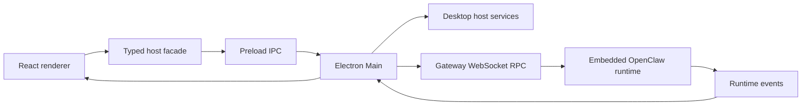

<p align="center">
  
</p>

Review Center の折りたたまれた Change Context は明示的に有効化し、4 種類の比較、ダイジェスト固定コメント、審査判断を表示します。変更適用は既存の承認・Git・Coding journal を使用し、審査承認でタスク完了やマージは行いません。[詳細](docs/modules/workspace-and-coding.md)。 Windows のソースホストでの検証範囲と機能ゲートのロールバックは[段階的有効化](docs/dev/change-context-review-loop/rollout.md)を参照してください。

`runtime.providerBudget` でホスト、プロジェクト、セッションの予算を明示的に設定できます。子の呼び出しはセッション owner の workspace を継承し、予約額と不明な費用は runtime owner が保持します。[リソースと観測](docs/modules/resources-and-observability.md)で対象範囲と精算の制約を確認してください。

# Verse Claw

プロジェクトを有効にすると、選択済みのモデルを保持しながら、ディレクトリと権限ポリシーをランタイムに同期します。

プロジェクトメニューから Git の初期化、作業ツリーの作成と切り替えを行い、各会話と下書きを引き継げます。

会話操作は下書きを保持し、管理サービスが確認した結果を表示します。アーカイブ設定から中断したアーカイブ・復元・削除を続行できます。コンテキスト変更はセッション世代を確認し、ストレージはタスクや会話が管理する作業ツリーを保護します。チェックポイントの復元は現在のセッション世代を送信し、その会話に記録された作業ディレクトリを使います。 チャットの再読み込み後は、Gateway から現在の接続準備状態とセッション操作を読み取ります。

Chat は同じ会話とタスクを、設定済みの別のチェックアウトへ移行できます。目標と成果物の参照を保持し、元の処理の完了と移行先の所有権を確認します。中断した移行は保存済みの操作から再開できます。
通常のストリーミングテキストはフレームごとにまとめて更新します。承認、キャンセル、エラー、完了は即時に反映し、返信の生成中も完了済みメッセージを安定して表示します。

長い会話はメッセージの実測高さで表示範囲を選び、DOM 上限内で読み込み済みの古い発言へ移動できます。履歴・プレビュー・投影のキャッシュは 32 MiB の共通予算を使い、削除されたキャッシュ内容は既存の履歴・メディア経路から再読込します。

互換性のあるファイル購読はネイティブ監視を共有し、フィルターと解除ハンドルは個別に保持します。知識ソースのディレクトリ再作成後は監視を再開し、複数ウィンドウは Main の新しい Git 状態を共有します。

管理対象プロセスは終了結果を確認するまで共有 executor の参照を保持します。poll は標準入力とキャンセルの処理枠を残し、出力は合計バイト上限と既存 artifact 参照で扱います。

ターミナルPTYと管理対象プロセスは宣言済みホスト容量を共有します。既知のサーバーポートを起動前に予約し、古い世代からの操作を拒否します。終了結果が不明な場合は予約を保持して復旧時に照合します。[端末リソースの所有権](harness/specs/guides/terminal-resource-ownership.md)。

リソースのポップオーバーを開くと、現在の会話のコーディネーター状態と worker の実行結果を再取得します。

会話から Git リポジトリを作成し、独立した worktree を選択して下書きを復元できます。`/storage` と **設定 → ストレージ** は、会話ファイル、プロセスメモリ、worktree の使用量を表示する同じページを開きます。[操作と所有権](docs/dev/session-worktree-storage.md)。

Runtime が管理する worktree の所有権、作成段階、マージ意図は SQLite に保存され、再起動後も復元できます。パスの置換、作成未完了、マージ結果不明の場合はリソースを保持し、古い実行資格の使用を拒否します。[登録と復元の契約](harness/specs/guides/execution-domain-registry.md)。

管理対象ツールは実行前にタスクの取得権、セッション世代、永続 checkout writer を共同確認し、既存のマージ・固定・クリーンアップ owner と資源を共有します。writer は呼び出し間も保持され、不明な結果やバックグラウンドプロセスは元の owner が照合します。[書き込み契約](harness/specs/guides/checkout-writer-ownership.md)に移譲・復旧・外部書き込みの境界を記載しています。

チャットメニューはライト／ダーク両テーマで不透明なグレーの面を使い、モデルのブランドアイコンと完全なモデル名、会話状態のリンクされたワークツリーを表示します。

会話を開くと所属ワークスペースへ切り替え、下書きを復元します。ブランチ操作は表示中の作業場所を更新します。派生会話は元の会話から展開でき、検索可能なメニューでは重複しません。[会話ナビゲーション](docs/dev/chat-worktree-session-navigation.md)。

セッションのライフサイクル表示は、元の v2 軌跡イベントから共通アセンブラーで構成します。Verifier の完了報告は、設定に従って修正タスクを lead に渡し、修正後に独立した再検証を行います。

Skill 設定はランタイム設定に保存され、管理対象のスキルは詳細からアンインストールできます。Agent Dev は通常のチャットとツールイベントを収集し、トークン使用量の重複を除きます。

会話の切り替えで読んでいたメッセージ位置と下書きを復元します。バックグラウンド処理の状態が変わっても、ポインターやキーボードで操作中の行は移動しません。未設定の担当者、権限エラー、依存待ちには理由と次の操作を表示し、派発時の計画と現在のキューを区別します。

メッセージの分岐には記録済みの会話境界を使い、利用できない場合は理由を表示します。別の会話へ続ける際は既存の編集可能な引き継ぎプレビューを開き、明示的な作成操作で実行します。

セッションの識別情報が読み込まれると引き継ぎを準備できます。サイドバーからの引き継ぎは読み込みを待ち、プレビューは現在のセッション世代に対応します。
有効化が中断された場合も、再試行では元の子セッションを再利用し、送信前に世代を確認します。

**チャット、コード、知識、Agent 実行を 1 つのデスクトップ作業空間に。**

[English](README.md) · [简体中文](README.zh-CN.md) · [日本語](README.ja-JP.md) · [Русский](README.ru-RU.md)

[モジュール詳細（中国語）](docs/modules/README.md) · [はじめに](#getting-started) · [アーキテクチャ](#architecture) · [開発](#development) · [トラブルシューティング](#troubleshooting) · [ドキュメント](#documentation)

Verse Claw は、組み込み OpenClaw Runtime 上に構築された Electron デスクトップアプリです。会話、プロジェクト workspace、コーディングツール、知識レビュー、メモリ、マルチ Agent 編成、メッセージチャネル、スケジュール、runtime 診断を 1 つのローカルデスクトップ製品にまとめます。

このリポジトリは renderer の薄いラッパーではありません。React UI、Electron Main Host、型付きプロセス間 contract、vendored OpenClaw Runtime、VerseBrowser、VerseShell 実行基盤、退役済み VToken source、実行可能な Harness 仕様、build/evidence/release pipeline を含みます。

> **現在の状態：**`0.4.9-alpha.0`、controlled preview。Windows x64 のローカル workflow が主な検証対象です。macOS/Linux には build target がありますが、platform runtime の検証は別です。component graduation や agent-driven evidence は、release、GA、liveReady、productApproved を意味しません。

## 製品を構成するモジュール

| 領域 | 現在の形 | 詳細 |
|---|---|---|
| LLM / モデル | account ベースの provider 設定、OAuth/API key/local auth、protocol adapter、fallback、turn/session model override、streaming、tool loop、reasoning effort、usage、推定 cost | [LLM とモデル（中国語）](docs/modules/llm-and-models.md) |
| 会話 / session | JSONL append-only session tree、run、abort/stop/archive/delete、checkpoint、compaction、handoff/fork、sidebar、group、long-session coordinator | [Session（中国語）](docs/modules/sessions.md) |
| Context / memory | Context Orchestrator、管理対象の注入に6,000文字の上限と編成後の追加内容の別集計、Workspace Context、health score、独立 Role/Runtime store 上の単一 Memory surface | [Context と Memory（中国語）](docs/modules/context-and-memory.md) |
| Workspace / coding | preflight、4 種類の permission mode、file preview、PTY terminal、web preview、Git、review、write journal、stale-write guard、auto verify | [Workspace と coding（中国語）](docs/modules/workspace-and-coding.md) |
| Knowledge | Markdown/wiki-first Library、Inbox → Draft → Steward → Proposal → explicit apply、Source Set、OKF、Runtime Lessons/SEKB、provenance、governance | [Knowledge（中国語）](docs/modules/knowledge-base.md) |
| Multi-agent / tasks | Agent/Persona/Role、9 組み込み role、routing、team template、resource-aware wave、subagent admission、Task Ledger、Task Loop、ClawGraph | [Multi-agent と task（中国語）](docs/modules/multi-agent-and-tasks.md) |
| タスク追跡レポート | 永続タスクのカードを展開すると、ソース、実行、操作結果、候補の検証、保存済み証拠を確認できます。調整役と実行役のモデル呼び出しは元の記録で重複排除され、カタログ価格は推定値、取得できない費用は不明として表示されます。 | [タスク追跡レポート](docs/modules/multi-agent-and-tasks.md) |
| プロジェクトとセッション | プロジェクト名から担当セッションを開き、異なる agent の明示的に関連付けられた担当者も表示します。既存グループ内で派生セッションとタスクを確認できます。タスク履歴から関連セッションとチェックポイントの成果物を開けます。分岐の質問は下書きになり、引き継ぎは作成後に送信され、再起動後も照合・復旧できます。 | [セッションとタスク（中国語）](docs/modules/multi-agent-and-tasks.md) |
| Verse components | VerseGit repository/evidence control plane、VerseShell governed execution、VerseBrowser driver、退役 VToken | [Verse tools（中国語）](docs/modules/verse-tools.md) |
| Resources / observability | ResourceFabric の操作別レイテンシ基準とメモリ/event-loop 圧力制御、バックグラウンド降載、プロセス追跡、token/cost 上限と回復 | [Resources と observability（中国語）](docs/modules/resources-and-observability.md) |
| Integrations | 15 channel types、Scheduled、Skills/MCP、Inbox、Remote Task、Code Review、VerseConf、media、Billing、Agent Dev | [Integrations（中国語）](docs/modules/integrations-and-surfaces.md) |

詳細 module document は現在 Simplified Chinese で保守されています。source path、API 名、evidence link は言語非依存です。4 つの root README が多言語入口です。

ストリーミング応答が履歴に切り替わっても、同じ質問は一枚のカードに表示されます。チャットはアシスタントのアバターを省き、本文を一列に揃えます。進捗説明と最終回答は表示したまま、実行詳細と操作不要のツールカードは初期状態で折りたたみます。実行中のツールの進捗アニメーションは保持し、エラーと承認要求は直接表示します。長いファイル変更は会話欄内で変更前後を並べ、折り返せないコードはプレビュー内で折り返します。展開後の差分だけがその領域内で横スクロールします。コマンドは最新の出力からプレビューし、コピーには保持されている全文が含まれます。完了した返信の下には本文に揃えたコンパクトな操作行を表示し、コピー、入力欄への引用、記録境界が有効な場合の分岐を提供します。時刻とトークン使用量も同じ行に配置します。リポジトリ変更ストリップはコンポーザーと同じ中央列幅を使用し、ツール呼び出しは対象と時間を示すコンパクトなステータスチップで表示されます。実行中のコマンド出力は開始順に並べ、引数と結果を分けて表示し、会話列内で折り返します。入力欄、変更レビュー、トップバーは利用可能な列幅に応じて密度を調整します。

タッチ操作では入力欄の主要ボタンに 44 px 以上のタップ領域を確保します。失敗した計画更新は実行詳細に残り、現在の計画を置き換えません。

会話状態は一つのサーフェスにまとめ、完了したプロセスは履歴に折りたたみます。プロセスの出力は会話と同じターミナル表示を使い、全文コピーと閲覧位置を維持するスクロールに対応します。ツール呼び出しと結果を一つにまとめ、診断情報は末尾に置きます。

セッション環境は実際の変更や活動が発生した後に表示されます。変更、確認された MCP・スキルの使用、サブエージェントを短いプレビューにまとめ、詳細は必要に応じて展開できます。自動展開は会話の隣に、手動表示は小さな浮動カードとして開きます。ワークスペースを閉じてもタブと選択内容は保持されます。

空のチャットでは入力欄の下にプロジェクト選択を表示し、そのメニューからローカルの作業コピーやワークツリーを選べます。読み込み済みの空のチャットでは、Gateway が切断されてもこれらのローカル操作を利用できます。開始アクションはクイックスタートから開きます。ファイルに変更があると入力欄の上にコンパクトな変更バーが現れ、ブランチと重複を除いたファイル数を表示します。「変更を確認」からレビューを開き、ブランチ検索・切り替えとワークツリー操作はメニューから利用できます。

入力欄のモデル、ナレッジ、権限メニューは、追加メニューと同じコンパクトなサーフェスとぼかしの展開アニメーションを使用します。ウィンドウ内に収まり、別のメニューを開くと閉じます。Escape と動きを減らす設定にも対応します。

入力欄からモデルを直接選択できます。新しい会話は直近の利用可能な選択を引き継ぎ、既存の会話は各自のモデルを保持します。変更は次のメッセージから適用され、Agent の既定モデルは設定で管理します。

ランタイムの承認要求は該当会話の入力欄を置き換え、コマンド、作業ディレクトリと選択肢を表示します。ページの他の部分は操作でき、承認処理が終わると元の入力欄、下書きと添付ファイルが復元されます。

質問、選択肢、計画確認と権限要求は、入力欄の位置に同じ確認パネルを表示します。ランタイム承認を最優先し、次にワークスペース権限、その他の要求を一件ずつ表示します。元の下書きと中断した質問の選択は保持され、要求の処理後に復元されます。材質、角丸と操作行は入力欄と統一されています。実行後の計画は処理詳細に残ります。アクティビティパネルはサイドバーと同じ会話行を使います。

会話には、どのツールが生成したかにかかわらず、そのターンの成果物が表示されます。音声と動画はネイティブコントロールでその場で再生でき、ファイルの欠落、サイズ超過、再生不能の場合は明示されます。画像は取得元を問わず同じビューアーで表示します。リモートの画像とメディアは自動で読み込まれず、開く操作を提供します。グラフは宣言された種類で描画され、データ表も確認できます。単独の段落のリンクはリンクカードになり、その他の構造化リソースはラベル付きの代替カードで表示されます。

## 現在の成熟度境界

| Label | 意味 |
|---|---|
| `default` / `advanced` | 宣言された controlled-preview 範囲内の製品 surface。GA ではありません。 |
| `internal` | 実装または内部 API はあるが、独立した user product entry はありません。 |
| `shadow` / `experiment` | 観測または限定的 experiment。routing、write、approval authority は持ちません。 |
| `retired` | compatibility、provenance、rollback inspection のためだけに保持。 |
| `agent-driven` | agent が生成し、そのように表示した evidence。real-human evidence ではありません。 |

現在の machine-readable component catalog は 54 行です：13 default、12 advanced、23 internal、6 retired、0 experiment。分類は runtime proof ではありません。詳細は [component disposition matrix](docs/dev/component-disposition-matrix-20261021.md)。

重要な default：

- Workspace Context と read-only DCS context tools は宣言された health / permission gate 下で有効です。
- Runtime Memory injection、SEKB automatic writeback、Browser private network は default-on ではありません。
- SEKB は原則のバージョンと実行に紐づく明示的な採用を記録し、実行結果と独立したタスク評価を分けて保存します。メモリのフィードバックは診断に使用し、検索順位や保持判断には影響しません。[RSI の証拠と境界](docs/dev/rsi-capability-and-boundaries.md) を参照してください。
- 制御された RSI prompt 研究では親バージョン、学習証拠の帰属、固定した検証の判断を記録します。候補は独立して封印した評価計画に紐づけます。
- VToken は retired。旧 env/config では production assembly / sidecar を再有効化できません。
- VerseGit と VerseShell は既定で無効です。ホスト統合は以下の責務と権限の境界を維持します。
- Dreams は retired。Image Generation は developer/test gate で、通常の製品 navigation ではありません。
- `liveReady=false`、`productApproved=false`、`defaultOn=false` は product lock として維持されます。

<!-- VERSE-TOOLS-BOUNDARY-START -->
**VerseGit の境界付きコーディングループ：**既定で無効、一般提供は未承認です。win32-x64 M1 provider はリポジトリの事実を提供し、候補の検証は VerseShell で実行します。write journal と Git apply はホストが管理します。M4 landing/admission は未承認で、`liveReady=false` と `productApproved=false` を維持します。VerseShell も既定で無効です。VerseBrowser は利用可能かつ所有セッションに紐づく runtime action のみ受け付け、モデルの引数でホストの承認を代替できません。リクエスト単位の private-network 検査はリダイレクトとサブリソースも対象です。[Verse の境界](docs/modules/verse-tools.md)を参照してください。
<!-- VERSE-TOOLS-BOUNDARY-END -->

Default や release claim を変更する前に、[default configuration](docs/dev/default-config-matrix.md)、[product semantics](docs/clawx-product-semantics.md)、[capability claims](shared/capability-claims.ts) を確認してください。

## アプリ画面

画像は 2026-10-05 の Windows Electron source build で取得されました。現在の header は後続の B2 identity を使用します。Knowledge 画像では `memory-wiki` を明示的に有効化し、model account / model request は使用していません。

| **Chat / task entry**<br>[](resources/readme/2026-10-05/en/chat.png) | **Knowledge library / review**<br>[](resources/readme/2026-10-05/en/knowledge.png) |
| --- | --- |
| **Task Ledger**<br>[](resources/readme/2026-10-05/en/tasks.png) | **Models / provider settings**<br>[](resources/readme/2026-10-05/en/settings.png) |

Capture condition と hash は [visual provenance](resources/readme/2026-10-05/README.md) を参照してください。

<a id="getting-started"></a>

## はじめに

前提：

- **Node.js 24.16.0 以降（24.x）**と Git。古い Windows Node 24 では TCP crash が発生する可能性があります。
- `package.json` で固定された **pnpm 11.2.2**。
- dependency、Electron、uv、agent-browser の download network access。
- Online provider account または互換 local model service。

Repository root で実行：

```sh
git clone https://github.com/Baixu22/VerseClaw.git
cd VerseClaw
corepack enable
corepack prepare pnpm@11.2.2 --activate
pnpm run init
pnpm --dir openclaw_runtime install --frozen-lockfile --ignore-scripts
node node_modules/electron/install.js
pnpm dev
```

`pnpm dev` は VerseBrowser、embedded runtime、bundled skills を build してから Vite と Electron を起動します。Gateway の ready には通常 10–30 秒必要です。Vite page だけでは完全な Electron Host services は得られません。

Gateway の起動時に読み込まれた設定更新は、起動成功時に処理済みになります。その後の設定変更と明示的な再起動要求は、進行中の起動または再起動が完了してから実行されます。明示的な停止は、クールダウン待機や起動失敗時の復旧を含む未完了の再起動を取り消します。

ソースからの起動では、通常ウィンドウとテストウィンドウの両方で共通の Runtime 起動処理によりセッションサービスを初期化します。

ビルド済み Gateway は解決済みの JavaScript Doctor 契約をネイティブで読み込み、SDK エイリアスの準備を減らします。マウントしたソースと外部プラグインはそれぞれの契約を使い、移行チェックも継続します。`pnpm run build:runtime` の後に `node scripts/measure-gateway-startup.mjs` を実行すると、隔離したループバック環境と空のキャッシュで比較できます。有効な各サンプルは対象ローダーの呼び出しと認証済み RPC の完了を確認します。

最初の session：

1. Setup を完了する。
2. Provider/model を設定し、接続を検証する。
3. Project directory、permission mode、workspace を選択する。
4. Scoped task を送り、Workspace Panel を確認する。
5. Inbox で approval を処理する。
6. Knowledge / Memory の永続変更は review surface 経由で行う。
7. 会話は行から管理します。ホバーで「ピン留め」と「⋯」（名前変更、ワークストリームへ移動、未読にする、分岐、引き継ぎ、コピー、元に戻せるアーカイブ、削除）が表示され、右クリックでも同じメニューが開きます。長いタイトルはホバー中にスクロール表示されます。
   派生会話は浅いインデントとガイドで示し、展開時も折りたたみ時も件数を表示します。コンパクトなヘッダーの会話名から検索・切り替え・元の会話への移動ができ、チェックポイント・分岐・引き継ぎ・更新・復旧・移行・メモリ診断は「その他」にまとまります。新しい会話を作る前に現在の下書きを保存し、作成が拒否された場合は元の会話と下書きを保持します。ダークモードはサイドバー、本文、入力欄を異なるグレーで区別します。空のタスク範囲もヘッダーから開けます。Settings → Session & Recovery で静かな表示を設定できます。
8. 会話の実行中や対応待ちには、サイドバーのベルにも会話行と同じ実行アニメーションを表示します。完了やエラーなどの終了状態には共通の静的な意味アイコンを使います。実行中の会話がない場合、ベルは最新の未読結果を示し、既読後はベルに戻ります。バッジは未読数を示します。パネルには実行中の会話と経過時間、完了・エラー・承認待ちのイベントが並びます。通知はベルメニューまたは Settings → Session & Recovery で切り替えられます。サイドバーを折りたたんでも Settings は下部に固定されます。

Release に存在する package だけが download target です。Build target の存在は current version の package を保証しません。

| Platform | Configured artifact | Validation scope |
|---|---|---|
| Windows x64 | NSIS | 主な controlled local acceptance target |
| macOS x64 / arm64 | DMG、ZIP | Build target。capability ごとの platform validation が必要 |
| Linux x64 / arm64 | AppImage、DEB、x64 RPM | Build target。GUI runtime が必要 |

<a id="architecture"></a>

## アーキテクチャ

通常の request path：

```text
React renderer
  -> typed host facade (src/lib/host-api.ts)
  -> preload IPC
  -> Electron Main（authorization + dispatch）
  -> Host service および/または Main-owned Gateway WebSocket RPC
  -> embedded OpenClaw runtime
```

Runtime event は Main と `host-events.ts` を通って renderer store に戻ります。File、terminal、Git などの local service は Gateway を通らず Main で完了できます。

これは universal な `WS -> HTTP -> IPC fallback` ではありません。Renderer page は Gateway に直接接続せず、Host API を迂回する Electron IPC も追加しません。`shared/host-api/contract.ts` が typed shared boundary です。



Main layers：

- `src/`：renderer、page、component、Zustand store、Host facade、i18n、style。
- `electron/`：Main service、IPC security、Gateway supervision、preload、desktop utility。
- `shared/`：Host API/event、domain type、4 言語 resource、authority/default manifest。
- `openclaw_runtime/`：vendored runtime、Gateway、agent、tool、channel、package、extension。
- `packages/` / `resources/`：VerseBrowser、VToken、VerseShell、skill、plugin、native asset。
- `harness/`、`tests/`、`scripts/`：executable rule、test、automation、evidence tooling。

詳細：[architecture guide](docs/architecture-overview.md)、[repository layout](docs/dev/repository-layout.md)。

## ローカルデータとプライバシー

別個の database server は不要です。

- Desktop setting / export は Electron `userData`。
- Runtime config は通常 `~/.openclaw`。`OPENCLAW_CONFIG_DIR` をサポート。
- Session は JSONL transcript、runtime state は SQLite も使用。
- Token history は structured session usage record から集計。Cost は推定値。
- Knowledge は `memory-wiki` vault と local governance metadata を使用。
- 監視フォルダーは追加・変更・削除を版付きの審査候補へ同期し、停止中の変更も再走査します。
- Librarian は許可済みの証拠と制限された会話履歴を設定済み Gateway モデルへ渡し、原文引用と版を検証します。部分読み取り、矛盾、モデル失敗を明示し、Studio はレビュー用の抜粋草稿を保存します。
- 中国語検索、長文の制限付き続読、provider 別 embedding キャッシュ、版に紐付く Steward 所見を実装しています。任意の公開 GitHub ディレクトリ接続は更新と撤回を Inbox へ送ります。他の SaaS 接続は未実装です。
- Log、trace、screenshot、Task Forest、handoff は明示的に curated されない限り local working data。

Local storage は offline execution を意味しません。Online model、channel、browser、external tool は設定に従って data を受け取ります。Credential や private transcript を commit / public issue に含めないでください。

VerseBrowser: インストール・開発・ビルド時に組み込みモジュールを自動コンパイルします。81 メソッドの契約は Electron の 81 機能の実装を意味しません。[呼び出し方法とドライバー制限](packages/README.md#versebrowser-integration-and-invocation)を参照してください。プライベートネットワークへの移動は Main がセッションと origin に結び付けて承認します。agent による検証も Main で承認を実行し、呼び出し側の承認マーカーではアクセス権を付与しません。 ナビゲーションの失敗時は待機状態を解放し、次の移動を独立して実行します。 ブラウザーのリソースは元のウィンドウの終了確認後に解放します。

<a id="development"></a>

## 開発と検証

| Command | Purpose |
|---|---|
| `pnpm dev` | Resource/runtime を準備し Electron 開発起動 |
| `pnpm run build:vite` | Renderer / Electron bundle build |
| `pnpm run build:runtime` | Embedded runtime build + Gateway startup smoke |
| `pnpm run typecheck` | node/web/test full typecheck |
| `pnpm run lint:check` | Lint のみ。file は変更しない |
| `pnpm test` | Root test group と selected regression |
| `pnpm run test:e2e` | Build + Electron Playwright |
| `pnpm contract:check` / `pnpm i18n:lint` | Host contract / 4 言語 coverage |
| `pnpm run harness:ci` | Repository Harness baseline |
| `pnpm run repo:artifacts:check` | Source / evidence / archive boundary |
| `pnpm run docs:policy:validate` | Documentation policy validation |

Task spec：

```bash
pnpm harness context --spec <task-spec>
pnpm harness validate --spec <task-spec>
pnpm harness run --spec <task-spec> --dry-run
```

UI change では Electron E2E と en/zh/ja/ru の string を追加します。Communication path の変更では `pnpm run comms:replay` と `pnpm run comms:compare` も必要です。Build success、install success、release authorization は別の事実です。

[個人 Agent QA シナリオ集](openclaw_runtime/qa/README.md)は、スクリプト provider で十項目の Gateway シナリオを実行し、最終状態を決定的に検証します。ソース実行環境の証拠は制御フロー、拒否、復旧を対象とし、実モデル品質とパッケージ動作には個別の検証ゲートがあります。

[Responses 検証契約](harness/specs/tasks/product-acceptance-space-bunny.md)は、ローカルサービスの推論後の本文、一度のツール往復、会話分離、中断と provider 障害を対象にします。中断した Responses stream は正常完了にも、不完全な引数でのツール実行にもなりません。この検証はモデルやリリースの承認ではありません。

[主要製品機能の検証マトリクス](harness/specs/tasks/product-acceptance-matrix.md)は、九つのユーザーフローを固定したテストソースに対応付け、各バッチの実行結果と残りの検証項目を記録します。逐次バッチは `--build-proof` で同じ検証済みビルドを再利用でき、実行時間の上限は各テストに宣言されたタイムアウトから算出します。

完全な gate map は [development and validation](docs/modules/development-and-validation.md) を参照してください。

<a id="troubleshooting"></a>

## トラブルシューティング

| Symptom | Check |
|---|---|
| Knowledge が `unknown method: wiki.status` | Knowledge の設定でプラグインの読み込みと `memory-wiki` を有効にして、vault を初期化します。既存のプラグインポリシーが有効化を妨げる場合は、設定操作が理由を返します。 |
| pnpm version / install failure | Node.js 24.x、固定 pnpm、2 つの dependency workspace、lockfile を確認。 |
| Electron executable がない | `node node_modules/electron/install.js` と download connectivity を確認。 |
| Gateway が unavailable | Settings → System & Runtime と log を確認。Doctor の後で Doctor Fix。 |
| Provider / channel unavailable | Auth、model、plugin enablement、account、proxy、real request/delivery evidence を確認。 |
| Tool write / command が blocked | Workspace root、permission mode、path boundary、Inbox approval を確認。 |
| E2E が stale runtime | `pnpm run build:runtime`。App source も変更した場合は再 build。 |
| Headless Linux Electron failure | Display server を用意。例：`xvfb-run -a pnpm run test:e2e`。 |
| VerseConf PPTX export failure | Plugin と 3-record template limit を確認。長い outline は Markdown。 |

<a id="documentation"></a>

## ドキュメント

| Topic | Entry |
|---|---|
| Module-by-module implementation | [Module deep dives（中国語）](docs/modules/README.md) |
| Architecture / data flow | [Architecture guide](docs/architecture-overview.md) · [Runtime control planes](docs/dev/runtime-control-planes.md) |
| Product boundary / default | [Product semantics](docs/clawx-product-semantics.md) · [Default configuration](docs/dev/default-config-matrix.md) · [Component matrix](docs/dev/component-disposition-matrix-20261021.md) |
| Knowledge / context | [Knowledge system](docs/enhancements/knowledge-persistence/README.md) · [Context Runtime Kit](docs/context-runtime-kit/README.md) · [Context orchestrator](docs/dev/context-orchestrator.md) · [Memory control plane](docs/dev/memory-control-plane.md) |
| Agent / task | [Role-first design](docs/role-first-design.md) · [Multi-agent orchestration](docs/multi-agent-orchestration/README.md) |
| VerseGit / VerseShell / VerseBrowser | [VerseGit](docs/dev/versegit-validation-layer/README.md) · [VerseShell](docs/dev/verseshell-foundation/STATUS.md) · [VerseBrowser](packages/README.md) |
| Development / evidence | [Development docs](docs/README.md) · [Agent Dev](docs/agent-dev-control-plane.md) · [Repository layout](docs/dev/repository-layout.md) · [Harness](harness/specs/) |

Historical plan と acceptance snapshot には固有の日付と candidate があります。現在の動作は source、default manifest、fresh evidence から判断してください。

## コントリビューションとライセンス

変更範囲を明確にし、関連 validation を提供してください。Behavior change では 4 root README と `docs/modules/` の該当 module を同期します。Interface、default、security boundary、user entry の変更では product semantics、default matrix、Harness spec も確認します。

Verse Claw は [OpenClaw](https://github.com/openclaw/openclaw) と ValueCell team の ClawX を基盤にしています。Repository は [MIT License](LICENSE) を使用します。Bundled component は各自の license/source obligation を保持します。詳細は [VerseShell notices](resources/verseshell/SOURCE.md)。一部 conversation/workspace interaction（web search source card を含む）は Swami Malode の [Rare UI](https://rareui.com) を基にし、attribution は `src/components/rareui` に保持されています。

### 永続タスクの実行

子エージェントの詳細は、表示中のセッションに対応するタスクの受け入れ状態を担当 owner から読み取ります。タスク owner が検証済みの証拠を承認した後、更新して承認結果を確認できます。検証記録とタスク owner の承認を個別に表示し、台帳の worker リンクから対応する transcript パネルを開けます。

Task Ledger → 永続タスクは、会話履歴とは独立して目標・制約・受け入れ条件を保存します。同一リポジトリのローカル Git ワークツリーは担当情報を共有します。管理対象ツールの実行前に担当を確認し、モデル要求の前に目標を復元します。ファイル内容の完全一致、または入力ファイルを指定したコマンドで検証できます。コマンドには既存のツール権限が適用されます。[設計文書](docs/dev/durable-task-system/PLAN.md)を参照してください。

プロジェクト担当のセッションで計画を依頼できます。タスクパネルには保存済みのタスク、計画の版、次の作業、暫定の前提、未決事項が表示されます。計画を改訂しても、以前のタスクと受け入れ記録は残ります。
次の作業を依頼すると、担当者は前提タスクの検収が済んだ最初の子タスクを計画順に引き受けます。同じプロジェクトで別の計画タスクが実行中または検収待ちの場合は、その完了を待ちます。
計画のタスクメニューから「次の計画タスクを割り当てる」を選ぶと、ワーカーが1件のタスクを開始します。プロジェクトのトークンまたは費用の予算を設定してください。ロールとモデルは現在の設定に従います。
ワーカーの完了後、開始したコーディネーターが自動的に結果を受け取ります。再試行では元のセッション世代を保持します。世代交代や引き継ぎ後の古い通知はモデル呼び出し前に拒否され、後任は保存済みのタスクチェックポイントから続行します。
Gateway の再起動後、以前のプロセスが終了し、タスクの実行権が有効で処理結果の未確認項目がなければ、コーディネーターは保存済みのチェックポイントから中断した実行を再開します。
新規の割り当てを一時停止しても、進行中の実行は継続し、タスクのキャンセルや処理結果の確認はできます。実行を停止してもタスクとチェックポイントは保持されます。
割り当て済みのタスクをキャンセルするとワーカーが停止し、遅れて届く結果で担当者が再開することはありません。ワーカーが失敗し、処理結果がすべて確定すると、未検収のチェックポイントを残して実行権を解放します。担当者は予算内で独立した着手可能なタスクを続行できます。

管理対象のワークツリーを回収する前に、過去の成果物を検証済み Git 参照で保持し、元のタスク履歴に保持記録を追加します。チェックアウトを削除した後も、agent は検証結果を追跡して成果物を読み取れます。実行中のタスク、未確定の効果、対応するスナップショットがない成果物がある場合はワークツリーを保持します。

無視されたファイル、Git インデックスのフラグで隠れた編集、保持先の検証済みコピーがない in-process ファイルと権限は回収時に保持します。Git とストレージの削除入口は同じインデックス検査を使います。未削除と確認できた変更ファイルの拒否は再試行でき、削除結果が不明な場合は実行予約を保持します。

Git とストレージからの削除は、最終の所有確認とネイティブ削除をタスクの作成・取得と同じ実行ドメインロックで直列化し、削除中のチェックアウトに新しいタスクが割り当てられることを防ぎます。

暗黙の main agent のモデルや名前を変更してもワークスペースの継承を維持し、その後のプロジェクト切り替えを実行先に反映します。明示された agent のワークスペース設定は保持します。

一覧は検索、状態フィルター、追加ページの読み込みに対応します。Agent は関連タスクを提案し、親の目標と制約を保ったまま依存関係のある子タスクへ分解できます。計画の取消は実行中の処理の確定を待ちます。受け入れと復旧は既存の runtime owner の記録を確認します。

タスクは agent が管理します。実行中のタスクは入力欄の上に固定表示され、タイトル、コピーできる短いタスク ID、現在のステップ、実際の進捗を示し、完了すると 1 行の記録に折りたたまれます。メニューからタスク台帳で開く、ステップを展開する、非表示にする操作ができ、いずれもタスク自体は変更しません。セッションのタスク範囲は会話上の帯ではなく、ヘッダーの控えめなチップになりました。セッション状態パネルは、コンテキスト使用量、使用中のコネクタ、変更とレビュー操作、バックグラウンドのワーカーとコマンドを並べた簡潔なキーと値の一覧です。ファイル変更時のみ入力欄の下に小さな入口を表示し、ブランチとワークツリーは詳細から操作できます。

復旧の実装と証拠：任意の execution writer は TaskFlow にツールの実行フェーズを保存し、副作用の前に CAS で実行権を取得します。owner が許可した処理のみ再開します。lifecycle と execution の両 writer で `taskflow` を明示する必要があり、既定値は `legacy` のままです。不明な副作用は照合が必要です。追加修正では保留応答のrun所有関係と起動時の復旧順序を修正しました。[検証状況](docs/dev/recovery-contract/FOLLOWUP-20261106.zh-CN.md)を参照してください。[2026-11-05の評価](docs/dev/recovery-contract/FINAL-20261105.zh-CN.md)では60件のlive回答と30件の主障害試行を保存しています。候補の状態分類は改善しましたが、固定レイテンシ基準はFAIL/NO-GOです。

サブエージェントの復旧は、`OPENCLAW_RECOVERY_AUTHORITY_MODE=authority` と両 writer の `taskflow` 設定で、RPC の前に判断と試行予算を保存します。不明な結果は照合状態として保持します。復旧ツールのイベントも同じ実行の購読処理に渡され、送信記録と完了状態を更新します。[復旧の準入ガイド](docs/dev/recovery-contract/GA-READINESS-20261106.md)を参照してください。

管理対象ワークツリーの統合は、既存の Coding ジャーナルで削除、名前変更、バイナリ内容を保持します。永続レシートで重複完了と再起動を照合し、統合先の内容が変わった場合は上書きを拒否します。 未申告のローカルファイルやGitで無視されたファイルは、クリーンアップ時にも保持されます。実行権限の変更は統合前に拒否されます。

独立レビューを必要とするタスクでは、提出した候補を読み取り専用のレビュー担当が確認します。許可されたタスクは一度修正でき、チェックと新しいレビューを経て検収されます。レビューは提出したファイルに紐づき、修正回数は再起動や引き継ぎ後も保持されます。

サイドバーの「システム概要」では、各プロジェクトの計画、次の作業、担当者、検証の参照を個別に確認できます。プロジェクト名から担当セッションを開けます。更新に失敗した場合は確認日時付きの前回の状態を保持し、帰属を確認できないリソース使用量と費用は不明と表示します。

プロジェクトの継続コンテキストは紐付いたタスクの承認済み情報を読み、送信前に担当者の識別情報を再確認します。引き継ぎ後も目標、制約、判断待ち事項、進捗、成果物参照を保持します。ファイルの欠落や変更を明示し、重要な情報が予算を超える場合は理由を示して送信を停止します。

システム概要から、アクティブな作業場所を切り替えずに、紐付いたプロジェクトの次のタスクを割り当てられます。権限と予算は対象プロジェクトに従います。全体の一時停止は新しい割り当てと管理下の操作を止め、受付済みの操作は完了できます。個別プロジェクトの再開では全体の停止を解除できません。

プロジェクト専用 Agent の設定を型付き変更としてプレビューできます。料金が確認済みで費用が増えない既存モデル、ツール制限の追加、コンテキスト上限の削減を扱います。適用後に Runtime 世代と読み込み済み値を確認し、失敗時は変更対象のフィールドだけを戻します。再起動後もプロジェクトカードから未確定の操作を復旧できます。

Mission の経験は元のセッション、出典参照、24時間の有効期限に結び付いた審査候補になります。承認後は Mission Control とメインチャットが元のセッション内で利用できます。コールド保存でも24時間の期限が適用され、撤回・置換・期限切れ後は再利用しません。モデルへの実際の挿入は共有コンテキスト予算にも従います。パネルは現在のセッションのライフサイクルイベントを反映します。応答待ちでも実行中の Mission を一時停止またはキャンセルでき、遅れた実行応答が届いた場合も確定した制御状態を保持します。 Runtime は一時停止、キャンセル、再開の確定後に古い tick の続行を終了し、実行の証拠を保持します。デフォルト Agent またはセッションが変わると Mission 表示をリセットし、遅延応答は元のセッションに紐付けます。 ロール一覧はパネルを開いたときに読み込み、空の一覧は再表示または手動更新まで待機します。
