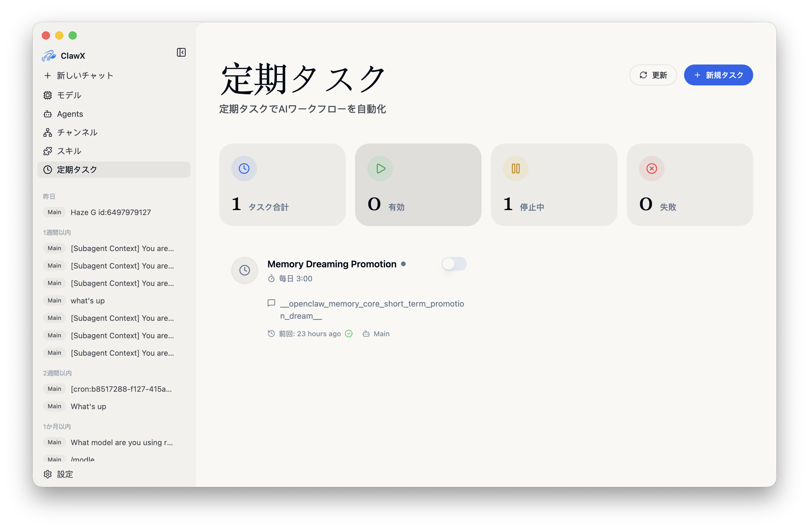
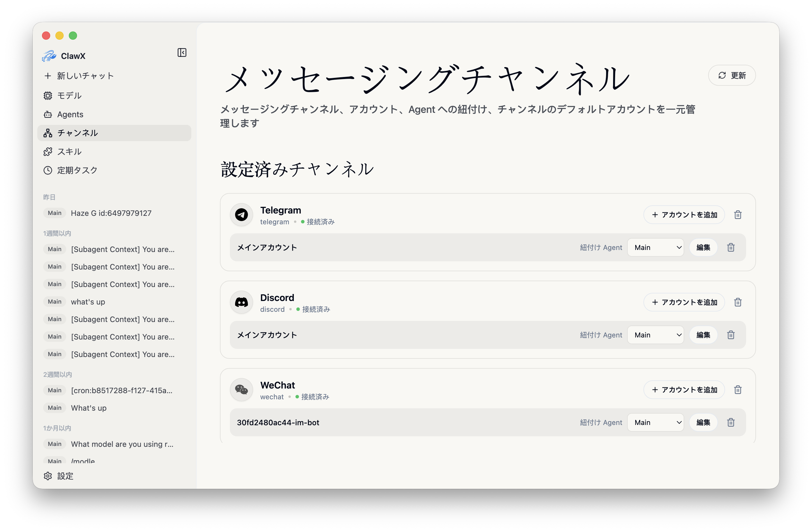
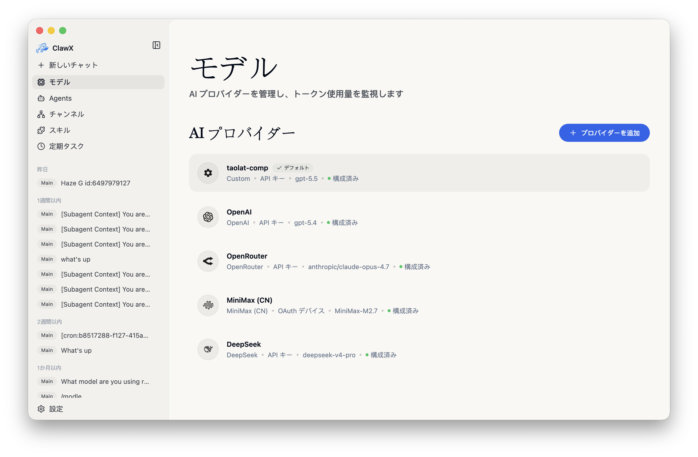

<p align="center">
  
</p>

<h1 align="center">Verse Claw</h1>

<p align="center">
  <strong>OpenClaw AIエージェントのためのデスクトップインターフェース</strong>
</p>

<p align="center">
  <a href="#機能">機能</a> •
  <a href="#なぜclawxなのか">なぜVerse Clawなのか</a> •
  <a href="#はじめに">はじめに</a> •
  <a href="#アーキテクチャ">アーキテクチャ</a> •
  <a href="#開発">開発</a> •
  <a href="#コントリビューション">コントリビューション</a>
</p>

<p align="center">
  
  
  
  <a href="https://discord.com/invite/84Kex3GGAh" target="_blank">
  
  </a>
  
  
</p>

<p align="center">
  <a href="README.md">English</a> | <a href="README.zh-CN.md">简体中文</a> | 日本語 | <a href="README.ru-RU.md">Русский</a>
</p>

---

## Capability Claim Boundary

Product capability statements must be checked against the canonical matrix in `shared/capability-claims.ts` and the generated status table in `artifacts/capability-claims/status-table.json` before being described as implemented, productized, stable, or end-to-end verified. The local gate `node scripts/check-capability-claims.mjs <files>` warns when high-confidence claims lack matrix, E2E, or real-runtime evidence.

## 概要

**Verse Claw**は、強力なAIエージェントと日常のユーザーとの間のギャップを埋めます。[OpenClaw](https://github.com/OpenClaw)をベースに構築されており、コマンドラインによるAIオーケストレーションを、アクセスしやすく美しいデスクトップ体験に変換します。ターミナルは不要です。

ワークフローの自動化、AI搭載チャネルの管理、インテリジェントなタスクのスケジューリングなど、Verse ClawはAIエージェントを効果的に活用するために必要なインターフェースを提供します。

制御された自律実行が必要な複雑な作業向けに、Agents オーケストレーションパネルには有界な **タスクループ** があります。ロール別サブ Agent を編成し、証拠を自己チェックし、範囲を絞った修復を行い、ライブ状態を表示し、信頼度や権限が不足する場合は `blocked` として安定的に停止します。

同じ Agents -> Roles & Orchestration 画面には、ClawGraph YAML を書かずに一般的なワークフローを始められる **Lightweight Subagent Runner** もあります。Explorer、Reviewer、Tester、Compare 3 approaches から選び、目標を入力すると、既存の Gateway 権限経路で明示的なロール worker を起動し、Verse Claw がライブ worker 状態、要約、失敗理由、Observability trace リンクを表示します。
role-first のオーケストレーション実行では、読み取り専用の統合結果も表示し、検証判断、証拠数、trace 数、可視化された失敗理由をそのまま確認できます。

長い会話、チェックポイント、証拠レビュー、明示的な scheduled tick をまたいで継続する目標向けに、Agents パネルには **Mission Control** もあります。`mission.run` で Mission を開始または再開し、Mission 状態を永続化し、ResumeCheckpoint、Task Ledger、メモリ、trace 証拠から有界なコンテキストを再構築し、各 tick で内部 `task_loop` を実行してから、reviewer が続行、修復、休眠、ユーザー確認、完了、またはブロックを判断します。
Mission と Task loop は内部の Engineering Control Signals（`evidence_gap`、`validation_missing`、`scope_drift`、`unverified_claim`、`replan_required` など）も運びます。これらは checkpoint、lifecycle event、Task Ledger metadata に残り、trace だけ、または内部 loop の complete だけを長期目標の完了事実として扱わないためのガードになります。

多くの worker ターンにまたがる長期タスクを安定して分解するために、**ClawGraph Runtime** は workspace YAML ワークフロー、DAG 実行、ステートレスなロール worker handoff、監査チェック、ユーザーレビューを提供し、ワークフロー全体を 1 つの肥大化した chat transcript に詰め込まないようにします。

Verse Clawはベストプラクティスのモデルプロバイダーが事前設定されており、Windowsおよび多言語設定をネイティブにサポートしています。もちろん、**設定 → 開発者 → 開発者モード**から高度な設定を微調整することもできます。

<p align="center"><strong style="font-size:1.1em; text-decoration: underline;">完全なエンタープライズ版、専用のサービスサポート、または御社のビジネスシナリオに合わせた導入支援が必要な場合は、<a href="mailto:public@valuecell.ai">public@valuecell.ai</a> までお問い合わせください。</strong></p>

---
## スクリーンショット

<p align="center">
  
</p>

<p align="center">
  
</p>

<p align="center">
  
</p>

<p align="center">
  
</p>

<p align="center">
  
</p>

<p align="center">
  
</p>

---

## なぜVerse Clawなのか

AIエージェントの構築にコマンドラインの習得は不要であるべきです。Verse Clawはシンプルな哲学のもとに設計されました：**強力な技術には、あなたの時間を尊重するインターフェースがふさわしい。**

| 課題 | Verse Clawのソリューション |
|------|----------------------|
| 複雑なCLIセットアップ | ワンクリックインストールとガイド付きセットアップウィザード |
| 設定ファイル | リアルタイムバリデーション付きのビジュアル設定 |
| プロセス管理 | ゲートウェイライフサイクルの自動管理 |
| アプリ更新 | 組み込みの更新確認や上流更新通知はありません |
| 複数のAIプロバイダー | 統合プロバイダー設定パネル |
| スキル/プラグインのインストール | 組み込みのスキルマーケットプレイスと管理機能 |

### OpenClaw内蔵

Verse Clawは公式の**OpenClaw**コアを直接ベースに構築されています。別途インストールを必要とせず、アプリケーション内にランタイムを組み込むことで、シームレスな「バッテリー同梱」体験を提供します。開発ビルドでは編集可能な `openclaw_runtime` ツリーを既定で優先し、公開 npm パッケージへ戻したい場合は `VERSE_CLAW_OPENCLAW_RUNTIME=npm` を指定できます。

私たちはアップストリームのOpenClawプロジェクトとの厳密な整合性を維持することにコミットしており、公式リリースが提供する最新の機能、安定性の改善、エコシステムの互換性に常にアクセスできることを保証します。

開発者モードを有効にすると、サイドバーにはネイティブの Dreams ページも表示され、Verse Claw 内で OpenClaw の記憶レビュー、夢日記、基本メンテナンス操作を扱えます。詳細な診断が必要な場合は、そのページから完全版の OpenClaw Dreams UI も開けます。

---

## 機能

### 🎯 ゼロ設定バリア
インストールから最初のAIインタラクションまで、すべてのセットアップを直感的なグラフィカルインターフェースで完了できます。ターミナルコマンド不要、YAMLファイル不要、環境変数の探索も不要です。

### 💬 インテリジェントチャットインターフェース
モダンなチャット体験を通じてAIエージェントとコミュニケーションできます。複数の会話コンテキスト、メッセージ履歴、Markdownによるリッチコンテンツレンダリング（GitHub 風テーブルや KaTeX による LaTeX 数式 `$インライン$`、`$$ブロック$$`、`\(インライン\)`、`\[ブロック\]` を含む）、計画・選択肢リスト・質問フロー・設定向けの構造化 Tool UI カードに加え、マルチエージェント構成ではメイン入力欄の `@agent` から対象エージェントへ直接ルーティングできます。
推論強度はランタイムポリシーとしても使われます。minimal/low は prompt、Skill、tool result の注入密度を下げて低コストで簡潔なターンにし、high/xhigh は明示的な `/loop`、ClawGraph、role/subagent、multi-model workflow を提案できますが、権限やツール authority は変更しません。
左サイドバーには Workgroups ビューがあり、workspace 単位のタスクグループで会話を整理し、実行中・待機中・要対応などの集約状態を表示し、未分類の会話も残したまま、新しい workspace スコープの会話に現在のワークグループを継承させます。
設定 → 作業モード では Plan、Build、Review、Docs/Data の作業モードを管理できます。モードは workspace session ごとに保存され、レポート、表計算、スライド、PDF、調査、Webサイト、デザイン、日常業務向けの成果物中心の Work Kits を設定できます。Kit 状態はローカル skill の準備状況、Main 所有の軽量 Office/Search Work Provider 状態、内蔵 Office skill の明示的なインストール操作を表示します。Work Provider は内蔵ライブラリ、任意パッケージ、外部サービス、Custom HTTP、外部バイナリ、runtime skill、MCP server、OpenClaw plugin を同じ source model で扱えます。Search はユーザーが provider を明示設定するまで `missingConfig` のままで、重い変換、crawler、OCR、dataframe runtime は任意のインターフェースとして扱います。次のメッセージには軽量な未信頼の意図 metadata だけが添付されます。workspace permission を自動変更したり、OpenClaw runtime のツールポリシーを上書きしたりはしません。
OfficeCLI も 設定 -> スキル -> 機能プラグイン から管理できます。Verse Claw はバイナリを検出し、インストールログをストリーミングし、Codeg 互換の `/officecli-*` スキルを同期し、`officecli watch` で `.docx`、`.xlsx`、`.pptx` をライブプレビューします。
コンポーザーから挿入した Skill は `/skill-name` 形式のチップとして表示され、チップをクリックすると右側のプレビュー側欄でその Skill の `SKILL.md` を開けます。
コンポーザーで `/` を入力すると、Context Palette が開き、Wiki 検索、読み取り専用ナレッジ範囲の変更、レビュー、CI 修復、テスト作成、diff 説明、Task Ledger、Mission Control、圧縮、セッション fork のクイックアクションを使えます。いずれも既存の Chat / Session フローを使います。
`@agent` で別のエージェントを選ぶと、Verse Claw はデフォルトエージェントを経由せず、そのエージェント自身の会話コンテキストへ直接切り替えます。各エージェントのワークスペースは既定で分離されていますが、より強い実行時分離は OpenClaw の sandbox 設定に依存します。
Verse Claw は既定で軽量な `policy-light` サンドボックス層を使い、Main プロセスの権限ゲート、ワークスペースルート検査、Gateway RPC 承認、OpenClaw exec approval を組み合わせて制御します。Docker と SSH は明示的に選択する `strong` provider として残り、起動要件ではありません。
Settings、Doctor、diagnostics は同じ effective sandbox policy を表示し、要求/有効 provider、runtime level、exec/network policy、Docker の利用可否、縮退理由を確認できます。
Settings → System & Runtime には Project Rules Center もあり、現在の workspace の `AGENTS.md` を確認し、`.clawx/rules/*.md` を一覧表示し、決定的な検証 warning を示し、欠落時には新しいルール真実源を作らずに保守的な `AGENTS.md` テンプレートを作成できます。
各 Agent は `provider/model` の実行時設定を個別に上書きできます。上書きしていない Agent は引き続きグローバルの既定モデルを継承します。
コンポーザーのコンテキスト状態には、確認付きの「現在のセッションを圧縮」操作が追加され、トークン圧力、非表示メッセージ数、前回の圧縮時刻、圧縮品質を確認できます。長期タスク状態は巨大な transcript に依存せず、Task Ledger / Context Pack に保持します。圧縮は高密度 recovery artifact も保存し、Handoff は transcript 証拠へ戻る前にそれを優先して使います。Runtime はまず手動または明示 opt-in の圧縮で段階的な tiered compression plan を使い、自動圧縮は品質ゲートで安定が確認されるまで telemetry を記録するだけです。
コンポーザーは長い会話の checkpoint 回復状態も表示します。キュー済みフォローアップ、最新の介入/checkpoint、回復警告、そしてセッションがアイドルのときに永続化されたキューを今送信する操作を確認でき、これらのキューは Gateway 再起動後も復元できます。
Chat のロールバック計画はレビュー優先の復旧パネルとして、安全/確認/危険の件数、チェックポイント、キュー、コンテキスト、ターミナル、Git、Task Ledger、メモリ信号を表示します。破壊的操作は承認付きツールへ誘導し、メモリ事実は Knowledge draft または proposal にします。

Agents オーケストレーションパネルには、制御された自律作業向けの有界な **タスクループ** 操作もあります。既存の Gateway RPC 経路で `task_loop.run` を開始し、ロール別サブ Agent の編成、自己チェック、範囲を絞った修復ラウンドを実行し、画面にはリアルタイムのフェーズ、反復回数、reviewer 判定、最終状態、trace 証拠を表示します。renderer から Gateway への直接接続は追加しません。

同じパネルには、ClawGraph YAML を不要にするプリセット型の並列フローとして **Lightweight Subagent Runner** もあります。Explorer は planner と architect worker で解決案を探し、Reviewer は現在の staged / unstaged Git diff をレビューし、Tester は tester と reviewer にテスト不足を確認させ、Compare 3 approaches はラベル付きの architect worker を 3 つ起動します。Runner はコードを自動マージせず、完了した実行を Observability trace にリンクします。
直接ロールオーケストレーション結果にもこの bounded な統合ビューが含まれ、検証失敗や証拠が要約の裏に隠れません。

同じパネルには、より長い目標向けの **Mission Control** もあります。`mission.run` で Mission を開始または再開し、Mission 状態を OpenClaw state DB に保存し、ResumeCheckpoint、Task Ledger、メモリ、trace 証拠から有界なコンテキストを再構築します。各 tick で内部 `task_loop` を実行し、Mission reviewer が反映、checkpoint 書き込み、メモリ候補提案を行い、UI には pause/resume/cancel、tick フェーズ、decision、next wake、blocked reason、trace 証拠が表示されます。scheduled tick は明示的な有効化が必要で、完了判定は常に証拠から行われます。
Engineering Control Signals は evidence gap、scope drift、validation missing、unverified claim を既存の checkpoint、Mission/Task reviewer、HostEvent、Task Ledger metadata の経路に明示します。Verse Claw は第二の進捗ファイルを作らず、Observability trace を自動的に完了事実として扱いません。

Chat 入力欄には、プレビュー優先の **新しい会話への Handoff** もあります。Verse Claw は ResumeCheckpoint、runtime recovery context、Task Ledger、Git 状態、最近の trace/error 状態、transcript fallback 証拠から編集可能な決定的な引き継ぎ草稿を作成し、新しい workspace スコープのセッションにその草稿を入力済みにします。自動送信はしません。
**新しい会話への Fork** は分岐型の対になる機能です。現在のセッションがアイドル状態のとき、Verse Claw は runtime に active transcript branch を継承した子セッションを作成させ、すぐに切り替えます。親セッションは変更せず、Task Ledger の真実をコピーせず、prompt の生成や自動送信も行いません。
Composer にはローカル preflight でおすすめされた継続アクションだけを表示し、短い healthy/risky/blocked の状態ヒントを添えます。セッションのドロップダウンには Fork と Handoff の両方を残して小さな Recommended マーカーと軽量な Fork 元情報を付けます。失敗時は Prepare handoff などの明示的な代替操作だけを提示し、自動で意味を切り替えません。

### ClawGraph Runtime
ClawGraph ページは、現在の workspace の `.clawx/clawgraph/*.yaml` ワークフローを一覧表示し、検証済み DAG にコンパイルして制御された run を開始し、ノード状態、読み取り専用 DAG、append-only イベント、レビュー項目を表示します。Worker は有界なロール別サブ Agent として実行され、構造化された `clawgraph_handoff` JSON だけを返します。監査失敗や不確かなグラフ変更は、真実として受け入れずユーザーレビューで停止します。ClawGraph は実行状態を記録し、Task Ledger は長期目標とレビュー台帳を担います。

### Agent Trace ワークベンチ
Observability ページは、Verse Claw 管理のローカル JSON/JSONL trace インデックスに、マスク済み trace envelope を既定で 30 日または 1000 件まで保持し、Agent 実行をインタラクティブな診断トレースグラフとして表示します。クエリ駆動の trace 一覧には issue chip、ソース鮮度（`live`、`stale`、`rehydrated`、`partial`）、エラー、成果物、リトライ、token/cost、遅いホットスポットを表示し、Root Cause、Critical Path、Artifacts、Cost のビューで問題をすばやく絞り込めます。ワークベンチは概要/根本原因ストリップから始まり、Graph、実行ツリー、スイムレーン表示、集中/標準/全件のグラフ密度切り替え、trace 比較、よく使う一覧ビューの保存、ローカルレビュー メモを備えています。グラフ検索、フェーズ/種類/状態フィルター、パン/ズーム、ミニマップ、重要経路の強調、タイムライン連動、Issues・イベント・マスク済み I/O 概要・成果物・許可済み属性を含むノード診断ドロワーも引き続き備えています。Chat の実行カードは trace データがある場合、該当 trace または issue ノードへ直接移動できます。`clearTraces()` は Verse Claw observability のインデックスとキャッシュだけを消去し、transcript/trajectory の元ファイルは削除しません。詳細は既定で概要中心で、完全な raw prompt、出力、tool args、tool output は露出しません。

Runtime には、Gateway から見える `tools.invoke` 呼び出しと runtime validation input 向けの security / verification shadow layer もあります。既定では無効で、ポリシーで有効にすると、マスク済みのインメモリ security decision、tool-call/event-log/checkpoint の deterministic verification summary、runId で相関できる result filter、集計 health count を `security.*` / `verification.*` RPC と追加 Observability span に記録します。ツールをブロックせず、外部テストや LLM judge を実行せず、raw tool args/result/events/checkpoints も永続化しません。

### タスク台帳
Task Ledger ページは、長期作業のために workspace 単位かつ Agent 中立の構造化記録を保持します。目標、サブタスク、依存関係、ブロック、レビュー対象、決定、逸脱、セッションリンクを append-only JSONL イベントとしてローカル OpenClaw 設定ディレクトリに保存し、Chat の横に要約を表示し、Tree、DAG、History、Review を含む単一のオフライン HTML として出力できます。

### リモートタスク
Remote Tasks ページは、メッセージ、OpenClaw Doctor、設定パッチの構造化タスクを扱うローカル優先の受信箱です。設定パッチは変更プレビューを表示し、ユーザーが明示的に承認した後にだけ Main プロセスが許可リスト内の設定更新を適用します。

### Code Review Center
Review Center は、未コミット変更、ベースブランチとの差分、または指定 commit に対して読み取り専用の AI review を実行します。severity 付きの findings、file/line アンカー、サニタイズ済み review trace を生成し、finding または review 全体を Task Ledger review node に変換できます。stage、commit、ファイル編集は行いません。

### Knowledge Hub
Knowledge ページは OpenClaw `memory-wiki` を通じて、出典付き wiki コンテキストを管理します。既定では Verse Claw 管理の隔離 native vault を使い、unsafe local-vault モードへ切り替えずに、制限されたテキストファイルやフォルダーを取り込めます。また、ローカル OKF v0.1 Markdown bundle を検証して `wiki.ingest` 上の薄い互換アダプターとしてインポートできます。状態確認、検索、結果確認、compile、lint、Knowledge Inbox、draft/proposal レビュー、provenance、ガバナンスの流れを備えています。Inbox は Chat、Task Ledger、ファイル、OKF、ClawGraph、agent 由来の候補知識を正式な wiki の外に保持し、ユーザーがドラフトへ昇格または破棄するまで書き込みません。provenance は出典参照と読み取り/参照イベントだけを記録し、wiki ページを変更しません。Chat の知識範囲（`None`、`Memory`、`Wiki`、`All`）は読み取り範囲だけを表します。Agent は search/get で文脈を読めますが、scope が有効でも書き込み、更新、アーカイブ、削除、マージ、apply はできません。Chat では `/wiki` で検索し、明示的な wiki 参照を visible chip として添付してから送信できます。`/memory`、`/all`、`/none`、`/scope` は読み取り範囲だけを変更し、書き込み権限にはなりません。知識呼び出しモードの既定は Suggest で、関連知識は任意の chip として表示されます。Auto-read は明示的に有効化した場合のみ、少数の新しく高信頼な読み取り専用参照を添付します。セッション由来の知識や agent/Knowledge Steward の提案は編集可能な draft/proposal に入り、ユーザーの明示的な確認後にだけ wiki へ適用されます。Obsidian は任意の拡張であり、必須依存ではありません。ガバナンスダッシュボードはオンデマンドの健全性チェックにより矛盾、陳腐化、未解決参照を可視化します。監視ディレクトリはプロジェクト文書を pending Inbox にだけ入れ、正式な wiki への direct-ingest や synthesis 作成は自動実行しません。

### Workspace Git コントロール
Workspace サイドバーはまずコンパクトな入口ランチャーを開きます。現在の workspace が Git リポジトリの場合だけ Review 入口が表示され、Git ではないプロジェクトには Git コントロールを表示しません。
Workspace サイドバーには Git ワークベンチがあり、リポジトリ状態、side-by-side ファイル diff、stage、patch コピー、承認付きのファイル revert、commit、branch、stash、worktree、GitHub Pull Request を扱えます。上部の readiness strip はローカル Git、組み込み Agent Git tools、worktree 数、`gh` 認証状態を数値化し、今使える能力をその場で確認できます。Worktree 追加は新規 branch と既存 branch の両方に対応し、新しい worktree は既定でリポジトリの隣に作られます。同じ Main プロセスの Git service が組み込み `clawx-git` MCP server も支えるため、Agent は shell コマンドを直接組み立てず、Verse Claw の権限管理を通じて制御された Git / PR ツールを呼び出します。revert、pull、push、worktree remove/prune、PR 作成など状態を書き換えたり公開したりする操作は承認付きです。

### 📡 マルチチャネル管理
複数のAIチャネルを同時に設定・監視できます。各チャネルは独立して動作するため、異なるタスクに特化したエージェントを実行できます。
現在は各チャンネルで複数アカウントを扱え、Channels ページでアカウントの Agent 紐付けやデフォルトアカウント切替を直接管理できます。
同じページで、各チャンネル/アカウントの DM、グループ、ネイティブ承認ポリシーの概要も表示し、許可リストの具体的なメンバーやシークレットは公開しません。
カスタムのチャンネルアカウント ID には、ルーティング不一致を防ぐため OpenClaw 互換の正規形式（`[a-z0-9_-]`、英小文字、最大 64 文字、先頭は英小文字または数字）を必須にしています。
Verse Claw には Tencent 公式の個人 WeChat チャンネルプラグインも同梱されており、Channels ページからアプリ内 QR フローで直接 WeChat を連携できます。

### ⏰ Cronベースの自動化
AIタスクを自動的に実行するようスケジュール設定できます。トリガーを定義し、間隔を設定することで、手動介入なしにAIエージェントを24時間稼働させることができます。
定期タスク画面では外部配信を「送信アカウント」と「受信先ターゲット」の 2 段階セレクターで設定できるようになりました。対応チャネルでは、受信先候補をチャネルのディレクトリ機能や既知セッション履歴から自動検出するため、`jobs.json` を手で編集する必要はありません。
定期タスクでは Agent Browser 自動化も実行できます。URL、ブラウザ profile/auth state、安全ポリシー、成功/失敗条件、保守的な安全ステップ再試行、診断項目を指定すると、チェックイン、ページ監視、ドラフト公開などのジョブが内部 managed browser の永続ログイン状態を再利用し、失敗時には簡潔な証拠を表示できます。

Verse Claw には、Web、RSS、V2EX、雪球、Bilibili、YouTube、GitHub、Twitter、小紅書に対応する読み取り専用の Reach Readers プラグインも既定で含まれます。各プラットフォームの API/CLI を優先し、既存の Agent Browser profile は安全なページ fallback または可視ログイン引き継ぎにのみ使用され、Cookie や token がモデルへ公開されることはありません。


### 🧩 拡張可能なスキルシステム
事前構築されたスキルでAIエージェントを拡張できます。統合 Skills ページはローカル優先で、管理ディレクトリや workspace のスキルをスキャンし、Gateway に依存せず有効/無効を切り替えられます。エンタープライズ拡張がある場合は、その拡張が提供する marketplace も表示できます。
Verse Claw はドキュメント処理スキル（`pdf`、`xlsx`、`docx`、`pptx`）もフル内容で同梱し、起動時に管理スキルディレクトリ（既定 `~/.openclaw/skills`）へ自動配備し、初回インストール時に既定で有効化します。追加の同梱スキル（`find-skills`、`self-improving-agent`、`tavily-search`）も既定で有効化されますが、必要な API キーが未設定の場合は OpenClaw が実行時に設定エラーを表示します。
Skills ページでは OpenClaw の複数ソース（管理ディレクトリ、workspace、追加スキルディレクトリ）から検出されたスキルを表示でき、各スキルの実際のパスを確認して実フォルダを直接開けます。OpenClaw 同梱の bundled skill については、コミュニティ版ではパッケージにも表示にも `skill-creator` のみを残し、dev 起動時と packaged 起動時の両方で他の bundled skill を物理的に削除します。さらに、削除済み bundled skill の古い `openclaw.json` エントリも一緒に掃除します。
チャット入力欄では、検出済みローカル Skill の有効化や貼り付けた MCP JSON の登録など、ローカル優先の能力管理リクエストを送信前に検出し、確認ダイアログでローカル監査結果も表示します。監査でブロックされていない操作だけを host API 経由で適用し、その結果を信頼済み Verse Claw メタデータとして今回のメッセージに注入します。能力オーケストレーションは `capability-management` Observability trace も出力し、監査、登録、reload、heartbeat、tool list の各ステップを記録するため、インストール/登録フローを Agent runtime trace と並べて調査できます。v1 の監査は説明可能なローカルゲートで、Skill メタデータと MCP command/URL/env のリスクを確認します。リモート marketplace パッケージの自動ダウンロードや npm/npx テンプレート実行は行いません。

主な検索スキルで必要な環境変数:
- `TAVILY_API_KEY`: `tavily-search` 用（上流ランタイムで OAuth 対応の場合あり）

### 🔐 セキュアなプロバイダー統合
複数のAIプロバイダー（OpenAI、Anthropicなど）に接続でき、資格情報はシステムのネイティブキーチェーンに安全に保存されます。OpenAI は API キーとブラウザ OAuth（Codex サブスクリプション）の両方に対応しています。
開発者モードでは、専用の Image Generation ページで、独立した OpenAI 互換の画像生成エンドポイント（Base URL、API キー、`gpt-image-2` などのモデル名）を設定でき、画像生成だけ専用の `/v1/images/generations` サービスを使い、チャットは通常の OpenAI Provider のまま継続できます。
OpenAI-compatible ゲートウェイを **Custom プロバイダー** で使う場合、**設定 → AI Providers → Provider 編集** でカスタム `User-Agent` を設定でき、互換性が必要なエンドポイントで有効です。
互換ゲートウェイで `/models` が認証以外の理由で使えない場合、Verse Claw は API キー検証時に軽量な `/chat/completions` または `/responses` プローブへ自動フォールバックします。

### 🌙 アダプティブテーマ
ライトモード、ダークモード、またはシステム同期テーマ。Verse Clawはあなたの好みに自動的に適応します。

### 🚀 自動起動設定
**設定 → 一般** から **システム起動時に自動起動** を有効化すると、ログイン後に Verse Claw が自動的に起動します。

### 🔔 更新通知
Verse Claw には組み込みの更新確認や上流更新通知はありません。二次配布では独自のパッケージングまたはリリース経路を使用してください。

---

## はじめに

### システム要件

- **オペレーティングシステム**: macOS 11以上、Windows 10以上、またはLinux（Ubuntu 20.04以上）
- **メモリ**: 最低4GB RAM（8GB推奨）
- **ストレージ**: 1GBの空きディスク容量

### インストール

#### ビルド済みリリース（推奨）

[Releases](https://github.com/ValueCell-ai/Verse Claw/releases)ページから、お使いのプラットフォーム向けの最新リリースをダウンロードしてください。

#### ソースからビルド

```bash
# リポジトリをクローン
git clone https://github.com/ValueCell-ai/Verse Claw.git
cd Verse Claw

# プロジェクトの初期化
pnpm run init

# 開発モードで起動
pnpm dev
```
### 初回起動

Verse Clawを初めて起動すると、**セットアップウィザード**が以下の手順をガイドします：

1. **言語と地域** – 使用する言語・地域の設定
2. **AIプロバイダー** – APIキーまたは OAuth（ブラウザ/デバイスログイン対応プロバイダー）で追加
3. **スキルバンドル** – 一般的なユースケース向けの事前設定スキルを選択
4. **検証** – メインインターフェースに入る前に設定をテスト

サポート対象のシステム言語がある場合、ウィザードはその言語を初期選択し、未対応の場合は英語にフォールバックします。

### プロキシ設定

Verse Clawには、Electron、OpenClaw Gateway、またはTelegramなどのチャネルがローカルプロキシクライアントを介してインターネットにアクセスする必要がある環境向けに、組み込みのプロキシ設定が含まれています。

**設定 → 開発者 → プロキシ**を開いて以下を設定します：

- **プロキシサーバー**: すべてのリクエストのデフォルトプロキシ
- **バイパスルール**: 直接接続すべきホスト（セミコロン、カンマ、または改行で区切る）
- **開発者モード**では、オプションで以下をオーバーライドできます：
  - **HTTP プロキシ**
  - **HTTPS プロキシ**
  - **ALL_PROXY / SOCKS**

推奨されるローカル設定例：

```text
プロキシサーバー: http://127.0.0.1:7890
```
注意事項：

- `host:port`のみの値はHTTPとして扱われます。
- 高度なプロキシフィールドが空の場合、Verse Clawは`プロキシサーバー`にフォールバックします。
- プロキシ設定を保存すると、Electronのネットワーク設定が即座に再適用され、ゲートウェイが自動的に再起動されます。
- Verse ClawはTelegramが有効な場合、プロキシをOpenClawのTelegramチャネル設定にも同期します。
- Verse Clawのプロキシが無効な状態では、Gatewayの通常再起動時に既存のTelegramチャネルプロキシ設定を保持します。
- OpenClaw設定のTelegramプロキシを明示的に消したい場合は、プロキシ無効の状態で一度「保存」を実行してください。
- **設定 → 開発者** では **OpenClaw Doctor** を実行でき、Gateway と同じ選択済みランタイムに対する診断出力をアプリ内で確認できます。
- Windows のパッケージ版では、同梱された `openclaw` CLI/TUI は端末入力を安定させるため、同梱の `node.exe` とパッケージ済みの `openclaw-runtime` エントリーポイント経由で実行されます。

---

## アーキテクチャ

Verse Clawは、**デュアルプロセス + Host API 統一アクセス**構成を採用しています。Renderer は単一クライアント抽象を呼び出し、プロトコル選択とライフサイクルは Main が管理します：

```
┌────────────────────────────────────────────────────────────────────┐
│                        Verse Claw デスクトップアプリ                       │
│                                                                    │
│  ┌──────────────────────────────────────────────────────────────┐  │
│  │              Electron メインプロセス                            │  │
│  │  • ウィンドウ＆アプリケーションライフサイクル管理                    │  │
│  │  • ゲートウェイプロセスの監視                                     │  │
│  │  • システム統合（トレイ、通知、キーチェーン）                       │  │
│  │  • リリースパッケージングのみ                            │  │
│  └──────────────────────────────────────────────────────────────┘  │
│                              │                                     │
│                              │ IPC（権威ある制御プレーン）             │
│                              ▼                                     │
│  ┌──────────────────────────────────────────────────────────────┐  │
│  │              React レンダラープロセス                           │  │
│  │  • モダンなコンポーネントベースUI（React 19）                      │  │
│  │  • Zustandによるステート管理                                    │  │
│  │  • 統一 host-api/api-client 呼び出し                           │  │
│  │  • リッチなMarkdownレンダリング                                 │  │
│  └──────────────────────────────────────────────────────────────┘  │
└──────────────────────────────┬─────────────────────────────────────┘
                               │
                               │ 型付き IPC リクエスト
                               ▼
┌─────────────────────────────────────────────────────────────────┐
│                Main Host Services と Gateway Manager              │
│                                                                 │
│  • host:invoke 型付きサービスディスパッチ                            │
│  • 設定、ファイル、セッション、スキル、プロバイダー、診断サービス          │
│  • Main が Gateway WebSocket とプロセス監視を所有                    │
└──────────────────────────────┬──────────────────────────────────┘
                               │
                               │ Main 所有 WebSocket
                               ▼
┌─────────────────────────────────────────────────────────────────┐
│                     OpenClaw ゲートウェイ                         │
│                                                                 │
│  • AIエージェントランタイムとオーケストレーション                       │
│  • メッセージチャネル管理                                           │
│  • スキル/プラグイン実行環境                                        │
│  • プロバイダー抽象化レイヤー                                       │
└─────────────────────────────────────────────────────────────────┘
```
### 設計原則

- **プロセス分離**: AIランタイムは別プロセスで動作し、重い計算処理中でもUIの応答性を確保します
- **フロントエンド呼び出しの単一入口**: Renderer は host-api/api-client を通じて呼び出し、下位プロトコルに依存しません
- **Mainによるトランスポート制御**: Gateway WebSocket は Electron Main のみが所有し、Renderer は型付き IPC で Main と通信します
- **拡張 IPC コントリビューション**: Main プロセス拡張は HTTP route ではなく、型付き IPC レジストリを通じて host-api action を提供します
- **グレースフルリカバリ**: 再接続・タイムアウト・バックオフで一時的障害を自動処理します
- **セキュアストレージ**: APIキーや機密データは、OSのネイティブセキュアストレージ機構を活用します
- **CORSセーフ設計**: Renderer はローカル Gateway や Host API HTTP エンドポイントを直接呼び出しません

### プロセスモデルと Gateway トラブルシューティング

- Verse Claw は Electron アプリのため、**1つのアプリインスタンスでも複数プロセス（main/renderer/zygote/utility）が表示される**のが正常です。
- 単一起動保護は Electron のロックに加え、ローカルのプロセスロックファイルも併用し、デスクトップ IPC / セッションバスが不安定な環境でも重複起動を防ぎます。
- ローリングアップグレード中に旧版/新版が混在すると、単一起動保護の挙動が非対称になる場合があります。安定運用のため、デスクトップクライアントは可能な限り同一バージョンへ揃えてください。
- ただし OpenClaw Gateway の待受は常に**単一**であるべきです。`127.0.0.1:18789` を Listen しているプロセスは1つだけです。
- Gateway の readiness は `system-presence`、`health`、`status` などの OpenClaw コア信号を基準にし、memory、Dreams、チャネルの失敗はグローバルな Gateway 障害ではなく capability degradation として表示します。
- Listen プロセスの確認例:
  - macOS/Linux: `lsof -nP -iTCP:18789 -sTCP:LISTEN`
  - Windows (PowerShell): `Get-NetTCPConnection -LocalPort 18789 -State Listen`
- ウィンドウの閉じるボタン（`X`）は既定でトレイへ最小化する動作で、完全終了ではありません。完全終了する場合はトレイメニューの **Quit Verse Claw** を使用してください。

---

## ユースケース

### 🤖 パーソナルAIアシスタント
質問への回答、メールの下書き、ドキュメントの要約、日常タスクのサポートなど、汎用的なAIエージェントを設定できます。すべてクリーンなデスクトップインターフェースから操作できます。

### 📊 自動モニタリング
ニュースフィード、価格追跡、特定イベントの監視などを行うスケジュールエージェントを設定できます。結果はお好みの通知チャネルに配信されます。

### 💻 開発者の生産性向上
AI を開発ワークフローに統合できます。エージェントを使用して、コードレビュー、ドキュメント生成、反復的なコーディングタスクの自動化が可能です。

### 🔄 ワークフロー自動化
複数のスキルを連鎖させて、高度な自動化パイプラインを作成できます。データの処理、コンテンツの変換、アクションのトリガーを、すべてビジュアルにオーケストレーションできます。

---

## 開発

### 前提条件

- **Node.js**: 22以上（LTS推奨）
- **パッケージマネージャー**: pnpm 9以上（推奨）またはnpm
- **Linux（Ubuntu/Debian）**: Electron を実行する前に、必要なシステムライブラリをインストールしてください:
  ```bash
  sudo apt-get install -y libnss3 libgtk-3-0 libxss1 libxtst6 libatspi2.0-0 libnotify4 xdg-utils
  ```
  Ubuntu 24.04以降では、一部のパッケージに `t64` サフィックスが付いています。上記コマンドを実行すると `apt` が自動的に適切なバリアントを選択します。

### プロジェクト構成

```Verse Claw/
├── electron/                 # Electron メインプロセス
│   ├── services/            # 型付き Host API、Provider/Secrets/ランタイムサービス
│   │   ├── providers/       # provider/account モデル同期ロジック
│   │   └── secrets/         # OS キーチェーンと秘密情報管理
│   ├── shared/              # 共通 Provider スキーマ/定数
│   │   └── providers/
│   ├── main/                # アプリ入口、ウィンドウ、IPC 登録
│   ├── gateway/             # OpenClaw ゲートウェイプロセスマネージャー
│   ├── preload/             # セキュア IPC ブリッジ
│   └── utils/               # ユーティリティ（ストレージ、認証、パス）
├── src/                      # React レンダラープロセス
│   ├── lib/                 # フロントエンド統一 API とエラーモデル
│   ├── stores/              # Zustand ストア（settings/chat/gateway）
│   ├── components/          # 再利用可能な UI コンポーネント
│   ├── pages/               # Setup/Dashboard/Chat/Billing/Channels/Skills/Cron/Settings
│   ├── i18n/                # ローカライズリソース
│   └── types/               # TypeScript 型定義
├── tests/
│   ├── e2e/                 # Playwright による Electron E2E スモークテスト
│   └── unit/                # Vitest ユニット/統合寄りテスト
├── resources/                # 静的アセット（アイコン、画像）
└── scripts/                  # ビルド/ユーティリティスクリプト
```
### 利用可能なコマンド

```bash
# 開発
pnpm run init             # 依存関係のインストール + バンドルバイナリ（uv、agent-browser）のダウンロード
pnpm dev                  # ホットリロードで起動（不足時は同梱スキルを自動準備）

# コード品質
pnpm lint                 # ESLintを実行
pnpm typecheck            # TypeScriptの型チェック

# テスト
pnpm test                 # ユニットテストを実行
pnpm run test:e2e         # Electron E2E スモークテストを実行
pnpm run test:e2e:headed  # 表示付きウィンドウで Electron E2E を実行
pnpm run comms:replay     # 通信リプレイ指標を算出
pnpm run comms:baseline   # 通信ベースラインを更新
pnpm run comms:compare    # リプレイ指標をベースライン閾値と比較

# Agent harness
pnpm harness context --spec harness/specs/tasks/connect-clawx-to-openclaw-runtime.md
pnpm harness validate --spec harness/specs/tasks/connect-clawx-to-openclaw-runtime.md

# Agent dev/test control plane
pnpm agent-dev:make <page|e2e|host-route|skill|channel|plugin|scenario> my-scenario
# scenario scaffolds register shared/agent-dev/scenarios.ts and generate snapshot-backed E2E
pnpm contract:check
pnpm i18n:lint
pnpm channel:conformance my-channel
pnpm agent-dev:workbench
pnpm agent-dev:promote-scenario artifacts/agent-dev-scenarios/example.scenario.json my-scenario
pnpm agent-dev:deep-test
pnpm agent-dev:deep-test:reuse     # 日常ループ: build 再利用、cached typecheck、Workbench E2E smoke
pnpm agent-dev:deep-test:reuse:full  # build と cached typecheck を再利用しつつ full Agent Dev E2E を実行
pnpm agent-dev:audit               # 既存 evidence から Agent Dev maturity を採点
pnpm agent-dev:audit:report        # 同じ audit report を生成するが shell は失敗させない
pnpm agent-dev:unit:fast           # 日常ユニット高速パス。レビュー証跡は agent-dev:unit を使用
pnpm run typecheck:agent-dev       # node+web typecheck を並列実行する日常ループ
pnpm run test:e2e:agent-dev-quality:smoke  # Workbench E2E smoke ループのみ
pnpm run typecheck:cached          # Fingerprint-cached repeat typecheck for local diagnosis
pnpm run typecheck:force           # Force a fresh uncached typecheck cache refresh
pnpm agent-dev:validate

# ビルド＆パッケージ
pnpm run build:vite       # フロントエンドのみビルド
pnpm build                # フルプロダクションビルド（パッケージアセット含む）
pnpm package              # 現在のプラットフォーム向けにパッケージ化（同梱プリインストールスキルを含む）
pnpm package:mac          # macOS向けにパッケージ化
pnpm package:win          # Windows向けにパッケージ化
pnpm package:linux        # Linux向けにパッケージ化
```

Verse Claw は active project workspace と OpenClaw agent workspace に `.clawx/harness/` の project harness ドキュメント骨格を生成します。rules、scenarios、task contracts、guides、layers、context-pack recipes、Task Ledger bridge docs を Verse Claw 独自の構造で扱い、並行する `.trellis/` や Markdown タスク状態の事実源は作りません。

Agent が作成するページ開発と機能テストでは、typed `hostApi.agentDev` control plane を使って state seed、`?devScenario=...`、host-api record/replay、diagnostics snapshot、transport trace、visual preset、selector contract を扱えます。deep-test report には machine-readable な `decision` と rolling timing history evidence も含まれます。詳しくは [`docs/agent-dev-control-plane.md`](docs/agent-dev-control-plane.md) を参照してください。

ヘッドレス Linux では Electron テストに表示サーバーが必要です。`xvfb-run -a pnpm run test:e2e` を利用してください。

### 通信回帰チェック

PR が通信経路（Gateway イベント、Chat 送受信フロー、Channel 配信、トランスポートのフォールバック）に触れる場合は、次を実行してください。

```bash
pnpm run comms:replay
pnpm run comms:compare
```

CI の `comms-regression` が必須シナリオと閾値を検証します。
### 技術スタック

| レイヤー | 技術 |
|---------|------|
| ランタイム | Electron 40以上 |
| UIフレームワーク | React 19 + TypeScript |
| スタイリング | Tailwind CSS + shadcn/ui |
| ステート管理 | Zustand |
| ビルド | Vite + electron-builder |
| テスト | Vitest + Playwright |
| アニメーション | Framer Motion |
| アイコン | Lucide React |

---

## コントリビューション

コミュニティからのコントリビューションを歓迎します！バグ修正、新機能、ドキュメントの改善、翻訳など、あらゆる貢献がVerse Clawをより良くするのに役立ちます。

### コントリビューション方法

1. リポジトリを**フォーク**する
2. フィーチャーブランチを**作成**する（`git checkout -b feature/amazing-feature`）
3. 明確なメッセージで変更を**コミット**する
4. ブランチに**プッシュ**する
5. **プルリクエスト**を作成する

### ガイドライン

- 既存のコードスタイルに従う（ESLint + Prettier）
- 新機能にはテストを書く
- 必要に応じてドキュメントを更新する
- コミットはアトミックかつ説明的に保つ

---

## 謝辞

Verse Clawは優れたオープンソースプロジェクトの上に構築されています：

- [OpenClaw](https://github.com/OpenClaw) – AIエージェントランタイム
- [Electron](https://www.electronjs.org/) – クロスプラットフォームデスクトップフレームワーク
- [React](https://react.dev/) – UIコンポーネントライブラリ
- [shadcn/ui](https://ui.shadcn.com/) – 美しくデザインされたコンポーネント
- [Zustand](https://github.com/pmndrs/zustand) – 軽量ステート管理

---

## コミュニティ

コミュニティに参加して、他のユーザーとつながり、サポートを受け、体験を共有しましょう。

| 企業微信 | Feishuグループ | Discord |
| :---: | :---: | :---: |
|  |  |  |

### Verse Claw パートナープログラム 🚀

Verse Claw パートナープログラムを開始します。特に、カスタム AI エージェントや自動化ニーズを持つより多くの顧客に Verse Claw を紹介してくださるパートナーを募集しています。

パートナーの皆さまには、見込みユーザーや案件との接点づくりを担っていただき、Verse Claw チームは技術サポート、カスタマイズ、統合を全面的に提供します。

AI ツールや自動化に関心のある顧客とお仕事をされている方は、ぜひご一緒できればうれしいです。

詳細は DM いただくか、[public@valuecell.ai](mailto:public@valuecell.ai) までメールでご連絡ください。

---

## スター履歴

<p align="center">
  
</p>

---

## ライセンス

Verse Clawは[MITライセンス](LICENSE)の下でリリースされています。本ソフトウェアの使用、変更、配布は自由に行えます。

---

<p align="center">
  <sub>ValueCell Teamが❤️を込めて開発</sub>
</p>
