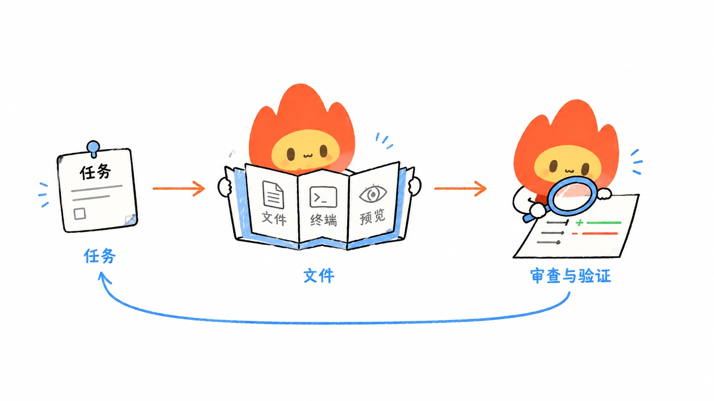
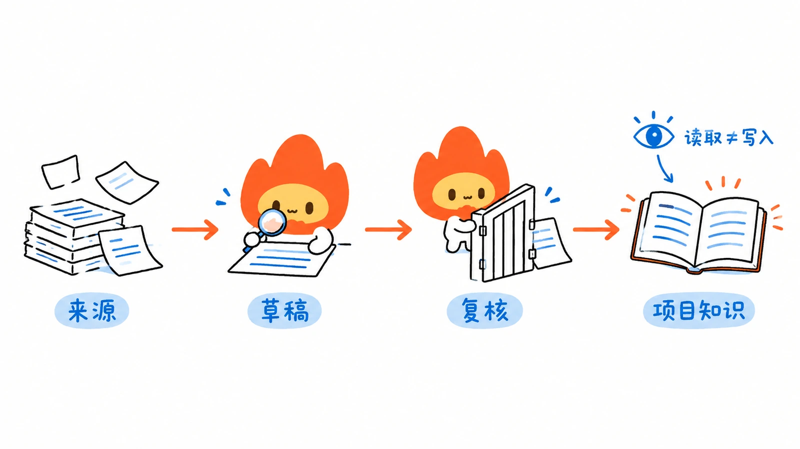

<p align="center">
  
</p>

# Verse Claw

**対話、コード、知識、Agent の実行をひとつのデスクトップワークスペースに。**

[English](README.md) · [简体中文](README.zh-CN.md) · [日本語](README.ja-JP.md) · [Русский](README.ru-RU.md)

[画面](#screenshots) · [機能](#features) · [ワークフロー](#workflows) · [はじめに](#getting-started) · [設定とデータ](#configuration) · [構成](#architecture) · [開発](#development) · [トラブルシューティング](#troubleshooting) · [ドキュメント](#documentation)

Verse Claw は OpenClaw を基盤とする Electron デスクトップアプリです。対話で作業を開始し、同じワークスペースでファイル、ターミナル、ブラウザープレビュー、コードの変更、生成物を確認できます。有用な内容は、根拠を確認できるプロジェクト知識として整理します。モデルと Agent の設定、メッセージチャンネル、定期タスク、ランタイム診断も備えています。

デスクトップは React、TypeScript、Vite を使用し、編集可能な OpenClaw ランタイムとプラグインのソースを同梱しています。現在のバージョンと依存関係は [package.json](package.json) を参照してください。一部のソース、設定、過去の文書には ClawX という名称が残っています。

> **現在の状態：** alpha 段階のプロジェクトです。ローカル受け入れ検証の中心は、制御された Windows x64 のワークフローです。macOS と Linux にもビルド対象がありますが、検証範囲はプラットフォームと機能ごとに異なります。実験的機能の有効化条件は、以下の説明、[製品セマンティクス](docs/clawx-product-semantics.md)、[機能マトリクス](shared/capability-claims.ts)に記載しています。

対話ではセッションメニューからチェックポイントを復元し、入力欄付近で Git を操作できます。モデルはメッセージ単位、セッション単位、または常時適用で選択できます。詳細 UI モードには圧縮の根拠と復旧操作があります。Gateway が停止中でもローカルのトークン使用履歴を確認できます。

<a id="screenshots"></a>

## 実際の画面

ヘッダーは 2026-10-06 に選定した B2 を使用しています。以下の日付付き画面は撮影時の旧デザインを保持しています。

2026-10-05 の Windows Electron ソースビルドを、Agent が分離プロファイルと実際のローカル Gateway で操作して撮影しました。掲載画像の UI は英語です。知識画面では `memory-wiki` を明示的に有効化しています。モデルアカウントやモデル呼び出しは使用せず、対話・台帳・資料庫は実際の空の状態です。画像をクリックすると原寸で表示できます。

| **対話とタスクの入口**<br>[](resources/readme/2026-10-05/en/chat.png) | **資料庫とレビューの入口**<br>[](resources/readme/2026-10-05/en/knowledge.png) |
| --- | --- |
| **Task Ledger**<br>[](resources/readme/2026-10-05/en/tasks.png) | **モデルとプロバイダーの設定**<br>[](resources/readme/2026-10-05/en/settings.png) |

撮影条件、生成画像のプロンプト、ファイルのハッシュは[画像の出典](resources/readme/2026-10-05/README.md)を参照してください。ストレージ警告は撮影機の実際のディスク状態です。

<a id="features"></a>

## 機能

| 分野 | できること | 入口 |
| --- | --- | --- |
| 対話とセッション | 応答のストリーミング、ファイルと知識参照の添付、ツール結果の確認、会話の検索・固定・グループ化・アーカイブ・復元 | メイン画面とセッションサイドバー |
| プロジェクト | プロジェクトの切り替え、ファイルの閲覧とプレビュー、対話の横でターミナル・ブラウザー・Git 差分・コードレビューを利用 | 対話ツールバーのワークスペースパネル |
| モデルとプロバイダー | アカウント、既定モデル、フォールバックの設定、トークン使用履歴の確認 | 設定 → モデルとプロバイダー |
| Agent とタスク | Agent・役割の設定とサブ Agent の活動確認、Task Ledger への記録、明示的な Task Loop・ClawGraph の実行 | 設定 → Agents、サイドバーのその他メニュー |
| 知識 | 資料の検索、出典と参照の管理、受信項目・下書き・提案のレビュー | サイドバー → 知識 |
| 受信トレイ | 権限要求、リモートタスク、ブラウザータスクの要対応項目と履歴の確認 | サイドバー → 受信トレイ |
| スケジュールとチャンネル | 定期タスクと実行履歴の管理、チャンネルアカウント・接続状態・Agent 割り当ての設定 | サイドバーのスケジュール、設定 → Channels |
| Skills と MCP | スキルの確認・有効化、スキルパック、マーケットからのインストール、MCP サーバー設定 | 設定 → Skills |
| 構造化ドキュメント | VerseConf プラグインによる調査表・スライド構成・リビジョン・エクスポートの管理 | プラグイン有効化後の Agent ツールと成果物パネル |
| 診断と復元 | セッション活動、プロセス、Trace、ランタイム状態、ストレージ使用量、復元操作の確認 | ワークスペースパネル、可観測性、設定 |

UI は日本語、英語、中国語、ロシア語に対応し、ライト・ダーク・システムテーマを選べます。一般設定の Basic / Advanced は診断情報の表示量を制御します。開発者モードを解除すると画像生成と Dreams の画面にもアクセスできます。

<a id="workflows"></a>

## 主なワークフロー

### プロジェクトでコード作業を進める

ワークスペースとモデルを選択 → タスクを説明し関連ファイルを添付 → 計画と権限要求を確認 → ツール実行を追跡 → ワークスペースパネルで差分をレビューし検証。



*プロジェクトの炎ロゴを使った AI 生成の概念図です。タスク → ワークスペースのツール → レビューと検証を表します。アプリのスクリーンショットや自動合格の保証ではありません。*

パネルにはファイル、ターミナル、ブラウザー、レビュー、成果物、活動関連のタブを開けます。ターミナルは対話の横または下に配置できます。ブラウザーはローカルプレビューや Web ページを表示し、レビュー画面は Git の変更と関連操作をまとめます。セッション活動パネルでは実行とコマンドの状態を確認できます。

権限セレクターには読み取り専用、計画、編集を許可、フルアクセスなどのモードがあります。計画モードはユーザーファイルの変更を制限しますが、ランタイムのメタデータは書き込まれる場合があります。詳細は[権限の意味と境界](docs/clawx-product-semantics.md)を参照してください。

### 対話と資料をプロジェクト知識にする

対話で知識の範囲と参照を選択 → ライブラリで出典を検索 → レビューキューで受信項目・下書き・提案を確認 → 根拠と変更を確認 → ガバナンス検証を経て適用。



*AI 生成の概念図：出典 → 下書き → レビュー → プロジェクト知識。知識の読み取りと変更の適用は別の権限です。*

Wiki 操作にはロード済みの `memory-wiki` 拡張が必要です。未設定でも画面は開けますが、状態取得・検索・適用にはプラグインと保管庫の準備が必要です。[知識とプラグインの境界](docs/architecture-overview.md#knowledge-plugins-and-data)を参照してください。

知識の読み取り範囲と書き込み権限は別々に管理します。Memory、Wiki、参照資料を選択しても、自動書き戻しは許可されません。レビュー画面で出典、下書き、提案、適用結果の関係を追跡できます。

### 対話からタスク実行へ進む

通常の Chat は即時の共同作業に使います。Task Ledger は目標、タスクノード、チェックポイント、証拠の事実を保存します。Task Loop は明示的に開始する制約付き実行です。Chat がアップグレードを提案しても、自動的に Task Loop へ移行することはありません。

ClawGraph はワークスペースの YAML ワークフローを読み込み、コンパイル診断、ノード状態、イベント、レビュー項目を表示します。ランタイムの Workboard はスケジューリングを担当し、ユーザー向け Task Ledger とは役割が異なります。[Agent オーケストレーション](docs/multi-agent-orchestration/README.md)と[概念の境界](docs/clawx-product-semantics.md)を参照してください。

### 構造化成果物を管理する

任意の `verseconf-artifacts` プラグインには、作成、検査、改訂、レコード並べ替え、履歴復元、エクスポートのツールがあります。調査表は CSV / XLSX、スライド構成は PPTX、内容は Markdown に出力できます。成果物パネルでは管理対象の版、履歴、出力を確認できます。

プラグインは**既定で無効**で、明示的な設定が必要です。PPTX は現在 3 枚のテンプレートを使用し、3 レコードを超える構成はエクスポートを拒否します。全内容を残すには Markdown を使用してください。任意のスライド数や長文のレイアウトは対象外です。設定・配布・検証の詳細は [VerseConf 統合ノート](docs/dev/verseconf-clawx-implementation-20261001.md)にあります。

### 実験的機能の範囲

コンテキスト管理（DCS）、トークン予算（VToken）、経験知識（SEKB）、Runtime Memory、ブラウザー自動化には、それぞれ設定・承認・段階導入の制約があります。診断や shadow データの存在だけでは、モデルのコンテキスト、自動書き戻し、ルーティングへの参加を意味しません。アプリのインストールだけで全機能が有効になることはありません。

状態は[機能マトリクス](shared/capability-claims.ts)、[既定設定マトリクス](docs/dev/default-config-matrix.md)、機能ごとの検証記録で確認してください。スクリプトや Agent が実行する受け入れシミュレーションは agent 駆動と明記します。個別テストの成功は、製品全体や全プラットフォームのリリース受け入れ完了を意味しません。

<a id="getting-started"></a>

## はじめに

### ソースから起動

必要なもの：

- **Node.js 24.16.0 以降の 24.x** と Git。Windows の古い Node 24 には TCP 接続でクラッシュする問題があります（[上流の修正](https://github.com/nodejs/node/issues/63620)）。
- [package.json](package.json) で固定された **pnpm 11.2.2**。Corepack で有効化できます。
- リポジトリへのアクセス権と、依存関係・Electron・uv・agent-browser をダウンロードするネットワーク接続。
- オンラインモデルの認証、または起動済みの互換ローカルモデルサービス。

リポジトリのルートで実行します：

```sh
git clone https://github.com/Baixu22/VerseClaw.git
cd VerseClaw
corepack enable
corepack prepare pnpm@11.2.2 --activate
pnpm run init
pnpm --dir openclaw_runtime install --frozen-lockfile --ignore-scripts
node node_modules/electron/install.js
pnpm dev
```

Node.js に Corepack が含まれない場合は、pnpm 11.2.2 を別途インストールし、`pnpm run init` から続けてください。

`init` はデスクトップ側の依存関係をインストールし、uv と agent-browser をダウンロードします。OpenClaw ランタイムは独立した依存ワークスペースのため、別途インストールします。Electron の自動インストールスクリプトは依存スクリプトポリシーで無効化されているため、明示的に実行します。

`pnpm dev` は拡張ブリッジの生成、ランタイムのビルド、内蔵スキルの準備を済ませてから Vite と Electron を起動します。初回起動にはビルド時間がかかり、アプリ起動後も Gateway の準備に時間が必要です。Vite の Web ページだけでは Electron Host の全サービスを利用できません。

### 最初のセッション

1. セットアップを完了し、「設定 → モデルとプロバイダー」でアカウントとモデルを設定して接続を確認します。
2. プロジェクトフォルダーを選び、ワークスペースと権限モードを確認します。
3. 範囲を絞ったタスクで新しい対話を開始し、必要なファイルや知識参照を添付します。
4. 対話ツールバーからワークスペースパネルを開き、ファイル、ターミナル出力、プレビュー、差分を確認します。
5. 受信トレイの要求を処理し、資料を蓄積するときは知識ワークスペースを使います。
6. 必要に応じて Skills / MCP、チャンネル、定期タスクを設定します。

画面の操作や多くのローカルテストに有料モデル呼び出しは不要です。リモートモデル、サービス、チャンネルには、提供元ごとの認証・ネットワーク・料金条件があります。

### パッケージとプラットフォーム

配布物は[本リポジトリの Releases](https://github.com/Baixu22/VerseClaw/releases)で実際に提供されている版を確認してください。ソースには次のビルド対象があります：

| プラットフォーム | 設定された成果物 | 現在の範囲 |
| --- | --- | --- |
| Windows x64 | NSIS インストーラー | 制御されたローカルワークフローの主な受け入れ対象 |
| macOS x64 / arm64 | DMG、ZIP | ビルド対象あり。機能はプラットフォームごとに検証 |
| Linux x64 / arm64 | AppImage、DEB、RPM は x64 | ビルド対象あり。デスクトップ実行にはグラフィック環境が必要 |

ビルド対象の存在は、その版の配布パッケージの存在を保証しません。ソース開発ビルドはパッケージ更新を確認せず、配布版の更新は設定されたリリース元に依存します。ネイティブ VerseShell と完全なパッケージ作成には、追加の[ソース・ツールチェーン要件](resources/verseshell/SOURCE.md)があります。

<a id="configuration"></a>

## 設定とローカルデータ

| 設定領域 | 内容 |
| --- | --- |
| モデルとプロバイダー / Agents | アカウント、モデル、フォールバック、役割、チャンネル割り当て |
| Skills / Channels / ブラウザー | スキル、MCP、チャンネルアカウント、ブラウザープロファイル、認証情報 |
| 一般 | テーマ、言語、起動設定、表示情報量 |
| システムとランタイム / 開発者 | Gateway、ランタイム、プロキシ、CLI、Doctor、Agent Dev Workbench |
| 請求 | ローカルトークン履歴、費用見積もり、使用状況 |
| ストレージとメモリ / アーカイブ / セッションと復元 | ストレージの走査・清掃、アーカイブ復元、セッション状態と復元設定 |

別途データベースサーバーを用意する必要はありません。アプリ設定はローカルに保存し、ランタイムは各サブシステムで設定ファイル、JSONL 会話記録、SQLite 状態データベースを使用します。

- OpenClaw の既定設定ディレクトリは `~/.openclaw`（Windows ではユーザーホーム下の `.openclaw`）で、主設定は `openclaw.json` です。デスクトップのパス解決は `OPENCLAW_CONFIG_DIR` による上書きに対応します。
- デスクトップデータは Electron の `userData`、アプリログはその `logs/` に保存します。[パスの定義](electron/utils/paths.ts)を参照してください。
- トークン履歴はローカルセッションの構造化 usage 記録から集計し、費用は見積もりです。会話を完全に削除すると、その会話の履歴への寄与も失われます。残す場合はアーカイブを利用してください。
- ローカル保存でも処理がすべてオフラインになるわけではありません。オンラインモデルや外部ツールに送信した内容は各サービスへ渡ります。認証情報、非公開の会話、生ログはコミットや公開の問題報告に含めないでください。

<a id="architecture"></a>

## アーキテクチャとディレクトリ


[Mermaid ソース](resources/readme/2026-10-05/architecture.mmd) · [Chat sequence](resources/readme/2026-10-05/chat-sequence.svg)

現在の要求経路は **React → 型付き Host facade → preload IPC → Electron Main** です。ランタイムが必要なサービスは Main 管理の WebSocket RPC で Gateway を呼び出します。ローカルのファイルや端末サービスがすべて Gateway を通るわけではありません。イベントは Main / preload と `host-events.ts` を経て UI ストアへ戻ります。

Renderer の入口は `src/lib/host-api.ts` と `src/lib/host-api-client.ts` です。これらの境界を一律の「WS → HTTP → IPC fallback」と表現することはできません。[アーキテクチャガイド](docs/architecture-overview.md)にはソース対応表、対話の時系列図、タスク・知識・プラグイン・ローカルデータの責務があります。

| パス | 内容 |
| --- | --- |
| `src/` | React ページ、コンポーネント、状態管理、Renderer API |
| `electron/` | デスクトップのライフサイクル、Host サービス、Gateway、プロセス管理 |
| `shared/` | 型契約、4 言語の翻訳、シナリオ登録、機能定義 |
| `openclaw_runtime/` | 独立した依存ワークスペースのランタイムとプラグイン |
| `harness/` | 仕様 CLI、シナリオ、規則、タスク、レイヤー規約 |
| `tests/` | デスクトップの単体・統合・Electron E2E テスト |
| `scripts/` | ビルド、リソース同期、検証、証拠生成 |
| `resources/` | 内蔵スキル、バイナリ、第三者ソースの声明 |
| `docs/` | 製品セマンティクス、設計、開発ガイド、運用手順 |
| `artifacts/` | 精選した証拠とローカル生成レポート。追跡対象は保管規則で決定 |

<a id="development"></a>

## 開発と検証

### 主なコマンド

リポジトリのルートで実行します。完全な定義は [package.json](package.json) にあります。

| コマンド | 用途 |
| --- | --- |
| `pnpm dev` | ランタイムとリソースを準備して開発アプリを起動 |
| `pnpm run build:vite` | Renderer と Electron をビルド。OpenClaw は再ビルドしない |
| `pnpm run build:runtime` | 内蔵ランタイムをビルドし Gateway 起動スモーク検証を実行 |
| `pnpm run typecheck` | node、web、テストの完全な型検証。3 項目すべて合格が必要 |
| `pnpm run lint:check` | 自動修正なしの lint。`pnpm run lint` はファイルを変更 |
| `pnpm exec vitest run tests/unit/rc10-evidence.test.ts` | 指定したデスクトップテストを実行 |
| `pnpm test` | デスクトップ、選定された DCS/ランタイム回帰、成熟度レジストリ検証 |
| `pnpm run test:integration` | 設定された統合テスト群を実行 |
| `pnpm run test:e2e` | アプリをビルドし Electron E2E を実行 |
| `pnpm run test:e2e:run` | 既存のアプリビルドで Electron E2E を実行。ランタイムの鮮度は必要 |
| `pnpm contract:check` / `pnpm i18n:lint` | Host API 契約と 4 言語の網羅性を検証 |
| `pnpm run harness:ci` | リポジトリの Harness CI 基準検証 |
| `pnpm repo:artifacts:check` | ソース、精選した証拠、ローカルアーカイブの境界を検証 |
| `pnpm run package:win` / `pnpm run package:mac` / `pnpm run package:linux` | 対象リソースを準備し、公開せずパッケージを生成 |

ルートの `pnpm test` は OpenClaw の全テストを実行しません。ランタイム変更では、その [package.json](openclaw_runtime/package.json) とタスク仕様から該当テスト・型検証を選択してください。Windows Electron E2E は Windows Node から実行する必要があります。

**LoCoMo 開発評価：** `pnpm eval:runtime-memory:locomo:full500` は明示的に 500 問を実行し、モデル・埋め込みの認証情報や検証済み成果物が不足すると失敗します。通常の単体テストとは別の評価であり、過去の集計フィクスチャは検証済みメモリ基準ではありません。[測定と証拠の境界](docs/dev/p0-memory-evaluation-integrity.md)を参照してください。 `--local-embedding-url` と `--local-embedding-model` でハッシュ固定のローカル Qwen3 埋め込みを明示的に指定できます。量子化結果は新しい参照であり、ホスト型スコアの再現ではありません。

### 変更に応じた検証

- **タスク仕様：** 最初に `pnpm harness context --spec <task-spec>`、実装後に `pnpm harness validate --spec <task-spec>` を実行します。`pnpm harness run --spec <task-spec> --dry-run` で選択された検証を確認します。
- **UI：** 対応する Electron E2E を更新し、文言は en / zh / ja / ru を揃えます。スタイルは [globals.css](src/styles/globals.css) に従います。
- **通信：** Renderer、Main、Gateway、送受信、フォールバックの変更では `pnpm run comms:replay` と `pnpm run comms:compare` も実行します。
- **ビルドとパッケージ：** ランタイムの鮮度とネイティブリソース契約を満たしてから対象成果物を検証します。ビルド成功とインストール受け入れ結果は別々に記録します。

### Agent Dev ツール

「設定 → 開発者」の Agent Dev Workbench は、シナリオ記録、契約、診断への入口を提供します。オフラインレポートは `pnpm agent-dev:workbench` で生成できます。

| コマンド | 対象 |
| --- | --- |
| `pnpm agent-dev:make <page\|e2e\|host-route\|skill\|channel\|plugin\|scenario> <name>` | 既存の開発規約に従ったひな形を生成 |
| `pnpm agent-dev:fast` | 契約、i18n、プロンプト品質、Workbench、対象単体テスト |
| `pnpm agent-dev:deep-test:reuse` | 新鮮なビルドを再利用し、キャッシュ型検証と Workbench スモーク E2E を実行 |
| `pnpm agent-dev:deep-test` | 新規ビルドによる完全な Agent Dev 診断と所要時間レポート |
| `pnpm agent-dev:audit` | 既存証拠に基づく厳格な成熟度監査 |

日常レポートの `decision.requiredFullGates` は、残っている完全検証を示します。Agent Dev の結果はそのツール群の範囲に限られます。sandbox、effect log、費用相関のレポートは、実際のランタイム作用の検証を代替しません。[Agent Dev コントロールプレーン](docs/agent-dev-control-plane.md)を参照してください。

<a id="troubleshooting"></a>

## トラブルシューティング

| 症状 | 確認すること |
| --- | --- |
| 知識画面で `unknown method: wiki.status` | `memory-wiki` の有効化とロードを確認し、保管庫を初期化。Gateway の準備完了だけでは不十分 |
| pnpm の版違い、依存関係のインストール失敗 | Node.js 24、固定 pnpm、両ワークスペースの依存関係を確認。ロックファイルは保持 |
| Electron 実行ファイルがない | ルートで `node node_modules/electron/install.js` を実行し、ダウンロード接続を確認 |
| Gateway が準備完了にならない | 「設定 → システムとランタイム」とログを確認。開発者設定で Doctor を実行してから Doctor Fix を検討 |
| プロバイダーやチャンネルが使えない | 認証、モデル、プラグイン、アカウント、プロキシを確認。設定保存は要求・配信成功の証明ではない |
| 書き込みや操作が拒否される | ワークスペース、権限モード、受信トレイの承認要求を確認 |
| E2E で古いランタイムと判定される | `pnpm run build:runtime` を実行。アプリも変更した場合は `build:vite` も再実行。鮮度検証は維持 |
| ヘッドレス Linux で Electron が起動しない | 表示サーバーを用意。例：`xvfb-run -a pnpm run test:e2e` |
| VerseConf のツールや出力が使えない | プラグインの有効化と設定を確認。3 レコード超の構成は Markdown で出力 |

<a id="documentation"></a>

## ドキュメント

| 知りたいこと | 入口 |
| --- | --- |
| 現在の構成とドキュメントの検証 | [構成ガイド](docs/architecture-overview.md) · [画像の出典](resources/readme/2026-10-05/README.md) · [ドキュメント索引](docs/README.md) |
| 製品動作、概念、機能の範囲 | [製品セマンティクス](docs/clawx-product-semantics.md) · [機能マトリクス](shared/capability-claims.ts) · [既定設定](docs/dev/default-config-matrix.md) |
| 知識、メモリ、コンテキスト | [知識システム](docs/enhancements/knowledge-persistence/README.md) · [Context Runtime Kit](docs/context-runtime-kit/README.md) |
| Agent とワークフロー | [オーケストレーション](docs/multi-agent-orchestration/README.md) · [役割パック](docs/role-packs.md) |
| 構造化ドキュメント | [VerseConf 統合](docs/dev/verseconf-clawx-implementation-20261001.md) |
| 開発規則と継続作業 | [AGENTS.md](AGENTS.md) · [継続開発ガイド](docs/dev/Sustained-Development-Playbook.md) · [Agent Dev](docs/agent-dev-control-plane.md) |
| ランタイムと受け入れ | [ランタイム収束](docs/dev/unified-agent-system/runtime-convergence/README.md) · [RC-09/RC-10 の証拠境界](docs/dev/windows-alpha-closeout-20261008.md) |
| リソース、保管、ソース復元 | [保管規則](docs/dev/repository-artifact-retention.md) · [VerseShell ソース契約](resources/verseshell/SOURCE.md) |

設計計画や過去の受け入れ記録には固有の範囲と日付があります。現在の入口はソースと対応する新しい証拠で確認してください。ローカルの Task Forest 履歴、引き継ぎ、仮ログは新規チェックアウトのビルド前提ではありません。

## コントリビューションとライセンス

変更範囲を明確にし、対応する検証を行い、動作変更時は 4 言語の README を更新してください。API、i18n、仕様、証拠は [AGENTS.md](AGENTS.md) に従います。ソース、再利用可能な fixture、精選した最終証拠を追跡し、非公開タスク履歴と生成した生ログはローカルに保管します。

Verse Claw は [OpenClaw](https://github.com/openclaw/openclaw) と ValueCell チームの ClawX を基盤としています。リポジトリは [MIT ライセンス](LICENSE) を採用しています。内蔵コンポーネントには固有のライセンスとソース提供義務があり、[VerseShell の声明](resources/verseshell/SOURCE.md)も参照してください。

### Coding 診断ログ

ランタイムの `diagnostics.enabled` を明示的に `true` にすると、既存の診断ログに承認必要と分類された割合の継続的な上昇と回復を記録します。これはツールの分類であり、実際のダイアログや人による承認回数ではありません。サンプル不足・期限切れは未測定です。設定を省略または無効にした場合は監視せず、承認やツール実行ポリシーを変更しません。

セッションの Handoff は Main で Task Ledger の系譜を検証・保存してから新しい会話を有効化します。循環や読み取れない履歴は拒否します。`openclaw.json` の `runtime.handoff.enabled=true` で深さ制限を有効化できます（`maxDepth`: 1–64、省略時は 3）。制限は既定で無効で、フォークは Handoff の系譜を保持します。
