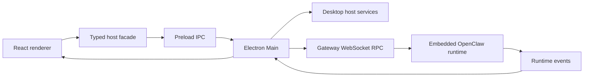

<p align="center">
  
</p>

Review Center の折りたたまれた Change Context は明示的に有効化し、4 種類の比較、ダイジェスト固定コメント、審査判断を表示します。変更適用は既存の承認・Git・Coding journal を使用し、審査承認でタスク完了やマージは行いません。[詳細](docs/modules/workspace-and-coding.md)。

# Verse Claw

**チャット、コード、知識、Agent 実行を 1 つのデスクトップ作業空間に。**

[English](README.md) · [简体中文](README.zh-CN.md) · [日本語](README.ja-JP.md) · [Русский](README.ru-RU.md)

[モジュール詳細（中国語）](docs/modules/README.md) · [はじめに](#getting-started) · [アーキテクチャ](#architecture) · [開発](#development) · [トラブルシューティング](#troubleshooting) · [ドキュメント](#documentation)

Verse Claw は、組み込み OpenClaw Runtime 上に構築された Electron デスクトップアプリです。会話、プロジェクト workspace、コーディングツール、知識レビュー、メモリ、マルチ Agent 編成、メッセージチャネル、スケジュール、runtime 診断を 1 つのローカルデスクトップ製品にまとめます。

このリポジトリは renderer の薄いラッパーではありません。React UI、Electron Main Host、型付きプロセス間 contract、vendored OpenClaw Runtime、VerseBrowser、VerseShell 実行基盤、退役済み VToken source、実行可能な Harness 仕様、build/evidence/release pipeline を含みます。

> **現在の状態：**`0.4.9-alpha.0`、controlled preview。Windows x64 のローカル workflow が主な検証対象です。macOS/Linux には build target がありますが、platform runtime の検証は別です。component graduation や agent-driven evidence は、release、GA、liveReady、productApproved を意味しません。

## 製品を構成するモジュール

| 領域 | 現在の形 | 詳細 |
|---|---|---|
| LLM / モデル | account ベースの provider 設定、OAuth/API key/local auth、protocol adapter、fallback、turn/session model override、streaming、tool loop、reasoning effort、usage、推定 cost | [LLM とモデル（中国語）](docs/modules/llm-and-models.md) |
| 会話 / session | JSONL append-only session tree、run、abort/stop/archive/delete、checkpoint、compaction、handoff/fork、sidebar、group、long-session coordinator | [Session（中国語）](docs/modules/sessions.md) |
| Context / memory | Context Orchestrator、6,000 文字 budget、Workspace Context、health score、独立 Role/Runtime store 上の単一 Memory surface | [Context と Memory（中国語）](docs/modules/context-and-memory.md) |
| Workspace / coding | preflight、4 種類の permission mode、file preview、PTY terminal、web preview、Git、review、write journal、stale-write guard、auto verify | [Workspace と coding（中国語）](docs/modules/workspace-and-coding.md) |
| Knowledge | Markdown/wiki-first Library、Inbox → Draft → Steward → Proposal → explicit apply、Source Set、OKF、Runtime Lessons/SEKB、provenance、governance | [Knowledge（中国語）](docs/modules/knowledge-base.md) |
| Multi-agent / tasks | Agent/Persona/Role、9 組み込み role、routing、team template、resource-aware wave、subagent admission、Task Ledger、Task Loop、ClawGraph | [Multi-agent と task（中国語）](docs/modules/multi-agent-and-tasks.md) |
| Verse components | VerseGit repository/evidence control plane、VerseShell governed execution、VerseBrowser driver、退役 VToken | [Verse tools（中国語）](docs/modules/verse-tools.md) |
| Resources / observability | cooperative ResourceFabric、background shedding、process/port tracking、token/cost limit、trace、issue、Problem、Session Activity、recovery | [Resources と observability（中国語）](docs/modules/resources-and-observability.md) |
| Integrations | 15 channel types、Scheduled、Skills/MCP、Inbox、Remote Task、Code Review、VerseConf、media、Billing、Agent Dev | [Integrations（中国語）](docs/modules/integrations-and-surfaces.md) |

詳細 module document は現在 Simplified Chinese で保守されています。source path、API 名、evidence link は言語非依存です。4 つの root README が多言語入口です。

チャットの処理詳細を折りたたんでも最終回答は表示されます。長いファイル変更は会話欄内で変更前後を並べ、折り返せないコードはプレビュー内で折り返します。展開後の差分だけがその領域内で横スクロールします。コマンドは最新の出力からプレビューし、コピーには保持されている全文が含まれます。リポジトリ変更ストリップはコンポーザーと同じ中央列幅を使用し、ツール呼び出しは対象と時間を示すコンパクトなステータスチップで表示されます。

ランタイムの承認要求は該当会話の入力欄を置き換え、コマンド、作業ディレクトリと選択肢を表示します。ページの他の部分は操作でき、承認処理が終わると元の入力欄、下書きと添付ファイルが復元されます。

## 現在の成熟度境界

| Label | 意味 |
|---|---|
| `default` / `advanced` | 宣言された controlled-preview 範囲内の製品 surface。GA ではありません。 |
| `internal` | 実装または内部 API はあるが、独立した user product entry はありません。 |
| `shadow` / `experiment` | 観測または限定的 experiment。routing、write、approval authority は持ちません。 |
| `retired` | compatibility、provenance、rollback inspection のためだけに保持。 |
| `agent-driven` | agent が生成し、そのように表示した evidence。real-human evidence ではありません。 |

現在の machine-readable component catalog は 54 行です：13 default、12 advanced、24 internal、5 retired、0 experiment。分類は runtime proof ではありません。詳細は [component disposition matrix](docs/dev/component-disposition-matrix-20261021.md)。

重要な default：

- Workspace Context と read-only DCS context tools は宣言された health / permission gate 下で有効です。
- Runtime Memory injection、SEKB automatic writeback、Browser private network は default-on ではありません。
- VToken は retired。旧 env/config では production assembly / sidecar を再有効化できません。
- VerseGit は default-off / landed-unwired。VerseShell は default-off controlled foundation。VerseBrowser は live driver snapshot の action のみ advertise します。
- Dreams は retired。Image Generation は developer/test gate で、通常の製品 navigation ではありません。
- `liveReady=false`、`productApproved=false`、`defaultOn=false` は product lock として維持されます。

Default や release claim を変更する前に、[default configuration](docs/dev/default-config-matrix.md)、[product semantics](docs/clawx-product-semantics.md)、[capability claims](shared/capability-claims.ts) を確認してください。

## アプリ画面

画像は 2026-10-05 の Windows Electron source build で取得されました。現在の header は後続の B2 identity を使用します。Knowledge 画像では `memory-wiki` を明示的に有効化し、model account / model request は使用していません。

| **Chat / task entry**<br>[](resources/readme/2026-10-05/en/chat.png) | **Knowledge library / review**<br>[](resources/readme/2026-10-05/en/knowledge.png) |
| --- | --- |
| **Task Ledger**<br>[](resources/readme/2026-10-05/en/tasks.png) | **Models / provider settings**<br>[](resources/readme/2026-10-05/en/settings.png) |

Capture condition と hash は [visual provenance](resources/readme/2026-10-05/README.md) を参照してください。

<a id="getting-started"></a>

## はじめに

前提：

- **Node.js 24.16.0 以降（24.x）**と Git。古い Windows Node 24 では TCP crash が発生する可能性があります。
- `package.json` で固定された **pnpm 11.2.2**。
- dependency、Electron、uv、agent-browser の download network access。
- Online provider account または互換 local model service。

Repository root で実行：

```sh
git clone https://github.com/Baixu22/VerseClaw.git
cd VerseClaw
corepack enable
corepack prepare pnpm@11.2.2 --activate
pnpm run init
pnpm --dir openclaw_runtime install --frozen-lockfile --ignore-scripts
node node_modules/electron/install.js
pnpm dev
```

`pnpm dev` は VerseBrowser、embedded runtime、bundled skills を build してから Vite と Electron を起動します。Gateway の ready には通常 10–30 秒必要です。Vite page だけでは完全な Electron Host services は得られません。

最初の session：

1. Setup を完了する。
2. Provider/model を設定し、接続を検証する。
3. Project directory、permission mode、workspace を選択する。
4. Scoped task を送り、Workspace Panel を確認する。
5. Inbox で approval を処理する。
6. Knowledge / Memory の永続変更は review surface 経由で行う。
7. セッションの完了、エラー、承認待ちはサイドバーのベルに残ります。システム通知はベルメニューまたは Settings → Session & Recovery で切り替えられます。

Release に存在する package だけが download target です。Build target の存在は current version の package を保証しません。

| Platform | Configured artifact | Validation scope |
|---|---|---|
| Windows x64 | NSIS | 主な controlled local acceptance target |
| macOS x64 / arm64 | DMG、ZIP | Build target。capability ごとの platform validation が必要 |
| Linux x64 / arm64 | AppImage、DEB、x64 RPM | Build target。GUI runtime が必要 |

<a id="architecture"></a>

## アーキテクチャ

通常の request path：

```text
React renderer
  -> typed host facade (src/lib/host-api.ts)
  -> preload IPC
  -> Electron Main（authorization + dispatch）
  -> Host service および/または Main-owned Gateway WebSocket RPC
  -> embedded OpenClaw runtime
```

Runtime event は Main と `host-events.ts` を通って renderer store に戻ります。File、terminal、Git などの local service は Gateway を通らず Main で完了できます。

これは universal な `WS -> HTTP -> IPC fallback` ではありません。Renderer page は Gateway に直接接続せず、Host API を迂回する Electron IPC も追加しません。`shared/host-api/contract.ts` が typed shared boundary です。



Main layers：

- `src/`：renderer、page、component、Zustand store、Host facade、i18n、style。
- `electron/`：Main service、IPC security、Gateway supervision、preload、desktop utility。
- `shared/`：Host API/event、domain type、4 言語 resource、authority/default manifest。
- `openclaw_runtime/`：vendored runtime、Gateway、agent、tool、channel、package、extension。
- `packages/` / `resources/`：VerseBrowser、VToken、VerseShell、skill、plugin、native asset。
- `harness/`、`tests/`、`scripts/`：executable rule、test、automation、evidence tooling。

詳細：[architecture guide](docs/architecture-overview.md)、[repository layout](docs/dev/repository-layout.md)。

## ローカルデータとプライバシー

別個の database server は不要です。

- Desktop setting / export は Electron `userData`。
- Runtime config は通常 `~/.openclaw`。`OPENCLAW_CONFIG_DIR` をサポート。
- Session は JSONL transcript、runtime state は SQLite も使用。
- Token history は structured session usage record から集計。Cost は推定値。
- Knowledge は `memory-wiki` vault と local governance metadata を使用。
- Log、trace、screenshot、Task Forest、handoff は明示的に curated されない限り local working data。

Local storage は offline execution を意味しません。Online model、channel、browser、external tool は設定に従って data を受け取ります。Credential や private transcript を commit / public issue に含めないでください。

VerseBrowser: インストール・開発・ビルド時に組み込みモジュールを自動コンパイルします。81 メソッドの契約は Electron の 81 機能の実装を意味しません。[呼び出し方法とドライバー制限](packages/README.md#versebrowser-integration-and-invocation)を参照してください。プライベートネットワークへの移動は Main がセッションと origin に結び付けて承認します。agent による検証も Main で承認を実行し、呼び出し側の承認マーカーではアクセス権を付与しません。

<a id="development"></a>

## 開発と検証

| Command | Purpose |
|---|---|
| `pnpm dev` | Resource/runtime を準備し Electron 開発起動 |
| `pnpm run build:vite` | Renderer / Electron bundle build |
| `pnpm run build:runtime` | Embedded runtime build + Gateway startup smoke |
| `pnpm run typecheck` | node/web/test full typecheck |
| `pnpm run lint:check` | Lint のみ。file は変更しない |
| `pnpm test` | Root test group と selected regression |
| `pnpm run test:e2e` | Build + Electron Playwright |
| `pnpm contract:check` / `pnpm i18n:lint` | Host contract / 4 言語 coverage |
| `pnpm run harness:ci` | Repository Harness baseline |
| `pnpm run repo:artifacts:check` | Source / evidence / archive boundary |
| `pnpm run docs:policy:validate` | Documentation policy validation |

Task spec：

```bash
pnpm harness context --spec <task-spec>
pnpm harness validate --spec <task-spec>
pnpm harness run --spec <task-spec> --dry-run
```

UI change では Electron E2E と en/zh/ja/ru の string を追加します。Communication path の変更では `pnpm run comms:replay` と `pnpm run comms:compare` も必要です。Build success、install success、release authorization は別の事実です。

[個人 Agent QA シナリオ集](openclaw_runtime/qa/README.md)は、スクリプト provider で十項目の Gateway シナリオを実行し、最終状態を決定的に検証します。ソース実行環境の証拠は制御フロー、拒否、復旧を対象とし、実モデル品質とパッケージ動作には個別の検証ゲートがあります。

[Responses 検証契約](harness/specs/tasks/product-acceptance-space-bunny.md)は、ローカルサービスの推論後の本文、一度のツール往復、会話分離、中断と provider 障害を対象にします。中断した Responses stream は正常完了にも、不完全な引数でのツール実行にもなりません。この検証はモデルやリリースの承認ではありません。

完全な gate map は [development and validation](docs/modules/development-and-validation.md) を参照してください。

<a id="troubleshooting"></a>

## トラブルシューティング

| Symptom | Check |
|---|---|
| Knowledge が `unknown method: wiki.status` | `memory-wiki` を enable/load し vault を初期化。Gateway ready だけでは不足。 |
| pnpm version / install failure | Node.js 24.x、固定 pnpm、2 つの dependency workspace、lockfile を確認。 |
| Electron executable がない | `node node_modules/electron/install.js` と download connectivity を確認。 |
| Gateway が unavailable | Settings → System & Runtime と log を確認。Doctor の後で Doctor Fix。 |
| Provider / channel unavailable | Auth、model、plugin enablement、account、proxy、real request/delivery evidence を確認。 |
| Tool write / command が blocked | Workspace root、permission mode、path boundary、Inbox approval を確認。 |
| E2E が stale runtime | `pnpm run build:runtime`。App source も変更した場合は再 build。 |
| Headless Linux Electron failure | Display server を用意。例：`xvfb-run -a pnpm run test:e2e`。 |
| VerseConf PPTX export failure | Plugin と 3-record template limit を確認。長い outline は Markdown。 |

<a id="documentation"></a>

## ドキュメント

| Topic | Entry |
|---|---|
| Module-by-module implementation | [Module deep dives（中国語）](docs/modules/README.md) |
| Architecture / data flow | [Architecture guide](docs/architecture-overview.md) · [Runtime control planes](docs/dev/runtime-control-planes.md) |
| Product boundary / default | [Product semantics](docs/clawx-product-semantics.md) · [Default configuration](docs/dev/default-config-matrix.md) · [Component matrix](docs/dev/component-disposition-matrix-20261021.md) |
| Knowledge / context | [Knowledge system](docs/enhancements/knowledge-persistence/README.md) · [Context Runtime Kit](docs/context-runtime-kit/README.md) · [Context orchestrator](docs/dev/context-orchestrator.md) · [Memory control plane](docs/dev/memory-control-plane.md) |
| Agent / task | [Role-first design](docs/role-first-design.md) · [Multi-agent orchestration](docs/multi-agent-orchestration/README.md) |
| VerseGit / VerseShell / VerseBrowser | [VerseGit](docs/dev/versegit-validation-layer/README.md) · [VerseShell](docs/dev/verseshell-foundation/STATUS.md) · [VerseBrowser](packages/README.md) |
| Development / evidence | [Development docs](docs/README.md) · [Agent Dev](docs/agent-dev-control-plane.md) · [Repository layout](docs/dev/repository-layout.md) · [Harness](harness/specs/) |

Historical plan と acceptance snapshot には固有の日付と candidate があります。現在の動作は source、default manifest、fresh evidence から判断してください。

## コントリビューションとライセンス

変更範囲を明確にし、関連 validation を提供してください。Behavior change では 4 root README と `docs/modules/` の該当 module を同期します。Interface、default、security boundary、user entry の変更では product semantics、default matrix、Harness spec も確認します。

Verse Claw は [OpenClaw](https://github.com/openclaw/openclaw) と ValueCell team の ClawX を基盤にしています。Repository は [MIT License](LICENSE) を使用します。Bundled component は各自の license/source obligation を保持します。詳細は [VerseShell notices](resources/verseshell/SOURCE.md)。一部 conversation/workspace interaction（web search source card を含む）は Swami Malode の [Rare UI](https://rareui.com) を基にし、attribution は `src/components/rareui` に保持されています。
