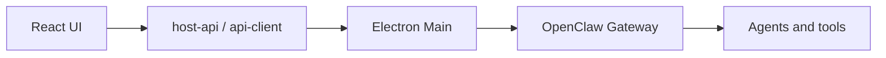

<p align="center">
  
</p>

# Verse Claw

**OpenClaw Agent のためのデスクトップワークスペース。**

[English](README.md) · [简体中文](README.zh-CN.md) · [日本語](README.ja-JP.md) · [Русский](README.ru-RU.md)

[機能](#features) · [はじめに](#getting-started) · [開発](#development) · [ドキュメント](#documentation)

Verse Claw は、チャット、プロジェクト、ナレッジレビュー、Agent の診断を一つの Electron アプリにまとめます。モデルを設定してプロジェクトを開き、ツールの結果、承認要求、タスクの状態を確認しながら作業できます。

Electron 40、React 19、TypeScript を使用し、編集可能な OpenClaw ランタイムのソースを同梱しています。

> **現在の範囲：** ローカル受け入れ検証の主な対象は、制御された Windows x64 ワークフローです。macOS と Linux にもビルド対象がありますが、全プラットフォームで同等の検証を意味しません。コンテキストとメモリの拡張には、個別の opt-in、shadow、承認の境界があります。[製品の意味と範囲](docs/clawx-product-semantics.md)と[能力マトリクス](shared/capability-claims.ts)を参照してください。

<a id="features"></a>
## できること

| 領域 | ワークフロー |
| --- | --- |
| チャットとモデル | プロバイダーとモデルを設定し、会話、コンテキスト、ツール出力を管理します。 |
| プロジェクト | 会話の隣で Git の変更、ターミナル、ブラウザープレビュー、コードレビューを扱います。 |
| タスクと Agent | ロール Worker や範囲を限定したタスクループを明示的に開始し、進捗、失敗、チェックポイント、承認を確認します。 |
| ナレッジ | 出典のある Library を検索し、Inbox、Draft、Proposal をレビューします。変更の適用には明示的な確認とガバナンス検証が必要です。 |
| チャネルとスケジュール | 対応プラグインと定期ジョブを設定します。利用可否はプラグイン、認証情報、ランタイム設定に依存します。 |
| 診断 | セッション活動、Trace、ランタイム状態、開発者ツールを確認します。診断データ自体は実行権限を与えません。 |

英語、中国語、日本語、ロシア語と、ライト／ダークテーマに対応しています。[同梱スクリーンショット](resources/screenshot/)は参考画像であり、現在のビルドと異なる場合があります。

### 権限の境界

- ナレッジの読み取り範囲は書き込みや適用の権限ではありません。提案はレビューまで Draft に留まります。
- コンテキスト予算、Runtime Memory 注入、SEKB 自動書き戻し、無人／プライベートネットワークのブラウザー利用には個別のゲートがあります。インストールだけで全機能が有効になるわけではありません。
- タスク単位の証拠は、製品リリース、既定での有効化、システム全体の GA を許可しません。[検証記録](artifacts/capability-claims/status-table.json)は各記録の範囲と候補を示します。

<a id="getting-started"></a>
## はじめに

### ソースから実行

**Node.js 24**、Git、`package.json` で固定された pnpm（11.2.2）を使用します。ランタイムは独立した依存ワークスペースです。clone にはこのリポジトリへのアクセス権が必要です。

```sh
git clone https://github.com/Baixu22/VerseClaw.git
cd VerseClaw
corepack enable
pnpm run init
pnpm --dir openclaw_runtime install --frozen-lockfile --ignore-scripts
node node_modules/electron/install.js
pnpm dev
```

`init` はデスクトップ側の依存をインストールし、uv と agent-browser をダウンロードします。依存パッケージのビルドスクリプトを制限しているため、Electron のインストールを明示的に実行します。`pnpm dev` はランタイムと内蔵スキルを準備してから Vite と Electron を起動します。

ネイティブ VerseShell とパッケージ作成には追加のソース／ツールチェーン要件があります。[ソースとビルドの契約](resources/verseshell/SOURCE.md)を参照してください。この checkout はソース開発を入口とし、配布ビルドは[このリポジトリの Releases](https://github.com/Baixu22/VerseClaw/releases)で確認します。

### 最初のセッション

1. 初期設定を完了し、対応するプロバイダーとモデルを設定します。実際のモデル呼び出しには有効な認証が必要です。
2. 信頼できるプロジェクトを開き、ワークスペースの権限モードを選択します。
3. チャットを開始し、ツール結果と承認要求を確認します。
4. 再利用する内容は Library と Review Queue で管理し、必要に応じてチャネルや定期ジョブを設定します。

画面操作と多くのローカルテストには有料モデル呼び出しが不要です。ソース開発ビルドは配布パッケージの更新を確認しません。パッケージ版の更新は設定された配布フィードに依存します。

### トラブルシューティング

- **Gateway が未準備：** 状態とログを確認し、Developer 設定の OpenClaw Doctor を使用します。
- **プロバイダー／チャネルが利用不可：** 認証、有効なプラグイン、プロキシを確認します。認証形式の妥当性だけでは接続や配信を証明できません。
- **E2E で古いランタイムと表示：** ランタイム変更後に `pnpm run build:runtime` を実行し、freshness チェックを回避しないでください。
- **ヘッドレス Linux：** Electron テストには表示サーバーが必要です。例：`xvfb-run -a pnpm run test:e2e`。

<a id="development"></a>
## 開発



Renderer は `host-api` / `api-client` を使います。Electron Main がバックエンド通信とデスクトッププロセスを管理し、ランタイムが Agent を実行します。[通信境界](harness/specs/scenarios/gateway-backend-communication.md)が契約を定義します。

| パス | 内容 |
| --- | --- |
| `src/` | React UI、ストア、Renderer API |
| `electron/` | デスクトップのライフサイクル、Gateway 管理、Host サービス |
| `shared/` | 型契約、翻訳、能力境界 |
| `openclaw_runtime/` | 編集可能なランタイムとプラグイン |
| `harness/specs/` | シナリオ、規則、タスク仕様 |
| `tests/` | デスクトップの単体・統合・Electron E2E テスト |
| `resources/` | 同梱リソースとネイティブ部品の出典 |

| コマンド | 用途 |
| --- | --- |
| `pnpm dev` | 開発アプリを起動 |
| `pnpm run typecheck` | node、web とテストの型チェック結果を確認 |
| `pnpm exec vitest run tests/unit/rc10-evidence.test.ts` | 指定した単体テストを実行 |
| `pnpm test` | 設定されたデスクトップ／ランタイムテストを実行 |
| `pnpm run build:vite` | Renderer と Electron をビルド |
| `pnpm run build:runtime` | ランタイムをビルド |
| `pnpm run test:e2e` | ビルドして Electron E2E を実行 |
| `pnpm contract:check` | Host API 契約の一致を確認 |
| `pnpm repo:artifacts:check` | ソースとアーカイブの境界を確認 |

タスク仕様の対象を変更する前に `pnpm harness context --spec <task-spec>` を実行します。通信変更では `pnpm run comms:replay` と `pnpm run comms:compare` も必要です。[AGENTS.md](AGENTS.md)に規則と検証要件があります。

ローカルの Task Forest 履歴、引き継ぎ、生成証拠は新規 checkout の前提条件ではありません。ソース、fixture、選別された証拠は追跡し、[保管と復元の規則](docs/dev/repository-artifact-retention.md)に従います。

<a id="documentation"></a>
## ドキュメント

- [製品の意味と制御されたプレビュー](docs/clawx-product-semantics.md)
- [継続開発](docs/dev/Sustained-Development-Playbook.md)
- [ランタイム収束と受け入れ](docs/dev/unified-agent-system/runtime-convergence/README.md)
- [ナレッジシステム](docs/enhancements/knowledge-persistence/README.md)
- [Agent オーケストレーション](docs/multi-agent-orchestration/README.md)
- [RC-09 事前検証と RC-10 証拠整合性](docs/dev/pending-worktree-consolidation.md)
- [セキュリティポリシー](SECURITY.md)

## 貢献とライセンス

変更範囲を限定し、必要な回帰テストとユーザー向け翻訳を更新してください。認証情報、ローカルタスク履歴、生成ログはコミットしません。問題や提案はこのリポジトリへ寄せてください。

Verse Claw は [OpenClaw](https://github.com/openclaw/openclaw) と ValueCell チームの ClawX を基盤とします。[MIT ライセンス](LICENSE)を参照してください。同梱部品はそれぞれのライセンスとソース通知を保持します。
