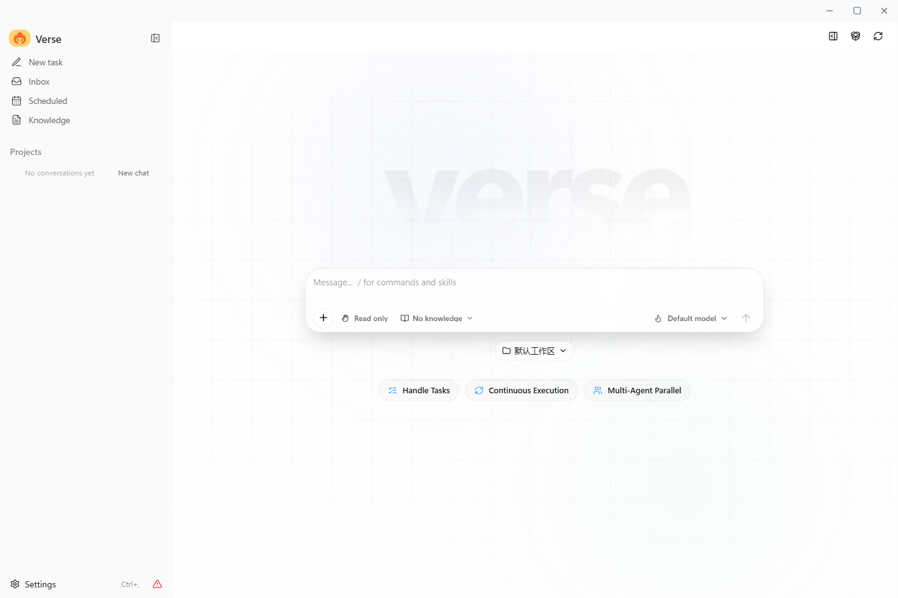
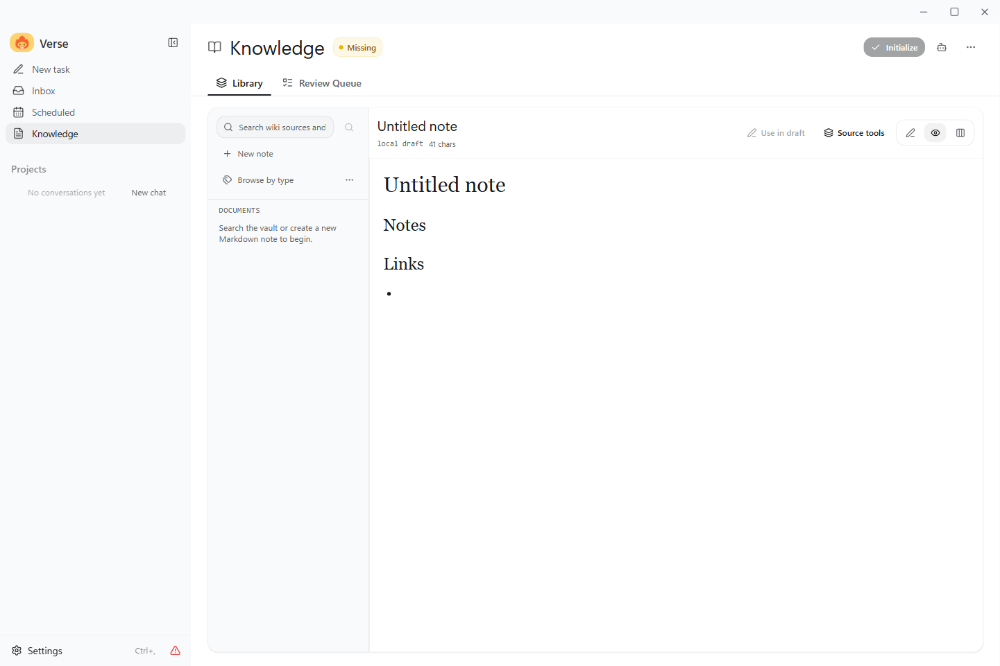
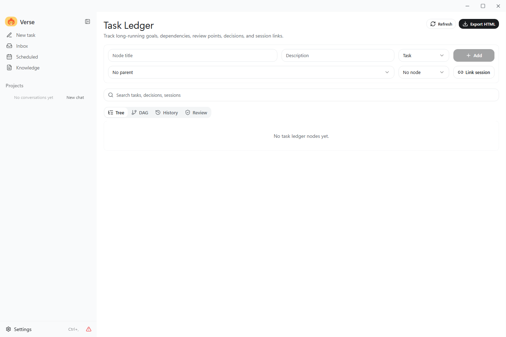
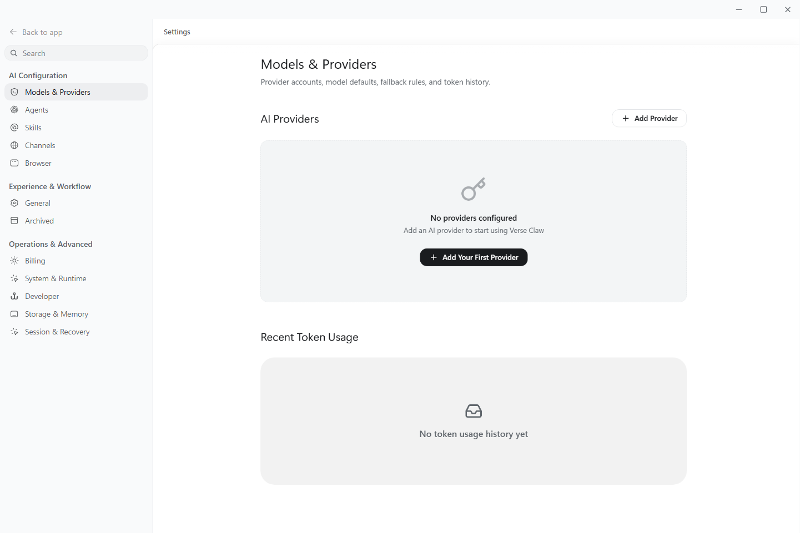
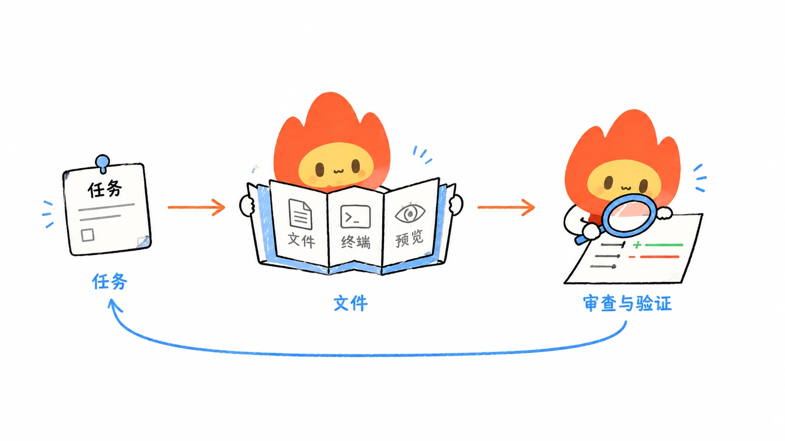
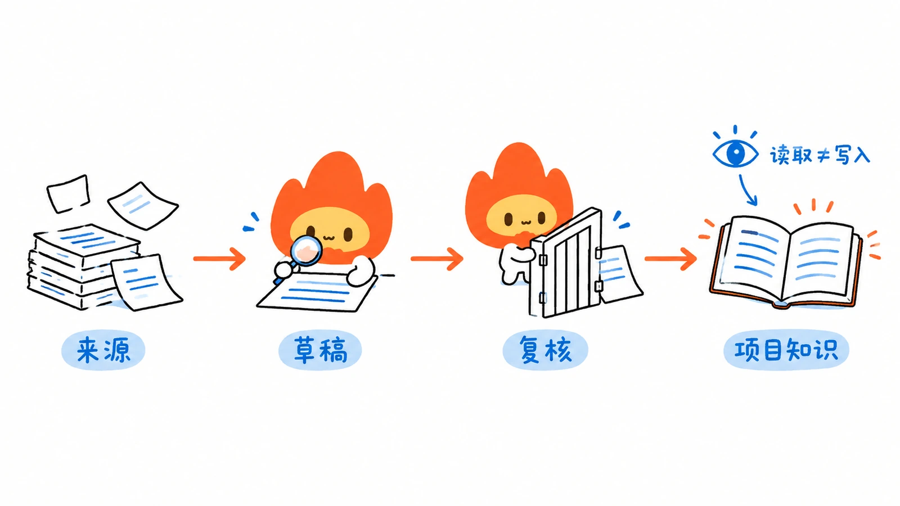
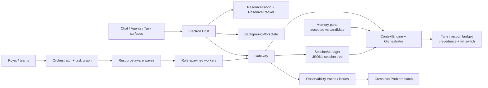

<p align="center">
  
</p>

# Verse Claw

**Chat, code, knowledge and agent execution in one desktop workspace.**

[English](README.md) · [简体中文](README.zh-CN.md) · [日本語](README.ja-JP.md) · [Русский](README.ru-RU.md)

[Screenshots](#screenshots) · [Features](#features) · [Workflows](#workflows) · [Getting started](#getting-started) · [Configuration](#configuration) · [Architecture](#architecture) · [Development](#development) · [Troubleshooting](#troubleshooting) · [Documentation](#documentation)

Verse Claw is an Electron desktop application built on OpenClaw. Start work in a conversation, inspect files, terminals, browser previews, code changes and generated artifacts in the same workspace, then turn useful material into reviewable project knowledge. The app also provides model and agent configuration, messaging channels, scheduled tasks and runtime diagnostics.

The desktop uses React, TypeScript and Vite. It is more than a renderer wrapper: the repository also contains the Electron Main host, typed shared contracts, a vendored OpenClaw runtime and extension catalogue, the embedded VerseBrowser and VToken components, the VerseShell MCP adapter, executable Harness specs, and the build/release/evidence pipeline. See [package.json](package.json) for the current version and dependencies. Some source, configuration and historical documents retain the ClawX name.

> **Current status:** this is an alpha project. Controlled Windows x64 workflows are the primary local acceptance target. macOS and Linux have build targets, with validation coverage specific to each platform and capability. Experimental features retain the activation conditions described below, in the [product semantics](docs/clawx-product-semantics.md) and in the [capability matrix](shared/capability-claims.ts).

Chat provides checkpoint restore from the session menu, repository controls beside the composer, and per-message, per-session or persistent model selection. Advanced UI mode exposes compression evidence and recovery actions. Local token usage history remains available while the Gateway is stopped.

<a id="screenshots"></a>

## Inside the app

The header uses the B2 identity selected on 2026-10-06; the dated screenshots below retain the previous appearance.

Captured directly from the Windows Electron source build on 2026-10-05, operated by an agent with isolated profiles and a real local Gateway. The Knowledge capture explicitly enables `memory-wiki`. No model account or model request is used: the empty conversation, ledger and library are real states. Click an image for full size.

| **Chat and task entry**<br>[](resources/readme/2026-10-05/en/chat.png) | **Knowledge library and review entry**<br>[](resources/readme/2026-10-05/en/knowledge.png) |
| --- | --- |
| **Task Ledger**<br>[](resources/readme/2026-10-05/en/tasks.png) | **Models and provider settings**<br>[](resources/readme/2026-10-05/en/settings.png) |

See [visual provenance](resources/readme/2026-10-05/README.md) for capture conditions, illustration prompts and file hashes. The storage warning reflects the capture machine’s actual disk state.

<a id="features"></a>

## Features

| Area | What you can do | Entry |
| --- | --- | --- |
| Chat and sessions | Stream responses, attach files and knowledge references, inspect tool results; search, pin, group, archive and restore conversations | Main view and session sidebar |
| Project workspaces | Switch projects, browse and preview files, use terminals, browsers, Git changes and code review beside the conversation | Workspace panel in the chat toolbar |
| Models and providers | Manage provider accounts, default models and fallback settings; inspect token usage history | Settings → Models & Providers |
| Agents and tasks | Configure agents and roles, inspect subagent activity; record tasks in Task Ledger and start explicit Task Loop or ClawGraph workflows | Settings → Agents; sidebar's more menu |
| Knowledge | Search the library, manage sources and references, review Inbox items, drafts and proposals | Sidebar → Knowledge |
| Memory | Review accepted memory and persisted candidates, approve proposals, delete/tombstone records, export a hashed JSON snapshot, and propose “Remember this” | Sidebar → Memory |
| Inbox | Handle permission requests, remote tasks and browser tasks that need attention; inspect their history | Sidebar → Inbox |
| Schedules and channels | Manage scheduled jobs and run history; configure channel accounts, connection status and agent bindings | Sidebar → Scheduled; Settings → Channels |
| Skills and MCP | Inspect and enable skills, manage skill packs, marketplace installation and MCP server configuration | Settings → Skills |
| Structured documents | Manage research tables, slide outlines, revisions and exports with the VerseConf plugin | Agent tools and artifact panel after plugin activation |
| Diagnostics and recovery | Inspect session activity, processes, traces, runtime status, storage usage and recovery actions | Workspace panel, Observability and Settings |

For an explicitly bound long session, the Chat activity rail also shows the stable coordinator conversation, its existing Task Ledger references and terminal completion batches, with direct links to the worker transcript and task record. Before a bound turn, ClawX reads a bounded `ContinuityContextPack/v1` from accepted Task Ledger Working Context, CompressionArtifact metadata, currently model-visible accepted memory refs and typed knowledge refs. Pending, candidate, expired, revoked, superseded, out-of-scope and unverified model claims are excluded; raw history stays behind on-demand owner refs. These rows and the pack project existing owners and do not create a second task list, memory store or injection authority.

The interface supports English, Chinese, Japanese and Russian, with light, dark and system themes. Basic / Advanced in General settings controls diagnostic detail. Image generation and Dreams pages are also available after unlocking developer mode.

<a id="workflows"></a>

## Common workflows

### Complete a coding task in a project

Choose a workspace and model → describe the task and attach relevant files → inspect the plan and permission requests → follow tool execution → review changes and run validation in the workspace panel.



*AI-generated concept illustration using the project’s flame logo: task → workspace tools → review and verification. It is not an app screenshot or a promise that verification passes automatically.*

The panel supports file, terminal, browser, review, artifact and activity tabs. Terminals can sit beside or below the conversation. The browser opens local previews or web pages, while the review surface brings together Git changes and related actions. Session activity shows run and command status.

The permission selector includes Read-only, Plan, Accept edits and Full access. Plan mode restricts user-file changes, while runtime metadata may still be written. See [workspace permission semantics](docs/clawx-product-semantics.md) for the precise boundary.

### Turn conversations and source material into knowledge

Choose a knowledge scope and references in Chat → search sources in Library → inspect Inbox items, drafts and proposals in Review Queue → check their evidence and changes → apply through the governed review path.



*AI-generated concept illustration: sources → drafts → review → project knowledge. Reading knowledge and applying changes require different authority.*

Wiki operations require the loaded `memory-wiki` extension. The page is accessible without it, but status, search and apply operations require the plugin and vault to be ready. See [knowledge and plugin boundaries](docs/architecture-overview.md#knowledge-plugins-and-data).

Knowledge read scope and write permission are managed separately. Selecting Memory, Wiki or a reference does not authorize automatic writeback. The review surface keeps the relationship between sources, drafts, proposals and application results visible.

The Knowledge corner character opens a compact floating conversation on click and minimizes back to the assistant. Suggestions and draft actions are available on demand. Drag stays near its dock and returns when released out of range. Its procedural Ginger avatar follows actual retrieval, reading, draft and review requests; replies share the main Chat Markdown renderer. See [Knowledge character integration](docs/dev/knowledge-bot.md).

### Move from collaboration to task execution

Ordinary Chat handles immediate collaboration. Task Ledger stores goals, task nodes, checkpoints and evidence facts. Task Loop is an explicitly started, constrained execution flow. Chat can suggest an upgrade without automatically becoming a Task Loop.

Workspace identifies the local execution root, agent binding and permission context. Project denotes a long-term work container; the shared identity contract currently supports a compatibility mapping, not independent Project management. Run identifies an execution attempt, while Task Ledger remains the source of user-visible task facts. See the [identity vocabulary](docs/clawx-product-semantics.md#identity-and-scope-vocabulary).

ClawGraph loads workspace YAML workflows and displays compilation diagnostics, node state, events and review items. Runtime Workboard owns scheduling separately from the user-facing Task Ledger. See [agent orchestration](docs/multi-agent-orchestration/README.md) and [concept boundaries](docs/clawx-product-semantics.md).

### Manage structured artifacts

The optional `verseconf-artifacts` plugin provides creation, inspection, revision, record ordering, history restoration and export tools. Research tables export to CSV / XLSX, slide outlines to PPTX, and content to Markdown. The artifact panel shows managed revisions, history and outputs.

The plugin is **disabled by default** and requires explicit configuration. PPTX currently uses a three-slide template: outlines with more than three records are rejected, with Markdown available to preserve the full outline. Arbitrary slide counts and long-text layout are not covered. See the [VerseConf integration notes](docs/dev/verseconf-clawx-implementation-20261001.md) for configuration, delivery and validation details.

### Experimental feature boundaries

Context management (DCS), token budgeting (VToken), experience knowledge (SEKB), Runtime Memory and browser automation have separate configuration, approval or rollout gates. Diagnostic or shadow data does not mean a feature affects model context, automatic writeback or routing. Installing the application does not activate every enhancement.

Consult the [capability matrix](shared/capability-claims.ts), [default configuration matrix](docs/dev/default-config-matrix.md) and feature-specific validation records. Scripted or agent-executed acceptance simulations must be labeled as agent-driven. Focused test success does not establish release acceptance for the entire product or every platform.

<a id="getting-started"></a>

## Getting started

### Run from source

Prerequisites:

- **Node.js 24.16.0 or later in the 24.x line** and Git. Earlier Windows Node 24 releases can crash in TCP connections ([upstream fix](https://github.com/nodejs/node/issues/63620)).
- **pnpm 11.2.2**, pinned in [package.json](package.json); Corepack can activate it.
- Repository access and network access for dependencies, Electron, uv and agent-browser.
- Authentication for online model providers, or a running compatible service for local models.

Run from the repository root:

```sh
git clone https://github.com/Baixu22/VerseClaw.git
cd VerseClaw
corepack enable
corepack prepare pnpm@11.2.2 --activate
pnpm run init
pnpm --dir openclaw_runtime install --frozen-lockfile --ignore-scripts
node node_modules/electron/install.js
pnpm dev
```

If your Node.js installation does not include Corepack, install pnpm 11.2.2 separately and continue from `pnpm run init`.

`init` installs desktop workspace dependencies and downloads uv and agent-browser. The OpenClaw runtime has a separate dependency workspace and needs its own installation. Electron's binary installation is explicit because the dependency script policy disables its automatic install script.

`pnpm dev` generates the extension bridge, builds the runtime and prepares bundled skills before starting Vite and Electron. The first launch includes that build work; Gateway also needs time to become ready after the app opens. A Vite web page alone does not provide the full Electron host services.

### First session

1. Complete the setup wizard, then configure an account and model in Settings → Models & Providers and check connectivity.
2. Choose a project folder and confirm the workspace and permission mode.
3. Start a conversation with a scoped task, attaching files or knowledge references as needed.
4. Open the workspace panel from the chat toolbar to inspect files, terminal output, browser previews and changes.
5. Handle pending requests in Inbox; use Knowledge when you want to retain project material.
6. Configure Skills / MCP, channels and scheduled tasks as needed.

App navigation and many local tests do not require paid model calls. Remote models, services and channels have their own authentication, network and billing requirements.

### Packages and platforms

Available distributions are the versions actually published in [this repository's Releases](https://github.com/Baixu22/VerseClaw/releases). The source configures these packaging targets:

| Platform | Configured artifacts | Current scope |
| --- | --- | --- |
| Windows x64 | NSIS installer | Primary local controlled-workflow acceptance platform |
| macOS x64 / arm64 | DMG, ZIP | Build targets exist; capabilities require platform-specific validation |
| Linux x64 / arm64 | AppImage, DEB; RPM for x64 | Build targets exist; desktop execution needs a graphical environment |

A build target does not guarantee a downloadable package for a particular version. Source development builds do not check for packaged updates; packaged updates depend on the configured release feed. Native VerseShell components and complete packaging have additional [source and toolchain requirements](resources/verseshell/SOURCE.md).

<a id="configuration"></a>

## Configuration and local data

| Settings area | Contents |
| --- | --- |
| Models & Providers / Agents | Accounts, models, fallback rules, roles and channel bindings |
| Skills / Channels / Browser | Skills, MCP, channel accounts, browser profiles and credentials |
| General | Theme, language, startup options and interface detail |
| System & Runtime / Developer | Gateway, runtime, proxy, CLI, Doctor and Agent Dev Workbench |
| Billing | Local token history, estimated costs and activity |
| Archived / Sessions & Recovery | Archive restoration, session state and recovery settings |

No separate database server is required. App settings use local storage; runtime subsystems use configuration files, JSONL transcripts and SQLite state databases.

- OpenClaw's default configuration directory is `~/.openclaw` (`.openclaw` under the Windows user home), with `openclaw.json` as its main configuration. Desktop path resolution supports the `OPENCLAW_CONFIG_DIR` override.
- Desktop data lives in Electron's `userData` directory, with app logs under `logs/`. See [electron/utils/paths.ts](electron/utils/paths.ts).
- Token history aggregates structured usage records from local sessions. Costs are estimates. Permanently deleting a conversation removes its contribution to history; archive it when you want to retain that history.
- Local storage does not imply offline execution: content submitted to online models or external tools reaches those services. Keep credentials, private transcripts and raw logs out of commits and public issue reports.

<a id="architecture"></a>

## Architecture and repository layout


[Mermaid source](resources/readme/2026-10-05/architecture.mmd) · [Chat sequence](resources/readme/2026-10-05/chat-sequence.svg)

The current request path is **React → typed host facade → preload IPC → Electron Main**. Runtime-bound services then call Gateway through the Main-owned WebSocket RPC connection. Local file and terminal services need not traverse Gateway. Events return through Main/preload and `host-events.ts` to update UI stores.

Renderer requests enter through `src/lib/host-api.ts` and `src/lib/host-api-client.ts`. These boundaries are not one universal “WS → HTTP → IPC fallback”. The [architecture guide](docs/architecture-overview.md) maps the source, traces a chat turn and explains task, knowledge, plugin and local-data ownership.

### Current module map

This map follows current source ownership rather than the older single-directory view. The detailed inventory and local/generated boundaries are in [repository layout and evidence roots](docs/dev/repository-layout.md).

| Surface | Key paths | Responsibility |
| --- | --- | --- |
| Renderer | `src/pages/`, `src/components/`, `src/stores/`, `src/lib/`, `src/i18n/`, `src/styles/`, `src/extensions/`, `src/hooks/`, `src/types/`, `src/assets/` | Route-level pages, shared UI, client state, typed host facade and events, localization, styling and static assets |
| Electron Main and Host | `electron/main/`, `electron/services/`, `electron/preload/`, `electron/extensions/`, `electron/shared/`, `electron/types/`, `electron/utils/` | Window/menu/tray lifecycle, IPC authorization and host dispatch, desktop services, shared Main types/utilities and event forwarding |
| Gateway bridge | `electron/gateway/` | Gateway startup and recovery, WebSocket RPC, connection/restart policy and runtime event adaptation |
| Shared boundary | `shared/host-api/`, `shared/types/`, `shared/i18n/`, `shared/host-events/`, `shared/agent-dev/`, `shared/knowledge/`, `shared/mcp/`, `shared/sandbox/`, `shared/security/`, `shared/verseshell/`, `shared/vtoken/` and shared semantic modules | Host API contract, cross-process types, four-language resources, event types, domain helpers, capability and product-semantics definitions |
| Embedded OpenClaw runtime | `openclaw_runtime/src/`, `openclaw_runtime/packages/`, `openclaw_runtime/ui/`, `openclaw_runtime/apps/`, `openclaw_runtime/experiments/`, `openclaw_runtime/test/` | Agents, models/providers, tools, sessions, context/memory, channels, scheduling, Gateway internals, runtime packages, app hosts and experiments |
| Runtime extensions | `openclaw_runtime/extensions/` | Provider, channel, tool, browser, memory, media and plugin implementations; availability depends on runtime enablement and policy |
| Embedded product components | `packages/versebrowser/`, `packages/vtoken/`, `resources/verseshell-mcp/` | Pinned browser-automation engine, Python/uv token sidecar and external MCP compatibility adapter |
| Bundled resources and packaging | `resources/skills/`, `resources/skill-packs/`, `resources/openclaw-plugins/`, `resources/verseshell/`, `resources/cli/`, `resources/context/`, `resources/icons/`, `resources/readme/`, `resources/brand-exploration/`, `resources/bin/`, `resources/workspace-harness/`, `public/`, `patches/`, `electron-builder.yml` | Preinstalled skills and packs, ClawX plugins, CLI/context assets, native binaries, workspace harness inputs, documentation media and packaging assets |
| Harness and tests | `harness/specs/`, `harness/src/`, `harness/workspace/`, `tests/unit/`, `tests/integration/`, `tests/e2e/` | Executable rules, scenarios, task specs and fixtures; unit, integration and Electron Playwright coverage |
| Build and release automation | `scripts/`, `.github/workflows/` | Build, resource synchronization, validation, maturity, evidence, packaging, release and CI workflows |
| Documentation and evidence | `docs/`, `plans/`, `team/`, `reports/`, `artifacts/` | Current architecture and runbooks, maturity decisions, historical design records, long-form reports, curated evidence and retained outputs |

### Runtime control planes

| Plane | Current mechanism | Boundary |
| --- | --- | --- |
| System resources | `ResourceFabric` admits workspace execution and chat-history work; `BackgroundWorkGate` defers background work under queue, RSS or CPU pressure; `ResourceTracker` owns session-linked server discovery and cleanup | Cooperative Main-process admission, not a global OS scheduler; foreground work is never shed |
| Context engineering | `ContextEngine` runs bootstrap, ingest, maintain, after-turn and assemble/compact; a shared 6,000-character turn budget applies precedence and a fail-closed enhancement kill switch; `ContextHealthMonitor` scores pressure, structure, goal alignment and novelty | Context enhancements are opt-in; target authority convergence is still separate design work |
| Session lifecycle | `SessionManager` is a JSONL append-only tree with leaf branching, compaction, labels and context reconstruction; Host actions add checkpoints, handoff, archive/restore and cascade delete | A session is not a run, task, workspace or project; Task Ledger owns user-visible task facts |
| Memory | One `Memory` surface projects accepted role cards and Runtime facts plus persisted candidates from their existing stores; Owner-dispatched approve/delete/export and gatekeeper-reviewed “Remember this” share the `MemoryControlPlaneManifest/v1` boundary | Candidate queues are never model-visible; owner write/use gates and Runtime Memory injection paths remain independently configurable. Native OpenClaw memory sources stay outside this panel and are disclosed explicitly |
| Problem perception | Per-trace issue detection feeds a cross-run Problem signature aggregator with a seven-day window, lifecycle state and redacted evidence artifacts | `pnpm observability:problems` is an agent batch, not a resident auto-remediation service |
| Multi-agent and roles | `RoleContract`, eight built-in roles, `router`/`lead-workers`/`adversarial-review` modes, team templates, task graphs and resource-aware waves | Write-set proof, tool contention and concurrency caps bound execution; `bounded_a2a` remains disabled; Runtime V2 Kernel work is planned |



See [runtime control planes](docs/dev/runtime-control-planes.md) for the sequence diagram, multi-agent flow, default-off boundaries and source anchors.

### Coding, agent tools and knowledge

| Surface | Current source and entry points | Boundary |
| --- | --- | --- |
| Coding and review | `src/pages/CodeReview/`, `electron/services/code-review-api.ts`, `git-api.ts`, `shared/types/coding-run.ts`, Task Loop and Task Ledger | Code review is explicitly read-only; CodingRun is an association/projection view, not a second task state machine. Task Ledger remains the user-visible task authority |
| VerseShell | `openclaw_runtime/src/agents/verseshell/`, `verseshell-runtime.ts`, `shared/verseshell/`, `resources/verseshell/`, `resources/verseshell-mcp/` | Governed execution, typed ACI, artifact results and patch preview are independently default-off; the external MCP adapter is separate from the internal execution path |
| VerseBrowser | `packages/versebrowser/`, `electron/services/agent-browser-*`, `electron/gateway/agent-browser-bridge.ts`, `shared/agent-browser/` | 81 contract methods are not 81 Electron capabilities: the driver implements 67, exposes 28 model actions and currently advertises 14 on the Windows desktop build |
| Knowledge | `src/pages/Knowledge/`, `electron/services/knowledge-api.ts`, `memory-wiki`, `openclaw_runtime/src/knowledge/sekb/` | Markdown/wiki-first and role-governed: agents read and propose; Inbox → Draft → Steward → Proposal → explicit apply is the durable write path. SEKB writeback remains default-off/shadow |
| Memory | `src/pages/Memory/`, `electron/services/memory-api.ts`, `openclaw_runtime/src/gateway/server-methods/memory-surface.ts` | One review surface; Role cards, Runtime facts and candidates keep their owning stores and mutation paths. Approval, tombstone/invalidation, hashed export and explicit-remember proposals never create a second Memory authority |

The detailed tool and knowledge flow is included in [runtime control planes](docs/dev/runtime-control-planes.md#coding-tools-and-knowledge-surfaces).

`src/App.tsx` currently registers first-run Setup (`/setup/*`), Chat (`/`), Knowledge, Memory, Inbox, Scheduled, Task Ledger, ClawGraph, Observability and Settings surfaces; Models, Agents, Channels and Skills are Settings sections, while Code Review and Browser are compatibility entry points into workspace panels. Image Generation and Dreams require developer mode.

Current pnpm workspace members are the root, `harness/`, `packages/versebrowser/` and `resources/verseshell-mcp/`. `packages/vtoken/` is a Python/uv sidecar. `openclaw_runtime/` is a vendored Git tree with its own dependency workspace, not a Git submodule or the packaged npm runtime.

VerseBrowser: install/dev/build compile the embedded module automatically. The 81-method contract is not 81 implemented Electron capabilities; see [invocation and driver limits](packages/README.md#versebrowser-integration-and-invocation).

<a id="development"></a>

## Development and validation

### Common commands

Run these from the repository root. [package.json](package.json) contains their complete definitions.

| Command | Purpose |
| --- | --- |
| `pnpm dev` | Prepare runtime/resources and start the development app |
| `pnpm run build:vite` | Build renderer and Electron bundles; does not rebuild OpenClaw |
| `pnpm run build:runtime` | Build the embedded runtime and run the Gateway startup smoke check |
| `pnpm run typecheck` | Full node, web and test type checks; all three must pass |
| `pnpm run lint:check` | Run lint without automatic fixes; `pnpm run lint` modifies files |
| `pnpm exec vitest run tests/unit/rc10-evidence.test.ts` | Run a specific desktop test file |
| `pnpm test` | Desktop tests, selected DCS/runtime regressions and maturity registry checks |
| `pnpm run test:integration` | Run the configured integration test group |
| `pnpm run test:e2e` | Build the app and run Electron E2E |
| `pnpm run test:e2e:run` | Run Electron E2E against an existing app build; the runtime must still be fresh |
| `pnpm contract:check` / `pnpm i18n:lint` | Check host API contracts and four-language coverage |
| `pnpm run harness:ci` | Run the repository's Harness CI baseline |
| `pnpm repo:artifacts:check` | Check source, curated evidence and local archive boundaries |
| `pnpm run package:win` / `pnpm run package:mac` / `pnpm run package:linux` | Prepare target-platform resources and produce packages without publishing |

Root `pnpm test` does not run every OpenClaw test. For runtime changes, select the relevant tests and type gates from its [package.json](openclaw_runtime/package.json) and the task specification. Windows Electron E2E must run under Windows Node.

**LoCoMo developer evaluation:** `pnpm eval:runtime-memory:locomo:full500` explicitly runs 500 questions and fails when model/embedding credentials or verified output are missing. It is separate from the default unit gate; historical aggregate fixtures are not accepted memory baselines. See the [measurement and evidence boundary](docs/dev/p0-memory-evaluation-integrity.md). An opt-in, hash-pinned local Qwen3 deployment can supply embeddings with `--local-embedding-url` and `--local-embedding-model`; its quantized results are a new reference, not a reproduction of hosted scores.

### Select validation for the change

- **Task specifications:** run `pnpm harness context --spec <task-spec>` first, then `pnpm harness validate --spec <task-spec>` after implementation. Inspect the selected flow with `pnpm harness run --spec <task-spec> --dry-run`.
- **UI:** update the relevant Electron E2E. Cover en / zh / ja / ru strings and follow [globals.css](src/styles/globals.css) for styling.
- **Communication:** changes to renderer, Main, Gateway, send/receive or fallback paths also require `pnpm run comms:replay` and `pnpm run comms:compare`.
- **Builds and packaging:** satisfy runtime freshness and native resource contracts before checking platform artifacts. Record build success and installation acceptance separately.

### Agent Dev tooling

Agent Dev Workbench in Settings → Developer provides scenario recording, contract and diagnostic entry points. Generate its offline report with `pnpm agent-dev:workbench`.

| Command | Scope |
| --- | --- |
| `pnpm agent-dev:make <page\|e2e\|host-route\|skill\|channel\|plugin\|scenario> <name>` | Scaffold artifacts using existing development conventions |
| `pnpm agent-dev:fast` | Contracts, i18n, prompt quality, Workbench and focused unit tests |
| `pnpm agent-dev:deep-test:reuse` | Reuse a fresh build with cached typechecking and Workbench smoke E2E |
| `pnpm agent-dev:deep-test` | Full Agent Dev diagnostics and timing with a fresh build |
| `pnpm agent-dev:audit` | Strict maturity audit of the available evidence |

Daily reports list outstanding full gates under `decision.requiredFullGates`. Agent Dev results cover that toolchain. Sandbox, effect-log and cost-correlation reports do not replace validation of actual runtime effects. See the [Agent Dev control plane](docs/agent-dev-control-plane.md).

<a id="troubleshooting"></a>

## Troubleshooting

| Symptom | What to check |
| --- | --- |
| Knowledge shows `unknown method: wiki.status` | Check that `memory-wiki` is enabled and loaded, then initialize the vault. Gateway readiness alone is insufficient |
| Wrong pnpm version or failed dependency installation | Check Node.js 24, pinned pnpm and dependencies in both workspaces; retain lockfiles |
| Missing Electron executable | Run `node node_modules/electron/install.js` from the root and check download connectivity |
| Gateway stays unavailable | Inspect Settings → System & Runtime and logs; run Doctor in Developer settings before considering Doctor Fix |
| Provider or channel unavailable | Check authentication, model, enabled plugins, channel accounts and proxy; saving configuration does not prove request or delivery success |
| Tools cannot write or an operation is blocked | Check the workspace, permission mode and approval requests in Inbox |
| E2E reports a stale runtime | Run `pnpm run build:runtime`; rebuild `build:vite` if app sources changed too; retain freshness checks |
| Electron fails on headless Linux | Provide a display server, for example `xvfb-run -a pnpm run test:e2e` |
| VerseConf tools or export unavailable | Check plugin activation/configuration; use Markdown for outlines with more than three records |

<a id="documentation"></a>

## Documentation

| Topic | Entry points |
| --- | --- |
| Current architecture and documentation checks | [Architecture guide](docs/architecture-overview.md) · [Visual provenance](resources/readme/2026-10-05/README.md) · [Documentation index](docs/README.md) |
| Product behavior, concepts and capability scope | [Product semantics](docs/clawx-product-semantics.md) · [Capability matrix](shared/capability-claims.ts) · [Default configuration](docs/dev/default-config-matrix.md) |
| Knowledge, memory and context | [Knowledge system](docs/enhancements/knowledge-persistence/README.md) · [Context Runtime Kit](docs/context-runtime-kit/README.md) |
| Agents and workflows | [Orchestration](docs/multi-agent-orchestration/README.md) · [Role packs](docs/role-packs.md) |
| Structured documents | [VerseConf integration](docs/dev/verseconf-clawx-implementation-20261001.md) |
| Conversation and workspace interactions | [Rare UI interaction adaptations](docs/dev/rareui-interactions.md) |
| Engineering rules and continuity | [AGENTS.md](AGENTS.md) · [Development playbook](docs/dev/Sustained-Development-Playbook.md) · [Agent Dev](docs/agent-dev-control-plane.md) |
| Runtime and acceptance | [Runtime convergence](docs/dev/unified-agent-system/runtime-convergence/README.md) · [RC-09/RC-10 evidence boundaries](docs/dev/windows-alpha-closeout-20261008.md) |
| Resources, archival and source recovery | [Retention policy](docs/dev/repository-artifact-retention.md) · [VerseShell source contract](resources/verseshell/SOURCE.md) |

Design plans and older acceptance snapshots have their own scope and dates. Current entry points are established by source and corresponding fresh evidence. Local Task Forest history, session handoffs and temporary logs are not prerequisites for a fresh checkout.

## Contributing and license

Keep changes scoped, provide relevant validation and update all four READMEs when behavior changes. Follow [AGENTS.md](AGENTS.md) for API, i18n, specifications and evidence requirements. Track source, reusable fixtures and curated final evidence together; retain private task history and raw generated logs locally.

Verse Claw builds on [OpenClaw](https://github.com/openclaw/openclaw) and the ClawX work by the ValueCell team. The repository uses the [MIT license](LICENSE). Bundled components retain their own licenses and source obligations, including the [VerseShell notices](resources/verseshell/SOURCE.md). Compact conversation and workspace interactions adapted from [Rare UI](https://rareui.com) by Swami Malode retain the source license and attribution under `src/components/rareui`.

### Coding diagnostic logs

With runtime `diagnostics.enabled` explicitly set to `true`, the existing diagnostic logger reports sustained high approval-required **classification** rates and their recovery. These are tool-tier classifications, not counts of actual dialogs or human approvals; missing/expired windows are unavailable. The monitor is off when the setting is omitted or false and never changes approval or tool execution policy.

With runtime `diagnostics.otel.enabled` and the `trace.cost-sampling` diagnostic flag both explicitly enabled, the existing single OpenTelemetry exit also emits a per-model-call USD cost estimate from a versioned price snapshot plus bounded, redacted trace samples; unknown prices stay `null` and the default/off path is unchanged.

Session handoff creation validates and persists its Task Ledger lineage in Main before activating the new conversation; cycles or unreadable history are rejected. To enable the relay depth limit, set `runtime.handoff.enabled=true` in `openclaw.json` (`maxDepth`: 1–64, implicit limit 3). The limit defaults off, and forks retain relay ancestry.
**Telemetry consent:** Turning telemetry off in Settings takes effect immediately: new events stop, the SDK queue is discarded locally and is not revived by re-enabling. A request already delivered cannot be recalled. See [the consent lifecycle](docs/dev/telemetry-consent-lifecycle.md).
