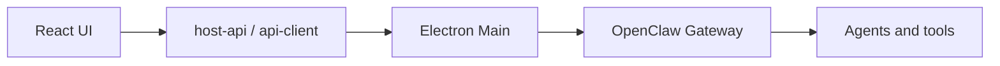

<p align="center">
  
</p>

# Verse Claw

**A desktop workspace for OpenClaw agents.**

[English](README.md) · [简体中文](README.zh-CN.md) · [日本語](README.ja-JP.md) · [Русский](README.ru-RU.md)

[Features](#features) · [Getting started](#getting-started) · [Development](#development) · [Documentation](#documentation)

Verse Claw brings chat, project workspaces, knowledge review and agent diagnostics into an Electron application. Configure a model, open a project and follow the work through visible tool results, approvals and task status.

Built with Electron 40, React 19 and TypeScript. The editable OpenClaw runtime lives in this repository.

> **Current scope:** controlled Windows x64 workflows are the primary local acceptance target. macOS and Linux have build targets; this does not imply equivalent validation on every platform. Context and memory enhancements retain their documented opt-in, shadow and approval boundaries. See the [product semantics](docs/clawx-product-semantics.md) and [capability matrix](shared/capability-claims.ts).

<a id="features"></a>
## What you can do

| Area | Workflow |
| --- | --- |
| Chat and models | Configure providers and models, manage conversations, attach context and inspect tool output. |
| Project workspaces | Work with Git changes, terminals, browser previews and code review alongside the conversation. |
| Tasks and agents | Start explicit role workers or bounded task loops; inspect progress, failures, checkpoints and approvals. |
| Knowledge | Search a source-backed library and review Inbox items, drafts and proposals. Applying a change requires explicit confirmation through the governed review path. |
| Channels and schedules | Configure supported channel plugins and scheduled jobs. Availability depends on the plugin, credentials and runtime configuration. |
| Diagnostics | Inspect session activity, traces, runtime status and Developer tools without treating diagnostic data as execution authority. |

The interface includes English, Chinese, Japanese and Russian, with light and dark themes. [Bundled UI screenshots](resources/screenshot/) are reference images and may differ from the current build.

### Permission boundaries

- Knowledge read scope does not grant write or apply permission. Suggestions remain drafts until reviewed.
- Context budgeting, Runtime Memory injection, SEKB automatic writeback and unattended/private-network browser access have separate gates. Installing the app does not enable all of them.
- Task-level evidence does not grant a product release, default-on rollout or blanket GA claim. [Validation records](artifacts/capability-claims/status-table.json) describe their own scope and candidate.

<a id="getting-started"></a>
## Getting started

### Run from source

Use **Node.js 24**, Git and the pnpm version pinned in `package.json` (11.2.2). The runtime has its own dependency workspace. Access to this repository is required to clone it.

```sh
git clone https://github.com/Baixu22/VerseClaw.git
cd VerseClaw
corepack enable
pnpm run init
pnpm --dir openclaw_runtime install --frozen-lockfile --ignore-scripts
node node_modules/electron/install.js
pnpm dev
```

`init` installs desktop dependencies and downloads uv and agent-browser. Electron's install script is explicit because dependency build scripts are restricted. `pnpm dev` first builds the runtime and prepares bundled skills, then starts Vite and Electron.

Native VerseShell resources and packaging have additional source/toolchain requirements; follow [the source and build contract](resources/verseshell/SOURCE.md). This checkout's entry point is source development; any distributed builds belong to [this repository's Releases](https://github.com/Baixu22/VerseClaw/releases).

### First session

1. Complete setup and configure a supported provider and model. Real model calls require valid provider authentication.
2. Open a trusted project as a workspace and choose its permission mode deliberately.
3. Start a chat, inspect tool results and respond to approval requests.
4. Use Knowledge's Library and Review Queue for reusable material; configure channels or scheduled jobs only when needed.

App navigation and many local tests do not require a paid model call. Source builds do not check for packaged updates; packaged updates depend on the configured release feed.

### Troubleshooting

- **Gateway not ready:** inspect its status and logs, then use OpenClaw Doctor in Developer settings.
- **Provider or channel unavailable:** check authentication, enabled plugins and proxy settings. A valid credential format alone does not prove connectivity or delivery.
- **Stale runtime in E2E:** run `pnpm run build:runtime` before testing a changed runtime. Do not bypass the freshness check.
- **Headless Linux:** Electron tests need a display server, for example `xvfb-run -a pnpm run test:e2e`.

<a id="development"></a>
## Development



Renderer calls go through `host-api` / `api-client`. Electron Main owns backend transport and desktop process supervision; the runtime owns agent execution. [Communication boundaries](harness/specs/scenarios/gateway-backend-communication.md) define the contract.

| Path | Purpose |
| --- | --- |
| `src/` | React UI, stores and renderer API facade |
| `electron/` | Desktop lifecycle, Gateway supervision and host services |
| `shared/` | Typed contracts, locales and capability boundaries |
| `openclaw_runtime/` | Editable runtime and plugin sources |
| `harness/specs/` | Scenarios, rules and task specifications |
| `tests/` | Desktop unit, integration and Electron E2E tests |
| `resources/` | Bundled assets and native-component provenance |

| Command | Purpose |
| --- | --- |
| `pnpm dev` | Start the development app |
| `pnpm run typecheck` | Check node, web and reported test types |
| `pnpm exec vitest run tests/unit/rc10-evidence.test.ts` | Run one focused desktop test file |
| `pnpm test` | Run the configured desktop and runtime test suites |
| `pnpm run build:vite` | Build renderer and Electron bundles |
| `pnpm run build:runtime` | Build the runtime |
| `pnpm run test:e2e` | Build and run Electron E2E tests |
| `pnpm contract:check` | Check host API contract alignment |
| `pnpm repo:artifacts:check` | Check source/archival boundaries |

Before changing a task-spec surface, run `pnpm harness context --spec <task-spec>`. Communication changes also require `pnpm run comms:replay` and `pnpm run comms:compare`. See [AGENTS.md](AGENTS.md) for repository rules and required validation.

Local Task Forest history, session handoffs and generated evidence are not fresh-checkout prerequisites. Keep source, fixtures and curated evidence tracked; follow [artifact retention and recovery](docs/dev/repository-artifact-retention.md).

<a id="documentation"></a>
## Documentation

- [Product semantics and controlled-preview boundaries](docs/clawx-product-semantics.md)
- [Development continuity](docs/dev/Sustained-Development-Playbook.md)
- [Runtime convergence and acceptance](docs/dev/unified-agent-system/runtime-convergence/README.md)
- [Knowledge-system design](docs/enhancements/knowledge-persistence/README.md)
- [Agent orchestration](docs/multi-agent-orchestration/README.md)
- [RC-09 preflight and RC-10 evidence integrity](docs/dev/pending-worktree-consolidation.md)
- [Security policy](SECURITY.md)

## Contributing and license

Keep changes scoped, include relevant regression coverage and update user-facing translations. Do not commit credentials, local task history or generated logs. Report issues and propose changes through this repository.

Verse Claw builds on [OpenClaw](https://github.com/openclaw/openclaw) and the ClawX work by the ValueCell team. See the [MIT license](LICENSE); bundled components retain their own license and source notices.
