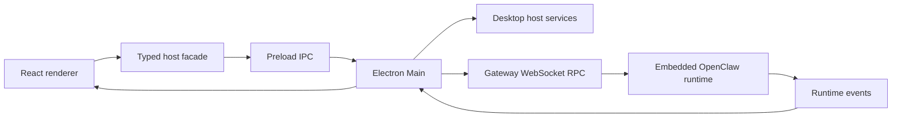

<p align="center">
  
</p>

Review Center includes a collapsed, opt-in Change Context view for four comparison modes, digest-anchored comments and explicit review verdicts. Pull Changes uses the existing approval, Git and Coding journal owners; review approval never completes a task or merges code. See [Workspace and coding](docs/modules/workspace-and-coding.md). The Windows source-host acceptance and feature-gate rollback are documented in [Controlled rollout](docs/dev/change-context-review-loop/rollout.md).

Provider spend limits can be enabled explicitly with `runtime.providerBudget` for host, project and session scopes. Child calls inherit the session owner's workspace; reservations and unknown costs are retained by the runtime owner. See [Resources and observability](docs/modules/resources-and-observability.md) for coverage and accounting limits.

# Verse Claw

Activating a project keeps its directory and permission policy aligned with the runtime while preserving the selected model.

Git initialization and worktree creation or switching are available inside the project menu, alongside the existing workspace choices.

Session controls retain drafts and show outcomes confirmed by their owners. Archive settings lists interrupted archive, restore and delete operations and continues the saved operation. Context changes verify the session generation; Storage preserves checkouts owned by tasks or sessions. Checkpoint recovery sends the current session generation and uses the conversation’s recorded working directory. Chat reads current connection readiness and session controls from the Gateway after reload.

Chat groups ordinary streamed text updates by animation frame. Approvals, cancellation, errors and completion publish immediately; completed message content stays stable while the active reply grows.

Long conversations use measured message heights to keep earlier loaded turns reachable within the DOM limit. History, preview and projection caches share a 32 MiB payload budget; evicted content reloads from the existing session and media owners.

Compatible filesystem subscriptions share native watchers while keeping independent filters and release handles. Knowledge sources resume after root recreation, and Main Git status reads share fresh results across windows.

Managed process lifecycles retain their shared executor until their own terminal result. Poll dispatch leaves room for stdin and cancellation, and captured output uses a shared byte limit with the existing artifact references.

Terminal PTYs and governed processes share declared host capacity. Known server ports are reserved before launch, stale terminal generations reject control, and uncertain exits retain their reservations for recovery. See [terminal resource ownership](harness/specs/guides/terminal-resource-ownership.md).

Resource pressure contracts new execution while running work keeps its slots. Agent queues have finite waiting limits and prompt cancellation. Disabling efficiency sampling stops diagnostic recording while resource protection and idle-process reclamation continue. See [resources and observability](docs/modules/resources-and-observability.md).

Opening the resource popover refreshes the current session's coordinator status and worker receipts.

Runtime-managed worktree ownership, creation stages and merge intent persist in SQLite across restarts. Replaced paths, incomplete setup and unknown merge outcomes retain their resources and reject stale execution credentials. See the [registration and recovery contract](harness/specs/guides/execution-domain-registry.md).

Managed tool effects combine task claims, session generations and durable checkout writers with the existing merge, freeze and cleanup owners. Writers persist between calls; unknown effects and background processes require owner reconciliation. The [writer contract](harness/specs/guides/checkout-writer-ownership.md) describes transfer, recovery and external-write boundaries.

Chat can continue the same conversation and task in another configured checkout. Migration retains the objective and artifact references, verifies source drain and target ownership, and resumes an interrupted transfer from its saved operation.

Session navigation restores the visible message and draft. Background work updates its own status while hovered or focused family rows stay in place. Empty projects, permission failures and dependency waits show specific reasons and existing next actions; dispatch plans remain separate from current queue observations.

Message Fork requires a recorded transcript boundary and shows why the action is unavailable. Suggestions to continue elsewhere use the existing editable Handoff preview; a new conversation is created only by its explicit action.

During a long task, **Send options** offers queueing, guidance and stop-then-send with a description of each outcome. Branching opens a conversation for your next message; summary handoff previews editable content before **Create and send**. Context organization and handoff sources keep technical details collapsed. [Conversation controls](docs/dev/chat-continuity-controls.md).

Handoff becomes available when the session identity finishes loading. Pending sidebar handoffs wait for that identity, and previews remain bound to the current session generation.
If activation is interrupted, retrying keeps the original child session and checks its generation before sending.

Conversations can initialize a Git repository, select an independent worktree, and restore its draft. `/storage` and **Settings → Storage** share a resource page for conversation files, process memory, and worktrees. [Usage and ownership](docs/dev/session-worktree-storage.md).

Composer menus use opaque neutral surfaces in both themes, show model brand icons and complete model names, and identify linked worktrees in conversation status.

Opening a conversation activates its owning workspace and restores its draft. Branch controls refresh the displayed checkout; related conversations expand under their source and appear once in the searchable session menu. [Session navigation](docs/dev/chat-worktree-session-navigation.md).

Session lifecycle views replay raw v2 trajectory events through one assembler. Verifier completion reports route configured repair tasks to the lead for independent re-verification.

Skill choices persist in the runtime configuration, and managed skills can be uninstalled from their details. Agent Dev reports collect normal chat and tool events and deduplicate token usage.

**Chat, code, knowledge and agent execution in one desktop workspace.**

[English](README.md) · [简体中文](README.zh-CN.md) · [日本語](README.ja-JP.md) · [Русский](README.ru-RU.md)

[Module deep dives](docs/modules/README.md) · [Getting started](#getting-started) · [Architecture](#architecture) · [Development](#development) · [Troubleshooting](#troubleshooting) · [Documentation](#documentation)

Verse Claw is an Electron desktop application built on an embedded OpenClaw runtime. It combines conversation, project workspaces, coding tools, knowledge review, memory, multi-agent orchestration, messaging channels, schedules and runtime diagnostics in one local desktop product.

This repository is more than a renderer wrapper. It contains the React UI, Electron Main host, typed cross-process contracts, the vendored OpenClaw runtime, VerseBrowser, the VerseShell execution foundation, retired VToken source, executable Harness specifications and the build/evidence/release pipeline.

> **Current status:** `0.4.9-alpha.0`, controlled preview. Windows x64 local workflows are the primary acceptance target. macOS/Linux have build targets, but platform-specific runtime validation is separate. Release, GA, live readiness and product approval are not implied by component graduation or agent-driven evidence.

## What is in the product

| Area | Current product shape | Deep dive |
|---|---|---|
| LLM and models | Account-based provider configuration, OAuth/API key/local auth, protocol adapters, model fallback, turn/session model overrides, streaming, tool loops, reasoning effort with a draggable text preview, usage and estimated cost | [LLM and models](docs/modules/llm-and-models.md) |
| Conversations and sessions | JSONL append-only session trees, runs, abort/stop/archive/delete, checkpoints, compaction, handoff/fork, searchable sidebar, persisted folders and long-session coordinator binding | [Sessions](docs/modules/sessions.md) |
| Context and memory | Context Orchestrator, 6,000-character managed-injection budget with separate post-orchestrator accounting, Workspace Context, context health, an unfilled circular chat TokenTag with compact recorded-source details and a Settings display switch, one reviewable Memory product over separate Role/Runtime stores | [Context and memory](docs/modules/context-and-memory.md) |
| Workspaces and coding | Workspace preflight, four permission modes, file preview, PTY terminals, web previews, Git operations, review panel, write journal, stale-write guard and auto verification | [Workspace and coding](docs/modules/workspace-and-coding.md) |
| Knowledge | Markdown/wiki-first library, Inbox → Draft → Steward → Proposal → explicit apply, Source Sets, OKF, Runtime Lessons/SEKB, provenance and governance | [Knowledge base](docs/modules/knowledge-base.md) |
| Multi-agent and tasks | Agent/Persona/Role separation, nine built-in roles, routing, team templates, resource-aware waves, subagent admission, Task Ledger, Task Loop and ClawGraph | [Multi-agent and tasks](docs/modules/multi-agent-and-tasks.md) |
| Task reports | Expand a persistent task card to inspect its source, runs, effects, candidate checks and retained evidence. Recorded model calls are counted once across coordinator and worker views; catalog prices are estimates and missing amounts remain unknown. | [Task reports](docs/modules/multi-agent-and-tasks.md) |
| Project and session navigation | Project names open their coordinator; the project view retains every explicitly associated coordinator across agents. Families expand within existing workgroups and show scoped tasks. Ledger history opens linked transcripts and checkpoint artifacts. Fork questions stay as drafts; Handoff creates and sends with restart recovery. | [Session and task flow](docs/modules/multi-agent-and-tasks.md) |
| Verse components | VerseGit repository/evidence control plane, VerseShell governed execution, VerseBrowser drivers, and retired VToken | [Verse tools](docs/modules/verse-tools.md) |
| Resources and observability | ResourceFabric with bounded per-operation latency feedback and memory/event-loop pressure control, background shedding, process tracking, token/cost limits and recovery | [Resources and observability](docs/modules/resources-and-observability.md) |
| Integrations and other surfaces | 15 channel types, schedules, Skills/MCP, Inbox, remote tasks, Code Review, VerseConf documents, media, Billing and Agent Dev | [Integrations and surfaces](docs/modules/integrations-and-surfaces.md) |

The detailed module documentation is currently maintained in Simplified Chinese; code paths, API names and linked evidence are language-neutral. The root READMEs remain the multilingual entry points.

Chat text and the input share the available conversation width. Adjacent tool operations form a folded group after each progress explanation. Folded summaries show an unboxed semantic icon and the latest operation text, entering left to right once with a continuous white running shimmer. Only the current running folded summary animates its Lucide icon; expanded rows and settled operations keep static icons, including on hover. Reduced motion keeps icons and text static. Expanded tool and command rows keep their progress strips, background, timer and completion check. Icons reflect file types, Git, browser actions, tests, builds, packages, memory, databases and agents. Expanding a group shows its calls, arguments, results, command output and file changes in order. Completed groups stay static and retain manual disclosure state. Final replies, delivered resources and pending requests remain accessible. Long previews keep wrapping and copy the complete retained content. Completed replies keep response-aligned actions and usage information.

Session status uses a single surface, with completed processes folded into history. Opening a process uses the same terminal view as the conversation, including output copying and scrolling that respects earlier lines being read. Matched tool calls and results share one disclosure; diagnostics stay at the end.

The session environment appears after actual changes or activity. It groups changes, observed MCP/skill usage and workers into short previews with details on demand. Automatic expansion sits beside the conversation; manual opening uses a compact overlay. Closing the workspace preserves its tabs and selected content.

Empty Chat shows a project picker below the composer; its menu includes local checkout and linked-worktree controls. Loaded empty chats retain these local controls when the Gateway disconnects. Starter actions open through Quick start. When files change, a compact review bar above the composer shows the branch and unique changed-file count; Review changes opens the review panel, while branch search, checkout, and worktree actions stay in its menu. The composer controls and review bar adapt to the conversation column, while live command output stays in event order and wraps within that column.

On touch screens the composer actions have a minimum 44 px target. Rejected plan updates stay in the execution details instead of replacing the displayed plan.

Composer model, knowledge and permission menus share a compact surface and the add menu's blur transition. Menus stay within the window, close when another opens, and support Escape and reduced motion.

The composer model button opens a compact reasoning card with the current model and a Preview Slider. Clicking the model unfolds a searchable, provider-grouped Rare UI picker and hides the reasoning controls. The slider's floating preview shows localized effort text. New chats start with your last available model; existing chats retain their own choice. Switching applies to subsequent messages. Agent defaults are managed in Settings.

Pending runtime approvals replace the owning conversation's input area with the command, working directory and offered choices. The rest of the page stays usable; resolving the requests restores the original input, draft and attachments.

Questions, choices, plan proposals and permission requests use one decision surface in the composer's position. Runtime approvals take priority, followed by workspace permissions and other requests. The draft stays mounted while the decision surface is active and returns when requests are resolved; interrupted question selections are retained. These surfaces share the composer's material, rounded outline and action row. Running plan progress leaves the composer when its run ends, and its history remains in the process disclosure. The activity panel reuses the sidebar's session rows, including pinning, rename and context menus.

Conversations show what a turn produced, whichever tool produced it. Audio and video play in place with native controls, and say so if a file is missing, too large or unplayable. Images from any source share one viewer; remote images and media are never loaded automatically and offer an open action instead. Charts draw their declared type with a data table available, standalone links become link cards, and any other structured resource gets a labelled fallback card.

## Current maturity boundaries

| Label | Meaning |
|---|---|
| `default` / `advanced` | A current product surface, within the stated controlled-preview boundary. Not a GA claim. |
| `internal` | Implemented or exposed internally without an independent user product entry. |
| `shadow` / `experiment` | Observation or bounded experiment; it does not own routing, writes or approval. |
| `retired` | Kept only for compatibility, provenance or rollback inspection. |
| `agent-driven` | Evidence produced by an agent and labeled as such. It is not real-human evidence. |

The current machine-readable component catalog contains 54 rows: 13 default, 12 advanced, 23 internal, 6 retired and 0 experiment. Classification is not runtime proof. See the [component disposition matrix](docs/dev/component-disposition-matrix-20261021.md).

Important current defaults:

- Workspace Context and read-only DCS context tools are on under their declared health and permission gates.
- Runtime Memory injection, SEKB automatic writeback and browser private-network access are not default-on.
- SEKB records explicit use of a principle by its version and run, with operational and independently graded outcomes kept separate. Memory feedback remains diagnostic and does not affect retrieval ranking or retention. See [RSI evidence and boundaries](docs/dev/rsi-capability-and-boundaries.md).
- Controlled RSI prompt research records parent versions, training attribution and frozen validation decisions. Staged candidates bind to a separately sealed evaluation plan.
- VToken is retired; its old environment/config names cannot re-enable production assembly or the sidecar.
- VerseGit and VerseShell remain default-off; their host integrations retain the boundaries described below.
- Dreams is retired. Image Generation is developer/test-gated rather than normal product navigation.
- `liveReady=false`, `productApproved=false` and `defaultOn=false` remain product locks.

<!-- VERSE-TOOLS-BOUNDARY-START -->
**VerseGit bounded coding loop:** default-off, not approved for general availability. The bounded win32-x64 M1 provider supplies repository facts; candidate verification uses VerseShell, while the host owns the write journal and Git apply. M4 landing/admission is unauthorized; `liveReady=false` and `productApproved=false` remain locked. VerseShell stays default-off. VerseBrowser accepts only available runtime actions with an owning session; host-only approvals cannot be supplied by the model, and request-level private-network checks cover redirects and subresources. See [Verse tool boundaries](docs/modules/verse-tools.md).
<!-- VERSE-TOOLS-BOUNDARY-END -->

See the [default configuration matrix](docs/dev/default-config-matrix.md), [product semantics](docs/clawx-product-semantics.md) and [capability claims](shared/capability-claims.ts) before changing a default or making a release claim.

## Inside the app

The screenshots below were captured from the Windows Electron source build on 2026-10-05. The header now uses the later B2 identity. The Knowledge capture explicitly enables `memory-wiki`; no model account or model request was used.

| **Chat and task entry**<br>[](resources/readme/2026-10-05/en/chat.png) | **Knowledge library and review entry**<br>[](resources/readme/2026-10-05/en/knowledge.png) |
| --- | --- |
| **Task Ledger**<br>[](resources/readme/2026-10-05/en/tasks.png) | **Models and provider settings**<br>[](resources/readme/2026-10-05/en/settings.png) |

See [visual provenance](resources/readme/2026-10-05/README.md) for capture conditions and hashes.

<a id="getting-started"></a>

## Getting started

Prerequisites:

- **Node.js 24.16.0 or later in the 24.x line** and Git. Earlier Windows Node 24 releases can crash in TCP connections.
- **pnpm 11.2.2**, pinned in `package.json`.
- Network access for dependencies, Electron, uv and agent-browser.
- A provider account or a compatible local model service.

Run from the repository root:

```sh
git clone https://github.com/Baixu22/VerseClaw.git
cd VerseClaw
corepack enable
corepack prepare pnpm@11.2.2 --activate
pnpm run init
pnpm --dir openclaw_runtime install --frozen-lockfile --ignore-scripts
node node_modules/electron/install.js
pnpm dev
```

`pnpm dev` builds VerseBrowser, the embedded runtime and bundled skills before opening Vite and Electron. The Gateway normally needs 10–30 seconds to become ready. A Vite page alone does not provide the full Electron Host services.

Queued configuration reloads already included in a successful Gateway launch are consumed at startup. Later changes and explicit restart requests run after the current startup or restart finishes. An explicit stop cancels pending restart work, including cooldown waits and startup recovery.

Source launches initialize session services through the normal runtime startup path in both ordinary and test windows.

Built Gateway startup tries native loading for resolved JavaScript doctor contracts before preparing SDK aliases. Mounted source overlays and external plugins keep their own contracts, and migration checks still run. After `pnpm run build:runtime`, use `node scripts/measure-gateway-startup.mjs` for an isolated, loopback-only comparison with fresh caches; every accepted sample must exercise the loader and complete an authenticated RPC.

First session:

1. Complete Setup.
2. Configure and validate a provider/model.
3. Choose a project directory, permission mode and workspace.
4. Send a scoped conversation and inspect the workspace panel.
5. Resolve approvals in Inbox.
6. Use Knowledge or Memory only through their review surfaces.
7. Manage a conversation from its row: hovering shows Pin and ⋯ (rename, move to a workgroup, mark unread, fork, hand off, copy, archive with Undo, delete); right-click opens the same menu, and long titles scroll while hovered.
   Related conversations use a shallow indent and a quiet guide; their count stays visible when expanded or collapsed. The compact header keeps unboxed workspace and conversation names. Click the title to search, switch or return to a source conversation; More holds checkpoints, fork, handoff, refresh, recovery, migration and memory tools. Starting a new conversation saves the current draft first; a refused creation keeps the source conversation and draft. Dark mode separates the sidebar, reading surface and raised composer with graphite tones. Empty task scopes remain available from the header. Settings → Session & Recovery offers a quiet display preset.
8. While a conversation runs or waits for you, the sidebar bell uses the same animated status as its row; settled activity uses a static semantic icon. When idle, the bell shows the latest unread result and returns to its bell glyph after the feed is read. Its badge counts unread activity. The panel shows running conversations with elapsed time, plus completion, error and approval events. System alerts can be toggled there or in Settings → Session & Recovery. The Settings control stays bottom-anchored when the sidebar is collapsed.

Configured packages are listed in Releases. A build target does not guarantee a downloadable package for the current version.

| Platform | Configured artifacts | Validation scope |
|---|---|---|
| Windows x64 | NSIS | Primary controlled local acceptance target |
| macOS x64 / arm64 | DMG, ZIP | Build targets; capability-specific validation required |
| Linux x64 / arm64 | AppImage, DEB; RPM x64 | Build targets; graphical runtime required |

<a id="architecture"></a>

## Architecture

The ordinary request path is:

```text
React renderer
  -> typed host facade (src/lib/host-api.ts)
  -> preload IPC
  -> Electron Main (authorization + dispatch)
  -> Host service and/or Main-owned Gateway WebSocket RPC
  -> embedded OpenClaw runtime
```

Runtime events return through Main and `host-events.ts` to renderer stores. Local files, terminals and Git can complete in Main without traversing Gateway.

This is not a universal `WS -> HTTP -> IPC fallback` chain. Renderer pages must not open direct Gateway connections or add direct Electron IPC calls. `shared/host-api/contract.ts` is the typed shared boundary.



Main repository layers:

- `src/`: renderer, pages, components, Zustand stores, Host facade, i18n and styles.
- `electron/`: Main services, IPC security, Gateway supervision, preload and desktop utilities.
- `shared/`: Host API/events, domain types, i18n resources, authority/default manifests.
- `openclaw_runtime/`: vendored runtime, Gateway, agents, tools, channels, packages and extensions.
- `packages/` and `resources/`: VerseBrowser, VToken, VerseShell, skills, plugins and native assets.
- `harness/`, `tests/`, `scripts/`: executable policy, tests, automation and evidence tooling.

See the [architecture guide](docs/architecture-overview.md) and [repository layout](docs/dev/repository-layout.md).

## Local data and privacy

No separate database server is required.

- Desktop settings and exports live under Electron `userData`.
- Runtime configuration normally lives under `~/.openclaw`, with `OPENCLAW_CONFIG_DIR` support.
- Sessions use JSONL transcripts; runtime state also uses SQLite.
- Token history is aggregated from structured session usage records. Costs are estimates.
- Daily model usage keeps different years separate and displays the year in each date label.
- Knowledge uses a `memory-wiki` vault plus local governance metadata.
- Knowledge imports keep same-named sources separate, reviewed creates reject collisions, and interrupted governance commits resume from recorded Wiki effects. Removed preinstalled skills stay removed across restarts.
- Watched folders reconcile additions, updates and withdrawals into versioned review candidates, including changes missed while the app was stopped.
- Librarian questions and bounded follow-ups use admitted evidence through the configured Gateway model; exact quotations and source versions are checked. Partial reads, conflicts and model failures remain visible. Studio keeps review-only excerpts.
- Chinese lexical retrieval, bounded long-document continuation, a provider-scoped embedding cache and version-bound Steward findings share the same admission boundary. An opt-in public GitHub directory connector sends updates and withdrawals to Inbox; other SaaS connectors are not implemented.
- Logs, traces, screenshots, Task Forest state and handoffs are local working data unless explicitly curated.

Local storage does not mean offline execution. Content sent to online models, channels, browsers or external tools reaches those services under their configured credentials and network policy. Keep secrets and private transcripts out of commits and public issue reports.

VerseBrowser: install/dev/build compile the embedded module automatically. The 81-method contract is not 81 implemented Electron capabilities; see [invocation and driver limits](packages/README.md#versebrowser-integration-and-invocation). Private-network navigation requires a Main-owned approval bound to the session and origin. Agent-driven verification performs that approval in Main; caller-supplied approval markers grant no access. Full access stays bound to the approved tab and origin. Network details, request comparisons, parameter candidates and JS snippets are redacted when the approval changes during a read. Background JS, SourceMap and replay requests use the same profile network policy. A replay approval permits one dispatch, including when its response is lost. Replay rejects credential fields in URLs, headers and request bodies before preparing a draft. Cancelling or pausing a task aborts its run; late callbacks cannot overwrite a retry. Failed navigation clears its wait state so subsequent navigation starts independently. Browser cleanup releases occupancy after the original window confirms it has closed.

<a id="development"></a>

## Development and validation

Common commands:

| Command | Purpose |
|---|---|
| `pnpm dev` | Prepare resources/runtime and start Electron development |
| `pnpm run build:vite` | Build renderer and Electron bundles |
| `pnpm run build:runtime` | Build embedded runtime and smoke-test Gateway startup |
| `pnpm run typecheck` | Full node/web/test typecheck |
| `pnpm run lint:check` | Lint without modifying files |
| `pnpm test` | Root test groups and selected regressions |
| `pnpm run test:e2e` | Build and run Electron Playwright |
| `pnpm contract:check` / `pnpm i18n:lint` | Host contract and four-language coverage |
| `pnpm run harness:ci` | Repository Harness baseline |
| `pnpm run repo:artifacts:check` | Source/evidence/archive boundaries |
| `pnpm run docs:policy:validate` | Durable documentation policy |

For task-spec work:

```bash
pnpm harness context --spec <task-spec>
pnpm harness validate --spec <task-spec>
pnpm harness run --spec <task-spec> --dry-run
```

UI changes should include Electron E2E and en/zh/ja/ru strings. Communication changes also require `pnpm run comms:replay` and `pnpm run comms:compare`. Packaging success, installer success and release authorization are separate facts.

The [personal-agent QA pack](openclaw_runtime/qa/README.md) runs ten Gateway scenarios with a scripted provider and deterministic final-state checks. Its source-host evidence covers control flow, denial and recovery; live-model quality and packaged behavior have separate acceptance gates.

The [Responses acceptance contract](harness/specs/tasks/product-acceptance-space-bunny.md) covers text after reasoning, one tool round trip, session isolation, cancellation and provider failures on a configured local service. An interrupted Responses stream cannot finish a turn successfully or dispatch an incomplete tool call. These checks do not approve a model or a release.

The [core product matrix](harness/specs/tasks/product-acceptance-matrix.md) maps nine journey groups to frozen test sources and records each batch's execution results and outstanding acceptance checks. Serial batches can reuse the same verified build with `--build-proof`; their execution budgets follow the declared case timeouts.

See [development and validation](docs/modules/development-and-validation.md) for the full gate map and evidence rules.

<a id="troubleshooting"></a>

## Troubleshooting

| Symptom | What to check |
|---|---|
| Knowledge shows `unknown method: wiki.status` | Use Knowledge configuration to enable plugin loading and `memory-wiki`, then initialize the vault. Configuration reports any existing plugin policy that blocks activation. |
| Wrong pnpm version / install failure | Check Node.js 24.x, pinned pnpm, both dependency workspaces and lockfiles. |
| Missing Electron executable | Run `node node_modules/electron/install.js` and check download connectivity. |
| Gateway stays unavailable | Inspect Settings → System & Runtime and logs; run Doctor before Doctor Fix. |
| Provider or channel unavailable | Check auth, model, plugin enablement, account status, proxy and real request/delivery evidence. |
| Tool write or command is blocked | Check workspace root, permission mode, path boundary and Inbox approvals. |
| E2E reports stale runtime | Run `pnpm run build:runtime`; rebuild the app as well if app sources changed. |
| Electron fails on headless Linux | Provide a display server, for example `xvfb-run -a pnpm run test:e2e`. |
| VerseConf PPTX export fails | Check plugin activation and the three-record template limit; use Markdown for longer outlines. |

<a id="documentation"></a>

## Documentation

| Topic | Entry points |
|---|---|
| Module-by-module current implementation | [Module deep dives](docs/modules/README.md) |
| Architecture and data flow | [Architecture guide](docs/architecture-overview.md) · [Runtime control planes](docs/dev/runtime-control-planes.md) |
| Product boundaries and defaults | [Product semantics](docs/clawx-product-semantics.md) · [Default configuration](docs/dev/default-config-matrix.md) · [Component matrix](docs/dev/component-disposition-matrix-20261021.md) |
| Knowledge and context | [Knowledge system](docs/enhancements/knowledge-persistence/README.md) · [Context Runtime Kit](docs/context-runtime-kit/README.md) · [Context orchestrator](docs/dev/context-orchestrator.md) · [Memory control plane](docs/dev/memory-control-plane.md) |
| Agents and tasks | [Role-first design](docs/role-first-design.md) · [Multi-agent orchestration](docs/multi-agent-orchestration/README.md) |
| VerseGit / VerseShell / VerseBrowser | [VerseGit control plane](docs/dev/versegit-validation-layer/README.md) · [VerseShell status](docs/dev/verseshell-foundation/STATUS.md) · [VerseBrowser integration](packages/README.md) |
| Development and evidence | [Development docs](docs/README.md) · [Agent Dev](docs/agent-dev-control-plane.md) · [Repository layout](docs/dev/repository-layout.md) · [Harness](harness/specs/) |

Historical plans and acceptance snapshots have their own dates and candidates. Current behavior should be established from source, default manifests and fresh evidence, not from the age or length of a design document.

## Contributing and license

Keep changes scoped, provide relevant validation and update all four root READMEs when behavior changes. For a functional or architecture change, also update the relevant module document under `docs/modules/`, the product semantics/default matrix when applicable, and reusable Harness specifications.

Verse Claw builds on [OpenClaw](https://github.com/openclaw/openclaw) and the ClawX work by the ValueCell team. The repository uses the [MIT license](LICENSE). Bundled components retain their own licenses and source obligations, including [VerseShell notices](resources/verseshell/SOURCE.md). Compact conversation/workspace interactions, including web-search source cards, adapted from [Rare UI](https://rareui.com) by Swami Malode retain attribution under `src/components/rareui`.

### Persistent task execution

Worker details show task acceptance from the task owner for the displayed session. Once the task owner accepts the verified evidence, refresh to read the accepted result. Recorded verifier checks and task-owner acceptance are shown separately; worker links in the ledger open their transcript panel.

Task Ledger → Persistent tasks saves objectives, constraints and acceptance checks independently of chat history. Sessions claim tasks in a repository shared by its local Git worktrees. Task execution checks ownership before managed tool calls and restores the current goal before model requests. Configure either an exact file-content check or a command check with declared input files; commands use the existing tool permissions. See [task-system architecture](docs/dev/durable-task-system/PLAN.md).

Ask the project coordinator to plan a goal. The task panel shows the saved tasks and plan versions, including the next action, assumptions, and pending decisions. A revision preserves prior tasks and acceptance records.
Ask the coordinator to take the next step in that plan. It claims the first task whose dependencies have passed acceptance and waits if another plan task in the project is still being worked on.
Open the plan’s task menu and choose **Dispatch next plan task** to start one worker. Dispatch requires a project token or cost budget. The worker uses the configured role and model policy.
Completed workers resume the coordinator that started them. Completion retries preserve its session generation. Results for a replaced generation or a coordinator that handed off are rejected before a model call; the successor resumes from the saved task checkpoint.
After a Gateway restart, an interrupted coordinator with a valid task claim resumes from the saved checkpoint once the previous process has exited and no task effects are unsettled.
Pausing dispatch keeps the current run and lets you cancel its task or reconcile pending effects. Stopping a run keeps the task and its checkpoint.
Cancelling a delegated task stops its worker and prevents late results from resuming the coordinator. A failed worker with settled effects releases its claim and leaves an unaccepted checkpoint; the coordinator can continue an independent ready task within its budget.

Managed worktree cleanup preserves historical task artifacts under verified Git references and records the retained bytes in the original task history. Agents can trace acceptance and read those artifacts after the checkout is removed. Active tasks, unresolved effects and artifacts without a matching retained snapshot keep the checkout available.

Cleanup retains ignored files, hidden Git index edits, and in-process files or permissions without a verified retained copy. Git and Storage deletion entries use the same hidden-index check; a confirmed native dirty-file refusal keeps the checkout retryable, while an unknown deletion result retains its execution reservation.

Git and Storage deletion also serialize their final ownership check and native removal with Task creation and claiming, so a new task cannot claim a checkout while it is being removed.

Changing the implicit main agent's model or name preserves its workspace inheritance, so later project switches remain the execution directory source. Explicit agent workspace settings remain explicit.

Search and filter the task list, then load further pages. Agents can suggest related tasks and decompose a goal into dependent tasks while retaining the parent goal and constraints. Cancelling a plan waits for in-flight effects to settle. Acceptance and recovery read receipts from the existing runtime owners.

Conversation tasks are managed by the agent. The task strip shares the execution tray above the input. Its collapsed row shows the objective, a neutral step count and actions when attention is needed; current steps open on demand. Click it to expand the live steps; archived plans remain in the turn summary. Finished run steps retain the task’s current acceptance state, and an accepted task folds to a receipt. Its menu copies the task ID, opens the Task Ledger or hides the strip. The knowledge control combines source, invocation mode and retrieval profile in one menu; non-local profiles remain visible on the control. Queued messages and failures appear inside the input, while checkpoint and intervention records open on demand. A failed initial task read offers an inline refresh and preserves the draft. The session task header stays quiet when its scope is empty. The session status panel shows context usage, connectors, reviewable changes and background work. Changed files reveal a review strip, with branch and worktree operations in its menu. The composer preserves model names and uses a single-line ellipsis only when they exceed the available width; the full identity remains in the tooltip and model list. Send, Stop and Resume share a circular button with a high-contrast icon. The input uses a 22px radius and sent messages use 12px corners with opaque surfaces and fine borders.

Before a new conversation starts, the input tray shows the project and a searchable branch selector. It closes when a run starts and stays hidden for conversations with history. A new empty conversation shows setup again; task progress remains visible when relevant. Directory and worktree actions are available in More. Open its settings and choose Create and open to make a worktree with an automatically named branch; custom names and starting branches are optional. Switching back restores the original conversation and draft. The task row shares the tray, and the input has a matte 22px outline. Creation replaces the input with real save, create and open stages; Stay in this conversation keeps the completed worktree available and restores the draft.

Recovery implementation and evidence: the opt-in execution writer persists tool lifecycle phases on TaskFlow, claims work before effects, and resumes only owner-authorized work. Both lifecycle and execution writers must explicitly select `taskflow`; defaults remain `legacy`. Unknown effects require reconciliation. Recovery follow-up fixes pending-delivery run ownership and startup recovery ordering; see the [follow-up verification](docs/dev/recovery-contract/FOLLOWUP-20261106.zh-CN.md). The [2026-11-05 evaluation](docs/dev/recovery-contract/FINAL-20261105.zh-CN.md) retains 60 live answers and 30 primary fault windows. Candidate outcome classification improves, while frozen latency gates return FAIL/NO-GO.

Gated subagent recovery (`OPENCLAW_RECOVERY_AUTHORITY_MODE=authority`, with both writers selecting `taskflow`) commits its decision and budget before RPC and preserves unknown outcomes for reconciliation. Recovered tool events enter the current run subscription to update delivery and completion records. See the [recovery admission guide](docs/dev/recovery-contract/GA-READINESS-20261106.md).

Managed worktree integration preserves deletions, renames and binary bytes through the existing Coding journal. Persistent worktree receipts reconcile duplicate completion and restart, while target drift refuses an overwrite. Cleanup preserves undeclared and ignored local files. Executable permission changes are refused before integration.

Tasks with an independent review criterion submit a candidate for a read-only reviewer. The coordinator can repair it once when the task allows it, rerun checks and request a fresh review before acceptance. Review results stay bound to the submitted files, and repair counts survive restart and handoff.

System overview in the sidebar reads each registered project independently, including its plan, next action, coordinator and verification references. Open a project by name to enter its coordinator. Failed refreshes retain the previous observation with its timestamp; unattributed resource usage and cost remain unknown.

Project continuity reads accepted context for the bound tasks and rechecks coordinator identity before sending. Handoffs retain task goals, constraints, pending decisions, progress and artifact references. Missing or changed artifact bytes remain explicit; oversized critical context stops the send with a diagnostic.

System overview can dispatch the next ready task for an explicitly bound project without switching the active workspace. Each request uses that project’s permissions and budget. Global pause blocks new dispatches and managed effects while admitted effects settle; resuming a project cannot override the global pause.

Project configuration supports typed previews for an exclusive project Agent. It may select an existing model with known non-increasing prices, add tool restrictions, or reduce context limits. Applying verifies the loaded Runtime generation; reload failures roll back only the fields changed by that operation. Pending or degraded operations can be recovered from the project card after reopening the app.

Mission experience remains a reviewable candidate, bound to the originating session with source references and a 24-hour expiry. Mission Control and the main chat can reuse approved experience only in its originating session. The 24-hour limit also applies to cold cards; revocation, replacement and expiry stop subsequent reuse. Delivery to a model also depends on the existing shared context budget. The panel follows lifecycle events from its current session. Running Missions can be paused or cancelled while their request is pending; the panel retains confirmed control state when an older run response arrives. Once pause, cancel or resume is accepted, Runtime settles the older tick and retains its execution evidence. Changing the default Agent or its session resets the Mission projection; delayed replies keep their original session scope. The role catalog loads when the panel opens; an empty catalog stays idle until reopened or manually refreshed.

The task ledger opens a compact persistent-task list. Rows show the objective, state and next step; ownership, acceptance and actions expand on demand. Task reports show recorded timing in a short summary, with usage and complete records in details. The system overview uses the same list hierarchy for project goals, progress, evidence and configuration.
