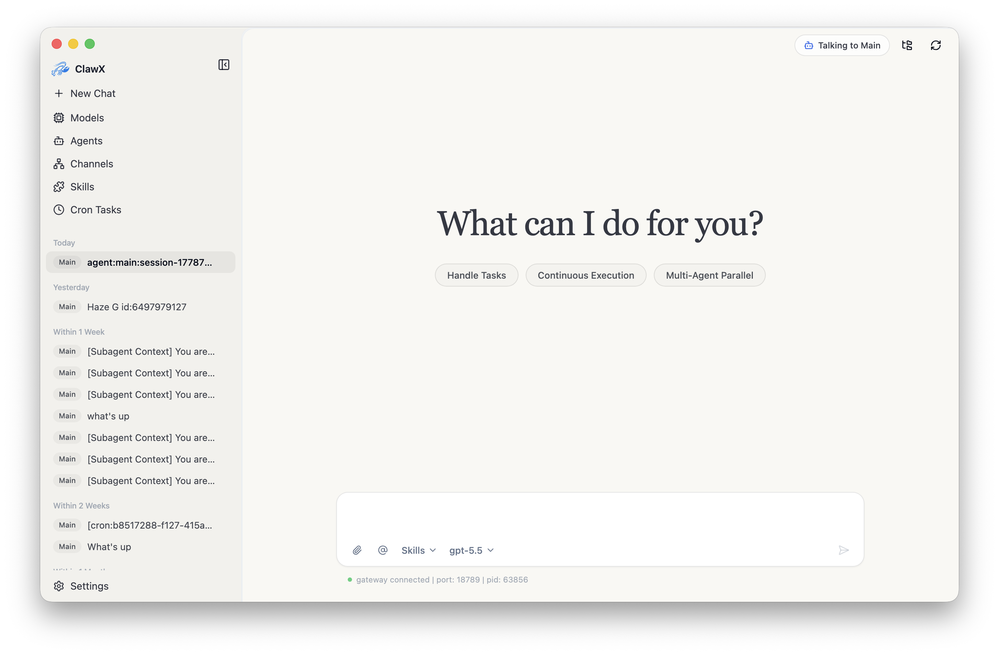
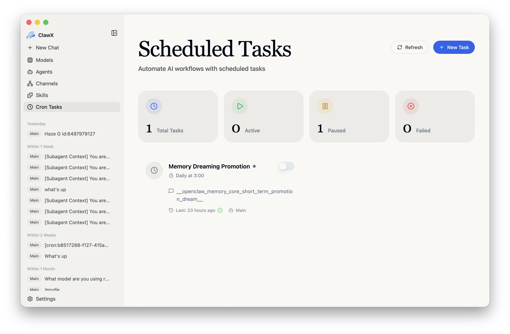
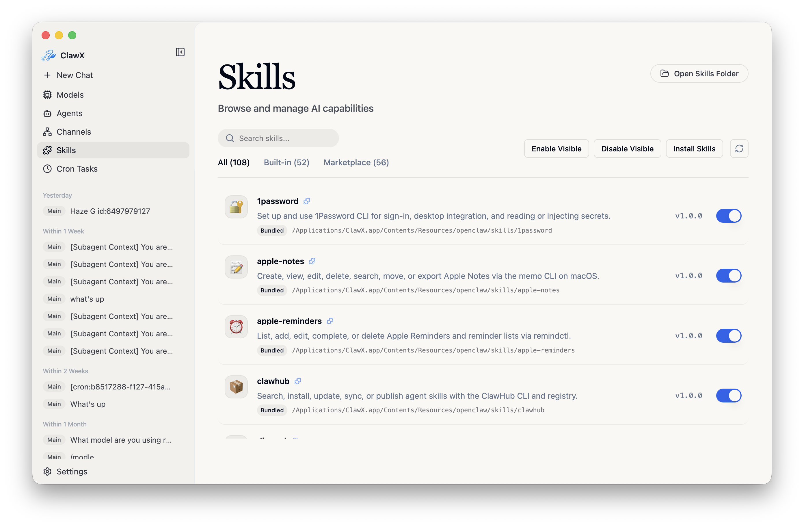
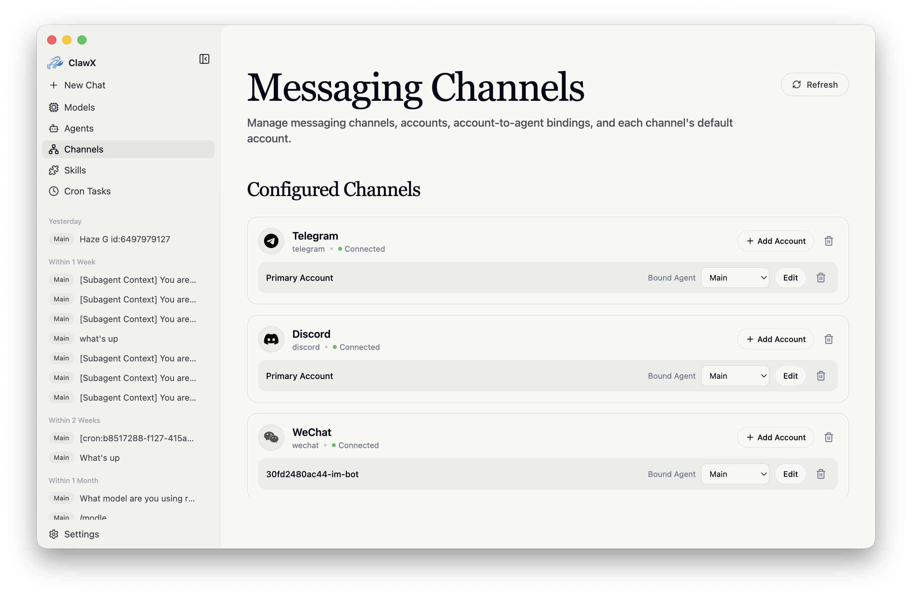
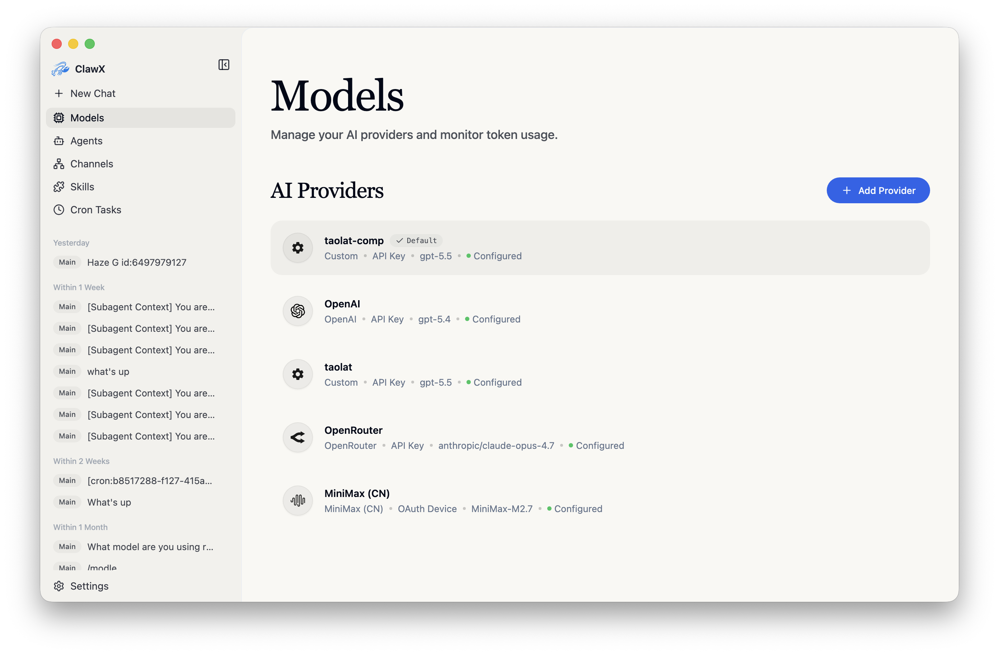
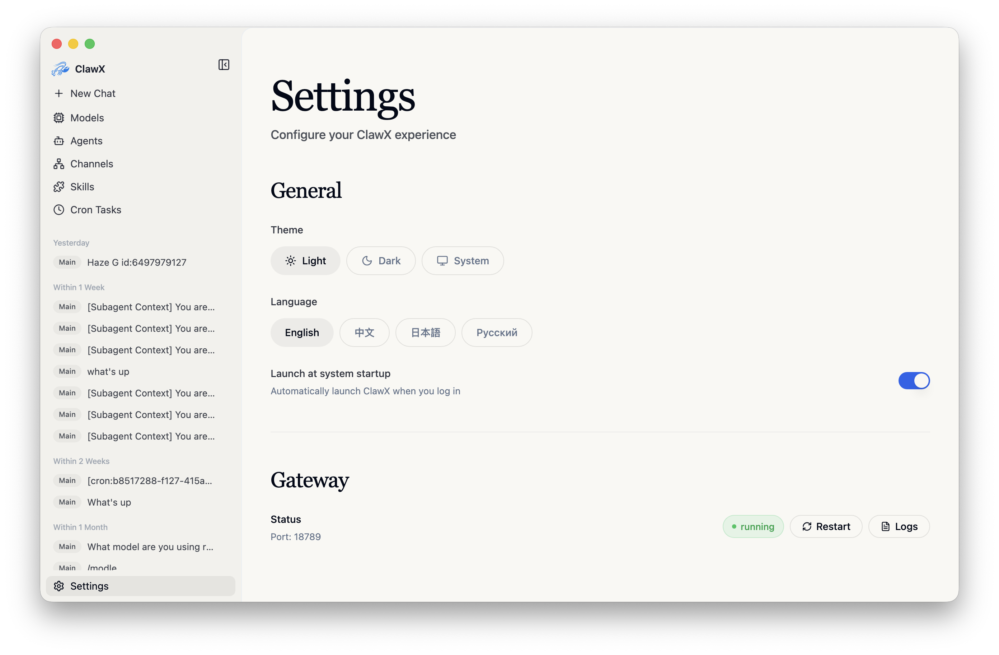

<p align="center">
  
</p>

<h1 align="center">Verse Claw</h1>

<p align="center">
  <strong>The Desktop Interface for OpenClaw AI Agents</strong>
</p>

<p align="center">
  <a href="#features">Features</a> 鈥?
  <a href="#why-clawx">Why Verse Claw</a> 鈥?
  <a href="#getting-started">Getting Started</a> 鈥?
  <a href="#architecture">Architecture</a> 鈥?
  <a href="#development">Development</a> 鈥?
  <a href="#contributing">Contributing</a>
</p>

<p align="center">
  
  
  
  <a href="https://discord.com/invite/84Kex3GGAh" target="_blank">
  
  </a>
  
  
</p>

<p align="center">
  English | <a href="README.zh-CN.md">绠-浣撲腑鏂?/a> | <a href="README.ja-JP.md">鏃ユ湰瑾?/a> | <a href="README.ru-RU.md">袪褍褋褋泻懈泄</a>
</p>

---

## Capability Claim Boundary

Product capability statements must be checked against the canonical matrix in `shared/capability-claims.ts` and the generated status table in `artifacts/capability-claims/status-table.json` before being described as implemented, productized, stable, or end-to-end verified. The local gate `node scripts/check-capability-claims.mjs <files>` warns when high-confidence claims lack matrix, E2E, or real-runtime evidence.

## Windows x64 Controlled Preview Scope

The current first-product validation target is **Verse Claw Windows x64 - DCS Coding Controlled Preview**. The path is internal, single-workspace, explicitly `opt-in`, and includes provider/model verification, controlled read/write/test/undo, runtime acknowledgement, restart recovery, kill/rollback, and a redacted support bundle.

Post-write automatic verification is also opt-in and default-off. When enabled, Verse Claw detects one bounded project test command and runs it through the existing effective `exec` policy, approval, sandbox, and timeout path; the pass, failure, skip reason, and bounded output tail remain visible without rolling back a successful write.

For DCS-enabled coding turns, knowledge, recent actions, and the tool registry now report their actual provider-visible prompt growth through the existing shared turn-injection ledger. The fixed budget is not enlarged: enabled DCS projections retain their existing bounded capacity, while truncation and drops remain explicit accounting evidence.

This scope does not include Runtime Memory injection, SEKB automatic writeback, unsupervised or private-network Browser use, automatic C6/C7 cutover, Coding WAL, automatic repository merge, or multi-forge/DAG expansion. Engineering and real-process tests are available; human canary evidence and release approval are still pending. The canonical one-label component inventory is in [`docs/clawx-product-semantics.md`](docs/clawx-product-semantics.md#windows-x64-controlled-preview).

## Overview

**Verse Claw** bridges the gap between powerful AI agents and everyday users. Built on top of [OpenClaw](https://github.com/OpenClaw), it transforms command-line AI orchestration into an accessible, beautiful desktop experience鈥攏o terminal required.

Whether you're automating workflows, managing AI-powered channels, or scheduling intelligent tasks, Verse Claw provides the interface you need to harness AI agents effectively.

For controlled autonomous execution, the Agents orchestration panel now includes a bounded **Task loop** that coordinates role subagents, self-checks evidence, runs scoped repairs, surfaces live status, and stops as `blocked` when confidence or permissions are insufficient.

The same Agents -> Roles & Orchestration surface now includes a **Lightweight Subagent Runner** for common no-YAML workflows. Users can choose Explorer, Reviewer, Tester, or Compare 3 approaches, enter a goal, and launch explicit role workers through the existing Gateway permission path while Verse Claw shows live worker status, summary, failures, and an Observability trace link.
Role-first orchestration runs also render a read-only synthesis that keeps verifier decisions, evidence counts, trace counts, and visible failures in view.

For goals that need to survive long conversations, checkpoints, evidence review, and explicit scheduled ticks, the Agents panel now includes **Mission Control**. It starts or resumes a Mission through `mission.run`, persists Mission state, rebuilds bounded context from ResumeCheckpoint, Task Ledger, memory, and trace evidence, runs one inner `task_loop` per tick, then lets the reviewer decide continue, repair, sleep, ask the user, complete, or block.
Mission and Task loops now carry internal Engineering Control Signals such as `evidence_gap`, `validation_missing`, `scope_drift`, `unverified_claim`, and `replan_required`; these signals stay in checkpoints, lifecycle events, and Task Ledger metadata, and they prevent trace-only or inner-loop-only results from being treated as durable completion facts.

For long tasks that need stable decomposition across many worker turns, **ClawGraph Runtime** adds workspace YAML workflows, DAG execution, stateless role-worker handoffs, audit checks, and user review without stuffing the whole workflow into one chat transcript.

Verse Claw comes pre-configured with best-practice model providers and natively supports Windows as well as multi-language settings. Of course, you can also fine-tune advanced configurations via **Settings 鈫?Developer 鈫?Developer Mode**.

<p align="center"><strong style="font-size:1.1em; text-decoration: underline;">For a full enterprise edition, dedicated service support, or tailored deployment guidance for your business scenario, contact us at <a href="mailto:public@valuecell.ai">public@valuecell.ai</a>.</strong></p>

---
## Screenshot

<p align="center">
  
</p>

<p align="center">
  
</p>

<p align="center">
  
</p>

<p align="center">
  
</p>

<p align="center">
  
</p>

<p align="center">
  
</p>

---

## Why Verse Claw

Building AI agents shouldn't require mastering the command line. Verse Claw was designed with a simple philosophy: **powerful technology deserves an interface that respects your time.**

| Challenge | Verse Claw Solution |
|-----------|----------------|
| Complex CLI setup | One-click installation with guided setup wizard |
| Configuration files | Visual settings with real-time validation |
| Process management | Automatic gateway lifecycle management |
| App updates | No built-in update checks or upstream update prompts |
| Multiple AI providers | Unified provider configuration panel |
| Skill/plugin installation | Local-first skill management with optional extension-provided marketplace |

### OpenClaw Inside

Verse Claw is built directly upon the official **OpenClaw** core. Instead of requiring a separate installation, we embed the runtime within the application to provide a seamless "battery-included" experience. Development builds prefer the editable `openclaw_runtime` tree by default, while `VERSE_CLAW_OPENCLAW_RUNTIME=npm` remains available as an explicit fallback to the published package.

We are committed to maintaining strict alignment with the upstream OpenClaw project, ensuring that you always have access to the latest capabilities, stability improvements, and ecosystem compatibility provided by the official releases.

When Developer Mode is enabled, the bottom `...` menu provides a native Dreams page for OpenClaw memory review, dream diary inspection, and basic maintenance actions. The full upstream OpenClaw Dreams UI remains available from that page when deeper diagnostics are needed.

---

## Features

### 馃幆 Zero Configuration Barrier
Complete the entire setup鈥攆rom installation to your first AI interaction鈥攖hrough an intuitive graphical interface. No terminal commands, no YAML files, no environment variable hunting.

### 馃挰 Intelligent Chat Interface
Communicate with AI agents through a modern chat experience. Support for multiple conversation contexts, message history, rich content rendering with Markdown (including GitHub-flavored tables and KaTeX-powered LaTeX math: `$inline$`, `$$block$$`, `\(inline\)`, and `\[block\]`), structured Tool UI cards for plans, option lists, question flows, and preferences, and direct `@agent` routing in the main composer for multi-agent setups.
Reasoning intensity is also a runtime policy. The single effort control (`auto`, `minimal`, `low`, `medium`, `high`, `xhigh`, `max`) captures the requested reasoning effort before provider/model downgrade and derives the linked runtime intensity: minimal/low reduce prompt, skill, and tool-result density for cheaper concise turns; medium/auto keep baseline; high/xhigh keep the full prompt and may suggest explicit `/loop`, ClawGraph, role/subagent, or multi-model workflows. Provider effort mappings are preserved on the wire (for example DeepSeek V4 aliases medium/xhigh to high). Intensity never changes permissions or tool authority, and CLI-backed harnesses report `prompt-only` adherence instead of claiming full parity.
The left sidebar includes a Workgroups view that organizes conversations by workspace-level task groups, shows aggregate running/waiting/attention status, keeps ungrouped conversations visible, and lets new workspace-scoped conversations inherit the current workgroup.
The fixed navigation is limited to **New task**, **Inbox**, **Scheduled**, and **Knowledge**. Inbox combines permission requests, Remote Tasks, and Browser Tasks waiting for approval with their real risk, evidence, history, and decisions. Browser, Review, Task Ledger, and ClawGraph remain available from the bottom `...` menu instead of competing as top-level pages.
Chat Work Modes are retired as user-facing controls. The composer sends explicit per-turn knowledge scope, selected knowledge refs, task-node context, and optional per-turn reasoning/intensity overrides; the agent-level reasoning effort remains the persistent default. Main-owned Work Providers continue to back lightweight Office/Search capabilities (reports, sheets, slides, PDFs, research, websites, design, and ops) through built-in libraries, optional packages, external services, Custom HTTP, external binaries, runtime skills, MCP servers, or OpenClaw plugins. Search remains missing-config until a provider is explicitly configured, and heavy converters, crawlers, OCR, and dataframe runtimes stay optional interfaces. These controls never change workspace permission automatically or override OpenClaw runtime tool policy.
OfficeCLI is also managed from Settings -> Skills -> Feature Plugins: Verse Claw detects the binary, streams install logs, syncs Codeg-compatible `/officecli-*` skills, and uses `officecli watch` for live `.docx`, `.xlsx`, and `.pptx` previews.
Skills you insert from the composer appear as `/skill-name` chips; click a chip to open the preview sidebar and read that skill's `SKILL.md`.
Typing `/` in the composer opens the Context Palette for wiki search, read-only knowledge scope changes, review, CI repair, tests, diff explanation, Task Ledger, Mission Control, compaction, and session fork through the existing Chat and session flows. Session lifecycle commands (`/new`, `/resume <keyword>`, `/rename <label>`, `/archive`, `/delete`, `/clear`, `/copy`) map onto the same store/host paths as the sidebar: `/new` starts a fresh chat, `/resume` switches to a session matching the keyword, `/rename` renames the current session, `/archive` and `/delete` archive or permanently delete it, `/clear` resets the local message view, and `/copy` copies the transcript as markdown.
When you target another agent with `@agent`, Verse Claw switches into that agent's own conversation context directly instead of relaying through the default agent. Agent workspaces stay separate by default, and stronger isolation depends on OpenClaw sandbox settings.
By default, Verse Claw uses a lightweight `policy-light` sandbox layer backed by Main-process permission gates, workspace-root checks, Gateway RPC approval, and OpenClaw exec approval; Docker and SSH remain optional explicit `strong` providers rather than startup requirements.
Command risk classification is subcommand aware rather than prefix based, so leading global flags cannot disguise what a command does. For `git`, flags that can execute arbitrary code (`-c` setting `core.pager`/`core.editor`/`alias.*`, `--config-env`), redirect its helper binaries (`--exec-path`), or move the operation to another repository (`-C`, `--git-dir`, `--work-tree`, `--namespace`) are treated as high-risk whatever subcommand follows them, and a global flag can no longer downgrade a destructive or network subcommand to a plain write.
Writes into Git repository metadata stay approval-gated even inside a workspace where ordinary edits are auto-accepted, because a hook or config written there executes on the next Git invocation; this covers nested repositories, submodules, and the `.git` pointer file a linked worktree uses, while `.gitignore`, `.gitattributes`, and `.github/` remain ordinary files. Approval prompts for destructive Git operations state the grading rationale rather than a generic warning — which remote and branch a push targets, whether that branch is a shared one, what refspec scope applies when no branch is named, and whether a reset discards working-tree changes or only moves the branch pointer.
When Docker sandboxing runs on a Windows host whose daemon lives in WSL2 (or another Linux daemon reached through `DOCKER_HOST`), bind sources are translated automatically into the WSL2 mount namespace (`C:\...\workspace` → `/mnt/c/.../workspace`, `\\wsl$\<distro>\...` → POSIX) so volume mounts no longer fail with `invalid volume specification`; local Windows named-pipe daemons and macOS/Linux hosts are unaffected.
Settings, Doctor, and diagnostics now show the same effective sandbox policy, including requested/effective provider, runtime level, exec and network policy, Docker availability, and degraded fallback reason.
Settings -> System & Runtime also includes Project Rules Center, which inspects the active workspace `AGENTS.md`, lists `.clawx/rules/*.md`, shows deterministic validation warnings, and can create a conservative missing `AGENTS.md` template without introducing a new rule source of truth.
Each agent can also override its own `provider/model` runtime setting; agents without overrides continue inheriting the global default model.
Each persistent Agent now has one effective identity projection across Agents, Chat, orchestration, and Observability. `main` uses the Verse brand avatar by default; other Agents receive deterministic local DiceBear avatars, and the avatar editor stores approved presets plus generated SVG files under `.clawx/avatar/` without calling the public DiceBear API. Temporary orchestration Roles remain badges layered over the owning Agent avatar rather than becoming separate identities.
The composer context indicator includes a confirmed manual compression action for the current session, surfacing token pressure, hidden-message counts, last compaction, and compression quality while keeping long-task state in Task Ledger / Context Pack instead of relying on a huge transcript. Compaction also stores a token-dense recovery artifact that handoff can use before falling back to transcript evidence. The runtime uses a tiered progressive compression plan for manual/explicit opt-in compaction first; automatic compaction records telemetry until the quality gates prove the new path is ready to take over.
It also surfaces checkpointed recovery state for long conversations: queued follow-ups, latest intervention/checkpoint signals, recovery warnings, and an idle-session action to drain queued follow-up messages that survived a Gateway restart.
When a Gateway restart interrupts an active main-agent turn, restart recovery now resumes incomplete assistant/tool transcript tails while leaving completed, errored, and approval-pending turns protected from duplicate replay.
During an active run, the composer keeps Queue, Guide, and Interrupt as distinct actions; its primary control changes from send to a checkpointed pause, then stays resumable when that session is reopened.
The Chat rollback plan adds a review-first recovery panel with safe/review/dangerous counts, checkpoint/queue/context/terminal/Git/Task Ledger/Memory signals, and typed actions that route destructive work through approval-backed tools while memory facts become Knowledge drafts or proposals.
It also includes preview-first **Handoff to new conversation**: Verse Claw prepares an editable deterministic recovery package from ResumeCheckpoint, runtime recovery context, Task Ledger, Git status, recent trace/error state, and transcript fallback evidence, then creates a fresh workspace-scoped session with that draft prefilled without auto-sending.

The session menu also exposes **Checkpoints**: Verse Claw lists long-task `ResumeCheckpoint` snapshots (one per Mission tick) and can restore the workspace to a chosen checkpoint by rolling back write-journal entries recorded after it — the manual half of the runtime's replay-rollback authority (the automatic half is gated behind `runtime.mission.rollback.enabled`).
**Fork to new conversation** is the branch-style counterpart: when the current session is idle, Verse Claw asks the runtime to create a child conversation with the active transcript branch already present, switches to it immediately, keeps the parent unchanged, and does not copy Task Ledger truth, generate a prompt, or auto-send.
The composer shows only the recommended continuity action from a local preflight check with a short healthy/risky/blocked cue, while the session dropdown keeps both Fork and Handoff with a small Recommended marker and lightweight Fork lineage metadata; failure prompts offer explicit alternatives such as Prepare handoff without automatically switching semantics.

The Agents orchestration panel also includes a bounded **Task loop** action for controlled autonomous work. It starts `task_loop.run` through the existing Gateway RPC path, coordinates role subagents, runs self-check and scoped repair rounds, and shows live phase, iteration, reviewer decision, terminal status, and trace evidence without adding renderer-direct Gateway transport.

It also includes a **Lightweight Subagent Runner** for preset parallel workflows that do not require ClawGraph YAML. Explorer launches planner and architect workers for solution discovery, Reviewer reviews the current staged and unstaged Git diff, Tester asks tester and reviewer roles for coverage gaps, and Compare 3 approaches runs three labeled architect workers. The runner never auto-merges code and links completed runs to Observability traces.
Direct role orchestration results include the same bounded synthesis view, so verifier failures and evidence stay visible instead of being hidden behind a summary.
Chat renders orchestration progress as a responsive Wave timeline. Stable task-node and role-instance identifiers keep repeated Roles separate from planning through live lifecycle updates and the final result bundle, while narrow layouts collapse to a vertical timeline without page-level horizontal scrolling.

The same panel now exposes **Mission Control** for longer goals. It starts or resumes `mission.run`, stores Mission state in the OpenClaw state DB, rebuilds bounded context from ResumeCheckpoint, Task Ledger, memory, and trace evidence, runs an inner `task_loop` tick, reflects with the Mission reviewer, writes checkpoints, proposes memory, and surfaces pause/resume/cancel plus live tick phase, decision, next wake, blocked reason, and trace evidence. Scheduled Mission ticks are opt-in; completion is always decided from evidence, not from the wake trigger.
Engineering Control Signals make evidence gaps, scope drift, missing validation, and unverified completion claims explicit inside the existing checkpoint, Mission/Task reviewer, HostEvent, and Task Ledger metadata paths; Verse Claw does not create a second progress file or treat Observability traces as completion truth.

### ClawGraph Runtime
The ClawGraph page lists `.clawx/clawgraph/*.yaml` workflows from the active workspace, compiles them into a checked DAG, starts controlled runs, and shows node status, read-only DAG structure, append-only events, and review items. Workers run as bounded role subagents and return structured `clawgraph_handoff` JSON; audit failures or uncertain graph changes freeze for user review instead of being accepted as truth. ClawGraph records execution state, while Task Ledger remains the long-term goal and review ledger.

### Agent Trace Workbench
The Observability page keeps a Verse Claw-owned local JSON/JSONL trace index for recent sanitized trace envelopes (30 days or 1000 traces by default) and shows agent runs as an interactive diagnostic trace graph. The query-driven list surfaces issue chips, source freshness (`live`, `stale`, `rehydrated`, `partial`), errors, artifacts, retries, token/cost, and slow hotspots; Root Cause, Critical Path, Artifacts, and Cost views make diagnosis faster. The workbench now opens with a summary/root-cause strip, supports Graph, Run tree, and Swimlane views, and lets users switch focused/balanced/full graph density, compare a trace with another run, save common list views, and keep local review notes. The graph still supports search, phase/type/status filtering, pan/zoom, mini-map navigation, critical-path highlighting, timeline sync, and a node diagnostics drawer with Issues, events, redacted I/O summaries, artifacts, and whitelisted attributes. Chat execution cards link directly to their trace or issue node when trace data exists. `clearTraces()` resets only Verse Claw observability index/cache, while details stay summary-first and do not expose full raw prompts, outputs, tool args, or tool output by default.

The runtime also includes a default-off security and verification shadow layer for Gateway-visible `tools.invoke` calls and runtime validation inputs. When enabled by policy, it records sanitized in-memory security decisions, deterministic tool-call/event-log/checkpoint verification summaries, runId-correlated result filters, and aggregate health counts through `security.*` and `verification.*` RPCs plus additive Observability spans; it does not block tools, run external tests, call an LLM judge, or persist raw tool arguments/results/events/checkpoints.

### Task Ledger
The Task Ledger page keeps a workspace-scoped, agent-neutral record for long-running work: goals, subtasks, dependencies, blockers, review nodes, decisions, deviations, and session links. It stores append-only JSONL events under the local OpenClaw config directory, shows a compact summary beside active chats, and exports a single offline HTML file with Tree, DAG, History, and Review views.

### Inbox and Remote Tasks
Inbox provides one local-first decision queue for permission requests, structured Remote Task envelopes, and supervised Browser Tasks. Remote settings patches show a change preview and require explicit approval before the Main process applies a whitelisted configuration update. Completed permission and Remote Task records remain available in History; the local Remote Task test-envelope creator now lives under **Settings > Developer**. The legacy `/remote-tasks` route opens Inbox with the Remote Tasks filter selected.

### Code Review Center
The Review Center runs read-only AI review over uncommitted changes, diffs against a base branch, or a selected commit. It normalizes findings by severity with file and line anchors, records sanitized review traces, and can turn a finding or full review result into a Task Ledger review node without staging, committing, or editing files. Git patches are verified through the shared structured patch contract; malformed or producer-truncated diffs stop before the model review starts. In Chat, successful journal-backed `edit` and full-file `write` actions show a rich diff with a copyable text patch; missing, stale, or incomplete mutation lineage is not reconstructed from renderer state. The Remote PR tab reads bounded GitHub pull request details, commits, files, structured diffs, checks, reviews, branch protection, and selected file content through the Main-owned host API. Completeness, capability, and readiness remain visible; missing, truncated, unauthorized, or unknown evidence never becomes a ready state. Review, line-comment, thread-reply, and allowlisted metadata changes stay as drafts until an exact one-time action-bound approval is consumed; head/version drift fails closed, and partial or ambiguous outcomes expose reconciliation instead of inviting a blind retry. Controlled merge uses the same Main-owned policy: it immediately re-reads head and readiness, consumes a short-lived one-time approval bound to the exact strategy and policy evidence, and sends the expected head SHA. Production repositories are not allowlisted, Agent merge is default-off, and post-merge refresh or audit failures are shown as reconciliation rather than a reason to retry the merge.

### Conversation Workspace
The Chat workspace keeps the working surface compact and continuous. Its visible tabs are `Review`, `Terminal`, `Browser`, `Files`, `Artifacts`, and `Audit`; Changes is inside Review and file preview is inside Files. Browser offers Preview and supervised Live views, while Terminal can move between the bottom panel and side tab without creating a second shell session. At narrow widths, Files switches between the tree and preview as a single view. The workspace uses the existing Main-owned Browser, terminal, Git, review, screenshot, snapshot, and approval APIs; `/browser` and `/code-review` remain compatibility routes that open the corresponding workspace context. Task Ledger and ClawGraph remain available as full-page tools from workspace context links.

### Knowledge Hub
The Knowledge page manages source-backed wiki context through OpenClaw `memory-wiki`. It defaults to an isolated Verse Claw-managed native vault, can import bounded text files or folders without switching to unsafe local-vault mode, and can validate/import local OKF v0.1 Markdown bundles as a thin compatibility adapter over `wiki.ingest`. It offers status, search, inspect, compile, lint, Knowledge Inbox, draft/proposal review, provenance, and governance workflows. Inbox items capture chat, task, file, OKF, ClawGraph, or agent candidates outside the formal wiki until the user promotes or dismisses them; provenance records source refs and read/reference events without mutating wiki pages. Chat knowledge scope (`None`, `Memory`, `Wiki`, or `All`) is read-only: agents may search/get context, but cannot write, update, archive, delete, merge, or apply knowledge because a scope is enabled. In Chat, `/wiki` searches and attaches explicit wiki references as visible chips before send, while `/memory`, `/all`, `/none`, and `/scope` adjust read scope without turning it into write permission. The invocation mode defaults to Suggest, where relevant knowledge appears as optional chips; Auto-read is opt-in and only attaches a small read-only set of fresh, high-confidence references. Session knowledge and agent/steward suggestions enter editable drafts/proposals first; only explicit user confirmation applies them to the wiki. Obsidian remains optional rather than required. A governance dashboard surfaces contradictions, stale pages, and dangling references through on-demand health checks; watched directories keep project docs flowing into pending Inbox items and never direct-ingest or create syntheses automatically.

For advanced SEKB diagnostics, `runtime.contextBlock.sekb.shadowEvaluation.enabled` is an explicit default-off operator flag. It requires `runtime.contextBlock.sekb.enabled`; `OPENCLAW_SEKB_SHADOW_EVALUATION_ENABLED` can override the shadow flag only. It stores bounded, deterministic advisory metadata for capture and completion evidence, and never filters trajectories, writes principles, or changes task completion.

The optional `runtime.contextBlock.sekb.batchDistillationAssistant.enabled` is also default-off and requires the SEKB master gate; `OPENCLAW_SEKB_BATCH_DISTILLATION_ASSISTANT_ENABLED` overrides only this assistant flag. An operator must explicitly invoke it; Host/CLI may use DEEPSEEK_API_KEY when present, otherwise the caller supplies a provider. It sends only bounded redacted trajectory projections and bounded existing-principle summaries, allows one observable 30-second retry, then returns the existing deterministic distillation suggestions on provider, timeout, JSON, schema, or limit failure. It records safe aggregate trace/cost evidence only; it never writes a principle, memory, ContextBlock, index, or trajectory state before the existing `confirm_and_save` confirmation path.

Knowledge > Runtime Lessons exposes the existing typed assisted path for deterministic suggest, exact-candidate review, explicit confirm or reject, and retrieval of confirmed principles. Suggestion and review are mutation-free; confirm requires visible session lineage and still uses `confirm_and_save`, while retrieval is displayed as bounded advisory text and is never attached to Chat automatically. Hermes shadow export/protocol/report and batch operations remain CLI/Host-only. All feature flags remain default-off and never auto-write principles, memory, ContextBlock, indexes, or trajectory state. Offline artifacts under `artifacts/sekb-hermes-phase-a5/` are non-authoritative evaluation evidence.

Local CLI/Host ops load `openclaw_runtime/dist/knowledge/sekb/index.js`. Build it with `pnpm build:runtime` or the targeted `pnpm exec node scripts/build-openclaw-runtime.mjs --sekb-only`. Without that dist, Host routes degrade to `runtimeUnavailable` and CLI commands exit with a build hint; `pnpm sekb:hermes:gate` does not need dist.

CLI:

- `pnpm sekb:hermes:export` - privacy-bounded shadow export
- `pnpm sekb:hermes:protocol` - dual-review protocol sample + reviews template
- `pnpm sekb:hermes:report -- --reviews <path>` - offline report (`shadow_only` until promotion gates pass)
- `pnpm sekb:hermes:suggest` / `--batch` - deterministic suggestions; batch requires flags; Host/CLI use DEEPSEEK_API_KEY when set, else deterministic fallback
- `pnpm sekb:hermes:confirm` / `pnpm sekb:hermes:reject` - existing DistillationTool boundaries
- `pnpm sekb:hermes:gate` - focused tests + contract + harness validate

Host API (`knowledge.*`): `runtimeLessonsReport`, `sekbShadowEvaluationExport`, `sekbShadowEvaluationProtocol`, `sekbShadowEvaluationReport`, `sekbSuggestPrinciples`, `sekbBatchDistillSuggest`, `sekbConfirmPrinciple`, `sekbRejectSuggestion`, `sekbRetrieveForTask`.

Shadow V1 scoring and threshold 50 are frozen; labeling kit readiness is not promotion readiness. Phase C/D filtering and scheduling remain deferred.

### Workspace Git Control
The Workspace sidebar now opens to a compact entry launcher; repository review appears as a Review entry only when the active workspace is a Git repository, so non-Git projects are not shown Git controls.
The Workspace sidebar includes a Git workbench for repository status, side-by-side file diffs, staging, copyable patches, approval-gated file reverts, commits, branches, stashes, worktrees, merge, rebase, reset, and GitHub pull requests. Its compact Audit tab combines permission decisions with the most recent `git reflog --all` entries (bounded view; older entries beyond the limit are marked as hidden), including commits, checkouts, resets, rebases, and other reference movement. Its readiness strip quantifies local Git, built-in Agent Git tools, worktree count, and `gh` authentication so the panel shows what is actually usable. Worktree add supports new-branch and existing-branch flows, with new worktrees placed next to the repository by default. Unified diffs can be applied, reverted, or checked without writing through a structured patch engine that reports applied, skipped, and conflicted paths separately; a malformed or truncated patch is rejected before any file is touched rather than partially applied. A read-only base comparison diffs HEAD against its nearest remote ancestor — an explicit ref, the branch upstream, or `origin/HEAD` — and reports which of those was used; when no remote ancestor exists, or the two sides share no common commit, it reports the comparison as unavailable instead of guessing a base. The same Main-process Git service powers the built-in `clawx-git` MCP server, so agents can use controlled Git and PR tools through Verse Claw permissions instead of shelling out directly; destructive or publishing actions such as revert, pull, push, merge, rebase, reset, patch apply/revert, worktree remove/prune, and PR creation stay approval-gated.

### 馃摗 Multi-Channel Management
Configure and monitor multiple AI channels simultaneously. Each channel operates independently, allowing you to run specialized agents for different tasks.
Each channel now supports multiple accounts, per-account agent binding, and switching the channel default account directly from the Channels page.
The same page now surfaces each channel/account's DM, group, and native approval policy summary without exposing allowlist entries or secrets.
For custom channel account IDs, Verse Claw enforces OpenClaw-compatible canonical IDs (`[a-z0-9_-]`, lowercase, max 64 chars, must start with a letter/number) to prevent routing mismatches.
Verse Claw now also bundles Tencent's official personal WeChat channel plugin, so you can link WeChat directly from the Channels page with an in-app QR flow.

### 鈴?Cron-Based Automation
Schedule AI tasks to run automatically. Define triggers, set intervals, and let your AI agents work around the clock without manual intervention.
The Cron page now lets you configure external delivery directly in the task form with separate sender-account and recipient-target selectors. For supported channels, recipient targets are discovered automatically from channel directories or known session history, so you no longer need to edit `jobs.json` by hand.
Scheduled tasks can also run Agent Browser automations: choose a URL, a browser profile/auth state, safety policy, success/failure conditions, conservative safe-step retry, and diagnostics so jobs such as check-ins, page monitoring, or draft publishing can reuse persisted login state through the internal managed browser and show concise failure evidence.

The **Scheduled** page now projects Cron jobs and supervised Browser runs into one compact list without merging their backend models. Cron keeps create, edit, enable/pause, delete, run-now, delivery, and run-history controls; Browser runs expose approve, reject, retry, cancel, ordered steps, timestamps, and typed result or error evidence. At 960px, details replace the list instead of forcing a crowded third column. Browser profiles and the existing credential Vault are managed under **Settings > Browser**; submitted passwords remain Main-owned and are never echoed back to the renderer.

The Agent Browser workbench and legacy `/browser` route remain compatibility entry points from the bottom `...` menu and expose isolated tabs and live sessions through the Main-owned runtime. Moving those live sessions into the Chat workspace is a later migration step. Chat also enforces transcript token/cost budgets before dispatch, bounds persisted/rendered tool output, and aborts the underlying run on cancel or hard timeout.

Supervised Browser tasks are persisted in a waiting-for-approval state before any browser effect. The approval view shows the objective, target, approved domains, mode, action scope, and ordered plan; after explicit approval, Main executes bounded navigate, wait, and click steps and reports a typed success or failure result. This does not enable unattended browsing or private-network access, and credentials remain Main-owned Vault references.

Verse Claw also includes the readonly Reach Readers plugin for Web, RSS, V2EX, Xueqiu, Bilibili, YouTube, GitHub, Twitter, and Xiaohongshu. Platform API/CLI readers run first; the existing Agent Browser profile provides a guarded page fallback or visible login handoff without exposing cookies or tokens to the model.


### 馃З Extensible Skill System
Extend your AI agents with pre-built skills. The integrated Skills page is local-first: it scans managed/workspace skill directories, lets you enable or disable skills without depending on the Gateway, and can optionally expose an extension-provided marketplace in enterprise builds.
Verse Claw also pre-bundles full document-processing skills (`pdf`, `xlsx`, `docx`, `pptx`), deploys them automatically to the managed skills directory (default `~/.openclaw/skills`) on startup, and enables them by default on first install. Additional bundled skills (`find-skills`, `self-improving-agent`, `tavily-search`) are also enabled by default; if required API keys are missing, OpenClaw will surface configuration errors in runtime.
The Skills page can display skills discovered from multiple OpenClaw sources (managed dir, workspace, and extra skill dirs), and now shows each skill's actual location so you can open the real folder directly. For bundled OpenClaw skills, community builds now ship and expose only `skill-creator`; non-allowlisted bundled skills are physically trimmed in both dev and packaged startup, and any stale `openclaw.json` entries left behind for those removed bundled skills are pruned.
From the chat composer, local-first capability requests such as enabling a discovered skill or registering pasted MCP JSON are detected before send, shown in a confirmation dialog with a local audit result, applied through the host API only when not blocked, and then summarized back into the message as trusted Verse Claw metadata. The capability orchestration also emits a `capability-management` Observability trace with audit, register, reload, heartbeat, and tool-list steps so install/registration flows can be inspected alongside agent runtime traces. The v1 audit is an explainable local gate for Skill metadata and MCP command/URL/env risk; it does not auto-download marketplace packages or run remote npm/npx templates.

Environment variables for bundled search skills:
- `TAVILY_API_KEY` for `tavily-search` (OAuth may also be supported by upstream skill runtime)
- `find-skills` and `self-improving-agent` do not require API keys

### 馃攼 Secure Provider Integration
Connect to multiple AI providers (OpenAI, Anthropic, and more) with credentials stored securely in your system's native keychain. OpenAI supports both API key and browser OAuth (Codex subscription) sign-in.
In developer mode, the dedicated Image Generation page supports an independent OpenAI-compatible image-generation endpoint (Base URL, API key, and model name such as `gpt-image-2`) so image generation can use a dedicated `/v1/images/generations` service while chat continues using the normal OpenAI provider.
For **Custom** providers used with OpenAI-compatible gateways, you can set a custom `User-Agent` in **Settings 鈫?AI Providers 鈫?Edit Provider** for compatibility-sensitive endpoints.
When a compatible gateway rejects `/models` for non-auth reasons, Verse Claw automatically falls back to a lightweight `/chat/completions` or `/responses` probe during API key validation.
Providers configured with an environment SecretRef in `openclaw.json` are also recognized as ready when that variable is available to Verse Claw and allowed by the secret provider. The environment key is not copied into configuration files.

### 馃寵 Adaptive Theming
Light mode, dark mode, or system-synchronized themes. Verse Claw adapts to your preferences automatically.

UI v2 is now the default on Windows, macOS, and Linux. It uses FakeCoding-aligned neutral work surfaces, compact 28-36 px controls, grayscale primary actions, sans management headings, and 120-180 ms motion while preserving each platform's native window controls. Settings deep links keep the previous page mounted and restore focus after closing. During the staged migration, developers can compare the previous shell with `?uiVersion=legacy`.

### 馃殌 Startup Launch Control
In **Settings 鈫?General**, you can enable **Launch at system startup** so Verse Claw starts automatically after login.

### 馃敂 Update Prompts
Verse Claw does not include built-in update checks or upstream update prompts. Distribute updates through your own packaging or release channel.

---

## Getting Started

### System Requirements

- **Operating System**: macOS 11+, Windows 10+, or Linux (Ubuntu 20.04+)
- **Memory**: 4GB RAM minimum (8GB recommended)
- **Storage**: 1GB available disk space

### Installation

#### Pre-built Releases (Recommended)

Download the latest release for your platform from the [Releases](https://github.com/ValueCell-ai/Verse Claw/releases) page.

#### Build from Source

```bash
# Clone the repository
git clone https://github.com/ValueCell-ai/Verse Claw.git
cd Verse Claw

# Initialize the project
pnpm run init

# Start in development mode
pnpm dev
```
### First Launch

When you launch Verse Claw for the first time, the **Setup Wizard** will guide you through:

1. **Language & Region** 鈥?Configure your preferred locale
2. **AI Provider** 鈥?Add providers with API keys or OAuth (for providers that support browser/device login)
3. **Skill Bundles** 鈥?Select pre-configured skills for common use cases
4. **Verification** 鈥?Test your configuration before entering the main interface

The wizard preselects your system language when it is supported, and falls back to English otherwise.

> Note for Moonshot (Kimi): Verse Claw keeps Kimi web search enabled by default.
> When Moonshot is configured, Verse Claw also syncs Kimi web search to the China endpoint (`https://api.moonshot.cn/v1`) in OpenClaw config.

### Proxy Settings

Verse Claw includes built-in proxy settings for environments where Electron, the OpenClaw Gateway, or channels such as Telegram need to reach the internet through a local proxy client.

Open **Settings 鈫?Developer 鈫?Proxy** and configure:

- **Proxy Server**: the default proxy for all requests
- **Bypass Rules**: hosts that should connect directly, separated by semicolons, commas, or new lines
- In **Developer Mode**, you can optionally override:
  - **HTTP Proxy**
  - **HTTPS Proxy**
  - **ALL_PROXY / SOCKS**

Recommended local examples:

```text
Proxy Server: http://127.0.0.1:7890
```
Notes:

- A bare `host:port` value is treated as HTTP.
- If advanced proxy fields are left empty, Verse Claw falls back to `Proxy Server`.
- Saving proxy settings reapplies Electron networking immediately and restarts the Gateway automatically.
- Verse Claw also syncs the proxy to OpenClaw's Telegram channel config when Telegram is enabled.
- Gateway restarts preserve an existing Telegram channel proxy if Verse Claw proxy is currently disabled.
- To explicitly clear Telegram channel proxy from OpenClaw config, save proxy settings with proxy disabled.
- In **Settings 鈫?Developer**, you can run **OpenClaw Doctor** against the same selected runtime used by the Gateway and inspect the diagnostic output without leaving the app.
- On packaged Windows builds, the bundled `openclaw` CLI/TUI runs through the shipped `node.exe` entrypoint and the packaged `openclaw-runtime` entry to keep terminal input behavior stable.

---

## Architecture

Verse Claw employs a **dual-process architecture** with a unified host API layer. The renderer talks to a single client abstraction, while Electron Main owns protocol selection and process lifecycle:

```
鈹屸攢鈹-鈹-鈹-鈹-鈹-鈹-鈹-鈹-鈹-鈹-鈹-鈹-鈹-鈹-鈹-鈹-鈹-鈹-鈹-鈹-鈹-鈹-鈹-鈹-鈹-鈹-鈹-鈹-鈹-鈹-鈹-鈹-鈹-鈹-鈹-鈹-鈹-鈹-鈹-鈹-鈹-鈹-鈹-鈹-鈹-鈹-鈹-鈹-鈹-鈹-鈹-鈹-鈹-鈹-鈹-鈹-鈹-鈹-鈹-鈹-鈹-鈹-鈹-鈹-鈹-鈹?
鈹?                       Verse Claw Desktop App                         鈹?
鈹?                                                                 鈹?
鈹? 鈹屸攢鈹-鈹-鈹-鈹-鈹-鈹-鈹-鈹-鈹-鈹-鈹-鈹-鈹-鈹-鈹-鈹-鈹-鈹-鈹-鈹-鈹-鈹-鈹-鈹-鈹-鈹-鈹-鈹-鈹-鈹-鈹-鈹-鈹-鈹-鈹-鈹-鈹-鈹-鈹-鈹-鈹-鈹-鈹-鈹-鈹-鈹-鈹-鈹-鈹-鈹-鈹-鈹-鈹-鈹-鈹-鈹-鈹-鈹-鈹-鈹? 鈹?
鈹? 鈹?             Electron Main Process                         鈹? 鈹?
鈹? 鈹? 鈥?Window & application lifecycle management               鈹? 鈹?
鈹? 鈹? 鈥?Gateway process supervision                             鈹? 鈹?
鈹? 鈹? 鈥?System integration (tray, notifications, keychain)      鈹? 鈹?
鈹? 鈹? 鈥?Release packaging only                               鈹? 鈹?
鈹? 鈹斺攢鈹-鈹-鈹-鈹-鈹-鈹-鈹-鈹-鈹-鈹-鈹-鈹-鈹-鈹-鈹-鈹-鈹-鈹-鈹-鈹-鈹-鈹-鈹-鈹-鈹-鈹-鈹-鈹-鈹-鈹-鈹-鈹-鈹-鈹-鈹-鈹-鈹-鈹-鈹-鈹-鈹-鈹-鈹-鈹-鈹-鈹-鈹-鈹-鈹-鈹-鈹-鈹-鈹-鈹-鈹-鈹-鈹-鈹-鈹-鈹? 鈹?
鈹?                             鈹?                                  鈹?
鈹?                             鈹?IPC (authoritative control plane) 鈹?
鈹?                             鈻?                                  鈹?
鈹? 鈹屸攢鈹-鈹-鈹-鈹-鈹-鈹-鈹-鈹-鈹-鈹-鈹-鈹-鈹-鈹-鈹-鈹-鈹-鈹-鈹-鈹-鈹-鈹-鈹-鈹-鈹-鈹-鈹-鈹-鈹-鈹-鈹-鈹-鈹-鈹-鈹-鈹-鈹-鈹-鈹-鈹-鈹-鈹-鈹-鈹-鈹-鈹-鈹-鈹-鈹-鈹-鈹-鈹-鈹-鈹-鈹-鈹-鈹-鈹-鈹-鈹? 鈹?
鈹? 鈹?             React Renderer Process                        鈹? 鈹?
鈹? 鈹? 鈥?Modern component-based UI (React 19)                    鈹? 鈹?
鈹? 鈹? 鈥?State management with Zustand                           鈹? 鈹?
鈹? 鈹? 鈥?Unified host-api/api-client calls                       鈹? 鈹?
鈹? 鈹? 鈥?Rich Markdown rendering                                 鈹? 鈹?
鈹? 鈹斺攢鈹-鈹-鈹-鈹-鈹-鈹-鈹-鈹-鈹-鈹-鈹-鈹-鈹-鈹-鈹-鈹-鈹-鈹-鈹-鈹-鈹-鈹-鈹-鈹-鈹-鈹-鈹-鈹-鈹-鈹-鈹-鈹-鈹-鈹-鈹-鈹-鈹-鈹-鈹-鈹-鈹-鈹-鈹-鈹-鈹-鈹-鈹-鈹-鈹-鈹-鈹-鈹-鈹-鈹-鈹-鈹-鈹-鈹-鈹-鈹? 鈹?
鈹斺攢鈹-鈹-鈹-鈹-鈹-鈹-鈹-鈹-鈹-鈹-鈹-鈹-鈹-鈹-鈹-鈹-鈹-鈹-鈹-鈹-鈹-鈹-鈹-鈹-鈹-鈹-鈹-鈹-鈹-鈹攢鈹-鈹-鈹-鈹-鈹-鈹-鈹-鈹-鈹-鈹-鈹-鈹-鈹-鈹-鈹-鈹-鈹-鈹-鈹-鈹-鈹-鈹-鈹-鈹-鈹-鈹-鈹-鈹-鈹-鈹-鈹-鈹-鈹-鈹-鈹?
                               鈹?
                               鈹?Typed IPC requests
                               鈻?
鈹屸攢鈹-鈹-鈹-鈹-鈹-鈹-鈹-鈹-鈹-鈹-鈹-鈹-鈹-鈹-鈹-鈹-鈹-鈹-鈹-鈹-鈹-鈹-鈹-鈹-鈹-鈹-鈹-鈹-鈹-鈹-鈹-鈹-鈹-鈹-鈹-鈹-鈹-鈹-鈹-鈹-鈹-鈹-鈹-鈹-鈹-鈹-鈹-鈹-鈹-鈹-鈹-鈹-鈹-鈹-鈹-鈹-鈹-鈹-鈹-鈹-鈹-鈹-鈹-鈹-鈹-鈹?
鈹?               Main Host Services & Gateway Manager              鈹?
鈹?                                                                 鈹?
鈹? 鈥?host:invoke typed service dispatcher                          鈹?
鈹? 鈥?Settings, files, sessions, skills, providers, diagnostics     鈹?
鈹? 鈥?Main-owned Gateway WebSocket and process supervision          鈹?
鈹斺攢鈹-鈹-鈹-鈹-鈹-鈹-鈹-鈹-鈹-鈹-鈹-鈹-鈹-鈹-鈹-鈹-鈹-鈹-鈹-鈹-鈹-鈹-鈹-鈹-鈹-鈹-鈹-鈹-鈹-鈹攢鈹-鈹-鈹-鈹-鈹-鈹-鈹-鈹-鈹-鈹-鈹-鈹-鈹-鈹-鈹-鈹-鈹-鈹-鈹-鈹-鈹-鈹-鈹-鈹-鈹-鈹-鈹-鈹-鈹-鈹-鈹-鈹-鈹-鈹-鈹?
                               鈹?
                               鈹?Main-owned WebSocket
                               鈻?
鈹屸攢鈹-鈹-鈹-鈹-鈹-鈹-鈹-鈹-鈹-鈹-鈹-鈹-鈹-鈹-鈹-鈹-鈹-鈹-鈹-鈹-鈹-鈹-鈹-鈹-鈹-鈹-鈹-鈹-鈹-鈹-鈹-鈹-鈹-鈹-鈹-鈹-鈹-鈹-鈹-鈹-鈹-鈹-鈹-鈹-鈹-鈹-鈹-鈹-鈹-鈹-鈹-鈹-鈹-鈹-鈹-鈹-鈹-鈹-鈹-鈹-鈹-鈹-鈹-鈹-鈹-鈹?
鈹?                    OpenClaw Gateway                             鈹?
鈹?                                                                 鈹?
鈹? 鈥?AI agent runtime and orchestration                            鈹?
鈹? 鈥?Message channel management                                    鈹?
鈹? 鈥?Skill/plugin execution environment                            鈹?
鈹? 鈥?Provider abstraction layer                                    鈹?
鈹斺攢鈹-鈹-鈹-鈹-鈹-鈹-鈹-鈹-鈹-鈹-鈹-鈹-鈹-鈹-鈹-鈹-鈹-鈹-鈹-鈹-鈹-鈹-鈹-鈹-鈹-鈹-鈹-鈹-鈹-鈹-鈹-鈹-鈹-鈹-鈹-鈹-鈹-鈹-鈹-鈹-鈹-鈹-鈹-鈹-鈹-鈹-鈹-鈹-鈹-鈹-鈹-鈹-鈹-鈹-鈹-鈹-鈹-鈹-鈹-鈹-鈹-鈹-鈹-鈹-鈹-鈹?
```
### Design Principles

- **Process Isolation**: The AI runtime operates in a separate process, ensuring UI responsiveness even during heavy computation
- **Single Entry for Frontend Calls**: Renderer requests go through host-api/api-client; protocol details are hidden behind a stable interface
- **Main-Process Transport Ownership**: Electron Main owns the Gateway WebSocket; the renderer talks to Main over typed IPC
- **Extension IPC Contributions**: Main-process extensions contribute host-api actions through the typed IPC registry instead of HTTP routes
- **Graceful Recovery**: Built-in reconnect, timeout, and backoff logic handles transient failures automatically
- **Secure Storage**: API keys and sensitive data leverage the operating system's native secure storage mechanisms
- **CORS-Safe by Design**: The renderer does not call local Gateway or Host API HTTP endpoints directly

### Process Model & Gateway Troubleshooting

- Verse Claw is an Electron app, so **one app instance normally appears as multiple OS processes** (main/renderer/zygote/utility). This is expected.
- Single-instance protection uses Electron's lock plus a local process-file lock fallback, preventing duplicate app launch in environments where desktop IPC/session bus is unstable.
- During rolling upgrades, mixed old/new app versions can still have asymmetric protection behavior. For best reliability, upgrade all desktop clients to the same version.
- The OpenClaw Gateway listener should still be **single-owner**: only one process should listen on `127.0.0.1:18789`.
- Gateway readiness is based on OpenClaw core signals such as `system-presence`, `health`, and `status`; memory, Dreams, or channel failures are shown as capability degradation instead of global Gateway failure.
- To verify the active listener:
  - macOS/Linux: `lsof -nP -iTCP:18789 -sTCP:LISTEN`
  - Windows (PowerShell): `Get-NetTCPConnection -LocalPort 18789 -State Listen`
- Clicking the window close button (`X`) hides Verse Claw to tray; it does **not** fully quit the app. Use tray menu **Quit Verse Claw** for complete shutdown.

### Controlled VerseShell typed ACI canary

VerseShell is an optional Windows x64 execution backend for internal canaries. It is disabled by default and is not a general-availability or native-shell replacement. When explicitly enabled, Agent `exec` calls still pass OpenClaw's allowlist/approval policy, then run through the verified bundled `ae.exe` with a workspace jail, strict repository-owned policy, only the `shell.exec` capability, and an action-bound one-time approval token. Runtime, protocol, catalog, workspace, capability, or policy drift fails closed; governed execution never falls back to the native shell.

The bundled runtime is accepted only from the pinned corresponding source in
[`resources/verseshell/source-inputs.json`](resources/verseshell/source-inputs.json): a clean commit,
ordered tracked patches, allowlisted recovered inputs, locked Rust qualification, current-interpreter
Python verification, and two byte-identical Windows builds. See [`SOURCE.md`](resources/verseshell/SOURCE.md),
[`BUILD.md`](resources/verseshell/BUILD.md), and the [P0-02 evidence](docs/dev/verseshell-foundation/P0-REPRODUCIBLE-BUNDLE-EVIDENCE-2026-08-14.md).
This source/build gate does not enable the canary or change the default-off rollout locks.
The governed approval denial, one-time token-isolated retry, bounded artifact recovery, and no-native-fallback probe are recorded separately in the [P0-03 evidence](docs/dev/verseshell-foundation/P0-GOVERNED-PROBE-EVIDENCE-2026-08-14.md); this engineering result does not qualify provider-backed canary or product approval.
The P1 supervised ACI kernel now records explicit `starting`/`handshaking`/`ready`/`backoff`/`stopped`/`failed` lifecycle, host-owned request/trace/deadline metadata, bounded lifecycle errors, opt-in read-only retry, and an operator kill switch that fails closed. See the [P1-01 evidence](docs/dev/verseshell-foundation/P1-SUPERVISED-ACI-EVIDENCE-2026-08-14.md); this remains engineering evidence only and does not enable rollout.
The external `resources/verseshell-mcp` compatibility adapter is now a tracked workspace package with a frozen SDK lockfile, deny-by-default product profile, runtime-aligned capability filtering, strict agent startup, and package/runtime/protocol identity checks. `verseshell_eval` and shell-string compatibility are development-profile-only; effectful compatibility tools remain deferred, the compatibility shell path accepts explicit argv, and nothing becomes ClawX's internal execution route. See the [P1-03 evidence](docs/dev/verseshell-foundation/P1-MCP-COMPATIBILITY-EVIDENCE-2026-08-14.md). Keep MCP compatibility, writes, native fallback, canary traffic, and rollout locks disabled by default.

The P2-01 read-only facade now connects only the stable `read_file`, `search_content`, and
`result_query` surface to the host-owned typed ACI route. It is independently default-off and
materializes only when all five readiness flags are explicit and the kill switch is clear. Workspace
escapes, absolute paths, NULs, unbounded queries, malformed result handles, expired artifacts, and
owner drift fail closed; cache identity includes workspace, revision, policy, operation, and args.
This is engineering evidence only and does not enable command profiles, writes, canary traffic,
default-on, GA, or product approval. See the [P2-01 evidence](docs/dev/verseshell-foundation/P2-READONLY-FACADE-EVIDENCE-2026-08-14.md).

The P2-02 argv-only command profiles now turn OpenClaw's pre-approval command analysis into an
immutable host-owned execution plan. Ordinary test/build/lint/git commands run as direct argv;
pipelines, chains, redirects, heredocs, inline evaluation, and explicit interpreters remain
separate terminal-shell payloads. The host derives the profile (including `pnpm`/`npm`/`corepack`
`exec`/`dlx` runner passthrough); the model never selects a profile, interpreter, PATH/PATHEXT
resolution, policy, or approval token. Windows `.exe`/`.com` stay direct argv, `.cmd`/`.bat`
keep their resolved script identity under an audited `cmd.exe` interpreter, and approval never
re-parses the display command. cwd/env/argv/timeout/output bounds fail closed and no
native/MCP/legacy fallback is reachable. This is engineering evidence only and does not enable
diagnostics, writes, canary traffic, default-on, GA, or product approval. See the
[P2-02 evidence](docs/dev/verseshell-foundation/P2-COMMAND-PROFILES-EVIDENCE-2026-08-14.md).

The P3 external-write policy now marks compiler, script, Git-hook, terminal-shell, and other
mutating process commands as external writes on the immutable command plan. The existing
OpenClaw exec approval remains the only authorization surface, and the static warning never
copies command text or credentials. These process writes are outside the ClawX write journal,
carry `rollbackClaim=false`, and are never automatically rolled back. This engineering slice
does not enable writes, canary traffic, default-on, GA, or product approval. See the
[P3 evidence](docs/dev/verseshell-foundation/P3-EXTERNAL-WRITE-POLICY-EVIDENCE-2026-09-02.md).

Use this conservative `openclaw.json` configuration:

```json
{
  "tools": {
    "exec": {
      "host": "verseshell",
      "security": "allowlist",
      "ask": "on-miss"
    }
  },
  "runtime": {
    "verseShellFoundation": {
      "verifiedRuntime": true,
      "typedAci": true,
      "facade": true,
      "governedExec": true,
      "artifactResults": true
    }
  }
}
```

`tools.exec.host=verseshell` is an operator-owned global or per-agent cohort selection. The session directive `/exec host=verseshell security=allowlist ask=on-miss` may select the same host when configuration allows the override; VerseShell is not exposed as a per-call model host. Sandbox, node, remote/provider-native, and elevated execution retain their existing owners. Large outputs return `result://sha256/...` handles; the Agent can inspect bounded slices with `verseshell_result`. Result handles and lineage are runtime-owned and content-addressed; expired, missing, digest-mismatched, or owner-mismatched artifacts fail closed, and truncation reports retained/omitted byte counts instead of silently dropping output. Keep `legacyEval`, `mcpCompatibility`, and `compatibilityNativeFallback` disabled. For immediate rollback, set `runtime.verseShellFoundation.killSwitch` to `true` or export `VERSE_VERSESHELL_FOUNDATION_KILL_SWITCH=1`, then restart the Gateway. Local engineering coverage is not real cohort, provider-usage, ROI, soak, or product-graduation evidence.

---

## Use Cases

### 馃 Personal AI Assistant
Configure a general-purpose AI agent that can answer questions, draft emails, summarize documents, and help with everyday tasks鈥攁ll from a clean desktop interface.

### 馃搳 Automated Monitoring
Set up scheduled agents to monitor news feeds, track prices, or watch for specific events. Results are delivered to your preferred notification channel.

### 馃捇 Developer Productivity
Integrate AI into your development workflow. Use agents to review code, generate documentation, or automate repetitive coding tasks.

### 馃攧 Workflow Automation
Chain multiple skills together to create sophisticated automation pipelines. Process data, transform content, and trigger actions鈥攁ll orchestrated visually.

---

## Development

### Runtime Lifecycle Governance (Phase 2, default-off)

Runtime Lifecycle Governance is delivered in phases. Phase 0 shipped the shared foundation (`SessionAdmissionRegistry`, `flow_runs` goal-wake SQL CAS, mission fencing, operation-journal primitive). Phase 1 added the canonical cleanup finalizer and drain pipeline. Phase 2 added the delete operation journal with per-agent SQLite immediate-transaction commit, the Electron mirror gate driven by a caller-persisted `operationId`, and terminal keep-on-leave with global `terminal.list({})`. Phase 3 added the default-off same-gateway goal wake loop: one SQLite immediate arm transaction (`task_runs(queued) + flow_runs(waiting) + mission(sleeping)`), persisted `turnBarrier` ack after full idle, `goal_wait` restricted to bound mission owner/lead turns, `exec(background=true, wait="goal")`, and process-exit level-check wake with mission-side duplicate-wake dedupe. Phase 4 adds the default-off durable helper protocol (`intent.json -> started.json -> exit.json` under `<trusted-root>/background-processes/<runId>/`) with `ProcessRunReconciler` startup/sweep recovery, ownerEpoch invalidation on session reset/delete, runDir quota/TTL/redaction, and a Windows detached helper path. Recovery never replays a command; `intent` without `started` and no live helper resolves `lost`. Phase 5 extends the `SessionActivity` read model with goal, process, and lineage projections sourced only from existing read probes (`mission_runs`, goal-wake `flow_runs`/`task_runs`, bash process registry, supervisor snapshot, and subagent lineage). The Electron service forwards and merges the typed snapshot, and the chat session-activity panel renders the new states through `react-i18next` and existing design tokens with no new lifecycle actions. The projection write-path test reports `activitySnapshotWriteFindings=0`. Audit traces remain `armTxCount=1`, `processPollToolCalls=0`, and Phase 4 adds `secretPersistenceFindings=0`; ordinary Chat and default `background=true` behavior are unchanged. Phase 6 completed the evidence-only production closeout: `audit-0.json` through `audit-6.json` all validate with `pnpm run runtime-lifecycle-audit --phase all`, superseded phase scratch prompts were removed, the closeout is recorded in `docs/dev/handoffs/LATEST.md` and task-forest `TF-0077`, and deferred ideas remain in `future-work.json`. A GA hardening pass (2026-08-19) added packaged-Electron durable-helper verification and a 10-cycle real-process goal-wake canary; the RLG-only acceptance is now an unconditional PASS, while goal-wake/durable-helper defaults and all product locks remain unchanged. See `docs/dev/runtime-lifecycle-governance/README.zh-CN.md`, `artifacts/runtime-lifecycle-governance/audit-6.json`, and `artifacts/runtime-lifecycle-governance/ga-acceptance.json`.

### Prerequisites

- **Node.js**: 22+ (LTS recommended)
- **Package Manager**: pnpm 9+ (recommended) or npm
- **Linux (Ubuntu/Debian)**: Install required system libraries before running Electron:
  ```bash
  sudo apt-get install -y libnss3 libgtk-3-0 libxss1 libxtst6 libatspi2.0-0 libnotify4 xdg-utils
  ```
  On Ubuntu 24.04+, some packages use a `t64` suffix; run the above command and `apt` will automatically select the correct variant.

### Project Structure

```Verse Claw/
鈹溾攢鈹- electron/                 # Electron Main Process
鈹?  鈹溾攢鈹- services/            # Typed host APIs, provider, secrets and runtime services
鈹?  鈹?  鈹溾攢鈹- providers/       # Provider/account model sync logic
鈹?  鈹?  鈹斺攢鈹- secrets/         # OS keychain and secret storage
鈹?  鈹溾攢鈹- shared/              # Shared provider schemas/constants
鈹?  鈹?  鈹斺攢鈹- providers/
鈹?  鈹溾攢鈹- main/                # App entry, windows, IPC registration
鈹?  鈹溾攢鈹- gateway/             # OpenClaw Gateway process manager
鈹?  鈹溾攢鈹- preload/             # Secure IPC bridge
鈹?  鈹斺攢鈹- utils/               # Utilities (storage, auth, paths)
鈹溾攢鈹- src/                      # React Renderer Process
鈹?  鈹溾攢鈹- lib/                 # Unified frontend API + error model
鈹?  鈹溾攢鈹- stores/              # Zustand stores (settings/chat/gateway)
鈹?  鈹溾攢鈹- components/          # Reusable UI components
鈹?  鈹溾攢鈹- pages/               # Setup/Dashboard/Chat/Billing/Channels/Skills/Cron/Settings
鈹?  鈹溾攢鈹- i18n/                # Localization resources
鈹?  鈹斺攢鈹- types/               # TypeScript type definitions
鈹溾攢鈹- tests/
鈹?  鈹溾攢鈹- e2e/                 # Playwright Electron end-to-end smoke tests
鈹?  鈹斺攢鈹- unit/                # Vitest unit/integration-like tests
鈹溾攢鈹- resources/                # Static assets (icons/images)
鈹斺攢鈹- scripts/                  # Build and utility scripts
```
### Available Commands

```bash
# Development
pnpm run init             # Install dependencies + download bundled binaries (uv, agent-browser)
pnpm dev                  # Start with hot reload (auto-prepares bundled skills if missing)

# Quality
pnpm lint                 # Run ESLint
pnpm typecheck            # TypeScript validation

# Testing
pnpm test                 # Run unit tests
pnpm run test:e2e         # Run Electron E2E smoke tests with Playwright
pnpm run test:e2e:headed  # Run Electron E2E tests with a visible window
pnpm run comms:replay     # Compute communication replay metrics
pnpm run comms:baseline   # Refresh communication baseline snapshot
pnpm run comms:compare    # Compare replay metrics against baseline thresholds

# Agent harness
pnpm harness context --spec harness/specs/tasks/connect-clawx-to-openclaw-runtime.md
pnpm harness validate --spec harness/specs/tasks/connect-clawx-to-openclaw-runtime.md

# Agent dev/test control plane
pnpm agent-dev:make <page|e2e|host-route|skill|channel|plugin|scenario> my-scenario
# scenario scaffolds register shared/agent-dev/scenarios.ts and generate snapshot-backed E2E
pnpm contract:check
pnpm i18n:lint
pnpm channel:conformance my-channel
pnpm agent-dev:workbench
pnpm agent-dev:promote-scenario artifacts/agent-dev-scenarios/example.scenario.json my-scenario
pnpm agent-dev:deep-test
pnpm agent-dev:deep-test:reuse     # Daily loop: reuse build, cached typecheck, Workbench smoke E2E
pnpm agent-dev:deep-test:reuse:full  # Reuse build and cached typecheck, but run full Agent Dev E2E
pnpm agent-dev:audit               # Score Agent Dev maturity from existing evidence
pnpm agent-dev:audit:report        # Generate the same audit report without failing the shell
pnpm agent-dev:unit:fast           # Daily unit loop; use agent-dev:unit for full review evidence
pnpm run typecheck:agent-dev       # Parallel node+web typecheck daily loop
pnpm run typecheck:cached          # Fingerprint-cached repeat typecheck for local diagnosis
pnpm run typecheck:force           # Force a fresh uncached typecheck cache refresh
pnpm run test:e2e:agent-dev-quality:smoke  # Workbench E2E smoke loop only
pnpm agent-dev:validate

# Build & Package
pnpm run build:vite       # Build frontend only
pnpm build                # Full production build (with packaging assets)
pnpm package              # Package for current platform (includes bundled preinstalled skills)
pnpm package:mac          # Package for macOS
pnpm package:win          # Package for Windows
pnpm package:linux        # Package for Linux
```

Verse Claw also seeds workspace-local `.clawx/harness/` docs for active project workspaces and OpenClaw agent workspaces. This provides a Trellis-inspired project harness for rules, scenarios, task contracts, guides, layers, context-pack recipes, and Task Ledger bridge docs without introducing a parallel `.trellis/` or Markdown task-state source of truth.

Agent-authored page and functional tests can use the typed `hostApi.agentDev` control plane for state seeds, `?devScenario=...`, host-api record/replay, diagnostics snapshots, transport traces, trace timelines, Workbench evidence, cost reports, skill sandbox reports, visual presets, selector contracts, redacted scenario recordings, and reviewed scenario promotion. Settings > Developer includes the in-app Agent Dev Workbench panel, and deep-test reports now include machine-readable `decision` and rolling timing history evidence. See [`docs/agent-dev-control-plane.md`](docs/agent-dev-control-plane.md).

Verse Token (`packages/vtoken`) is an opt-in Working Context assembly foundation exposed via host-api (`hostApi.vtoken.*`) and Settings > Developer > Verse Token Bridge. It is disabled by default and does not replace the production DCS ContextEngine path. Host integration notes live in [`packages/vtoken/README.HOST.md`](packages/vtoken/README.HOST.md). Local commands: `pnpm vtoken:test`, `pnpm vtoken:worker`.

On headless Linux, run Electron tests under a display server such as `xvfb-run -a pnpm run test:e2e`.

### Communication Regression Checks

When a PR changes communication paths (gateway events, chat runtime send/receive flow, channel delivery, or transport fallback), run:

```bash
pnpm run comms:replay
pnpm run comms:compare
```

`comms-regression` in CI enforces required scenarios and threshold checks.

### Electron E2E Tests

The Playwright Electron suite launches the packaged renderer and main process
from `dist/` and `dist-electron/`, so it does not require manually running
`pnpm dev` first.

`pnpm run test:e2e` automatically:

- builds the renderer and Electron bundles with `pnpm run build:vite`
- starts Electron in an isolated E2E mode with a temporary `HOME`
- uses a temporary Verse Claw `userData` directory
- skips heavy startup side effects such as gateway auto-start, bundled skill
  installation, tray creation, and CLI auto-install

The first two baseline specs cover:

- first-launch setup wizard visibility on a fresh profile
- skipping setup and navigating to the Models page inside the Electron app

Add future Electron flows under `tests/e2e/` and reuse the shared fixture in
`tests/e2e/fixtures/electron.ts`.
### Tech Stack

| Layer | Technology |
|-------|------------|
| Runtime | Electron 40+ |
| UI Framework | React 19 + TypeScript |
| Styling | Tailwind CSS + shadcn/ui |
| State | Zustand |
| Build | Vite + electron-builder |
| Testing | Vitest + Playwright |
| Animation | Framer Motion |
| Icons | Lucide React |

---

## Contributing

We welcome contributions from the community! Whether it's bug fixes, new features, documentation improvements, or translations鈥攅very contribution helps make Verse Claw better.

### How to Contribute

1. **Fork** the repository
2. **Create** a feature branch (`git checkout -b feature/amazing-feature`)
3. **Commit** your changes with clear messages
4. **Push** to your branch
5. **Open** a Pull Request

### Guidelines

- Follow the existing code style (ESLint + Prettier)
- Write tests for new functionality
- Update documentation as needed
- Keep commits atomic and descriptive

---

## Acknowledgments

Verse Claw is built on the shoulders of excellent open-source projects:

- [OpenClaw](https://github.com/OpenClaw) 鈥?The AI agent runtime
- [Electron](https://www.electronjs.org/) 鈥?Cross-platform desktop framework
- [React](https://react.dev/) 鈥?UI component library
- [shadcn/ui](https://ui.shadcn.com/) 鈥?Beautifully designed components
- [Zustand](https://github.com/pmndrs/zustand) 鈥?Lightweight state management

---

## Community

Join our community to connect with other users, get support, and share your experiences.

| Enterprise WeChat | Feishu Group | Discord |
| :---: | :---: | :---: |
|  |  |  |

### Verse Claw Partner Program 馃殌

We're launching the Verse Claw Partner Program and looking for partners who can help introduce Verse Claw to more clients, especially those with custom AI agent or automation needs.

Partners help connect us with potential users and projects, while the Verse Claw team provides full technical support, customization, and integration.

If you work with clients interested in AI tools or automation, we'd love to collaborate.

DM us or email [public@valuecell.ai](mailto:public@valuecell.ai) to learn more.

---

## Star History

<p align="center">
  
</p>

---

## License

Verse Claw is released under the [MIT License](LICENSE). You're free to use, modify, and distribute this software.

---

<p align="center">
  <sub>Built with 鉂わ笍 by the ValueCell Team</sub>
</p>
