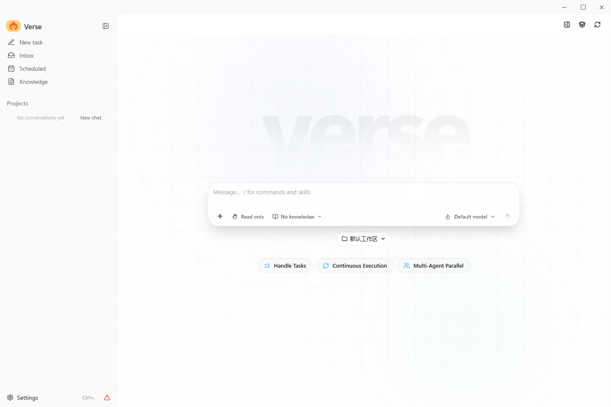
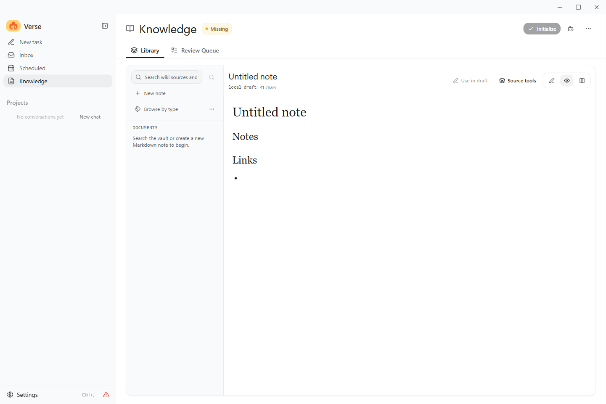
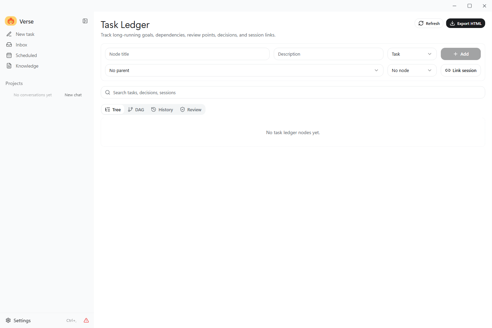
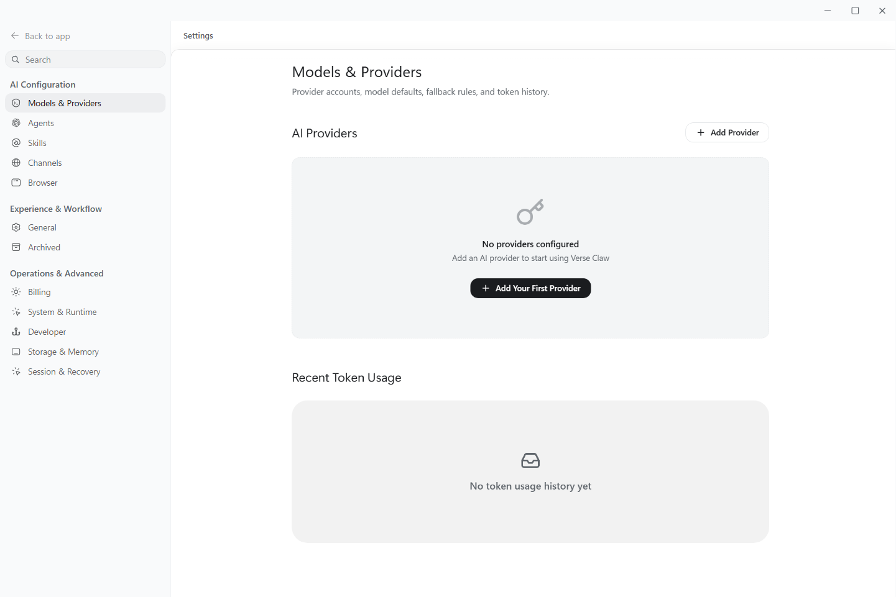
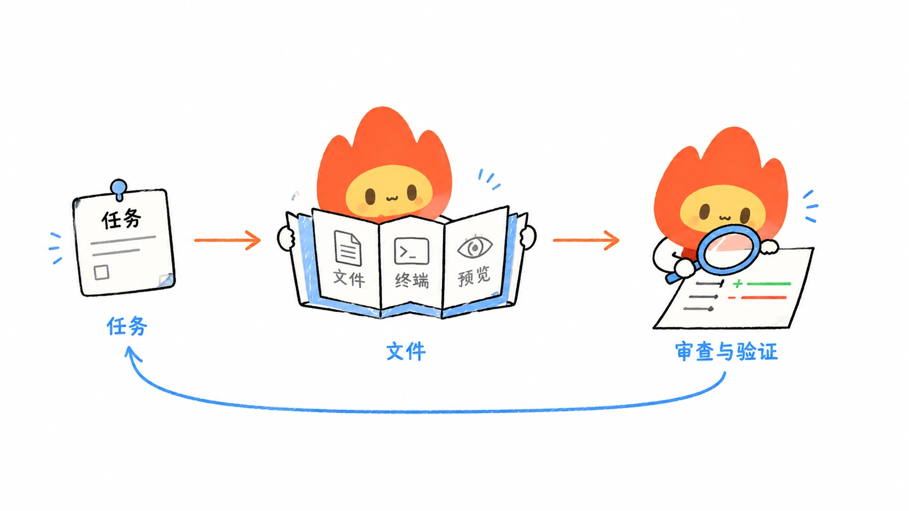
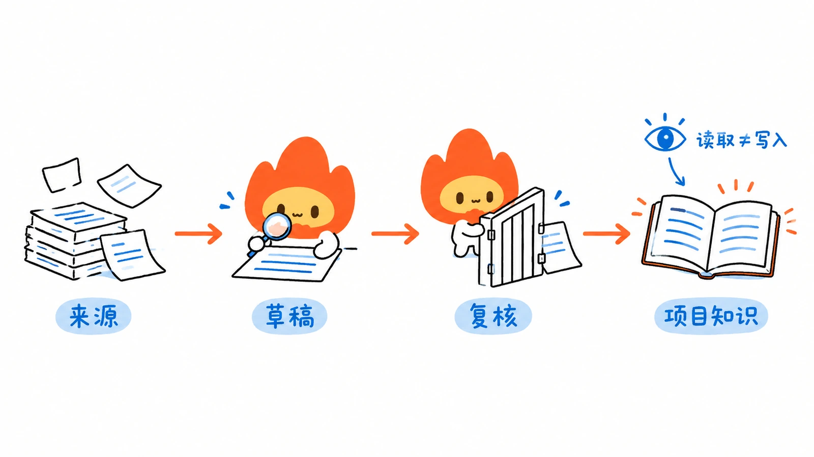

<p align="center">
  
</p>

# Verse Claw

**Диалоги, код, знания и выполнение задач агентами в одном настольном приложении.**

[English](README.md) · [简体中文](README.zh-CN.md) · [日本語](README.ja-JP.md) · [Русский](README.ru-RU.md)

[Скриншоты](#screenshots) · [Возможности](#features) · [Рабочие процессы](#workflows) · [Начало работы](#getting-started) · [Настройки](#configuration) · [Архитектура](#architecture) · [Разработка](#development) · [Решение проблем](#troubleshooting) · [Документация](#documentation)

Verse Claw — приложение Electron на базе OpenClaw. Начните работу в диалоге, просматривайте файлы, терминалы, браузер, изменения кода и созданные материалы в том же рабочем пространстве, затем сохраняйте полезные результаты как проверяемые знания проекта. Приложение также предоставляет настройки моделей и агентов, каналы сообщений, задания по расписанию и диагностику среды выполнения.

Интерфейс использует React, TypeScript и Vite. Исходники OpenClaw и плагинов входят в репозиторий и доступны для редактирования. Текущая версия и зависимости указаны в [package.json](package.json). В части исходников, настроек и исторических документов сохраняется название ClawX.

> **Текущее состояние:** проект находится на стадии alpha. Основная локальная приёмка охватывает контролируемые сценарии Windows x64. Для macOS и Linux предусмотрены цели сборки; покрытие проверками зависит от платформы и функции. Условия включения экспериментальных возможностей описаны ниже, в [семантике продукта](docs/clawx-product-semantics.md) и [матрице возможностей](shared/capability-claims.ts).

В чате можно восстановить контрольную точку из меню сеанса, работать с Git рядом с полем ввода и выбрать модель для одного сообщения, текущего сеанса или постоянного использования. Расширенный режим интерфейса открывает данные сжатия и действия восстановления. Локальная история использования токенов доступна и при остановленном Gateway.

<a id="screenshots"></a>

## Интерфейс приложения

В заголовке используется B2, выбранный 2026-10-06. Датированные снимки ниже сохраняют прежнее оформление на момент съёмки.

Снимки сделаны агентом в Windows Electron из сборки исходников от 2026-10-05: изолированные профили и настоящий локальный Gateway. Интерфейс на снимках английский. Для страницы знаний явно включён `memory-wiki`. Аккаунты моделей и запросы к моделям не использовались; пустые диалог, журнал задач и библиотека отражают реальное состояние. Нажмите на изображение для полного размера.

| **Диалог и вход в задачи**<br>[](resources/readme/2026-10-05/en/chat.png) | **Библиотека знаний и проверка**<br>[](resources/readme/2026-10-05/en/knowledge.png) |
| --- | --- |
| **Task Ledger**<br>[](resources/readme/2026-10-05/en/tasks.png) | **Модели и провайдеры**<br>[](resources/readme/2026-10-05/en/settings.png) |

Условия съёмки, промпты иллюстраций и хеши файлов приведены в [описании изображений](resources/readme/2026-10-05/README.md). Предупреждение о хранилище отражает реальное состояние диска машины.

<a id="features"></a>

## Возможности

| Область | Что можно делать | Где найти |
| --- | --- | --- |
| Диалоги и сессии | Получать потоковые ответы, прикладывать файлы и ссылки на знания, просматривать результаты инструментов; искать, закреплять, группировать, архивировать и восстанавливать диалоги | Главный экран и боковая панель сессий |
| Рабочие пространства | Переключать проекты, просматривать файлы, пользоваться терминалом, браузером, Git и проверкой кода рядом с диалогом | Панель рабочего пространства на панели инструментов чата |
| Модели и провайдеры | Управлять аккаунтами, моделями по умолчанию и резервными настройками, просматривать историю токенов | Настройки → Модели и провайдеры |
| Агенты и задачи | Настраивать агентов и роли, следить за подагентами; вести Task Ledger и явно запускать Task Loop или ClawGraph | Настройки → Agents; дополнительное меню боковой панели |
| Знания | Искать материалы, управлять источниками и ссылками, проверять входящие материалы, черновики и предложения | Боковая панель → Знания |
| Входящие | Обрабатывать запросы разрешений, удалённые и браузерные задачи, требующие внимания, просматривать историю | Боковая панель → Входящие |
| Расписание и каналы | Управлять заданиями и историей запусков; настраивать аккаунты каналов, соединения и привязки агентов | Расписание на боковой панели; Настройки → Channels |
| Skills и MCP | Просматривать и включать навыки, управлять наборами, установкой из каталога и настройками MCP-серверов | Настройки → Skills |
| Структурированные документы | Управлять исследовательскими таблицами, планами слайдов, версиями и экспортом через VerseConf | Инструменты агента и панель материалов после включения плагина |
| Диагностика и восстановление | Просматривать активность сессий, процессы, трассировки, состояние runtime, хранилище и действия восстановления | Рабочая панель, раздел наблюдаемости и настройки |

Интерфейс доступен на русском, английском, китайском и японском языках, со светлой, тёмной и системной темами. Basic / Advanced в общих настройках управляет подробностью диагностики. После включения режима разработчика доступны страницы генерации изображений и Dreams.

<a id="workflows"></a>

## Основные рабочие процессы

### Выполнить задачу с кодом в проекте

Выберите рабочее пространство и модель → опишите задачу и приложите файлы → проверьте план и запросы разрешений → проследите за инструментами → проверьте изменения и выполните проверки в рабочей панели.



*Концептуальная иллюстрация, созданная ИИ с фирменным огненным персонажем: задача → инструменты рабочего пространства → проверка изменений. Это не скриншот и не обещание автоматического прохождения проверок.*

Панель поддерживает вкладки файлов, терминала, браузера, проверки кода, материалов и активности. Терминал можно разместить сбоку или снизу. Браузер открывает локальный предпросмотр и веб-страницы, а раздел проверки объединяет изменения Git и связанные операции. Панель активности показывает состояние запусков и команд.

Доступны режимы «Только чтение», «План», «Принимать изменения» и «Полный доступ». Режим планирования ограничивает изменение пользовательских файлов, но служебные метаданные runtime могут записываться. Подробности — в [семантике разрешений](docs/clawx-product-semantics.md).

### Превратить диалоги и материалы в знания проекта

Выберите область знаний и ссылки в чате → найдите источники в библиотеке → изучите входящие материалы, черновики и предложения в очереди проверки → проверьте основания и изменения → примените через контролируемый процесс проверки.



*Концептуальная иллюстрация ИИ: источники → черновики → проверка → знания проекта. Чтение знаний и применение изменений требуют разных разрешений.*

Для Wiki требуется загруженное расширение `memory-wiki`. Страница открывается и без него, но состояние, поиск и применение изменений требуют готового плагина и хранилища. См. [границы знаний и плагинов](docs/architecture-overview.md#knowledge-plugins-and-data).

Область чтения знаний и разрешение на запись управляются отдельно. Выбор Memory, Wiki или ссылки не разрешает автоматическую обратную запись. Интерфейс сохраняет видимую связь между источниками, черновиками, предложениями и результатами применения.

### Перейти от диалога к выполнению задач

Обычный Chat предназначен для непосредственной совместной работы. Task Ledger хранит цели, узлы задач, контрольные точки и факты о результатах проверок. Task Loop — ограниченный цикл выполнения, запускаемый явно. Предложение перейти к нему не превращает обычный диалог в Task Loop автоматически.

ClawGraph загружает процессы из YAML рабочего пространства и показывает диагностику компиляции, состояние узлов, события и элементы проверки. Workboard отвечает за планирование внутри runtime отдельно от пользовательского Task Ledger. См. [оркестрацию агентов](docs/multi-agent-orchestration/README.md) и [границы понятий](docs/clawx-product-semantics.md).

### Управлять структурированными материалами

Необязательный плагин `verseconf-artifacts` предоставляет инструменты создания, просмотра, изменения, упорядочивания записей, восстановления истории и экспорта. Исследовательские таблицы экспортируются в CSV / XLSX, планы слайдов — в PPTX, содержимое — в Markdown. Панель показывает управляемые версии, историю и выходные файлы.

Плагин **выключен по умолчанию** и требует явной настройки. Сейчас PPTX использует шаблон из трёх слайдов: экспорт плана с более чем тремя записями отклоняется. Markdown позволяет сохранить полный план. Произвольное число слайдов и вёрстка длинного текста пока не покрываются. Настройка, поставка и проверки описаны в [заметках об интеграции VerseConf](docs/dev/verseconf-clawx-implementation-20261001.md).

### Границы экспериментальных возможностей

Управление контекстом (DCS), бюджет токенов (VToken), знания из опыта (SEKB), Runtime Memory и автоматизация браузера имеют отдельные настройки, разрешения или условия постепенного включения. Диагностические и shadow-данные сами по себе не означают участие в контексте модели, автоматической записи или маршрутизации. Установка приложения не активирует все расширения.

Состояние определяется [матрицей возможностей](shared/capability-claims.ts), [матрицей настроек по умолчанию](docs/dev/default-config-matrix.md) и проверками конкретной функции. Симуляции приёмки, выполненные скриптом или агентом, должны отмечаться как agent-driven. Успех отдельных тестов не подтверждает приёмку всего продукта или всех платформ для выпуска.

<a id="getting-started"></a>

## Начало работы

### Запуск из исходников

Потребуются:

- **Node.js 24** и Git.
- **pnpm 11.2.2**, закреплённый в [package.json](package.json); его можно активировать через Corepack.
- Доступ к репозиторию и сети для загрузки зависимостей, Electron, uv и agent-browser.
- Авторизация онлайн-провайдера модели либо запущенный совместимый локальный сервис.

Выполните из корня репозитория:

```sh
git clone https://github.com/Baixu22/VerseClaw.git
cd VerseClaw
corepack enable
corepack prepare pnpm@11.2.2 --activate
pnpm run init
pnpm --dir openclaw_runtime install --frozen-lockfile --ignore-scripts
node node_modules/electron/install.js
pnpm dev
```

Если установленный Node.js не содержит Corepack, установите pnpm 11.2.2 отдельно и продолжите с `pnpm run init`.

`init` устанавливает зависимости настольного workspace и загружает uv и agent-browser. OpenClaw использует отдельное пространство зависимостей, которое устанавливается отдельно. Установка бинарного Electron указана явно, поскольку политика скриптов зависимостей отключает его автоматический установочный скрипт.

Перед запуском Vite и Electron команда `pnpm dev` генерирует мост расширений, собирает runtime и подготавливает встроенные навыки. Первый запуск включает эту сборку; после открытия приложения Gateway также нужно время на готовность. Одна веб-страница Vite не предоставляет все сервисы Electron Host.

### Первая сессия

1. Завершите мастер настройки, добавьте аккаунт и модель в «Настройки → Модели и провайдеры», проверьте соединение.
2. Выберите папку проекта, рабочее пространство и режим разрешений.
3. Создайте диалог с конкретной задачей, при необходимости приложите файлы или ссылки на знания.
4. Откройте рабочую панель из чата для просмотра файлов, терминала, браузера и изменений.
5. Обработайте запросы во входящих; используйте раздел знаний для сохранения материалов проекта.
6. При необходимости настройте Skills / MCP, каналы и задания по расписанию.

Навигация по приложению и многие локальные тесты не требуют платных вызовов модели. У удалённых моделей, сервисов и каналов собственные требования к авторизации, сети и оплате.

### Пакеты и платформы

Доступные дистрибутивы определяются фактически опубликованными версиями в [Releases этого репозитория](https://github.com/Baixu22/VerseClaw/releases). В исходниках настроены следующие цели:

| Платформа | Настроенные форматы | Текущий охват |
| --- | --- | --- |
| Windows x64 | Установщик NSIS | Основная платформа локальной приёмки контролируемых сценариев |
| macOS x64 / arm64 | DMG, ZIP | Цели сборки есть; возможности проверяются для каждой платформы |
| Linux x64 / arm64 | AppImage, DEB; RPM для x64 | Цели сборки есть; приложению нужна графическая среда |

Наличие цели сборки не гарантирует готовый пакет для конкретной версии. Сборки разработки не проверяют обновления установленных пакетов; обновление дистрибутива зависит от настроенного источника выпуска. Нативные компоненты VerseShell и полная упаковка имеют дополнительные [требования к исходникам и инструментам](resources/verseshell/SOURCE.md).

<a id="configuration"></a>

## Настройки и локальные данные

| Раздел | Содержимое |
| --- | --- |
| Модели и провайдеры / Agents | Аккаунты, модели, резервные правила, роли и привязки каналов |
| Skills / Channels / Браузер | Навыки, MCP, аккаунты каналов, профили браузера и учётные данные |
| Общие | Тема, язык, запуск и подробность интерфейса |
| Система и runtime / Разработчик | Gateway, runtime, прокси, CLI, Doctor и Agent Dev Workbench |
| Оплата | Локальная история токенов, оценка стоимости и активность |
| Хранилище и память / Архив / Сессии и восстановление | Сканирование и очистка, восстановление архива, состояние сессий и параметры восстановления |

Отдельный сервер базы данных не нужен. Настройки приложения хранятся локально; подсистемы runtime используют конфигурационные файлы, записи диалогов JSONL и базы состояния SQLite.

- По умолчанию OpenClaw использует `~/.openclaw` — папку `.openclaw` в домашнем каталоге Windows — и основной файл `openclaw.json`. Разрешение путей в настольной части поддерживает переменную `OPENCLAW_CONFIG_DIR`.
- Данные приложения находятся в каталоге Electron `userData`, а журналы — в его подкаталоге `logs/`. См. [определения путей](electron/utils/paths.ts).
- История токенов суммирует структурированные записи usage локальных сессий. Стоимость является оценкой. Полное удаление диалога удаляет и его вклад в историю; используйте архив, если хотите её сохранить.
- Локальное хранение не означает полностью автономную работу: содержимое, переданное онлайн-моделям или внешним инструментам, отправляется соответствующим сервисам. Не включайте учётные данные, закрытые диалоги и сырые журналы в коммиты и публичные отчёты об ошибках.

<a id="architecture"></a>

## Архитектура и структура репозитория


[Исходник Mermaid](resources/readme/2026-10-05/architecture.mmd) · [Chat sequence](resources/readme/2026-10-05/chat-sequence.svg)

Текущий путь запроса: **React → типизированный Host facade → preload IPC → Electron Main**. Сервисы runtime затем обращаются к Gateway по WebSocket RPC под управлением Main. Локальным файловым и терминальным сервисам не обязательно проходить через Gateway. События возвращаются через Main / preload и `host-events.ts` в хранилища UI.

Точки входа Renderer — `src/lib/host-api.ts` и `src/lib/host-api-client.ts`. Эти границы нельзя описывать как универсальный «WS → HTTP → IPC fallback». [Обзор архитектуры](docs/architecture-overview.md) содержит карту исходников, последовательность диалога и обязанности подсистем задач, знаний, плагинов и локальных данных.

| Путь | Назначение |
| --- | --- |
| `src/` | Страницы React, компоненты, состояние и API Renderer |
| `electron/` | Жизненный цикл приложения, сервисы Host, Gateway и процессы |
| `shared/` | Контракты типов, четыре локализации, реестр сценариев и возможности |
| `openclaw_runtime/` | Исходники runtime и плагинов с отдельными зависимостями |
| `harness/` | CLI спецификаций, сценарии, правила, задачи и соглашения слоёв |
| `tests/` | Модульные, интеграционные и Electron E2E тесты приложения |
| `scripts/` | Сборка, синхронизация ресурсов, проверки и сбор подтверждений |
| `resources/` | Встроенные навыки, бинарные ресурсы и сведения об исходниках компонентов |
| `docs/` | Семантика продукта, проекты, руководства разработки и эксплуатации |
| `artifacts/` | Отобранные подтверждения и локальные отчёты; отслеживание определяется правилами хранения |

<a id="development"></a>

## Разработка и проверки

### Основные команды

Запускайте из корня репозитория. Полные определения находятся в [package.json](package.json).

| Команда | Назначение |
| --- | --- |
| `pnpm dev` | Подготовить runtime и ресурсы, запустить приложение для разработки |
| `pnpm run build:vite` | Собрать Renderer и Electron; не пересобирает OpenClaw |
| `pnpm run build:runtime` | Собрать встроенный runtime и выполнить smoke-проверку запуска Gateway |
| `pnpm run typecheck` | Полная проверка типов node, web и тестов; все три должны пройти |
| `pnpm run lint:check` | Lint без автоисправлений; `pnpm run lint` изменяет файлы |
| `pnpm exec vitest run tests/unit/rc10-evidence.test.ts` | Выполнить конкретный тест приложения |
| `pnpm test` | Тесты приложения, выбранные регрессии DCS/runtime и проверки реестра зрелости |
| `pnpm run test:integration` | Выполнить настроенную группу интеграционных тестов |
| `pnpm run test:e2e` | Собрать приложение и выполнить Electron E2E |
| `pnpm run test:e2e:run` | Выполнить Electron E2E на существующей сборке; runtime должен оставаться актуальным |
| `pnpm contract:check` / `pnpm i18n:lint` | Проверить контракт Host API и четыре локализации |
| `pnpm run harness:ci` | Выполнить базовые проверки Harness CI |
| `pnpm repo:artifacts:check` | Проверить границы исходников, отобранных подтверждений и локального архива |
| `pnpm run package:win` / `pnpm run package:mac` / `pnpm run package:linux` | Подготовить ресурсы платформы и создать пакеты без публикации |

Корневой `pnpm test` не запускает все тесты OpenClaw. При изменениях runtime выбирайте соответствующие тесты и проверки типов из его [package.json](openclaw_runtime/package.json) и спецификации задачи. Windows Electron E2E необходимо запускать через Windows Node.

**Оценка LoCoMo для разработки:** `pnpm eval:runtime-memory:locomo:full500` явно запускает 500 вопросов и завершается ошибкой при отсутствии ключей модели/эмбеддингов или проверенного отчёта. Это не часть обычного набора unit-тестов; исторические сводные фикстуры не считаются подтверждённой базовой оценкой памяти. См. [границы измерений и доказательств](docs/dev/p0-memory-evaluation-integrity.md). Параметры `--local-embedding-url` и `--local-embedding-model` явно включают локальный Qwen3 с проверкой хеша весов; результаты квантованной модели — новый ориентир, а не воспроизведение облачной оценки.

### Проверки по типу изменений

- **Спецификации:** сначала выполните `pnpm harness context --spec <task-spec>`, после реализации — `pnpm harness validate --spec <task-spec>`. Проверьте выбранный набор через `pnpm harness run --spec <task-spec> --dry-run`.
- **Интерфейс:** обновите соответствующий Electron E2E, обеспечьте тексты en / zh / ja / ru и следуйте [globals.css](src/styles/globals.css).
- **Связь:** изменения Renderer, Main, Gateway, отправки, получения или fallback требуют также `pnpm run comms:replay` и `pnpm run comms:compare`.
- **Сборка и упаковка:** сначала обеспечьте актуальность runtime и соблюдение контрактов нативных ресурсов. Успех сборки и приёмку установки фиксируйте отдельно.

### Инструменты Agent Dev

Agent Dev Workbench в «Настройки → Разработчик» предоставляет запись сценариев, контракты и диагностику. Офлайн-отчёт создаётся командой `pnpm agent-dev:workbench`.

| Команда | Область |
| --- | --- |
| `pnpm agent-dev:make <page\|e2e\|host-route\|skill\|channel\|plugin\|scenario> <name>` | Создать заготовки по существующим соглашениям |
| `pnpm agent-dev:fast` | Контракты, i18n, качество промптов, Workbench и целевые модульные тесты |
| `pnpm agent-dev:deep-test:reuse` | Использовать актуальную сборку, кэш проверки типов и smoke E2E Workbench |
| `pnpm agent-dev:deep-test` | Полная диагностика Agent Dev и замер времени с новой сборкой |
| `pnpm agent-dev:audit` | Строгий аудит зрелости по имеющимся подтверждениям |

Полные проверки, которые ещё предстоит выполнить, перечислены в `decision.requiredFullGates`. Результаты Agent Dev относятся к его инструментам. Отчёты sandbox, effect log и корреляции стоимости не заменяют проверки реальных действий runtime. См. [контрольный контур Agent Dev](docs/agent-dev-control-plane.md).

<a id="troubleshooting"></a>

## Решение проблем

| Симптом | Что проверить |
| --- | --- |
| Знания: `unknown method: wiki.status` | Проверьте включение и загрузку `memory-wiki`, затем инициализируйте хранилище. Готовности Gateway недостаточно |
| Неверная версия pnpm или ошибка установки зависимостей | Node.js 24, закреплённый pnpm и зависимости обоих workspace; сохраняйте lock-файлы |
| Отсутствует исполняемый Electron | Выполните `node node_modules/electron/install.js` из корня и проверьте доступ к загрузке |
| Gateway остаётся недоступным | Проверьте «Система и runtime» и журналы; запустите Doctor в настройках разработчика перед применением Doctor Fix |
| Провайдер или канал не работает | Проверьте авторизацию, модель, плагины, аккаунты и прокси; сохранение настроек не доказывает успешный запрос или доставку |
| Запись или операция заблокирована | Проверьте рабочее пространство, режим разрешений и запросы во входящих |
| E2E сообщает об устаревшем runtime | Выполните `pnpm run build:runtime`; при изменении приложения также пересоберите `build:vite`. Сохраняйте проверку актуальности |
| Electron не запускается в Linux без экрана | Предоставьте графическую среду, например `xvfb-run -a pnpm run test:e2e` |
| Инструменты или экспорт VerseConf недоступны | Проверьте включение и настройку плагина; для планов с более чем тремя записями используйте Markdown |

<a id="documentation"></a>

## Документация

| Тема | Ссылки |
| --- | --- |
| Текущая архитектура и проверка документации | [Обзор архитектуры](docs/architecture-overview.md) · [Источники изображений](resources/readme/2026-10-05/README.md) · [Индекс документации](docs/README.md) |
| Поведение продукта, понятия и границы | [Семантика продукта](docs/clawx-product-semantics.md) · [Матрица возможностей](shared/capability-claims.ts) · [Настройки по умолчанию](docs/dev/default-config-matrix.md) |
| Знания, память и контекст | [Система знаний](docs/enhancements/knowledge-persistence/README.md) · [Context Runtime Kit](docs/context-runtime-kit/README.md) |
| Агенты и процессы | [Оркестрация](docs/multi-agent-orchestration/README.md) · [Наборы ролей](docs/role-packs.md) |
| Структурированные документы | [Интеграция VerseConf](docs/dev/verseconf-clawx-implementation-20261001.md) |
| Правила разработки и преемственность | [AGENTS.md](AGENTS.md) · [Руководство разработки](docs/dev/Sustained-Development-Playbook.md) · [Agent Dev](docs/agent-dev-control-plane.md) |
| Runtime и приёмка | [Согласование runtime](docs/dev/unified-agent-system/runtime-convergence/README.md) · [Границы подтверждений RC-09/RC-10](docs/dev/windows-alpha-closeout-20261008.md) |
| Ресурсы, архивы и восстановление исходников | [Правила хранения](docs/dev/repository-artifact-retention.md) · [Контракт исходников VerseShell](resources/verseshell/SOURCE.md) |

Проектные планы и старые результаты приёмки имеют собственные даты и область действия. Текущие точки входа определяются исходниками и соответствующими актуальными подтверждениями. Локальная история Task Forest, передача сессий и временные журналы не требуются для сборки нового checkout.

## Участие и лицензия

Ограничивайте область изменений, выполняйте необходимые проверки и обновляйте все четыре README при изменении поведения. Следуйте [AGENTS.md](AGENTS.md) в вопросах API, i18n, спецификаций и подтверждений. Отслеживайте исходники, повторно используемые fixture и отобранные итоговые результаты вместе; закрытую историю задач и сырые журналы храните локально.

Verse Claw основан на [OpenClaw](https://github.com/openclaw/openclaw) и работе команды ValueCell над ClawX. Репозиторий использует [лицензию MIT](LICENSE). Встроенные компоненты сохраняют собственные лицензии и обязательства по предоставлению исходников, включая [сведения о VerseShell](resources/verseshell/SOURCE.md).

### Диагностические журналы coding

При явном `diagnostics.enabled: true` существующий диагностический журнал отмечает устойчиво высокую долю классификаций, требующих подтверждения, и восстановление. Это классификация инструментов, а не число диалогов или подтверждений человеком. Недостаточные и просроченные выборки считаются неизмеренными. Если настройка отсутствует или выключена, мониторинг не включается; политика подтверждения и выполнения инструментов не меняется.

При явном включении и `diagnostics.otel.enabled`, и диагностического флага `trace.cost-sampling` существующий единственный выход OpenTelemetry дополнительно выдаёт оценку стоимости каждого вызова модели в USD по версионированному снимку цен и ограниченные обезличенные срезы трассировки; неизвестные цены остаются `null`, а путь по умолчанию и выключенный не меняются.
