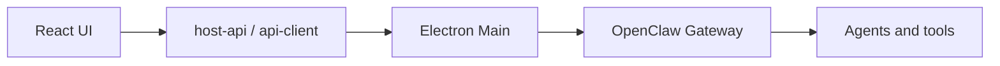

<p align="center">
  
</p>

# Verse Claw

**Настольная рабочая среда для агентов OpenClaw.**

[English](README.md) · [简体中文](README.zh-CN.md) · [日本語](README.ja-JP.md) · [Русский](README.ru-RU.md)

[Возможности](#features) · [Начало работы](#getting-started) · [Разработка](#development) · [Документация](#documentation)

Verse Claw объединяет чат, проекты, проверку знаний и диагностику агентов в приложении Electron. Настройте модель, откройте проект и следите за результатами инструментов, запросами одобрения и состоянием задач.

Приложение использует Electron 40, React 19 и TypeScript. Исходный код среды OpenClaw включён в репозиторий и доступен для изменения.

> **Текущие границы:** основная локальная приёмка охватывает контролируемые сценарии Windows x64. Для macOS и Linux есть цели сборки, но это не означает одинаковое покрытие проверками. Расширения контекста и памяти сохраняют отдельные режимы opt-in, shadow и требования одобрения. См. [семантику продукта](docs/clawx-product-semantics.md) и [матрицу возможностей](shared/capability-claims.ts).

<a id="features"></a>
## Возможности

| Область | Работа в приложении |
| --- | --- |
| Чат и модели | Настройка провайдеров и моделей, управление беседами, вложение контекста и просмотр результатов инструментов. |
| Проекты | Изменения Git, терминалы, браузерный просмотр и проверка кода рядом с беседой. |
| Задачи и агенты | Явный запуск ролевых агентов и ограниченных циклов задач; просмотр прогресса, ошибок, контрольных точек и одобрений. |
| Знания | Поиск в библиотеке с источниками, проверка входящих записей, черновиков и предложений. Применение требует явного подтверждения и проверки правил. |
| Каналы и расписания | Настройка поддерживаемых плагинов каналов и периодических заданий. Доступность зависит от плагина, авторизации и настроек среды. |
| Диагностика | Активность сеансов, трассировки, состояние среды и инструменты разработчика. Диагностические данные сами по себе не дают права на выполнение. |

Доступны английский, китайский, японский и русский языки, светлая и тёмная темы. [Скриншоты в репозитории](resources/screenshot/) приведены для справки и могут отличаться от текущей сборки.

### Границы разрешений

- Область чтения знаний не даёт права записи или применения. Предложения остаются черновиками до проверки.
- Бюджет контекста, внедрение Runtime Memory, автоматическая запись SEKB и работа браузера без наблюдения либо в частной сети имеют отдельные ограничения. Установка не включает все возможности автоматически.
- Доказательства по отдельной задаче не разрешают выпуск продукта, включение функций по умолчанию или объявление общей готовности. [Записи проверок](artifacts/capability-claims/status-table.json) относятся к указанным в них границам и кандидатам.

<a id="getting-started"></a>
## Начало работы

### Запуск из исходного кода

Нужны **Node.js 24**, Git и версия pnpm из `package.json` (11.2.2). У среды выполнения отдельное пространство зависимостей. Для клонирования нужен доступ к репозиторию.

```sh
git clone https://github.com/Baixu22/VerseClaw.git
cd VerseClaw
corepack enable
pnpm run init
pnpm --dir openclaw_runtime install --frozen-lockfile --ignore-scripts
node node_modules/electron/install.js
pnpm dev
```

`init` устанавливает зависимости приложения и загружает uv и agent-browser. Скрипты сборки зависимостей ограничены, поэтому установка Electron выполняется явно. `pnpm dev` сначала собирает среду выполнения и подготавливает встроенные навыки, затем запускает Vite и Electron.

Для нативного VerseShell и упаковки нужны дополнительные исходники и инструменты; см. [контракт исходного кода и сборки](resources/verseshell/SOURCE.md). Этот checkout предназначен прежде всего для разработки; распространяемые сборки следует искать в [Releases этого репозитория](https://github.com/Baixu22/VerseClaw/releases).

### Первый сеанс

1. Завершите настройку и выберите поддерживаемого провайдера и модель. Реальные обращения к модели требуют действительной авторизации.
2. Откройте доверенный проект и осознанно выберите режим разрешений.
3. Начните беседу, проверяйте результаты инструментов и запросы одобрения.
4. Используйте Library и Review Queue для повторно используемых знаний; подключайте каналы и расписания по необходимости.

Навигация по приложению и многие локальные тесты не требуют платного вызова модели. Сборка для разработки не проверяет обновления пакетов; обновления упакованного приложения зависят от настроенного канала выпуска.

### Решение проблем

- **Gateway не готов:** проверьте состояние и журналы, затем используйте OpenClaw Doctor в настройках разработчика.
- **Провайдер или канал недоступен:** проверьте авторизацию, включённые плагины и прокси. Корректный формат ключа не доказывает подключение или доставку.
- **E2E сообщает об устаревшей среде:** после изменения runtime выполните `pnpm run build:runtime`, не обходя проверку актуальности.
- **Linux без экрана:** Electron требует сервер отображения, например `xvfb-run -a pnpm run test:e2e`.

<a id="development"></a>
## Разработка



Renderer обращается через `host-api` / `api-client`. Electron Main управляет транспортом и настольными процессами, среда выполнения — агентами. Контракт описан в [границах взаимодействия](harness/specs/scenarios/gateway-backend-communication.md).

| Путь | Назначение |
| --- | --- |
| `src/` | React UI, хранилища и API Renderer |
| `electron/` | Жизненный цикл приложения, Gateway и Host-сервисы |
| `shared/` | Типизированные контракты, переводы и границы возможностей |
| `openclaw_runtime/` | Исходный код среды и плагинов |
| `harness/specs/` | Сценарии, правила и спецификации задач |
| `tests/` | Модульные, интеграционные и Electron E2E тесты |
| `resources/` | Встроенные ресурсы и происхождение нативных компонентов |

| Команда | Назначение |
| --- | --- |
| `pnpm dev` | Запустить приложение для разработки |
| `pnpm run typecheck` | Проверить node, web и получить результат проверки типов тестов |
| `pnpm exec vitest run tests/unit/rc10-evidence.test.ts` | Выполнить один целевой тестовый файл |
| `pnpm test` | Выполнить настроенные тесты приложения и runtime |
| `pnpm run build:vite` | Собрать Renderer и Electron |
| `pnpm run build:runtime` | Собрать runtime |
| `pnpm run test:e2e` | Собрать приложение и выполнить Electron E2E |
| `pnpm contract:check` | Проверить согласованность Host API |
| `pnpm repo:artifacts:check` | Проверить границы исходников и архивов |

Перед изменением области задачи выполните `pnpm harness context --spec <task-spec>`. Изменения взаимодействия также требуют `pnpm run comms:replay` и `pnpm run comms:compare`. Правила и проверки находятся в [AGENTS.md](AGENTS.md).

Локальная история Task Forest, передача сеансов и создаваемые доказательства не являются условием новой сборки. Отслеживайте исходники, фикстуры и отобранные доказательства согласно [правилам хранения и восстановления](docs/dev/repository-artifact-retention.md).

<a id="documentation"></a>
## Документация

- [Семантика продукта и контролируемый предварительный выпуск](docs/clawx-product-semantics.md)
- [Непрерывность разработки](docs/dev/Sustained-Development-Playbook.md)
- [Согласование runtime и приёмка](docs/dev/unified-agent-system/runtime-convergence/README.md)
- [Система знаний](docs/enhancements/knowledge-persistence/README.md)
- [Оркестрация агентов](docs/multi-agent-orchestration/README.md)
- [Предварительная проверка RC-09 и целостность RC-10](docs/dev/pending-worktree-consolidation.md)
- [Политика безопасности](SECURITY.md)

## Участие и лицензия

Ограничивайте область изменений, добавляйте необходимые проверки и обновляйте пользовательские переводы. Не коммитьте учётные данные, локальную историю задач и создаваемые журналы. Используйте этот репозиторий для сообщений о проблемах и предложений.

Verse Claw основан на [OpenClaw](https://github.com/openclaw/openclaw) и работе команды ValueCell над ClawX. См. [лицензию MIT](LICENSE); встроенные компоненты сохраняют собственные лицензии и уведомления об исходном коде.
