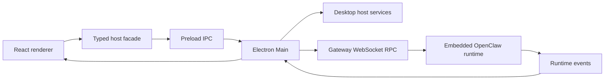

<p align="center">
  
</p>

В Review Center доступен свернутый, явно включаемый Change Context: четыре режима сравнения, комментарии с привязкой к дайджесту и решения проверки. Применение использует существующие разрешения, Git и Coding journal; одобрение не завершает задачи и не сливает код. [Подробнее](docs/modules/workspace-and-coding.md). Границы проверки в Windows и откат через отключение функции описаны в [управляемом включении](docs/dev/change-context-review-loop/rollout.md).

# Verse Claw

Меню проекта позволяет создать Git-репозиторий, создать или переключить рабочее дерево с сохранением его диалога и черновика.

Управление диалогами сохраняет черновики и показывает подтверждённые результаты. В настройках архива можно продолжить прерванное архивирование, восстановление или удаление. Изменения контекста проверяют поколение сеанса; хранилище защищает рабочие деревья, связанные с задачами и диалогами. Восстановление контрольной точки использует рабочую папку, записанную для этого диалога.

При переключении диалогов восстанавливаются читаемое сообщение и черновик. Фоновая работа обновляет свой статус, сохраняя положение строк под указателем и фокусом клавиатуры. Для пустых проектов, отказов доступа и зависимостей показаны причины и следующие действия; план запуска отделён от текущей очереди.

Ветвление сообщения использует сохранённую границу истории и показывает причину недоступности. Для продолжения в новом диалоге открывается существующий редактируемый предпросмотр передачи; создание выполняется явным действием.

Chat переносит тот же диалог и задачу в другой настроенный checkout, сохраняя цель и ссылки на результаты. Система проверяет завершение исходных действий и целевое владение; прерванный перенос продолжается из сохранённой операции.

Передача становится доступна после загрузки идентификатора сеанса. Запрос из боковой панели ожидает его загрузки, а предпросмотр привязан к текущему поколению сеанса.

В чатах можно создать репозиторий Git, выбрать отдельное рабочее дерево и восстановить черновик. `/storage` и **Настройки → Хранилище** открывают общую страницу файлов чатов, памяти процессов и рабочих деревьев. [Использование и принадлежность ресурсов](docs/dev/session-worktree-storage.md).

Управляемые инструменты перед выполнением совместно проверяют право на задачу, поколение сессии и постоянного владельца записи checkout. Владение сохраняется между вызовами; неизвестные результаты и фоновые процессы сверяет исходный owner. [Контракт записи](harness/specs/guides/checkout-writer-ownership.md) описывает передачу, восстановление и границы внешних изменений.
**Чат, код, знания и выполнение агентов в одном рабочем пространстве.**

[English](README.md) · [简体中文](README.zh-CN.md) · [日本語](README.ja-JP.md) · [Русский](README.ru-RU.md)

[Подробные модули (китайский)](docs/modules/README.md) · [Начало работы](#getting-started) · [Архитектура](#architecture) · [Разработка](#development) · [Решение проблем](#troubleshooting) · [Документация](#documentation)

Verse Claw — Electron-приложение на встроенном OpenClaw Runtime. Оно объединяет диалог, проектные workspace, инструменты кодирования, проверку знаний, память, мультиагентную оркестрацию, каналы сообщений, расписания и диагностику runtime в одном локальном desktop-продукте.

Репозиторий не является тонкой оболочкой renderer. Он содержит React UI, Electron Main Host, типизированные межпроцессные контракты, vendored OpenClaw Runtime, VerseBrowser, основу управляемого выполнения VerseShell, исходники выведенного из эксплуатации VToken, исполняемые Harness-спецификации и build/evidence/release pipeline.

> **Текущий статус:** `0.4.9-alpha.0`, controlled preview. Основная цель локальной приёмки — Windows x64 workflows. Для macOS/Linux есть build targets, но проверка их runtime — отдельная работа. Component graduation и agent-driven evidence не означают release, GA, liveReady или productApproved.

## Модули продукта

| Область | Текущая форма | Подробно |
|---|---|---|
| LLM и модели | Учётные записи providers, OAuth/API key/local auth, protocol adapters, fallback, model overrides на turn/session, streaming, tool loop, reasoning effort, usage и оценка cost | [LLM и модели (кит.)](docs/modules/llm-and-models.md) |
| Диалоги и sessions | JSONL append-only session tree, runs, abort/stop/archive/delete, checkpoints, compaction, handoff/fork, sidebar, группы и long-session coordinator | [Sessions (кит.)](docs/modules/sessions.md) |
| Context и memory | Context Orchestrator, budget 6 000 символов, Workspace Context, health score, единый Memory surface поверх отдельных Role/Runtime stores | [Context и Memory (кит.)](docs/modules/context-and-memory.md) |
| Workspace и coding | Preflight, четыре permission mode, preview файлов, PTY terminal, web preview, Git, review, write journal, stale-write guard, auto verify | [Workspace и coding (кит.)](docs/modules/workspace-and-coding.md) |
| Knowledge | Markdown/wiki-first Library, Inbox → Draft → Steward → Proposal → explicit apply, Source Set, OKF, Runtime Lessons/SEKB, provenance и governance | [Knowledge (кит.)](docs/modules/knowledge-base.md) |
| Multi-agent и tasks | Agent/Persona/Role, девять built-in roles, routing, team templates, resource-aware waves, subagent admission, Task Ledger, Task Loop, ClawGraph | [Multi-agent и tasks (кит.)](docs/modules/multi-agent-and-tasks.md) |
| Проекты и сеансы | Имя проекта открывает координатора; проект показывает всех явно связанных координаторов разных агентов. Связанные сеансы раскрываются внутри рабочих групп и показывают задачи своего контекста. История задач открывает связанные диалоги и артефакты контрольных точек. Вопрос в ветке остаётся черновиком; передача создаёт сеанс и отправляет первый ход с восстановлением после перезапуска. | [Сеансы и задачи (кит.)](docs/modules/multi-agent-and-tasks.md) |
| Verse components | VerseGit repository/evidence control plane, VerseShell governed execution, VerseBrowser drivers и retired VToken | [Verse tools (кит.)](docs/modules/verse-tools.md) |
| Resources и observability | Cooperative ResourceFabric, background shedding, process/port tracking, token/cost limits, traces, issues, Problems, Session Activity и recovery | [Resources и observability (кит.)](docs/modules/resources-and-observability.md) |
| Integrations | 15 channel types, Scheduled, Skills/MCP, Inbox, Remote Tasks, Code Review, VerseConf, media, Billing и Agent Dev | [Integrations (кит.)](docs/modules/integrations-and-surfaces.md) |

Подробные module documents сейчас поддерживаются на упрощённом китайском; source paths, API names и evidence links не зависят от языка. Четыре root README остаются multilingual entry points.

Чат показывает текст в одной колонке без аватаров ассистента. Сообщения о ходе работы и итоговый ответ остаются видимыми, а подробности выполнения и пассивные карточки инструментов изначально свёрнуты. Текущий инструмент сохраняет анимацию прогресса; ошибки и запросы разрешений доступны сразу. Длинные изменения показывают обе версии рядом внутри колонки чата; неразрывные строки переносятся в превью, а после разворачивания прокручиваются только внутри области диффа. Команды показывают последний вывод. Копирование включает весь сохранённый текст. Полоса изменений репозитория использует ту же центрированную ширину, что и поле ввода, а вызовы инструментов показываются компактными статус-чипами с целью и временем.

Состояние сеанса показывается на единой поверхности; завершённые процессы свёрнуты в историю. Вывод процесса использует тот же терминал, что и чат, с копированием и сохранением позиции при чтении старых строк. Вызов инструмента и его результат объединены, диагностика расположена в конце.

Окружение чата появляется после фактических изменений или активности. Изменения, наблюдаемые вызовы MCP, чтение навыков и субагенты показываются короткими списками с раскрываемыми подробностями. Автоматическое раскрытие занимает место рядом с чатом, ручное открывает компактную плавающую карточку. Закрытие рабочей области сохраняет вкладки и выбранное содержимое.

В пустом чате выбор проекта и ветки Git расположен в одной строке под полем ввода. Начальные действия доступны через «Быстрый старт», а поиск и переключение веток используют существующие средства Git.

Запросы разрешений временно заменяют поле ввода соответствующего диалога, показывая команду, рабочий каталог и доступные решения. Остальная страница остаётся доступной; после обработки запросов восстанавливаются поле ввода, черновик и вложения.

В разговоре отображается то, что создал ход, каким бы инструментом это ни было сделано. Аудио и видео воспроизводятся на месте с помощью стандартных элементов управления, а если файл отсутствует, слишком велик или не воспроизводится, об этом сообщается. Изображения из любых источников открываются в одном просмотрщике; удалённые изображения и медиа не загружаются автоматически, вместо этого предлагается открыть их. Диаграммы строятся в объявленном типе и дополняются таблицей данных, отдельные ссылки становятся карточками, а прочие структурированные ресурсы показываются в подписанной резервной карточке.

## Границы зрелости

| Label | Значение |
|---|---|
| `default` / `advanced` | Текущая продуктовая поверхность в заявленной controlled-preview границе. Не GA. |
| `internal` | Есть реализация или внутренний API, но нет отдельного пользовательского product entry. |
| `shadow` / `experiment` | Наблюдение или ограниченный эксперимент; не владеет routing, записью или approval. |
| `retired` | Сохранено только для compatibility, provenance или rollback inspection. |
| `agent-driven` | Evidence создано агентом и помечено как такое. Это не real-human evidence. |

Текущий machine-readable component catalog содержит 54 строки: 13 default, 12 advanced, 23 internal, 6 retired, 0 experiment. Классификация не является runtime proof. См. [component disposition matrix](docs/dev/component-disposition-matrix-20261021.md).

Важные defaults:

- Workspace Context и read-only DCS context tools включены при заявленных health/permission gates.
- Runtime Memory injection, SEKB automatic writeback и Browser private network не default-on.
- SEKB записывает явное применение принципа с его версией и запуском, отдельно сохраняя результат выполнения и независимую оценку задачи. Обратная связь используется для диагностики и не меняет поиск или сохранение памяти. См. [RSI evidence and boundaries](docs/dev/rsi-capability-and-boundaries.md).
- Управляемые эксперименты RSI с prompt сохраняют родительские версии, атрибуцию тренировочных данных и решения по фиксированным проверкам. Кандидаты связываются с отдельным зафиксированным планом оценки.
- VToken retired; старые env/config имена не могут снова включить production assembly или sidecar.
- VerseGit — default-off и landed-unwired. VerseShell — default-off controlled foundation. VerseBrowser рекламирует действия из live driver snapshot, а не из полного контракта.
- Dreams retired. Image Generation ограничен developer/test surface и не является обычной продуктовой навигацией.
- `liveReady=false`, `productApproved=false` и `defaultOn=false` остаются product locks.

Перед изменением default или release claim прочитайте [default configuration](docs/dev/default-config-matrix.md), [product semantics](docs/clawx-product-semantics.md) и [capability claims](shared/capability-claims.ts).

## Скриншоты

Скриншоты сделаны из Windows Electron source build 2026-10-05. Текущий header использует более позднюю B2 identity. В Knowledge capture явно включён `memory-wiki`; model account и model request не использовались.

| **Chat и task entry**<br>[](resources/readme/2026-10-05/en/chat.png) | **Knowledge library и review**<br>[](resources/readme/2026-10-05/en/knowledge.png) |
| --- | --- |
| **Task Ledger**<br>[](resources/readme/2026-10-05/en/tasks.png) | **Models и provider settings**<br>[](resources/readme/2026-10-05/en/settings.png) |

Условия съёмки и hashes: [visual provenance](resources/readme/2026-10-05/README.md).

<a id="getting-started"></a>

## Начало работы

Требования:

- **Node.js 24.16.0 или новее в ветке 24.x** и Git. Более ранние Windows Node 24 могут падать в TCP connections.
- **pnpm 11.2.2**, зафиксированный в `package.json`.
- Сетевой доступ к dependencies, Electron, uv и agent-browser.
- Online provider account или совместимый local model service.

Из корня репозитория:

```sh
git clone https://github.com/Baixu22/VerseClaw.git
cd VerseClaw
corepack enable
corepack prepare pnpm@11.2.2 --activate
pnpm run init
pnpm --dir openclaw_runtime install --frozen-lockfile --ignore-scripts
node node_modules/electron/install.js
pnpm dev
```

`pnpm dev` собирает VerseBrowser, embedded runtime и bundled skills, затем открывает Vite и Electron. Gateway обычно готов через 10–30 секунд. Одна Vite-страница не даёт полный Electron Host services.

Первый session:

1. Завершить Setup.
2. Настроить и проверить provider/model.
3. Выбрать project directory, permission mode и workspace.
4. Отправить scoped task и проверить Workspace Panel.
5. Обработать approvals в Inbox.
6. Постоянные изменения Knowledge/Memory выполнять через review surfaces.
7. Разговором управляют из его строки: при наведении появляются «Закрепить» и «⋯» (переименовать, переместить в рабочий поток, отметить непрочитанным, ответвить, передать, скопировать, архивировать с отменой, удалить); правый клик открывает то же меню, а длинные названия прокручиваются при наведении.
   Дочерние разговоры выделены отступом и тонкой линией; счётчик виден только при сворачивании. Название в компактном заголовке открывает поиск, переключение и переход к исходному разговору. Контрольные точки, ответвление, передача, обновление, восстановление, миграция и диагностика памяти собраны в «Ещё». Тёмная тема различает боковую панель, текст и поле ввода оттенками графита. Пустые области задач скрыты; спокойное отображение настраивается в Settings → Session & Recovery.
8. Колокольчик на боковой панели слегка покачивается во время выполнения разговора и становится янтарным, когда требуется действие. Число в правом верхнем углу показывает непрочитанные события. При открытии панели покачивание прекращается; панель показывает выполняющиеся разговоры с прошедшим временем, завершения, ошибки и запросы на одобрение. Системные оповещения переключаются там же или в Settings → Session & Recovery.

Только фактически опубликованный Release package является download target. Наличие build target не гарантирует package для текущей версии.

| Platform | Configured artifact | Validation scope |
|---|---|---|
| Windows x64 | NSIS | Основная controlled local acceptance platform |
| macOS x64 / arm64 | DMG, ZIP | Build targets; нужна platform/capability validation |
| Linux x64 / arm64 | AppImage, DEB, x64 RPM | Build targets; требуется graphical environment |

<a id="architecture"></a>

## Архитектура

Обычный request path:

```text
React renderer
  -> typed host facade (src/lib/host-api.ts)
  -> preload IPC
  -> Electron Main (authorization + dispatch)
  -> Host service и/или Main-owned Gateway WebSocket RPC
  -> embedded OpenClaw runtime
```

Runtime events возвращаются через Main и `host-events.ts` в renderer stores. Локальные file, terminal и Git operations могут завершаться в Main без Gateway.

Это не универсальная цепочка `WS -> HTTP -> IPC fallback`. Renderer pages не должны напрямую подключаться к Gateway или добавлять direct Electron IPC в обход Host API. `shared/host-api/contract.ts` — типизированная общая граница.



Основные слои:

- `src/`: renderer, pages, components, Zustand stores, Host facade, i18n и styles.
- `electron/`: Main services, IPC security, Gateway supervision, preload и desktop utilities.
- `shared/`: Host API/events, domain types, четыре language resources, authority/default manifests.
- `openclaw_runtime/`: vendored runtime, Gateway, agents, tools, channels, packages и extensions.
- `packages/` и `resources/`: VerseBrowser, VToken, VerseShell, skills, plugins и native assets.
- `harness/`, `tests/`, `scripts/`: executable rules, tests, automation и evidence tooling.

Подробнее: [architecture guide](docs/architecture-overview.md), [repository layout](docs/dev/repository-layout.md).

## Локальные данные и приватность

Отдельный database server не нужен.

- Desktop settings/exports находятся в Electron `userData`.
- Runtime config обычно находится в `~/.openclaw`; поддерживается `OPENCLAW_CONFIG_DIR`.
- Sessions используют JSONL transcripts; runtime state также использует SQLite.
- Token history строится из structured session usage; cost является оценкой.
- Knowledge использует `memory-wiki` vault и local governance metadata.
- Наблюдаемые папки сверяют добавления, изменения и удаления с версиями кандидатов на проверку, включая изменения во время остановки приложения.
- Librarian передаёт допущенные источники и ограниченную историю настроенной модели Gateway, проверяет точные цитаты и версии, явно показывает неполные чтения, конфликты и ошибки модели. Studio сохраняет выдержки как черновики для проверки.
- Реализованы китайский лексический поиск, ограниченное продолжение чтения, кеш embedding с изоляцией provider и выводы Steward с привязкой к версии. Необязательный коннектор публичного каталога GitHub отправляет изменения и отзывы в Inbox; другие SaaS-коннекторы не реализованы.
- Logs, traces, screenshots, Task Forest и handoffs являются local working data, пока явно не curated.

Локальное хранение не означает offline execution. Online models, channels, browsers и external tools получают данные согласно конфигурации. Не коммитьте credentials, private transcripts и raw logs.

<a id="development"></a>

## Разработка и проверка

Навигация в частную сеть требует одобрения Main, привязанного к сессии и origin. Автоматическая проверка выполняет одобрение через agent в Main; маркеры одобрения в запросе не дают доступа.

### Основные команды

Запускайте из корня репозитория. Полные определения находятся в [package.json](package.json).

| Команда | Назначение |
|---|---|
| `pnpm dev` | Подготовка resources/runtime и запуск Electron development |
| `pnpm run build:vite` | Build renderer и Electron bundles |
| `pnpm run build:runtime` | Build embedded runtime и Gateway startup smoke |
| `pnpm run typecheck` | Full node/web/test typecheck |
| `pnpm run lint:check` | Lint без изменения файлов |
| `pnpm test` | Root test groups и selected regressions |
| `pnpm run test:e2e` | Build и Electron Playwright |
| `pnpm contract:check` / `pnpm i18n:lint` | Host contract и покрытие четырёх языков |
| `pnpm run harness:ci` | Repository Harness baseline |
| `pnpm run repo:artifacts:check` | Границы source/evidence/archive |
| `pnpm run docs:policy:validate` | Validation documentation policy |

Task spec:

```bash
pnpm harness context --spec <task-spec>
pnpm harness validate --spec <task-spec>
pnpm harness run --spec <task-spec> --dry-run
```

UI changes должны включать Electron E2E и строки en/zh/ja/ru. Communication changes дополнительно требуют `pnpm run comms:replay` и `pnpm run comms:compare`. Build success, install success и release authorization — разные факты.

Состояние включения Skill сохраняется в конфигурации runtime OpenClaw, а управляемый каталог Skill регистрируется до запуска Gateway. Локальное обнаружение, видимость в runtime и доверие к выполнению остаются отдельными проверками.

Полная карта gates: [development and validation](docs/modules/development-and-validation.md).

<a id="troubleshooting"></a>

## Решение проблем

| Симптом | Что проверить |
|---|---|
| Knowledge показывает `unknown method: wiki.status` | Включить и загрузить `memory-wiki`, затем инициализировать vault. Gateway readiness недостаточна. |
| Неверный pnpm / install failure | Node.js 24.x, pinned pnpm, два dependency workspace и lockfiles. |
| Нет Electron executable | Запустить `node node_modules/electron/install.js`, проверить download connectivity. |
| Gateway unavailable | Settings → System & Runtime и logs; сначала Doctor, затем Doctor Fix. |
| Provider/channel unavailable | Auth, model, plugin enablement, account status, proxy и real request/delivery evidence. |
| Tool write/command blocked | Workspace root, permission mode, path boundary и Inbox approvals. |
| E2E сообщает stale runtime | `pnpm run build:runtime`; при изменении app sources пересобрать app. |
| Headless Linux Electron failure | Нужен display server, например `xvfb-run -a pnpm run test:e2e`. |
| VerseConf PPTX export failure | Проверить plugin и лимит трёх записей template; длинный outline — Markdown. |

<a id="documentation"></a>

## Документация

| Тема | Вход |
|---|---|
| Реализация по модулям | [Module deep dives (кит.)](docs/modules/README.md) |
| Architecture / data flow | [Architecture guide](docs/architecture-overview.md) · [Runtime control planes](docs/dev/runtime-control-planes.md) |
| Product boundary / defaults | [Product semantics](docs/clawx-product-semantics.md) · [Default configuration](docs/dev/default-config-matrix.md) · [Component matrix](docs/dev/component-disposition-matrix-20261021.md) |
| Knowledge / context | [Knowledge system](docs/enhancements/knowledge-persistence/README.md) · [Context Runtime Kit](docs/context-runtime-kit/README.md) · [Context orchestrator](docs/dev/context-orchestrator.md) · [Memory control plane](docs/dev/memory-control-plane.md) |
| Agent / tasks | [Role-first design](docs/role-first-design.md) · [Multi-agent orchestration](docs/multi-agent-orchestration/README.md) |
| VerseGit / VerseShell / VerseBrowser | [VerseGit](docs/dev/versegit-validation-layer/README.md) · [VerseShell](docs/dev/verseshell-foundation/STATUS.md) · [VerseBrowser](packages/README.md) |
| Development / evidence | [Development docs](docs/README.md) · [Agent Dev](docs/agent-dev-control-plane.md) · [Repository layout](docs/dev/repository-layout.md) · [Harness](harness/specs/) |

Historical plans и acceptance snapshots имеют собственные даты и candidates. Текущее поведение определяется source, default manifests и fresh evidence.

## Участие и лицензия

Сохраняйте узкий scope и предоставляйте релевантную validation. При изменении поведения синхронизируйте четыре root README и соответствующий документ в `docs/modules/`. При изменении interface, defaults, security boundary или user entry также проверьте product semantics, default matrix и Harness spec.

Verse Claw основан на [OpenClaw](https://github.com/openclaw/openclaw) и работе ClawX команды ValueCell. Репозиторий использует [MIT License](LICENSE). Bundled components сохраняют собственные licenses/source obligations, включая [VerseShell notices](resources/verseshell/SOURCE.md). Часть взаимодействий conversation/workspace, включая карточки источников веб-поиска, адаптирована из [Rare UI](https://rareui.com) Swami Malode; attribution сохранена в `src/components/rareui`.

В чатах можно создать репозиторий Git, выбрать отдельное рабочее дерево и восстановить его черновик. `/storage` или **Настройки → Хранилище** показывают файлы чатов, память процессов и рабочие деревья, позволяют освободить ресурсы и удалить свободные деревья без связанной рабочей области. [Подробнее](docs/dev/session-worktree-storage.md).

### Постоянные задачи

В сведениях о дочернем агенте показана приёмка задачи для текущего сеанса из её owner. После принятия проверенных доказательств владельцем задачи обновите панель, чтобы увидеть принятый результат. Квитанции проверки и принятие задачи владельцем показаны отдельно; ссылка исполнителя в журнале открывает его transcript-панель.

Task Ledger → Постоянные задачи сохраняет цели, ограничения и критерии независимо от истории чата. Локальные Git worktree одного репозитория используют общее назначение задач. Перед управляемыми вызовами инструментов проверяется владелец, а перед запросом модели восстанавливается цель. Доступны проверки точного содержимого файла и команды с указанными входными файлами; действуют обычные разрешения инструментов. См. [архитектуру](docs/dev/durable-task-system/PLAN.md).

Перед удалением управляемого рабочего дерева исторические артефакты сохраняются через проверенные ссылки Git, а подтверждения добавляются в исходную историю задачи. После удаления каталога agent может проследить приёмку и прочитать артефакты. Активные задачи, незавершённые операции и отсутствие соответствующего снимка сохраняют рабочее дерево.

Очистка сохраняет игнорируемые файлы, изменения, скрытые флагами индекса Git, и файлы с правами доступа без проверенной копии в целевом каталоге. Удаление через Git и страницу хранилища использует общую проверку индекса. После подтверждённого отказа из-за изменённых файлов возможна повторная попытка; неизвестный результат удаления сохраняет резервирование исполнения.

Последняя проверка владельца и удаление через Git или хранилище выполняются под общей блокировкой домена с созданием и получением задач, предотвращая получение новой задачи во время удаления каталога.

Изменение модели или имени неявного main agent сохраняет наследование рабочего каталога, поэтому переключение проекта определяет последующее место исполнения. Явно заданные каталоги агентов сохраняются.

Список поддерживает поиск, фильтр состояния и загрузку следующих страниц. Agent предлагает связанные задачи и разбивает цель на зависимые подзадачи, сохраняя родительскую цель и ограничения. Отмена плана ожидает завершения текущих операций. Приёмка и восстановление проверяют записи существующих владельцев runtime.

Agent управляет задачами в разговоре. Выполняемая задача закреплена над полем ввода: название, короткий ID задачи (можно скопировать), текущий шаг и реальный прогресс; она остаётся там до завершения, а затем сворачивается в однострочную запись. Меню открывает задачу в журнале задач, разворачивает шаги или скрывает панель, не меняя саму задачу. Область задач сеанса стала неброским значком в заголовке вместо полосы над перепиской. Панель состояния сеанса — короткий список «ключ — значение»: использование контекста, используемые коннекторы, изменения с кнопкой просмотра, фоновые исполнители и команды. Небольшой вход к изменённым файлам появляется под полем ввода только при реальных изменениях; ветки и рабочие деревья доступны в подробностях.

Интеграция управляемых рабочих деревьев сохраняет удаления, переименования и двоичные данные через существующий журнал Coding. Постоянные квитанции позволяют сверять повторное завершение и перезапуск; изменение целевых данных блокирует перезапись. Очистка сохраняет незаявленные локальные файлы и файлы, игнорируемые Git. Изменения разрешений на выполнение отклоняются до интеграции.
