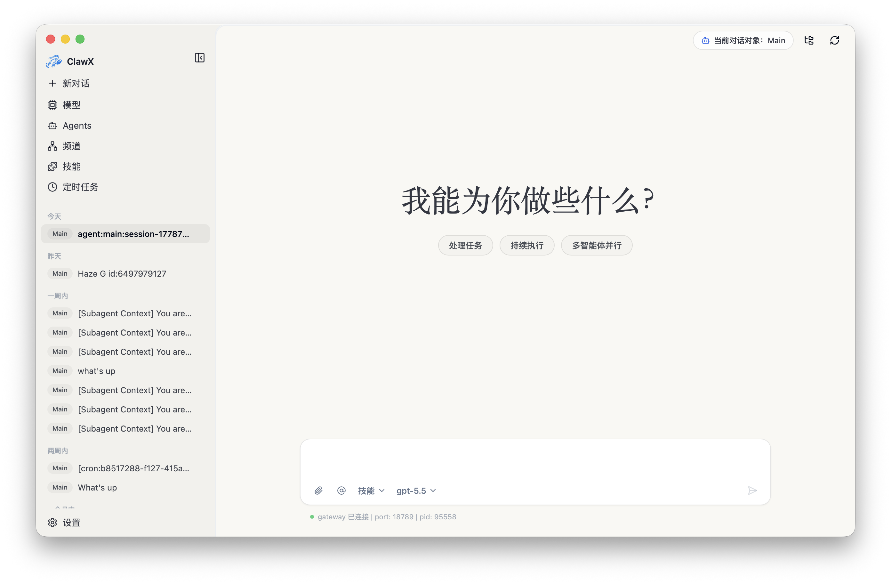
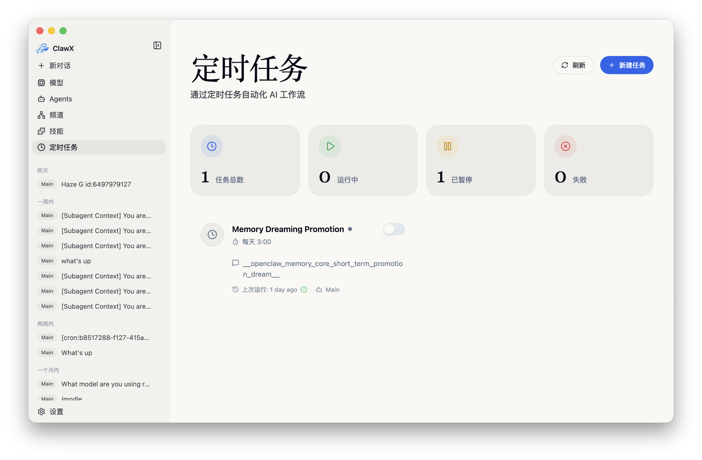
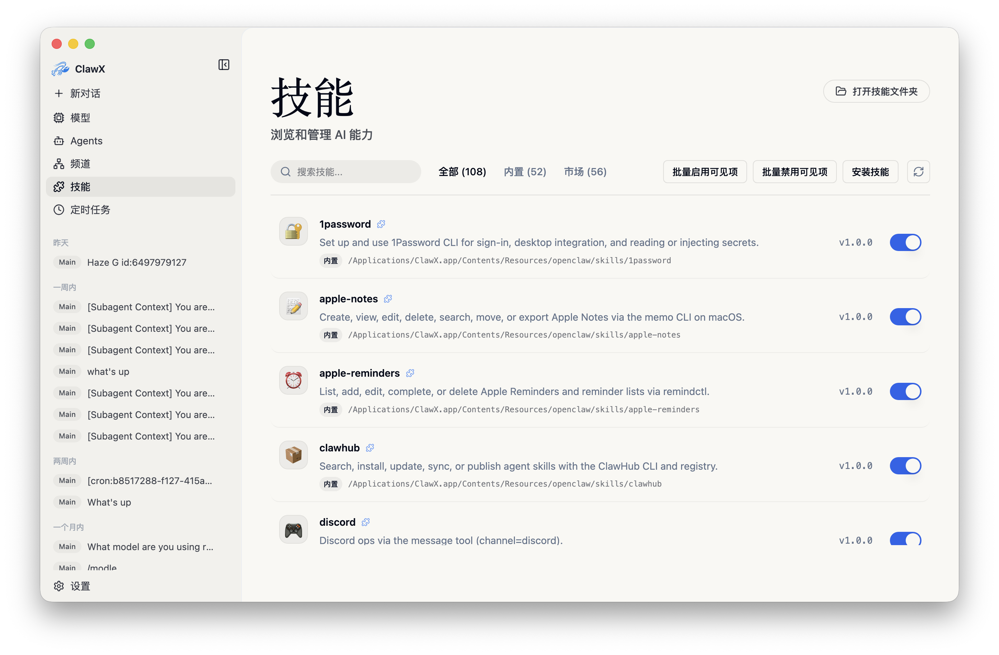
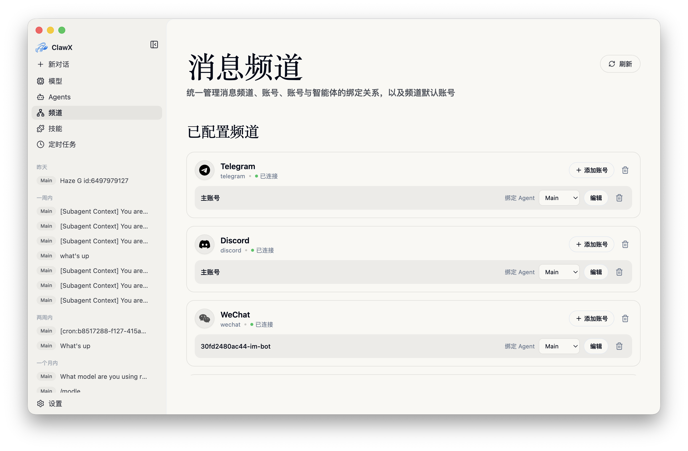
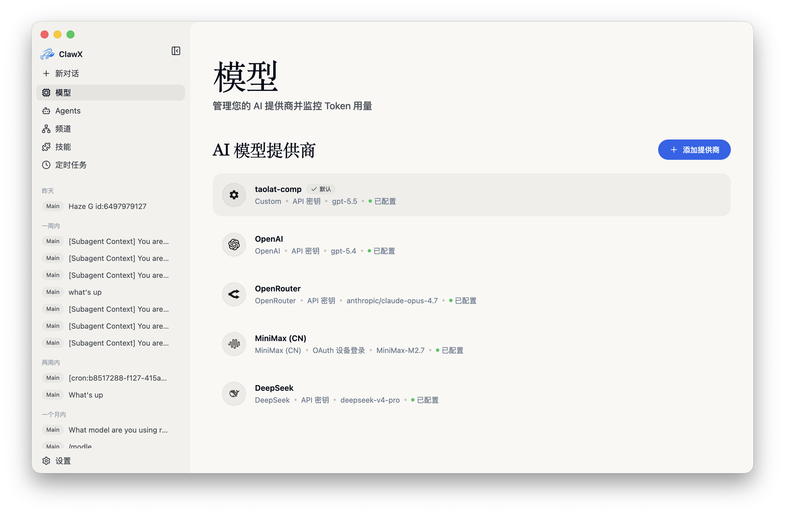
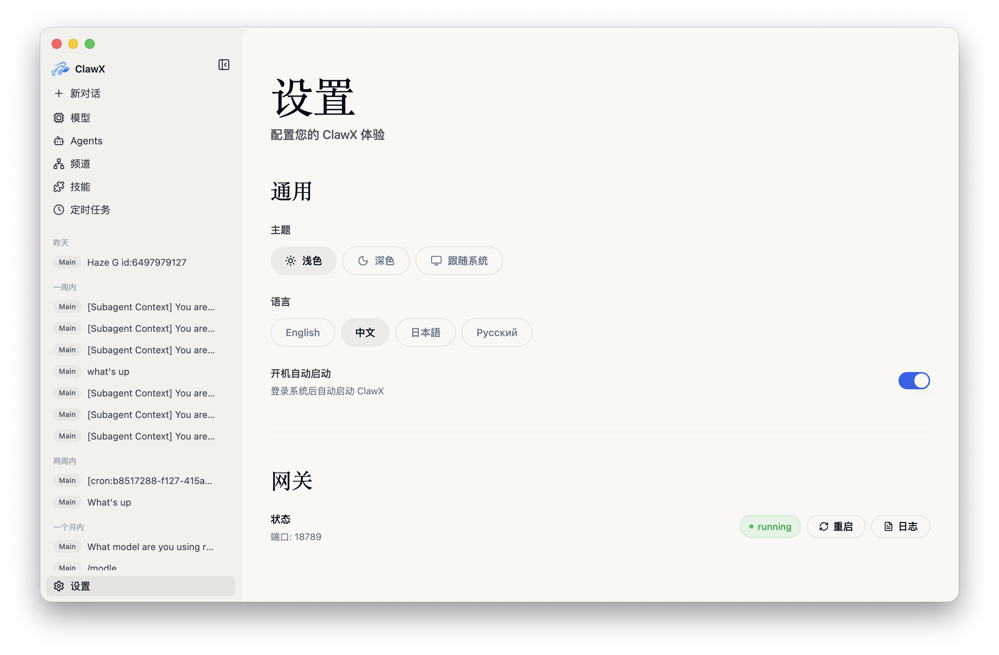

<p align="center">
  
</p>

<h1 align="center">Verse Claw</h1>

<p align="center">
  <strong>OpenClaw AI 智能体的桌面客户端</strong>
</p>

<p align="center">
  <a href="#功能特性">功能特性</a> •
  <a href="#为什么选择-clawx">为什么选择 Verse Claw</a> •
  <a href="#快速上手">快速上手</a> •
  <a href="#系统架构">系统架构</a> •
  <a href="#开发指南">开发指南</a> •
  <a href="#参与贡献">参与贡献</a>
</p>

<p align="center">
  
  
  
  <a href="https://discord.com/invite/84Kex3GGAh" target="_blank">
  
  </a>
  
  
</p>

<p align="center">
  <a href="README.md">English</a> | 简体中文 | <a href="README.ja-JP.md">日本語</a> | <a href="README.ru-RU.md">Русский</a>
</p>

---

## Capability Claim Boundary

Product capability statements must be checked against the canonical matrix in `shared/capability-claims.ts` and the generated status table in `artifacts/capability-claims/status-table.json` before being described as implemented, productized, stable, or end-to-end verified. The local gate `node scripts/check-capability-claims.mjs <files>` warns when high-confidence claims lack matrix, E2E, or real-runtime evidence.

## 概述

**Verse Claw** 是连接强大 AI 智能体与普通用户之间的桥梁。基于 [OpenClaw](https://github.com/OpenClaw) 构建，它将命令行式的 AI 编排转变为易用、美观的桌面体验——无需使用终端。

无论是自动化工作流、连接通讯软件，还是调度智能定时任务，Verse Claw 都能提供高效易用的图形界面，帮助你充分发挥 AI 智能体的能力。

对于需要受控自治执行的复杂任务，Agents 编排面板现在提供有界的 **任务循环**：它会编排角色子 Agent、自检证据、执行限定返工、展示实时状态，并在信心或权限不足时稳定停在 `blocked`。

同一个 Agents -> Roles & Orchestration 界面现在还提供 **Lightweight Subagent Runner**，用于无需编写 ClawGraph YAML 的常见工作流。用户可以选择 Explorer、Reviewer、Tester 或 Compare 3 approaches，输入目标后通过现有 Gateway 权限路径启动显式角色 worker，并在 Verse Claw 中查看实时 worker 状态、摘要、失败原因和 Observability trace 链接。
角色优先编排运行也会显示只读综合结果，保留验证决策、证据数量、trace 数量和可见失败原因。

对于需要跨长对话、检查点、证据复核和显式定时 tick 延续的目标，Agents 面板现在提供 **Mission Control**：它通过 `mission.run` 启动或恢复 Mission，持久化 Mission 状态，基于 ResumeCheckpoint、Task Ledger、记忆和 trace 证据重建有界上下文，每个 tick 运行一次内部 `task_loop`，再由 reviewer 决定继续、修复、休眠、询问、完成或阻塞。
Mission 和 Task loop 现在会携带内部 Engineering Control Signals，例如 `evidence_gap`、`validation_missing`、`scope_drift`、`unverified_claim` 和 `replan_required`；这些信号会保存在 checkpoint、生命周期事件和 Task Ledger metadata 中，并阻止只凭 trace 或内部 loop 完成状态就把长期目标当作已完成事实。

对于需要跨大量 worker 回合稳定拆解的长任务，**ClawGraph Runtime** 提供 workspace YAML 工作流、DAG 执行、无状态角色 worker handoff、审计检查和用户复核能力，避免把完整工作流塞进一个无限增长的 chat transcript。

Verse Claw 预置了最佳实践的模型供应商配置，原生支持 Windows 平台以及多语言设置。当然，你也可以通过 **设置 → 开发者 → 开发者模式** 来进行精细的高级配置。

<p align="center"><strong style="font-size:1.1em; text-decoration: underline;">如需完整的企业版、专属服务支持或面向您业务场景的定制化落地辅导，请联系 <a href="mailto:public@valuecell.ai">public@valuecell.ai</a>。</strong></p>

---

## 截图预览

<p align="center">
  
</p>

<p align="center">
  
</p>

<p align="center">
  
</p>

<p align="center">
  
</p>

<p align="center">
  
</p>

<p align="center">
  
</p>

---

## 为什么选择 Verse Claw

构建 AI 智能体不应该需要精通命令行。Verse Claw 的设计理念很简单：**强大的技术值得拥有一个尊重用户时间的界面。**

| 痛点 | Verse Claw 解决方案 |
|------|----------------|
| 复杂的命令行配置 | 一键安装，配合引导式设置向导 |
| 手动编辑配置文件 | 可视化设置界面，实时校验 |
| 进程管理繁琐 | 自动管理网关生命周期 |
| 应用更新 | 不内置更新检查，也不连接上游更新源 |
| 多 AI 供应商切换 | 统一的供应商配置面板 |
| 技能/插件安装复杂 | 内置技能市场与管理界面 |

### 内置 OpenClaw 核心

Verse Claw 直接基于官方 **OpenClaw** 核心构建。无需单独安装，我们将运行时嵌入应用内部，提供开箱即用的无缝体验。开发模式会默认优先使用可编辑的 `openclaw_runtime` 目录；如需强制回到已发布的 npm 包，可设置 `VERSE_CLAW_OPENCLAW_RUNTIME=npm`。

我们致力于与上游 OpenClaw 项目保持严格同步，确保你始终可以使用官方发布的最新功能、稳定性改进和生态兼容性。

打开开发者模式后，侧边栏还会提供原生 Dreams 页面，可在 Verse Claw 内查看 OpenClaw 记忆回顾、梦境日记，并执行基础维护操作；需要更深诊断时仍可从该页面打开完整 OpenClaw Dreams UI。

---

## 功能特性

### 🎯 零配置门槛
从安装到第一次 AI 对话，全程通过直观的图形界面完成。无需终端命令，无需 YAML 文件，无需到处寻找环境变量。

### 💬 智能聊天界面
通过现代化的聊天体验与 AI 智能体交互。支持多会话上下文、消息历史记录、Markdown 富文本渲染（包括 GitHub 风格表格以及由 KaTeX 渲染的 LaTeX 数学公式：`$行内$`、`$$块级$$`、`\(行内\)` 和 `\[块级\]`）、用于计划、选项列表、问题流和偏好设置的结构化 Tool UI 卡片，以及在多 Agent 场景下通过主输入框中的 `@agent` 直接路由到目标智能体。
推理强度也会作为运行时策略生效：minimal/low 会降低 prompt、skill 和工具结果注入密度，让普通回合更省 token、更简洁；high/xhigh 可建议显式 `/loop`、ClawGraph、角色/子 Agent 或多模型协作，但不会改变权限或工具授权边界。
左侧栏提供 Workgroups 视图，可按 workspace 级任务组组织会话，显示运行、等待、需处理等聚合状态，保留未归组会话，并让新的 workspace 作用域会话继承当前工作组。
设置 → 工作模式 中提供 Plan、Build、Review 和 Docs/Data 管理。模式会按 workspace session 保存，并通过面向产物的 Work Kits 管理报告、表格、演示、PDF、调研、网站、设计和日常事务能力。Kit 状态会显示本地 skill 可用性、由主进程拥有的轻量 Office/Search Work Provider 状态，并为内置 Office skill 提供显式安装入口；下一条消息只会携带轻量的不可信意图 metadata。Work Provider 可以由内置库、可选包、外部服务、Custom HTTP、外部二进制、runtime skill、MCP server 或 OpenClaw plugin 通过同一来源模型承接。Search 在用户显式配置 provider 前保持 `missingConfig`，重型格式转换、爬虫、OCR 和 dataframe runtime 只作为可选接口。工作模式不会自动改变 workspace permission，也不会覆盖 OpenClaw runtime 的工具策略。
OfficeCLI 也可在 设置 -> 技能 -> 功能插件 中管理：Verse Claw 会检测二进制文件、流式显示安装日志、同步与 Codeg 兼容的 `/officecli-*` 技能，并用 `officecli watch` 实时预览 `.docx`、`.xlsx` 和 `.pptx` 文件。
从输入框插入的技能会以 `/技能名` 卡片形式显示；点击卡片可在右侧预览栏打开并阅读该技能的 `SKILL.md`。
在输入框输入 `/` 会打开 Context Palette，可发现 Wiki 搜索、只读知识范围切换、审查、修复 CI、补测试、解释 diff、Task Ledger、Mission Control、压缩和会话 fork；这些动作都会复用现有 Chat 和 Session 流程。
当你使用 `@agent` 选择其他智能体时，Verse Claw 会直接切换到该智能体自己的对话上下文，而不是经过默认智能体转发。各 Agent 工作区默认彼此分离，但更强的运行时隔离仍取决于 OpenClaw 的 sandbox 配置。
Verse Claw 默认使用轻量 `policy-light` 沙盒层，由主进程权限门禁、工作区根目录检查、Gateway RPC 审批和 OpenClaw exec approval 共同生效；Docker 与 SSH 保留为需要显式选择的 `strong` provider，不再是启动必需项。
Settings、Doctor 和 diagnostics 现在展示同一份 effective sandbox policy，包括请求/生效 provider、runtime level、exec 与 network policy、Docker 可用性和降级原因。
Settings → System & Runtime 还提供 Project Rules Center，可检查当前 workspace 的 `AGENTS.md`，列出 `.clawx/rules/*.md`，展示确定性校验 warning，并在缺失时创建保守的 `AGENTS.md` 模板，而不会引入新的规则真相源。
每个 Agent 还可以单独覆盖自己的 `provider/model` 运行时设置；未覆盖的 Agent 会继续继承全局默认模型。
输入框的上下文状态现在提供需要确认的“压缩当前会话”操作，可展示 token 压力、已隐藏消息数量、上次压缩时间和压缩质量；长期任务状态仍进入 Task Ledger / Context Pack，而不是依赖无限增长的 transcript。压缩还会保存高密度 recovery artifact，接力到新对话时会优先使用它，再回退到 transcript 证据。运行时会先在手动/显式 opt-in 压缩中使用分层渐进式压缩计划；自动压缩路径先记录遥测，等质量门禁证明稳定后再接管。
输入框还会显示长对话的 checkpoint 恢复状态：排队后续、最近一次人工介入/checkpoint、恢复警告，以及在会话空闲时立即发送已持久化排队后续的操作；这些排队消息可在 Gateway 重启后继续恢复。
Chat 回滚方案现在提供复核优先的恢复面板，显示安全/复核/高风险计数，以及检查点、队列、上下文、终端、Git、Task Ledger、记忆信号；破坏性操作会进入带审批的工具链，记忆事实会变成 Knowledge 草稿或提案。

Agents 编排面板现在也提供有界的 **任务循环** 操作，用于受控自治任务。它通过现有 Gateway RPC 路径启动 `task_loop.run`，编排角色子 Agent，执行自检与限定返工轮次，并在界面中显示实时阶段、轮次、reviewer 结论、终态和 trace 证据，不新增 renderer 直连 Gateway 通道。

同一面板现在也提供 **Lightweight Subagent Runner**，用于无需 ClawGraph YAML 的预设并行流程。Explorer 会启动 planner 与 architect worker 查找方案，Reviewer 会审查当前 staged 与 unstaged Git diff，Tester 会让 tester 与 reviewer 查找测试缺口，Compare 3 approaches 会启动三个带标签的 architect worker。Runner 不会自动合并代码，并会把完成的运行链接到 Observability trace。
直接角色编排结果现在也包含这个有边界的综合视图，验证失败和证据不会被摘要隐藏。

同一面板现在也提供 **Mission Control**，用于更长目标。它通过 `mission.run` 启动或恢复 Mission，把 Mission 状态写入 OpenClaw state DB，从 ResumeCheckpoint、Task Ledger、记忆和 trace 证据重建有界上下文，每个 tick 运行一次内部 `task_loop`，再进行 Mission reviewer 反思、写入 checkpoint、提出记忆候选，并在界面显示 pause/resume/cancel、tick 阶段、decision、next wake、blocked reason 和 trace 证据。定时 tick 需要显式启用；完成判定始终来自证据而不是唤醒触发器。
Engineering Control Signals 会把 evidence gap、scope drift、validation missing 和 unverified claim 明确写入现有 checkpoint、Mission/Task reviewer、HostEvent 与 Task Ledger metadata 路径；Verse Claw 不会创建第二套进度文件，也不会把 Observability trace 自动当作完成事实。

Chat 输入区还提供预览优先的 **接力到新对话**：Verse Claw 会从 ResumeCheckpoint、runtime 恢复上下文、Task Ledger、Git 状态、近期 trace/error 状态和 transcript fallback 证据生成可编辑的确定性接力草稿，然后创建新的 workspace 作用域会话并把草稿预填到输入框，不会自动发送。
**Fork 到新对话** 是分支式对应功能：当前会话空闲时，Verse Claw 会请求 runtime 创建一个已继承 active transcript branch 的子会话，立即切换过去，父会话保持不变，并且不会复制 Task Ledger 真相、生成 prompt 或自动发送。
Composer 只显示本地 preflight 推荐的连续性动作，并用很短的 healthy/risky/blocked 提示说明状态；会话下拉菜单仍保留 Fork 和接力两项，并用轻量推荐标记与 Fork 来源元数据提示选择。失败提示只提供显式替代动作，例如“准备接力”，不会自动切换语义。

### ClawGraph Runtime
ClawGraph 页面会列出当前 workspace 中的 `.clawx/clawgraph/*.yaml` 工作流，将其编译为经过校验的 DAG，启动受控运行，并显示节点状态、只读 DAG、append-only 事件和待复核项。Worker 作为有界角色子 Agent 运行，只返回结构化 `clawgraph_handoff` JSON；审计失败或不确定的改图会冻结到用户复核，而不是直接当作真实结果接受。ClawGraph 记录执行状态，Task Ledger 仍负责长期目标与复核账本。

### Agent Trace 工作台
Observability 页面会维护 Verse Claw 自有的本地 JSON/JSONL trace 索引，默认保留最近 30 天或 1000 条脱敏 trace envelope，并把 Agent 运行展示成可交互的诊断链路图。查询驱动的 trace 列表会显示 issue chips、来源新鲜度（`live`、`stale`、`rehydrated`、`partial`）、错误、产物、重试、token/cost 和慢点热点；Root Cause、Critical Path、Artifacts、Cost 快捷视图用于更快定位问题。工作台现在会先展示摘要/根因条，支持图谱、运行树、泳道三种视图，可在聚焦/均衡/完整三档图谱密度之间切换，也支持 trace 对比、保存常用列表视图和本地复盘备注。图谱继续支持搜索、阶段/类型/状态过滤、平移缩放、小地图、关键路径高亮、时间线联动，以及包含 Issues、事件、脱敏 I/O 摘要、产物和白名单属性的节点诊断抽屉。实时 Chat 执行卡片在有 trace 数据时可直接跳转到对应 trace 或 issue 节点。`clearTraces()` 只清理 Verse Claw observability 索引和缓存，不删除 transcript/trajectory 原始会话文件；详情默认只展示摘要，不暴露完整 raw prompt、输出、tool args 或 tool output。

Runtime 还包含默认关闭的安全与验证影子层，覆盖 Gateway 可见的 `tools.invoke` 调用和 runtime 验证输入。启用策略后，它会通过 `security.*` 和 `verification.*` RPC 记录脱敏的内存态安全决策、确定性的 tool-call/event-log/checkpoint 验证摘要、按 runId 关联的结果筛选和聚合健康计数，并写入增量 Observability span；它不会阻断工具、运行外部测试、调用 LLM judge，也不会持久化原始 tool args/result/events/checkpoints。

### 任务账本
Task Ledger 页面为长期任务维护 workspace 级、Agent 中立的结构化记录：长期目标、子任务、依赖、阻塞、待复核节点、决策、偏差和会话链接。它在本地 OpenClaw 配置目录中保存 append-only JSONL 事件，在 Chat 旁展示紧凑摘要，并可导出单文件离线 HTML，包含树视图、DAG、历史和复核视图。

### 远程任务
Remote Tasks 页面提供本地优先的结构化任务收件箱，可接收消息、OpenClaw Doctor 和设置补丁任务。设置补丁会展示变更预览，并且只有用户明确批准后，主进程才会应用白名单内的配置更新。

### Code Review Center
Review Center 可以对未提交改动、相对基准分支的 diff 或指定 commit 运行只读 AI 审查。它会按 severity 结构化 findings，保留 file/line 锚点，写入脱敏 review trace，并可把单条 finding 或整次 review 转成 Task Ledger review node，不会暂存、提交或编辑文件。

### Knowledge Hub
Knowledge 页面通过 OpenClaw `memory-wiki` 管理有来源支撑的 wiki 上下文。默认使用 Verse Claw 托管的隔离 native vault，可在不切换到 unsafe local-vault 模式的情况下导入受限的文本文件或文件夹，也可以验证并导入本地 OKF v0.1 Markdown bundle，作为覆盖在 `wiki.ingest` 之上的轻量兼容适配层。它提供状态、搜索、查看、compile、lint、Knowledge Inbox、draft/proposal 审查、provenance 和治理流程。Inbox 会把 Chat、任务账本、文件、OKF、ClawGraph 或 agent 提出的候选知识暂存在正式 wiki 之外，直到用户选择提升为草稿或忽略；provenance 只记录来源引用和读取/引用事件，不修改 wiki 页面。Chat 的知识范围（`None`、`Memory`、`Wiki` 或 `All`）只代表读取范围：agent 可以 search/get 上下文，但不能因为启用 scope 就写入、修改、归档、删除、合并或 apply 知识。在 Chat 中，`/wiki` 会搜索并以可见 chip 挂载明确的 wiki 引用后再发送，`/memory`、`/all`、`/none` 和 `/scope` 只调整读取范围，不会变成写权限。知识调用模式默认是 Suggest：相关知识只显示为可选 chip；Auto-read 需要用户显式开启，并且只会附加少量新鲜、高置信、只读引用。会话知识以及 agent/知识管理员建议都会先进入可编辑 draft/proposal，只有用户明确确认后才写入 wiki。Obsidian 是可选增强，不是必需依赖。治理仪表盘按需运行健康检查，呈现矛盾条目、陈旧页面和无主引用；监控目录只会把项目文档放入 pending Inbox，不会自动 direct-ingest 到正式 wiki，也不会自动生成 synthesis。

### Workspace Git 控制
Workspace 侧栏现在会先打开精简入口面板；只有当前 workspace 是 Git 仓库时才显示“审查”入口，非 Git 项目不会暴露 Git 控件。
Workspace 侧栏提供 Git 工作台，可查看仓库状态、side-by-side 文件 diff、暂存、复制 patch、带审批的文件还原、提交、分支、stash、worktree 和 GitHub Pull Request。顶部 readiness 条会量化本机 Git、内置 Agent Git 工具、worktree 数量和 `gh` 登录状态，让面板直接显示当前哪些能力可用。Worktree 添加支持新分支和已有分支两种流程，新 worktree 默认放在仓库同级目录。同一套 Main 进程 Git service 也驱动内置 `clawx-git` MCP server，让 Agent 通过 Verse Claw 权限体系调用受控 Git 与 PR 工具，而不是直接拼 shell 命令；revert、pull、push、worktree remove/prune、创建 PR 等会改写或发布状态的操作仍需要审批。

### 📡 多频道管理
同时配置和监控多个 AI 频道。每个频道独立运行，允许你为不同任务运行专门的智能体。
现在每个频道支持多个账号，并可在 Channels 页面直接完成账号绑定到 Agent 与默认账号切换。
同一页面也会展示频道/账号的私聊、群组与原生审批策略摘要，仅显示模式与计数，不暴露白名单成员或密钥。
对于自定义频道账号 ID，Verse Claw 现在会强制校验 OpenClaw 兼容的规范格式（`[a-z0-9_-]`、小写、最长 64 位、且必须以字母或数字开头），避免路由匹配异常。
Verse Claw 现在还内置了腾讯官方个人微信渠道插件，可直接在 Channels 页面通过内置二维码流程完成微信连接。

### ⏰ 定时任务自动化
调度 AI 任务自动执行。定义触发器、设置时间间隔，让 AI 智能体 7×24 小时不间断工作。
现在定时任务页面已经可以直接配置外部投递，统一拆成“发送账号”和“接收目标”两个下拉选择。对于已支持的通道，接收目标会从通道目录能力或已知会话历史中自动发现，不需要再手动修改 `jobs.json`。
定时任务也可以运行 Agent Browser 自动化：配置 URL、浏览器 profile/auth state、安全策略、成功/失败判定、保守安全步骤重试和诊断项后，就能让网页签到、页面监控、草稿发布等任务通过内部 managed browser 复用持久化登录态，并在失败时展示简洁证据。


### 🧩 可扩展技能系统
通过预构建的技能扩展 AI 智能体的能力。集成的 Skills 页面采用“本地优先”方式：会扫描托管目录与 workspace 技能目录，并且无需依赖 Gateway 即可启用或停用技能；在企业扩展接管时，也可以显示扩展提供的 marketplace。
Verse Claw 还会内置预装完整的文档处理技能（`pdf`、`xlsx`、`docx`、`pptx`），在启动时自动部署到托管技能目录（默认 `~/.openclaw/skills`），并在首次安装时默认启用。额外预装技能（`find-skills`、`self-improving-agent`、`tavily-search`）也会默认启用；若缺少必需的 API Key，OpenClaw 会在运行时给出配置错误提示。
Skills 页面可展示来自多个 OpenClaw 来源的技能（托管目录、workspace、额外技能目录），并显示每个技能的实际路径，便于直接打开真实安装位置。对于 OpenClaw 自带的 bundled skills，社区版现在在打包产物里只保留并展示 `skill-creator`；开发模式和打包版启动时都会直接清理其它 bundled skill，同时把这些已删除 bundled skill 在 `openclaw.json` 中残留的旧配置一并移除。
在聊天输入框中，本地优先的能力管理请求（例如启用已发现的技能，或注册粘贴的 MCP JSON）会在发送前被识别，并在确认对话框中展示本地审计结果；只有未被审计阻断的动作才会通过 host API 应用变更，执行结果会作为可信 Verse Claw 元数据注入本次消息。能力编排还会写入一条 `capability-management` Observability trace，记录审计、注册、reload、heartbeat 和工具列表步骤，让安装/注册流程可以和 Agent runtime trace 一起排查。v1 审计是可解释的本地门禁，会检查 Skill 元数据以及 MCP command/URL/env 风险；不会自动下载远程 marketplace 包，也不会执行远程 npm/npx 模板安装。

重点搜索技能所需环境变量：
- `TAVILY_API_KEY`：用于 `tavily-search`（上游运行时也可能支持 OAuth）

### 🔐 安全的供应商集成
连接多个 AI 供应商（OpenAI、Anthropic 等），凭证安全存储在系统原生密钥链中。OpenAI 同时支持 API Key 与浏览器 OAuth（Codex 订阅）登录。
在开发者模式下，独立的“图像生成”页面支持配置 OpenAI 兼容生图端点（Base URL、API Key 和模型名，例如 `gpt-image-2`），生图请求会走专用的 `/v1/images/generations` 服务，聊天仍继续使用正常的 OpenAI Provider。
如果你通过 **自定义（Custom）Provider** 对接 OpenAI-compatible 网关，可以在 **设置 → AI Providers → 编辑 Provider** 中配置自定义 `User-Agent`，以提高兼容性。
如果兼容网关的 `/models` 因非鉴权原因不可用，Verse Claw 会在校验 API Key 时自动降级为轻量的 `/chat/completions` 或 `/responses` 探测。

### 🌙 自适应主题
支持浅色模式、深色模式或跟随系统主题。Verse Claw 自动适应你的偏好设置。

### 🚀 开机启动控制
在 **设置 → 通用** 中，你可以开启 **开机自动启动**，让 Verse Claw 在系统登录后自动启动。

### 🔔 更新提示
Verse Claw 不内置更新检查，也不会连接上游更新源或弹出更新提示。二次分发时请使用你自己的打包发布渠道。

---

## 快速上手

### 系统要求

- **操作系统**：macOS 11+、Windows 10+ 或 Linux（Ubuntu 20.04+）
- **内存**：最低 4GB RAM（推荐 8GB）
- **存储空间**：1GB 可用磁盘空间

### 安装方式

#### 预构建版本（推荐）

从 [Releases](https://github.com/ValueCell-ai/Verse Claw/releases) 页面下载适用于你平台的最新版本。

#### 从源码构建

```bash
# 克隆仓库
git clone https://github.com/ValueCell-ai/Verse Claw.git
cd Verse Claw

# 初始化项目
pnpm run init

# 以开发模式启动
pnpm dev
```
### 首次启动

首次启动 Verse Claw 时，**设置向导** 将引导你完成以下步骤：

1. **语言与区域** – 配置你的首选语言和地区
2. **AI 供应商** – 通过 API 密钥或 OAuth（支持浏览器/设备登录的供应商）添加账号
3. **技能包** – 选择适用于常见场景的预配置技能
4. **验证** – 在进入主界面前测试你的配置

如果系统语言在支持列表中，向导会默认选中该语言；否则回退到英文。

> Moonshot（Kimi）说明：Verse Claw 默认保持开启 Kimi 的 web search。
> 当配置 Moonshot 后，Verse Claw 也会将 OpenClaw 配置中的 Kimi web search 同步到中国区端点（`https://api.moonshot.cn/v1`）。

### 代理设置

Verse Claw 内置了代理设置，适用于需要通过本地代理客户端访问外网的场景，包括 Electron 本身、OpenClaw Gateway，以及 Telegram 这类频道的联网请求。

打开 **设置 → 开发者 → 代理**，配置以下内容：

- **代理服务器**：所有请求默认使用的代理
- **绕过规则**：需要直连的主机，使用分号、逗号或换行分隔
- 在 **开发者模式** 下，还可以单独覆盖：
  - **HTTP 代理**
  - **HTTPS 代理**
  - **ALL_PROXY / SOCKS**

本地代理的常见填写示例：

```text
代理服务器: http://127.0.0.1:7890
```
说明：

- 只填写 `host:port` 时，会按 HTTP 代理处理。
- 高级代理项留空时，会自动回退到“代理服务器”。
- 保存代理设置后，Electron 网络层会立即重新应用代理，并自动重启 Gateway。
- 如果启用了 Telegram，Verse Claw 还会把代理同步到 OpenClaw 的 Telegram 频道配置中。
- 当 Verse Claw 代理处于关闭状态时，Gateway 的常规重启会保留已有的 Telegram 频道代理配置。
- 如果你要明确清空 OpenClaw 中的 Telegram 代理，请在关闭代理后点一次“保存代理设置”。
- 在 **设置 → 开发者** 中，可以直接运行 **OpenClaw Doctor**，针对与 Gateway 相同的当前运行时执行诊断，并在应用内查看输出。
- 在 Windows 打包版本中，内置的 `openclaw` CLI/TUI 会通过随包分发的 `node.exe` 和打包的 `openclaw-runtime` 入口运行，以保证终端输入行为稳定。

---

## 系统架构

Verse Claw 采用 **双进程 + Host API 统一接入架构**。渲染进程只调用统一客户端抽象，协议选择与进程生命周期由 Electron 主进程统一管理：

```
┌───────────────────────────────────────────────────────────────────┐
│                        Verse Claw 桌面应用                              │
│                                                                   │
│  ┌─────────────────────────────────────────────────────────────┐  │
│  │              Electron 主进程                                 │  │
│  │  • 窗口与应用生命周期管理                                       │  │
│  │  • 网关进程监控                                               │  │
│  │  • 系统集成（托盘、通知、密钥链）                                │  │
│  │  • 仅保留发布打包                                               │  │
│  └─────────────────────────────────────────────────────────────┘  │
│                              │                                    │
│                              │ IPC (权威控制面)                     │
│                              ▼                                    │
│  ┌─────────────────────────────────────────────────────────────┐  │
│  │              React 渲染进程                                  │  │
│  │  • 现代组件化 UI（React 19）                                  │  │
│  │  • Zustand 状态管理                                          │  │
│  │  • 统一 host-api/api-client 调用                             │  │
│  │  • Markdown 富文本渲染                                       │  │
│  └────────────────────────────────────────────────────────────┘  │
└──────────────────────────────┬───────────────────────────────────┘
                               │
                               │ 类型化 IPC 请求
                               ▼
┌─────────────────────────────────────────────────────────────────┐
│                  主进程 Host Services 与 Gateway Manager          │
│                                                                 │
│  • host:invoke 类型化服务分发                                      │
│  • 设置、文件、会话、技能、供应商、诊断服务                           │
│  • 主进程持有 Gateway WebSocket 并负责进程监控                       │
└──────────────────────────────┬──────────────────────────────────┘
                               │
                               │ 主进程持有 WebSocket
                               ▼
┌─────────────────────────────────────────────────────────────────┐
│                     OpenClaw 网关                                │
│                                                                 │
│  • AI 智能体运行时与编排                                           │
│  • 消息频道管理                                                   │
│  • 技能/插件执行环境                                               │
│  • 供应商抽象层                                                   │
└─────────────────────────────────────────────────────────────────┘
```
### 设计原则

- **进程隔离**：AI 运行时在独立进程中运行，确保即使在高负载计算期间 UI 也能保持响应
- **前端调用单一入口**：渲染层统一走 host-api/api-client，不感知底层协议细节
- **主进程掌控传输策略**：Gateway WebSocket 只由 Electron Main 持有，渲染进程通过类型化 IPC 调用 Main
- **扩展 IPC 贡献点**：主进程扩展通过类型化 IPC 注册表贡献 host-api action，而不是挂载 HTTP route
- **优雅恢复**：内置重连、超时、退避逻辑，自动处理瞬时故障
- **安全存储**：API 密钥和敏感数据利用操作系统原生的安全存储机制
- **CORS 安全**：渲染进程不直接请求本地 Gateway 或 Host API HTTP 端点

### 进程模型与 Gateway 排障

- Verse Claw 基于 Electron，**单个应用实例出现多个系统进程是正常现象**（main/renderer/zygote/utility）。
- 单实例保护同时使用 Electron 自带锁与本地进程文件锁回退机制，可在桌面会话总线异常时避免重复启动。
- 滚动升级期间若新旧版本混跑，单实例保护仍可能出现不对称行为。为保证稳定性，建议桌面客户端尽量统一升级到同一版本。
- 但 OpenClaw Gateway 监听应始终保持**单实例**：`127.0.0.1:18789` 只能有一个监听者。
- Gateway readiness 以 OpenClaw 的 `system-presence`、`health`、`status` 等核心信号为准；memory、Dreams 或频道失败会显示为能力降级，而不是全局 Gateway 故障。
- 可用以下命令确认监听进程：
  - macOS/Linux：`lsof -nP -iTCP:18789 -sTCP:LISTEN`
  - Windows（PowerShell）：`Get-NetTCPConnection -LocalPort 18789 -State Listen`
- 点击窗口关闭按钮（`X`）默认只是最小化到托盘，并不会完全退出应用。请在托盘菜单中选择 **Quit Verse Claw** 执行完整退出。

---

## 使用场景

### 🤖 个人 AI 助手
配置一个通用 AI 智能体，可以回答问题、撰写邮件、总结文档并协助处理日常任务——全部通过简洁的桌面界面完成。

### 📊 自动化监控
设置定时智能体来监控新闻动态、追踪价格变动或监听特定事件。结果将推送到你偏好的通知渠道。

### 💻 开发者效率工具
将 AI 融入你的开发工作流。使用智能体进行代码审查、生成文档或自动化重复性编码任务。

### 🔄 工作流自动化
将多个技能串联起来，创建复杂的自动化流水线。处理数据、转换内容、触发操作——全部通过可视化方式编排。

---

## 开发指南

### 前置要求

- **Node.js**：22+（推荐 LTS 版本）
- **包管理器**：pnpm 9+（推荐）或 npm
- **Linux（Ubuntu/Debian）**：运行 Electron 前，请先安装所需系统库：
  ```bash
  sudo apt-get install -y libnss3 libgtk-3-0 libxss1 libxtst6 libatspi2.0-0 libnotify4 xdg-utils
  ```
  在 Ubuntu 24.04+ 上，部分软件包使用 `t64` 后缀，运行上述命令后 `apt` 会自动选择正确版本。

### 项目结构

```Verse Claw/
├── electron/                 # Electron 主进程
│   ├── services/            # 类型化 Host API、Provider、Secrets 与运行时服务
│   │   ├── providers/       # Provider/account 模型同步逻辑
│   │   └── secrets/         # 系统钥匙串与密钥存储
│   ├── shared/              # 共享 Provider schema/常量
│   │   └── providers/
│   ├── main/                # 应用入口、窗口、IPC 注册
│   ├── gateway/             # OpenClaw 网关进程管理
│   ├── preload/             # 安全 IPC 桥接
│   └── utils/               # 工具模块（存储、认证、路径）
├── src/                      # React 渲染进程
│   ├── lib/                 # 前端统一 API 与错误模型
│   ├── stores/              # Zustand 状态仓库（settings/chat/gateway）
│   ├── components/          # 可复用 UI 组件
│   ├── pages/               # Setup/Dashboard/Chat/Billing/Channels/Skills/Cron/Settings
│   ├── i18n/                # 国际化资源
│   └── types/               # TypeScript 类型定义
├── tests/
│   ├── e2e/                 # Playwright Electron 端到端冒烟测试
│   └── unit/                # Vitest 单元/集成型测试
├── resources/                # 静态资源（图标、图片）
└── scripts/                  # 构建与工具脚本
```
### 常用命令

```bash
# 开发
pnpm run init             # 安装依赖并下载捆绑二进制（uv、agent-browser）
pnpm dev                  # 以热重载模式启动（若缺失会自动准备预装技能包）

# 代码质量
pnpm lint                 # 运行 ESLint 检查
pnpm typecheck            # TypeScript 类型检查

# 测试
pnpm test                 # 运行单元测试
pnpm run test:e2e         # 运行 Electron E2E 冒烟测试
pnpm run test:e2e:headed  # 以可见窗口运行 Electron E2E 测试
pnpm run comms:replay     # 计算通信回放指标
pnpm run comms:baseline   # 刷新通信基线快照
pnpm run comms:compare    # 将回放指标与基线阈值对比

# Agent harness
pnpm harness context --spec harness/specs/tasks/connect-clawx-to-openclaw-runtime.md
pnpm harness validate --spec harness/specs/tasks/connect-clawx-to-openclaw-runtime.md

# Agent dev/test control plane
pnpm agent-dev:make <page|e2e|host-route|skill|channel|plugin|scenario> my-scenario
# scenario scaffolds register shared/agent-dev/scenarios.ts and generate snapshot-backed E2E
pnpm contract:check
pnpm i18n:lint
pnpm channel:conformance my-channel
pnpm agent-dev:workbench
pnpm agent-dev:promote-scenario artifacts/agent-dev-scenarios/example.scenario.json my-scenario
pnpm agent-dev:deep-test
pnpm agent-dev:deep-test:reuse     # 日常循环：复用构建、缓存 typecheck、只跑 Workbench E2E 烟测
pnpm agent-dev:deep-test:reuse:full  # 复用构建和缓存 typecheck，但运行完整 Agent Dev E2E
pnpm agent-dev:audit               # 根据现有 evidence 评估 Agent Dev 成熟度
pnpm agent-dev:audit:report        # 生成同一份审计报告，但不让 shell 失败退出
pnpm agent-dev:unit:fast           # 日常单测快路径；评审证据仍使用 agent-dev:unit
pnpm run typecheck:agent-dev       # 并行运行 node+web typecheck 的日常循环
pnpm run test:e2e:agent-dev-quality:smoke  # 仅 Workbench E2E 冒烟循环
pnpm run typecheck:cached          # Fingerprint-cached repeat typecheck for local diagnosis
pnpm run typecheck:force           # Force a fresh uncached typecheck cache refresh
pnpm agent-dev:validate

# 构建与打包
pnpm run build:vite       # 仅构建前端
pnpm build                # 完整生产构建（含打包资源）
pnpm package              # 为当前平台打包（包含预装技能资源）
pnpm package:mac          # 为 macOS 打包
pnpm package:win          # 为 Windows 打包
pnpm package:linux        # 为 Linux 打包
```

Verse Claw 现在会在 active project workspace 和 OpenClaw agent workspace 中播种 `.clawx/harness/` 项目 harness 文档骨架，用 Verse Claw 自有结构承载 rules、scenarios、task contracts、guides、layers、context-pack recipes 和 Task Ledger bridge docs，而不是引入并行的 `.trellis/` 或 Markdown 任务状态事实源。

Agent 编写的页面开发和功能测试可以使用 typed `hostApi.agentDev` 控制面来完成状态种子、`?devScenario=...`、host-api record/replay、诊断快照、transport trace、视觉 preset 和 selector contract。deep-test 报告现在也包含机器可读的 `decision` 和滚动耗时历史 evidence。详见 [`docs/agent-dev-control-plane.md`](docs/agent-dev-control-plane.md)。

在无头 Linux 环境下，Electron 测试需要显示服务；可使用 `xvfb-run -a pnpm run test:e2e`。

### 通信回归检查

当 PR 涉及通信链路（Gateway 事件、Chat 收发流程、Channel 投递、传输回退）时，建议执行：

```bash
pnpm run comms:replay
pnpm run comms:compare
```

CI 中的 `comms-regression` 会校验必选场景与阈值。
### 技术栈

| 层级 | 技术 |
|------|------|
| 运行时 | Electron 40+ |
| UI 框架 | React 19 + TypeScript |
| 样式 | Tailwind CSS + shadcn/ui |
| 状态管理 | Zustand |
| 构建工具 | Vite + electron-builder |
| 测试 | Vitest + Playwright |
| 动画 | Framer Motion |
| 图标 | Lucide React |

---

## 参与贡献

我们欢迎社区的各种贡献！无论是修复 Bug、开发新功能、改进文档还是翻译——每一份贡献都让 Verse Claw 变得更好。

### 如何贡献

1. **Fork** 本仓库
2. **创建** 功能分支（`git checkout -b feature/amazing-feature`）
3. **提交** 清晰描述的变更
4. **推送** 到你的分支
5. **创建** Pull Request

### 贡献规范

- 遵循现有代码风格（ESLint + Prettier）
- 为新功能编写测试
- 按需更新文档
- 保持提交原子化且描述清晰

---

## 致谢

Verse Claw 构建于以下优秀的开源项目之上：

- [OpenClaw](https://github.com/OpenClaw) – AI 智能体运行时
- [Electron](https://www.electronjs.org/) – 跨平台桌面框架
- [React](https://react.dev/) – UI 组件库
- [shadcn/ui](https://ui.shadcn.com/) – 精美设计的组件库
- [Zustand](https://github.com/pmndrs/zustand) – 轻量级状态管理

---

## 社区

加入我们的社区，与其他用户交流、获取帮助、分享你的使用体验。

| 企业微信 | 飞书群组 | Discord |
| :---: | :---: | :---: |
|  |  |  |

### Verse Claw 合作伙伴计划 🚀

我们正在启动 Verse Claw 合作伙伴计划，寻找能够帮助我们将 Verse Claw 介绍给更多客户的合作伙伴，尤其是那些有定制化 AI 智能体或自动化需求的客户。

合作伙伴负责帮助我们连接潜在用户和项目，Verse Claw 团队则提供完整的技术支持、定制开发与集成服务。

如果你服务的客户对 AI 工具或自动化方案感兴趣，欢迎与我们合作。

欢迎私信我们，或发送邮件至 [public@valuecell.ai](mailto:public@valuecell.ai) 了解更多。

---

## Stars 历史

<p align="center">
  
</p>

---

## 许可证

Verse Claw 基于 [MIT 许可证](LICENSE) 发布。你可以自由地使用、修改和分发本软件。

---

<p align="center">
  <sub>由 ValueCell 团队用 ❤️ 打造</sub>
</p>
