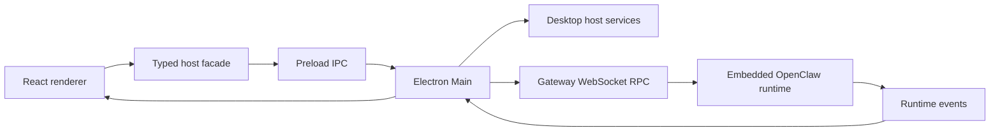

<p align="center">
  
</p>

审查中心提供折叠、显式启用的 Change Context：四种比较方式、digest 锚定评论与显式审查结论。拉取变更复用现有审批、Git 与 Coding journal；审查通过不完成任务或合并代码。详见[工作区与编码](docs/modules/workspace-and-coding.md)。 Windows 源码宿主的验收范围与入口回滚见[受控启用与回滚](docs/dev/change-context-review-loop/rollout.md)。

可通过 `runtime.providerBudget` 显式设置宿主、项目和会话预算；子调用继承会话 owner 的 workspace，预留与未知成本由运行时 owner 保留。覆盖范围和核销边界见[资源与观测](docs/modules/resources-and-observability.md)。

# Verse Claw

激活项目会同步运行时的目录与权限策略，并保留已选择的模型。

空闲任务租约过期后，同一会话代次与工作树可以递增 owner epoch 接续，旧凭据随即失效；未决效果仍需对账。

Gateway 重启后，恢复任务会等待桌面完成连接认证，再进行效果准入。

重启恢复按所属 agent 处理各自的 `global` 会话与失败通知。authority 模式下，子代理的自动续跑链累计最多恢复两次，等待和压缩均保留已用次数；新会话代次重新计数。

Agent 启动复用配置和工作区匹配的 Gateway 插件状态；配置或工作区变化按各自作用域加载。

Gateway 配置监听器在实际热更新时加载定时任务、MCP 清理和提供方刷新执行模块。启动投递队列为空时，不加载发送与回复执行模块。
连接握手直接读取健康缓存和更新提示，无需加载健康探测或更新执行模块。敏感健康结果与公开缓存分开保存。
就绪探测只接收连接挑战；鉴权与 RPC 执行模块在连接发来首个请求帧时加载。

原生语法解析器在首次分析对应语言的代码时加载。

Agent 的上下文和生命周期执行模块在开始运行时加载，运行器选择读取已有元数据。
轨迹读取按需准备会话数据，连接关闭时释放订阅。

项目下拉菜单提供 Git 初始化、工作树创建与切换，并沿用各自会话和草稿。

会话控制保留草稿，并按所属服务的确认结果显示状态。归档设置列出中断的归档、还原和删除操作，可继续原操作；上下文修改核对会话代次，存储页保留任务或会话管理的工作树。检查点恢复携带当前会话代次，并使用该会话记录的执行目录。 聊天页重载后从 Gateway 回读当前连接的就绪状态与会话控制。

Chat 可将同一会话和任务迁移到另一个已配置检出，保留目标与产物引用。系统核对源环境排空和目标所有权，中断后从已保存的操作继续恢复。
聊天普通文本流按帧合并更新，批准、取消、错误和完成状态即时发布；当前回复增长时，已完成消息保持稳定。

长会话按实际消息高度计算视口，已加载的早期轮次可在 DOM 上限内定位。历史、预览和投影缓存共享 32 MiB 载荷预算，淘汰后通过原有会话与媒体入口回读。

兼容的文件订阅共享原生监听器，各自保留过滤规则和释放句柄。知识源目录重建后自动恢复监听，多个窗口共享 Main 的新鲜 Git 状态结果。

受管进程按生命周期持有共享 executor，确认终态后释放自身引用。poll 调度为 stdin 和取消保留空间，输出按合计字节限额保留，并继续提供原有 artifact 引用。

终端 PTY 与受管进程共享已声明的宿主容量；已知服务端口在启动前预留，旧代次终端拒绝控制，退出结果不确定时保留占用供恢复核对。详见[终端资源归属](harness/specs/guides/terminal-resource-ownership.md)。

资源压力会收紧新的执行准入，已开始的工作保持占用。Agent 等待队列有明确上限，取消会及时结束等待。关闭效率采样会停止诊断记录，资源保护与空闲进程回收继续运行。详见[资源与观测](docs/modules/resources-and-observability.md)。

会话支持建立 Git 仓库、选择独立工作树并恢复草稿。`/storage` 与**设置 → 存储空间**共用资源页，可查看会话文件、进程内存和工作树占用。[操作与归属规则](docs/dev/session-worktree-storage.md)。

Runtime 管理的工作树归属、创建阶段和合并意图持久保存在 SQLite 中。重启后可恢复归属；路径被替换、创建未完成或合并结果未知时保留资源并拒绝继续使用旧资格。[注册与恢复契约](harness/specs/guides/execution-domain-registry.md)。

打开资源弹窗会刷新当前会话的协调器状态与 worker 回执。

受管工具在执行前联合核对任务领取、会话代次和持久 checkout writer，并与现有合并、冻结和清理共用资源 owner。writer 在工具之间保持占用，未知效果与后台进程需要原 owner 结清。[写入占用契约](harness/specs/guides/checkout-writer-ownership.md)说明转交、恢复和外部写入边界。

会话菜单采用浅灰／石墨灰的不透明表面，显示模型品牌图标和完整模型名，并在会话状态中标识关联工作树。

打开会话会同步激活所属工作区并恢复草稿；分支操作即时刷新检出信息。子会话可在来源下展开，会话菜单支持搜索并去除重复项。[会话导航](docs/dev/chat-worktree-session-navigation.md)。

会话生命周期统一由原始 v2 轨迹拼装结果驱动。Verifier 完成报告按配置把修复任务交给 lead，修复后再独立复验。

Skill 配置直接写入运行时配置，受管技能可在详情中卸载。Agent Dev 报告采集正常聊天与工具事件，并对 token 用量去重。

切换会话会恢复可见消息位置和草稿。后台工作更新自身状态，指针或键盘所在的家族行保持位置。空项目、权限失败和依赖等待显示具体原因与已有下一步入口；派发安排和当前队列观测分别展示。

消息分支使用已记录的转录边界，缺少边界或当前不可操作时显示禁用原因。另开会话的建议沿用可编辑的 Handoff 预览，由明确的创建动作提交。

长任务运行中的“发送方式”说明排队、引导和停止后发送的效果；“分支继续”打开新会话供下一次提问，“摘要接力”先编辑内容再“创建并发送”。整理上下文和接力来源默认收起技术详情。[会话操作](docs/dev/chat-continuity-controls.md)。

会话身份加载完成后可准备 Handoff；侧栏发起的接力会等待身份就绪，预览始终对应当前会话代次。
激活中断后，重试会复用原来的子会话，并在发送前核验会话代次。

**在一个桌面工作空间里完成对话、编码、知识与 Agent 执行。**

[English](README.md) · [简体中文](README.zh-CN.md) · [日本語](README.ja-JP.md) · [Русский](README.ru-RU.md)

[模块详解](docs/modules/README.md) · [快速开始](#getting-started) · [架构](#architecture) · [开发与验证](#development) · [常见问题](#troubleshooting) · [文档导航](#documentation)

Verse Claw 是基于嵌入式 OpenClaw Runtime 的 Electron 桌面应用。它把会话、项目工作区、编码工具、知识审核、记忆、多智能体编排、消息渠道、计划任务和运行时诊断集中在同一个本地桌面产品里。

这个仓库不只是 Renderer 外壳，还包含 React UI、Electron Main Host、类型化跨进程契约、vendored OpenClaw Runtime、VerseBrowser、VerseShell 执行基础、已退役但仍保留的 VToken 源码、可执行 Harness 规格，以及构建/证据/发布流水线。

> **当前状态：**`0.4.9-alpha.0`，controlled preview。Windows x64 本地工作流是主要验收目标；macOS/Linux 有构建目标，但平台级运行时验证是另一件事。组件毕业或 agent-driven 证据都不代表公开发布、GA、liveReady 或 productApproved。

## 产品包含什么

| 领域 | 当前产品形态 | 深入文档 |
|---|---|---|
| LLM 与模型 | 基于账户的供应商配置，OAuth/API Key/本地认证，协议适配，模型 fallback，单轮/会话模型覆盖，流式返回、工具循环、带拖动文字预览的推理强度、token usage 与估算成本 | [LLM 与模型](docs/modules/llm-and-models.md) |
| 会话与运行 | JSONL 追加型会话树、run、abort/stop/archive/delete、checkpoint、compaction、handoff/fork、可搜索侧栏、持久化分组与长会话 coordinator | [会话](docs/modules/sessions.md) |
| 上下文与记忆 | Context Orchestrator、6,000 字符受管注入预算与编排后分账、Workspace Context、上下文健康评分、仅显示线条圆环并提供真实来源详情和设置开关的聊天 TokenTag，以及基于独立 Role/Runtime store 的单一 Memory 产品面 | [上下文与记忆](docs/modules/context-and-memory.md) |
| 工作区与编码 | Workspace preflight、四种权限模式、文件预览、PTY 终端、Web Preview、Git、Review Panel、write journal、stale-write guard 与 auto verify | [工作区与编码](docs/modules/workspace-and-coding.md) |
| 知识库 | Markdown/wiki-first Library、Inbox → Draft → Steward → Proposal → explicit apply、Source Set、OKF、Runtime Lessons/SEKB、provenance 与 governance | [知识库](docs/modules/knowledge-base.md) |
| 多智能体与任务 | Agent/Persona/Role 分层、9 个内置角色、路由、团队模板、资源感知波次、subagent admission、Task Ledger、Task Loop、ClawGraph | [多智能体与任务](docs/modules/multi-agent-and-tasks.md) |
| 任务追溯报告 | 展开持久任务卡，可查看来源、运行、工具效果、候选检查和保留证据。协调者与执行者的已记录模型调用按原始回执去重；目录价格标为估算，缺少金额时显示未知。 | [任务追溯报告](docs/modules/multi-agent-and-tasks.md) |
| 项目与会话导航 | 项目名进入负责人；项目视图保留显式关联的不同 agent 负责人。会话家族在原工作组内展开，并展示任务范围。任务历史可打开关联会话和检查点产物。分支问题保留为草稿；续接创建后发送首轮，支持重启后核实与恢复。 | [会话与任务链路](docs/modules/multi-agent-and-tasks.md) |
| Verse 系列 | VerseGit 仓库/证据控制面、VerseShell 受控执行、VerseBrowser 驱动，以及已退役 VToken | [Verse 系列](docs/modules/verse-tools.md) |
| 资源与可观测性 | ResourceFabric 有界操作延迟基线与内存/event-loop 压力控制、后台降载、进程追踪、token/cost 上限与恢复 | [资源与可观测性](docs/modules/resources-and-observability.md) |
| 集成与其他表面 | 15 类渠道、Scheduled、Skills/MCP、Inbox、Remote Tasks、Code Review、VerseConf 文档、媒体、Billing 与 Agent Dev | [集成与页面](docs/modules/integrations-and-surfaces.md) |

模块详解当前以简体中文维护；其中源码路径、API 名称和证据链接与语言无关。四个根 README 负责多语言入口。

会话正文与输入框共享可用宽度，助手说明之后的相邻工具操作默认折叠成一组。折叠处采用无背景的图标和最新处理文本，文字从左向右进场一次并持续白色 shimmer；仅当前运行的折叠摘要播放 Lucide 图标动效，展开后和结束状态的图标保持静态，悬停不触发动效。减少动态效果时文字和图标静态显示。展开后的工具和命令保留背景、进度填充、计时及完成状态勾。图标按文件类型、Git、浏览器动作、测试、构建、包管理、记忆、数据库和子代理等工作匹配。展开后按顺序查看调用、参数、结果、命令输出和文件修改。完成后恢复静态，保留手动开合状态。进度说明、最终答复、交付资源和待回应请求保持可访问。较长预览继续自动换行，复制包含完整的已保留内容；已完成答复的操作行、时间和 token 用量仍与正文对齐。

触屏上，输入栏的主要操作至少有 44 px 的点击区域。未成功的计划更新保留在执行详情中，不会取代当前计划。

提问、选项、计划确认和权限请求共用输入框位置的决策面板。运行时审批优先，其次是工作区权限和其他待回应请求，一次突出一项。处理期间保留原输入草稿，请求结束后恢复；被审批打断的问题也保留已选答案。面板统一沿用输入框的材质、圆角和底部操作行。运行结束后计划进度条收起，历史计划保留在过程详情中。活动面板复用侧栏会话行，支持同样的置顶、重命名和右键菜单。

会话状态采用统一的平面分组，已完成进程默认收进历史。打开进程后复用对话中的终端视图，支持复制完整输出，并在新日志到来时保留回看位置。工具调用与对应结果合并到一个展开入口，诊断信息置于末尾。输入区、变更审查条和顶部会话栏随可用列宽收缩控件，窄屏保留分支、变更数和审查入口。

会话环境在发生实际变更或活动后出现，将变更、已观察到的 MCP/Skill 使用和子代理收进简短摘要，详情按需展开。自动展开与会话并排，手动打开使用浮层卡片；关闭工作空间会保留页签和当前选中内容。

空会话在输入框下方显示项目选择；项目菜单提供本地检出和工作树选择。已载入的空会话在 Gateway 断开后仍保留这些本地入口。三个快捷操作收进“快捷开始”。出现文件变更后，输入框上方显示紧凑变更条，展示分支和去重后的文件数量；“审查变更”直接打开审查面板，分支搜索、切换和工作树操作收在菜单中。

输入区的模型、知识库和权限菜单采用统一的紧凑浮层与加号菜单同款模糊展开动效。菜单自动适配窗口边界，切换入口时收起上一菜单，支持 Escape 关闭和减少动态效果设置。

模型入口先打开紧凑强度卡片，展示当前模型与 Preview Slider。点击模型行展开可搜索、按提供商分组的 Rare UI 列表，并隐藏强度控制；滑块浮层显示本地化强度文字。新会话沿用最近一次可用模型，已有会话保留各自的选择，切换从下一条消息生效。Agent 默认模型在设置中管理。

运行时权限请求覆盖所属会话的输入区，显示命令、工作目录和允许的选项，页面其余部分仍可操作。处理完请求后恢复原输入框、草稿和附件。

会话会展示本轮产生的资源，无论它来自哪个工具。音频和视频可直接用原生控件播放；文件缺失、过大或无法播放时会明确提示。各种来源的图片共用同一个查看器；远程图片和媒体不会自动载入，而是提供打开操作。图表按声明的类型绘制，并可查看数据表；独立成段的链接显示为链接卡片；其他结构化资源显示为带标注的兜底卡片。

## 当前成熟度边界

| 标签 | 含义 |
|---|---|
| `default` / `advanced` | 在声明范围内属于当前产品表面；不是 GA 承诺 |
| `internal` | 有实现或内部接口，但没有独立用户产品入口 |
| `shadow` / `experiment` | 观测或有限实验，不拥有路由、写回或审批权威 |
| `retired` | 仅为兼容、来源追溯或回滚检查保留 |
| `agent-driven` | agent 生成并如实标注的证据，不是 real-human evidence |

当前机器可读组件目录有 54 条：13 default、12 advanced、23 internal、6 retired、0 experiment。分类不等于运行时证明。详见[组件处置矩阵](docs/dev/component-disposition-matrix-20261021.md)。

当前重要默认值：

- Workspace Context 与只读 DCS context tools 在声明的健康/权限门槛下开启。
- Runtime Memory injection、SEKB automatic writeback、Browser private network 不默认开启。
- SEKB 按经验版本和运行记录显式采用，分别保存执行结果与独立任务判分。记忆反馈用于诊断，不参与检索排序或保留决策。详见 [RSI 证据与边界](docs/dev/rsi-capability-and-boundaries.md)。
- 受控 RSI prompt 研究记录父版本、训练归因和冻结验证裁决，待测候选绑定独立封存的评估计划。
- VToken 已退役；旧环境变量/配置不能重新启用生产 assembly 或 sidecar。
- VerseGit 与 VerseShell 仍默认关闭；宿主接入保留下述职责与权限边界。
- Dreams 已退役；Image Generation 是开发者/测试门槛，不是正常产品导航。
- `liveReady=false`、`productApproved=false`、`defaultOn=false` 仍是产品锁。

<!-- VERSE-TOOLS-BOUNDARY-START -->
**VerseGit 有界编码闭环：**默认关闭，尚未批准全面可用。win32-x64 M1 provider 提供仓库事实；候选验证通过 VerseShell 执行，宿主保有 write journal 与 Git apply。M4 landing/admission 未授权；`liveReady=false`、`productApproved=false` 保持冻结。VerseShell 仍默认关闭。VerseBrowser 只接受当前可用且绑定所属会话的运行时动作，模型参数不能代替宿主批准；请求级私网校验覆盖重定向和子资源。详见 [Verse 组件边界](docs/modules/verse-tools.md)。
<!-- VERSE-TOOLS-BOUNDARY-END -->

改默认值或做发布声明前，请先读[默认配置矩阵](docs/dev/default-config-matrix.md)、[产品语义](docs/clawx-product-semantics.md)和[能力声明矩阵](shared/capability-claims.ts)。

## 应用截图

截图来自 2026-10-05 的 Windows Electron source build；当前 header 已使用之后的 B2 身份。Knowledge 截图明确启用了 `memory-wiki`，没有使用模型账户或模型请求。

| **Chat 与任务入口**<br>[](resources/readme/2026-10-05/en/chat.png) | **Knowledge Library 与 Review**<br>[](resources/readme/2026-10-05/en/knowledge.png) |
| --- | --- |
| **Task Ledger**<br>[](resources/readme/2026-10-05/en/tasks.png) | **模型与 Provider 设置**<br>[](resources/readme/2026-10-05/en/settings.png) |

图片来源、采集条件和 hash 见[视觉来源说明](resources/readme/2026-10-05/README.md)。

<a id="getting-started"></a>

## 快速开始

前置条件：

- **Node.js 24.16.0 或更高的 24.x 版本**与 Git；更早的 Windows Node 24 可能有 TCP 崩溃问题。
- **pnpm 11.2.2**，由 `package.json` 固定。
- 能访问依赖、Electron、uv 和 agent-browser 下载。
- 在线 provider 账户，或兼容的本地模型服务。

在仓库根目录运行：

```sh
git clone https://github.com/Baixu22/VerseClaw.git
cd VerseClaw
corepack enable
corepack prepare pnpm@11.2.2 --activate
pnpm run init
pnpm --dir openclaw_runtime install --frozen-lockfile --ignore-scripts
node node_modules/electron/install.js
pnpm dev
```

`pnpm dev` 会先构建 VerseBrowser、嵌入式 runtime 和 bundled skills，再打开 Vite 与 Electron。Gateway 通常需要 10–30 秒就绪；只打开 Vite 页面不能获得完整 Electron Host services。

Gateway 成功启动后会消耗本次启动已加载的排队配置刷新；后来的配置更新和显式重启请求会在当前启动或重启完成后执行。显式停止会取消待完成的重启，包括冷却等待和启动失败恢复。

源码运行在普通窗口和测试窗口中使用相同的 Runtime 启动流程初始化会话服务。

已构建的 Gateway 启动时先尝试原生加载已解析的 JavaScript Doctor 契约，减少 SDK 别名加载器准备。Windows 插件的文件 URL 会转为文件系统路径，用于原生加载和缓存失效。挂载源码与外部插件仍使用各自的契约，迁移检查照常执行。内置渠道列表与 ID 查找共享各自根目录的元数据，渠道别名和每次请求的禁用判断使用同一份数据。运行 `pnpm run build:runtime` 后，可用 `node scripts/measure-gateway-startup.mjs` 在隔离的回环环境和空缓存下对照测速；每个有效样本都必须实际调用被测加载器并完成认证 RPC。

Gateway 在运行时入口、静态模型目录、模型别名查询和插件激活判断中复用当前插件元数据。Telegram 与 Matrix 迁移检查在发现对应旧文件后加载数据读取模块。Reach Readers 在首次工具执行时初始化浏览器与转写服务。桌面构建并行执行前端编译、内置浏览器补丁与编译及 Electron 构建，等待全部产物完成后退出，并保留源码和产物溯源记录。

Gateway 重连在设备、端点和共享凭据相同时复用已认证的设备令牌。设备令牌不匹配时，同一次连接用共享凭据重新引导一次。已配对设备依据已批准的记录认证，待配对队列的读取不参与这条路径。受管进程在临时目录保留 Node 字节码，并在启动完成后写出，供崩溃后的重启复用。`NODE_COMPILE_CACHE` 和 `NODE_DISABLE_COMPILE_CACHE` 的显式设置优先。

第一次使用：

1. 完成 Setup。
2. 在 Settings → Models & Providers 配置并验证账户/模型。
3. 选择项目目录、权限模式和 Workspace。
4. 发起有范围的任务并在 Workspace Panel 检查文件、终端、预览和变更。
5. 在 Inbox 处理审批。
6. Knowledge 和 Memory 的持久变化必须经过各自 review surface。
7. 在会话行上管理会话：悬停显示「置顶」和「⋯」（重命名、移至工作线、标为未读、分叉、接力、复制、可撤销的归档、删除）；右键打开同一菜单，过长的标题在悬停时滚动显示。
   子会话以浅缩进和细引导线表示层级，展开和折叠时均显示数量。紧凑顶部保留无底框的工作区和会话名；点击标题可搜索、切换及返回来源会话，检查点、分叉、接力、刷新、恢复、迁移和记忆诊断集中在「更多」。新建会话先保存当前草稿，创建被拒绝时保留来源会话和草稿。深色通过不同石墨灰区分侧栏、正文与抬高的输入区。空任务范围保留顶部入口，设置 → 会话与恢复提供安静展示选项。
8. 会话运行或等待处理时，侧栏铃铛沿用会话行的运行状态动效；已完成、出错等终态统一使用静态语义图标。空闲时，铃铛显示最新未读结果，阅读后恢复铃铛图标；角标显示未读活动数。面板列出进行中的会话及已用时长，以及完成、出错和审批事件；可在铃铛菜单或 Settings → Session & Recovery 控制系统通知。侧栏折叠后，设置按钮仍固定在底部。

Release 中实际发布的版本才是可下载版本。构建目标存在不代表当前版本一定提供对应安装包。

| 平台 | 配置产物 | 当前验证范围 |
|---|---|---|
| Windows x64 | NSIS | 主要受控本地验收平台 |
| macOS x64 / arm64 | DMG、ZIP | 有构建目标；需按能力做平台验证 |
| Linux x64 / arm64 | AppImage、DEB；x64 RPM | 有构建目标；需要图形环境 |

<a id="architecture"></a>

## 架构

普通桌面请求路径：

```text
React renderer
  -> typed host facade (src/lib/host-api.ts)
  -> preload IPC
  -> Electron Main（授权 + dispatch）
  -> Host service 和/或 Main-owned Gateway WebSocket RPC
  -> embedded OpenClaw runtime
```

运行时事件经 Main 与 `host-events.ts` 回到 Renderer store。文件、终端和 Git 等本地服务可以在 Main 完成，不必经过 Gateway。

这不是统一的 `WS -> HTTP -> IPC fallback` 链。页面不得直接连接 Gateway，也不得新增绕过 Host API 的 Electron IPC。`shared/host-api/contract.ts` 是共享类型边界。



仓库主要层次：

- `src/`：renderer、页面、组件、Zustand store、Host facade、i18n、样式。
- `electron/`：Main services、IPC 安全、Gateway supervision、preload 与桌面工具。
- `shared/`：Host API/events、领域类型、四语文案、authority/default manifest。
- `openclaw_runtime/`：vendored runtime、Gateway、agents、tools、channels、packages、extensions。
- `packages/` 与 `resources/`：VerseBrowser、VToken、VerseShell、skills、plugins 与原生资源。
- `harness/`、`tests/`、`scripts/`：可执行规则、测试、自动化与证据工具。

进一步阅读：[架构导读](docs/architecture-overview.md)、[仓库布局](docs/dev/repository-layout.md)。

## 本地数据与隐私

没有单独部署的数据库服务器。

- 桌面设置和导出在 Electron `userData`。
- Runtime 配置通常在 `~/.openclaw`，支持 `OPENCLAW_CONFIG_DIR`。
- 会话使用 JSONL transcript；运行态还使用 SQLite。
- Token 历史来自 session transcript 的结构化 usage；成本是估算值。
- 模型用量按日统计区分不同年份，日期标签包含年份。
- Knowledge 使用 `memory-wiki` vault 和本地 governance metadata。
- 知识导入区分同名来源，创建提案遇到已有页面会报冲突，中断的治理提交按已记录的 Wiki 效果恢复。已卸载的预装技能不会在重启后自动恢复。
- 监听目录通过快照核对新增、修改与撤销，补偿停机期间的变化；变更只进入带版本的待审候选。
- Librarian 问答与有界追问通过已配置 Gateway 模型处理准入后的证据，核验逐项原文引用与版本；部分读取、冲突和模型失败明确披露。Studio 继续生成待审摘录草稿。
- 中文词法、长文有界续读、按 provider 隔离的 embedding 缓存和版本绑定的 Steward 发现共用来源准入。可选公共 GitHub 目录连接器将更新与撤销送入 Inbox；其他 SaaS 连接器尚未实现。
- 日志、trace、截图、Task Forest 与 handoff 默认是本地工作数据，除非明确整理为 curated evidence。

本地存储不等于离线执行。在线模型、渠道、浏览器和外部工具会按配置接收数据。不要把凭据、私人 transcript、原始日志提交到仓库或公开 issue。

VerseBrowser：安装、开发和构建会自动编译内嵌模块。81 个契约方法不代表 Electron 已实现 81 项能力；参见[调用方式与驱动限制](packages/README.md#versebrowser-integration-and-invocation)。私网导航需要由 Main 批准，并绑定会话与 origin。自动验收在 Main 执行 agent 驱动的批准；请求中自行填写的批准标记不授予权限。完全访问绑定获批时的标签页和 origin；批准在读取期间改变时，网络详情、请求对比、参数候选和 JS 片段自动脱敏。后台 JS、SourceMap 与重放请求沿用同一 profile 网络策略。每次重放批准只允许一次派发，响应丢失后也不能复用。URL、Header 与请求体中的凭据字段会在生成重放草案前被拒绝。取消或暂停会中止当前运行，旧回调不能覆盖重试后的任务。导航失败会立即清理等待状态，后续导航独立执行。浏览器清理在原窗口确认关闭后释放占用。

<a id="development"></a>

## 开发与验证

常用命令：

| 命令 | 用途 |
|---|---|
| `pnpm dev` | 准备资源/runtime 并启动 Electron 开发 |
| `pnpm run build:vite` | 构建 renderer 与 Electron bundles |
| `pnpm run build:runtime` | 构建嵌入式 runtime 并做 Gateway startup smoke |
| `pnpm run typecheck` | 先生成 VerseBrowser 声明，再执行 node/web/test 全量类型检查 |
| `pnpm run lint:check` | 只检查 lint，不改文件 |
| `pnpm test` | 根测试组与选定回归 |
| `pnpm run test:recovery:light` | 单 worker 验证 Harness 按需加载与字节码缓存中断恢复 |
| `pnpm run test:recovery:tiny` | 单个 Node 进程、96 MiB 堆上限验证工作区别名、原生 SDK 边界与插件加载配置 |
| `pnpm run test:e2e` | 构建并运行 Electron Playwright |
| `pnpm contract:check` / `pnpm i18n:lint` | Host contract 与四语覆盖 |
| `pnpm run harness:ci` | 仓库 Harness 基线 |
| `pnpm run repo:artifacts:check` | 源码/证据/归档边界 |
| `pnpm run docs:policy:validate` | 文档策略校验 |

Task spec 工作流：

```bash
pnpm harness context --spec <task-spec>
pnpm harness validate --spec <task-spec>
pnpm harness run --spec <task-spec> --dry-run
```

UI 改动应补 Electron E2E 和 en/zh/ja/ru 文案。通信路径改动还应运行 `pnpm run comms:replay` 与 `pnpm run comms:compare`。构建成功、安装成功、发布授权是三个不同事实。

[个人 Agent QA 场景包](openclaw_runtime/qa/README.md)通过脚本 provider 运行十项 Gateway 场景，并确定性回读终态。源宿主证据覆盖控制流、拒绝和恢复；真实模型质量与打包行为有各自的验收门禁。

[Responses 验收合同](harness/specs/tasks/product-acceptance-space-bunny.md)覆盖本地服务的推理后正文、一次工具往返、会话隔离、取消与 provider 故障。中断的 Responses 流不能成功结束任务，也不能派发参数不完整的工具调用；这些检查不构成模型或发布批准。

[核心产品矩阵](harness/specs/tasks/product-acceptance-matrix.md)将九组用户旅程映射到冻结的测试源码，并记录每个批次的执行结果与剩余验收项。串行批次可通过 `--build-proof` 复用同一份已核验构建，执行预算按用例声明的超时计算。

完整门禁与证据规则见[开发与验证](docs/modules/development-and-validation.md)。

<a id="troubleshooting"></a>

## 常见问题

| 现象 | 排查方式 |
|---|---|
| Knowledge 显示 `unknown method: wiki.status` | 通过 Knowledge 配置启用插件加载和 `memory-wiki`，再初始化 vault；现有插件策略阻止启用时，配置操作会返回原因。 |
| pnpm 版本不符 / 安装失败 | 核对 Node.js 24.x、固定 pnpm、两个 dependency workspace 与 lockfile。 |
| Electron executable 缺失 | 运行 `node node_modules/electron/install.js` 并检查下载。 |
| Gateway 一直不可用 | 查看 Settings → System & Runtime 与日志；先 Doctor，再考虑 Doctor Fix。 |
| Provider/渠道不可用 | 检查认证、模型、插件启用、账户状态、代理，以及真实请求/投递证据。 |
| 工具写入或命令被阻止 | 检查 workspace root、权限模式、路径边界和 Inbox approval。 |
| E2E 报 runtime stale | 运行 `pnpm run build:runtime`；app source 也改了就重建。 |
| Headless Linux Electron 失败 | 提供 display server，例如 `xvfb-run -a pnpm run test:e2e`。 |
| VerseConf PPTX 导出失败 | 检查插件和三条记录模板限制；长大纲用 Markdown。 |

<a id="documentation"></a>

## 文档导航

| 主题 | 入口 |
|---|---|
| 按模块阅读当前实现 | [模块详解](docs/modules/README.md) |
| 架构与数据流 | [架构导读](docs/architecture-overview.md) · [Runtime 控制平面](docs/dev/runtime-control-planes.md) |
| 产品边界与默认值 | [产品语义](docs/clawx-product-semantics.md) · [默认配置矩阵](docs/dev/default-config-matrix.md) · [组件处置矩阵](docs/dev/component-disposition-matrix-20261021.md) |
| 知识与上下文 | [知识系统](docs/enhancements/knowledge-persistence/README.md) · [Context Runtime Kit](docs/context-runtime-kit/README.md) · [Context Orchestrator](docs/dev/context-orchestrator.md) · [Memory 控制面](docs/dev/memory-control-plane.md) |
| Agent 与任务 | [Role-first 设计](docs/role-first-design.md) · [多 Agent 编排](docs/multi-agent-orchestration/README.md) |
| VerseGit / VerseShell / VerseBrowser | [VerseGit 控制面](docs/dev/versegit-validation-layer/README.md) · [VerseShell 状态](docs/dev/verseshell-foundation/STATUS.md) · [VerseBrowser 集成](packages/README.md) |
| 开发与证据 | [开发文档](docs/README.md) · [Agent Dev](docs/agent-dev-control-plane.md) · [仓库布局](docs/dev/repository-layout.md) · [Harness](harness/specs/) |

历史计划和验收快照有自己的日期与候选 commit。当前行为应依据源码、默认 manifest 和 fresh evidence，而不是设计文档的长度或年代。

## 贡献与许可证

保持变更范围清晰，提供相应验证；行为变化时同步四个根 README 与 `docs/modules/` 对应模块。接口、默认值、安全边界或用户入口变化时，还要检查产品语义、默认矩阵和 Harness spec。

Verse Claw 基于 [OpenClaw](https://github.com/openclaw/openclaw) 与 ValueCell 团队的 ClawX 工作。仓库使用 [MIT License](LICENSE)。Bundled components 各自保留许可证和 source obligations，包括 [VerseShell notices](resources/verseshell/SOURCE.md)。部分会话/工作区交互（包括网页搜索来源卡片）适配自 Swami Malode 的 [Rare UI](https://rareui.com)，归属信息保留在 `src/components/rareui`。

### 持久任务执行

子代理详情按当前会话读取任务 owner 的验收状态。任务 owner 接受核验证据后，可刷新查看已验收结果。验证回执与任务 owner 验收分别显示；账本中的 worker 链接打开对应 transcript 面板。

“任务账本 → 持久任务”保存独立于聊天历史的目标、约束与验收检查。同一仓库的本地 Git 工作树共享任务领取；执行前核对会话归属，模型请求前恢复当前目标。验收可使用精确文件内容检查，或带输入文件清单的命令检查；命令仍通过现有工具权限执行。详见[任务系统架构](docs/dev/durable-task-system/PLAN.md)。

在项目负责人会话中提出规划请求，可在任务面板查看已保存的任务与计划版本，包括下一步、暂定假设和待决事项。修订会保留旧任务及验收记录。
请负责人执行计划的下一步时，它会按计划顺序领取第一个前置任务均已验收的子任务；同项目另有计划任务在执行或待验收时，先等待该任务结清。
在计划的任务菜单选择「派发下一个计划任务」，即可启动一名执行者。项目需配置 token 或费用预算，执行者使用生效的角色与模型策略。
执行者结束后自动通知派发它的项目负责人。重试保留原会话代号；负责人换代或完成交接后，旧通知在模型调用前被拒绝。新负责人从已保存的任务检查点继续。
Gateway 重启后，若原进程已退出、任务写入权仍有效且没有未结清效果，项目负责人从原任务的检查点接续中断的运行。
暂停派发保留当前运行，仍可取消任务或核对待确认效果。停止当前运行会保留任务和检查点。
取消已委派的任务会停止执行者，迟到结果不会唤醒负责人。执行者终态失败且效果已结清时，会释放写入权并保留未验收的检查点；负责人可在预算内继续独立的就绪任务。

受管工作树回收前，会把历史任务产物保留到经过核验的 Git 引用，并在原任务历史记录保留回执。删除检出目录后，agent 仍能追溯验收并读取产物。任务仍在执行、效果未结清或产物缺少匹配快照时，工作树继续保留。

回收会保留忽略文件、被 Git 索引标记隐藏的编辑，以及尚无核验副本的进程内文件和权限。Git 与存储页删除入口共用隐藏索引检查；确认未删除的原生脏文件拒绝可重试，删除结果未知时继续保留执行权预留。

Git 与存储页删除的最终归属检查和原生删除，与任务建库、领取使用同一执行域屏障，防止删除过程中产生新的任务领取。

修改隐式 main agent 的模型或名称时保留工作区继承关系，后续项目切换仍决定其执行目录；显式配置的 agent 工作区继续按原配置使用。

任务列表支持搜索、状态筛选与加载后续页。Agent 可以查询相似任务，并将目标拆成有依赖的子任务，保留父目标和约束。取消计划时等待在途效果结清；验收和故障恢复读取现有运行 owner 的回执。

任务由 agent 在会话中管理。任务条并入输入框上沿的执行托盘，折叠行显示目标、中性步骤计数与必要操作；点击展开当前步骤，已结束的计划保留在对话摘要中。本轮步骤完成后继续显示任务的验收状态，任务验收通过后收为一行回执。菜单可复制任务 ID、打开任务账本或隐藏任务条。书本入口统一设置知识来源、调用模式与检索方案，非本地检索档位在入口上显示。队列与失败提示位于输入框内，检查点和干预记录按需查看。任务首次读取失败时提供就地刷新并保留草稿。会话任务范围为空时页眉保持安静。会话状态面板展示上下文用量、连接器、可审阅变更与后台工作；变更条保留分支和工作树操作。 输入框保留模型原名，仅在宽度不足时单行省略；完整名称保留在提示与模型列表中。发送、停止和继续统一为圆形按钮与高对比图标。输入区采用22px圆角，已发消息采用12px圆角与实色细边卡片。

新会话启动前，输入框上沿显示项目和可搜索的分支选择；运行开始后自动收起，已有对话保持收起，新建空会话时再次显示，任务进度仍按真实状态展示。目录和工作树操作从「更多」进入。打开设置后直接点击「创建并打开」，即可用自动命名的分支建立工作树；改名和起点按需展开。切回原目录会恢复原会话与草稿。任务行与执行位置共用托盘，输入区采用22px圆角与灰阶实色材质。创建时原位显示保存、创建和打开阶段；可选择创建后留在当前会话，完成后恢复原草稿并保留打开入口。

恢复实现与证据：可选 execution writer 将工具生命周期相位存入 TaskFlow，在副作用前以 CAS 领取执行权，只恢复 owner 已授权的工作。生命周期与执行 writer 都必须显式选择 `taskflow`，默认仍为 `legacy`；未知副作用进入对账。后续修复已处理待投递答复的run归属和启动恢复排序，验证边界见[后续修复报告](docs/dev/recovery-contract/FOLLOWUP-20261106.zh-CN.md)。[2026-11-05实测](docs/dev/recovery-contract/FINAL-20261105.zh-CN.md)保留60个真实provider答案与30个主故障窗口；候选终态分类改善，但冻结时延门槛仍为FAIL/NO-GO。

子代理恢复在 `OPENCLAW_RECOVERY_AUTHORITY_MODE=authority` 且两种 writer 都选择 `taskflow` 时，先提交决定和预算，再派发 RPC；未知结果保留为对账状态。恢复工具事件接入当前运行订阅，更新投递记录与完成状态。见[恢复准入指南](docs/dev/recovery-contract/GA-READINESS-20261106.md)。

受管工作树的成果回流通过现有 Coding 日志保留删除、重命名和二进制字节；持久工作树回执核对重复完成与重启，目标内容漂移时拒绝覆盖。 清理会保留未声明和被 Git 忽略的本地文件。可执行权限变更在整合前被拒绝。

声明独立评审要求的任务可提交候选，由只读评审者核对文件。任务允许时，负责人可修复一次，重新运行检查并取得新评审后验收。评审结果绑定本次提交的文件，修复次数在重启和交接后保留。

侧栏“系统总览”分别读取各项目的计划、下一步、负责人和验证引用，点击项目名进入负责人会话。刷新失败会保留带时间的上次状态；无法归属的资源用量和费用显示未知。

项目连续上下文按绑定任务读取已接受事实，并在发送前复核负责人身份。交接保留目标、约束、待决事项、进度和产物引用；文件缺失或变化会明确标注，关键上下文超出预算时停止发送并返回原因。

压缩和交接投影保留结构化条目的验证状态、否定结论、临时范围及逐项证据引用。已接受的 Working Context 保留原负责人状态；约束修订保留与被替代记录的关系。未确认当前轮次的临时约束只保留为历史引用。

系统总览可为已绑定的项目派发下一项就绪任务，无需切换活动工作区；派发继续使用该项目的权限和预算。全局暂停阻止新派发和受管效果准入，已准入效果可结清；单项目恢复不能绕过全局暂停。

项目配置支持独占 Agent 的类型化预览，可选择已配置且费用不增加的模型、增加工具限制或降低上下文上限。应用后核对 Runtime 代际与已加载值；重载失败仅回滚本次字段。重开应用后，可从项目卡恢复待确认或降级操作。

Mission 经验先形成可审核候选，绑定原会话、来源引用和 24 小时有效期。审核通过后，Mission Control 和主聊天可在原会话内复用经验；冷存储经验同样受 24 小时有效期限制。撤销、替代和过期后停止后续复用；实际进入模型请求还受共享上下文预算约束。面板跟随当前会话的生命周期事件。执行中的 Mission 在请求等待期间可暂停或取消，较早的执行响应到达时保留已确认的控制状态。 Runtime 接受暂停、取消或恢复后，结束旧 tick 的续行并保留执行证据。默认 Agent 或其会话变化时，面板重置 Mission 投影，延迟回复仍归属原会话。 角色目录在面板展开时读取，空目录保持空闲，可重新展开或手动刷新。

任务账本默认打开紧凑的持久任务列表，每行先显示目标、状态与下一步，归属、验收和操作按需展开。任务报告先展示已记录耗时摘要，用量与完整记录在详情中查看。系统总览沿用同一列表层级，组织项目目标、进度、证据与配置。

主会话在相同模式下使用统一准入，保留原有三次恢复预算。Session owner 在响应数据发送前记录输出边界，未知输出和待投递答复保留用于对账。

已完成恢复拒绝再次使用原准入身份启动。未结束命令的模型 fallback 保留同一准入，由整条命令在尝试与持久化收尾完成后提交终态。

最终投递在统一恢复模式下将 Session 待答复绑定到原有 durable send intent。队列先提交决定和已消耗尝试，再执行发送；未知结果保留对账，已确认发送只结算。清理答复时核对生产运行、Session 代次、文本与 intent，保留原有五次上限和退避规则。队列写入失败时停止发送；对账领取并释放原 owner，不消耗发送尝试。

ACP 在统一恢复模式下将原请求、运行时身份、输出边界和已消耗尝试存入现有 ACP 行。fresh handle 与 backend fallback 使用同一准入，控制器重建后仍沿用原有每 backend 两次尝试的上限。Core 确知尚未进入 turn 时才允许继续；未知结果保留对账，已完成请求直接结算。

同一进程的 turn claim 持有到身份清理结束。SQLite 清理写入失败时，原预算仍保留；控制器在同一进程重建后可继续已确认未开始的请求，未知结果继续对账。

ensure/status 身份写入的 ACK 丢失后，按原 ACP 行与当前 Session 世代确认已提交结果。Goal-wake 通过同一 authority 对账原 durable helper 与 task，校验 nonce 和 Session epoch，先保存 task 终态再清理文件；重启后沿既有 Mission CAS 推进待处理 wait，保持原 helper 身份。

当前会话的运行任务和生命周期操作结束后，手动压缩恢复可用。

global 会话的分支和命令 hook 使用所选 agent，未指定时采用配置的默认 agent。

初次和更新的压缩摘要以完整原句逐字保留用户指定的有效事实。[2026-11-16 恢复验收](harness/specs/fixtures/recovery-contract-eval/ga-20261106/final-candidate-6115256e-20261116/REPORT.zh-CN.md)记录了 505 项通过的回归、120/120 项事实保真和 15/15 个正确故障终态；两轮 legacy 的 15 槽全部匹配。GA 为 NO_GO：恢复 P50/P95 为 17.439/83.204 秒，构建耗时和源码行数门禁失败。
