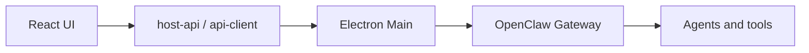

<p align="center">
  
</p>

# Verse Claw

**面向 OpenClaw Agent 的桌面工作台。**

[English](README.md) · [简体中文](README.zh-CN.md) · [日本語](README.ja-JP.md) · [Русский](README.ru-RU.md)

[功能](#features) · [快速开始](#getting-started) · [开发](#development) · [文档](#documentation)

Verse Claw 将对话、项目工作区、知识复核和 Agent 诊断放进同一个 Electron 应用。配置模型、打开项目后，可以跟踪工具结果、审批请求和任务状态。

基于 Electron 40、React 19 和 TypeScript；可编辑的 OpenClaw 运行时源码包含在仓库中。

> **当前范围：** 本地验收重点是受控的 Windows x64 工作流。macOS、Linux 有构建目标，但不代表所有平台具有相同的验证覆盖。上下文和记忆增强保留各自的 opt-in、shadow 与审批边界。详见[产品语义](docs/clawx-product-semantics.md)和[能力矩阵](shared/capability-claims.ts)。

<a id="features"></a>
## 可以做什么

| 功能 | 使用方式 |
| --- | --- |
| 对话与模型 | 配置供应商和模型、管理会话、附加上下文并查看工具输出。 |
| 项目工作区 | 在对话旁查看 Git 改动、使用终端、浏览器预览和代码审查。 |
| 任务与 Agent | 显式启动角色 Worker 或有边界的任务循环，查看进度、失败、检查点和审批。 |
| 知识库 | 搜索有来源的资料库，复核收件项、草稿和提案；应用变更须经过明确确认与治理校验。 |
| 频道与定时任务 | 配置支持的频道插件和定时任务；可用性取决于插件、凭据与运行时配置。 |
| 诊断 | 查看会话活动、Trace、运行时状态和开发者工具；诊断数据本身不授予执行权限。 |

界面提供中文、英文、日文和俄文，支持浅色与深色主题。[仓库内的界面截图](resources/screenshot/)用于参考，可能与当前版本不同。

### 权限边界

- 知识读取范围不授予写入或应用权限，建议先保留为待复核草稿。
- 上下文预算、Runtime Memory 注入、SEKB 自动写回，以及无人监督或私网浏览器访问各有独立门禁；安装应用不会自动启用所有能力。
- 单项工程证据不等于产品发布、默认开启或全系统 GA。[验证记录](artifacts/capability-claims/status-table.json)只说明各自的范围和候选版本。

<a id="getting-started"></a>
## 快速开始

### 从源码运行

准备 **Node.js 24**、Git，以及 `package.json` 固定的 pnpm 版本（11.2.2）。运行时有独立的依赖工作区；克隆仓库需要相应访问权限。

```sh
git clone https://github.com/Baixu22/VerseClaw.git
cd VerseClaw
corepack enable
pnpm run init
pnpm --dir openclaw_runtime install --frozen-lockfile --ignore-scripts
node node_modules/electron/install.js
pnpm dev
```

`init` 安装桌面端依赖，并下载 uv 和 agent-browser。依赖构建脚本受到限制，因此单独执行 Electron 安装脚本。`pnpm dev` 会先构建运行时、准备内置技能，再启动 Vite 与 Electron。

原生 VerseShell 资源及打包还需要对应源码和工具链，参见[源码与构建契约](resources/verseshell/SOURCE.md)。本仓库以源码开发为入口；分发的安装包以[本仓库 Releases](https://github.com/Baixu22/VerseClaw/releases)为准。

### 第一次使用

1. 完成初始化，配置受支持的供应商和模型。实际模型调用需要有效认证。
2. 将可信项目打开为工作区，并明确选择权限模式。
3. 开始对话，查看工具结果，处理需要确认的操作。
4. 在知识库的「资料库」与「待复核队列」中管理可复用内容；需要时再配置频道和定时任务。

浏览界面和运行许多本地测试不需要付费模型调用。源码开发构建不检查安装包更新；打包版本的更新取决于配置的发布源。

### 常见问题

- **Gateway 未就绪：** 查看状态和日志，再使用开发者设置中的 OpenClaw Doctor。
- **供应商或频道不可用：** 检查认证、已启用的插件和代理设置。凭据格式正确不等于已经连通或完成投递。
- **E2E 提示运行时过期：** 修改运行时后先执行 `pnpm run build:runtime`，不要绕过 freshness 检查。
- **无头 Linux：** Electron 测试需要显示服务，例如 `xvfb-run -a pnpm run test:e2e`。

<a id="development"></a>
## 开发



Renderer 通过 `host-api` / `api-client` 调用后端。Electron Main 管理后端传输和桌面进程，运行时负责 Agent 执行。具体约束见[通信边界](harness/specs/scenarios/gateway-backend-communication.md)。

| 路径 | 内容 |
| --- | --- |
| `src/` | React 界面、状态和 Renderer API 入口 |
| `electron/` | 桌面生命周期、Gateway 管理和 Host 服务 |
| `shared/` | 类型契约、翻译和能力边界 |
| `openclaw_runtime/` | 可编辑的运行时与插件源码 |
| `harness/specs/` | 场景、规则和任务规格 |
| `tests/` | 桌面端单元、集成和 Electron E2E 测试 |
| `resources/` | 内置资源与原生组件来源记录 |

| 命令 | 用途 |
| --- | --- |
| `pnpm dev` | 启动开发应用 |
| `pnpm run typecheck` | 检查 node、web，并报告测试类型检查结果 |
| `pnpm exec vitest run tests/unit/rc10-evidence.test.ts` | 运行一个桌面端专项测试文件 |
| `pnpm test` | 运行配置的桌面端及运行时测试集 |
| `pnpm run build:vite` | 构建 Renderer 与 Electron |
| `pnpm run build:runtime` | 构建运行时 |
| `pnpm run test:e2e` | 构建并运行 Electron E2E |
| `pnpm contract:check` | 检查 Host API 契约一致性 |
| `pnpm repo:artifacts:check` | 检查源码与归档边界 |

修改任务规格涉及的代码前，先运行 `pnpm harness context --spec <task-spec>`。通信改动还需要 `pnpm run comms:replay` 和 `pnpm run comms:compare`。仓库规则与验证要求见 [AGENTS.md](AGENTS.md)。

本地 Task Forest 历史、会话交接和生成证据不是新检出的构建前置条件。源码、夹具和精选证据继续跟踪；归档与恢复遵循[保留规则](docs/dev/repository-artifact-retention.md)。

<a id="documentation"></a>
## 文档

- [产品语义与受控预览边界](docs/clawx-product-semantics.md)
- [持续开发手册](docs/dev/Sustained-Development-Playbook.md)
- [运行时收敛与验收](docs/dev/unified-agent-system/runtime-convergence/README.md)
- [知识系统设计](docs/enhancements/knowledge-persistence/README.md)
- [Agent 编排](docs/multi-agent-orchestration/README.md)
- [RC-09 预检与 RC-10 证据完整性](docs/dev/pending-worktree-consolidation.md)
- [安全政策](SECURITY.md)

## 贡献与许可证

保持修改范围明确，补充相关回归覆盖，并同步面向用户的翻译。不要提交凭据、本地任务历史或生成日志。问题与变更建议请通过本仓库提交。

Verse Claw 基于 [OpenClaw](https://github.com/openclaw/openclaw)，并继承 ValueCell 团队的 ClawX 工作。参见 [MIT 许可证](LICENSE)；内置组件保留各自的许可证和源码声明。
