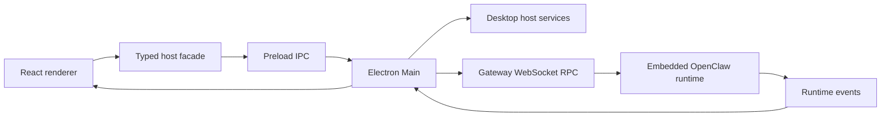

<p align="center">
  
</p>

审查中心提供折叠、显式启用的 Change Context：四种比较方式、digest 锚定评论与显式审查结论。拉取变更复用现有审批、Git 与 Coding journal；审查通过不完成任务或合并代码。详见[工作区与编码](docs/modules/workspace-and-coding.md)。 Windows 源码宿主的验收范围与入口回滚见[受控启用与回滚](docs/dev/change-context-review-loop/rollout.md)。

可通过 `runtime.providerBudget` 显式设置宿主、项目和会话预算；子调用继承会话 owner 的 workspace，预留与未知成本由运行时 owner 保留。覆盖范围和核销边界见[资源与观测](docs/modules/resources-and-observability.md)。

# Verse Claw

聊天普通文本流按帧合并更新，批准、取消、错误和完成状态即时发布；当前回复增长时，已完成消息保持稳定。

长会话按实际消息高度计算视口，已加载的早期轮次可在 DOM 上限内定位。历史、预览和投影缓存共享 32 MiB 载荷预算，淘汰后通过原有会话与媒体入口回读。

兼容的文件订阅共享原生监听器，各自保留过滤规则和释放句柄。知识源目录重建后自动恢复监听，多个窗口共享 Main 的新鲜 Git 状态结果。

受管进程按生命周期持有共享 executor，确认终态后释放自身引用。poll 调度为 stdin 和取消保留空间，输出按合计字节限额保留，并继续提供原有 artifact 引用。

会话支持建立 Git 仓库、选择独立工作树并恢复草稿。`/storage` 与**设置 → 存储空间**共用资源页，可查看会话文件、进程内存和工作树占用。[操作与归属规则](docs/dev/session-worktree-storage.md)。

Runtime 管理的工作树归属、创建阶段和合并意图持久保存在 SQLite 中。重启后可恢复归属；路径被替换、创建未完成或合并结果未知时保留资源并拒绝继续使用旧资格。[注册与恢复契约](harness/specs/guides/execution-domain-registry.md)。

Skill 配置直接写入运行时配置，受管技能可在详情中卸载。Agent Dev 报告采集正常聊天与工具事件，并对 token 用量去重。

**在一个桌面工作空间里完成对话、编码、知识与 Agent 执行。**

[English](README.md) · [简体中文](README.zh-CN.md) · [日本語](README.ja-JP.md) · [Русский](README.ru-RU.md)

[模块详解](docs/modules/README.md) · [快速开始](#getting-started) · [架构](#architecture) · [开发与验证](#development) · [常见问题](#troubleshooting) · [文档导航](#documentation)

Verse Claw 是基于嵌入式 OpenClaw Runtime 的 Electron 桌面应用。它把会话、项目工作区、编码工具、知识审核、记忆、多智能体编排、消息渠道、计划任务和运行时诊断集中在同一个本地桌面产品里。

这个仓库不只是 Renderer 外壳，还包含 React UI、Electron Main Host、类型化跨进程契约、vendored OpenClaw Runtime、VerseBrowser、VerseShell 执行基础、已退役但仍保留的 VToken 源码、可执行 Harness 规格，以及构建/证据/发布流水线。

> **当前状态：**`0.4.9-alpha.0`，controlled preview。Windows x64 本地工作流是主要验收目标；macOS/Linux 有构建目标，但平台级运行时验证是另一件事。组件毕业或 agent-driven 证据都不代表公开发布、GA、liveReady 或 productApproved。

## 产品包含什么

| 领域 | 当前产品形态 | 深入文档 |
|---|---|---|
| LLM 与模型 | 基于账户的供应商配置，OAuth/API Key/本地认证，协议适配，模型 fallback，单轮/会话模型覆盖，流式返回、工具循环、推理强度、token usage 与估算成本 | [LLM 与模型](docs/modules/llm-and-models.md) |
| 会话与运行 | JSONL 追加型会话树、run、abort/stop/archive/delete、checkpoint、compaction、handoff/fork、可搜索侧栏、持久化分组与长会话 coordinator | [会话](docs/modules/sessions.md) |
| 上下文与记忆 | Context Orchestrator、6,000 字符受管注入预算与编排后分账、Workspace Context、上下文健康评分，以及基于独立 Role/Runtime store 的单一 Memory 产品面 | [上下文与记忆](docs/modules/context-and-memory.md) |
| 工作区与编码 | Workspace preflight、四种权限模式、文件预览、PTY 终端、Web Preview、Git、Review Panel、write journal、stale-write guard 与 auto verify | [工作区与编码](docs/modules/workspace-and-coding.md) |
| 知识库 | Markdown/wiki-first Library、Inbox → Draft → Steward → Proposal → explicit apply、Source Set、OKF、Runtime Lessons/SEKB、provenance 与 governance | [知识库](docs/modules/knowledge-base.md) |
| 多智能体与任务 | Agent/Persona/Role 分层、9 个内置角色、路由、团队模板、资源感知波次、subagent admission、Task Ledger、Task Loop、ClawGraph | [多智能体与任务](docs/modules/multi-agent-and-tasks.md) |
| Verse 系列 | VerseGit 仓库/证据控制面、VerseShell 受控执行、VerseBrowser 驱动，以及已退役 VToken | [Verse 系列](docs/modules/verse-tools.md) |
| 资源与可观测性 | ResourceFabric 分类执行反馈与内存/event-loop 压力控制、后台降载、进程追踪、token/cost 上限与恢复 | [资源与可观测性](docs/modules/resources-and-observability.md) |
| 集成与其他表面 | 15 类渠道、Scheduled、Skills/MCP、Inbox、Remote Tasks、Code Review、VerseConf 文档、媒体、Billing 与 Agent Dev | [集成与页面](docs/modules/integrations-and-surfaces.md) |

模块详解当前以简体中文维护；其中源码路径、API 名称和证据链接与语言无关。四个根 README 负责多语言入口。

对话中的处理过程可折叠，最终答复保持可见。较长的文件替换会在会话栏内同时预览修改前后，无法断行的代码在预览中自动换行，展开后只在差异区域内横向滚动。命令预览从最新输出开始。两者均支持展开，复制仍包含完整的已保留内容。仓库变更条与会话输入框使用同一条居中列宽；工具调用以紧凑的状态芯片显示目标与耗时。

运行时权限请求覆盖所属会话的输入区，显示命令、工作目录和允许的选项，页面其余部分仍可操作。处理完请求后恢复原输入框、草稿和附件。

会话会展示本轮产生的资源，无论它来自哪个工具。音频和视频可直接用原生控件播放；文件缺失、过大或无法播放时会明确提示。各种来源的图片共用同一个查看器；远程图片和媒体不会自动载入，而是提供打开操作。图表按声明的类型绘制，并可查看数据表；独立成段的链接显示为链接卡片；其他结构化资源显示为带标注的兜底卡片。

## 当前成熟度边界

| 标签 | 含义 |
|---|---|
| `default` / `advanced` | 在声明范围内属于当前产品表面；不是 GA 承诺 |
| `internal` | 有实现或内部接口，但没有独立用户产品入口 |
| `shadow` / `experiment` | 观测或有限实验，不拥有路由、写回或审批权威 |
| `retired` | 仅为兼容、来源追溯或回滚检查保留 |
| `agent-driven` | agent 生成并如实标注的证据，不是 real-human evidence |

当前机器可读组件目录有 54 条：13 default、12 advanced、23 internal、6 retired、0 experiment。分类不等于运行时证明。详见[组件处置矩阵](docs/dev/component-disposition-matrix-20261021.md)。

当前重要默认值：

- Workspace Context 与只读 DCS context tools 在声明的健康/权限门槛下开启。
- Runtime Memory injection、SEKB automatic writeback、Browser private network 不默认开启。
- SEKB 按经验版本和运行记录显式采用，分别保存执行结果与独立任务判分。记忆反馈用于诊断，不参与检索排序或保留决策。详见 [RSI 证据与边界](docs/dev/rsi-capability-and-boundaries.md)。
- 受控 RSI prompt 研究记录父版本、训练归因和冻结验证裁决，待测候选绑定独立封存的评估计划。
- VToken 已退役；旧环境变量/配置不能重新启用生产 assembly 或 sidecar。
- VerseGit 与 VerseShell 仍默认关闭；宿主接入保留下述职责与权限边界。
- Dreams 已退役；Image Generation 是开发者/测试门槛，不是正常产品导航。
- `liveReady=false`、`productApproved=false`、`defaultOn=false` 仍是产品锁。

<!-- VERSE-TOOLS-BOUNDARY-START -->
**VerseGit 有界编码闭环：**默认关闭，尚未批准全面可用。win32-x64 M1 provider 提供仓库事实；候选验证通过 VerseShell 执行，宿主保有 write journal 与 Git apply。M4 landing/admission 未授权；`liveReady=false`、`productApproved=false` 保持冻结。VerseShell 仍默认关闭。VerseBrowser 只接受当前可用且绑定所属会话的运行时动作，模型参数不能代替宿主批准；请求级私网校验覆盖重定向和子资源。详见 [Verse 组件边界](docs/modules/verse-tools.md)。
<!-- VERSE-TOOLS-BOUNDARY-END -->

改默认值或做发布声明前，请先读[默认配置矩阵](docs/dev/default-config-matrix.md)、[产品语义](docs/clawx-product-semantics.md)和[能力声明矩阵](shared/capability-claims.ts)。

## 应用截图

截图来自 2026-10-05 的 Windows Electron source build；当前 header 已使用之后的 B2 身份。Knowledge 截图明确启用了 `memory-wiki`，没有使用模型账户或模型请求。

| **Chat 与任务入口**<br>[](resources/readme/2026-10-05/en/chat.png) | **Knowledge Library 与 Review**<br>[](resources/readme/2026-10-05/en/knowledge.png) |
| --- | --- |
| **Task Ledger**<br>[](resources/readme/2026-10-05/en/tasks.png) | **模型与 Provider 设置**<br>[](resources/readme/2026-10-05/en/settings.png) |

图片来源、采集条件和 hash 见[视觉来源说明](resources/readme/2026-10-05/README.md)。

<a id="getting-started"></a>

## 快速开始

前置条件：

- **Node.js 24.16.0 或更高的 24.x 版本**与 Git；更早的 Windows Node 24 可能有 TCP 崩溃问题。
- **pnpm 11.2.2**，由 `package.json` 固定。
- 能访问依赖、Electron、uv 和 agent-browser 下载。
- 在线 provider 账户，或兼容的本地模型服务。

在仓库根目录运行：

```sh
git clone https://github.com/Baixu22/VerseClaw.git
cd VerseClaw
corepack enable
corepack prepare pnpm@11.2.2 --activate
pnpm run init
pnpm --dir openclaw_runtime install --frozen-lockfile --ignore-scripts
node node_modules/electron/install.js
pnpm dev
```

`pnpm dev` 会先构建 VerseBrowser、嵌入式 runtime 和 bundled skills，再打开 Vite 与 Electron。Gateway 通常需要 10–30 秒就绪；只打开 Vite 页面不能获得完整 Electron Host services。

已构建的 Gateway 启动时先尝试原生加载已解析的 JavaScript Doctor 契约，减少 SDK 别名加载器准备。挂载源码与外部插件仍使用各自的契约，迁移检查照常执行。运行 `pnpm run build:runtime` 后，可用 `node scripts/measure-gateway-startup.mjs` 在隔离的回环环境和空缓存下对照测速；每个有效样本都必须实际调用被测加载器并完成认证 RPC。

第一次使用：

1. 完成 Setup。
2. 在 Settings → Models & Providers 配置并验证账户/模型。
3. 选择项目目录、权限模式和 Workspace。
4. 发起有范围的任务并在 Workspace Panel 检查文件、终端、预览和变更。
5. 在 Inbox 处理审批。
6. Knowledge 和 Memory 的持久变化必须经过各自 review surface。
7. 在会话行上管理会话：悬停显示「置顶」和「⋯」（重命名、移至工作线、标为未读、分叉、接力、复制、可撤销的归档、删除）；右键打开同一菜单，过长的标题在悬停时滚动显示。
8. 侧栏铃铛显示活动：有会话运行时铃铛带一圈运行指示（需要你处理时为琥珀色），面板列出进行中的会话及已用时长，以及完成、出错和审批事件；可在铃铛菜单或 Settings → Session & Recovery 控制系统通知。

Release 中实际发布的版本才是可下载版本。构建目标存在不代表当前版本一定提供对应安装包。

| 平台 | 配置产物 | 当前验证范围 |
|---|---|---|
| Windows x64 | NSIS | 主要受控本地验收平台 |
| macOS x64 / arm64 | DMG、ZIP | 有构建目标；需按能力做平台验证 |
| Linux x64 / arm64 | AppImage、DEB；x64 RPM | 有构建目标；需要图形环境 |

<a id="architecture"></a>

## 架构

普通桌面请求路径：

```text
React renderer
  -> typed host facade (src/lib/host-api.ts)
  -> preload IPC
  -> Electron Main（授权 + dispatch）
  -> Host service 和/或 Main-owned Gateway WebSocket RPC
  -> embedded OpenClaw runtime
```

运行时事件经 Main 与 `host-events.ts` 回到 Renderer store。文件、终端和 Git 等本地服务可以在 Main 完成，不必经过 Gateway。

这不是统一的 `WS -> HTTP -> IPC fallback` 链。页面不得直接连接 Gateway，也不得新增绕过 Host API 的 Electron IPC。`shared/host-api/contract.ts` 是共享类型边界。



仓库主要层次：

- `src/`：renderer、页面、组件、Zustand store、Host facade、i18n、样式。
- `electron/`：Main services、IPC 安全、Gateway supervision、preload 与桌面工具。
- `shared/`：Host API/events、领域类型、四语文案、authority/default manifest。
- `openclaw_runtime/`：vendored runtime、Gateway、agents、tools、channels、packages、extensions。
- `packages/` 与 `resources/`：VerseBrowser、VToken、VerseShell、skills、plugins 与原生资源。
- `harness/`、`tests/`、`scripts/`：可执行规则、测试、自动化与证据工具。

进一步阅读：[架构导读](docs/architecture-overview.md)、[仓库布局](docs/dev/repository-layout.md)。

## 本地数据与隐私

没有单独部署的数据库服务器。

- 桌面设置和导出在 Electron `userData`。
- Runtime 配置通常在 `~/.openclaw`，支持 `OPENCLAW_CONFIG_DIR`。
- 会话使用 JSONL transcript；运行态还使用 SQLite。
- Token 历史来自 session transcript 的结构化 usage；成本是估算值。
- Knowledge 使用 `memory-wiki` vault 和本地 governance metadata。
- 监听目录通过快照核对新增、修改与撤销，补偿停机期间的变化；变更只进入带版本的待审候选。
- Librarian 问答与有界追问通过已配置 Gateway 模型处理准入后的证据，核验逐项原文引用与版本；部分读取、冲突和模型失败明确披露。Studio 继续生成待审摘录草稿。
- 中文词法、长文有界续读、按 provider 隔离的 embedding 缓存和版本绑定的 Steward 发现共用来源准入。可选公共 GitHub 目录连接器将更新与撤销送入 Inbox；其他 SaaS 连接器尚未实现。
- 日志、trace、截图、Task Forest 与 handoff 默认是本地工作数据，除非明确整理为 curated evidence。

本地存储不等于离线执行。在线模型、渠道、浏览器和外部工具会按配置接收数据。不要把凭据、私人 transcript、原始日志提交到仓库或公开 issue。

VerseBrowser：安装、开发和构建会自动编译内嵌模块。81 个契约方法不代表 Electron 已实现 81 项能力；参见[调用方式与驱动限制](packages/README.md#versebrowser-integration-and-invocation)。私网导航需要由 Main 批准，并绑定会话与 origin。自动验收在 Main 执行 agent 驱动的批准；请求中自行填写的批准标记不授予权限。 导航失败会立即清理等待状态，后续导航独立执行。 浏览器清理在原窗口确认关闭后释放占用。

<a id="development"></a>

## 开发与验证

常用命令：

| 命令 | 用途 |
|---|---|
| `pnpm dev` | 准备资源/runtime 并启动 Electron 开发 |
| `pnpm run build:vite` | 构建 renderer 与 Electron bundles |
| `pnpm run build:runtime` | 构建嵌入式 runtime 并做 Gateway startup smoke |
| `pnpm run typecheck` | node/web/test 全量类型检查 |
| `pnpm run lint:check` | 只检查 lint，不改文件 |
| `pnpm test` | 根测试组与选定回归 |
| `pnpm run test:e2e` | 构建并运行 Electron Playwright |
| `pnpm contract:check` / `pnpm i18n:lint` | Host contract 与四语覆盖 |
| `pnpm run harness:ci` | 仓库 Harness 基线 |
| `pnpm run repo:artifacts:check` | 源码/证据/归档边界 |
| `pnpm run docs:policy:validate` | 文档策略校验 |

Task spec 工作流：

```bash
pnpm harness context --spec <task-spec>
pnpm harness validate --spec <task-spec>
pnpm harness run --spec <task-spec> --dry-run
```

UI 改动应补 Electron E2E 和 en/zh/ja/ru 文案。通信路径改动还应运行 `pnpm run comms:replay` 与 `pnpm run comms:compare`。构建成功、安装成功、发布授权是三个不同事实。

[个人 Agent QA 场景包](openclaw_runtime/qa/README.md)通过脚本 provider 运行十项 Gateway 场景，并确定性回读终态。源宿主证据覆盖控制流、拒绝和恢复；真实模型质量与打包行为有各自的验收门禁。

[Responses 验收合同](harness/specs/tasks/product-acceptance-space-bunny.md)覆盖本地服务的推理后正文、一次工具往返、会话隔离、取消与 provider 故障。中断的 Responses 流不能成功结束任务，也不能派发参数不完整的工具调用；这些检查不构成模型或发布批准。

完整门禁与证据规则见[开发与验证](docs/modules/development-and-validation.md)。

<a id="troubleshooting"></a>

## 常见问题

| 现象 | 排查方式 |
|---|---|
| Knowledge 显示 `unknown method: wiki.status` | 启用并加载 `memory-wiki`，再初始化 vault；Gateway 就绪不够。 |
| pnpm 版本不符 / 安装失败 | 核对 Node.js 24.x、固定 pnpm、两个 dependency workspace 与 lockfile。 |
| Electron executable 缺失 | 运行 `node node_modules/electron/install.js` 并检查下载。 |
| Gateway 一直不可用 | 查看 Settings → System & Runtime 与日志；先 Doctor，再考虑 Doctor Fix。 |
| Provider/渠道不可用 | 检查认证、模型、插件启用、账户状态、代理，以及真实请求/投递证据。 |
| 工具写入或命令被阻止 | 检查 workspace root、权限模式、路径边界和 Inbox approval。 |
| E2E 报 runtime stale | 运行 `pnpm run build:runtime`；app source 也改了就重建。 |
| Headless Linux Electron 失败 | 提供 display server，例如 `xvfb-run -a pnpm run test:e2e`。 |
| VerseConf PPTX 导出失败 | 检查插件和三条记录模板限制；长大纲用 Markdown。 |

<a id="documentation"></a>

## 文档导航

| 主题 | 入口 |
|---|---|
| 按模块阅读当前实现 | [模块详解](docs/modules/README.md) |
| 架构与数据流 | [架构导读](docs/architecture-overview.md) · [Runtime 控制平面](docs/dev/runtime-control-planes.md) |
| 产品边界与默认值 | [产品语义](docs/clawx-product-semantics.md) · [默认配置矩阵](docs/dev/default-config-matrix.md) · [组件处置矩阵](docs/dev/component-disposition-matrix-20261021.md) |
| 知识与上下文 | [知识系统](docs/enhancements/knowledge-persistence/README.md) · [Context Runtime Kit](docs/context-runtime-kit/README.md) · [Context Orchestrator](docs/dev/context-orchestrator.md) · [Memory 控制面](docs/dev/memory-control-plane.md) |
| Agent 与任务 | [Role-first 设计](docs/role-first-design.md) · [多 Agent 编排](docs/multi-agent-orchestration/README.md) |
| VerseGit / VerseShell / VerseBrowser | [VerseGit 控制面](docs/dev/versegit-validation-layer/README.md) · [VerseShell 状态](docs/dev/verseshell-foundation/STATUS.md) · [VerseBrowser 集成](packages/README.md) |
| 开发与证据 | [开发文档](docs/README.md) · [Agent Dev](docs/agent-dev-control-plane.md) · [仓库布局](docs/dev/repository-layout.md) · [Harness](harness/specs/) |

历史计划和验收快照有自己的日期与候选 commit。当前行为应依据源码、默认 manifest 和 fresh evidence，而不是设计文档的长度或年代。

## 贡献与许可证

保持变更范围清晰，提供相应验证；行为变化时同步四个根 README 与 `docs/modules/` 对应模块。接口、默认值、安全边界或用户入口变化时，还要检查产品语义、默认矩阵和 Harness spec。

Verse Claw 基于 [OpenClaw](https://github.com/openclaw/openclaw) 与 ValueCell 团队的 ClawX 工作。仓库使用 [MIT License](LICENSE)。Bundled components 各自保留许可证和 source obligations，包括 [VerseShell notices](resources/verseshell/SOURCE.md)。部分会话/工作区交互（包括网页搜索来源卡片）适配自 Swami Malode 的 [Rare UI](https://rareui.com)，归属信息保留在 `src/components/rareui`。

### 持久任务执行

“任务账本 → 持久任务”保存独立于聊天历史的目标、约束与验收检查。同一仓库的本地 Git 工作树共享任务领取；执行前核对会话归属，模型请求前恢复当前目标。验收可使用精确文件内容检查，或带输入文件清单的命令检查；命令仍通过现有工具权限执行。详见[任务系统架构](docs/dev/durable-task-system/PLAN.md)。

任务列表支持搜索、状态筛选与加载后续页。Agent 可以查询相似任务，并将目标拆成有依赖的子任务，保留父目标和约束。取消计划时等待在途效果结清；验收和故障恢复读取现有运行 owner 的回执。

任务由 agent 在会话中管理。定位后，顶部只保留一个任务头，显示真实步骤进度，支持隐藏和重开。对话画布保持纯净，文件实际发生变化后才在输入框下方显示小入口；真实分支和工作树操作放在详情中。
