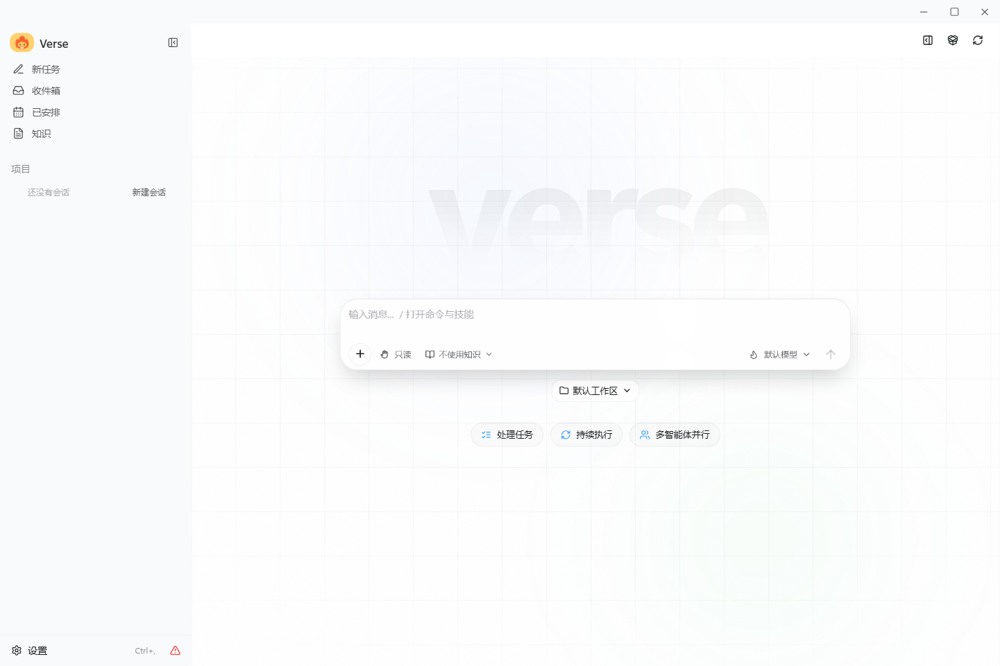
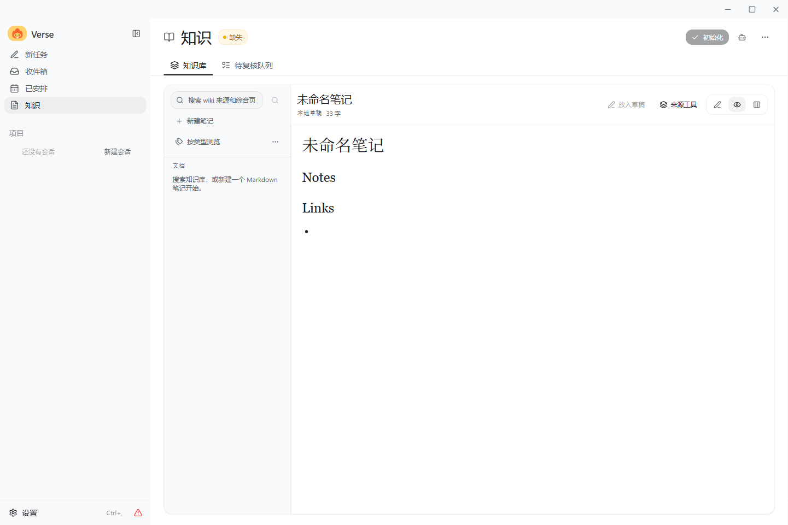
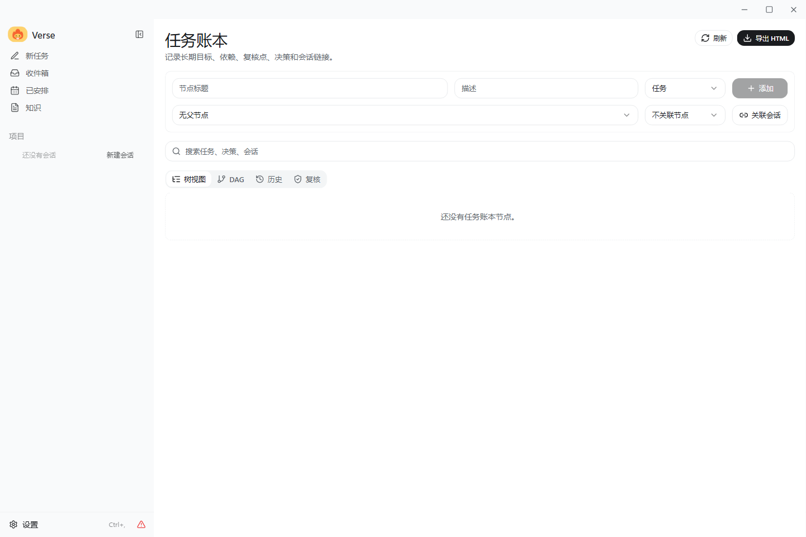
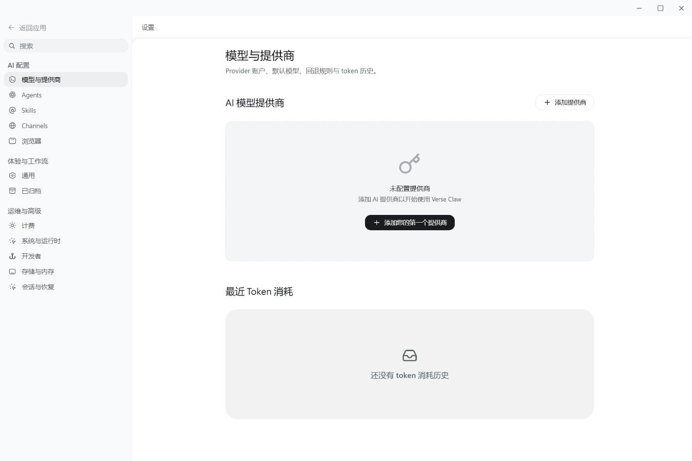
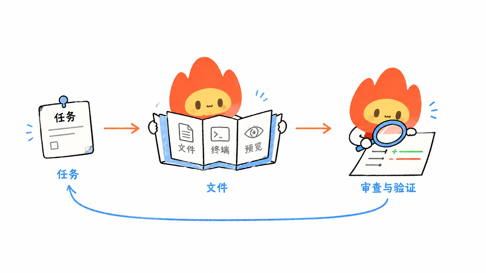
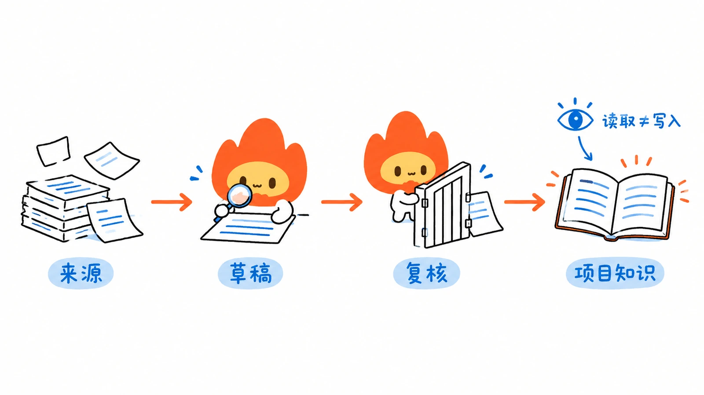
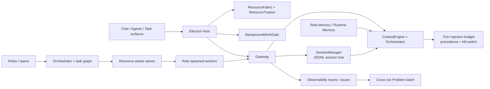

<p align="center">
  
</p>

# Verse Claw

**把对话、代码、知识和 Agent 执行放进同一个桌面工作台。**

[English](README.md) · [简体中文](README.zh-CN.md) · [日本語](README.ja-JP.md) · [Русский](README.ru-RU.md)

[界面截图](#screenshots) · [功能概览](#features) · [工作流](#workflows) · [快速开始](#getting-started) · [配置与数据](#configuration) · [架构](#architecture) · [开发](#development) · [常见问题](#troubleshooting) · [文档](#documentation)

Verse Claw 是基于 OpenClaw 的 Electron 桌面应用：在对话中发起工作，在同一工作区查看文件、终端、浏览器、代码改动和生成产物，再将有价值的内容整理为可复核的项目知识。它也提供模型与 Agent 配置、消息频道、定时任务和运行诊断。

桌面端使用 React、TypeScript 和 Vite。这不是只包含 Renderer 的外壳：仓库同时包含 Electron Main Host、类型化共享契约、随仓内置的 OpenClaw 运行时与扩展目录、内嵌 VerseBrowser 与 VToken 组件、VerseShell MCP 适配器、可执行 Harness 规格，以及构建、发布与证据流水线。当前版本和依赖以 [package.json](package.json) 为准。部分源码、配置和历史文档仍使用 ClawX 名称。

> **当前状态：** 项目处于 alpha 阶段，本地验收重点是受控的 Windows x64 工作流。macOS、Linux 有构建目标，验证覆盖按具体平台和能力区分。实验能力的启用条件见下文，以及[产品语义](docs/clawx-product-semantics.md)和[能力矩阵](shared/capability-claims.ts)。

对话支持从会话菜单恢复检查点、在输入区查看和操作 Git，以及为单条消息、当前会话或长期配置选择模型。高级界面模式提供压缩证据和恢复入口。Gateway 停止时仍可查看本地 Token 用量历史。

<a id="screenshots"></a>

## 真实界面

页首已采用 2026-10-06 选定的 B2 形象；下方带日期的截图保留拍摄时的旧外观。

以下截图来自 2026-10-05 的 Windows Electron 源码构建，由 agent 在隔离配置中操作并直接截取。Gateway 为真实本地进程；知识页显式启用了 `memory-wiki`。未配置模型账户、未发送模型请求，空会话、空账本和空资料库均为真实状态。点击图片可查看原图。

| **对话与任务入口**<br>[](resources/readme/2026-10-05/zh/chat.png) | **知识库与待复核入口**<br>[](resources/readme/2026-10-05/zh/knowledge.png) |
| --- | --- |
| **任务账本**<br>[](resources/readme/2026-10-05/zh/tasks.png) | **模型与提供商设置**<br>[](resources/readme/2026-10-05/zh/settings.png) |

截图配置、生成图提示词与文件摘要见[图片来源说明](resources/readme/2026-10-05/README.md)。图中的磁盘告警来自截图机器的实际状态。

<a id="features"></a>

## 功能概览

| 功能 | 可以做什么 | 入口 |
| --- | --- | --- |
| 对话与会话 | 流式对话、附加文件和知识引用、查看工具结果；搜索、置顶、分组、归档和恢复会话 | 主界面与会话侧栏 |
| 项目工作区 | 切换项目、浏览文件和预览内容，在对话旁使用终端、浏览器、Git 变更和代码审查 | 对话工具栏的工作区面板 |
| 模型与提供商 | 管理提供商账户、默认模型和回退配置，查看 token 用量历史 | 设置 → 模型与提供商 |
| Agent 与任务 | 配置 Agent 和角色，查看子 Agent 活动；用 Task Ledger 记录任务，用显式 Task Loop 或 ClawGraph 执行有约束的流程 | 设置 → Agents；侧栏更多菜单 |
| 知识工作台 | 搜索资料、管理来源与引用，在待复核队列中处理收件项、草稿和提案 | 侧栏 → 知识 |
| 收件箱 | 汇总权限申请、远程任务和浏览器任务中需要处理的事项，并查看历史结果 | 侧栏 → 收件箱 |
| 定时任务与频道 | 创建和管理定时任务、查看运行记录；配置频道账户、连接状态和 Agent 绑定 | 侧栏 → 已安排；设置 → Channels |
| Skills 与 MCP | 查看、启停技能，管理技能包、市场安装和 MCP 服务配置 | 设置 → Skills |
| 结构化文档 | 用 VerseConf 插件管理研究表格、幻灯片大纲、修订与导出 | 启用插件后的 Agent 工具与产物面板 |
| 诊断与恢复 | 查看会话活动、进程、Trace、运行时状态、存储占用和恢复操作 | 工作区面板、可观测性、设置 |

界面支持中文、英文、日文和俄文，提供浅色、深色和跟随系统主题。通用设置中的 Basic / Advanced 控制诊断信息的展示深度；解锁开发者模式后还可进入图像生成与梦境页面。

<a id="workflows"></a>

## 常用工作流

### 在项目中完成一次代码任务

选择工作区和模型 → 说明任务、附加相关文件 → 检查计划与权限请求 → 查看工具执行 → 在工作区面板审查改动并运行验证。



*AI 生成的概念流程插画：沿用项目火焰 logo，展示“任务 → 工作区工具 → 审查与验证”的迭代。不是应用截图，也不表示任务会自动通过验证。*

工作区面板可以同时打开文件、终端、浏览器、审查、产物和活动相关标签。终端支持侧边或底部布局；浏览器可打开本地预览或网页；审查入口集中展示 Git 改动及相关操作。会话活动面板用于跟踪运行和命令状态。

权限选择器提供只读、计划、接受修改和完全访问等模式。计划模式限制用户文件修改，但运行元数据可能仍会写入；具体行为以[工作区权限语义](docs/clawx-product-semantics.md)为准。

### 把对话和资料变成项目知识

在对话中选择知识范围和引用 → 在「资料库」检索来源 → 在「待复核队列」查看收件项、草稿和提案 → 核对依据与变更 → 经治理校验后应用。



*AI 生成的知识流程插画：来源 → 草稿 → 复核 → 项目知识。读取知识与应用变更是不同权限。*

Wiki 操作依赖已加载的 `memory-wiki` 扩展。页面可以在未配置时打开，但完整的状态、搜索和应用需要插件与知识库就绪；见[架构与插件边界](docs/architecture-overview.md#knowledge-plugins-and-data)。

知识读取范围与写入权限分别管理。选中 Memory、Wiki 或引用资料，并不等于授权自动写回。复核界面保留来源、草稿、提案与应用结果的关系，便于检查知识从哪里来、如何改变。

### 从即时协作扩展到任务执行

普通对话适合即时协作；Task Ledger 保存目标、任务节点、检查点与证据事实；Task Loop 用于显式启动的受约束执行。普通对话可以建议升级任务，但不会自动变成 Task Loop。

Workspace 标识本地执行根目录、agent 绑定与权限上下文；Project 表示长期工作容器，当前 shared 身份契约仅提供兼容映射，尚未交付独立 Project 管理。Run 标识一次执行尝试；Task Ledger 仍是用户可见任务事实的唯一来源。详见[身份词汇表](docs/clawx-product-semantics.md#identity-and-scope-vocabulary)。

ClawGraph 从工作区 YAML 加载流程，展示编译诊断、节点状态、事件和复核项。运行时的 Workboard 负责调度，和面向用户的 Task Ledger 各有职责。详见[Agent 编排](docs/multi-agent-orchestration/README.md)与[产品概念边界](docs/clawx-product-semantics.md)。

### 管理结构化产物

可选的 `verseconf-artifacts` 插件提供创建、检查、修订、记录排序、历史恢复和导出工具。研究表格可导出 CSV / XLSX，幻灯片大纲可导出 PPTX，内容也可导出 Markdown；产物面板展示受管理的版本、历史与输出。

插件**默认关闭**，使用前需要显式配置。当前 PPTX 使用三页模板，超过三条记录会明确拒绝导出，可改用 Markdown 保留完整大纲。它尚不覆盖任意页数演示文稿与长文本排版。配置、交付和验证细节见 [VerseConf 集成说明](docs/dev/verseconf-clawx-implementation-20261001.md)。

### 实验能力的范围

上下文管理（DCS）、token 预算（VToken）、经验知识（SEKB）、Runtime Memory 和浏览器自动化分别受配置、审批或灰度门禁控制。诊断或 shadow 数据不代表已经参与模型上下文、自动写回或路由决策；安装应用不会自动启用全部增强能力。

能力状态以[能力矩阵](shared/capability-claims.ts)、[默认配置矩阵](docs/dev/default-config-matrix.md)和各自验证记录为准。验收模拟由脚本或 Agent 执行时必须标记为 agent 驱动；局部测试通过不代表完整产品或所有平台已通过发布验收。

<a id="getting-started"></a>

## 快速开始

### 从源码运行

准备：

- **Node.js 24.16.0 或更新的 24.x 版本** 和 Git。Windows 上更早的 Node 24 存在 TCP 连接原生崩溃问题（[上游修复](https://github.com/nodejs/node/issues/63620)）。
- [package.json](package.json) 固定的 **pnpm 11.2.2**，可用 Corepack 激活。
- 仓库访问权限，以及下载依赖、Electron、uv 和 agent-browser 所需的网络连接。
- 使用在线模型时所需的提供商认证；本地模型则需要已运行的兼容服务。

在仓库根目录运行：

```sh
git clone https://github.com/Baixu22/VerseClaw.git
cd VerseClaw
corepack enable
corepack prepare pnpm@11.2.2 --activate
pnpm run init
pnpm --dir openclaw_runtime install --frozen-lockfile --ignore-scripts
node node_modules/electron/install.js
pnpm dev
```

若当前 Node.js 安装不提供 Corepack，可自行安装 pnpm 11.2.2 后，从 `pnpm run init` 继续。

`init` 安装桌面工作区依赖并下载 uv、agent-browser。OpenClaw 运行时有独立的依赖工作区，需要单独安装。由于依赖脚本策略禁止 Electron 自动执行安装脚本，这里显式下载其二进制文件。

`pnpm dev` 会先生成扩展桥、构建运行时并准备内置技能，再启动 Vite 与 Electron。首次启动包含构建过程；应用打开后，Gateway 还需要时间就绪。只运行 Vite 网页不能替代完整的 Electron Host 服务。

### 第一次使用

1. 完成初始化向导，在「设置 → 模型与提供商」配置账户、模型并检查连接。
2. 选择项目文件夹，确认工作区和权限模式。
3. 新建对话，附加文件或选择知识引用，发起一个范围明确的任务。
4. 从对话工具栏打开工作区面板，查看文件、终端输出、浏览器预览和改动。
5. 查看收件箱中的待处理请求；需要积累项目资料时，进入知识工作台。
6. 按需配置 Skills / MCP、频道和定时任务。

浏览界面和运行许多本地测试不需要付费模型调用。使用远程模型、服务或频道时，其认证、网络和费用由相应提供商决定。

### 安装包与平台

分发产物以[本仓库 Releases](https://github.com/Baixu22/VerseClaw/releases)实际提供的版本为准。源码配置中的打包目标如下：

| 平台 | 配置的产物 | 当前范围 |
| --- | --- | --- |
| Windows x64 | NSIS 安装器 | 本地受控工作流的主要验收平台 |
| macOS x64 / arm64 | DMG、ZIP | 有构建目标，具体能力需按平台验证 |
| Linux x64 / arm64 | AppImage、DEB；RPM 为 x64 | 有构建目标，桌面运行需要图形环境 |

构建目标不代表对应版本已有可下载安装包。源码开发构建不检查安装包更新；打包版本的更新取决于实际配置的发布源。原生 VerseShell 组件与完整打包另有[源码和工具链要求](resources/verseshell/SOURCE.md)。

<a id="configuration"></a>

## 配置与本地数据

| 设置区域 | 内容 |
| --- | --- |
| 模型与提供商 / Agents | 账户、模型、回退规则、角色与频道绑定 |
| Skills / Channels / 浏览器 | 技能、MCP、频道账户、浏览器 Profile 与凭据 |
| 通用 | 主题、语言、启动项和界面深度 |
| 系统与运行时 / 开发者 | Gateway、运行时、代理、CLI、Doctor 与 Agent Dev Workbench |
| 计费 | 本地 token 历史、费用估算和使用活动 |
| 已归档 / 会话与恢复 | 归档恢复、会话运行与恢复设置 |

无需另外部署数据库服务。应用设置使用本地存储；运行时按子系统使用配置文件、JSONL 会话记录和 SQLite 状态库。

- OpenClaw 默认配置目录是 `~/.openclaw`（Windows 上为用户主目录下的 `.openclaw`），主配置为 `openclaw.json`；桌面路径入口支持 `OPENCLAW_CONFIG_DIR` 覆盖。
- 桌面数据位于 Electron 的 `userData` 目录，应用日志位于其 `logs/` 子目录。路径规则见 [electron/utils/paths.ts](electron/utils/paths.ts)。
- Token 历史从本地会话中结构化的 usage 记录汇总。费用是估算值；永久删除会话会移除相关历史贡献，保留历史时可使用归档。
- 本地存储不等于离线执行：提交给在线模型或外部工具的内容会发送到对应服务。凭据、私有会话与原始日志不要放进提交或公开的问题报告。

<a id="architecture"></a>

## 架构与目录


[Mermaid 源文件](resources/readme/2026-10-05/architecture.mmd) · [Chat sequence](resources/readme/2026-10-05/chat-sequence.svg)

当前调用链是 **React → typed host facade → preload IPC → Electron Main**；需要运行时的服务再通过 Main 管理的 WebSocket RPC 调用 Gateway。本地文件、终端等 Host 服务不必都绕经 Gateway。运行事件经 Main / preload 返回 `host-events.ts`，再更新界面状态。

Renderer 请求入口是 `src/lib/host-api.ts` 与 `src/lib/host-api-client.ts`。这两个边界不能合并描述为统一的“WS → HTTP → IPC 回退”。[架构导读](docs/architecture-overview.md)包含源码映射、聊天时序图，以及任务、知识、插件和本地数据的职责。

### 当前模块地图

下表按当前源码所有权划分，而不是沿用早期仅按顶层目录概括的方式。更细的模块清单、生成文件与本地状态边界见[仓库布局与证据根目录](docs/dev/repository-layout.md)。

| 层面 | 主要路径 | 当前职责 |
| --- | --- | --- |
| Renderer | `src/pages/`、`src/components/`、`src/stores/`、`src/lib/`、`src/i18n/`、`src/styles/`、`src/extensions/`、`src/hooks/`、`src/types/`、`src/assets/` | 路由页面、共享界面、客户端状态、类型化 Host facade 与事件、国际化、样式和静态资源 |
| Electron Main 与 Host | `electron/main/`、`electron/services/`、`electron/preload/`、`electron/extensions/`、`electron/shared/`、`electron/types/`、`electron/utils/` | 窗口/菜单/托盘生命周期、IPC 授权与 Host 分发、桌面服务、Main 共享类型与工具及事件回传 |
| Gateway 桥接 | `electron/gateway/` | Gateway 启动与恢复、WebSocket RPC、连接/重启策略和运行事件适配 |
| 共享边界 | `shared/host-api/`、`shared/types/`、`shared/i18n/`、`shared/host-events/`、`shared/agent-dev/`、`shared/knowledge/`、`shared/mcp/`、`shared/sandbox/`、`shared/security/`、`shared/verseshell/`、`shared/vtoken/` 及共享语义模块 | Host API 契约、跨进程类型、四语言资源、事件类型、领域辅助模块、能力声明与产品语义定义 |
| 内置 OpenClaw 运行时 | `openclaw_runtime/src/`、`openclaw_runtime/packages/`、`openclaw_runtime/ui/`、`openclaw_runtime/apps/`、`openclaw_runtime/experiments/`、`openclaw_runtime/test/` | Agent、模型/供应商、工具、会话、上下文/记忆、频道、调度、Gateway 内部实现、运行时包、应用宿主与实验 |
| 运行时扩展 | `openclaw_runtime/extensions/` | 供应商、频道、工具、浏览器、记忆、媒体和插件实现；是否可用取决于运行时启用状态与策略 |
| 内嵌产品组件 | `packages/versebrowser/`、`packages/vtoken/`、`resources/verseshell-mcp/` | 固定版本浏览器自动化引擎、Python/uv Token sidecar 和外部 MCP 兼容适配器 |
| 随包资源与打包 | `resources/skills/`、`resources/skill-packs/`、`resources/openclaw-plugins/`、`resources/verseshell/`、`resources/cli/`、`resources/context/`、`resources/icons/`、`resources/readme/`、`resources/brand-exploration/`、`resources/bin/`、`resources/workspace-harness/`、`public/`、`patches/`、`electron-builder.yml` | 预装技能与技能包、ClawX 插件、CLI 与上下文资源、原生二进制、工作区 Harness 输入、文档媒体和打包资源 |
| Harness 与测试 | `harness/specs/`、`harness/src/`、`harness/workspace/`、`tests/unit/`、`tests/integration/`、`tests/e2e/` | 可执行规则、场景、任务规格与 fixture；单元、集成和 Electron Playwright 覆盖 |
| 构建与发布自动化 | `scripts/`、`.github/workflows/` | 构建、资源同步、验证、成熟度、证据、打包、发布和 CI 流程 |
| 文档与证据 | `docs/`、`plans/`、`team/`、`reports/`、`artifacts/` | 当前架构与运行手册、成熟度决策、历史设计记录、长报告、精选证据和保留输出 |

### 运行时控制平面

| 平面 | 当前机制 | 边界 |
| --- | --- | --- |
| 系统资源调度 | `ResourceFabric` 对工作区执行与聊天历史做准入控制；`BackgroundWorkGate` 在队列、RSS 或 CPU 压力下延后后台任务；`ResourceTracker` 负责会话关联服务的发现与清理 | 这是 Main 进程内的协作式准入，不是全局 OS 调度器；前台工作不会被资源收缩策略丢弃 |
| 上下文工程 | `ContextEngine` 覆盖 bootstrap、ingest、maintain、after-turn 与 assemble/compact；共享的 6,000 字符单轮注入预算按优先级记账并受 fail-closed kill switch 控制；`ContextHealthMonitor` 评估注入压力、结构保真、目标对齐和新颖度 | 上下文增强默认按 opt-in 使用；目标 authority 收敛仍是独立设计工作 |
| 会话生命周期 | `SessionManager` 使用 JSONL append-only 树，支持 leaf 分支、压缩、标签和上下文重建；Host 侧增加 checkpoint、handoff、归档/恢复与级联删除 | 会话不等于 Run、Task、Workspace 或 Project；用户可见任务事实仍只归 Task Ledger |
| 记忆系统 | Role Memory 是 SQLite 控制平面，包含 Memory Card、Gatekeeper 审核、冲突处理和七桶 Context Pack；Runtime Memory 有独立的持久化、hydrate 与 inject 门控 | write/use gate 与 Runtime Memory 路径默认关闭；没有自动经验回写，也不把未门控注入当作生产能力 |
| 问题感知 | 先对单条 trace 检测 Issue，再按签名聚合成跨运行 Problem，保留 7 天窗口、生命周期状态和脱敏证据产物 | `pnpm observability:problems` 是 agent 批处理，不是常驻自动修复服务 |
| 多智能体与角色 | `RoleContract`、8 个内置角色、`router`/`lead-workers`/`adversarial-review` 三种模式、团队模板、任务图和资源感知执行波次 | 写入集证明、工具争用与并发上限共同约束执行；`bounded_a2a` 仍禁用；Runtime V2 Kernel 仍是规划项 |



时序图、多智能体流程图、默认关闭边界和源码锚点见[运行时控制平面](docs/dev/runtime-control-planes.md)。

### 编码、Agent 工具与知识

| 表面 | 当前源码与入口 | 边界 |
| --- | --- | --- |
| 编码与代码审查 | `src/pages/CodeReview/`、`electron/services/code-review-api.ts`、`git-api.ts`、`shared/types/coding-run.ts`、Task Loop 与 Task Ledger | Code Review 明确只读；CodingRun 是关联/投影视图，不是第二套任务状态机。用户可见任务事实仍由 Task Ledger 拥有 |
| VerseShell | `openclaw_runtime/src/agents/verseshell/`、`verseshell-runtime.ts`、`shared/verseshell/`、`resources/verseshell/`、`resources/verseshell-mcp/` | 受控执行、typed ACI、结果 artifact 和 patch preview 分别默认关闭；外部 MCP 适配器不等于内部执行路径 |
| VerseBrowser | `packages/versebrowser/`、`electron/services/agent-browser-*`、`electron/gateway/agent-browser-bridge.ts`、`shared/agent-browser/` | 81 个契约方法不是 81 项 Electron 能力：驱动实现 67 个，模型层 28 个 action，当前 Windows 桌面只广告 14 个可用 action |
| 知识库 | `src/pages/Knowledge/`、`electron/services/knowledge-api.ts`、`memory-wiki`、`openclaw_runtime/src/knowledge/sekb/` | Markdown/wiki-first 且受角色治理：Agent 可读、可提议；Inbox → Draft → Steward → Proposal → 明确确认后 apply。SEKB 自动回写仍是默认关闭/影子阶段 |

更完整的工具与知识流转图见[运行时控制平面](docs/dev/runtime-control-planes.md#coding-tools-and-knowledge-surfaces)。

`src/App.tsx` 当前注册首次运行 Setup（`/setup/*`）、Chat（`/`）、Knowledge、Inbox、Scheduled、Task Ledger、ClawGraph、Observability 和 Settings 界面；Models、Agents、Channels、Skills 是 Settings 内的分区，Code Review 和 Browser 是进入工作区面板的兼容入口；Image Generation 与 Dreams 需要开发者模式。

当前 pnpm workspace 成员是仓库根目录、`harness/`、`packages/versebrowser/` 和 `resources/verseshell-mcp/`。`packages/vtoken/` 是 Python/uv sidecar；`openclaw_runtime/` 是随仓内置的 Git 源码树，拥有独立依赖工作区，不是 Git submodule，也不是打包时使用的 npm 运行时。

VerseBrowser：安装、开发和构建会自动编译内嵌模块。81 个契约方法不代表 Electron 已实现 81 项能力；参见[调用方式与驱动限制](packages/README.md#versebrowser-integration-and-invocation)。

<a id="development"></a>

## 开发与验证

### 常用命令

以下命令在仓库根目录执行，完整定义见 [package.json](package.json)。

| 命令 | 用途 |
| --- | --- |
| `pnpm dev` | 准备运行时与资源，启动开发应用 |
| `pnpm run build:vite` | 构建 Renderer 与 Electron；不重建 OpenClaw 运行时 |
| `pnpm run build:runtime` | 构建内置运行时并执行 Gateway 启动冒烟检查 |
| `pnpm run typecheck` | 完整检查 node、web 和测试类型，三项均须通过 |
| `pnpm run lint:check` | 执行不自动修复的 lint 门禁；`pnpm run lint` 会修改文件 |
| `pnpm exec vitest run tests/unit/rc10-evidence.test.ts` | 运行指定的桌面端测试文件 |
| `pnpm test` | 桌面测试、选定的 DCS/运行时回归和成熟度注册校验 |
| `pnpm run test:integration` | 运行配置的集成测试组 |
| `pnpm run test:e2e` | 构建应用并运行 Electron E2E |
| `pnpm run test:e2e:run` | 复用已有应用构建运行 Electron E2E，运行时仍须新鲜 |
| `pnpm contract:check` / `pnpm i18n:lint` | 检查 Host API 契约与四语言覆盖 |
| `pnpm run harness:ci` | 执行仓库 Harness CI 基线 |
| `pnpm repo:artifacts:check` | 检查源码、精选证据与本地归档边界 |
| `pnpm run package:win` / `pnpm run package:mac` / `pnpm run package:linux` | 按目标平台准备资源并生成安装包，不发布 |

根目录 `pnpm test` 不包含 OpenClaw 的所有测试。修改运行时还应按其 [package.json](openclaw_runtime/package.json) 和任务规格选择对应测试与类型门禁。Windows Electron E2E 必须由 Windows Node 执行。

**LoCoMo 开发评测：** `pnpm eval:runtime-memory:locomo:full500` 显式运行 500 题；缺少模型/嵌入凭据或已验证产物时明确失败。它不属于默认单测门，历史聚合夹具不能作为已验收的记忆基线。详见[测量与证据边界](docs/dev/p0-memory-evaluation-integrity.md)。 可显式通过 `--local-embedding-url` 和 `--local-embedding-model` 使用摘要固定的本地 Qwen3 嵌入；量化结果属于新配置参考，不能冒充托管分数的复现。

### 按改动选择验证

- **任务规格：** 先执行 `pnpm harness context --spec <task-spec>`，实现后执行 `pnpm harness validate --spec <task-spec>`，再用 `pnpm harness run --spec <task-spec> --dry-run` 核对选中的验证流程。
- **界面：** 更新对应 Electron E2E；用户文案覆盖 en / zh / ja / ru，样式遵循 [globals.css](src/styles/globals.css)。
- **通信：** 涉及 Renderer、Main、Gateway、发送接收或降级路径时，额外运行 `pnpm run comms:replay` 与 `pnpm run comms:compare`。
- **构建与打包：** 先满足运行时 freshness 和原生资源契约，再检查目标平台产物；构建成功和安装验收分别记录。

### Agent Dev 工具链

「设置 → 开发者」中的 Agent Dev Workbench 提供场景记录、契约与诊断入口，离线报告由 `pnpm agent-dev:workbench` 生成。

| 命令 | 适用范围 |
| --- | --- |
| `pnpm agent-dev:make <page\|e2e\|host-route\|skill\|channel\|plugin\|scenario> <name>` | 从现有约定生成开发骨架 |
| `pnpm agent-dev:fast` | 契约、i18n、提示词质量、Workbench 与专项单元测试 |
| `pnpm agent-dev:deep-test:reuse` | 复用新鲜构建，使用缓存类型检查和 Workbench 冒烟 E2E |
| `pnpm agent-dev:deep-test` | 新构建下的完整 Agent Dev 诊断与耗时报告 |
| `pnpm agent-dev:audit` | 根据现有证据执行严格成熟度审计 |

日常快速报告中的 `decision.requiredFullGates` 列出仍需执行的完整门禁。Agent Dev 的通过范围限于其工具链；sandbox、effect log 和成本关联等报告不能替代真实运行效果的验证。详见 [Agent Dev 控制平面](docs/agent-dev-control-plane.md)。

<a id="troubleshooting"></a>

## 常见问题

| 现象 | 排查方式 |
| --- | --- |
| 知识页显示 `unknown method: wiki.status` | 检查 `memory-wiki` 扩展是否启用并成功加载，再初始化知识库；仅 Gateway 就绪还不够 |
| pnpm 版本不符或依赖安装失败 | 核对 Node.js 24、固定 pnpm 版本及两个工作区的依赖；保留锁文件 |
| Electron 可执行文件缺失 | 在根目录执行 `node node_modules/electron/install.js`，检查下载网络 |
| Gateway 一直未就绪 | 查看「设置 → 系统与运行时」及日志；在开发者设置运行 Doctor，确认诊断后再使用 Doctor Fix |
| 供应商或频道不可用 | 检查认证、模型、插件启用、频道账户与代理；配置保存成功不代表请求或投递成功 |
| 工具无法写文件或操作被阻止 | 核对当前工作区、权限模式和收件箱中的审批请求 |
| E2E 报运行时过期 | 执行 `pnpm run build:runtime`；应用也有修改时重建 `build:vite`，保留 freshness 检查 |
| 无头 Linux 无法运行 Electron | 提供显示服务，例如 `xvfb-run -a pnpm run test:e2e` |
| VerseConf 工具或导出不可用 | 核对插件启用与配置；超过三条记录的大纲改用 Markdown 导出 |

<a id="documentation"></a>

## 文档导航

| 想了解什么 | 入口 |
| --- | --- |
| 当前架构与文档核验 | [架构导读](docs/architecture-overview.md) · [图片来源](resources/readme/2026-10-05/README.md) · [文档索引](docs/README.md) |
| 产品行为、概念与能力范围 | [产品语义](docs/clawx-product-semantics.md) · [能力矩阵](shared/capability-claims.ts) · [默认配置](docs/dev/default-config-matrix.md) |
| 知识、记忆与上下文设计 | [知识系统](docs/enhancements/knowledge-persistence/README.md) · [Context Runtime Kit](docs/context-runtime-kit/README.md) |
| Agent 与工作流 | [编排文档](docs/multi-agent-orchestration/README.md) · [角色包](docs/role-packs.md) |
| 结构化文档 | [VerseConf 集成](docs/dev/verseconf-clawx-implementation-20261001.md) |
| 工程规则与持续开发 | [AGENTS.md](AGENTS.md) · [持续开发手册](docs/dev/Sustained-Development-Playbook.md) · [Agent Dev](docs/agent-dev-control-plane.md) |
| 运行时与验收 | [运行时收敛](docs/dev/unified-agent-system/runtime-convergence/README.md) · [RC-09/RC-10 证据边界](docs/dev/windows-alpha-closeout-20261008.md) |
| 资源、归档与源码恢复 | [保留规则](docs/dev/repository-artifact-retention.md) · [VerseShell 源码契约](resources/verseshell/SOURCE.md) |

设计文档中的阶段计划和旧验收快照带有各自范围与日期；当前可用入口以源码和对应新证据为准。本地 Task Forest 历史、会话交接与临时日志不是新检出的构建前置条件。

## 贡献与许可证

保持修改范围明确，提供对应验证，涉及行为变化时同步四份 README。遵循 [AGENTS.md](AGENTS.md) 的 API、i18n、规格与证据要求；源码、可复用夹具和精选最终证据一起跟踪，私有任务历史与原始生成日志留在本地。

Verse Claw 基于 [OpenClaw](https://github.com/openclaw/openclaw)，并继承 ValueCell 团队的 ClawX 工作。仓库采用 [MIT 许可证](LICENSE)；内置组件保留各自许可证和源码义务，包括 [VerseShell 的声明](resources/verseshell/SOURCE.md)。

### Coding 诊断日志

运行时 `diagnostics.enabled` 显式设为 `true` 时，已有诊断日志会报告持续偏高的“需审批分类率”及恢复。这是工具破坏层分类，不是实际弹窗或真人审批次数；不足或过期窗口记为缺测。省略或关闭该配置时不启用监测，告警不改变审批或工具执行策略。

当运行时 `diagnostics.otel.enabled` 与 `trace.cost-sampling` 诊断旗标同时显式开启时，既有的唯一 OpenTelemetry 出口还会按版本化价格快照输出每次模型调用的美元估价，并做有界脱敏轨迹采样；未知价格保持 `null`，默认或关闭路径行为不变。

会话接力在 Main 中核验并持久化 Task Ledger 血缘后才激活新会话；环路或无法读取的历史会被拒绝。可在 `openclaw.json` 设置 `runtime.handoff.enabled=true` 启用接力深度限制（`maxDepth` 为 1–64，省略时为 3）。限制默认关闭，分叉保留接力血缘。
**遥测同意：** 在设置中关闭遥测立即生效：后续事件停止，SDK 队列在本地丢弃，重新开启不会复活旧事件；已发出的请求无法撤回。详见[同意生命周期](docs/dev/telemetry-consent-lifecycle.md)。
