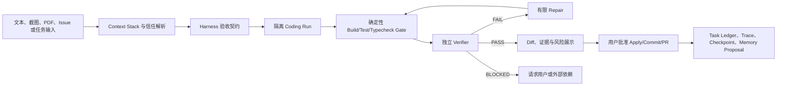

# ClawX Agent Coding 与 DCS 设计吸收调研

> 调研对象：Grok Build、Codex CLI、Gemini CLI、Letta legacy server（DCS 专项）  
> 调研日期：2026-07-16  
> 目标：识别 ClawX 可直接吸收的优秀设计，并形成不重复建设现有 Runtime 的落地路线。

## 1. 执行摘要

ClawX 当前并不缺少多 Agent、长任务、Worktree、记忆、压缩、权限、Task Ledger、Observability 或 Harness 等基础能力。与其他工具相比，ClawX 的主要短板不是架构零件数量，而是这些能力尚未统一成一条用户可理解、可验证、可恢复的 Coding Run 产品闭环。

综合四个项目，推荐的目标组合是：

```text
Gemini 式 Context Stack / Policy / Checkpoint
        +
Grok 式 Implement / Verify / Best-of-N / Background Task
        +
Codex 式 Structured Run / Review / Permission Envelope / Diff-first Attempt
        +
Letta 式 Memory Blocks / Context Accounting / Compaction Ledger
        +
ClawX 自有 Harness / Mission / Task Ledger / Observability / Governed Memory
```

最终产品流程应收束为：



首要建议不是立即实现 Best-of-N，而是先推出 **Verified Coding Run**：真实执行独立 verifier、确定性测试门禁、有限返修、结构化证据和人工应用确认。

## 2. 调研范围与版本

| 项目 | 本次检查对象 | 重点 |
| --- | --- | --- |
| Grok Build | 本地源码快照；已安装 `grok 0.2.101` | Best-of-N、自验证、Goal Harness、Worktree、后台任务、Memory/Compaction |
| Codex CLI | 本机 `codex-cli 0.144.2` | 结构化 headless、review、sandbox/approval、app-server、cloud attempts、plugins/MCP |
| Gemini CLI | 本机 `0.48.0-nightly.20260613.g9e5599c32` | 1M context、Policy Engine、checkpoint、GEMINI.md、extensions、ACP、多模态/grounding |
| Letta | `C:\Users\27933\Desktop\verseshell\letta-main` | DCS、Memory Blocks、archival/recall、compaction、sleep-time memory agents |
| ClawX | 当前工作树 | 现有能力、成熟度、可复用边界和缺口 |

重要边界：`letta-main/AGENTS.md` 明确说明该仓库是维护模式的 legacy Letta V1 server。本文只吸收其中已经落地的 DCS 机制，不建议复制其 Server、ORM 或 API 架构。

## 3. ClawX 当前能力基线

ClawX 已经具备：

- Role-first multi-agent orchestration、显式 workers、subagent lifecycle。
- Explorer、Reviewer、Tester、Compare 3 approaches UI preset。
- Task Loop、有限 repair、checkpoint、evidence gate。
- Mission Control 多 tick 长目标、pause/resume/cancel、sleep、review。
- Task Ledger、ClawGraph、Observability 和 Runtime trace。
- 结构化 Git、GitHub、Worktree 管理与审批。
- Workspace permission modes、sandbox policy、permission audit。
- Skills、MCP、Role/Agent capability publication。
- Manual compaction、compression artifact、recovery context。
- Memory proposal/review、Role Memory、Knowledge Hub 治理。
- Agent Dev scenario、record/replay、evidence、deep-test 与 audit 控制面。

关键成熟度差异：

| 能力 | 当前状态 | 主要缺口 |
| --- | --- | --- |
| Multi-agent runtime | Active | 普通 Chat 不自动继承编排和 repair 保证 |
| Compare 3 approaches | Active UI | 当前只比较三种设计方案，不产生真实实现和 winner patch |
| Worktree | Git 管理成熟，Agent 自动隔离在演进 | 尚缺候选创建、依赖准备、执行、验证、Apply 的完整闭环 |
| Task Loop / Mission | Active | 独立 verifier 路径仍未完全成为默认产品闭环 |
| Evidence Verifier | 合同与 shadow 很强 | 大量路径明确 `shadow_only`、default-off、无 completion authority |
| Memory | Proposal/review Active | Runtime hydration 和自动影响决策仍大量处于 shadow/readiness |
| Background monitor | 内部能力分散 | 缺通用 coding task、日志 watch、CI monitor 统一控制面 |
| Agent Dev Workbench | 控制面 Active | skill sandbox、effect log、完整 requestId/cost correlation 仍有脚手架成分 |

## 4. 从 Grok Build 吸收什么

### 4.1 独立自验证闭环

Grok 的 `check-work` 在实现完成后启动独立 verifier，重新检查用户要求、实际 diff、构建、测试和规则，失败后有限返修。

ClawX 应将其升级为 Harness 驱动版本：

1. 用户请求与后续修订生成 obligations。
2. Harness task spec 提供 `requiredRules`、`requiredTests`、`acceptance`。
3. Implementer 在隔离 Worktree 修改。
4. 确定性门禁先运行。
5. 独立 verifier 读取实际工作区和 evidence refs。
6. 输出 `pass | fail | blocked | insufficient_evidence`。
7. FAIL 生成 scoped repair brief，最多返修两次。
8. PASS 后由用户批准 Apply。

相比 Grok，ClawX 不应只依赖通用 verifier prompt，而应让 Harness 成为机器可执行验收合同。

### 4.2 Best-of-N 实现竞赛

Grok 的 Best-of-N 通过多个独立 Worktree 产生实现，再比较并应用 winner。

ClawX 第一阶段建议 Best-of-2：

- 两个候选使用相同 acceptance contract。
- 每个候选产生真实 diff 和测试证据。
- 构建、测试、typecheck 失败者直接淘汰。
- 通过候选再由独立 evaluator 比较。
- 支持 `NO_ACCEPTABLE_CANDIDATE`。
- 用户确认后才 Apply，不自动 merge/commit/PR。

现有 Compare preset 位于 `src/components/agents/SubagentRunnerPanel.tsx`，目前三个 worker 只是设计保守、模块化和集成优先方案，并且调用设置 `includeVerifier: false`。它适合作为 Best-of-N 的 UI 起点，但不能直接宣传为真实实现竞赛。

### 4.3 Goal Harness 的状态纪律

Grok Goal Harness 的优秀点包括：

- 目标开始时冻结 acceptance、verification plan、non-goals 和风险。
- 纯状态机记录 active、paused、blocked、budget exhausted、completed。
- 相同 gap fingerprint 检测无进展。
- 多轮失败后启动 strategist 改变方法。
- 未知持久化状态恢复为暂停，而不是自动执行。
- 每轮只保留最新 continuation directive，控制上下文增长。

ClawX 已有 Mission Control，不应创建第二套 Goal。应把这些纪律吸收到 Mission：冻结验收契约、gap fingerprint、预算、暂停原因、策略切换和 verification unavailable 状态。

### 4.4 统一后台任务控制面

Grok 将子代理、后台命令、monitor、scheduler 统一为 task ID，并提供查询、等待、终止、恢复和 Tasks Pane。

ClawX 可定义统一 `CodingTaskRecord`：

```ts
type CodingTaskRecord = {
  taskId: string
  codingRunId: string
  kind: 'agent' | 'command' | 'build' | 'test' | 'monitor' | 'scheduled'
  ownerAgentId: string
  status: 'queued' | 'running' | 'waiting' | 'complete' | 'failed' | 'cancelled'
  worktreeId?: string
  outputArtifactRef?: string
  evidenceRefs: string[]
  startedAt: number
  finishedAt?: number
  cancellationReason?: string
}
```

Monitor、Cron 和 Trace 只能产生 evidence，不能拥有任务完成权威。日志和外部事件必须作为不可信数据处理。

## 5. 从 Codex CLI 吸收什么

### 5.1 Structured Run Protocol

Codex `exec` 支持 JSONL、JSON Schema 输出、output-last-message、ephemeral、resume 和 fork。ClawX 应为所有 Coding Run 提供统一事件协议：

```text
run.started
context.resolved
agent.started
tool.requested
approval.requested
tool.completed
test.completed
diff.updated
verification.completed
repair.started
run.completed
run.blocked
```

同一协议应同时服务：

- Electron Coding Run Card。
- Headless CLI/CI。
- GitHub Action。
- Remote Task。
- IDE/ACP adapter。

最终结果可接受 JSON Schema 约束，事件使用 JSONL streaming。

### 5.2 Run-scoped Permission Envelope

Codex 把 sandbox、approval、network、writable roots 和 managed policy 放在运行入口的一等位置。

ClawX 建议定义：

```ts
type PermissionEnvelope = {
  profile: 'read-only' | 'workspace-write' | 'full-access'
  approvalPolicy: 'untrusted' | 'on-request' | 'never'
  readableRoots: string[]
  writableRoots: string[]
  network: 'deny' | 'allowlisted' | 'allow'
  source: 'admin' | 'user' | 'workspace' | 'run'
  expiresAt?: number
}
```

每次审批、工具执行和 verifier evidence 都应引用 envelope 版本。UI 必须能解释最终策略来自哪里、为何允许或拒绝，禁止静默放宽或 silent fallback。

### 5.3 独立只读 Code Review Contract

Codex `review` 原生区分 uncommitted、base branch 和 commit selector。

ClawX Code Review Center 可统一为：

- `workspace_diff`
- `base_branch`
- `commit_sha`
- `pull_request`
- `candidate_attempt`

Review Agent 默认只读，findings 使用 `severity/file/line/evidence/suggestion` 结构，不与实现 Agent 共用完成结论。

### 5.4 Diff-first Remote Attempts

Codex Cloud 将多个 attempts、查看 diff 和 apply 分开。ClawX 的 Remote Tasks 和 Best-of-N 应采用：

- immutable attempt identity。
- 每个 attempt 独立 session/worktree/evidence。
- 先展示 diff 和验证结果。
- 用户显式选择 attempt 并 Apply。
- Apply、commit 和 PR 是不同权限动作。

### 5.5 Plugin、MCP 与 Doctor 生命周期

值得吸收：

- Marketplace snapshot pin/ref 和 provenance。
- 安装/升级前 manifest capability disclosure。
- 安装、升级 diff 和原子 rollback。
- MCP OAuth scopes、bearer token env、secret 生命周期。
- 机器可读且脱敏的 `doctor --json` support bundle。

ClawX 不需要复制 Codex app-server daemon；应继续使用 Host API/Gateway，但可以生成版本化 schema/bindings，并为远程控制使用短期 pairing token、能力范围和完整审计。

### 5.6 Browser/Computer Evidence

Codex 的 Browser Use、Computer Use 和 CDP 能力提示 ClawX：浏览器/桌面操作不能只返回“成功”，应保存：

- origin/target allowlist。
- screenshot/DOM snapshot。
- action trace。
- selector 和输入摘要。
- permission envelope。
- 最终可复现证据。

## 6. 从 Gemini CLI 吸收什么

### 6.1 分层、可解释的 Policy Engine

Gemini CLI 的策略优先级是：

```text
Admin > User > Workspace > Extension > Default
```

规则可按 tool、MCP、args pattern、read-only annotation、交互模式和 approval mode 匹配，并输出 allow、ask_user、deny。

ClawX 已有权限治理，下一步应补齐：

- 确定性合并顺序。
- 最终命中规则和来源展示。
- Extension/Skill 不得越过 Workspace/User/Admin。
- Headless 模式不能产生无人回答的 `ask_user`，应 fail closed。
- Plan 模式默认拒绝写操作，只显式开放 read-only。
- 未知 discovered tool：交互询问，非交互拒绝。

### 6.2 Context Stack

Gemini 的 `GEMINI.md` 价值不在文件名，而在分层、可见、可 reload、受 workspace trust 控制。

ClawX 应提供统一 Context Stack：

```text
Admin policy
User instructions
Workspace AGENTS.md
Harness task/rules/scenarios/layers
Role contract
Skill/plugin context
Session/run overrides
Retrieved memory/knowledge evidence
```

每一层显示：来源、摘要、token 数、信任状态、启用状态、最后加载时间、冲突结果。未信任目录默认禁用 workspace hooks、MCP、project settings 和 workspace instructions，而不仅仅限制 shell。

### 6.3 模型级 Context Budget 与溢出预警

Gemini CLI 将模型 token limit、即将溢出事件和压缩触发集成在一起。ClawX 应建立模型级预算注册表，并记录：

```ts
type ContextBudget = {
  modelRef: string
  hardLimit: number
  warningThreshold: number
  compactionThreshold: number
  reservedOutputTokens: number
  reservedToolTokens: number
}
```

还应公开 input、output、cached input、cache hit rate、估计 cache savings 和 context fingerprint。

### 6.4 Git + Session 联合 Checkpoint

Gemini 的 checkpoint 不只是保存对话，还关联 Git snapshot 和可恢复工具状态。

ClawX checkpoint 应组合：

- Conversation/ResumeCheckpoint。
- Git snapshot 或 Worktree ref。
- Pending tool-call state。
- Acceptance progress。
- Active/background task metadata。
- Context fingerprint。
- Permission envelope version。

恢复时必须检查工作区 fingerprint 和 rollback，必要时标记 `requiresReverification=true`。

### 6.5 Extension 生命周期与迁移器

Gemini extensions/skills/hooks/MCP 已形成 install、link、new、validate、update、enable/disable、config 生命周期。

ClawX 可补齐：

- 开发态 link。
- 安装前 validate。
- Config schema。
- User/Workspace scope enable/disable。
- 更新兼容性检查与 rollback。
- Codex、Gemini、Claude 配置、rules、hooks、MCP 和 skills 的导入向导。

### 6.6 多模态 Intake 与 Search Grounding

将截图、PDF、草图和网页资料先转换为结构化需求与 acceptance contract，再进入 Verified Coding Run。检索结果必须保存 URL、时间、引用片段和 grounding metadata，作为 verifier evidence，而不是直接把网页摘要当事实。

## 7. 从 Letta DCS 吸收什么

### 7.1 可计量的 Context Sections

Letta 的 `ContextWindowCalculator` 将 system prompt 拆分为：

- base/system instructions。
- memory blocks。
- memory filesystem。
- tool usage rules。
- directories。
- memory metadata。
- messages 和 tool definitions。

并分别计算 token，返回当前/最大上下文和 archival/recall 数量。

ClawX 可构建 Context Budget Dashboard 和 deterministic Context Compiler：

```ts
type ContextSection = {
  id: string
  kind: 'system' | 'rules' | 'memory' | 'knowledge' | 'messages' | 'tools' | 'evidence'
  sourceRef: string
  trust: 'trusted' | 'reviewed' | 'untrusted'
  priority: number
  tokenCount: number
  selected: boolean
  reason: string
  digest: string
}
```

这与 ClawX 正在建设的 Context Runtime Kit、Compression Artifact 和 evidence refs 高度契合，不应创建第二套 DCS 真源。

### 7.2 Memory Blocks

Letta 将总是处于上下文中的有限记忆拆成有标签的 Blocks，每个 block 有：

- label。
- description。
- value。
- size limit。
- read-only 状态。
- metadata。
- Agent/Conversation 关联。

ClawX 可把经过治理的 Role Memory、Workspace Memory 和 Knowledge 摘要投影成只读 Context Blocks。Agent 若要修改，应产生 patch/proposal，而不是直接写 active memory。

### 7.3 Archival 与 Recall 分层

Letta 区分：

- Core memory：始终 in-context，容量有限。
- Recall memory：历史消息，可搜索。
- Archival memory：外部持久检索存储。

ClawX 可映射为：

| Letta | ClawX 建议映射 |
| --- | --- |
| Core memory | 本次 Context Pack 中选中的 governed blocks |
| Recall memory | Session transcript/recovery/context family，按需检索 |
| Archival memory | Runtime Memory、Knowledge Hub、Task Ledger evidence、artifact store |

关键原则是检索结果不是自动真相，仍需 provenance、trust 和 evidence gate。

### 7.4 Compaction Ledger

Letta 支持不同 compaction model、mode、prompt 和 sliding window percentage，并在压缩后重新构建 system prompt 和 memory blocks。

ClawX 应记录 Compaction Ledger：

```ts
type CompactionLedgerEntry = {
  compactionId: string
  sessionId: string
  beforeContextDigest: string
  afterContextDigest: string
  sourceMessageRefs: string[]
  summaryArtifactRef: string
  preservedEvidenceRefs: string[]
  droppedSectionRefs: string[]
  modelRef: string
  tokenBefore: number
  tokenAfter: number
  verificationStatus: 'unverified' | 'sampled' | 'verified' | 'failed'
}
```

压缩前应生成 Memory/Knowledge candidate；压缩后重新编译 Context Stack，并允许用户查看丢弃了什么、保留了什么、依据是什么。

### 7.5 Sleep-time Memory Agent

Letta 在主 Agent 响应后异步启动 sleeptime agent，整理共享 memory blocks，不阻塞主响应。

ClawX 可以吸收“后台整理”模式，但必须遵守现有治理：

- 后台 agent 只生成 Memory Proposal、Knowledge Inbox draft 或 index refresh evidence。
- 不能直接修改 active memory。
- 必须携带 source message refs、confidence、owner scope 和 expiration/invalidation 条件。
- 用户关闭 memory 时不得运行。
- 失败不影响前台 turn。

### 7.6 Git-backed Memory 的可审计性

Letta legacy server 还实现了 Markdown + Git memory repository，支持历史 ref、commit 和 block frontmatter。

ClawX 不一定需要 Git 作为生产 memory store，但应吸收：

- 版本历史。
- 可比较 diff。
- 原子提交。
- 恢复到历史版本。
- 用户可读导出。
- 索引可以重建，原始内容不能只存在向量库。

## 8. 统一目标架构

### 8.1 Coding Run 聚合根

建议引入统一 `CodingRun` 聚合，而不替代 Mission、Task Ledger 或 Trace：

```ts
type CodingRun = {
  codingRunId: string
  objective: string
  acceptanceContractRef: string
  mode: 'single' | 'verified' | 'best-of-n' | 'review'
  sessionIds: string[]
  orchestrationRunId?: string
  missionId?: string
  taskLedgerRootId?: string
  traceId?: string
  attemptIds: string[]
  permissionEnvelopeRef: string
  contextFingerprint: string
  status: 'planning' | 'implementing' | 'testing' | 'verifying' | 'repairing' | 'awaiting_approval' | 'completed' | 'failed' | 'blocked'
}
```

`CodingRun` 只是关联和投影层：

- Mission 仍拥有长期策略状态。
- Task Ledger 仍拥有用户可见任务真相。
- ClawGraph 仍拥有显式 DAG 状态。
- Observability 仍拥有 trace/evidence。
- Git/Worktree 仍由 Main/Runtime 边界管理。
- Memory/Knowledge 仍走 proposal/review。

### 8.2 Coding Run Card

Chat 中应显示：

- 当前阶段和耗时。
- Worker、角色、模型、Worktree。
- Acceptance 通过数量。
- 实际 build/test/typecheck 结果。
- changed files 和 diff。
- Verifier verdict 和 repair 次数。
- Permission profile 和待审批动作。
- Context pressure/compaction 状态。
- Trace、Task Ledger、Diff、Checkpoint 深链接。

### 8.3 统一证据优先级

完成判断建议按以下优先级：

1. 确定性构建、测试、typecheck、lint。
2. Harness rule 和 acceptance contract。
3. 实际 diff、文件和运行结果。
4. 独立 verifier 的结构化判断。
5. Worker/Implementer 自述。

LLM judge 不能覆盖确定性失败，也不能把 `verification_unavailable` 转换为成功。

## 9. 分阶段路线图

### P0：Verified Coding 基础

1. 定义 `CodingRun`、Structured Run Events 和 JSONL/schema 输出。
2. 将 Harness task spec 编译成 Acceptance Contract。
3. 单 Worktree implementer + deterministic gates。
4. 真正启动独立 verifier session。
5. PASS/FAIL/BLOCKED/INSUFFICIENT_EVIDENCE。
6. 最多两次有限 repair。
7. Chat Coding Run Card。
8. Run-scoped Permission Envelope 与 explain UI。

成功指标：

- 有代码修改的 Verified Run 中 verifier 实际执行率 100%。
- 确定性门禁执行率至少 90%。
- false-complete rate 低于 5%。
- 相比当前 Task Loop，外部 acceptance 成功率提升至少 10 个百分点。
- 用户能从一个页面回答“改了什么、跑了什么、为何通过/阻塞”。

### P1：隔离候选与恢复

1. Best-of-2 真实实现竞赛。
2. Immutable attempt、Worktree、diff 和 evidence bundle。
3. `NO_ACCEPTABLE_CANDIDATE`。
4. Git + Session + Acceptance 联合 checkpoint。
5. Context Stack viewer 和 workspace trust。
6. Review selector contract。
7. Background build/test/monitor 统一 task ID。

毕业指标：

- Best-of-2 相比单候选成功率提升至少 10 个百分点。
- 总成本低于约 2.5 倍。
- Worktree 隔离失败不发生共享目录写入。
- Resume 后 rollback 检测和重新验证率 100%。

### P2：DCS 与扩展治理

1. Context Section token accounting 和预算 Dashboard。
2. Compaction Ledger 和压缩前 Memory Proposal。
3. Role input/output artifact contract。
4. Extension link/validate/update/scope/rollback。
5. MCP OAuth/secret 生命周期。
6. Multimodal intake 和 grounded evidence packet。
7. Browser/Computer action evidence。
8. Machine-readable redacted Doctor bundle。

### P3：成熟后再考虑

- 多 verifier skeptic panel。
- Best-of-N 动态 N。
- 标准 ACP adapter。
- Local Model Runtime 管理面。
- GitHub Action/PR/Issue 统一运行投影。
- 受控 sleep-time Memory Proposal agent。
- 主动 prompt-cache planner。

## 10. 不建议照搬的内容

- 不复制 Grok Rust Runtime、TUI、ACP 真源或第二套 Scheduler。
- 不复制 Letta legacy Server、ORM、V1 API 或直接记忆写入模式。
- 不新建第二套 Goal、Task、Trace、Memory、Knowledge 或 DCS 真源。
- 不把 Best-of-3 设为默认。
- 不全局开启 Git Worktree、patch flow 或 full access。
- 不允许 Worktree 失败后静默回退共享目录。
- 不让 LLM judge 成为唯一完成依据。
- 不自动合并 winner、自动 commit、自动 PR 或自动发布。
- 不把完整 transcript、原始 tool args/output 塞给 verifier 或 checkpoint。
- 不让后台 monitor、Cron、Trace 或 memory agent拥有完成权威。
- 不把验证基础设施故障静默视为成功。
- 不让 Extension、Skill 或 MCP 越过 Admin/User/Workspace 权限规则。

## 11. 建议新增 Harness 任务规格

建议后续拆成独立 task specs，而不是一个大改动：

1. `verified-coding-run-contract.md`
2. `verified-coding-run-independent-verifier.md`
3. `coding-run-card.md`
4. `coding-run-permission-envelope.md`
5. `best-of-two-isolated-attempts.md`
6. `coding-run-checkpoint-recovery.md`
7. `context-stack-and-budget-dashboard.md`
8. `compaction-ledger.md`
9. `coding-background-task-control-plane.md`
10. `extension-lifecycle-governance.md`

每个规格均应引用 `gateway-backend-communication`，保持 Renderer → Host API → Main/Gateway 的边界，并包含 i18n、Electron E2E、comms replay/compare 和文档同步要求。

## 12. 关键源码证据索引

### ClawX

- `openclaw_runtime/src/agents/orchestrator.ts`
- `openclaw_runtime/src/agents/task-loop-controller.ts`
- `openclaw_runtime/src/agents/mission-control/controller.ts`
- `openclaw_runtime/src/agents/mission-control/reviewer.ts`
- `openclaw_runtime/src/agents/worktree-service.ts`
- `openclaw_runtime/src/runtime-core/evidence-verifier.ts`
- `openclaw_runtime/src/runtime-core/evidence-verifier-code-task-gate-shadow.ts`
- `src/components/agents/SubagentRunnerPanel.tsx`
- `shared/host-api/contract.ts`
- `harness/specs/tasks/mission-control-loop-mvp.md`
- `harness/specs/tasks/lightweight-subagent-runner-mvp.md`
- `harness/specs/tasks/phase-5-evidence-verifier.md`

### Grok Build

- `crates/codegen/xai-grok-shell/skills/check-work/SKILL.md`
- `crates/codegen/xai-grok-shell/skills/best-of-n/SKILL.md`
- `crates/codegen/xai-grok-shell/src/session/goal_classifier.rs`
- `crates/codegen/xai-grok-shell/src/session/goal_tracker.rs`
- `crates/codegen/xai-grok-pager/docs/user-guide/16-subagents.md`
- `crates/codegen/xai-grok-pager/docs/user-guide/20-background-tasks.md`

### Codex CLI

- 本机 `codex --help`
- 本机 `codex exec --help`
- 本机 `codex review --help`
- 本机 `codex cloud --help`
- 本机 `codex features list`
- `C:\Users\27933\AppData\Roaming\npm\node_modules\@openai\codex`

### Gemini CLI

- `C:\Users\27933\AppData\Roaming\npm\node_modules\@google\gemini-cli\README.md`
- `C:\Users\27933\AppData\Roaming\npm\node_modules\@google\gemini-cli\bundle\policies`
- 本机 `gemini --help`

### Letta DCS

- `letta/services/context_window_calculator/context_window_calculator.py`
- `letta/services/summarizer/summarizer_config.py`
- `letta/services/summarizer/summarizer.py`
- `letta/schemas/memory.py`
- `letta/schemas/block.py`
- `letta/services/block_manager.py`
- `letta/services/memory_repo/memfs_client_base.py`
- `letta/groups/sleeptime_multi_agent_v4.py`
- `letta/prompts/system_prompts/sleeptime_v2.py`

## 13. 最终结论

ClawX 最有机会形成差异化的方向，不是简单复制某一个 CLI，而是将四类优势组合起来：

- Grok 的可靠执行闭环。
- Codex 的结构化协议、安全和 diff-first 远程尝试。
- Gemini 的 Context、Policy、Checkpoint、多模态和扩展治理。
- Letta 的可计量 DCS、Memory Blocks 和压缩/长期记忆分层。

ClawX 自身的 Harness、Mission、Task Ledger、Host API、Observability 和受治理 Memory 是这套组合的核心优势。所有新增设计都应围绕这些既有真源收束。

近期最正确的投入顺序是：

1. Verified Coding Run。
2. Harness 驱动独立 Verifier。
3. Coding Run Card 和 Structured Events。
4. Permission Envelope。
5. Best-of-2 隔离尝试。
6. Context Stack、Context Budget 和 Compaction Ledger。

完成这些后，ClawX 才真正具备一条能够明确回答以下问题的专业 coding workflow：

> 改了什么、为什么这样改、运行了什么验证、证据在哪里、为什么可以通过、失败后如何修复、恢复时是否仍可信，以及最终由谁批准应用。
