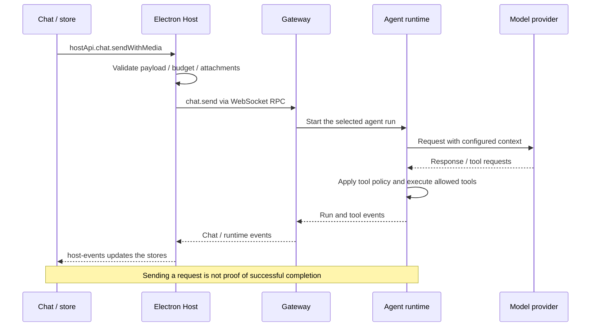

# Verse Claw architecture

This guide describes the current source paths inspected on **2026-10-05**. Verse Claw is an Electron desktop application with an embedded, separately built OpenClaw runtime. It is not a renderer-only web client. The diagrams describe ownership and call paths, not a claim that every optional subsystem is enabled.

## The desktop and runtime boundary

[Editable Mermaid source](../resources/readme/2026-10-05/architecture.mmd)

| Layer | Responsibility | Source entry |
| --- | --- | --- |
| React renderer | Routes, chat, knowledge, task and settings views; local UI state | [`src/App.tsx`](../src/App.tsx), [`src/stores/chat/`](../src/stores/chat/) |
| Typed host facade | Build module/action requests, correlate responses, apply the renderer timeout margin | [`host-api.ts`](../src/lib/host-api.ts), [`host-api-client.ts`](../src/lib/host-api-client.ts), [shared contract](../shared/host-api/contract.ts) |
| Preload bridge | Expose `window.verseClaw.hostInvoke`; send `host:invoke` through Electron IPC | [`electron/preload/index.ts`](../electron/preload/index.ts) |
| Main dispatcher | Authorize the sender, validate requests, dispatch registered host services and enforce action timeouts | [`host-invoke.ts`](../electron/main/ipc/host-invoke.ts), [`host-invoke-security.ts`](../electron/main/ipc/host-invoke-security.ts) |
| Desktop services | Own workspace/file operations, terminals, browser integration and desktop configuration | [`electron/services/`](../electron/services/) |
| Gateway manager | Start/connect/supervise the local Gateway, issue WebSocket RPC, receive runtime events | [`manager.ts`](../electron/gateway/manager.ts), [`ws-client.ts`](../electron/gateway/ws-client.ts) |
| OpenClaw runtime | Agent/model runs, tools, plugins, channels, scheduling and subsystem persistence | [`openclaw_runtime/src/`](../openclaw_runtime/src/), [`extensions/`](../openclaw_runtime/extensions/) |
| Event return path | Forward Gateway events to the window and update renderer stores | [`electron/main/index.ts`](../electron/main/index.ts), [`host-events.ts`](../src/lib/host-events.ts) |

The ordinary typed host request crosses **IPC first**. Gateway-bound host services then use the Main-owned WebSocket connection. Desktop services can finish locally without traversing Gateway. These are separate boundaries; describing them as a universal “WS → HTTP → IPC fallback” is inaccurate for the current facade. HTTP-facing services and runtime HTTP endpoints do not change that ordinary call path.

Renderer code should use the typed facade and event facade, not open direct Gateway connections. Some older policy text still names `src/lib/api-client.ts`; that file is absent in this checkout. The current request implementation is `src/lib/host-api-client.ts`.

## One chat turn

[SVG fallback](../resources/readme/2026-10-05/chat-sequence.svg) · [Editable Mermaid source](../resources/readme/2026-10-05/chat-sequence.mmd)

1. [`runtime-send-actions.ts`](../src/stores/chat/runtime-send-actions.ts) calls `hostApi.chat.sendWithMedia` with the session, input and optional context references.
2. [`chat-api.ts`](../electron/services/chat-api.ts) validates and prepares the request, handles attachments and budget checks, then calls `gatewayManager.rpc('chat.send', ...)`.
3. The Gateway dispatches the selected agent run. Model and tool execution use runtime configuration and policy; optional memory or context components have their own enablement conditions.
4. Main forwards chat and runtime events. The renderer consumes them through `host-events.ts` and its stores, displaying text, tool activity and completion/error state.

An RPC acknowledgement, a rendered tool card and a successfully completed tool effect are different facts. Streaming and multiple tool iterations are simplified in the diagram. It does not imply every chat becomes a Task Loop or a multi-agent run.

## Three forms of task state

| Concept | What it represents | What it does not imply |
| --- | --- | --- |
| Chat/session | Immediate conversation and its execution history | Automatic decomposition into a planned multi-role workflow |
| Task Ledger / explicit Task Loop | User-facing goals, dependencies, evidence and deliberately started bounded execution | The internal runtime scheduler or automatic promotion from every chat |
| ClawGraph / runtime Workboard | YAML workflow inspection/execution surfaces and internal scheduling responsibilities | Interchangeability with the user-facing task ledger |

See [product semantics](clawx-product-semantics.md) and [orchestration](multi-agent-orchestration/README.md) for the precise boundaries.

## Knowledge, plugins and data

The Knowledge page provides a library and review queue. The Wiki backend is supplied by the [`memory-wiki` extension](../openclaw_runtime/extensions/memory-wiki/openclaw.plugin.json), including `wiki.status`, search and apply routes. A reachable Gateway alone does not guarantee that these plugin methods are available. A missing or disabled extension can leave the page visible while Wiki operations fail.

Reading selected sources does not grant write permission. Drafts, proposals, governance checks and application results remain distinct. Runtime Memory, DCS, VToken and automatic experience writeback should be described using their [product semantics](clawx-product-semantics.md) and [default configuration boundaries](dev/default-config-matrix.md), not inferred from the presence of a panel.

The optional [`verseconf-artifacts` plugin](dev/verseconf-clawx-implementation-20261001.md) owns structured-document tooling. It is disabled by default. Its current PPTX export uses a three-slide template and rejects more than three records; Markdown retains a longer outline. Its presence does not mean a general-purpose document editor or arbitrary-slide renderer is shipped.

Desktop settings live under Electron `userData`; OpenClaw configuration normally lives under `~/.openclaw` with `OPENCLAW_CONFIG_DIR` support in the desktop path resolver. Runtime subsystems use files, JSONL and SQLite. There is no separately deployed database server requirement. Online model and external tool calls still send the chosen input to their configured services.

## Reading and verifying this guide

- [`package.json`](../package.json) defines the desktop build/test commands; [`openclaw_runtime/package.json`](../openclaw_runtime/package.json) defines the independent runtime workspace.
- `build:vite` builds the renderer and Electron bundles. `build:runtime` builds and smoke-checks the runtime. One is not a replacement for the other.
- [Visual provenance](../resources/readme/2026-10-05/README.md) distinguishes generated illustrations from real Electron captures and records their scope.
- [README coverage audit](dev/readme-audit-20261005.md) records what was checked and the known limits. Historical test counts and source availability alone are not a current release verdict.
