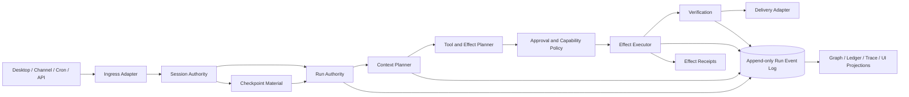

# ClawX 架构哲学与成熟产品对照研究

**研究日期**：2026-08-02  
**研究对象**：ClawX Electron 桌面端、OpenClaw Gateway/runtime、渠道插件、Host API、DCS/Context、任务控制面  
**对照对象**：OpenAI Codex CLI（本地源码、官方文档）、Aider（本地源码、官方文档）  
**研究目的**：回答 ClawX 是否存在比当前架构更优的落地方式，以及在修复已知缺陷后，ClawX 仍然需要通过设计解决哪些结构性问题。

## 1. 先给结论

ClawX 的主要问题已经不是“功能不够”，而是**能力面大于产品边界，控制面大于用户能够理解的运行模型**。

如果把上一轮审计中的缺陷全部修完，ClawX 仍然不会自动变成成熟产品。它会成为一个功能很宽的 agent platform，但未必是一个让开发者可以稳定依赖的 coding product。成熟产品的优势不在于拥有更多模块，而在于让用户始终知道四件事：

1. 当前是哪一个任务、哪一次运行在工作；
2. Agent 能读什么、能改什么、能执行什么；
3. 哪些内容进入了模型上下文，为什么进入；
4. 失败后究竟可以恢复什么，哪些外部副作用不能恢复。

因此建议把 ClawX 收敛为两层：

```text
Core Coding Agent
  单一 turn/session/effect authority
  清晰的上下文、编辑、验证、审批和恢复语义

Capability Platform
  channels / web / cron / browser / media / MCP / remote / multi-agent
  全部作为受策略控制的适配器和可选 profile
```

**核心判断**：不要用继续增加模块的方式补全架构。应先建立一个小而强的运行时内核，再把现有的大量能力降级为插件或 profile。ClawX 最有价值的方向不是复制 Codex CLI 或 Aider，而是把两者的可靠 coding 内核与 ClawX 的渠道、任务和可观测平台结合起来。

**本研究的进一步修正**：这个“小而强的运行时内核”不应被理解为一个普通的 coding loop。根据项目的实际设计意图，内核应以 DCS-first Context Engine 为中心：DCS 负责统一 Context Language、候选裁决、预算、编译和 lineage；Mem 负责需要语义判断的信息；最终每轮只生成一个 provider-bound ContextBundle。详见 [DCS-first 上下文工程设计](C:\Users\27933\Desktop\clawx\ClawX\docs\dev\dcs-first-context-engineering.md)。

长期设计约束已经收敛为 [STAR 原则](C:\Users\27933\Desktop\clawx\ClawX\docs\dev\star-principles-and-development-philosophy-2026-08-02.md)；后续外部 agent 的独立挑战使用 [竞争评审提示词](C:\Users\27933\Desktop\clawx\ClawX\docs\dev\dcs-first-architecture-review-prompt.md)。

## 2. 研究边界与证据等级

本研究使用三类证据：

| 证据 | 用途 | 限制 |
|---|---|---|
| ClawX 源码、类型、文档、审计报告 | 判断当前系统真实的架构边界和已接线路径 | 不能单独证明真实 provider、真实渠道和长期运行可靠 |
| `C:\Users\27933\Desktop\coding\codex-main` 与 `source_archive\codex` | 判断 Codex CLI 的控制面、运行时和状态模型 | 本地快照可能不是最新发行版本 |
| Aider 官方文档与 `aider-main`/`source_archive\aider` | 判断 repo map、编辑格式、模式切换、lint/test 反馈回路 | Aider 是 coding CLI，不是全渠道 agent platform |

本报告沿用上一轮审计的证据分级：E0/E1 只能证明代码存在或已经接线；E2/E3 证明受控测试；E4 才是真实 provider/channel/browser canary；E5 才是长期 soak、真人 A/B 和产品批准。当前 ClawX 的结论仍为：

```text
accept-with-residuals
liveReady=false
productApproved=false
defaultOn=false
jointSystemGa=false
TF-0006=blocked
```

这不是本报告试图改变的结论。架构研究和生产放行是两个不同问题：**架构可以现在收敛，生产能力仍须按证据逐项毕业**。

## 3. 三个系统实际上在优化什么

### 3.1 Codex CLI：优化“受约束的本地执行”

Codex CLI 的核心不是“拥有最多工具”，而是把一个本地任务包装成可控的执行单元：

- sandbox 定义技术边界，approval policy 定义何时停下来询问；两者不是同一个概念；
- 默认工作流偏向 read-only 或 workspace-write，网络和越界访问需要明确升级；
- 交互 TUI、`codex exec`、JSONL 输出、app-server 复用同一套 turn/event 语义；
- `AGENTS.md` 采用全局到项目、再到子目录的指令链，且有明确大小上限；
- 非交互执行有稳定的 stdout/stderr 分工和结构化事件，适合 CI 和自动化。

这是一种“**先把边界和恢复做好，再增加自主性**”的产品哲学。官方资料明确强调：sandbox 限制 agent 能做什么，approval 决定何时必须征求用户同意；它们不是通过一个模糊的“高强度模式”同时改变的。

### 3.2 Aider：优化“最短 coding 反馈回路”

Aider 的价值集中在代码修改本身：

- repo map 通过符号抽取、依赖图和 PageRank，在 token 预算内选出与当前任务最相关的代码结构；
- edit format 把模型输出约束为 whole、search/replace、udiff 等可解析编辑格式；
- ask/code/architect 模式让讨论、规划和执行有明确的用户可见边界；
- architect 模式把“提出解决方案”和“生成精确编辑”分给两个模型，减少一个模型同时承担推理与格式化的失败；
- lint/test 可以在每次编辑后自动反馈，失败结果再次进入修复回路。

Aider 的设计取舍很明确：它不试图同时解决渠道编排、远程设备、长期记忆、定时任务和通用业务自动化。因此每个新增状态都能直接服务于“理解仓库、修改文件、验证结果”。

### 3.3 ClawX：优化“多入口、多能力、多生命周期的平台化 agent”

ClawX 已经形成了另一种产品：

- 桌面 Chat、24 条 runtime channel metadata、Cron、Heartbeat、API 都可以作为入口；
- Gateway/Auto-reply 把入站消息分发到 agent turn；
- Context Orchestrator、DCS、VToken、CVK、Memory、SEKB 提供上下文与经验层；
- Coding、Browser、Web Search/Fetch、MCP、Office/PDF、媒体、设备和 Remote Forge 提供宽能力面；
- Fork、Handoff、Queue、Checkpoint、Task Ledger、ClawGraph、Observability 提供长任务控制和可视化；
- Host API 与 Electron 形成桌面控制面。

这些能力本身并非错误。问题是：**它们目前共享了太多隐含状态，却没有一个所有入口都必须服从的最小运行时权威模型**。结果是，系统看起来像一个完整平台，但每一层对“任务、运行、上下文、效果、恢复”的定义仍可能不同。

## 4. 对照矩阵

| 维度 | Codex CLI | Aider | ClawX 当前/目标 | 判断 |
|---|---|---|---|---|
| 首要场景 | 本地 coding/执行 | 本地 coding/edit-test | 全渠道通用 agent + coding | ClawX 的场景宽度最大，产品焦点最弱 |
| agent loop | turn + event + sandboxed exec | chat loop + edit parser + lint/test | Gateway/auto-reply + runtime + 多个控制循环 | ClawX 需要统一 turn authority |
| 上下文 | 有界、分层指令链、显式输入 | repo map + 用户指定文件 + 历史 | DCS/VToken/CVK/Memory/SEKB/多 provider | ClawX 需要把上下文变成 typed budgeted bundle |
| 编辑 | 受 sandbox 约束的 patch/tool | 受格式约束的 whole/diff/search-replace | 多种 coding 工具、journal、apply_patch、审批 | 应吸收 Aider 的可解析 edit contract |
| 权限 | sandbox 与 approval 分离 | CLI/文件/git 确认 | workspace guard、approval、provider/channel policy 多套 | 应建立 effect policy，而不是继续增加开关 |
| 验证 | command/test/event 反馈 | lint/test 自动回路 | 多种测试、ledger、observability，但路径多 | coding profile 需要单一 verify loop |
| 会话 | thread/rollout/app-server | chat history/git | transcript、trajectory、queue、fork、handoff、checkpoint | 需要区分 transcript、workspace、process、external effect |
| 多 Agent | 可有子任务，但不是默认产品模型 | architect/editor 是受限双模型 | multi-agent、mission、ClawGraph、handoff | 默认不应把编排暴露给普通 coding 任务 |
| 入口 | CLI/TUI/exec/app-server | CLI/IDE 集成 | desktop/channel/cron/API/remote | 入口应全部适配同一 Ingress/Turn Contract |
| 可观测性 | JSONL event 与 rollout | 对话、diff、测试输出 | graph/ledger/trace/ClawGraph 多投影 | 所有投影必须来自同一 append-only event log |
| 失败恢复 | sandbox boundary + session resume | git/diff/手工确认 | journal/checkpoint/rollback/handoff 多语义 | 需要诚实的 recovery taxonomy |

## 5. 如果已知问题全部修完，ClawX 仍然有哪些优势

这里的“修完”假设上一轮审计列出的接线、默认值、审批、checkpoint、queue、delete cascade、channel conformance、真实 canary 等问题全部达到各自目标，但不假设新架构已经建立。

### 5.1 多入口到同一 agent 的能力明显强于 coding-only 产品

ClawX 可以把桌面、消息渠道、定时器、API 和心跳任务接入同一个 agent runtime。对需要“在聊天里下达任务、在本地 workspace 修改、通过外部渠道通知”的组织来说，这是一项真实差异化能力。Codex CLI 和 Aider 主要围绕本地工作区；它们不会天然提供 24 条消息渠道和 Gateway 生命周期。

### 5.2 生命周期控制比一般 coding CLI 更完整

Fork、Handoff、Queue、Checkpoint、Ledger、Observability 等能力，理论上可以支持跨时段的长任务、人工接力和审计。只要这些能力都投影自同一运行事件流，ClawX 可以形成比单次 CLI 调用更强的长期任务体验。

### 5.3 上下文治理和经验系统的上限更高

Context Orchestrator 的候选收集、去重、预算、lineage 以及 DCS/VToken/SEKB 的分层，为“哪些知识被使用、从哪里来、能否撤销”提供了比普通 prompt 拼接更好的技术基础。成熟后，这可以成为组织级 coding agent 的优势：不仅完成当前任务，还能保留经过确认的工程约束和经验。

### 5.4 能力适配范围更广

Browser、Web、MCP、媒体、Office/PDF、设备、Remote Forge 等能力使 ClawX 可以处理代码任务与外部世界交互的复合工作流。对“查资料、改代码、运行验证、更新文档、发通知”的任务，平台化能力确实有价值。

### 5.5 桌面产品化和可视化潜力更强

Electron、Host API、Execution Graph、Task Ledger 和 Settings/Developer Workbench 可以把 agent 的状态变成可观察、可介入的桌面产品，而不是只在终端输出文本。这为非 CLI 用户和需要审计的团队提供了入口。

这些优势成立的前提不是代码模块存在，而是必须满足三个条件：**统一权威、默认边界清晰、真实运行证据充分**。否则优势只是潜在能力，不是用户可以依赖的产品承诺。

## 6. 修完现有问题后仍会存在的结构性缺点

### 6.1 缺少单一运行时权威

当前系统存在 Gateway runtime、transcript/trajectory、Task Ledger、Execution Graph、ClawGraph、Observability、Electron store 等多个状态面。它们可以互相同步，但只要同步关系不是单向投影，就会出现：

- UI 显示运行中，Gateway 已经重启；
- Ledger 记录任务完成，实际 outbound delivery 未确认；
- checkpoint 认为可以恢复，外部浏览器或进程已经不可恢复；
- graph 节点存在，但没有对应的可重放事件。

这不是某个 bug，修单个 API 不能根治。必须指定：**一个 append-only run event log 是事实源，其他对象都是投影**。

### 6.2 能力边界与状态边界耦合过深

渠道、Cron、Browser、Memory、SEKB、Multi-agent、Remote Tasks 等能力都可能创建、暂停、恢复或重试 agent turn。每加一个入口，都会增加 admission、session key、权限、上下文、投递、失败恢复和可观测性组合。最终复杂度近似于入口数乘以效果类型数，而不是简单的模块数相加。

要补全它，不能只补更多 conformance test；需要把所有入口收敛到一个不可变的 `IngressEnvelope` 和一个统一的 `TurnRequest`。

### 6.3 上下文系统概念过多，用户和开发者都难以建立心智模型

DCS、VToken、CVK/CKV、Memory、SEKB、BlockStore、working memory、knowledge、experience 等术语分别有技术理由，但对一个 coding task 来说，用户只需要知道：

```text
本轮上下文 = 用户输入 + 仓库证据 + 已批准的记忆 + 工具结果
```

如果这些来源不能被压缩成一个带来源、优先级、预算和撤销关系的 `ContextBundle`，系统会出现重复注入、顺序依赖、隐式 prompt 改变和难以解释的模型行为。更多的 context provider 只会加重问题。

### 6.4 “模式”和“强度”容易被误解为权限

`minimal/low/medium/high/xhigh/max` 可以合理地改变推理预算、工具选择或规划深度，但用户很容易理解成“更强模式会自动获得更大权限”。如果 effort、mode、multi-agent、网络、写入和远程操作没有严格分离，系统会出现隐式升级。

正确设计应该是：

```text
effort = 质量/成本预算
mode = 交互工作流（ask / plan / code / review）
capability profile = 允许的效果集合
approval policy = 何时停下来询问
```

这四个维度不能由一个枚举值同时控制。

### 6.5 rollback 的物理语义永远不可能统一

文件 pre-image、git worktree、transcript rewind、context compaction、运行中进程、浏览器状态、消息已发送、远程 PR mutation 是不同的资源。它们不可能共享一个“回滚”按钮而保持诚实。

即使 checkpoint RPC 和 journal 全部修完，ClawX 仍需要明确显示：

| 恢复对象 | 能否恢复 | 正确命名 |
|---|---|---|
| 对话历史 | 通常可截断/分叉 | transcript fork/rewind |
| 模型上下文 | 可重新构建 | context rebuild |
| 工作区文件 | 部分可恢复 | workspace restore |
| 运行中进程 | 通常只能终止并重启 | process restart |
| 已发送消息/远程变更 | 不能自动撤销 | external effect remains |

把这些能力包装成“全局回滚”会制造比没有回滚更危险的错误期待。

### 6.6 多 Agent 的成本和失败面会超过普通任务收益

多 Agent 会增加 token、并发写入、workspace 冲突、上下文拼接、handoff 误差和审批数量。对于小型 coding task，它通常比一个有 repo map、清晰 patch 和测试反馈的单 Agent 更差。

多 Agent 应是受约束的任务类型，而不是系统默认的运行方式：有明确的 fan-out 边界、每个 worker 的独立 worktree、预算和合并协议，且用户能看到为什么需要拆分。

### 6.7 桌面、Gateway、渠道形成分布式系统，却仍使用多种本地状态机制

Electron Main、Renderer、Gateway、channel plugin、provider、browser process、cron worker 之间存在重启、断线、重复投递和版本漂移。`electron-store`、JSONL、SQLite、内存 graph、trajectory 等各自适合局部用途，但如果没有统一的 run identity、idempotency key 和 receipt，就很难回答“这条消息是否已经执行、是否已经发送、重试会不会重复副作用”。

### 6.8 验证矩阵和发布成本会成为产品瓶颈

修完功能后，24 条渠道、多 provider、多浏览器、媒体、Office、Windows/macOS/Linux、Electron/Gateway/CLI 的组合仍然巨大。没有能力分层和 profile，任何一个默认值变更都可能需要全矩阵验证，产品会陷入“工程上能做，发布上不敢承诺”。

## 7. 哪些缺点可以通过设计补全

| 缺点 | 设计补全 | 是否能靠加测试解决 |
|---|---|---|
| 多个状态面互相漂移 | Event Log 作为唯一事实源，Ledger/Graph/UI/trace 为投影 | 不能，测试只能发现部分漂移 |
| 入口语义不一致 | `IngressEnvelope -> SessionKey -> TurnRequest` 统一入口 | 部分可以，核心是契约收敛 |
| Context 术语过多 | `ContextBundle` 统一来源、预算、优先级、lineage、撤销 | 不能，需模型和 API 重构 |
| 权限和 effort 混合 | Capability Profile + Approval Policy + Effort 三轴分离 | 不能只靠 UI 提示 |
| rollback 过度承诺 | Recovery Taxonomy + Effect Receipt + 明确不可逆效果 | 可以验证，但必须先改语义 |
| 多 Agent 默认复杂 | 单 Agent 默认；有理由的 bounded orchestration profile | 测试只能证明边界，不能替用户选择 |
| 渠道/浏览器/远程扩大矩阵 | Adapter contract、profile cohort、真实 canary 分层 | 需要 conformance + E4/E5 证据 |
| 记忆污染和隐式注入 | Capture -> Review -> Commit -> Retrieve 的单向生命周期 | 需要权限、审计和内容安全共同保证 |
| 长任务难以接力 | `RunCheckpoint` 只保存可重建事实，不保存虚假“世界快照” | 可以验证恢复材料是否完整 |
| UI 与 runtime 不一致 | UI 只订阅事件和投影，不持有第二套运行状态 | 需要架构边界，而非更多 state patch |

以下缺点不应通过设计继续扩张来“补全”：

- 不应为了证明平台化而默认开启所有渠道、搜索、浏览器、记忆和远程工具；
- 不应把 Agent Dev、synthetic canary 或旧 release evidence 当作联合系统 GA；
- 不应把多 Agent、ClawGraph、Heartbeat、Remote Forge 暴露为普通 coding task 的必经路径；
- 不应继续增加一个新的 Context provider 来修复已有 Context provider 的优先级问题；
- 不应通过再增加一个 rollback 类型来掩盖外部副作用不可逆；
- 不应把“功能存在”继续当作“功能已可承诺”的产品指标。

## 8. 建议的设计哲学

### 原则一：任务结果优先于能力数量

第一指标不是工具数、渠道数、graph 节点数或 prompt 层数，而是：

```text
用户任务完成率
可解释性
可恢复性
副作用安全性
完成成本与延迟
```

每个新能力必须回答：它改善了哪一种任务结果？是否增加了用户必须理解的状态？能否在 profile 外完全不影响核心 coding 路径？

### 原则二：一个 Agent Turn，三个唯一权威

建议固定三个 authority：

1. **Run authority**：唯一决定 turn 的生命周期、排队、取消、重试、暂停和完成；
2. **Session authority**：唯一保存 transcript、context lineage、checkpoint material 和 fork/handoff 关系；
3. **Effect authority**：唯一批准、执行、记录和确认文件、命令、网络、浏览器、消息、远程 API 等副作用。

UI、Task Ledger、Execution Graph、ClawGraph、Observability 都只能是投影，不能在本地再做一套事实判断。

### 原则三：默认最小能力，显式升级

推荐默认 profile：

```text
read + inspect + propose
```

用户明确进入 coding profile 后，才允许 workspace write；命令执行、网络、浏览器、远程 API 和渠道发送按 effect class 升级。升级记录必须绑定到 run/session/effect，而不是绑定到模糊的“高强度模式”。

### 原则四：上下文是可验证的输入，不是隐式魔法

所有进入模型的内容都应成为 DCS Context IR 中的 `ContextUnit`，至少包含：

```text
kind / source / version / epistemicStatus / scope / priority / tokenBudget / reason / expiresAt / reversible
```

模型请求前生成一个不可变 `ContextBundle`，并在 trace 中记录被选中、压缩、冲突隔离和被丢弃的候选。DCS 是编译层；VToken、CVK、Memory、SEKB 可以继续存在，但只能作为 producer/transformer，不能各自直接向 prompt 写入一段未登记文本。简单、结构明确的信息可以走 deterministic fast path；只有需要语义判断的信息才进入 Mem。

### 原则五：恢复语义必须诚实

所有恢复操作都返回机器可读的 receipt：恢复了什么、没有恢复什么、是否产生新的外部副作用、下一步是否需要人工确认。成功但恢复 0 个文件必须是失败或显式 no-op，而不是成功。

### 原则六：复杂度必须被工作负载证明

单 Agent、短反馈回路是默认；multi-agent、Cron、Browser、Remote、Memory 和自动经验写回只有在任务类型明确要求时才启用。复杂度不是越多越先进，而是必须被任务收益证明。

### 原则七：先做可信 coding agent，再做 general agent platform

ClawX 应将 coding 作为第一个可承诺产品：

```text
理解仓库 -> 提出计划 -> 生成精确编辑 -> 执行验证 -> 展示 diff/receipt -> 可恢复接力
```

渠道、搜索、浏览器、媒体、Office、远程等能力围绕这个内核以 adapter 方式扩展，而不是让 coding 路径承受平台全部复杂度。

### 原则八：每个能力都有声明、证据和毕业条件

能力状态至少分为：`implemented`、`wired`、`controlled`、`canary-ready`、`live-observed`、`product-approved`。UI 和文档必须展示与证据一致的状态，禁止把代码存在或 fixture 通过写成默认可用。

## 9. 建议的目标架构



### 9.1 核心数据对象

```text
IngressEnvelope
  idempotencyKey, source, actor, channel, targetSession, payload, receivedAt

TurnRequest
  sessionId, objective, mode, capabilityProfile, effort, contextPolicy

ContextBundle
  items[], budget, lineage, omittedCandidates, policyDigest

ProposedEffect
  effectClass, target, preview, risk, approvalRequirement, idempotencyKey

EffectReceipt
  proposedEffect, decision, startedAt, completedAt, outcome, artifactDigest

VerificationReport
  checks[], changedFiles, testResults, unresolvedRisks, confidence

RunCheckpoint
  objective, confirmedFacts, contextRefs, effectReceipts, nextAction, blockers
```

这组对象比继续增加 `DCS/VToken/CVK/Memory/TaskLedger/ClawGraph` 之间的专用连接更重要。旧模块可以逐步适配到这些对象上，最终让模块名变成实现细节，而不是产品语义。

### 9.2 Coding profile 应吸收什么

从 Aider 吸收：

- repo map 的符号/依赖排序和 token 预算；
- 可解析、可验证、可重放的 edit contract；
- architect/plan 与 editor/apply 的职责分离；
- lint/test 作为同一 turn 的反馈，而不是任务结束后才运行。

从 Codex CLI 吸收：

- sandbox 与 approval 的双层模型；
- 交互和非交互都输出同一事件协议；
- workspace、网络和外部资源的显式 capability profile；
- `AGENTS.md` 一类有边界的项目指令链；
- session/app-server 的稳定恢复入口。

ClawX 自己保留：

- 多渠道入口；
- 桌面人工接力；
- 长任务 checkpoint 和 receipt；
- Context lineage、组织级经验和可观测投影。

## 10. 建议的收敛路线

### 阶段 0：重新命名产品边界

发布文档中明确：ClawX 当前是“受控可运行的 agent platform / coding preview”，不是默认开启的全渠道自治系统。把 core coding profile、平台能力和实验能力分成三栏，所有 capability claim 与证据等级绑定。

### 阶段 1：建立 Run/Session/Effect authority

新增统一 event schema 和 idempotency 规则，先让 Chat、一个真实 channel、Cron 三个入口走同一 `IngressEnvelope -> TurnRequest`。Graph、Ledger、Observability 改为消费事件，不再各自写状态。

### 阶段 2：交付可信 coding golden path

只围绕一个 workspace 完成：repo map/context bundle、DCS ContextUnit、选择性 Mem routing、计划、精确 patch、approval、lint/test、diff、workspace restore、checkpoint resume。用真实 provider 做 E4 canary，记录 latency、cost、上下文关键事实保留率、重复率、approval rate、failure/recovery 和人工评价。

### 阶段 3：以 adapter 方式接入平台能力

按真实任务需要逐个接入 Search/Fetch、Browser、Office、媒体和渠道。每个 adapter 必须实现 capability declaration、effect receipt、error taxonomy、conformance test 和 canary cohort；未满足条件时不进入默认 profile。

### 阶段 4：受约束的长任务和多 Agent

先做单 Agent 可恢复长任务，再做独立 worktree 的 bounded fan-out。只有当真实任务数据证明拆分减少总成本或提高成功率时，才将某类任务升级为 multi-agent profile。

### 阶段 5：毕业与默认值

用 real corpus、真实渠道/provider/browser、4-28 天 soak、真人 A/B、恢复演练和产品批准决定是否毕业。任何单模块绿色不能直接翻转联合系统 GA。

## 11. 最终判断：ClawX 应该做什么、不应该做什么

### 应该做

- 把 ClawX 定义为“可接入多世界的可信 coding/agent runtime”，而不是无限能力集合；
- 以单一 event log、run/session/effect authority 统一现有控制面；
- 把 Aider 的 repo map/edit/verify 和 Codex 的 sandbox/approval/session 作为 coding 内核基线；
- 保留渠道、长任务、记忆、浏览器和远程能力，但全部 adapter 化、profile 化、证据化；
- 让用户在任何时刻知道当前运行、权限、上下文和恢复边界。

### 不应该做

- 不要为了“平台完整”让默认路径经过 multi-agent、ClawGraph、Memory、Browser 或全部渠道；
- 不要继续用新的 provider、flag 或 UI 状态掩盖 authority 不统一；
- 不要把上下文增强、模式切换和 effort 设计成隐式权限升级；
- 不要把 transcript rewind、file restore 和外部副作用撤销统称为 rollback；
- 不要在没有 E4/E5 证据时把 synthetic/evidence scaffolding 包装成生产承诺。

## 12. 一句话结论

**ClawX 的更优解不是变成另一个 Codex CLI，也不是把 Aider 的功能搬进 Electron；更优解是用 Codex 的边界与运行时纪律、Aider 的 coding 反馈回路，重建一个小而权威的核心内核，再让 ClawX 的渠道、记忆、长任务和多媒体能力作为可验证的外接世界。**

只有这样，ClawX 的“新颖和复杂”才会变成用户价值，而不是让每个新能力都扩大一次不可控的状态空间。

## 附录：研究资料

### ClawX 本地资料

- `docs/dev/full-chain-maturity-audit-2026-08-02.md`
- `docs/dev/context-orchestrator.md`
- `docs/dev/default-config-matrix.md`
- `shared/dcs/prod-flags-catalog.ts`
- `openclaw_runtime/src/auto-reply/dispatch.ts`
- `openclaw_runtime/src/context-engine/context-orchestrator.ts`
- `shared/host-api/contract.ts`
- `shared/types/long-task-control.ts`

### Codex CLI

- [Agent approvals & security](https://developers.openai.com/codex/agent-approvals-security)
- [Sandbox](https://developers.openai.com/codex/concepts/sandboxing)
- [Non-interactive mode](https://developers.openai.com/codex/noninteractive)
- [Developer commands](https://developers.openai.com/codex/cli/reference)
- [Custom instructions with AGENTS.md](https://developers.openai.com/codex/guides/agents-md)
- 本地源码：`C:\Users\27933\Desktop\coding\codex-main`、`C:\Users\27933\Desktop\coding\source_archive\codex`

### Aider

- [Repository map](https://aider.chat/docs/repomap.html)
- [Edit formats](https://aider.chat/docs/more/edit-formats.html)
- [Chat modes](https://aider.chat/docs/usage/modes.html)
- [Linting and testing](https://aider.chat/docs/usage/lint-test.html)
- 本地源码：`C:\Users\27933\Desktop\coding\aider-main`、`C:\Users\27933\Desktop\coding\source_archive\aider`

**资料访问日期**：2026-08-02。外部资料用于设计对照，不替代 ClawX 的真实 provider、channel、browser 和长期 soak 证据。
