# Stage 0 黄金 Coding Turn 链路契约（D4）

| 字段 | 值 |
|---|---|
| 文档状态 | `draft`（Stage 0 契约冻结稿） |
| 版本 | v1 |
| 日期 | 2026-08-16 |
| 代码基线 | `f55201b22630d5c904f3105b2a9c8876ea5e889b` |
| 黄金路径定义 | 普通 coding turn：用户输入 → identity → ContextRef → CompilationSnapshot → PromptPlan → RequestEnvelope → provider fetch → 一个真实工具调用 → 临时最小 Grant → Tool Guard → EffectReceipt |
| 阶段边界 | Stage 0 只冻结链路与字段；Stage 1 才实现 Provider Guard + 一个真实工具调用 + EffectReceipt |

## 1. 链路总图

```mermaid
flowchart LR
  U[用户输入] --> I[session/run/attempt Identity]
  I --> R[ContextRef: 用户意图 / Task Ledger / 工具结果]
  R --> S[CompilationSnapshot]
  S --> P[DCS PromptPlan]
  P --> E[Provider Guard RequestEnvelope]
  E --> F[provider fetch]
  F --> T[一个真实工具调用]
  T --> A[Approval Ledger approved row]
  A --> G[CapabilityGrant 临时最小]
  G --> TG[Tool Guard]
  TG --> X[真实领域执行 + domain journal]
  X --> EF[EffectReceipt]
```

约束：

- 每步只消费上一环节的 sealed/durable 输出；
- 所有 digest/ref 链必须可查询；
- Stage 1 观测模式开启时，不改变任何发送字节、工具注册、审批与默认值。

## 2. 逐环节契约

### S0 用户输入 → session/run/attempt Identity

| 项 | 内容 |
|---|---|
| 输入 | 用户消息、session key、当前 run/attempt 上下文 |
| 输出 | `TurnIdentity { sessionKey, runId, attemptIndex, modelCallIndex }` |
| 失败语义 | 任一字段缺失或非规范 id：拒绝进入 Provider Guard，返回可查询拒绝原因，不发送请求 |
| 回滚语义 | 无副作用；不创建 session/run，只读取 |
| Stage 1 必查字段 | `sessionKey`、`runId`、`attemptIndex`、`modelCallIndex` |
| Stage 状态 | Stage 1 `in_progress` |

### S1 ContextRef（用户意图、Task Ledger、工具结果）

| 项 | 内容 |
|---|---|
| 输入 | 用户消息 transcript 记录、当前 Task Ledger revision、本轮可用的工具结果 archive/journal 引用 |
| 输出 | 三个来源的 `ContextRef` 指纹：`refId`、`kind`、`owner`、`sourceRef`、`revision`、`contentDigest`、`acl`、`retention`、`provenance`、`lifecycle` |
| 失败语义 | 用户意图 ref 缺失：黄金路径 fail-closed；工具结果 ref 可缺省但必须体现为 omitted；digest 与 owner store 不一致：ref 失效，不得进入快照 |
| 回滚语义 | 只读 owner store，不写 payload；ref 失效只影响本轮编译 |
| Stage 1 必查字段 | `refId`、`kind`、`sourceRef`、`revision`、`contentDigest` |
| Stage 状态 | Stage 0 `proposed`；生产接线 Stage 2 |

### S2 CompilationSnapshot

| 项 | 内容 |
|---|---|
| 输入 | 上一环节的 ContextRef 指纹、Task Ledger revision、catalog epoch、policy epoch/digest、model profile、RC-03 transform graph、budget |
| 输出 | 不可变 `CompilationSnapshot/v1`，含 `snapshotDigest` |
| 失败语义 | 缺 catalog/policy epoch：新资产 fail-closed；epoch 或 policy 变化：必须新 snapshot，禁止静默复用 |
| 回滚语义 | 快照只读、可丢弃；DCS 服务崩溃后可凭 receipt 重建（Stage 2 目标），不得要求 DCS 变成数据库 |
| Stage 1 必查字段 | `snapshotId`、`snapshotDigest`、`catalogEpoch`、`policyEpoch`、`policyDigest`、`taskLedgerRevision` |
| Stage 状态 | Stage 0 `proposed`；生产接线 Stage 2 |

### S3 DCS PromptPlan

| 项 | 内容 |
|---|---|
| 输入 | sealed snapshot 输入（Stage 0 指契约上可解释的 refs/epochs） |
| 输出 | `PromptPlan/v1`：`selected`、`omitted`、`order`、`budget`、`why`、`planDigest`、`sealed=true` |
| 失败语义 | 快照缺失、policy 不一致、selected/omitted 重叠、order 不完整、未 seal：拒绝进入 Provider Guard |
| 回滚语义 | 计划是内存/追加审计产物；丢弃只损失一次编译记录，不改变 owner 数据 |
| Stage 1 必查字段 | `planId`、`planDigest`、`selected[]`、`omitted[]`、`order[]`、`budget`、`policyDigest` |
| Stage 状态 | Stage 0 `proposed`；Stage 1 以最小 DCS projection 支持封口 |

### S4 Provider Guard RequestEnvelope

| 项 | 内容 |
|---|---|
| 输入 | sealed `PromptPlan`、provider adapter 的最终请求组装 |
| 输出 | `RequestEnvelope/v1`：`system`、`messages`、`tools`、`media`、`transforms`、`transport`、`envelopeDigest` |
| 失败语义 | 任一覆盖字段缺失、发现未登记 transform、plan 未 seal：拒绝（Stage 1 观测模式先记录） |
| 回滚语义 | envelope 是发送前内存结构；观测写失败不改变发送行为；不重放请求 |
| Stage 1 必查字段 | `envelopeId`、`envelopeDigest`、`system/messages/tools/media` 的 coverage 标记、`transforms[]`、`transport.providerId` |
| Stage 状态 | Stage 1 `in_progress` |

### S5 provider fetch

| 项 | 内容 |
|---|---|
| 输入 | 组装完成的最终请求 + `buildGuardedModelFetch` 现有 guard |
| 输出 | provider 响应流 + 最终 wire digest（`WireReceipt/v1` 关联） |
| 失败语义 | SSRF/超时/代理/重试沿用现有语义；receipt 写入失败记录 census，不改变发送 |
| 回滚语义 | 不自动重放副作用；重试必须新 `wireAttemptIndex` 并保持 correlation |
| Stage 1 必查字段 | `wireAttemptIndex`、`wireDigest`、`correlationDigest`、`transformIds` |
| Stage 状态 | Stage 1 `in_progress`（覆盖黄金路径，非全部 provider/channel） |

### S6 一个真实工具调用

| 项 | 内容 |
|---|---|
| 输入 | 模型返回的真实 tool call（Stage 1 选择一个白名单内的 coding 工具） |
| 输出 | 工具调用身份：`toolCallId`、`toolName`、目标 `resource`、`action` |
| 失败语义 | 不在 Stage 1 白名单：fail-closed；模型伪造 call：拒绝；工具执行点未接 Tool Guard：不得执行 |
| 回滚语义 | 拒绝不执行；**拒绝不自动回滚本轮之前已完成的其他副作用**（与现有 write journal 语义一致，必须如实记录） |
| Stage 1 必查字段 | `toolCallId`、`toolName`、`resource`、`action` |
| Stage 状态 | Stage 1 `in_progress` |

### S7 Approval → CapabilityGrant（临时最小）

| 项 | 内容 |
|---|---|
| 输入 | approval ledger 中 `approved` 行 + policy digest + S6 工具调用身份 |
| 输出 | `CapabilityGrant/v1`，只包含临时最小字段 |
| 失败语义 | `denied`、过期、revision conflict、governance mismatch：不签发；Tool Guard 拒绝 |
| 回滚语义 | grant 是派生内存凭证，不写权限库；执行后立即失效 |
| Stage 1 必查字段 | `grantId`、`actor`、`scope`、`approvalRef`、`ttl`、`effectIdempotency`、`status` |
| Stage 状态 | Stage 1 `in_progress`（临时最小）；完整 grant 契约 Stage 4 |

### S8 Tool Guard

| 项 | 内容 |
|---|---|
| 输入 | 真实工具调用 + 临时最小 grant |
| 输出 | `allow` 或结构化 `deny` |
| 失败语义 | 任一校验失败（actor/scope/TTL/approval ref/effect idempotency）即 `deny`，不得执行 |
| 回滚语义 | deny 无副作用；grant 进入 `expired/revoked` |
| Stage 1 必查字段 | `grantId`、拒绝原因、`status`、effect idempotency key |
| Stage 状态 | Stage 1 `in_progress` |

### S9 EffectReceipt

| 项 | 内容 |
|---|---|
| 输入 | 真实执行器返回 outcome、domain journal ref、proposal digest、grant/approval 关联 |
| 输出 | `EffectReceipt/v1` + approval ledger outcome 推进 |
| 失败语义 | `unknown`：`needs_reconciliation`，禁止自动重放；同 idempotency key 异内容：`content-conflict`；denied：只能 `not_applied` |
| 回滚语义 | receipt append-only；不授权重放；domain journal 仍是 effect truth |
| Stage 1 必查字段 | `receiptId`、`idempotencyKey`、`outcome`、`journalRef`、`proposalDigest`、`createdAt` |
| Stage 状态 | Stage 1 `in_progress` |

## 3. Stage 1 临时最小 Grant 字段（冻结）

| 字段 | 语义 | 校验 |
|---|---|---|
| `actor` | `{sessionKey, runId, attemptIndex, modelCallIndex, actorKind}`，必须等于发起 tool call 的 turn identity | 与 Identity adapter 逐字段一致 |
| `scope` | `{taskBranchId, resource, action, purpose}`，只允许一个 resource/action | 不允许 `*`；必须与模型可见 descriptor 和实际工具执行点一致 |
| `approval ref` | `{approvalId, decision:"approved", resolvedBy, policyDigest}` | approval ledger 必须真实处于 `approved`；denied 不签发 |
| `TTL` | `{issuedAt, expiresAt}`，默认只覆盖单次 tool call | `expiresAt>issuedAt`；过期即拒绝 |
| `effect idempotency` | `{key, namespace}` | 同 key 同内容幂等，异内容冲突；一次执行后立即失效 |

附加冻结（Stage 0 已声明，Stage 1 单工具调用通常不使用）：

- `delegation`（parent/child）：子 agent 权限严格 ≤ 父 agent；
- `revocation`（reason + revocation epoch）：撤销后 Tool Guard 必须拒绝。

## 4. 黄金路径内未登记 egress = 0（Stage 1 覆盖范围）

定义：

- **provider egress**：从 sealed `PromptPlan` 到 provider fetch 之间的任何请求字节；未出现在 `RequestEnvelope.transforms` 或未获得 seal registry 登记的 mutation 计为未登记 egress。
- **tool effect**：黄金路径内选择的一个真实工具调用；未经过 grant + Tool Guard 即执行的副作用计为未登记 effect。

Stage 1 必须同时给出五种证明：

1. provider 出口 allowlist；
2. 静态代码约束（禁止未登记 semantic mutation）；
3. 运行时 census（owner census / seal producer 登记）；
4. 负向测试（伪造未登记 transform、缺字段 envelope、denied/expired grant）；
5. break-glass 审计路径（保留审计记录，不计入正常覆盖率）。

范围限定：Stage 1 只承诺**黄金路径内**未登记 egress = 0；channel、cron、browser、多 agent、非黄金 provider 后续阶段逐面扩大覆盖。

## 5. Stage 1 必查字段汇总

| 环节 | 必须可查询 |
|---|---|
| Identity | `sessionKey`、`runId`、`attemptIndex`、`modelCallIndex` |
| ContextRef | `refId`、`kind`、`sourceRef`、`revision`、`contentDigest` |
| Snapshot | `snapshotId`、`snapshotDigest`、`catalogEpoch`、`policyEpoch`、`policyDigest`、`taskLedgerRevision` |
| PromptPlan | `planId`、`planDigest`、`selected[]`、`omitted[]`、`order[]`、`budget` |
| RequestEnvelope | `envelopeId`、`envelopeDigest`、system/messages/tools/media coverage、`transforms[]` |
| Provider fetch | `wireAttemptIndex`、`wireDigest`、`correlationDigest` |
| Grant | `grantId`、`actor`、`scope`、`approvalRef`、`ttl`、`effectIdempotency`、`status` |
| Tool Guard | `grantId`、deny reason、`status` |
| EffectReceipt | `receiptId`、`idempotencyKey`、`outcome`、`journalRef`、`proposalDigest` |

## 6. 禁止在本契约中承诺的事项

- 不承诺仅凭 Receipt 重建 prompt 原文；
- 不承诺拒绝会自动回滚先前已完成的写入；
- 不承诺 Stage 1 覆盖全部 provider、channel、plugin；
- 不承诺观测模式之外 fail-closed（未经 owner 决策）；
- 不承诺 Stage 1 工具执行可用 fixture/synthetic 证据替代真实执行。
