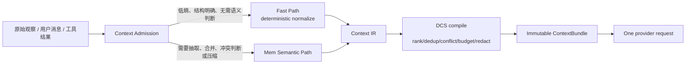

# DCS-first 上下文工程设计

**日期**：2026-08-02  
**定位**：ClawX 的核心设计方向补充  
**核心命题**：DCS 不是一个 context provider，而是所有 agent turn 的上下文编译层；Mem 不是所有信息的必经通道，而是对需要语义判断的信息执行受控压缩、归纳、去重和工作记忆构建。

本设计遵循 [STAR 原则：DCS-first 的设计哲学与后续开发理念](%USERPROFILE%\Desktop\clawx\ClawX\docs\dev\star-principles-and-development-philosophy-2026-08-02.md)，并可使用 [DCS-first 架构竞争评审提示词](%USERPROFILE%\Desktop\clawx\ClawX\docs\dev\dcs-first-architecture-review-prompt.md) 交给其他 agent 独立挑战。

## 1. 对用户设计的准确表述

ClawX 真正想构建的不是“能力很多的聊天 Agent”，而是：

> 一个以 DCS 为核心、以 Mem 为语义处理器、以统一 Context Language 为中间表示、每轮只生成一次最终上下文的可控上下文运行时。

这条路线是可行的，而且具有比普通 coding agent 更强的差异化。但它要求我们把 DCS 的职责从“若干 context enhancement 的集合”提升为**系统的语义边界**：任何可能进入云端模型请求的内容，都必须经过 DCS 的登记、裁决、编译和审计。

这里的“一次完整上下文”应精确定义为：

```text
每个 agent turn 只有一个 provider-bound ContextBundle
所有来源在进入 provider adapter 之前完成合并、排序、去重、裁剪和脱敏
provider adapter 不再自行拼接第二套隐藏 prompt
```

它不意味着每一个字节都必须经过昂贵的 Mem 推理，也不意味着每轮都要把所有历史重新发送。语义上只有一个最终 bundle；传输上仍可以使用稳定前缀、provider cache、摘要引用或增量优化。

## 2. DCS、Mem 和 Working Context 的分工

### 2.1 DCS：上下文编译器和策略边界

DCS 负责回答：

- 哪些候选信息有资格进入本轮；
- 候选信息的来源、版本、可信度、时效和作用域是什么；
- 哪些候选重复、冲突、过期或超过预算；
- 哪些信息可以合并，哪些信息必须原文保留；
- 最终以什么顺序、什么格式、什么目标通道投影给模型；
- 本轮实际发送了什么，以及哪些候选被拒绝或降级。

DCS 不应该负责所有内容的深度理解。它更像编译器和 linker：收集 typed input，执行规则和优化，输出不可变的 provider-bound artifact。

### 2.2 Mem：选择性语义处理器

Mem 负责对**需要语义判断**的输入执行：

- 去除重复叙述和低价值细节；
- 抽取稳定事实、约束、决定、风险和待办；
- 把多个观察合并成高密度 working context；
- 识别冲突、过期、未经确认的推断；
- 将长历史压缩为可引用的短语义单元；
- 在任务结束或显式确认后，提出可持久化的经验候选。

Mem 不应自动把所有原始消息、工具输出、日志和历史都变成长期记忆。它应该产出**带证据和状态的候选单元**，由 DCS 决定是否进入本轮。

### 2.3 Working Context：任务级认知工作集

Working Context 不是 Memory 的别名，也不是最近消息的拼接。它是当前任务真正需要保持的最小状态集合，例如：

```text
Objective       当前要完成什么
Constraints     必须遵守的边界、项目规则、安全条件
ConfirmedFacts  已由源码、工具或用户确认的事实
Decisions       已做出的方案选择及原因
OpenRisks       尚未解决的冲突、风险和不确定性
ActiveFiles     当前实际相关的文件、符号和 diff
Evidence        支撑关键判断的工具结果、测试和来源
NextAction      下一步可执行动作
```

它应当是 task/session scoped、可版本化、可追踪的，而不是全局人格记忆。

## 3. 两条信息处理路径

“所有上下文统一”不等于“所有信息都经过昂贵 Mem”。必须设计双路径：



### 3.1 Fast Path

以下内容通常不需要调用 Mem：

- 文件路径、行号、git status、diff header、请求 ID、时间戳；
- 已经是结构化 schema 的 tool result；
- 明确的用户指令和短约束；
- 小型、无重复、无冲突的代码片段；
- 测试结果的状态、退出码和少量错误行；
- 经过信任校验的固定项目规则。

Fast Path 仍必须进入统一 Context IR，不能直接绕过 DCS 拼接字符串。它绕过的是 Mem 的语义成本，不是治理和审计。

### 3.2 Mem Semantic Path

以下情况才值得进入 Mem：

- 多轮消息重复表达同一个目标或约束；
- 工具输出很长，需要保留结论和证据而不是全文；
- 多个来源存在冲突，需要标出事实等级和不确定性；
- 历史任务中存在可能复用的程序性经验；
- 需要从日志、讨论或变更中抽取工作状态；
- 上下文接近预算上限，需要进行语义压缩而不是字符截断。

Mem 的调用也应先经过成本门控。短信息不应为了“统一”而额外调用模型；否则 DCS 会从上下文工程变成上下文税。

## 4. 统一 Context Language / IR

当前 `ContextCandidate/v1` 已经是一个重要基础，但它主要表达“候选文本如何进入 prompt”。要实现你描述的统一语言，还需要把语义属性纳入 IR：

```ts
type ContextUnit = {
  schema: "ContextUnit/v1";
  id: string;
  kind:
    | "objective"
    | "constraint"
    | "fact"
    | "decision"
    | "risk"
    | "evidence"
    | "working_state"
    | "tool_contract"
    | "next_action"
    | "instruction";
  text: string;
  source: {
    type: "user" | "repository" | "tool" | "memory" | "channel" | "system";
    ref: string;
    version?: string;
  };
  epistemic: {
    status: "confirmed" | "inferred" | "proposed" | "uncertain" | "stale";
    confidence?: number;
    evidenceRefs?: string[];
  };
  scope: "turn" | "task" | "session" | "workspace" | "profile";
  priority: "critical" | "high" | "normal" | "optional";
  freshness?: { observedAt: string; expiresAt?: string };
  sensitivity?: "public" | "workspace" | "secret-adjacent";
  merge: "preserve" | "summarize" | "dedup" | "conflict-set";
  tokenCostEstimate?: number;
};
```

`ContextCandidate/v1` 可以继续作为投影候选协议，但应该由 `ContextUnit` 生成，而不是让不同 provider 自己生产不透明字符串。这样才能回答：

- 为什么这段信息被发送；
- 它是事实还是推断；
- 它是否已经过期；
- 它与哪条证据关联；
- 它被压缩、合并或丢弃的原因是什么。

## 5. 高密度不是简单压缩

“不断丢掉冗余信息”是正确方向，但不能把目标简化成压缩率或字符数。上下文优化的目标应是：

```text
maximize(
  task coverage
  + constraint preservation
  + evidence grounding
  + continuity
  - redundancy
  - provider cost
  - latency
  - privacy/security risk
)
under hard limits:
  token budget
  model context window
  per-source cost
  maximum compilation latency
```

至少要保留四类不可牺牲信息：

1. **目标和硬约束**：丢失后会让任务方向错误；
2. **已确认事实和证据**：丢失后会让模型重新猜测；
3. **关键决定及原因**：丢失后会导致反复改方案；
4. **未解决风险和下一动作**：丢失后会导致任务失去连续性。

可以压缩的通常是：重复描述、已被更高版本事实覆盖的观察、低相关日志、已完成且不再影响下一步的过程细节。

### 5.1 不能使用裸字符截断

当前预算系统以字符为统一计量是工程上可解释的起点，但对高密度上下文还不够：按前缀截断可能截断 JSON、代码块、约束列表或证据关系。

后续应改成 unit-aware packing：

- 先按 `ContextUnit` 原子单元排序；
- 只在允许 `summarize` 的单元上做摘要；
- `critical` 单元必须完整保留；
- `conflict-set` 不得合并成无来源的单一结论；
- 每个被压缩或丢弃的单元保留 lineage；
- 最终 bundle 必须能通过 schema 校验和静态敏感信息检查。

## 6. 成本控制的正确层次

成本不应只靠“把总预算从 6000 调大/调小”解决。建议分四层：

### 层 1：Admission cost

在读取昂贵 provider 或调用 Mem 之前，先用任务、来源类型、长度、重复指纹和缓存判断是否值得处理。

### 层 2：Semantic processing cost

Mem 只处理高收益候选；相同 source/version/content digest 直接复用结果。摘要和抽取结果要缓存并带失效条件，不能每轮无条件重算。

### 层 3：Bundle packing cost

DCS 在统一 IR 上做一次排序、去重、冲突处理和预算分配，避免多个 provider 各自截断、各自摘要。

### 层 4：Transport cost

最终只发送一个 authoritative bundle；在不改变语义的前提下使用稳定系统前缀、prompt cache、压缩引用或 provider 侧缓存，减少重复 token 计费。

## 7. 当前实现距离这个目标还有什么差距

当前实现已经提供了重要的地基：

- `ContextCandidate/v1` 统一了 Memory、VToken、CVK、DCS 的候选投影；
- Context Orchestrator 负责最终排序、去重、预算、投影和 lineage；
- kill switch 可以 fail-closed 地切断增强路径；
- turn-wide ledger 让多个来源共享预算；
- 默认配置仍保持 VToken、working-memory、Runtime Memory、SEKB 等增强路径关闭。

但它目前仍更接近“上下文增强仲裁器”，不是完整的 DCS-first compiler，主要差距是：

1. `ContextCandidate` 以 text/source/channel/target 为主，缺少 kind、epistemic status、freshness、sensitivity、merge policy 和 evidence graph；
2. 成本门控发生在候选生产之后仍较多，尚未形成“先 admission、再决定是否调用 Mem”的统一查询计划；
3. 预算是字符级 flat pool，尚未实现语义单元级 packing 和可验证摘要；
4. 候选集合主要是进程内生命周期，尚未成为可恢复、可重放的编译 artifact；
5. 仍需审计所有 provider-boundary，保证没有任何 adapter 在 DCS 之后偷偷追加隐藏 system prompt；
6. 高密度效果还没有真实 corpus、真实 provider 和真人 A/B 证据，不能用 fixture 通过替代信息保真度证明。

因此，当前系统不是方向错误，而是**已经完成了 DCS-first 的第一层 authority foundation，尚未完成语义编译器和成本优化层**。

## 8. DCS-first 的设计原则

### 原则一：统一语言优先于统一字符串

统一不是把所有来源拼成一个长字符串，而是让所有来源先表达为同一个 Context IR。字符串只是最后的 provider projection。

### 原则二：所有内容受控，只有部分内容需要 Mem

Fast Path 也必须有来源、版本、预算和 lineage；Mem Path 只对需要语义判断的信息付费。

### 原则三：先保真，再压缩

任何压缩算法都必须先证明目标、约束、关键证据和风险没有丢失，再优化 token 和延迟。

### 原则四：Working Context 是任务状态，不是全局记忆

working context 应随 task/session 版本演进，任务结束后只有经过确认的单元才可以晋升为长期经验。

### 原则五：一轮一次编译，一次权威发送

所有来源在 provider boundary 前完成一次编译；编译产物不可变、可审计、可重放。provider adapter 不再二次拼接。

### 原则六：任何丢弃都必须可解释

被去重、压缩、冲突隔离、过期淘汰或预算丢弃的内容，都必须在 lineage 中有明确原因。高密度不能靠黑箱沉默实现。

## 9. 推荐的 DCS pipeline

```text
1. Ingest
   收集 user/channel/tool/repository/system observations

2. Admission
   判断 source 是否相关、是否重复、是否需要 Mem、是否允许进入本轮

3. Normalize
   Fast Path 结构化；Mem Path 语义抽取/压缩；全部输出 ContextUnit/v1

4. Working-set update
   更新 task-scoped objective/constraints/facts/decisions/risks/nextAction

5. Resolve
   处理版本、时效、冲突、权限、敏感性和作用域

6. Pack
   按任务效用和硬约束选择原文、摘要、引用或丢弃

7. Compile
   生成不可变 ContextBundle/v1、policyDigest、lineage 和 cost receipt

8. Send
   provider adapter 只接受 ContextBundle，不自行添加未登记上下文

9. Observe
   记录 selected/omitted/compressed/conflicted、实际 token、延迟、成本和结果
```

## 10. 下一步最值得做的不是扩大能力，而是做三件事

### P0：ContextUnit/v1 和 ContextBundle/v1

把 `ContextCandidate/v1` 上移为统一 IR 的投影协议，增加 kind、epistemic、scope、priority、freshness、sensitivity、merge 和 evidence 引用。先不改变默认值，只统一语言。

### P1：Admission + Mem routing

新增一个确定性的 admission planner，决定：

```text
pass_fast_path
pass_mem_path
defer
drop
```

planner 必须在昂贵 provider/Mem 调用前运行，并给出可解释原因。

### P2：Unit-aware packer 与真实密度评估

替换裸 prefix truncation，建立真实 corpus 指标：

- 关键事实保留率；
- 约束保留率；
- 重复率下降；
- 每轮 prompt token/cost；
- 编译延迟；
- 模型重复提问率；
- 任务完成率和恢复成功率；
- 人工对摘要正确性、证据充分性和遗漏风险的评分。

只有这些指标形成真实 canary，才能讨论 DCS/Mem 是否应该扩大默认范围。

## 11. 最终判断

你选择“专精上下文工程”是合理的，而且可以成为 ClawX 相对于 Codex CLI/Aider 的真正差异化：

- Codex CLI 更擅长受约束地执行；
- Aider 更擅长短反馈回路地修改代码；
- ClawX 可以更擅长把多来源信息编译成高密度、可控、可追踪、可恢复的工作上下文。

但这个优势成立的关键不是 Mem 越强、上下文层越多，而是：

```text
DCS 统一语言
Mem 选择性语义处理
Working Context 任务化
ContextBundle 单次编译
Lineage 全程可见
预算和成本可验证
```

一句话：**ClawX 不应追求“让所有信息都经过 Mem”，而应追求“让所有进入模型的信息都经过 DCS；只有值得语义处理的信息才经过 Mem”。**
