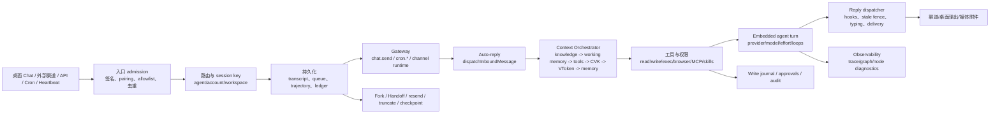

# ClawX 全链路成熟度审计

**审计日期：** 2026-08-02  
**审计对象：** ClawX Electron 桌面端、OpenClaw Gateway/runtime、共享 Host API、渠道插件、Skills、Agent Dev 与运行时控制面  
**审计目的：** 还原消息进入后的真实执行链路，区分代码存在、已接线、默认启用、受控验证、真实 canary、生产 soak、产品批准和联合系统 GA。

## 1. 执行摘要

### 1.1 最终判定

```text
decision       = accept-with-residuals
production     = controlled-operable（受控可运行，不等于 GA）
liveReady      = false
productApproved= false
defaultOn      = false
jointSystemGa  = false / NO-GO
TF-0006        = blocked
```

ClawX 已经不是功能演示：它拥有真实的 Gateway、Auto-reply、渠道插件、Context Orchestrator、编码写入保护、Browser 安全边界、Cron、Fork/Handoff、Observability、Task Ledger、ClawGraph、MCP、Remote Forge 和多媒体运行时。工程广度和控制面完整度较高。

但是，联合系统还没有达到“默认开启、长期生产验证、语义一致、可对外承诺”的成熟度。阻断原因不是单个功能缺失，而是生产证据和跨层语义仍不闭合：没有真实生产 corpus、真人 A/B、长期 soak 和产品签署；上下文/记忆增强仍以 opt-in 和 kill switch 为主；敏感信息保护不是所有落点的端到端保证；rollback、delete cascade、trace、plan 和 queue 的权威边界仍存在差异；当前工作树也不是干净发布基线。

### 1.2 关键结论

1. **消息进入和 agent turn 主路径是真实的。** 桌面 `chat.send` 与渠道入站最终汇聚到 `dispatchInboundMessage` 的 agent-turn 层，但两者在 admission、路由、持久化和 outbound delivery 之前并不等价。
2. **Coding 安全底座较强，但是多套实现的混合强度。** workspace guard、审批、journal、apply-patch preflight 和 fail-closed 权限已接线；journal 写入是 fail-open，执行被拒也不会自动回滚之前的写入。
3. **Context/DCS/VToken/CVK/MEM 的“权威编排”已存在，但默认状态必须分层理解。** 生产排序为 `knowledge -> working_memory -> tool_registry -> CVK -> VToken -> memory pilot`；Context Runtime Kit engine 默认选中，而 VToken、working memory、Runtime Memory、SEKB 和多个可选 context-family provider 默认关闭。
4. **强度控制影响资源和提示策略，不是权限提升。** `auto/minimal/low/medium/high/xhigh/max` 会改变 prompt、Skills top-k、工具结果上限和压力阈值，但不会越过审批、自动启用多代理或强制进入长任务循环。
5. **Fork/Handoff/queue/loop 有真实实现，但 rollback 不是完整系统快照。** Fork 是 transcript clone；handoff 是聚合后的新会话草稿；恢复只覆盖写 journal 中记录的文件，不恢复 transcript、运行中进程、网络或外部副作用。
6. **24 个渠道插件存在，不代表 24 个渠道全部联网运行。** Gateway 启动即加载控制面，但只有已加载、已配置、已启用且有账号的插件才会实际连接。
7. **Web Search/Fetch、Cron、Skills 和 Browser 均有默认路径，但都受 provider、policy、审批或配置过滤。** “默认加入工具集”不是“每轮必然成功调用”。
8. **Observability、Task Ledger 和 ClawGraph 已接线，但不是同一份权威副作用日志。** Execution Graph 是 UI projection；ClawGraph 状态主要在 Gateway 进程内存中，重启会丢失运行态。
9. **MCP、Office/PDF、图像/音频/视频理解和图像生成是本项目额外的真实能力。** 它们有 Host/Main 边界与 provider registry，但实际可用性依赖密钥、可选依赖、外部服务和运行时插件。

### 1.3 机器证据中的硬反证

- `artifacts/uas-06-single-local-exec-canary/report.json`（2026-07-30）明确标记 `qualification=engineering-only`、`summary.status=needs-real-canary`。
- 该报告有 9 条 engineering observation、9 条 governed VerseShell path、0 native fallback，但 `realPairedTasks=0`、`realProviderUsage=0`，因此只能证明工程内核路径。
- `artifacts/uas-06-single-local-exec-canary/real-cohort-report.json` 标记 `qualification=no-live-observations`，其中 `liveObservations=0`、`providerReceipts=0`、`humanReviews=0`、`reviewedRollbackDrills=0`。
- 同一证据包冻结 `liveReady=false`、`productApproved=false`、`defaultOn=false`、`TF-0006=blocked`。这些锁比单项测试绿灯优先级更高。
- 该报告的 27 个 source inventory hash 与当前工作树已有 6 个不一致，因此它也是历史工程证据，不能代表当前 dirty tree。

## 2. 审计范围与证据等级

### 2.1 范围

- Electron renderer -> Host API -> Main services -> Gateway -> OpenClaw runtime -> provider/channel delivery
- coding、workspace 权限、审批、journal、rollback、敏感数据与供应链
- Context Orchestrator、DCS、VToken、CVK/CKV、Memory、SEKB、lineage 与 kill switch
- effort、mode、multi-agent、ACP、Task/Mission Loop、ClawGraph、resource limits
- session send、fork、handoff、truncate、resend、guide、interrupt、queue、checkpoint/rollback
- 24 个渠道插件、Auto-reply、Web Search/Fetch、Cron、Heartbeat、Skills、Browser
- Observability、Execution Graph、Task Ledger、Agent Dev Workbench
- MCP、插件信任、媒体理解/生成、Office/PDF、设备权限、Remote Tasks、Remote Forge
- Release signing、update feed、SBOM/provenance、ASAR/fuses 与当前工作树状态

### 2.2 证据等级

| 等级 | 含义 | 本报告如何使用 |
|---|---|---|
| E0 | 源码/类型/manifest 存在 | 只能证明“代码存在” |
| E1 | Main/Gateway/renderer 已接线 | 证明路径可被调用，不证明默认启用 |
| E2 | 单元、契约、静态扫描或 schema 验证 | 证明局部行为和边界 |
| E3 | 受控 E2E、fixture 或 IPC replay | 证明受控场景，不等价于真实环境 |
| E4 | 真实 provider、真实渠道、真实浏览器或生产 canary | 本次没有覆盖完整 E4 |
| E5 | 长期 soak、真人 A/B、产品批准 | 本次未满足，正是 TF-0006 阻断项 |

本次新鲜验证快照：**33 个 test files，318 passed，0 assertion failed，49 deliberately skipped**。这些测试覆盖大量 runtime 和 Host API 边界，但没有真实渠道凭据、真实 provider、真实网站、真实长期 cron、完整 Electron E2E 或干净 HEAD 基线，因此最高只能支持 E2/E3 结论。

## 3. 全链路真实架构



### 3.1 路径解释

| 阶段 | 真实情况 | 成熟度判断 |
|---|---|---|
| 入站 | 渠道 webhook、桌面 `chat.send`、Cron、Heartbeat 各有自己的前置校验 | 已接线；语义不完全统一 |
| admission | 签名/replay、pairing、allowlist、sender/channel policy、prompt-injection fencing | 受控验证通过；真实渠道矩阵未全量 canary |
| session | 由 channel/account/agent/workspace 推导 session key，写入 transcript/trajectory | 真实运行；不同入口的持久化时序不同 |
| agent turn | `dispatchInboundMessage` 汇聚 reply resolution、工具 assembly、provider call 和 dispatcher | 生产主路径真实存在 |
| context | Context Orchestrator 最终排序、去重、预算、projection、lineage | 权威编排存在；增强默认关闭 |
| side effect | write journal、approval、MCP shadow、browser artifact、trajectory | 多数有审计；不是单一全局副作用日志 |
| delivery | foreground fence、before-deliver hooks、typing、channel-specific policy | 已接线；各渠道能力和错误语义不同 |

## 4. 成熟度评分矩阵

评分区分“工程能力广度”和“生产证据强度”，不是把代码行数当成熟度。

| 维度 | 工程能力（10） | 生产证据（10） | 当前判断 |
|---|---:|---:|---|
| 消息入口、Auto-reply、渠道 | 8.0 | 4.5 | 主路径真实，24 渠道 conformance 尚未有真实报告 |
| Coding、权限、审批、安全 | 8.0 | 6.0 | 边界强，敏感数据与多实现一致性仍有残留 |
| Context/DCS/VToken/CVK/Memory | 8.0 | 4.0 | 编排和 lineage 完整，默认增强仍 opt-in |
| Effort、Mode、Multi-agent | 7.5 | 5.0 | 资源/深度/allowlist 有限制，未证明长期多代理 soak |
| Session continuity、queue、rollback | 7.0 | 4.0 | fork/handoff/queue 可用，checkpoint 权威路径和恢复语义不完整 |
| Web/Cron/Skills/Browser | 8.0 | 5.0 | 安全门禁清晰，外部依赖和真实 canary 缺失 |
| Observability、Ledger、ClawGraph | 7.5 | 4.5 | 可查询、可重建，projection 与 runtime authority 分离 |
| MCP、媒体、Office/PDF、设备 | 7.0 | 3.5 | 能力面广，provider/dependency/config 依赖显著 |
| 运维、发布、供应链 | 8.0 | 4.0 | 治理脚本成熟，当前证据旧且工作树 dirty |
| **综合** | **7.7** | **4.5** | **accept-with-residuals；不具备 GA 证据** |

## 5. Coding 与安全

### 5.1 已确认的安全底座

- `write/edit/apply_patch` 有 workspace guard、path broker、realpath/junction recheck、权限模式和审批风险判断。
- 写入默认进入串行 mutation queue；write journal 默认开启并保存到 `.openclaw/journal/<session>`。
- `undo_write` 按逆序恢复；首个失败会停止并保留证据。
- `apply_patch` 有全批次 preflight、批次状态、rollback/recovery ref，避免半批次静默执行。
- `auto verify` 为 `auto` 时，在有 runner 的情况下执行；显式关闭仍可关闭。
- workspace 新建/缺失/非法 permission mode 默认是 `readOnly`；`plan`、`acceptEdits`、`fullAccess` 需要显式选择，`fullAccess` 不应视为安全默认。
- Host API 有 sender/webContents 绑定、payload size/depth/prototype 检查、错误清洗和 renderer/Main 单一入口约束。
- Browser URL 只允许受控 http/https；私网默认拒绝；WebView nodeIntegration、guest preload、危险权限默认拒绝。
- channel 入站有 pairing/allowlist、签名/replay reject 和 prompt-injection fencing；Feishu/WeCom 默认不会自动变成 `open/*`。
- 供应链有 pinning、SBOM/provenance、ASAR integrity、Electron fuses、Windows signing/update feed policy。

### 5.2 安全残留

1. **F-SEC-001（Critical，Partial）**：渠道凭据虽然有 vault/renderer redaction，但 Gateway 仍可能 co-read `openclaw.json` 明文；不能宣称所有 provider/channel secret 已端到端只存在 vault。
2. **F-DATA-004（High，Partial）**：raw 文件、raw diff、可配置 transcript、provider payload、model echo 等敏感信息边界尚未形成完整统一矩阵。
3. **F-REL-004（High，Partial）**：同一安全能力存在多套实现，secret handling、external navigation、legacy IPC 与 Host API 的强度并不完全一致。
4. **Journal fail-open**：journal 写失败不会阻止文件写入。它提高恢复能力，但不是写入事务的原子安全保证。
5. **拒绝不等于回滚**：exec/approval 被拒时，之前已经成功写入的文件不会自动回滚。
6. **CVK `enforce` 尚未成为工具执行门**：`tool-call-gate.ts` 会计算 `denied`，但当前生产 consumer 只把 diagnostics 渲染为 system prompt addition，工具执行 adapter/before-tool-call 边界没有消费该结果。原 registry 中 F-AUTH-003 的 Fixed 表述因此偏强。

### 5.3 Findings registry 的证据治理漂移

`plans/system-maturity/findings-registry.json` 顶层 `counts` 仍为 `30 Fixed / 4 Partial / 1 Open`，但其实际 `findings[]` 数组标签是 **32 Fixed / 3 Partial / 0 Open**。这是证据索引一致性缺陷，不能把顶层统计直接当当前安全状态；F-AUTH-003 和 F-DATA-005 的独立复核又表明，数组中的部分 `Fixed` 标签也需要重新评估。

## 6. Context、DCS、VToken、CVK/CKV 与 Memory

### 6.1 权威链路

`openclaw_runtime/src/context-engine/context-orchestrator.ts` 明确把以下来源收敛到一个最终 projection authority：

```text
knowledge
  -> working_memory
  -> tool_registry
  -> CVK/CKV addition
  -> VToken
  -> memory pilot
```

Orchestrator 负责候选收集、优先级、去重、预算、目标 projection、lineage 和 kill switch；错误默认不会中断 agent turn，而是返回原 prompt。

### 6.2 默认状态

| 能力 | 代码/接线 | 默认状态 | 真实判定 |
|---|---|---|---|
| Context Orchestrator | E1/E2 | 主路径接线 | 可作为排序与 lineage authority |
| DCS context view tools | E1/E2 | false | 只有 BlockStore/sink/session 依赖齐全时才加入 |
| VToken assembly | E1/E2 | false | opt-in，受 kill switch 与 turn budget 控制 |
| VToken bridge | E1 | false | `VERSE_VTOKEN_BRIDGE_ENABLED=1` 或显式 setEnabled；uv/python worker，最多 3 次重试 |
| working memory | E1/E2 | false | 需显式 provider/flag |
| Runtime Memory inject/persist/shadow | E1/E2 | false | diagnostics/canary 优先，不是默认 prompt authority |
| Context Runtime Kit / CVK engine | E1/E2 | 默认主 engine（未显式配置 slot 且未设 `enabled:false` 时） | prompt navigation、selector/checksum/provenance、diagnostics 与 legacy recovery 已接线 |
| 可选 context-family provider | E1/E2 | 多数 false | `contextFamily.contextStatus` 等需单独配置，不能与 CRK engine 默认状态混为一谈 |
| CVK tool-call gate | E0/E2 | typed `report_only/enforce` | 当前 production consumer 只把结果渲染进 `systemPromptAddition`；`denied` 未接入工具执行边界，不能宣称硬阻断 |
| SEKB | E1/E3 | shadow/manual | 有 golden path；明确禁止 unattended auto writeback |

VToken pack 是无状态 `VtokenPackRequest/v1`，token 数是 `chars_div_4` 估算，不等同 provider 实际计费。VToken assembly 和 Memory pilot 都会进入 turn-wide injection budget，预算不足可 truncate/drop。

现有 `artifacts/runtime-memory-eval/report.json` 是 `ScriptedLlmDriver` 受控合成评估，`generatedAt=1000` 且 `testSuite.totalFiles=0`；其中的 utility、effect size、latency 或 token overhead 指标不能作为真实 provider/runtime cohort 证据。SEKB golden-path 同样是 deterministic 路径，策略明确为 `autoWriteback=false`、`humanConfirmRequired=true`、`defaultOn=false`。

### 6.3 成熟度判断

上下文系统的工程架构已达到“可控 pilot”而非“默认生产增强”。必须保留以下边界：

- kill switch 应切断 VToken、Memory、DCS flags 和 CVK system prompt addition；
- SEKB 经验只能在人工确认路径写回；
- CRK/CVK engine 默认承担 context assembly/navigation，不代表所有 family provider 或 Memory/VToken 增强默认开启；
- CVK tool gate 的 `enforce` 当前只改变 diagnostics 的 severity/wording，尚未成为工具执行硬门；
- legacy fallback 必须保留诊断原因，不能把 fallback 当作新系统成功。

## 7. Effort、模式切换、Multi-agent 与资源强度

### 7.1 Effort

普通 Chat 支持：`auto`、`minimal`、`low`、`medium`、`high`、`xhigh`、`max`。它会影响 prompt 完整度、Skills top-k、工具结果上限、上下文压力阈值、shell 压缩、多代理/长任务提示和 provider/model 支持校验；不绕过审批，不改变 workspace permission，不自动开启 Task Loop/ClawGraph。

部分档位在 provider/model 不支持时会回落 baseline。旧 Work Mode 主要是兼容/工作包和 artifact kit 入口，不是权限或工具真源。

### 7.2 Multi-agent

- `sessions_spawn` 支持 native subagent、ACP、isolated session 和同 Agent transcript fork。
- `sessions_send`、`sessions_yield`、`team_orchestrate` 提供 child/lead 协作路径。
- 顶层并发默认约 4，subagent 默认约 8；每 requester 最多 5 个 active child；spawn depth 默认 1。
- 跨 Agent 需要 allowlist；sandbox parent 不能生成 unsandboxed child。
- `bounded_a2a` 明确拒绝，当前只接受 `none` 或 `lead_mediated`。
- 普通 Chat 不强制角色分解；handoff artifact pilot 默认关闭。

资源 scheduler 能做 wave、工具争用和 effort cost estimate，但 `budgetEstimate` 不是统一的 CPU/RAM/token/cost 硬预算执行器；独立 facade 中的 64-worker 默认值不能外推为全局调度上限。

## 8. 会话连续性、截断、队列、回滚和长任务

| 能力 | 真实行为 | 主要边界 |
|---|---|---|
| Fork | transcript clone，保留 parent lineage、runtime/model，UI 可达 | 不是多 agent spawn；不能复制外部副作用 |
| Handoff | 聚合 checkpoint、archive、transcript、Task Ledger、Git、Observability，创建新空会话并放入可编辑 composer 草稿 | 仍需用户审核发送；Ledger link best-effort |
| `sessions.truncate` / Resend | Main 原子重写 transcript，删除目标 message 及其后内容，再重发 | 不恢复外部 side effect |
| Context-window truncation | 只从当前 prompt projection 隐藏旧消息以继续 turn | 原 transcript 仍保留，不回滚任何副作用 |
| `sessions.compact` | Gateway 执行真实 compaction；checkpoint branch/restore 可恢复会话历史 | 不撤销文件、进程、网络或外部 delivery |
| guide | 进入 steering queue | 不终止当前 run |
| interrupt/revise-goal | 持久 checkpoint/intervention，abort 当前 run，再以新消息启动新 run | `confirmationRequired` 目前是 metadata，不是可靠的阻塞确认门 |
| `/loop` queue | SQLite 持久队列，可在失败后恢复 pending | renderer 临时队列不是同一权威 |
| Task Loop | 最多约 3 iterations、2 repairs；需显式调用/升级和 Task Ledger root | 普通消息不会自动变成长任务 |
| Mission Loop | 最多约 8 ticks、3 repair ticks | 仍依赖 provider/tool/ledger 状态 |
| Checkpoint rollback | 设计上恢复 write journal pre-image sidecars，支持 seq/createdAt boundary 和 restart rehydrate | 不是 Git/full workspace snapshot；不恢复 runtime/网络/进程 |

### 8.1 当前工作树中的 checkpoint WIP

HEAD `6493d5c` 有 restore/diff handler 与 Host/UI 代码，但 core Gateway descriptors/whitelist 尚未注册；当前未提交 WIP 才加入这些 registration。因此不能把 checkpoint restore 当作 HEAD 上可达的生产 RPC。

此外，Gateway restore 使用 `sessionId: checkpoint.sessionKey`，而 coding journal 通常以运行时 UUID（`options.sessionId`）作为 key；存在“RPC 返回成功但恢复 0 文件”的风险。该 WIP 不计入成熟能力。

### 8.2 当前 pending Chat queue WIP 缺陷

- `ChatInput` 只有 `sending && ... && !allReady` 时才排队；无附件普通消息 `allReady=true`，Enter 可能静默不排队。
- `targetSessionKey` 入队后 drain 未使用，可能在 session 切换后投递到错误会话。
- 队列是 renderer 全局内存，不按 session 分区、不持久化，重启丢失。
- 只有部分 final/error/aborted 路径触发 drain，send failure/timeout 未统一触发。
- 现有测试直接测 store，没有覆盖真实 ChatInput 条件和 session 切换。

## 9. Channels、Auto-reply、Web、Cron、Skills、Browser

### 9.1 Channels

runtime metadata 层存在 **24 条 channel plugin 记录**，其中是 **23 个生产渠道候选 + 1 个 `qa-channel` 测试 fixture**。可见插件包括：

```text
clickclack, discord, feishu, googlechat, imessage, irc, line, matrix,
mattermost, msteams, nextcloud-talk, nostr, qa-channel, qqbot, signal,
slack, sms, synology-chat, telegram, tlon, twitch, whatsapp, zalo, zalouser
```

Gateway 启动会启动 channel control plane，但只有已加载、已配置、已启用且账号可用的插件会实际连接。Desktop 的静态 `ChannelType` 只定义 15 种，主设置页优先暴露 8 种常用渠道；因此“runtime metadata 24 条”“桌面可配置 15 种”“主 UI 首屏 8 种”和“当前实际在线账号数”是四个不同指标。渠道插件 manifest 数量也不能证明每个渠道都经过同一版本的真实 conformance。

`dispatchInboundMessage` 是 Auto-reply 的公共 live path：完成 inbound context、诊断 timeline、message/reply hooks、reply resolver、foreground stale fence、typing/buffered dispatcher 和 outbound delivery。桌面 `chat.send` 与渠道 turn 在 agent-turn 层汇聚，但入站认证、路由、持久化、投递失败和渠道 payload 语义仍不同。

### 9.2 Web Search / Web Fetch

`web_search`、`web_fetch` 被尝试加入默认工具集；显式 `enabled:false` 会关闭。但 provider-native search、lean/local model、role permission、tool allow/deny 和 message-provider policy 仍可能过滤。它们是“默认可用的受策略工具”，不是每轮无条件成功执行。

### 9.3 Cron 与 Heartbeat

- Cron 默认启用，Gateway 暴露完整 `cron.get/list/status/add/update/remove/run/runs`，agent tool 也可调用。
- `agentTurn` job 执行完整 embedded turn，并有 SQLite 持久队列、CAS lease、失败恢复和工具 allowlist。
- Heartbeat 是未被原始清单点名的真实能力：默认约 30 分钟 cadence，默认 delivery target 为 `none`；空 `HEARTBEAT.md` 或无到期任务可以跳过模型调用。
- Heartbeat 有 active hours、busy/cron/session-lane deferral、flood guard、retry、isolated session 和 durable delivery；多 Agent heartbeat 不被单一慢 Agent 阻塞。

### 9.4 Skills

Skills 具备发现、snapshot、按需读取 `SKILL.md`、命令、安装/卸载、ClawHub、扫描和 UI；Office skill pack 也有 composer 入口。当前 Marketplace 仅有 6 个内建可安装 slug，`clawhubUninstall` 仍是返回 success 的 no-op。边界是来源信任、安装完整性、命令执行权限和技能声明与实际 runtime policy 之间的差异。Skill 存在不等于默认加载，也不等于命令无需审批。

### 9.5 Browser

Browser 具备 profile/vault、可见/无头 task、步骤上限、URL/域 allowlist、私网 deny、approval upgrade、CDP allowlist、network recorder、artifact 和 restart recovery。默认适合“监督式 canary”，不适合无人监督、无 allowlist 的生产承诺。真实外部网站、登录态、验证码和长时间任务仍未作为本次 E4 证据。

## 10. 可视化、功能暴露、Trace、Task Ledger、ClawGraph

### 10.1 Observability

Host API 支持 query、trace、graph、node diagnostics、clear；Chat runtime event adapter 已接线；索引保留约 30 天/1000 条；可从 transcript/trajectory 重建，并标记 `live`、`rehydrated`、`stale`。

这是真实可查询、可重建的控制面，但 UI E2E 主要使用 IPC fixture，runtime/trajectory 场景不少使用合成文件。因此不能把页面可视化当成生产副作用日志的完整证明。

### 10.2 Execution Graph

Execution Graph 将 transcript、stream、runtime event、child transcript 投影为 UI 图，可跳转 Observability trace；它不是权威的外部副作用账本。文件写入以 journal/audit 为准，渠道投递以 delivery result/渠道运行时为准。

### 10.3 Task Ledger

Task Ledger 是 workspace 级 append-only JSONL + snapshot projection，API 支持 edge。当前 UI 主要支持状态、review、reorder、disable、note；没有通用 DAG edge editor。由 orchestration plan 生成的 projection 明确只读/受限编辑，不能宣传为完整计划编排器。

### 10.4 ClawGraph

ClawGraph 有 YAML compiler、Gateway RPC、审批、subagent spawn、并发 wave、handoff、audit/review/abort。运行状态主要在 Gateway 进程内 `Map`，重启丢失；现有 E2E 多为 mocked Host API。它是可运行的 DAG 控制面，不是跨重启 durable workflow engine。

## 11. 用户未列出的真实能力

### 11.1 MCP 与插件运行时

MCP Main service 支持最多约 200 个 server，transport 为 `stdio/http/streamable-http/sse/websocket`，scope 为 `global/agent/workspace`；有 exposure、tool allow/deny、schema fail-closed、permission/sandbox/network/SSL projection、heartbeat 和 runtime reload。

MCP env 的 plaintext 只在 Main；renderer 看到 masked placeholder，SecretRef 由 `mcp-env-broker` 解析。网络策略有 `disabled/localOnly/enabled`，localOnly 只接受 loopback。工具请求/结果会生成 protocol shadow 和 provider-registry shadow。Gateway 未暴露 RPC 或不可用时会 fail closed，而不是假装成功。

项目共有约 135 个 plugin manifest，覆盖模型 provider、渠道、browser、memory、codegraph、voice、device、文档提取等类别。插件信任、安装扫描、allowlist 和运行时 schema 路径存在，但真实生产插件 cohort、签名来源和全量升级回归仍不是本次 E4 证据。

### 11.2 多媒体理解与生成

- media-understanding registry 支持 image/audio/video capability、音频转写、视频理解、PDF 原生文档输入和 provider/model fallback。
- 图片输入有 MIME、尺寸、像素、总 payload 和 text-only offload 限制；工具读结果会做 image sanitization。
- media-generation runtime 支持 image generation provider、模型候选、timeout/fallback 和生成图片托管；Electron `media` Host API 提供 preview/save/settings/test。
- TTS/voice-call/discord-voice 有 message-provider tool filtering；例如 `discord-voice` 会拒绝 TTS，`node` provider 有 canvas/image/pdf/tts/web 工具白名单。

这些能力的实际可用性依赖 provider key、model capability、配置和可选外部服务，不能由源码 registry 推导为“默认可用”。

### 11.3 Office、PDF、Research 和数据产物

`shared/types/work-provider.ts` 定义并接线：

| 能力 | 供应方 | 默认判断 |
|---|---|---|
| Word-style document read/write | `mammoth` / `docx` | built-in library，依赖可用时 ready |
| Spreadsheet/CSV | `xlsx` / `papaparse` | built-in library，依赖可用时 ready |
| Editable slides | `pptxgenjs` | built-in library，依赖可用时 ready |
| PDF validate/merge | `pdfjs-dist` / `pdf-lib` | built-in library，依赖可用时 ready |
| format conversion | LibreOffice / Pandoc | external binary，可缺失 |
| web search/read/citation | configured service + readability | provider/config 依赖 |
| crawler/OCR/dataframe | external service | 默认可能 missingConfig/runtimeUnavailable |

### 11.4 设备、桌面和隐私采集

WebView 明确默认拒绝 `media`、`geolocation`、`display-capture`、`serial`、`hid`、`usb`、`bluetooth`、clipboard sensitive permissions 等；只允许受控 Gateway Control origin，guest nodeIntegration/preload 禁止。

同时，插件生态存在 `device-pair`、`phone-control`、`canvas` 等外围能力，项目也有 screenshot/clipboard/desktop automation sensitive-capture grant policy。它们属于显式授权和受控能力，不是无感知的摄像头、麦克风或位置默认开放。

### 11.5 Remote Tasks 与 Remote Forge

- Remote Tasks 有本地 JSON 持久化、preview、approve/reject/execute，支持 message、doctor、settingsPatch；settingsPatch 有 allowlist 和审批。但当前 `message` execute 只把 body 写入 `resultSummary`，没有 dispatch 一个真实 agent turn。
- `relay/channel/api` 当前只是来源标签，没有等价的远程 ingress、认证、签名或 relay 接入链。因此它是本地远程任务模型/模拟器，不是成熟远程控制面。
- Remote Forge 有 GitHub read path、PR/commit/files/diff/checks/reviews/protection/content，mutation 有 stale-head guard、一次性审批和 reconciliation；merge 默认关闭且要 repository allowlist。

### 11.6 VerseShell

- `resources/bin/win32-x64/ae.exe` 是真实 Win32 x64 二进制，大小 14,880,256 bytes；manifest 记录 SHA-256、协议、31 个 operation catalog、构建信息和 AGPL 对应源。
- 当前 provenance 是 dirty base + 已记录 patch，并使用显式 provenance override；macOS/Linux artifact 字段为空。
- foundation rollout flags 全部默认关闭。7 月 30 日工程证据覆盖 9 个场景、100% governed local path、0 native fallback，但 real observation/provider usage/human recovery 均为 0。
- 因此 VerseShell 是真实 Windows 工程内核和供应链接线，不是跨平台生产能力，当前状态仍是 `needs-real-canary`。

### 11.7 发布、更新与供应链

- Windows signing policy、update feed origin/channel policy、依赖 pinning、SBOM/provenance、ASAR integrity 和 Electron fuses 均有脚本与 CI 门禁。
- Release workflow 包含 SignPath、Authenticode、签名后 `latest.yml` hash 重算、CycloneDX/SLSA 证据和 GitHub attestation。
- 现有 P6 验证来自旧 branch/commit；本地 Authenticode probe 曾验证系统 `notepad.exe`，并非当前 ClawX installer。
- 旧的额外全 Electron E2E 记录为 228 total、174 passed、4 skipped、50 failed；当前 workflow 的产品文案是 Controlled Preview，且仅 Windows x64。
- 当前 dirty worktree 没有新的 clean-tree release baseline、签名 installer 和完整门禁结果，故发布治理设计成熟不等于当前版本 release-ready。

## 12. 当前明确残留与不应宣传的事项

1. **TF-0006 仍 blocked：** 缺 real corpus manifest、真人 live A/B、14-28 天 soak、zero-observation/stress/upper-bound 报告和产品批准。
2. **默认增强关闭：** VToken bridge/assembly、Memory inject/persist/shadow、SEKB auto writeback、多个 CVK/DCS provider 均不是默认开启。
3. **敏感信息端到端不完整：** channel/Gateway co-read 明文、raw/diff/transcript/provider payload/model echo 边界仍需收敛。
4. **rollback 语义不完整：** HEAD checkpoint RPC 不可达；即使 WIP 注册后，也只恢复 write journal pre-image。
5. **pending renderer queue 有直接缺陷：** 普通无附件消息可能不入队，目标 session 未使用，重启丢失，session 切换可能误投递。
6. **delete cascade 表述过强：** direct delete 会 sweep transcript/trajectory/archive 并尝试级联，但 Host cascade 创建的 KnowledgeStore adapter 缺少 `listMemoryCards/deleteMemoryCard`，derivative cascade 是 best-effort；`permanentDeleteSession` 和 archive-empty 路径也未统一调用完整 cascade。因此 F-DATA-005 不应继续简单标为 Fixed。
7. **Channel conformance 证据缺失：** `scripts/channel-conformance.mjs` 默认寻找 `openclaw_runtime/extensions/channels/<name>`，真实插件在 `openclaw_runtime/extensions/<name>`；当前没有真实 24 渠道 conformance report。
8. **Observability/Graph/Ledger/ClawGraph 不是同一 authority：** 可视化完整度不能替代副作用、重启恢复和外部 delivery 证据。
9. **Agent Dev 不能外推联合系统 GA：** `artifacts/agent-dev-audit/report.json` 的 97/100、A、release-grade 只证明 Agent Dev 控制平面；该报告生成于 2026-07-03，而其自身 freshness policy 是 24 小时，截至本审计日已过期。`artifacts/agent-dev-deep-test/report.json` 生成于 2026-07-28，即使所选 Agent Dev full gates 当时通过，也仍是 Agent Dev/seeded Workbench 证据，不是联合系统 GA；对应 Workbench evidence 还明确记录 `channelConformance=false`。
10. **当前工作树 dirty：** 以下 WIP 不计入成熟度：`openclaw_runtime/src/agents/tool-loop-detection.ts`、Gateway descriptors/server methods、checkpoint test、`shared/chat/types.ts`、`src/pages/Chat/ChatInput.tsx`、chat stores、`pnpm-lock.yaml`、pending queue test 和 `.tmp-ui-compose-verification/` 等。

## 13. 分阶段建议

### P0：先保持当前边界

- 保持 `liveReady=false`、`productApproved=false`、`defaultOn=false`、`jointSystemGa=NO-GO`。
- 禁止用 Agent Dev、合成 E2E 或旧 release evidence 替代真实生产证据。
- 不开启 SEKB unattended writeback，不开放 Browser private network 默认值，不把 fullAccess 设为默认。

### P1：先修语义一致性

- 统一 checkpoint descriptor/whitelist、journal key、restore result 和 UI confirmation；为“成功但恢复 0 文件”加硬失败。
- 修复 pending Chat queue 的普通消息入队、target session、session 分区、持久化和所有终止路径 drain。
- 重新审计 delete cascade，补齐 KnowledgeStore memory-card adapter、permanent delete/archive empty 和失败状态返回。
- 修正 channel conformance 路径并生成 24 渠道机器报告。
- 同步 findings registry 顶层 counts 与 findings 数组，所有报告记录 source commit、dirty patch 和证据新鲜度。

### P2：建立真实 canary

- 准备脱敏 real corpus manifest，覆盖长上下文、敏感信息、代码变更、浏览器、渠道和多代理。
- 至少一个真实 provider、两个真实渠道、一个真实 Browser profile、一个 Cron/Heartbeat 长任务和一个媒体/Office 产物走 E4 canary。
- 记录 requestId/runId/sessionKey/traceId/cost/latency/tool outcome/approval/side effect digest 的相关性。

### P3：再讨论默认开启

只有在真人 A/B、14-28 天 soak、失败/恢复统计、隐私边界审查、产品签署和 clean-tree full gates 全部完成后，才可以讨论 TF-0006 解锁。即便单个组件通过，也不能直接推出联合系统 GA。

## 14. 验证记录与证据索引

### 14.1 本次验证

```text
33 test files
318 passed
0 assertion failed
49 deliberately skipped
```

覆盖的代表性主题：Context Orchestrator、VToken、kill switch、预算/lineage、SQLite queue、guide/interrupt、Task Ledger gate、渠道 admission/signature/replay/prompt-injection、vault、Browser restricted mode/approval/CDP/recovery、Cron isolated turn/allowlist/lease、Fork/Handoff Host API/Gateway route、Auto-reply Feishu/WeCom/Discord/Telegram unauthorized inbound。

### 14.2 未覆盖或不能外推

- 未跑 Electron 全量 E2E。
- 未使用真实渠道凭据、真实 provider、真实网站、真实 GitHub mutation 或真实长期 timer。
- 未完成真实 transcript clone 的生产环境验证。
- 当前未跟踪 pending queue 测试与 checkpoint WIP 未纳入绿灯结论。
- 所有结果基于 dirty worktree，不是纯 HEAD。

### 14.3 主要证据文件

- `openclaw_runtime/src/auto-reply/dispatch.ts`
- `openclaw_runtime/src/context-engine/context-orchestrator.ts`
- `openclaw_runtime/src/context-engine/chat-turn-vtoken-injection.ts`
- `openclaw_runtime/src/context-engine/chat-turn-memory-injection.ts`
- `electron/services/mcp-api.ts`
- `shared/mcp/secret-ref.ts`
- `shared/mcp/runtime-projection.ts`
- `shared/types/work-provider.ts`
- `electron/utils/webview-security.ts`
- `docs/dev/tf0001-controlled-operable-closeout.md`
- `artifacts/p0-production-pass/evidence.json`
- `artifacts/agent-dev-audit/report.json`
- `artifacts/agent-dev-deep-test/report.json`
- `artifacts/uas-06-single-local-exec-canary/report.json`
- `artifacts/uas-06-single-local-exec-canary/real-cohort-report.json`
- `plans/system-maturity/findings-registry.json`

## 15. 结论

ClawX 的真实成熟度可以概括为：**高广度、强工程控制、多个真实闭环，但联合系统仍处于受控可运行和证据升级阶段。**

它已经足以支持受控内部使用、工程试验和明确边界下的 canary；还不足以承诺默认开启、无人监督浏览、自动经验写回、跨平台 VerseShell 生产能力、完整 session rollback、全渠道一致性或联合系统 GA。

因此本审计不建议修改现有 readiness flags，不建议把任何 default-off 组件翻为 default-on，也不建议把本报告中的“代码存在/已接线/受控测试通过”改写成“真实生产证明”。
