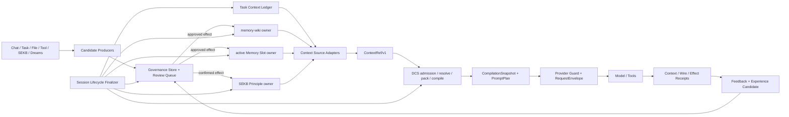
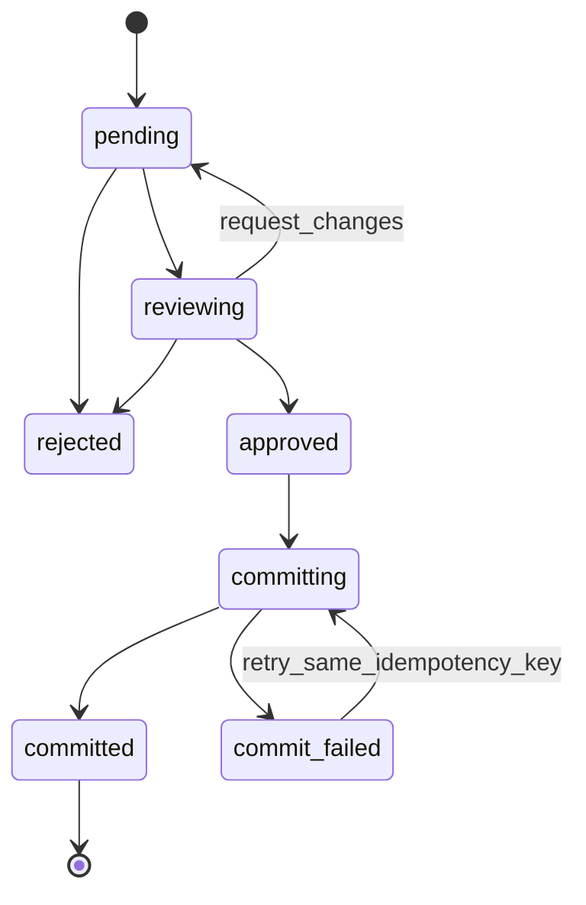

# Verse Claw 统一知识系统开发规划

> 文档状态：`development-reference`
>
> 日期：2026-08-18
>
> 工作树：`D:\verse_claw_worktree_knowledge`
>
> 分支：`codex/knowledge-system-unification-plan`
>
> 基线：`734ec877e75682861103660fbdea2bd55253ece0`
>
> 适用范围：Knowledge Hub、Chat 知识使用、Role/Runtime Memory、SEKB 经验总结、DCS Context、Session Lifecycle、治理与反馈证据。

> 执行入口：先运行 `harness/specs/tasks/knowledge-system-integrity-foundation.md`（KS-00），再按 KS-01、KS-02、KS-03 串行执行。本文是架构与验收总纲；具体实现卡以对应 Harness task spec 为准。

> 状态口径：文档中的“决策”表示架构已冻结，“WIP”表示工作树中有代码但未完成包级验收，“verified”只表示对应规格的全部门禁和证据已通过。三者不得混用。

---

> 实施状态（2026-08-18）：KS-00～KS-09 工程闭环完成并全部通过包级门禁。Task Forest proposal `TFP-knowledge-system-ks09-closeout-20260818` 已 apply + validate + export；TF-0070 milestone done(100%)，TF-0071..TF-0080 全部 done。六份可复跑表面报告档位仅 shadow/opt-in，E4 全部 not-evaluated、E5 全部 blocked，0 default-on/GA/productApproved 宣称。产品锁仍为 `liveReady=false`、`productApproved=false`、`defaultOn=false`；default-on/GA 仍是独立产品批准门槛。

## 0. 执行裁决

### 0.1 一句话目标

建立一条可验证的闭环：

```text
来源/会话/任务
  -> 候选
  -> 统一治理
  -> 唯一目标 owner 提交
  -> DCS 检索与编译
  -> Chat/Agent 使用
  -> 召回与结果证据
  -> 经验候选/修正/淘汰
```

当前工作不是继续添加知识、记忆或经验组件，而是统一它们的权威、生命周期、引用、写入、删除和反馈契约。

### 0.2 最终架构决策

1. 不新增知识数据库、向量数据库、sidecar 或第二套上下文服务。
2. 不建立“万能 KnowledgeEntity/ContextUnit”作为所有内容的 canonical 模型。
3. 原始内容继续由领域 owner 拥有；统一的是逻辑契约和控制流。
4. DCS 是唯一的本轮上下文 admission、resolve、pack、compile 和 lineage authority。
5. Provider Guard 是最终 RequestEnvelope authority；DCS 之后不得有未登记 prompt mutation。
6. memory 插件槽同时只能有一个 active writer。首个 active owner 选择 Role Memory。
7. Runtime Memory 保持 shadow/benchmark，不与 Role Memory 并行写入或注入。
8. SEKB 拥有经验候选、人工审核和已确认 Principle；DCS experience Block 是派生投影，不是第二真相源。
9. memory-wiki 继续是正式项目知识页面 owner；Knowledge Hub 只做治理与产品入口。
10. Dreams/memory-core、Chat 自动总结、文件 watcher 和 agent 只能产生候选，不能直接写正式 Wiki、Memory 或 SEKB Principle。
11. 普通 Chat 自动捕获、SEKB unattended writeback、Runtime Memory 默认注入继续关闭。
12. 所有 canonical owner durable 写入都是 effect，必须有幂等键、审批依据和 EffectReceipt。Candidate/Governance metadata 可以在策略允许下持久化，但只能写治理域，必须有 captureKey、审计事件和保留策略，不能冒充已批准 owner commit。

### 0.3 非目标

- 不在本计划中讨论联合系统 GA。
- 不通过翻转 default-on 证明能力可用。
- 不以合成 fixture、Agent Dev 绿灯或 deterministic golden path 替代真人证据。
- 不重写 memory-wiki、Role Memory、SEKB 或 BlockStore 的核心存储。
- 不让 renderer 直接访问 Gateway、SQLite 或 IPC 私有通道。
- 不让 DCS 变成长久内容 owner。

### 0.4 当前交付状态

本工作树已完成 KS-00～KS-07：KS-00～KS-03 基线/治理/经验写入/owner adapter，KS-04 Chat/DCS 单一消费路径，KS-05 经验闭环，KS-06 完整治理生命周期（方案 B 运行时权威收口），KS-07 Semantic Retrieval 与 Source Set。KS-07 已通过包级门禁，Task Forest close-out proposal 已保存并等待用户确认 apply；KS-08 不得在确认前启动。KS-07 验收证据见 `docs/dev/knowledge-system-unification/evidence/KS-07-SEMANTIC-RETRIEVAL-SOURCE-SET-ACCEPTANCE.md`，质量报告见 `docs/dev/knowledge-system-unification/quality/KS-07-SOURCE-SET-QUALITY.json`。

唯一开发入口如下：

```text
KS-00 基线与契约冻结
  -> KS-01 ReviewBundle 与 Governance Integrity
  -> KS-02 Experience Write Truth 与 Session Cascade
  -> KS-03 GovernanceStore 与 Owner Adapters
  -> KS-04 Chat/DCS 单一消费路径
  -> KS-05 经验闭环
  -> KS-06 完整治理生命周期
  -> KS-07 Semantic Retrieval 与 Source Set
  -> KS-08 UI/Observability 收敛
  -> KS-09 Canary、优化与毕业裁决
```

---

## 1. 当前基线与审计结论

### 1.1 当前物理系统

| 系统 | 当前存储/实现 | 当前职责 | 主要问题 |
|---|---|---|---|
| Knowledge Hub | `~/.openclaw/knowledge/**.json` + memory-wiki | Inbox、Draft、Proposal、Wiki 应用 | 多文件非事务、状态分裂、仅 create 可真正 apply |
| Role Memory | `role-memory.sqlite` / `openclaw_runtime/src/memory/**` | MemoryCard、治理、ContextPack | 与 Runtime Memory、多条注入路径语义重叠 |
| Runtime Memory | runtime-memory SQLite/provider | 事实、episode、混合检索、实验治理 | 默认关闭，不能成为并行 writer |
| SEKB | openclaw-state SQLite | trajectory、suggestion、Principle、人工确认 | confirm 后又投影 DCS，存在重复调用与写入状态失真 |
| DCS BlockStore | openclaw-state SQLite `context_blocks` | working/task/knowledge/experience 投影与检索 | 派生数据删除不完整，journal fallback 不可被查询 |
| Dreams/memory-core | 文件与 dreaming pipeline | 离线整理/梦境 | 尚未成为统一候选生产者 |
| Chat | 显式 Knowledge references + 多条 memory/prompt 路径 | 知识引用和上下文消费 | 引用不等于使用；部分来源可绕过统一 DCS 语义 |
| Session Lifecycle | transcript sweep + best-effort derivative cascade | 会话删除 | 真实 DCS experience、Memory adapter、失败状态不闭合 |

### 1.2 已确认缺陷

#### KS-F01：Draft/Proposal 错配可应用错误提案（P0）

`src/pages/Knowledge/index.tsx` 独立维护 `selectedDraftId` 与 `selectedProposalId`，两者又分别 fallback 到列表首项。`reviewAndApply` 审核选中的 Draft，却应用独立选中的 Proposal。

必须改为单一 `ReviewBundle` 选择，Host 在 apply 时再次验证 `proposal.draftId + contentDigest + expectedRevision`。

#### KS-F02：DCS journal fallback 冒充 written（P1）

`electron/services/knowledge-api.ts` 在真实 BlockStore sink 不可用时使用 JSON journal sink。journal 返回 `accepted: true`，但 `context_search` 无法消费该 journal，Host 仍可能报告 `dcsWrite=written`。

状态必须拆为：

```text
persisted
journaled_degraded
rejected
not_attempted
```

只有真实 BlockStore commit 并可读回时才允许 `persisted`。

#### KS-F03：SEKB confirm 存在重复 DCS upsert（P1）

`confirm_and_save` 异步调用一次 `handleConfirmAndSave`，严格 lineage 路径随后再次调用。必须收敛为一个 awaitable commit path，并以 Principle revision 派生幂等键。

#### KS-F04：Session delete 未清理真实 DCS experience（P1）

当前 Host cascade 清理 JSON journal、SEKB 和可选 Memory adapter，但不可靠枚举/删除 SQLite `context_blocks` 中的 experience 行。上层删除路径还会将 derivative 失败降为 warning。

目标语义：删除 operation 未完成时保持 retryable/incomplete，不报告完整成功。

#### KS-F05：Governance JSON 无原子性和并发控制（P1）

`writeJsonFile` 是直接覆盖；`captureKey` 去重是 list-then-write；Draft/Proposal 状态迁移跨多个文件。进程中断和并发请求均可能留下孤儿、重复或部分状态。

#### KS-F06：Watcher 设置与真实行为不一致（P1）

Watcher 只处理 `rename`，普通 `change` 不 ingest；`autoCompile` 总是 skipped；`requiresReview` 强制为 true；启动失败只写日志却可能向 UI 返回成功。

#### KS-F07：治理生命周期只闭合 create（P1）

Contract 声明 create/update/merge/archive/delete，但 memory-wiki apply 对非 create 一律拒绝。UI、Contract 和实现必须一致：要么实现，要么在完成前隐藏并明确 unsupported。

#### KS-F08：经验反馈不能证明采用（P2）

当前 provenance 多数只能证明引用被附加或候选被检索，不能证明模型实际读取、引用、采纳或改善任务结果。`record_adoption` 缺少真实生产调用闭环。

#### KS-F09：Source Set answer 不是语义综合（P2）

当前结果主要是 excerpt 拼接与固定 confidence，不能解决冲突、未知项或引用一致性，不应对用户描述成真正的 grounded synthesis。

### 1.3 验证基线

审计时已有结果：

- `pnpm contract:check`：通过。
- Knowledge/Chat 聚焦测试：50 通过、4 失败。
- 失败集中在 Semantic Steward dependency injection：`createKnowledgeApi()` 覆盖测试注入 invoker。
- Runtime SEKB/Memory 聚焦测试：42 通过。
- Session cascade/provenance/runtime build contract：13 通过，但没有覆盖真实 DCS BlockStore cleanup。
- 未运行完整 Electron E2E。

以下为 KS-00 时点的历史审计快照：审计时工作树中出现并发产生的未提交 Knowledge/SEKB/DCS/Session WIP，不能自动视为验收证据。KS-00 已通过差异复核确认其归属；KS-01～KS-03 随后按 spec 串行实现并完成独立验收，当前已不再是 WIP 状态。

---

## 2. 目标架构

### 2.1 总体拓扑



### 2.2 五个逻辑平面

| 平面 | 唯一职责 | 不允许承担 |
|---|---|---|
| 数据 owner 平面 | 保存 canonical payload 与 domain revision | 裁决本轮 prompt |
| 治理平面 | candidate、review、approve/reject、mutation proposal | 直接旁路写 owner |
| 上下文平面 | DCS 选择、冲突、预算、编译、lineage | 保存长期知识 |
| Effect 平面 | 审批、幂等执行、真实结果、补偿 | 仅靠 receipt 重放副作用 |
| 出口/证据平面 | Provider Guard、RequestEnvelope、Context/Wire/Effect receipt | 保存原始敏感 prompt |

### 2.3 权威矩阵

| 对象 | Canonical owner | 写入入口 | 读取/投影入口 |
|---|---|---|---|
| WikiPage | memory-wiki | approved Wiki mutation adapter | Wiki ContextSourceAdapter |
| GovernanceCandidate/Proposal | GovernanceStore | candidate producer / reviewer | Knowledge Hub read model |
| MemoryCard | active memory slot，初始为 Role Memory | approved Memory mutation adapter | Memory ContextSourceAdapter |
| ExperiencePrinciple | SEKB | confirm effect only | SEKB ContextSourceAdapter |
| Task Context | Task Context Ledger | task/user/tool versioned update | Ledger ContextSourceAdapter |
| Context Block | DCS BlockStore | ProjectionAdapter | DCS tools/assembler |
| CompilationSnapshot/PromptPlan | DCS | compile transaction | receipt/debugger |
| RequestEnvelope | Provider Guard | sealed provider adapter | wire receipt |
| EffectReceipt | existing effect boundary | domain executor | audit/feedback |
| Session identity/transcript | OpenClaw session authority | session runtime | source refs/archive |

关键约束：同一个逻辑对象只有一个 canonical owner。跨 owner promotion 创建带 lineage 的新对象，不做无来源复制。

---

## 3. 统一契约

### 3.1 不使用万能内容实体

WikiPage、MemoryCard、ExperiencePrinciple 和 Task Context 保持各自 domain schema。它们只在跨边界时投影为统一引用或治理命令。

必须冻结的七类 artifact：

1. `ContextRef`
2. `GovernanceProposal`
3. `CompilationSnapshot`
4. `PromptPlan`
5. `RequestEnvelope`
6. `CapabilityGrant`
7. `EffectReceipt`

### 3.2 ContextRef/v1

建议最小结构：

```ts
type ContextRefV1 = {
  schema: "ContextRef/v1";
  refId: string;
  owner: "memory-wiki" | "memory-slot" | "sekb" | "task-ledger" | "session" | "archive";
  subjectKind: "wiki-page" | "memory-card" | "experience-principle" | "task-context" | "transcript" | "artifact";
  subjectId: string;
  revision: string;
  contentDigest: string;
  scope: {
    workspaceId?: string;
    agentId?: string;
    roleTags?: string[];
    sessionKey?: string;
    taskId?: string;
  };
  trust: "untrusted" | "advisory" | "confirmed" | "high-trust";
  sensitivity: "public" | "workspace" | "sensitive" | "secret-adjacent" | "secret";
  retention: {
    policy: "source-coupled" | "promoted" | "ephemeral" | "legal-hold";
    expiresAt?: string;
  };
  acl: { read: string[] };
  provenance: {
    sourceRefs: string[];
    evidenceRefs: string[];
    derivedFrom?: string[];
  };
};
```

`ContextRef` 不保存完整正文。DCS 在权限、预算和信任检查后通过 owner adapter materialize 内容。

### 3.3 GovernanceProposal/v1

```ts
type GovernanceProposalV1 = {
  schema: "GovernanceProposal/v1";
  proposalId: string;
  reviewBundleId: string;
  candidateId: string;
  operation: "create" | "update" | "merge" | "archive" | "revoke" | "delete" | "restore";
  targetOwner: "memory-wiki" | "memory-slot" | "sekb";
  targetRef?: ContextRefV1;
  expectedRevision?: string;
  contentDigest: string;
  captureKey?: string;
  sourceRefs: string[];
  evidenceRefs: string[];
  scope: ContextRefV1["scope"];
  sensitivity: ContextRefV1["sensitivity"];
  retentionPolicy: ContextRefV1["retention"]["policy"];
  policyDecision: "allow" | "needs-review" | "reject";
  status: "pending" | "reviewing" | "approved" | "rejected" | "committing" | "committed" | "commit-failed";
  approval?: { actorId: string; decidedAt: string; reviewedDigest: string };
  idempotencyKey: string;
  createdAt: string;
  updatedAt: string;
};
```

约束：

- UI 只选择 `reviewBundleId`，不再独立选择 Draft 和 Proposal。
- apply 前重新读取 bundle，并校验 reviewed digest、target revision 和状态。
- stale revision 必须返回 conflict，不得覆盖。
- 相同 idempotencyKey + 相同 digest 返回 duplicate success；不同 digest 必须冲突失败。

### 3.4 Adapter 契约

```ts
interface ContextSourceAdapter {
  descriptor(): CapabilityDescriptor;
  search(query: RetrievalQuery): Promise<ContextRefV1[]>;
  materialize(ref: ContextRefV1, grant: CapabilityGrant): Promise<MaterializedContext>;
}

interface GovernedTargetAdapter {
  prepare(proposal: GovernanceProposalV1): Promise<MutationPlan>;
  commit(plan: MutationPlan, grant: CapabilityGrant): Promise<MutationResult>;
  compensate(receipt: EffectReceipt): Promise<CompensationResult>;
  enumerateBySource(sourceRef: string): Promise<ContextRefV1[]>;
}

interface ProjectionAdapter {
  rebuild(source: ContextRefV1): Promise<ProjectionResult>;
  invalidateBySource(source: ContextRefV1, reason: string): Promise<InvalidationResult>;
}
```

只有 memory-wiki、active memory slot 和 SEKB adapter 可以实现 GovernedTargetAdapter。Runtime Memory、Dreams、Chat、watcher 只能实现 candidate producer 或 read-only source adapter。

### 3.5 使用与反馈证据

系统必须区分：

| 阶段 | 能证明什么 | 不能证明什么 |
|---|---|---|
| retrieved | owner 返回了候选 | 候选进入了 prompt |
| selected | DCS 选择了引用 | provider 收到了内容 |
| delivered | RequestEnvelope 包含该 digest | 模型实际采用 |
| cited | 输出明确引用来源 | 引用一定改善结果 |
| adopted | 用户/agent 明确接受并产生关联 action | 因果改善 |
| outcome | 关联任务成功/失败 | 单条知识是唯一原因 |

这些记录复用现有 append-only receipt/journal，不新增 telemetry store，也不保存原始 prompt。

---

## 4. 生命周期

### 4.1 治理状态机



Canonical object 生命周期：

```text
active
  -> superseded
  -> archived
  -> revoked
  -> deleted/tombstoned
```

### 4.2 修正、合并和回滚

- correction 必须创建 update/supersede proposal，不直接改历史 revision。
- merge 必须保留全部 source refs 和被合并对象列表。
- archive 从普通检索中移除，但保留审计和显式读取。
- revoke 立即使所有 DCS projection 失效。
- restore 是新 proposal，不是数据库时间旅行。
- effect rollback 使用 compensation；不可恢复 effect 必须明确标记。

### 4.3 会话删除

删除顺序必须迁移为：

```text
1. 创建 generation-aware delete operation
2. fence 新 turn / capture / promotion
3. 每个 owner adapter enumerateBySource(session)
4. 删除或 revoke source-coupled candidate、proposal、memory、principle、projection
5. invalidate DCS context_blocks 与索引
6. 清理 transcript / trajectory / archive
7. 验证 residual count = 0
8. operation committed；否则 incomplete/retryable
```

默认隐私策略：来源会话删除时，所有 source-coupled 派生内容一并删除或 revoke。只有人工批准时显式选择 `promoted` 且内容已经脱敏，才允许在源会话删除后保留。

---

## 5. 端到端产品流程

### 5.1 Knowledge 治理

```text
Chat/Task/File/Manual
  -> create candidate(captureKey)
  -> Inbox pending
  -> Steward heuristic/semantic review
  -> one ReviewBundle
  -> user approve/reject/request changes
  -> approved effect to target owner
  -> EffectReceipt
  -> projection rebuild
  -> active knowledge visible
```

零写入约束：capture、triage、semantic review、preview、reject 均不得写 Wiki/Memory/Principle/DCS experience。

### 5.2 Chat 使用知识

```text
user message + optional pinned refs
  -> owner adapters search/resolve
  -> ContextRef candidates
  -> DCS admission/conflict/freshness/sensitivity/budget
  -> CompilationSnapshot
  -> PromptPlan
  -> Provider Guard
  -> RequestEnvelope
  -> Context/Wire Receipt
  -> answer with resolvable citations
```

Pinned reference 是高优先级请求，不是无条件旁路；权限、敏感性和失效状态仍可使其被拒绝，并必须向用户解释原因。

### 5.3 经验总结与复用

```text
task/session outcome
  -> redacted trajectory/evidence
  -> distillation suggestion
  -> duplicate/conflict check
  -> Inbox experience candidate
  -> human confirm/reject
  -> one SEKB Principle commit
  -> one DCS experience projection
  -> later DCS retrieval
  -> delivered/cited/adopted/outcome evidence
  -> effectiveness update or stale/revoke proposal
```

SEKB suggestion 不得直接写 BlockStore。confirm 只调用一次统一 commit coordinator。

### 5.4 Source Set answer

目标行为：

- 检索结果必须来自可解析 ContextRef。
- answer 每个关键结论带 source citation。
- 冲突来源必须作为 conflict set 展示，不静默择一。
- 证据不足时返回 unknowns，不生成固定虚假 confidence。
- synthesis 失败时退化为来源列表，不伪装成综合答案。

---

## 6. 现有组件归位

| 组件 | 目标角色 | 迁移动作 | 最终禁止 |
|---|---|---|---|
| Knowledge Inbox/Draft/Proposal JSON | GovernanceStore compatibility input | P0 原子化；P1 导入 existing openclaw-state SQLite | 多文件非事务状态 authority |
| memory-wiki | WikiPage owner | 保留，增加 governed mutation adapter | Chat/agent 直接 apply |
| Role Memory | active memory slot owner | 保留治理和 ContextPack；通过 adapter 接 DCS | role-spawn/memory pilot 绕过 DCS 的重复注入 |
| Runtime Memory | shadow/benchmark | 只读 shadow、离线质量评估 | 与 Role Memory 同时 persist/inject |
| SEKB Principle | ExperiencePrinciple owner | 保留 confirm/reject；写入统一 effect path | suggestion auto write、重复 DCS upsert |
| DCS experience Block | derived projection | 从 Principle rebuild/invalidate | 当 canonical Principle store |
| Dreams/memory-core | candidate producer | 输出带 evidence 的 Inbox candidate | 直接正式写回 |
| Working Memory Block | Task Ledger projection | 升级为版本化 Objective/Constraints/Facts/Decisions/Risks/NextAction | 当全局长期记忆 |
| VToken | stateless packer/benchmark | 接收统一 budget/refs | durable memory owner |
| CVK/Context Runtime Kit | capability/navigation projection | semantic contribution 登记入 DCS/Provider Guard | 隐藏 prompt mutation |
| Chat Knowledge chips | pinned ContextRef UI | 经 Host API 和 DCS | 原始字符串注入或写权限 |
| DCS journal fallback | degraded recovery evidence | 明确 journaled_degraded；提供重放工具或退役 | 报告 persisted/written |

---

## 7. 能力优化设计

### 7.1 相关性与质量

1. 统一 query context：task objective、active files、role、workspace、recent errors、explicit refs。
2. 分层检索：exact id/path -> lexical -> semantic -> conflict rerank。
3. freshness、scope、trust、sensitivity 在 DCS resolve 阶段统一裁决。
4. 冲突不覆盖：同时保留 competing refs，标记 confirmed/inferred/stale。
5. citations 必须可回到 owner revision；source 删除后 citation 明确失效。
6. feedback 只从真实 cited/adopted/outcome 更新，不用 retrieval_count 代替 adoption。

### 7.2 成本和延迟

1. 先 admission，再调用语义模型或 Runtime Memory。
2. Fast Path 处理短约束、ID、路径、结构化 tool result，不支付 Mem 成本。
3. Mem Path 只处理长文本、冲突、经验抽取和接近预算上限的语义压缩。
4. Provider queries 可并发，但 DCS merge/compile 只能一次。
5. cache key 必须包含 owner revision、policy epoch、Task Ledger revision 和 model profile。
6. provider 超时隔离，单个 Memory/Knowledge provider 失败不能阻断 turn。
7. 替换字符前缀截断，使用 unit-aware packer；critical constraint/evidence 不可被截断半段。

初始工程预算：

- Fast Path DCS 编译 p95 增量不高于 `max(50ms, 基线 turn-preparation 的 10%)`。
- 本地 owner adapter query p95 不高于 100ms；超时必须返回诊断并降级。
- Semantic Path 单独记录 latency/cost，不计入 Fast Path 毕业。
- 所有超预算 drop/truncate 必须有 receipt reason。

### 7.3 安全与污染防护

- 所有来源先赋 trust 和 sensitivity，再进入检索/索引。
- Chat、网页、文件、工具输出默认 untrusted，不得提升为 constraint/system instruction。
- secret/secret-adjacent 默认不进入长期记忆和 receipt。
- agent 不能通过 candidate metadata 提升 ACL、scope 或 retention。
- 广域 scope、constraint、decision、procedure、delete/merge 必须人工 review。
- 任何 prompt injection 检测只改变 admission/trust，不改写原始证据。

### 7.4 用户体验

Knowledge 页面收敛为三个业务视图：

1. `待处理`：所有 Knowledge/Memory/Experience candidate 的统一 Review Queue。
2. `知识库`：Wiki、Memory、Principle 的聚合只读投影与 owner 标识。
3. `历史`：审批、提交、修正、撤销、删除和 effect receipt。

不再单独提供相互割裂的 Runtime Lessons、Draft、Proposal 选择逻辑。类型和目标 owner 通过筛选器呈现，仍由一个 ReviewBundle 完成操作。

Chat 需要提供：

- 可搜索、可固定、可移除的知识引用。
- `为什么包含/为什么省略`。
- 来源 owner、revision、状态和引用。
- 写入候选入口，但不提供直接 apply。

### 7.5 可观测性

每一轮最少关联：

```text
requestId
runId
sessionKey
attemptIndex/modelCallIndex
taskId
proposalId/effectReceiptId
ContextRef ids
PromptPlan digest
RequestEnvelope digest
latency/token/cost
outcome
```

观测只存 digest/ref/reason/count，不默认保存正文。

---

## 8. 严格串行开发路线

### 8.1 依赖图


任何时刻只允许一个 work package 为 in_progress。后续包不得为前序包补测试而提前写生产代码。

### 8.2 工作包总览

| ID | 目标 | 估算 | 主要出口 |
|---|---|---:|---|
| KS-00 | 基线、authority、schema、状态源冻结 | 1–2 天 | 可执行 task specs、无权威冲突 |
| KS-01 | 修复 ReviewBundle、JSON 原子性和 CAS | 3–5 天 | 错配/并发/孤儿状态为 0 |
| KS-02 | 修复 SEKB/DCS 真写入与删除闭环 | 4–6 天 | 假成功/重复写/删除残留为 0 |
| KS-03 | GovernanceStore 和三类 owner adapter | 5–8 天 | 单写入 authority、兼容迁移 |
| KS-04 | Chat 知识统一经过 DCS/Provider Guard | 5–8 天 | pinned/auto retrieval 单一路径 |
| KS-05 | 捕获、人工确认、后续召回与反馈 | 6–10 天 | 一条真实可复用经验闭环 |
| KS-06 | update/merge/archive/revoke/delete/restore | 5–8 天 | 生命周期全操作闭合 |
| KS-07 | 语义检索、冲突、引用和 Source Set | 5–9 天 | grounded synthesis 与质量报告 |
| KS-08 | Knowledge UI、Chat UX、运行状态与审计 | 5–9 天 | 用户路径 E2E、无假开关 |
| KS-09 | 成本优化、real corpus、A/B、soak | 2–4 周+ | 分表面毕业裁决，不自动 GA |

---

## 9. Work Package 详细规格

### KS-00：基线与契约冻结

目标：在实现前消除文档、Task Forest、代码和 dirty WIP 的冲突。

必须完成：

- 对比 `D:\ClawX` dirty 工作区与本分支，列出需要移植/舍弃的知识相关 WIP。
- 解决 runtime-convergence `README.md`、`STATUS.md`、Task Forest 对 done/pending/blocked 的冲突。
- 更新上下文 authority ADR，明确本计划的 owner matrix。
- 冻结 ContextRef、GovernanceProposal、adapter role、receipt phase、session deletion policy。
- 为 KS-01、KS-02、KS-03 各建立独立 Harness task spec。

执行规格：`harness/specs/tasks/knowledge-system-integrity-foundation.md`。KS-00 是文档、状态和边界冻结包，不在共享 dirty diff 上运行 diff-aware 验收；先用 `--no-diff` 做结构校验，包级实现从 KS-01 开始。

出口：

- 单一 authority 文档无冲突。
- 无新增 DB/sidecar/provider authority。
- Task Forest 仅一个 ready 节点。
- `pnpm harness validate --spec <KS-01 spec>` 通过。

### KS-01：ReviewBundle 与 Governance Integrity

执行规格：`harness/specs/tasks/knowledge-system-ks01-review-bundle-integrity.md`。本包只处理治理审核一致性和 file-backed JSON 完整性；不得把 KS-02/KS-03 的 WIP 顺手算入本包完成度。

主要路径：

- `shared/host-api/contract.ts`
- `src/lib/host-api.ts`
- `electron/services/knowledge-api.ts`
- `src/pages/Knowledge/index.tsx`
- `tests/unit/knowledge-api.test.ts`
- `tests/unit/knowledge-page.test.tsx`
- `tests/unit/host-api-facade.test.ts`
- `tests/e2e/knowledge-hub.spec.ts`

实现要求：

1. 新增 ReviewBundle read model，Draft/Proposal 关系由 Host 返回。
2. UI 只维护 selectedReviewBundleId。
3. apply 校验 draftId、proposalId、reviewedDigest、expectedRevision、workspace 和状态。
4. Governance JSON 使用同目录 temp file + fsync/close + atomic rename。
5. 增加进程锁或单 writer queue；每个对象带 revision。
6. captureKey 去重必须在同一临界区内完成。
7. multi-file transition 使用 operation journal；失败可重试或回滚。
8. 修复 Semantic Steward invoker dependency injection。

硬验收：

- 10 个 Draft/Proposal 交叉排列不会错配。
- stale approval 100% conflict-fail。
- 并发相同 captureKey 只产生一个 candidate。
- 任意写入点 crash 后不存在 applied proposal + unapproved draft。
- Semantic Steward 10/10 通过。

回滚：保留旧 API 的 read compatibility；新 mutation path 可通过 flag 关闭，但不能恢复错配 apply。

### KS-02：Experience Write Truth 与 Session Cascade

执行规格：`harness/specs/tasks/knowledge-system-ks02-experience-session-truth.md`。本包必须以真实 BlockStore read-back 和可重试删除证据为准，不能只凭 sink 返回值宣称 persisted。

主要路径：

- `electron/services/knowledge-api.ts`
- `electron/services/session-cascade-delete.ts`
- `electron/services/sessions-api.ts`
- `openclaw_runtime/src/knowledge/sekb/distillation-tool.ts`
- `openclaw_runtime/src/knowledge/sekb/experience-block-bridge.ts`
- `openclaw_runtime/src/context-engine/block-store.ts`
- `openclaw_runtime/src/knowledge/sekb/session-cascade-delete.ts`

实现要求：

1. confirm coordinator 只执行一次 Principle commit 和一次 projection commit。
2. idempotencyKey = stable principle id + revision + projection schema。
3. BlockStore sink commit 后按 block_id read-back 或 query 验证。
4. journal sink 返回 journaled_degraded；UI 不显示已进入 DCS。
5. BlockStore 增加按 session/source ref 枚举与 invalidate/delete 的 owner API。
6. Session finalizer 在 transcript mutation 前协调 derivative cleanup。
7. cascade failure 返回 incomplete/retryable，并保留 operation journal。
8. permanent delete、archive empty、normal delete 统一调用同一 finalizer。

硬验收：

- confirm 并发/重试只产生一个 Principle revision 和一个 experience projection。
- BlockStore 不可用时 persisted 计数为 0。
- 删除后 Principle、trajectory、MemoryCard、context_blocks、journal、archive residual 为 0。
- 使用同一 session key 新建会话不会召回旧 experience。
- 未确认 suggestion durable write 为 0。

回滚：关闭 projection adapter并保留 Principle；派生 DCS Block 可重建，不回滚 canonical Principle。

### KS-03：GovernanceStore 与 Owner Adapters

执行规格：`harness/specs/tasks/knowledge-system-ks03-governance-store-adapters.md`。迁移完成前 JSON 只能作为兼容读取源；不得通过双写掩盖 parity 或 owner 注册问题。

目标：把 JSON 治理 metadata 迁入已有 openclaw-state SQLite，并建立统一适配器。

主要路径：

- `shared/knowledge/**`
- `shared/host-api/contract.ts`
- `openclaw_runtime/src/state/openclaw-state-schema.sql`
- `openclaw_runtime/src/state/openclaw-state-db.ts`
- `electron/services/knowledge-api.ts`
- `openclaw_runtime/src/memory/**`
- `openclaw_runtime/src/knowledge/sekb/**`
- `openclaw_runtime/src/context-engine/**`

数据表建议复用 existing state DB：

```text
knowledge_candidates
knowledge_governance_proposals
knowledge_governance_events
knowledge_owner_links
```

约束：

- 不复制 Wiki/Memory/Principle 正文到 GovernanceStore；只存 candidate body、proposal、refs、digest 和状态。
- 导入 JSON 时保留原 ID、captureKey、timestamps 和 source refs。
- 导入是单次 transaction；生成 parity report。
- 切换后旧 JSON 只读，禁止长期 dual-write。
- 注册 Wiki、Role Memory、SEKB 三类 adapter。
- 启动/热重载拒绝第二 active memory writer。

出口：

- 导入 count/digest parity 100%。
- JSON writer 为 0，compat read 有明确移除日期。
- adapter contract tests 全绿。
- Runtime Memory persist/inject 仍关闭。

### KS-04：Chat/DCS 单一消费路径

主要路径：

- `shared/chat/types.ts`
- `src/pages/Chat/**`
- `src/stores/chat/**`
- `electron/services/chat-api.ts`
- `openclaw_runtime/src/context-engine/context-orchestrator.ts`
- `openclaw_runtime/src/context-engine/context-candidate.ts`
- Provider Guard / transport paths

实现要求：

- Chat reference payload 只携带 typed ref，不携带可信正文。
- Host 将 refs 转为 untrusted read-only retrieval intent。
- owner adapters 解析 refs，DCS 统一 admission/resolve/pack。
- role-spawn、memory pilot、COMPASS direct prompt addition 迁移为 PromptContribution 或 declared transform。
- pinned refs 被拒绝时产生可见 reason。
- ContextReceipt 与 WireReceipt 能证明 selected/delivered。

出口：

- 黄金 Chat turn 未登记 semantic mutation = 0。
- pinned active ref delivery = 100%。
- revoked/ACL denied/stale ref delivery = 0，且有 reason。
- renderer direct IPC/Gateway fetch = 0。
- comms replay/compare 通过。

### KS-05：经验闭环

实现范围：

- task/session outcome 生成 redacted trajectory。
- deterministic gate 先筛选 reusability、uniqueness、confidence、temporality。
- semantic distillation 只在候选通过门控后运行。
- duplicate/conflict 检测在 review 前完成。
- confirm/reject 保持人工显式操作。
- 后续 Chat 通过 DCS 召回 confirmed active Principle。
- cited/adopted/outcome 触发 effectiveness event。
- stale/high-dismissal 自动提出 review proposal，不自动 revoke。

出口 E2E：

```text
失败任务
  -> experience candidate
  -> user confirm
  -> next fresh session receives Principle
  -> answer cites Principle
  -> task outcome recorded
  -> effectiveness updated
  -> session delete/revoke prevents later recall
```

未确认写入、自动 Principle writeback、无证据 adoption 均为 0。

### KS-06：完整治理生命周期

实现 create/update/merge/archive/revoke/delete/restore 的 owner-specific mutation plan。

当前状态：KS-06 已实现并通过包级门禁（方案 B runtime authority close）。`GovernanceLifecycleCoordinator` 提供幂等 commit、EffectReceipt、compensation；UI 仅保留未支持 operation 的隐藏门禁。

残余与 KS-08 carry-over：memory-wiki 的 `wiki.*` 生命周期 Main RPC 写入口尚未接入；Knowledge lifecycle UI 及每种 operation 的 Electron E2E 尚未实现。两项均不得被写成 KS-06 全绿证据。

每种 operation 必须具备：

- preview/diff
- policy decision
- user confirmation
- expectedRevision
- idempotency
- EffectReceipt
- projection invalidation/rebuild
- compensation/不可恢复说明
- E2E

在实现前，UI 不得显示未支持 operation。

### KS-07：Semantic Retrieval 与 Source Set

实现：

- exact/lexical/semantic hybrid retrieval。
- query task context 和 role/scope shaping。
- conflict set 和 freshness rerank。
- citation-resolvable synthesis。
- unknowns 和 suggested next actions。
- grounded/partial/missing_sources 由证据规则计算，不使用固定 confidence。
- Runtime Memory 仅 shadow 比较，不参与 active answer。

质量报告至少包含：Recall@5、Precision@5、citation validity、stale inclusion、conflict disclosure、latency、token cost、human usefulness。

当前状态（2026-08-18）：KS-07 已实现并验收，其 Task Forest proposal 已 apply。SourceSet 用户可见性需求已由 KS-08 关闭：Knowledge 页面经 host-api 显示 grounded/partial/missing_sources、sources、unknowns 与 next actions。

### KS-08：UI 与 Observability 收敛

实现统一 Knowledge 三视图、ReviewBundle 操作、Chat why-included、runtime status、degraded write、delete residual、receipt history。

当前状态（2026-08-18）：KS-08 已实现并验收，其 Task Forest proposal 已 apply。KS-09 已按表面关闭工程闭环报告：六份表面报告均可复跑，明确档位与 E1-E5 证据等级；真实 provider/user task/soak/product approval 仍为独立产品批准门槛。

### KS-09：Canary、优化与毕业

当前状态（2026-08-18）：KS-09 已实现并验收，close-out proposal 已 apply + validate + export。六份表面报告位于 `docs/dev/knowledge-system-unification/surface-reports/`，由 `openclaw_runtime/scripts/knowledge-surface-reports.mts --include-e2e` 可复跑生成。档位：explicit/pinned=opt-in、automatic=opt-in、Role Memory=shadow、SEKB=opt-in、semantic SourceSet=shadow、post-task capture=shadow。E4 全部 not-evaluated，E5 全部 blocked；报告不含任何 default-on/GA/productApproved 结论。

按表面分别评估：

1. explicit/pinned Knowledge refs
2. automatic Knowledge retrieval
3. Role Memory retrieval
4. SEKB experience retrieval
5. semantic Source Set synthesis
6. post-task candidate capture

每个表面独立执行：shadow -> opt-in -> canary -> soak -> product approval -> consider-default-on。任何一个通过都不能推出联合系统 GA。

---

## 10. 迁移与退役方案

### 10.1 通用四步

```text
observe legacy
  -> target read-only projection
  -> cut one writer with idempotency/rollback proof
  -> freeze/remove legacy writer after compatibility window
```

禁止 indefinite dual-write。

### 10.2 Governance JSON

1. P0 增加 atomic/CAS，先止血。
2. 导出 manifest：id、revision、digest、captureKey、source refs。
3. 单 transaction 导入 existing openclaw-state SQLite。
4. parity report 通过后切换 read。
5. 切换 writer，JSON 变只读 compatibility。
6. 一个 release window 后移除 JSON mutation code。

### 10.3 Role Memory / Runtime Memory

- Role Memory 是首个 active slot。
- Runtime Memory 只运行 shadow query/eval，结果不能进入 prompt。
- 未来替换 slot 必须：shadow parity -> export/import -> single writer cutover -> old writer freeze。
- 不允许两者同时 persist。

### 10.4 SEKB / DCS experience

- Principle 是 canonical；experience Block 是 rebuildable projection。
- 补全 source Principle ref/revision/digest。
- 扫描并 invalidate orphan/duplicate Blocks。
- 删除 detached JSON journal 或提供显式 replay 后再退役。

### 10.5 旧注入路径

- 先 census direct prompt mutation。
- 迁移为 ContextRef/PromptContribution。
- Provider Guard observational 验证 byte parity。
- 黄金路径未登记旁路为 0 后切断 legacy。
- 保留 kill switch，但 kill switch 不得恢复多 writer authority。

---

## 11. 质量门禁

### 11.1 硬正确性

| 指标 | 门槛 |
|---|---:|
| Draft/Proposal 错配 | 0 |
| stale CAS 被接受 | 0 |
| 相同 effect 重复执行 | 0 |
| 未确认 durable write | 0 |
| journal 冒充 persisted | 0 |
| active memory writers | 1 |
| Chat/DCS 后隐藏 semantic mutation | 0（黄金路径） |
| session delete residual | 0 |
| renderer direct IPC/Gateway HTTP | 0 |
| citation 无法解析 owner revision | 0 |

### 11.2 检索与行为

- explicit pinned ref 正确解析率 100%。
- active/allowed pinned ref selected/delivered 100%。
- revoked/deleted/denied ref delivered 0%。
- critical constraints 保留率 100%。
- conflict disclosure 100%（评测集已标注冲突时）。
- automatic retrieval 必须先建立 corpus baseline；不得凭 fixture 自定毕业。
- Runtime Memory 至少继续满足现有 maturity/Recall 门槛后，才可提出 slot 替换评审。

### 11.3 证据等级

| 等级 | 证据 | 可支持结论 |
|---|---|---|
| E1 | 单元/contract | schema 和纯逻辑 |
| E2 | 集成/真实 SQLite | owner、事务、删除 |
| E3 | Electron E2E | 产品路径 |
| E4 | real provider/user task | 行为价值 |
| E5 | soak + product approval | 分表面默认毕业讨论 |

E1–E3 不得外推 E4/E5。

---

## 12. 测试与验证命令

每个工作包先运行：

```powershell
pnpm harness context --spec harness/specs/tasks/<active-spec>.md
pnpm harness validate --spec harness/specs/tasks/<active-spec>.md
```

基础门禁：

```powershell
pnpm contract:check
pnpm run typecheck
pnpm run lint
pnpm test
```

Knowledge 聚焦：

```powershell
pnpm exec vitest run tests/unit/knowledge-api.test.ts tests/unit/knowledge-page.test.tsx tests/unit/knowledge-steward-semantic-pass.test.ts tests/unit/host-api-facade.test.ts
```

Runtime 聚焦：

```powershell
pnpm --dir openclaw_runtime exec vitest run src/knowledge/sekb/experience-block-bridge.test.ts src/knowledge/sekb/sekb.test.ts src/context-engine/block-store.test.ts src/context-engine/context-orchestrator.test.ts
```

会话生命周期：

```powershell
pnpm exec vitest run tests/unit/session-cascade-delete.test.ts tests/unit/session-delete-cascade-integration.test.ts
```

通信路径变更：

```powershell
pnpm run comms:replay
pnpm run comms:compare
```

Windows Electron E2E：

```powershell
pnpm run build:vite
pnpm run test:e2e tests/e2e/knowledge-hub.spec.ts
pnpm run test:e2e tests/e2e/knowledge-ks04-chat-dcs.spec.ts
pnpm run test:e2e tests/e2e/sekb-golden-path.spec.ts
```

具体测试文件不存在时，当前工作包负责先建立 RED test，不得静默跳过。

---

## 13. 首个开发 Sprint（已完成）

首个 Sprint 已按 KS-00 → KS-01 → KS-02 → KS-03 串行完成并验收；后续 Sprint 入口为 KS-04（待用户确认）。

### Sprint 入口

1. 用户确认并应用 Task Forest proposal，只有 KS-00 ready；在确认前只保存 proposal，不直接改 canonical graph。
2. 运行 KS-00 authority/status audit。
3. 为 KS-01 建 Harness spec 并通过 context/validate。

### Sprint 交付 1：KS-01

- ReviewBundle contract。
- UI 单选择。
- Host apply invariant。
- atomic JSON/CAS/captureKey。
- Semantic Steward DI 修复。
- 聚焦 unit + Electron E2E。

### Sprint 交付 2：KS-02

- one confirm coordinator。
- truthful DCS write status。
- real BlockStore cleanup。
- delete operation incomplete/retryable。
- restart/idempotency/cascade tests。

### Sprint Exit

- KS-F01–KS-F05 关闭。
- 所有 P0/P1 correctness tests 通过。
- 没有新增 default-on、auto capture、auto writeback。
- task forest、handoff、docs、evidence 同步。

---

## 14. Task Forest 归属

本计划不是新的 global task。推荐挂载：

```text
TF-0010 OpenClaw Runtime Authority 与 Operator 收敛
  -> 统一知识系统生命周期（新增 milestone，不是 global task）
     -> KS-00 基线与契约冻结
     -> KS-01 ReviewBundle 与 Governance Integrity
     -> KS-02 Experience Write Truth 与 Session Cascade
     -> KS-03 GovernanceStore 与 Owner Adapters
     -> KS-04 Chat/DCS 单一消费路径
     -> KS-05 经验闭环
     -> KS-06 完整治理生命周期
     -> KS-07 Semantic Retrieval 与 Source Set
     -> KS-08 UI/Observability
     -> KS-09 Canary 与毕业

统一知识系统生命周期 --contributes_to--> TF-0038 RC-07 Memory 与 Context 插件槽收敛
```

`TF-0026 Knowledge Library 与 Review Queue` 只作为 KS-08 的 `contributes_to` UI 归属，不再建立平行知识 authority。

新增 milestone 只承担计划分组和串行状态，不拥有代码、存储或运行时 authority。它直接挂在 `TF-0010` 下，避免被 `TF-0038` 的历史依赖 `TF-0031/TF-0037` 错误阻塞；与 `TF-0038` 只建立 `contributes_to` 跨边。KS-00～KS-09 各自保持一个 `child_of` 主父边，并按顺序建立 `depends_on`；任何时刻只把首个未完成节点置为 ready。

Task Forest 提案 `TFP-knowledge-system-unification-20260817`、`TFP-2e92914863`、`TFP-bbe2e21477`、`TFP-88df65a6ed`、`TFP-503710a9d8`、`TFP-c250f2cbab`、`TFP-knowledge-system-ks07-closeout-20260818`、`TFP-knowledge-system-ks08-closeout-20260818`、`TFP-knowledge-system-ks09-closeout-20260818` 已经用户确认并由 CLI 应用。canonical graph 现状：TF-0070 milestone done(100%)，TF-0071..TF-0080 全部 done(100%)。runtime-convergence `STATUS.md` 的 done/accepted 状态与 Task Forest 已一致。

---

## 15. 开发者执行协议

每个工作包必须：

1. 读取本文件、AGENTS.md、Sustained Development Playbook、LATEST handoff。
2. 读取 active Harness task spec，并运行 `pnpm harness context`。
3. 先写失败测试，再改实现。
4. 保持 renderer -> host-api -> Main/runtime 边界。
5. 任何用户可见 UI 改动同步 en/zh/ja/ru 和 Electron E2E。
6. 任何 communication path 改动运行 comms replay/compare。
7. 任何行为/架构改动检查三份 README 文档同步。
8. 每个工作包独立提交；不混入其他脏工作区改动。
9. 完成后更新 task forest、证据、handoff；下一节点经确认后才 ready。

遇到以下情况必须停止并升级：

- 需要新增 DB、sidecar、memory writer 或 context authority。
- 需要开启 ordinary Chat auto-capture、SEKB auto-writeback 或 Runtime Memory default injection。
- 无法证明 canonical owner 或 idempotency。
- 会话删除只能 best-effort 却要向用户报告成功。
- 实现需要长期 dual-write。
- 测试只能依赖 synthetic 证据却要提出生产毕业。

---

## 16. Definition of Done

统一知识系统的工程闭环完成，至少需要：

1. Governance candidate、review、commit、correction、revoke、delete 全生命周期可执行。
2. Wiki、Memory、SEKB 每种 canonical object 只有一个 writer。
3. 所有 Chat/Agent 知识使用统一经过 DCS 和 Provider Guard。
4. Context/Wire/Effect receipt 能解释来源、选择、交付和真实写入。
5. 经验候选人工确认后能在后续新会话召回，并有引用/采用/结果证据。
6. 会话删除可验证清除所有 source-coupled 派生内容。
7. fallback/degraded 状态对用户诚实可见。
8. 无未确认写入、重复 effect、错误 apply、隐藏 prompt mutation。
9. 单元、集成、Electron E2E、comms、typecheck、lint、Harness 全绿。
10. real corpus、真人 A/B、soak、产品批准仍作为 default-on 的独立后置门槛。

完成 1–9 只表示“统一知识系统工程可用”；未满足第 10 条时，仍不得宣称默认生产或联合系统 GA。
