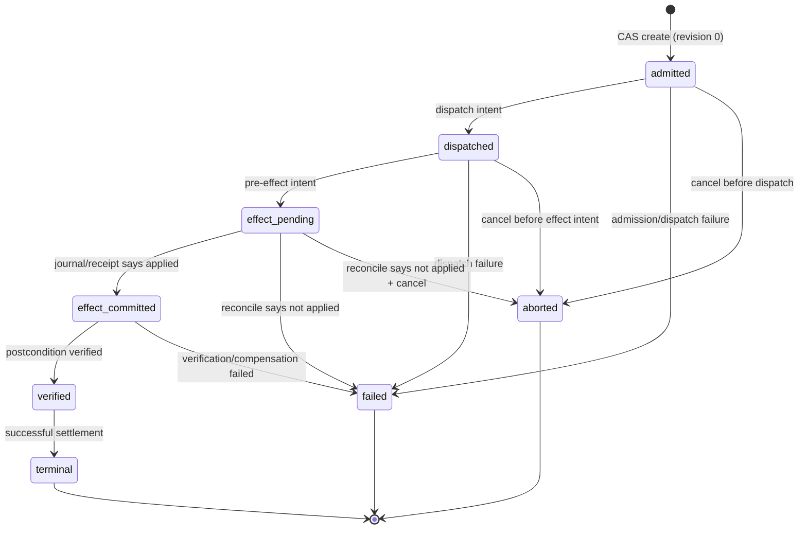

# 执行 Phase 状态机与统一收口层（TF-0717 实现前研究）

> 2026-11-05更新：单一TaskFlow row/CAS、旧表迁移、writer conjunction、持久化意图及phase-aware quarantine已接线。当前源码与实测见 [最终报告](FINAL-20261105.zh-CN.md)。§1–4保留最初研究基线与冻结契约；其中“当时无phase”的描述不代表当前实现。

> 状态：draft（实现前研究，不是生产实现）
>
> driven_by: agent
>
> actor: execution-phase-agent
>
> 日期：2026-11-04
>
> 范围：只定义纯契约、状态机、CAS 提交点、kill 窗口和验收门槛。不修改生产路径，不翻转 writer 默认值，不新增第二真相。

## 0. 结论摘要

### 0.1 我对诊断的认可度

| 结论 | 认可度 | 判断 |
|---|---:|---|
| 现有代码已有“coarse lifecycle + CAS”，但不存在持久化的执行 phase | 0.95 | `flow_runs` 只有 queued/running/waiting/blocked/succeeded/failed/cancelled/lost 八种 status；Task Loop 明确不为 phase-only 变化写 TaskFlow。 |
| 现有 EffectReceipt 只能做事后关联，不能承担 effect intent / replay 授权 | 0.95 | 源码头注释直接写明“explains and correlates domain-journal outcomes; it never authorizes replay”；apply_patch 只在 batch 结束后写 receipt，且 fail-open。 |
| 现有 checkpoint 是可覆盖的恢复材料，不是有序执行日志 | 0.95 | `recordLongTaskCheckpoint` 按 idempotency key upsert，`checkpoint_json` 会被更新；读取是 latest，不是按 sequence replay。 |
| 现有启动恢复会把“上一 boot 的非终态 flow”直接结算为 lost，但不会按 phase/effect 不确定性分流 | 0.90 | `settleOrphanedWorkflowLifecycles` 只检查 `isLive` 和 status；`effect_pending` 在真实应用中并没有持久化表示。 |
| “以 TaskFlow 同一行同时承载 status + execution_phase，domain journal 作为 effect truth”的统一收口层方向 | 0.88 | 与 TARGET-ARCHITECTURE 的 owner 矩阵一致；但必须补 pre-effect intent、phase-aware CAS、effect reconciler 和 kill 测试，不能只靠一个纯模块。 |
| 当前代码已经具备“执行恢复保证” | 0.05 | 事件日志 replay 明确未实现（返回 `event_log_replay_not_implemented`），checkpoint rollback 只恢复文件 journal，不恢复 runtime/external effects；phase 也尚未持久化。 |

这里的“认可度”是对该判断的证据置信度，不是对某个外部产品理念的背书。理念相似不等于代码已实现；代码有表/有类型也不等于恢复保证成立。

### 0.2 一句话收口

**一个 lifecycle row（TaskFlow `flow_runs`）拥有 status + execution_phase + revision；domain journal/EffectReceipt 拥有 effect 事实；`long_task_checkpoints` 只拥有 checkpoint 材料；RuntimeTaskEventLog 只是默认关闭的诊断证据；`shared/recovery-contract/execution-phase.ts` 只是所有消费者共享的纯决策表，不是 store、不是 writer、不是第二真相。**

## 1. 真实源码事实与短板

以下判断来自当前工作树的源码阅读，不是从文件名推断。

### 1.1 TaskFlow lifecycle 已有 CAS，但只有 coarse status

`openclaw_runtime/src/tasks/task-flow-cas.ts:28-104` 定义 `FLOW_STATUSES` 和显式合法转换图；`TaskFlowCasStore.casUpsert()` 在 `:154-282` 用 `WHERE flow_id = ? AND revision = ?` 做 SQL-level expected-revision CAS，并在同一 immediate transaction 内检查 controller ownership 和 status transition。

但 status 是粗粒度生命周期，不是执行阶段：

- `openclaw_runtime/src/tasks/workflow-lifecycle-owner.ts:101-157` 的提交输入只有 `status`、可选 `currentStep`、可选 `stateJson`；没有 first-class phase，也没有 effect intent。
- `commitWorkflowLifecycle` 在相同 status 且没有 `currentStep`/`stateJson` 时会直接返回 `unchanged`，不写 revision；这不是 phase 状态机。
- `task-flow-cas.ts:60-98` 的转换图包含 `queued -> succeeded`、`running -> waiting`、同状态幂等等 legacy 兼容边，不能直接当作 effect 边界状态机使用。

### 1.2 Task Loop 明确只提交“状态变化”，不提交“phase 变化”

`openclaw_runtime/src/agents/task-loop-controller.ts:480-509`：

- 注释直接写明 `phase-only changes do not write TaskFlow`。
- `committedTaskLoopFlowStatus` 只缓存最后提交的 flow status；`commitTaskLoopLifecycle()` 在 `committedTaskLoopFlowStatus.get(record) === flowStatus` 时直接 return。
- 因此 `execute -> collect_evidence -> self_check` 这些 phase 变化，只要 status 仍是 `running`，就不会产生任何 TaskFlow 写。

`task-loop-taskflow-projection.ts:40-99` 也只把 `running/complete/blocked/error/cancelled` 映射为 FlowStatus；`currentStep` 只是随状态提交顺带写入的字符串。结果是：重启后最多知道“还在 running”，不知道是 `dispatched`、`effect_pending` 还是 `effect_committed`，无法判断是否允许重跑。

### 1.3 EffectReceipt 是事后关联记录，不是 pre-effect intent

`openclaw_runtime/src/agents/effect-receipt.ts:1-13` 的模块头注释：

- “explains and correlates domain-journal outcomes; it never authorizes replay”
- “Domain journals remain the effect/idempotency truth.”
- 同一 idempotency key 相同内容是 duplicate，不同内容是 conflict；store 是 append-only。

`effect-receipt.ts:58-76` 的 outcome 是 `applied | not_applied | unknown | reconciled`。`apply-patch-effect-receipt.ts:85-105` 只在 batch 已进入 `committed` / `rolled_back` / `recovery_required` 后才决定 outcome；`:219-245` 的 `recordApplyPatchEffectReceipt` 明确 fail-open，且是 batch 执行完成后的记录。

关键缺口是：**没有一个在 effect 执行之前持久化的 `effect_pending` intent。** 如果进程在 effect 已发生、receipt 尚未写入之间被 kill，现有 receipt 表里没有记录；如果 receipt 写了 `unknown`，也没有通用 reconciler 能自动判断 effect 是否真的发生。

### 1.4 checkpoint 是可覆盖的恢复快照，不是有序事件日志

`openclaw_runtime/src/agents/long-task-control/store.ts:450-546`：

- `recordLongTaskCheckpoint` 用 `idempotency_key`（或 id）执行 `onConflict ... doUpdateSet`。
- `checkpoint_json` 在同一个 key 下会被更新，不是 append-only。
- `:829-860` 读取的是 `created_at DESC, id DESC` 的 latest/limit，不是按 sequence 重放。
- Task Ledger projection 在 `:548-562` 和 `:625-633` 是 best-effort，catch 后不阻塞。

所以它可以回答“最近一次 checkpoint 是什么”，不能回答“effect 前最后一次 phase 提交是什么、effect 是否已经发生”。把 checkpoint 当 phase/replay 真相会制造第二个恢复权威。

### 1.5 启动 orphan 结算只看 status + liveness

`openclaw_runtime/src/tasks/workflow-lifecycle-owner.ts:162-185` 的 `settleOrphanedWorkflowLifecycles()`：

- 遍历 controller 下的非终态 row；
- 对 `isLive(id) === false` 的 row 直接 `commitWorkflowLifecycle({ status: 'lost', currentStep: 'restart:controller-gone' })`；
- 不检查 phase，不检查 effect intent，也不查 domain journal/receipt。

`openclaw_runtime/src/gateway/server.impl.ts:1754-1793` 在 Gateway 启动时分别调用 ClawGraph、Mission、Task Loop 的 recovery：

- ClawGraph/Task Loop 的孤儿直接 lost；
- Mission 只把 `running` 恢复为 sleeping（`mission-control/controller.ts:1691-1716`），同样不看 effect。

这保证了“不会无限 running”，但没有保证“lost 之前 effect 不确定的状态已被 reconcile”。如果进程死在 effect 之后、lifecycle 终态之前，当前实现会把 row 标 lost，之后人工重跑可能重复 effect。

### 1.6 event-log replay 没有实现，checkpoint rollback 只覆盖文件

`openclaw_runtime/src/agents/checkpoint-rollback-executor.ts:229-315`：

- `createCheckpointRollbackDeps().replayEventLog` 固定返回 `{ ok: false, reason: 'event_log_replay_not_implemented: ...' }`。
- `applyCheckpoint` 通过 write-journal 恢复文件；`resolveCheckpointJournalRoot` 支持 worktree root，但仍是文件 journal。

`openclaw_runtime/src/agents/replay-rollback-authority.ts:224-231` 在 legacy checkpoint 成功结果里明确写出：

> file writes were rolled back via the write-journal, but runtime state and external side effects are not restored (event-log replay not implemented)

`openclaw_runtime/src/runtime-core/event-log.ts:19-60` 进一步说明 event log 是 built-but-unwired，四个 flag 默认都是 `false`。`DEFAULT_RUNTIME_EVENT_LOG_FEATURE_FLAGS` 中 `eventLogShadow`、`eventLogPersist`、`checkpointSerializerShadow`、`resumeReplayShadow` 全为 `false`。

因此当前系统可以声称“文件 journal 有回滚材料”，不能声称“执行恢复保证”（尤其不能声称 external effect 可重放或可撤销）。

### 1.7 五个结构性短板

| # | 短板 | 直接后果 |
|---|---|---|
| S1 | lifecycle 只有 coarse status，execution phase 没有 first-class、可 CAS 的 owner | 重启后不知道执行停在哪一步，phase-only 变化不可恢复 |
| S2 | effect 只有事后 receipt，没有 pre-effect intent + 通用 reconciler | effect 发生但 receipt 未写时无证据；`unknown` 无法安全收敛 |
| S3 | checkpoint 可覆盖、按 latest 读取，不是 sequence/replay ledger | 不能重建 effect 边界，不能作为 phase 真相 |
| S4 | orphan 恢复直接 lost，不看 phase/effect | 不确定 effect 可能被当 lost 后重跑，产生重复副作用 |
| S5 | event-log replay 未实现且默认关闭；rollback 只覆盖文件 | 不能宣称完整执行恢复保证，只能宣称文件级回滚能力 |

## 2. 统一收口层

### 2.1 Owner 矩阵

| 事实 | 唯一 owner | 禁止的并行真相 |
|---|---|---|
| workflow lifecycle status + execution phase + revision | TaskFlow `flow_runs`（经 `workflow-lifecycle-owner` 的 CAS writer） | Mission 表、Task Loop 内存 record、`long_task_checkpoints`、event log 作为 lifecycle 真值 |
| effect applied/not_applied 及 idempotency | 现有 domain journal（例如 write-journal、apply_patch batch journal） | 用 phase row 代替 effect 事实；用 receipt 授权 replay |
| effect 的关联说明 | EffectReceipt（append-only，digest/refs，不保存 raw payload） | 把 receipt 当 effect 的权威或 replay gate |
| checkpoint 材料 | `long_task_checkpoints`（可覆盖的恢复快照） | 把 checkpoint 当事件序列或 phase 状态机 |
| 诊断事件 | RuntimeTaskEventLog（默认 off，可 prune） | 把 event log 当 recovery source 或 completion proof |
| phase 词汇与 replay 分类 | `shared/recovery-contract/execution-phase.ts`（纯模块） | 各 domain 自己维护第二套 phase 枚举/转换表 |

### 2.2 单一写者规则

1. 一个 flow 只有一行 `flow_runs`。
2. `status` 和 `execution_phase` 共用同一个 `revision`，不引入 `phase_revision`。
3. 每次 phase 转换都通过一个 SQLite immediate transaction：读当前行、校验 `expectedRevision`、校验 `expectedPhase`、调用 `canTransition(from, to)`、写入新 phase/status/current_step/state_json/revision+1。
4. effect 前最后一次 phase 提交必须是 `effect_pending`；effect 结束并拿到 domain journal/receipt 证据后才提交 `effect_committed`。禁止先做 effect、后补 `effect_pending`。
5. `state_json.effectIntent` 只允许放 `idempotencyKey`、`proposalDigest`、`journalRef` 等有界指针/摘要，不放 raw tool payload；它指向 domain journal，不复制 effect 事实。
6. 同 phase 重复提交是 idempotent no-op：返回当前 revision，不增加 revision，不产生第二条历史。
7. phase 写入和 status 写入同事务；禁止“先写 status 成功、再尽力写 phase”或反向的双写。

### 2.3 为什么这不是第二真相

- phase 只回答“执行生命周期走到哪一步”，不回答“effect 究竟 applied 没有”；后者仍由 domain journal/EffectReceipt 回答。
- phase 的 `effect_pending` 只是一个 durable intent 指针；它使未知效果可被定位和 reconcile，但不授权重放。
- `long_task_checkpoints` 继续只保存 checkpoint 材料；它不因为多了 phase 字段就升级为 lifecycle truth。
- event log 继续默认 off；即便显式打开，也只是诊断证据，不是 recovery authority。

## 3. 执行 Phase 状态机

### 3.1 枚举与含义

| phase | 含义 | 对应 flow status | effect 是否可能已发生 |
|---|---|---|---|
| `admitted` | 已持久化 admission，dispatch 尚未提交 | `queued`（或 `running` 的初始行） | 否 |
| `dispatched` | dispatch intent 已提交；executor 可能已看到 | `running` | 否（effect 必须等 `effect_pending`） |
| `effect_pending` | effect intent 已在 effect 前提交；实际 effect 可能未做、正在做或已做 | `running` | 未知，必须 reconcile |
| `effect_committed` | domain journal/receipt 证明 effect 已 applied | `running` | 是，禁止重跑 |
| `verified` | 后置验证通过；effect 不得再次执行 | `running` | 是，禁止重跑 |
| `terminal` | 成功终态 | `succeeded` | 已完成并验证 |
| `failed` | 失败终态；不自动 replay | `failed` | 视失败点而定，按 `unsafe` 处理 |
| `aborted` | 取消终态；只在“无不确定 effect”时允许 | `cancelled` | 否；若 effect_pending 尚未 reconcile，不得进入 |

`terminal`、`failed`、`aborted` 是 terminal family。`lost` 是 FlowStatus 的进程丢失状态，不是 ExecutionPhase；启动结算不会把 phase 伪装成 lost。

### 3.2 合法转换



不存在的边（必须拒绝）：

- `admitted -> effect_pending/effect_committed/verified/terminal`
- `dispatched -> effect_committed/verified/terminal`
- `effect_pending -> dispatched/verified/terminal`
- `effect_committed -> effect_pending/terminal`
- `verified -> effect_committed/failed/aborted`
- 任何 terminal 的任何出边

### 3.3 可重跑 / 禁止重跑区

| phase | 是否可重新进入 effectful 路径 | 规则 |
|---|---|---|
| `admitted` | 可以重新 dispatch | 尚无 effect；同一 admission 可重试 dispatch，不产生副作用。 |
| `dispatched` | 不可盲重跑 | 先 reconcile dispatch/executor 是否已实际发生；没有 effect intent 不能当作 effect。 |
| `effect_pending` | 禁止重跑 effect | 必须先按 idempotencyKey 查 domain journal/receipt；只有证明 not_applied 才可 failed/aborted 或显式重试。 |
| `effect_committed` | 禁止重跑 effect | effect 已 applied；只允许继续 verify/terminal 或标记失败/补偿。 |
| `verified` | 禁止重跑 effect | 只允许 terminal 结算。 |
| `terminal` / `failed` / `aborted` | 禁止 | 终态吸收；失败/取消不自动 replay。 |

### 3.4 CAS 提交点

以下 `r` 是当前 `flow_runs.revision`。所有行都是同一个 `flow_id` 的同一行；成功提交后 `revision = r + 1`。同 phase 重复提交返回当前 `r`，不增加 revision。

| # | 转换 | flow status | expectedRevision | 提交内容 / 前置条件 | 对应 kill 窗口 |
|---:|---|---|---:|---|---|
| 1 | create -> `admitted` | `queued` 或初始 `running` | `CAS_CREATE_SENTINEL`（-1） | 新 row 创建，phase=`admitted`，revision=0；不写 effect intent | K1 前的 admission |
| 2 | `admitted -> dispatched` | `running` | `r` | 写 phase=`dispatched`，`currentStep='dispatch'`；在 executor dispatch 之前提交 | K1 |
| 3 | `dispatched -> effect_pending` | `running` | `r` | 写 phase=`effect_pending`，`state_json.effectIntent={idempotencyKey,proposalDigest}`；必须在任何 effectful tool 调用之前提交 | K2 |
| 4 | `effect_pending -> effect_committed` | `running` | `r` | domain journal/receipt 必须已证明 applied；写 phase=`effect_committed`，写入 receipt/journal ref | K3/K4 |
| 5 | `effect_committed -> verified` | `running` | `r` | 后置验证通过；写 phase=`verified`，只做验证/读取，不做 effect | K4/K5 |
| 6 | `verified -> terminal` | `succeeded` | `r` | 写 phase=`terminal`，设置 `ended_at` | K5 |
| 7 | `admitted/dispatched/effect_pending -> failed` | `failed` | `r` | 失败原因可证；`effect_pending` 必须先由 journal/receipt 证明 not_applied | 任一前置窗口 |
| 8 | `admitted/dispatched/effect_pending -> aborted` | `cancelled` | `r` | 取消且无不确定 effect；`effect_pending` 同样必须先证明 not_applied | 任一前置窗口 |
| 9 | `effect_committed -> failed` | `failed` | `r` | 验证失败或补偿失败；effect 已 applied，禁止重跑，只能标记失败/补偿 | K5 |

#### 拟议 CAS 输入形状（实现前契约，不新增 store）

```ts
type CommitExecutionPhaseInput = {
  flowId: string;
  expectedRevision: number;      // 当前 row.revision
  expectedPhase: ExecutionPhase; // 防止读旧 phase 后盲写
  nextPhase: ExecutionPhase;
  status: FlowStatus;            // 与 phase 同事务提交
  currentStep?: string;
  stateJson?: string | null;     // 有界 intent 指针，不放 raw payload
};

type CommitExecutionPhaseResult =
  | { ok: true; revision: number; unchanged?: boolean }
  | { ok: false; reason: 'revision-conflict' | 'phase-mismatch' | 'illegal-transition' | 'not-found'; current?: unknown };
```

SQL 条件必须是 `WHERE flow_id = ? AND revision = ? AND execution_phase = ?`（或在同一 immediate transaction 内读取并校验），使 stale revision 与 stale phase 都原子失败。`expectedPhase` 是现有 `casUpsert` 没有的维度，实现时必须扩展；本轮不修改生产代码。

#### CAS 失败语义

- revision conflict 或 expectedPhase 不匹配：返回当前 row，调用方必须重新读取并按 `classifyReplay(phase)` 决策；**effect 边界不允许盲重试**。
- `effect_pending` 的 CAS 提交、effect 执行、effect receipt 写成功是三个不同的持久化点；不能把它们合成一个“尽量写”的副作用。
- 如果 CAS 成功但进程在返回前 kill，重启读取该 phase 就是正确事实；调用方不能因为“没收到返回值”而重做 effect。

## 4. 五个 kill 窗口

这里把 kill 定义为进程在任意指令边界被 SIGKILL/断电/容器终止，且没有机会执行 cleanup。K1-K5 覆盖从 admission 到 terminal 的执行边界；每个窗口都必须在后续真实测试中注入。

| 窗口 | 注入点（持久化事实） | 重启看到的 phase | `classifyReplay` | 启动恢复动作 |
|---|---|---|---|---|
| K1 | `admitted` CAS 已提交，`dispatched` CAS 未提交 | `admitted` | `safe` | 没有 effect；可以按同一 admission 重新 dispatch，不产生 effect。 |
| K2 | `dispatched` CAS 已提交，`effect_pending` CAS 未提交 | `dispatched` | `reconcile` | 检查 executor/dispatch 是否真的发生；没有 effect intent，不得把 dispatch 当作 effect；确认无 effect 后才能重新 dispatch。 |
| K3 | `effect_pending` CAS 已提交，effect 尚未开始或正在开始 | `effect_pending` | `reconcile` | 查 domain journal/receipt；not_applied 才可进入 failed/aborted 或显式重试；unknown 保持 quarantine，绝不自动重跑。 |
| K4 | effect 已 applied、journal/receipt 已写，但 `effect_committed` CAS 未提交 | `effect_pending` | `reconcile` | 按 `state_json.effectIntent.idempotencyKey` 找到 journal/receipt；applied -> CAS `effect_committed`；not_applied -> failed；unknown -> 保持 quarantine。 |
| K5 | `effect_committed` 已提交，`verified`/`terminal` 未提交 | `effect_committed` 或 `verified` | `unsafe`（committed）/`safe`（verified） | 绝不重跑 effect；只继续 verification/terminal 的只读/写状态工作。 |

### 4.1 量化结论

- 8 个 phase 中：4 个 `safe`（admitted、verified、terminal、aborted）、2 个 `reconcile`（dispatched、effect_pending）、2 个 `unsafe`（effect_committed、failed）。
- 5/5 kill 窗口有明确处置；其中 K2/K3/K4 强制先 reconcile，K5 强制不重跑 effect。
- 1 个 phase 转换（`effect_pending -> effect_committed`）必须由 domain journal/receipt 证据驱动；没有证据不得前进。
- 0 个窗口允许“凭 lost/凭异常”自动重放 effect。

## 5. Gateway 启动：按phase保留或结算孤儿执行

当前实现以 `execution-phase/store.ts:settleOrphanedExecutionPhases` 与 `tasks/workflow-lifecycle-owner.ts:settleOrphanedWorkflowLifecycles` 为准。

- 工具执行owner：`verified` 经同一revision CAS收口为`terminal/succeeded`；`effect_pending` 或`effect_committed` 保留phase，写`needsReconciliation`并将lifecycle置为`blocked`；`dispatched`保持待授权恢复。
- 一般workflow owner：有phase的row不直接标lost；pending/committed effect进入`blocked`与`restart:needs-reconciliation`，其余有phase的row交回所属owner。没有phase的legacy row仍沿用失去controller后结算lost的原规则。
- 真实、已持久化tool result可由主会话owner推进`effect_committed -> verified -> terminal`；未知效果不能靠receipt、event-log或合成transcript结果跳到终态，也不能自动重放。

这是同一`flow_runs`上的phase/status/revision及恢复元数据，不是第二张执行账本。主会话和domain journal仍拥有各自状态；不能将该接线升级为跨transcript/session/effect的全局原子事务或通用外部效果对账器。

## 6. 默认writer仍为legacy

生产schema、pre-effect intent、真实工具重派和五窗口测量已经落地；默认不变的当前依据是完整评测仍 **FAIL/NO-GO**。候选45样本P50=32007ms、P95=86786.4ms超过冻结5000/15000ms；独立legacy复跑14条完整+1条注入后不完整，结构匹配12/15。其他四个RecoveryAuthority owner尚未接入。

已有gate要求`OPENCLAW_TASK_LOOP_LIFECYCLE_WRITER=taskflow`且`OPENCLAW_EXECUTION_PHASE_WRITER=taskflow`；任一不满足就关闭execution writer。`runtime.eventLog.*`保持false，RecoveryAuthority默认off且仍只读shadow。完整源头、样本量、相对/绝对门槛与未测边界见最终报告。

## 7. 回滚路径

### 7.1 正常回滚（推荐）

1. 将 `OPENCLAW_EXECUTION_PHASE_WRITER` 设回 `legacy`，或把 lifecycle writer 设回 `legacy`。
2. phase writer 冻结：不再写 phase，不再增加 revision；TaskFlow 中已有 row 保留为只读审计/证据。
3. domain 的 legacy 状态重新成为行为权威；Task Loop 内存 record/checkpoint 材料继续按原路径工作。
4. 回滚前若存在 `effect_pending` 或 `needsReconciliation` row，先运行 journal/receipt reconciler；不能因为“回滚了 writer”就忽略可能已发生的外部 effect。

### 7.2 紧急回滚

- 直接选择 legacy writer；不删除 TaskFlow row，不 `DROP` phase 列，不改已有 revision。
- 不执行双写补偿；宁可让 TaskFlow 暂时只读，也不把两个 writer 都当 truth。
- 任何已 terminal 的 row 保留原 phase/status/receipt 引用；任何非终态 row 按 §5 的 phase-aware quarantine/owner 结算规则处理。

## 8. 本轮交付与可量化验收

### 8.1 本轮只做纯契约

| 文件 | 作用 | 是否触碰生产路径 |
|---|---|---|
| `shared/recovery-contract/execution-phase.ts` | 纯 enum/transition/replay/commit 决策表 | 否 |
| `tests/unit/recovery-contract-execution-phase.test.ts` | 状态机、非法转换、终态、effect_pending reconcile、幂等 commit | 否 |
| `docs/dev/recovery-contract/EXECUTION-PHASE.zh-CN.md` | 设计、CAS 提交点、K1-K5、启动 phase-aware quarantine、legacy 默认、回滚 | 否 |
| `harness/specs/tasks/execution-phase-commit.md` | 实现前 draft spec 与验收门槛 | 否 |

### 8.2 可量化指标

- Phase 数量：8。
- 合法转换数量：12；测试对全部 8×8 有序 phase pair 做穷举断言。
- Terminal family：3（`terminal`、`failed`、`aborted`）；terminal 出边：0。
- Kill 窗口：5（K1-K5）；K2/K3/K4 强制 reconcile；K5 强制不重跑 effect。
- `effect_pending` replay disposition：`reconcile`（不得 safe，也不得 unsafe）。
- 本轮新增生产 writer：0；新增 store：0；默认 writer 变化：0；event-log 默认变化：0。
- 本轮测试文件：1；测试用例：12；目标全部通过。

### 8.3 本轮验证记录

以下是在本工作树内实际执行的命令与结果（2026-11-04，TEMP/TMP=D:\tmp）：

| 命令 | 结果 | 说明 |
|---|---|---|
| `pnpm exec vitest run tests/unit/recovery-contract-execution-phase.test.ts --maxWorkers=1` | PASS，1 file / 12 tests | 纯契约全部通过；实际调用需加 `--config.verify-deps-before-run=false`，因为本工作树 node_modules 不完整，pnpm 会尝试重装（见下）。 |
| `pnpm harness validate --spec harness/specs/tasks/execution-phase-commit.md` | PASS，Spec is valid | harness 结构、ownership、portability 全部通过。 |
| `pnpm run typecheck` | ENV-BLOCKED | 失败原因不是类型错误：`Cannot find module ...\@typescript\native-preview\bin\tsgo.js`。本工作树 `node_modules` 是指向 `D:\ClawX\node_modules` 的 junction，而该目录被并发安装/清理成不完整状态（`@types`、`vitest`、`typescript` 顶层包缺失）。未运行 `pnpm install`。 |
| `node <external-tsgo> --ignoreConfig --noEmit --strict --target ES2023 --module ESNext --moduleResolution bundler shared/recovery-contract/execution-phase.ts` | PASS | 用同版本 tsgo 7.0.0-dev.20260527.2 对纯模块做独立严格检查，exit 0。 |

完整 typecheck 在环境恢复后仍需重跑；本条不把 ENV-BLOCKED 写成类型通过。

### 8.4 后续实现门槛（不在本轮）

1. P1：在 TaskFlow schema 增加 nullable `execution_phase`（或经审定的等价 first-class 字段），实现 phase-aware CAS；legacy 默认下零写。
2. P2：接入 pre-effect intent；domain journal/EffectReceipt 仍为 effect truth；实现通用 `effect_pending` reconciler。
3. P3：对 K1-K5 做真实子进程 kill/重启测试，断言：不重复 effect、不错误重放、未知效果保留正确的 reconciliation 标记。
4. P4：在 explicit gate 下跑 pilot；只有 5/5 kill 窗口和 effect 对账全部通过，才讨论默认 writer；event log 仍默认 off。

## 9. 未做与不能声称的部分

- 未新增生产 phase schema、未实现 phase-aware CAS、未改任何生产 writer。
- 未实现 event-log replay；`replayEventLog` 仍是 `event_log_replay_not_implemented`。
- 未实现通用 external-effect reconciler；K3/K4 的实际 journal 查询仍属于后续实现。
- 未做真实 kill 注入；本文件只定义矩阵和验收口径。
- 没有把 checkpoint、event log、EffectReceipt 或 TaskFlow 任一方伪装成“完整恢复保证”。