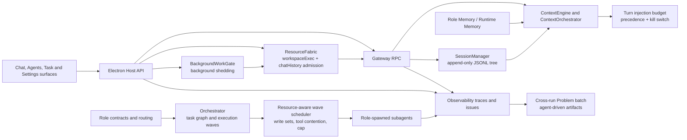
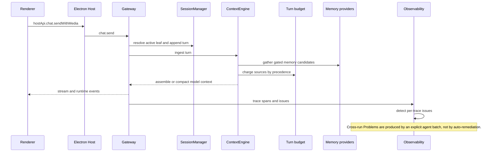
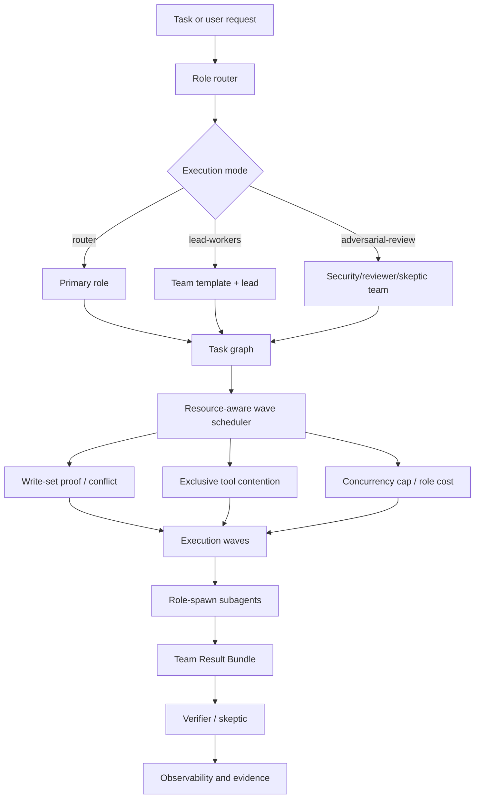
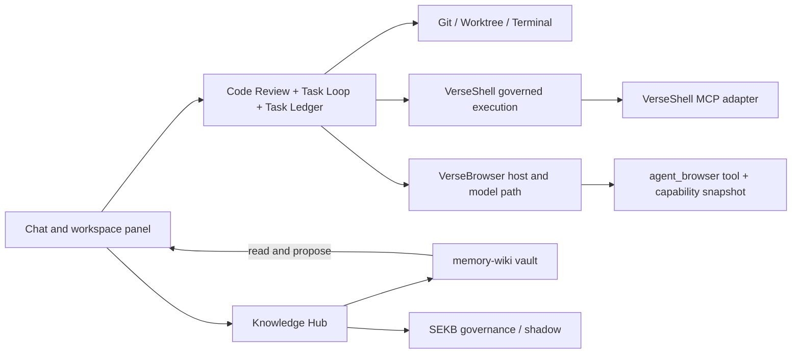

# Runtime control planes

Status snapshot: **2026-10-22**. This page separates landed runtime mechanisms from opt-in, shadow and planned work. It is a navigation aid; source code, product semantics and validation gates remain authoritative.

The repository is not only a chat UI around a model call. It contains several cooperating control planes:

- resource admission and background-load shedding;
- context assembly, budgeting and health scoring;
- append-only session lifecycle and branch management;
- role memory and runtime memory with separate write/use gates;
- trace issue detection and cross-run problem aggregation;
- role contracts, routing, task graphs and bounded concurrency.

These planes do not imply one universal scheduler, one memory store or one task authority. The identity and ownership boundaries are defined in [ClawX product semantics](../clawx-product-semantics.md).

## Control-plane overview

The diagram shows ownership relationships, not a promise that every edge is enabled in every run. ResourceFabric currently admits `workspaceExec` and `chat.history`; it is not a global process scheduler. Runtime Memory and enhancement paths are independently gated.

## Component authority manifest

Current component dispositions are recorded in [Component disposition matrix](component-disposition-matrix-20261021.md) and `shared/dcs/component-disposition-catalog.ts`; the latter is the machine-readable source for later ModelCapabilityProfile work.

The product-level memory domain/lifecycle matrix is [Memory control plane](memory-control-plane.md); `shared/memory/control-plane.ts` is its machine-readable `MemoryControlPlaneManifest/v1` source.

`shared/component-authority-manifest.ts` is the machine-readable `ComponentAuthorityManifest/v1` registry for component purpose, owned data types, scopes, allowed reads/writes, effects, forbidden actions, runtime availability source and source anchors. `tests/unit/component-authority-manifest.test.ts` is the static guard: it rejects duplicate accepting/update authorities, domain executors, unauthorized cross-domain writes and permission escalation, then cross-checks the registry against this document, the FP-P1 product table and the default-config matrix.

| Domain | Canonical owner or owner group | Boundary |
| --- | --- | --- |
| context | Context Runtime Kit; DCS context authority; Provider request guard | CRK owns reference lifecycle, DCS owns candidate adjudication/PromptPlan, and Provider Guard owns the final RequestEnvelope |
| memory | Role-memory card governance; Runtime memory store; native retrieval; candidate queue; embedding provider; Dreaming derived cache | Role cards, runtime facts/timelines/episodes, retrieval, candidates, embeddings and rebuildable Dreaming signals are separate data domains; only accepted memory is retrievable/injectable |
| knowledge | Knowledge review authority; Knowledge retrieval source; SEKB candidate provider | Only the review authority can apply knowledge; SEKB supplies candidates/provenance |
| capability | V3 capability catalog; Skills/MCP source registry; Tool Search | Sources publish manifests, Tool Search expands discovery/schema, and V3 descriptors never carry executor closures |
| execution | Coding execution backend; VerseShell adapter | Execution performs effects but consumes permission decisions; VerseShell does not become a second executor |
| permission | Permission and approval authority | This is the only component role allowed to authorize or approve |
| task | Task Ledger | Task Ledger owns user-visible task facts and task-scoped working-context proposals/acceptance |
| browser | Browser session owner; browser task projection owner | Session/action state, task projection and approval decisions have separate owners |
| observability | Observability recorder; Routing Memo observation | Trace/receipt/log recording cannot grant execution or approval; Routing Memo remains shadow until scorecard-backed active authority exists |
| ui-transport | Host API transport owner; renderer surface | Renderer uses typed host-api only and cannot call Gateway or read/write memory/knowledge directly |

The manifest is static architecture evidence, not a runtime feature flag. It does not change a product default, enable a component or replace the authoritative implementation source. `buildComponentAuthorityProfile()` combines the static defaults with caller-supplied effective availability and produces a `ComponentAuthorityProfile/v1` summary suitable for a later model capability profile; TF-0489 does not wire that profile into live model behavior.
## One-turn lifecycle

## Current mechanisms and boundaries

| Plane | Landed mechanism | Current scheduling or limit | Boundary |
| --- | --- | --- | --- |
| System resources | `ResourceFabric`, `ResourceEnvelope`, `BackgroundWorkGate`, `ResourceTracker`, efficiency sampler and power policy | Main admission currently covers `workspaceExec` and `chat.history`; default account limits are 1–4 active slots with a 64-entry queue and 30s admission timeout. Background work defers at queue-depth/RSS/CPU high watermarks and resumes at lower watermarks after minimum dwell. ResourceTracker probes tracked servers every 30s; idle is 10m and auto-cleanup is 30m | Foreground work is never shed by the background gate. ResourceFabric is cooperative Main-process admission, not a container or OS scheduler |
| Context engineering | `ContextEngine` lifecycle: bootstrap, ingest, maintain, afterTurn, assemble, compact; `ContextOrchestrator`; block/fact stores; `ContextHealthMonitor` | One 6,000-character turn injection ledger is shared by sources. Precedence is `knowledge`, `working_memory`, `tool_registry`, `cvk_addition`, `vtoken`, `memory_pilot`, `other`. Drops above 10% are alertable. Health scores injection pressure, structural fidelity, goal alignment and information novelty | Workspace Context (working-memory + tool-registry) is baseline-on behind one user toggle and fails closed under the enhancement kill switch. VToken, memory pilot and other advanced context paths remain independently gated. Target authority convergence and provider guarding remain bounded current claims |
| Session lifecycle | `SessionManager` JSONL append-only tree with leaf pointer, branch/fork, compaction entries, labels and context reconstruction; Host actions cover checkpoint restore, handoff, compact, archive, restore, permanent delete and derivative cascade | Session summaries use bounded read concurrency; handoff writes are serialized and enforce configured depth; session-linked resource cleanup runs on delete | A session is not a task, run, workspace or project. Task Ledger remains the only user-visible task-fact authority |
| Memory | Role Memory control plane in `role-memory.sqlite`; Runtime Memory persistence/hydration; `memory-core`, `active-memory`, `memory-wiki`, `memory-lancedb`; gatekeeper, dual write/use gates, retention, conflict review and injection explain logs | Context Pack uses seven buckets and a 3,000-character default budget. Role Memory write/use gates default closed. Runtime Memory feature flags default off and product semantics classify injection as diagnostics-only. Background consolidation is designed to run outside the write path; memory-core dreaming is cron-driven | Presence of a memory module is not a claim of production injection. No automatic experience writeback or un-gated second memory authority |
| Problem perception | `detectObservabilityIssues` over trace graphs; `buildObservabilityProblemSnapshot`; `pnpm observability:problems`; redacted manifests, evidence and resolution files | Per-trace issues are bounded and severity-ranked. Cross-run signatures use a seven-day window; a second occurrence or critical occurrence promotes a Problem to `open`; state is `pending`, `open`, `mitigated` or `closed` | This is an agent-driven batch over the sanitized trace index, not a resident governance service, auto-remediation loop or second runtime log database |
| Multi-agent and roles | `RoleContract`, role registry/router, eight built-in roles, team templates, task graph, execution waves, resource-aware scheduler, role-spawn subagents, verifier/skeptic and Team Result Bundle | Modes are `router`, `lead-workers` and `adversarial-review`. Waves are capped by `maxActiveRoles`; write-set conflicts, insufficient write-set proof and exclusive-tool contention defer nodes. Leaf subagents cannot spawn descendants. Worker failure is isolated; follow-up is bounded | `bounded_a2a` remains disabled/normalized to `none`. A role contract grants no extra permission; prompts, handoffs, scores or routing memos cannot widen tool authority. Runtime V2 Kernel work is planned, not completed |

## Multi-agent execution path

## Role vocabulary

The code uses three distinct concepts that must not be conflated:

| Canonical label | Existing type | Meaning |
| --- | --- | --- |
| Assistant | `AgentSummary` | Persistent user-created identity that owns workspace, model, channel and session bindings |
| Persona | `AgentRoleProfile` | One-to-one behavior/style profile compiled to SOUL.md and mirrored to a sidecar |
| Role Contract | `RoleContract` | Reusable M:N execution contract with hard tool allowlist, permissions, effort, output schema and handoff rules |

The built-in role contracts are `planner`, `architect`, `implementer`, `tester`, `reviewer`, `security-reviewer`, `docs-writer` and `skeptic`. Channels bind to Assistants, not Role Contracts.

## Coding, tools and knowledge surfaces

### Coding and review

- `CodingRun` is a **read-only association view** across sessions, runs, attempts, Task Ledger, trace, permission envelope and context fingerprint. It does not own a state machine or a second task store.
- The versioned `coding-run/v1` JSONL protocol is for display and CI interchange. It is not a Codex exec compatibility layer and does not create a second trace or task authority.
- `CodeReviewRun` is explicitly `readonly: true`. Targets are uncommitted diff, base branch or commit; the review produces bounded diff stats, patch artifacts, severity-ranked findings, evidence refs and trace/session correlation.
- Code Review findings can be projected into Task Ledger nodes. This creates task facts through the Task Ledger owner rather than turning the review into a second task state.
- Task Loop is the explicit high-constraint execution path with phases, bounded repair iterations, checkpointing and an evidence gate. Ordinary Chat does not automatically become a Task Loop.
- Git, Worktree, terminal, workspace files and review are Host-owned surfaces. Remote Forge remains a controlled preview and is separate from local read-only review.

### VerseShell

- VerseShell is a governed execution runtime, not the only shell available to the product.
- `verseshell-runtime.ts` launches `ae --serve`, uses a compact request/response protocol, tracks lifecycle and falls back to the native shell after repeated identical failures.
- The governed route includes typed ACI, command profiles, host-sanitized environment, workspace-relative cwd, bounded output, result artifacts, process management and patch preview.
- Command profiles are `generic`, `test`, `build`, `lint`, `git` and `terminal-shell`. Profiles classify and bound execution; they do not grant write authority. The existing execution approval pipeline remains the authorization surface.
- The bundled VerseShell runtime is provenance-checked and currently resolved for Windows x64. Development overrides are forbidden in packaged mode.
- Every foundation capability is independently governed and has a rollback/kill path. Workspace Context is the explicit TF-0494 baseline-on user profile; other advanced surfaces remain default-off. `liveReady`, product approval and release status are not implied by source presence or by one graduated default.
- `resources/verseshell-mcp/` is an external MCP compatibility adapter with deny-by-default capabilities, no wildcard grants and compact protocol support. It is not the internal desktop execution path.

### VerseBrowser

- `packages/versebrowser/` is a private workspace module consumed through public exports; it is not an external second runtime.
- Desktop path: renderer `hostApi.agentBrowser` → Electron Main adapter → embedded browser-window engine.
- Model path: `agent_browser` → Gateway `agentBrowser.invoke` → Main host adapter.
- The host contract has 81 methods, but the Electron driver implements 67. The 13 facade-only additions return explicit `E_NOT_IMPLEMENTED`; the 81-method contract is not a capability count.
- The model vocabulary has 28 actions filtered by the live driver profile. On the current Windows desktop build, 14 are advertised; `command` and the 13 source-only actions are unavailable with reasons.
- Session ownership, sandbox policy, external-browser authorization and capability checks are enforced before browser effects. `ok: true` transport does not prove business success; inspect nested observation, console/network completeness and verdict.

### Knowledge Hub, Wiki and SEKB

The [Project RAG long-term decision](adr/2026-11-09-project-rag-retrieval-plane.md) extends the owner/retrieval/DCS boundaries with planned persistent hybrid search, reranking, source adapters and Research. Its delivery status is tracked by the [work packages](project-rag/WORK-PACKAGES.md); these are not current runtime capability claims.

- Knowledge is Markdown/wiki-first and role-governed. The allowed durable path is `Inbox → Draft → Steward review → Proposal → explicit confirmation → wiki.apply`.
- `routeContext` does not inject SEKB by default. Runtime Lessons participate only when the caller explicitly sets `sourcePolicy.runtimeLessons`, and each candidate carries structured provenance.
- The Knowledge workbench exposes `library`, `review-queue`, `inbox`, `drafts`, `review`, `runtime` and `governance` tabs.
- Chat knowledge scopes are `none`, `memory`, `wiki` and `all`; modes are `manual`, `suggest` and `auto-read`. Knowledge references are read-only context and must not change tool or workspace permissions.
- Source Sets and grounded answers return sources, unknowns, suggested next actions and a grounding status. The current answer path is page/snippet-level and does not claim a full RAG platform. A real SiliconFlow embedding provider can be opted into for the semantic lane; lexical fallback remains authoritative when the provider is unavailable.
- `memory-wiki` exposes `wiki_get`, `wiki_lint`, `wiki_search` and `wiki_status`. `wiki_apply` is operator-gated and is not registered for ordinary agents unless `tools.allowAgentApply` is explicitly enabled. The generic agent `gateway` tool forwards only an allowlisted core-RPC subset and does not forward plugin `wiki.apply`; the Gateway RPC remains available to the governed Main host path. Vault modes are `isolated`, `bridge` and experimental `unsafe-local`; search corpora are `wiki`, `memory` or `all`.
- Agents may read and propose. They may not silently apply, archive, delete or merge durable knowledge. SEKB remains default-off/shadow for automatic writeback.
- Knowledge Hub is not an Obsidian clone, NotebookLM clone, separate RAG stack or second runtime memory authority.

## Current versus planned

**Landed and observable**

- Main-process resource admission and background-load shedding.
- Context lifecycle, shared per-turn injection budget, lineage and deterministic context-health scoring.
- Append-only session tree, compaction, branching, checkpoint, handoff, archive and cascade delete.
- Role memory governance plus separately gated runtime-memory persistence and hydration.
- Trace issue detection and agent-driven cross-run Problem aggregation.
- Role contracts, routing modes, team templates, task graphs and resource-aware execution waves.

**Baseline-on user profile**

- Workspace Context: one Settings > General toggle composes the working-memory window and compact tool registry under the shared turn budget.

**Opt-in, shadow or default-off**

- Runtime Memory persistence and injection pilot.
- COMPASS and legacy role-memory context blocks.
- VToken turn assembly and memory dual write/use gates.
- `bounded_a2a` and routing memo authority.
- Context enhancement paths when the kill switch is engaged.

**Planned or incomplete**

- The unified context authority model described in [Context Capability Convergence Blueprint](context-capability-blueprint.md).
- Persistent orchestration Runtime V2 kernel, completion-driven DAG and multidimensional admission/budget work described in [Runtime V2 allocation](../multi-agent-orchestration/runtime-v2-p3-p5-allocation.md).
- Full provider-boundary request guarding and replayable final-request lineage.

## Source anchors

- Resources: `electron/services/resource-fabric.ts`, `openclaw_runtime/src/resources/background-work-gate.ts`, `electron/services/resource-tracker.ts`, `electron/services/efficiency-sampler.ts`.
- Context: `openclaw_runtime/src/context-engine/types.ts`, `context-orchestrator.ts`, `turn-injection-budget.ts`, `context-health-monitor.ts`, `assembler.ts`.
- Sessions: `openclaw_runtime/src/agents/sessions/session-manager.ts`, `electron/services/sessions-api.ts`, `electron/services/session-cascade-delete.ts`.
- Memory: `openclaw_runtime/src/memory/`, `openclaw_runtime/src/runtime-core/memory-*.ts`, `openclaw_runtime/extensions/{memory-core,active-memory,memory-wiki,memory-lancedb}/`.
- Problems: `electron/services/observability-issues.ts`, `electron/services/observability-problems.ts`, `scripts/observability-problems.mjs`.
- Multi-agent: `openclaw_runtime/src/agents/{role-contract,role-registry,role-router,team-template,orchestrator,orchestration-protocol,orchestration-resource-scheduler,role-spawn}.ts`.
- Roles: `shared/types/role-identity.ts`, `docs/role-identity-taxonomy.md`, `docs/role-first-design.md`.
- Coding: `shared/types/coding-run.ts`, `shared/types/code-review.ts`, `electron/services/code-review-api.ts`, `openclaw_runtime/src/agents/task-loop-controller.ts`, `docs/dev/coding-run-protocol.md`.
- VerseShell: `openclaw_runtime/src/agents/verseshell-runtime.ts`, `openclaw_runtime/src/agents/verseshell/`, `resources/verseshell/`, `resources/verseshell-mcp/`, `shared/verseshell/`.
- VerseBrowser: `packages/versebrowser/`, `electron/services/agent-browser-capabilities.ts`, `electron/gateway/agent-browser-bridge.ts`, `shared/agent-browser/`, `packages/README.md`.
- Knowledge: `src/pages/Knowledge/index.tsx`, `electron/services/knowledge-api.ts`, `openclaw_runtime/extensions/memory-wiki/`, `openclaw_runtime/src/knowledge/sekb/`, `docs/enhancements/knowledge-persistence/`.