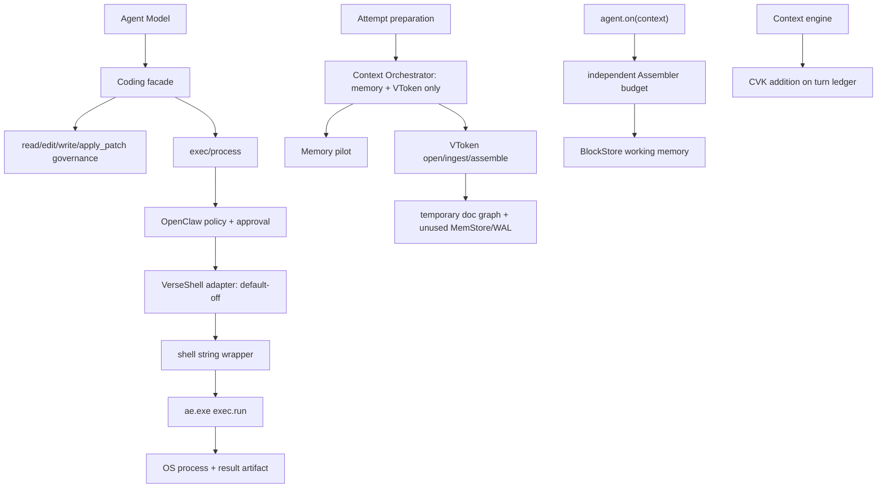
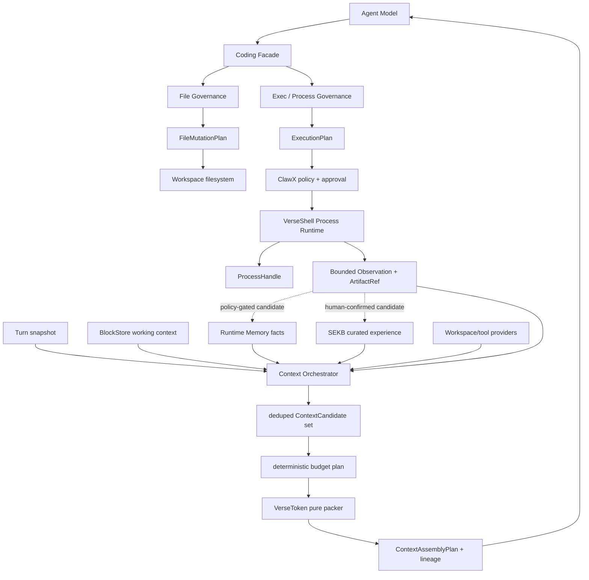

# VerseShell、VerseToken、Coding 与 DCS/Memory 能力融合审计和路线图

> 状态：`research-complete / architecture-recommendation`
>
> 审计日期：2026-07-27
>
> 适用范围：ClawX / OpenClaw Runtime / VerseShell / VerseToken / Coding / DCS / BlockStore / Runtime Memory / SEKB
>
> 决策级别：研究结论与实施候选，不代表 Task Forest 已批准、默认开启、GA 或 TF-0006 解阻
>
> 后续状态：路线已于 2026-07-27 通过 `TFP-unified-agent-system-roadmap-20260727` 登记；正式编号和当前调度见 `DEVELOPMENT-LOG.zh-CN.md`

## 1. 文件定位

本文是统一 Agent 系统的能力审计、架构裁决和后续实施调度依据。它回答：

1. 现有组件到底已经具备什么，而不是只看目录或宣传；
2. 哪些能力应复用、补齐、收口或淘汰；
3. VerseShell、VerseToken、Coding、DCS 和 Memory 各自应拥有什么 authority；
4. 如何让 Agent 全量使用统一基础设施，同时不增加 LLM 智能路由和工具学习成本；
5. 小范围使用如何验证回本，并在什么条件下才允许扩大范围。

本文不是：

- 将所有组件塞进 VerseShell 的单体化设计；
- 让模型直接使用 VerseShell 26 个 operation 的工具扩面；
- default-on、联合系统 GA 或生产批准；
- 已批准的 Task Forest 排期；
- 对论文中收益数字的项目背书。

连续性入口：

- 开发原则：`docs/dev/unified-agent-system/DEVELOPMENT-STRATEGY.zh-CN.md`
- VerseShell 专项审计：`docs/dev/verseshell-foundation/CAPABILITY-AUDIT-AND-IMPLEMENTATION-PLAN.zh-CN.md`
- 当前会话交接：`docs/dev/handoffs/LATEST.md`
- 正式任务状态：`.agent-workbench/task-forest/`

## 2. 核心结论

本项目不缺“组件数量”，缺的是**唯一调用主路径、唯一状态 owner 和跨组件一致的契约**。

推荐方案是：

> **统一 contract 和主路径，不统一 authority 或进程。**

具体含义：

- Agent 继续使用 Coding 层熟悉的 `read/edit/write/apply_patch/exec/process/context_*`；
- Coding 将本地 `exec/process` 确定性编译为 typed execution contract，不新增 LLM router；
- VerseShell 成为本地进程创建、生命周期、受限 observation 和 artifact 的唯一执行内核；
- Context Orchestrator 成为 context 候选选择、去重、优先级、最终预算和 lineage 的唯一 authority；
- VerseToken 作为无业务状态的 context packer/renderer，不拥有 Working Memory、长期 Memory、WAL 或最终预算；
- BlockStore 拥有会话内 Working Context，Runtime Memory 拥有经治理的长期事实，SEKB 拥有人工确认的可复用工程经验；
- Coding 继续拥有文件写入治理、mutation queue、write journal、undo 和写后验证，VerseShell transaction 不取代它。

最终形态可以“全量使用”统一基础设施，但全量的定义是：

> 所有合格的本地进程执行都经过 VerseShell；所有 prompt 增量都经过 Context Orchestrator；模型侧工具和各类数据 authority 保持稳定且唯一。

它不等于所有组件都成为 VerseShell operation，也不等于所有远程、sandbox 或 UI 执行都强制经过同一个二进制。

## 3. 研究方法和证据等级

### 3.1 本轮读取范围

- 两份用户提供的模型调研材料；
- VerseShell 已有能力审计、状态文件和 typed ACI contract；
- `packages/vtoken` Python 源码、RPC host、store、MemStore、assembler 和测试；
- Electron VToken host-api bridge；
- OpenClaw Runtime 的 VToken client、Context Orchestrator、Assembler、Memory provider 注册和 attempt wiring；
- Coding 工具构造、apply_patch、mutation queue、symbol lease、write journal 和写后 side effects；
- Task Forest 当前导出、COMPASS 手册和 handoff。

### 3.2 证据等级

| 等级 | 含义 | 本文用法 |
|---|---|---|
| E1 | 当前源码和可重复本地测试 | 架构裁决的主要依据 |
| E2 | 当前仓库文档、spec、历史 evidence | 用于理解意图；与代码冲突时以 E1 为准 |
| E3 | 官方论文元数据和摘要 | 支持设计原则，不证明本项目收益 |
| E4 | 产品材料、博客、模型总结 | 仅作为候选线索，不作为验收证据 |

外部来源核验说明：本机 AnySearch 脚本与其标注的官方 `v2.1.0` 原文件不一致，因此未执行该脚本。本轮改用官方 arXiv API 只读核对编号、标题和摘要。

### 3.3 本轮测试证据

| 测试 | 结果 | 解释 |
|---|---|---|
| `pnpm vtoken:test` | 246 passed / 1 failed | `TestHotReloadConcurrent.test_concurrent_resolve_during_reload` 未观察到最终 `v5` |
| 热重载失败用例单独复跑 | 5/5 failed | 不是一次性抖动；测试在最后写入后立即停止 reader，当前缺少可验证的刷新完成语义 |
| Context/VToken/Coding focused Vitest | 11 files / 147 tests passed | 局部 contract 和现有治理行为通过 |
| 根层 Orchestrator/VToken bridge/default tests | 3 files / 18 tests passed | 默认 OFF 和现有入口扫描通过 |

热重载红灯不在当前生产 assembly 的直接热路径上，因为生产每回合执行 `open -> ingest -> assemble`，且 `docSources=[]`。它仍然阻止项目宣称 VToken 的 doc-source 并发热重载已经可靠；若目标改为纯 packer，可将该能力移出生产依赖。

## 4. 现状审计

### 4.1 VerseShell：完整二进制，接入和生命周期不完整

已确认：

- ClawX 内置 `ae.exe` 与固定上游 commit `c3983694407a9ddb23505e05fad4a9eae653b283` 的 release binary SHA-256 相同；
- catalog 为 26 个 operation，二进制不是裁剪版；
- ClawX 当前生产候选路径只接 `runtime.handshake`、`exec.run`、`result.query`；
- policy profile、action-bound approval、fail-closed、bounded observation 和 artifact 查询已经存在；
- 所有生产相关 flag 仍默认关闭。

关键缺口：

- `exec.run` 仍由 ClawX 把 command string 包装为 `cmd /C`、PowerShell、Git Bash 或 `sh -lc`；
- 上游缺请求级 env/PATH、stdin、background、ConPTY、主动 cancel、`start/read/write/poll/kill` 和重启恢复；
- workspace jail 和 Job Object 不是 OS filesystem sandbox；
- transaction/test last-state 是进程级状态，且 transaction 不覆盖 shell 命令造成的写入；
- 当前能力不足以无回归替代现有 `exec/process`。

裁决：保留并扩展 VerseShell 的**进程执行内核**。不引入其 file/repo/test/transaction operation 作为新的模型主工具。

### 4.2 VerseToken：assembler 完整，但生产集成承担了不必要状态

生产调用链：

```text
Embedded attempt
  -> Context Orchestrator
  -> computeVtokenExtraSystemPrompt
  -> shared VtokenRpcClient
  -> Python vtoken.host_rpc
  -> UnifiedStore / ContextAssembler
```

已确认：

- `packages/vtoken` 是 Python 包 `verse-token 0.4.3`；
- host_rpc 是单进程、单活动 `UnifiedStore`；
- shared client 用 `runExclusive` 串行化完整 `open -> ingest* -> assemble`；
- 每回合 `vt.open` 会关闭旧 store，再用 bootstrap、tool schema 和 memory projection 重建临时 doc graph；
- 当前生产打开 `sessionDir + session`，因此会创建空 `MemStore`、WAL 和 lock；host RPC 没有暴露 `vt.write`，该持久状态没有生产业务价值；
- 默认 pack budget 为 600 estimated tokens，默认计数器是 `len(text) // 4`，不是 provider tokenizer；
- 生产 worker 是全局单例，所有 workspace/session 的 VToken assembly 被同一互斥尾队列串行化；
- Developer 面板 smoke 调用 `hostApi.vtoken.open({})`，默认不创建 MemStore；只有显式使用同一 `sessionDir + session` 才会与生产路径争锁。

问题：

1. VToken 同时像 packer、临时 graph store 和潜在 memory store，边界过宽；
2. 只读 assembly 为无用 WAL/lock 付出 I/O、故障和锁竞争成本；
3. 全局 worker 使无关 workspace/session 串行；
4. `tokens_used` 是估算，不能作为 provider 成本事实；
5. `harness/specs/tasks/vtoken-foundation-bridge.md` 仍写产品默认 ON，而规则、代码、README 和测试均锁定默认 OFF，存在 spec drift；
6. 热重载测试当前稳定失败，不能宣称该扩展能力已可靠。

裁决：复用 parser/graph/selection/rendering，但将生产形态收口为**无业务 Memory 的纯 assembly service**。

### 4.3 Coding：已经是稳定门面和治理层，不是待搬迁的单一包

模型侧主要工具来自：

`openclaw_runtime/src/agents/agent-tools.ts:createOpenClawCodingTools`

已存在：

- `read/edit/write/apply_patch/exec/process/undo_write/context_*` 和可选 `verseshell_result`；
- tool construction plan、provider/session/sandbox/allowlist policy；
- workspace containment、parse-on-touch、read hash；
- write journal 默认开启、undo、写后 syntax/diagnostics/diff/test-runner 检测；
- edit/write 的逐文件 mutation queue；
- stale full-file write guard 和 symbol lease 的可选门禁；
- destructive tier 和软性写入提示。

发现的完整性缺口：

1. `apply_patch` 没有使用逐文件 mutation queue；
2. 多文件 patch 按 hunk 顺序直接落盘，后段失败会保留前段修改；
3. write journal 会在调用前建立快照，但 tool 抛错时不会把 undo 信息附着到失败结果，partial mutation 不够可见；
4. 包装构造顺序为 `lease -> journal -> stale -> side-effects -> soft -> destructive`，实际执行由外向内，因此 journal 快照发生在 lease 获取前，与“lease before other layers”的注释意图相反；
5. 当前测试覆盖各 wrapper 的局部行为，但没有锁定多文件 patch 中途失败语义和 lease/journal 实际顺序。

裁决：Coding 必须保留文件写入 authority。VerseShell 不替换其 journal、undo、stale guard 或 diagnostics；先修复内部一致性，再让 exec/process 编译到 VerseShell。

### 4.4 DCS/Context/Memory：已有共享账本，但还没有真正单一调度者

当前存在两个不同时间点：

```text
attempt 准备阶段
  -> Context Orchestrator
     -> Memory inject pilot
     -> VToken assembly

每次 LLM 调用前
  -> agent.on("context")
     -> 新建 Assembler
     -> BlockStore working-memory projection

context engine assemble 后
  -> CVK systemPromptAddition
```

已完成的进展：

- attempt 为 memory pilot、VToken 和 CVK 创建同一个 `injectionTurnId`；
- `turn-injection-budget.ts` 提供 6000 字符的共享账本和观测；
- Assembler 在收到 `turnId` 时能够加入同一账本；
- kill switch 能关闭多条增强路径；
- BlockStore 已是 working-memory 的持久 authority。

仍未闭合：

1. `agent.on("context")` 调用 Assembler 时只传 `{ session_id }`，没有 `turnId`，因此动态 Working Memory 仍使用自己的 2000 字符预算；
2. `TURN_INJECTION_PRECEDENCE` 只给 entry 记录排序索引，不会重排调用；
3. 实际扣费顺序是 memory pilot、VToken、CVK，之后动态 Assembler 另开预算，与声明的 `knowledge -> working_memory -> tool_registry -> cvk -> vtoken -> memory` 相反；
4. Orchestrator 目前只直接拥有 memory pilot 和 VToken 两个 stage，无法统一收集、去重和排序全部候选；
5. VToken 可投影 BlockStore 的 working-memory/compass/role-memory，而 Assembler 和 memory provider 又可注入同类语义；heading guard 只能避免相同标题重复，不能做跨 provider 语义去重；
6. memory pilot 的 `totalTokenBudget` 主要进入 metadata；实际最终 prompt 增长由外层字符账本截断，provider 内部并未按统一 allowance 聚合选择；
7. attempt 默认只注册 `role-memory` provider，没有注册 `runtime-memory`；长期事实提取、验证、注入尚未形成生产闭环。

裁决：`Context Orchestrator` 的名称和入口已经存在，但它当前是**部分编排者**，不是完整 authority。第一阶段必须把动态 assembly、候选去重和真实优先级调度收回同一 owner。

## 5. 对模型调研材料的裁决

### 5.1 可采纳

| 方案/来源 | 可采纳内容 | 本项目落点 |
|---|---|---|
| SWE-agent ACI | 为固定模型设计稳定、专用接口 | 保持 Coding facade，不暴露 26 operations |
| DMI | 声明式接口、策略与机制分离 | ClawX 决策，VerseShell 执行已批准 plan |
| AdaCoM | 外部 context manager，不要求改底层 agent | Context Orchestrator 独立于模型工具循环 |
| MemAct | context curation 可作为显式、可评估策略 | 后期 shadow 实验，不进入 P0 authority 收口 |
| HiAgent/Context Folding | 长任务按子目标折叠 | 基础预算和 lineage 闭合后再做 |
| Artifacts as Memory | 环境 artifact 可降低内部历史表示负担 | VerseShell 保存原始证据，DCS 决定是否进入 context/memory |
| IBCT/PAuth 类思想 | 授权绑定具体动作和调用边界 | 复用现有 action-bound approval token |
| PTR | 可重复流程采用 plan -> deterministic execute -> verify | 后期用于高结构编码/运维任务 |
| Letta 的分层概念 | working/recall/archive 有助于解释生命周期 | 仅作为信息生命周期模型，不复制其运行时 |

### 5.2 不采纳或需降级

| 原建议 | 裁决 | 原因 |
|---|---|---|
| DCS 放到 VerseShell 层 | 拒绝 | 执行机制不能拥有 prompt、隐私、检索和保留策略 |
| Memory 映射为 VerseShell 状态 | 拒绝 | 会制造第二 Memory authority 和跨 session 污染 |
| 每个自研组件注册为 VerseShell operation | 拒绝 | operation 不是模块总线；会形成单体和版本耦合 |
| 固定为 3-5 个工具 | 降级为原则 | 应追求稳定、按需投影的 facade，不用任意数字做 KPI |
| 多模型智能路由作为回本主策略 | 当前拒绝 | 用户目标是不增加路由调用；固定执行策略可确定性完成 |
| “可降 70%-85% 成本” | 拒绝作为项目结论 | 缺本地 paired A/B、provider usage 和置信区间 |
| Job Object/范围隔离等于 sandbox | 拒绝 | Job Object 管进程树，不构成 filesystem/network 安全边界 |
| `2604.21936` 作为通用 Agent 框架证明 | 降级 | 该论文是医学影像工作流；仅能借鉴 artifact contract 和确定性 executor |
| “tool reliability matters more than model capability” | 不作为引文 | 当前核验材料没有提供可归因的原始证据 |

### 5.3 外部来源核验结果

官方 arXiv 元数据确认以下编号与标题匹配：

- `2405.15793` SWE-agent；
- `2510.12635` Memory as Action；
- `2605.30785` AdaCoM；
- `2604.03515` Inside the Scaffold；
- `2510.04607` DMI；
- `2604.04131` Profile-Then-Reason；
- `2605.05440` Authorization Propagation；
- `2604.08756` Artifacts as Memory；
- `2507.21428` MemTool；
- `2602.02486` RE-TRAC。

论文只能证明某种设计值得实验，不能替代当前仓库的 correctness、安全和 ROI 证据。

## 6. 当前调用图



主要问题不是任一节点完全缺失，而是：

- execution 仍以 shell string 为核心；
- context 存在静态和动态两条 owner 不一致的路径；
- VToken 在纯 assembly 中持有无用状态；
- Coding 的多文件 mutation 失败语义不完整。

## 7. 目标架构



### 7.1 为什么这不是智能路由

工具和执行后端由确定性规则决定：

- `read/edit/write/apply_patch` 固定走 Coding 文件治理；
- 合格的本地 `exec/process` 固定编译为 VerseShell contract；
- sandbox、远程 host、provider-native tools 保持各自 authority；
- context provider 由 feature flag、session 类型、数据 classification 和固定优先级选择；
- 不调用额外模型来决定“该走哪条执行路径”。

以后若实验 learned context manager，也只能在 shadow 中产出候选排序，不得绕过 Orchestrator 的预算、隐私和安全门。

## 8. Authority Matrix

| 数据/副作用 | 唯一 authority | 其他组件权限 |
|---|---|---|
| 模型侧 coding tool contract | Coding facade | VerseShell 不直接扩模型工具 |
| 命令 allowlist、approval、workspace policy | ClawX/OpenClaw | VerseShell 只验证已绑定授权并执行 |
| 本地进程创建和生命周期 | VerseShell | Coding 编译 plan、展示 handle |
| 文件 mutation、stale guard、lease、journal、undo | Coding | VerseShell 只可执行明确的进程计划 |
| 原始命令输出 artifact | VerseShell | Orchestrator/Memory 只引用和治理 |
| 会话 Working Context | BlockStore | VToken 只读 projection，不写权威状态 |
| 最终 context 选择、去重、优先级和 prompt budget | Context Orchestrator | provider/VToken 只能消费 allowance |
| 长期事实/episode | Runtime Memory | 需治理、验证和 retention policy |
| 可复用工程原则 | SEKB | 必须人工确认，禁止自动写回 |
| token 成本事实 | provider usage/billing | VToken 估算只能标记为 estimate |
| 跨层 lineage | Trace contract，由 Orchestrator/Execution 共同写事件 | 单个组件不得创建不相关的第二 request identity |

## 9. 能力处置清单

### 9.1 直接复用

- Coding facade 和 tool construction plan；
- OpenClaw policy/approval/workspace containment；
- Coding write journal、undo、parse/diagnostics 框架；
- VerseShell verified binary、handshake、action token、bounded observation、artifact；
- BlockStore 和现有 context provider seam；
- VToken parser、ingest adapters、graph selection、rendering；
- Context enhancement kill switch 和 observability 基础。

### 9.2 必须补齐

- Orchestrator 的动态 turn 入口、候选协议、去重和真实优先级调度；
- VToken stateless/session-scoped 并发模型和 tokenizer/estimate 语义；
- apply_patch mutation plan、锁顺序和 partial failure contract；
- VerseShell 直接 argv、env/PATH、stdin、background、PTY、cancel、process recovery；
- execution/context/memory 共享 trace 和 artifact lineage；
- paired A/B 的实际 provider usage 与维护成本记录。

### 9.3 应逐步淘汰

- governed exec 的默认 shell-string 包装；
- VToken 只读 assembly 创建的空 MemStore/WAL/lock；
- 独立于 Orchestrator 的 context 私有预算；
- 同一 BlockStore 内容被 VToken、Assembler 和 memory pilot 重复投影；
- 长期保留独立 `verseshell_result` 学习面；进程生命周期完成后应并入现有 `process` 读取体验；
- task spec 中与实现冲突的 VToken default-ON 表述。

### 9.4 明确不引入

- 内部 MCP 主路径；
- legacy eval 主路径；
- `cap all`、permissive policy 或 governed native fallback；
- DCS/Memory 的 VerseShell operation 化；
- 第二 write journal、第二 context budget 或第二 Memory authority；
- 为固定规则引入额外 LLM router。

## 10. 目标 Contract Family

### 10.1 `ExecutionPlan/v1`

最小字段：

```text
planId, traceId, agentId, sessionId, workspaceId
executable { requested, resolvedPath, kind, identityDigest }
argv[], cwd, envDelta { allowlistedSet, unset, pathPrepend }
stdinMode, outputPolicy, timeoutMs
mode { foreground, background, pty }
authorizationRef, risk, expectedEffects[]
```

要求：默认 direct argv；`.cmd/.bat` 必须显式解析为 Windows batch interpreter，不允许在 adapter 中隐式猜测。

### 10.2 `ProcessHandle/v1`

```text
processId, planId, traceId, agentId, sessionId, workspaceId
state, pid?, startedAt, exitedAt?, exitCode?, signal?
stdinCapability, ptyCapability, recoverability, retentionDeadline
```

### 10.3 `Observation/v2` 和 `ArtifactRef/v1`

在现有 `verseshell.observation/v1` 上增量演进：

- 明确 lifecycle event、stdout/stderr cursor、truncation 和 dropped bytes；
- artifact 包含 digest、media type、size、TTL、producer plan 和敏感级别；
- observation 只返回可行动摘要，完整输出通过 cursor/artifact 读取；
- artifact 是证据，不自动成为 Memory。

### 10.4 `FileMutationPlan/v1`

由 Coding 拥有：

```text
mutationId, orderedTargets[], expectedHashes[], leaseSet
journalSnapshotSet, commitMode, failureMode, recoveryRef
```

`apply_patch` 必须选择一种明确语义：

- 原子：预计算全部结果，全部验证后统一提交；或
- 显式 partial：失败结果列出已落盘文件和可执行恢复引用。

不能继续以“抛错但可能已改文件”作为隐式契约。

### 10.5 `ContextCandidate/v1`

```text
candidateId, sourceId, sourceClass, scope
contentRef/content, exactChars, estimatedTokens
priorityClass, dedupKey, freshness, sensitivity
retention, provenance, featureFlag, allowedSurfaces[]
```

### 10.6 `ContextAssemblyPlan/v1`

```text
turnId, totalCharAllowance
orderedCandidates[], dropped[], truncated[]
renderAssignments[], finalSegments[], lineage
```

Orchestrator 先排序和分配 allowance，再调用 VToken；VToken 不能自行重新拉取 Memory 或建立第二预算。

### 10.7 `MemoryCandidate/v1`

```text
candidateId, sourceArtifactRefs[], claimType
content, confidence, sensitivity, retention
validationState, approvalState, targetStore
```

只有通过 policy 的候选才进入 Runtime Memory；只有人工确认的工程经验才进入 SEKB。

## 11. 分阶段实施路线

所有阶段串行推进。一次只打开一个 Task Forest ready 节点，不开平行 mega-surface。

### U0：治理登记和规格校正

范围：

- 用户确认后提交 Task Forest proposal；
- 新建引用 `gateway-backend-communication` 的 Harness task spec；
- 修复 VToken task spec 的 default-ON 漂移；
- 冻结 contract 版本和跨层 owner。

退出条件：Task Forest、Harness、默认矩阵和本文没有 authority 冲突。

### U1：Context Orchestrator 真正收口

范围：

- 把 `agent.on("context")` 动态 assembly 纳入 Orchestrator；
- 统一 `turnId`，禁止 Assembler 私有预算；
- 将“优先级数组”改为先收集候选、再排序、后收费；
- 引入 stable `candidateId/dedupKey`，禁止相同 BlockStore 语义重复注入；
- 将 memory providers、CVK、working-memory 和 VToken 统一记入 lineage。

退出条件：

- 生产静态扫描只有一个 context assembly authority；
- 任意 source 不能绕过总预算；
- 实际注入顺序与声明优先级一致；
- flag off/kill switch 为零查询、零注入或有明确例外记录；
- 组合测试覆盖 working-memory + role-memory + VToken 同时开启时的去重。

### U2：VerseToken 纯装箱化

范围：

- 生产只读 assembly 不传 `sessionDir/session`，不创建 MemStore/WAL/lock；
- 定义 stateless request 或按 workspace/session 隔离的 worker pool，消除全局无关串行；
- 由 Orchestrator 传入明确 allowance 和已去重候选；
- 接 provider tokenizer 或在 schema 中强制标记 `estimate_method=chars_div_4`；
- 修复或重写热重载并发测试，定义刷新完成语义。

退出条件：只读 assembly 零业务持久副作用；多 workspace 并发不互相 reopen；estimate 不再冒充 actual usage。

### U3：Coding 写入一致性

范围：

- 使 lease 在 journal snapshot 和所有其他写入层之前实际生效；
- `apply_patch` 获取排序后的多文件 lease/queue，避免死锁；
- 实现原子 mutation plan，或显式 partial result + recovery ref；
- 增加多文件中途失败、并发 patch、journal/lease 顺序测试。

退出条件：失败后文件状态可证明；同文件并发不交错；journal 和 undo 对 partial failure 可见。

### U4：VerseShell Execution Contract 和生命周期

范围：

- 上游/adapter 支持直接 argv、可执行解析、env delta、PATH/PATHEXT；
- 增加 stdin、background、ConPTY、poll/read/write/kill、cancel 和进程树终止；
- process state 按 workspace + agent + session 隔离；
- 补齐 artifact cursor、重启后的可解释状态和过期语义。

退出条件：现有 `exec/process` 行为矩阵在 VerseShell 上功能等价；常用 Node/pnpm/git/python 命令覆盖 Windows quoting、Unicode 和 shim；无 native fallback。

### U5：单一本地执行平面迁移

范围：

- Coding `exec/process` 对合格本地 host 固定编译到 VerseShell；
- `verseshell_result` 能力并入现有 process read/log 体验；
- sandbox/remote/provider-native 执行保持其现有 owner；
- 以 workspace/cohort 配置启用，不做 per-call LLM 路由。

退出条件：canary cohort 内本地执行覆盖率 100%，native fallback 0，安全/功能门禁无回归，kill switch rollback 演练通过。

### U6：长任务和长期 Memory 闭环

依赖 U1-U5，不得提前。

范围：

- 子目标级 context folding；
- artifact -> MemoryCandidate -> 验证 -> Runtime Memory；
- 人工确认的 artifact/trajectory -> SEKB；
- 可选 learned context manager 仅做 shadow 排序实验。

退出条件：真实 corpus 显示完成率提升、重复读取/执行下降，且错误记忆、越权持久化为 0。

### U7：回本与毕业决策

该阶段不能绕过 TF-0006 的真实 corpus、live A/B、soak 和产品批准要求。

## 12. 小范围回本策略

不采用“每次调用都让模型路由”。采用**cohort 级全量使用 + paired A/B**：

1. 选定一个 workspace/内部用户 cohort；
2. cohort 内所有合格本地 `exec/process` 都走 VerseShell，不保留隐式 native fallback；
3. 对照 cohort 保持 native baseline；
4. 使用同一任务集、模型、prompt、工具 facade 和预算；
5. 分开统计 cold/warm、前台/后台、短命令/长任务；
6. 每轮达到门槛才扩大 cohort，不按单次任务智能路由。

### 12.1 必须记录的指标

| 类别 | 指标 |
|---|---|
| 正确性 | task completion、命令成功率、错误分类、结果一致性 |
| Agent 成本 | 实际 provider input/output/cache tokens、tool turns、重复调用数 |
| 执行成本 | cold/warm latency、p50/p95、CPU、RSS、worker restart |
| 输出收益 | 原始 bytes、注入 bytes、artifact query 次数、恢复成功率 |
| 生命周期 | background/stdin/PTY/cancel/timeout 成功率 |
| 安全 | 未授权执行、越界访问、approval bypass、敏感输出泄漏 |
| 运营 | kill switch 时间、rollback 成功率、人工恢复分钟数 |
| 维护 | 跨语言改动量、缺陷数、升级耗时、spec drift 数 |

### 12.2 回本公式

```text
净收益
= 避免失败/重试的价值
 + provider 实际费用下降
 + 人工恢复时间下降
 + 可审计/可恢复带来的风险成本下降
 - VerseShell/VToken worker 的延迟与资源成本
 - Rust + Node + Python 跨栈维护成本
 - 迁移、测试和发布成本
```

不能用 `len(text)//4`、tool definition 字节数或单次 demo 推导费用收益。

### 12.3 建议扩围门槛

- 未授权执行、越权持久化和隐式 fallback：必须为 0；
- exec/process 功能矩阵：100% 等价后才允许 cohort 全量；
- task completion 相比 baseline 不显著下降；
- warm path p95 额外开销控制在基线可接受预算内，预算需先由真实基线确定；
- provider 实际费用、工具轮次或人工恢复时间至少一项有稳定改善，且其他关键项无显著恶化；
- artifact recovery 和 kill switch rollback 演练成功率 100%。

## 13. NO-GO 和停止条件

任一条件触发即停止扩围：

- 为追求统一而把 DCS/Memory 放入 VerseShell；
- context 候选仍有未计费或重复注入；
- VToken `tokens_used` 被当成 provider actual usage；
- apply_patch 仍可能静默留下 partial mutation；
- VerseShell 缺 stdin/background/PTY/cancel 任一现有关键能力却切默认路径；
- governed 路径自动回退 native shell；
- workspace jail/Job Object 被宣传为 OS sandbox；
- 通过增加 LLM router 掩盖确定性 contract 缺口；
- 未经真实 canary 就宣称 50%-70% 以上成本收益；
- 修改 default-on、GA、TF-0006 或 Task Forest 而未获得用户确认。

## 14. 当前优先级和下一步

最高优先级不是新增 operation，也不是模型路由，而是：

1. **TF-0011 / UAS-00 证据冻结**：建立 Harness task spec、冻结基线并修复 VToken spec drift；
2. **TF-0013 / UAS-02 Context authority 收口**：修正实际预算顺序、动态 Assembler 私账和重复投影；
3. **TF-0014 / UAS-03 VToken 纯装箱化**：去掉无用 MemStore/WAL 和全局无关串行；
4. **TF-0015 / UAS-04 Coding 写入一致性**：修正 wrapper 顺序和 apply_patch partial failure；
5. **TF-0016 / UAS-05 VerseShell 生命周期等价**：补齐后才谈全量替代 PowerShell/Git Bash；
6. **TF-0017 / UAS-06 cohort 级单一路径**：不用 LLM router，以真实 paired A/B 判断回本。

路线已获确认并登记，但实现仍未开始。当前唯一 `status=ready` 的可执行节点是 `TF-0009`；完成或正式暂停它之后，才允许按依赖从 `TF-0011` 开始。

## 15. 最终理解

VerseShell、VerseToken 和 Coding 都不是“残血组件”：

- VerseShell 是完整二进制，但上游进程生命周期和 ClawX 适配还不足；
- VerseToken 的算法/存储能力完整，但生产只需要其中的 assembly 子集，当前反而使用了不必要状态；
- Coding 已经拥有大量关键治理能力，不能为了统一而被 VerseShell 覆盖；
- DCS/Memory 不是缺模块，而是入口和预算还没有真正完成单一 owner 收口。

因此正确的能力补全不是“把所有已有能力都打开”，而是：

> 保留强能力，删除重复 authority，补齐跨层 contract，再按功能等价和真实收益逐步收敛为唯一主路径。

这条路线既符合用户希望的全量统一，也避免额外智能路由、工具学习和长期双轨维护成本。

## 16. 参考来源

本地权威：

- `docs/dev/verseshell-foundation/CAPABILITY-AUDIT-AND-IMPLEMENTATION-PLAN.zh-CN.md`
- `docs/dev/verseshell-foundation/STATUS.md`
- `openclaw_runtime/src/agents/agent-tools.ts`
- `openclaw_runtime/src/agents/apply-patch.ts`
- `openclaw_runtime/src/context-engine/context-orchestrator.ts`
- `openclaw_runtime/src/context-engine/turn-injection-budget.ts`
- `openclaw_runtime/src/agents/embedded-agent-runner/extensions.ts`
- `openclaw_runtime/src/context-engine/chat-turn-vtoken-injection.ts`
- `packages/vtoken/src/vtoken/host_rpc.py`
- `packages/vtoken/src/vtoken/store.py`
- `packages/vtoken/src/vtoken/memstore.py`

外部设计参考：

- SWE-agent: https://arxiv.org/abs/2405.15793
- Memory as Action: https://arxiv.org/abs/2510.12635
- AdaCoM: https://arxiv.org/abs/2605.30785
- DMI: https://arxiv.org/abs/2510.04607
- Profile-Then-Reason: https://arxiv.org/abs/2604.04131
- Artifacts as Memory: https://arxiv.org/abs/2604.08756
- Authorization Propagation: https://arxiv.org/abs/2605.05440
- Inside the Scaffold: https://arxiv.org/abs/2604.03515
