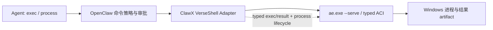

# VerseShell 能力审计与实施调度报告

> 审计日期：2026-07-27
>
> 审计对象：ClawX `%USERPROFILE%\Desktop\clawx\ClawX-maturity-p0` 与 VerseShell `%USERPROFILE%\Desktop\verseshell\verseshell`
>
> 当前裁决：`accept-for-controlled-development`，不具备 default-on、原生 shell 全量替代或 GA 资格
>
> 上游基线：VerseShell `1.0.0`，commit `c3983694407a9ddb23505e05fad4a9eae653b283`

## 1. 文件定位

本文是 VerseShell 在 ClawX 中的**能力差距审计、架构裁决和实施调度输入**，用于回答：

1. 上游能力是否真实存在，ClawX 是否已经使用；
2. 当前接入是否因裁剪导致能力缺失；
3. 哪些能力值得补齐，哪些能力会与现有系统重复或产生倒退；
4. 如何把 VerseShell 建成单一执行平面，同时不增加 Agent 的工具学习和智能路由成本；
5. 后续实现应按什么依赖顺序推进，如何验收和停止扩面。

本文不是以下权威的替代品：

| 权威 | 文件或目录 | 职责 |
|---|---|---|
| 当前发布/灰度状态 | `docs/dev/verseshell-foundation/STATUS.md` | 说明现在能否开启、是否可发布 |
| 能力审计与方向裁决 | 本文 | 解释差距、目标架构和实施顺序 |
| 实施约束与门禁 | `harness/specs/tasks/*.md` | 规定每个实施切片允许修改的范围与测试 |
| 正式任务排期 | `.agent-workbench/task-forest/` | 记录任务父子关系、状态、依赖和进度 |
| 单次会话续接 | `docs/dev/handoffs/LATEST.md` | 告诉下一会话从哪里继续，不作为长期架构真源 |

本文中的阶段是候选实施调度，不等于 Task Forest 已排期。Task Forest 只能在用户确认 proposal 后通过其 CLI 更新。

## 2. 系统背景

ClawX 是 Electron + React + OpenClaw Runtime 桌面应用。Agent 当前通过既有 `exec` 和 `process` 工具执行本地命令，由 OpenClaw 负责命令策略、allowlist、审批、环境清洗、会话和进程交互。

VerseShell 是 Rust 编写的 Agent-Computer Interface 运行时。它提供：

- typed JSONL ACI；
- capability 和 action-bound approval token；
- Windows Job Object 进程树超时终止；
- 有界 observation、语义 reducer 和结果 artifact；
- typed file/repo/test/transaction 操作；
- 可选 MCP 和 legacy eval 兼容面。

引入 VerseShell 的原始目的不是再增加一个 shell 工具，而是逐步替代 PowerShell、Git Bash 等原生 shell 作为 Agent 本地执行的**控制平面和进程承载层**。ClawX 仍然拥有用户授权和产品策略，VerseShell 拥有进程执行、生命周期、输出约束和底层审计。

目标不是让模型学习 31 个 operation，而是保持模型面对 `exec` / `process`，在内部统一进入 VerseShell。

## 3. 当前架构与已实现范围

当前已经实现：

- Electron 对 `ae.exe` 的路径、SHA-256、版本、协议和 operation catalog 进行验证；
- Gateway 只接受仓库定义的 `clawx-governed-exec-v1` profile；
- profile 只授予 `shell.exec`；
- OpenClaw 审批发生在 VerseShell 调用之前；
- `E_NEEDS_APPROVAL` 只允许用一次性 action token 在隔离进程中重试一次；
- governed 路径失败关闭，不回退 native shell；
- `exec.run` 返回有界 observation；
- `result.query`/`verseshell_result` 可以恢复有界 artifact 片段；
- UAS-05 新增内部 `process.start/poll/write/kill/list`，并由现有 `exec/process` 工具消费；
- lifecycle owner 按 runtime/workspace/agent/session 隔离，使用单调 cursor、有界保留、artifact lineage 和显式 restart `lost`；
- Windows 已覆盖 PATH/PATHEXT、batch shim、pipe stdin、ConPTY、Job Object 整树 kill、timeout 和 runtime crash cleanup；
- 五个 lifecycle operation 明确不注册到 MCP，也不形成新的模型工具；
- 所有生产相关 flag 默认关闭，并有总 kill switch。

当前并未实现：

- VerseShell 作为所有本地命令的默认执行平面；
- 所有 shell-string 兼容命令都迁移为无需解释器的直接 argv；
- VerseShell 事务与 ClawX write journal 的统一；
- 31 个 operation 的全量模型侧暴露。

## 4. 版本与完整性审计

### 4.1 二进制结论

ClawX 的 `resources/bin/win32-x64/ae.exe` 由固定上游 commit 加受跟踪 UAS-05 patch 构建：

| 项目 | 值 |
|---|---|
| 大小 | `14,880,256` bytes |
| SHA-256 | `19ca598916077f677722b4f82d8dfc1c24c4e88ace9809abe681255370702699` |
| base commit | `c3983694407a9ddb23505e05fad4a9eae653b283` |
| source patch SHA-256 | `cabfb192f6f9688156f5a3ab5a19307fcd1af3fb2ee2c59b2d494a557d417098` |
| Cargo 默认 feature | `native` |
| 协议 | `verseshell.jsonl/v1` |
| catalog schema | `verseshell.operation-catalog/v1` |
| catalog count | `31` |
| catalog digest | `sha256:0685f5a168785c6e64eb084c01b8acbf76c5786ca00e7784be09608e9dd23ce7` |

结论：**ClawX 没有使用裁剪版二进制；UAS-05 通过显式 base+patch 对应源码扩展了生命周期，不能再把该 binary 描述为 clean upstream build。**

### 4.2 本轮重新核验的证据

- Rust `process_lifecycle_tests` 3/3、`operation_protocol_tests` 9/9 通过，release `ae.exe` 构建成功；
- 真实 Windows 测试覆盖 PATH/PATHEXT shim、env、pipe stdin write/submit/EOF、ConPTY 输入、cursor、owner mismatch、重复 kill、timeout、整树清理、runtime crash reconciliation 和 12-byte retention；
- focused OpenClaw VerseShell suite 8 files / 47 tests 通过；manifest/UAS-05 根测试 2 files / 12 tests 通过；
- bundle script 8/8 和 package manifest validation 通过；patch、binary、catalog identity 可机器校验；
- VerseShell 工作树有 13 项 UAS-05 build inputs，完整 diff 与 untracked source 已采集到对应源码 patch。

### 4.3 继承的项目证据

`STATUS.md` 已记录 `pnpm verseshell:test`、focused OpenClaw tests、typecheck、manifest/package、comms replay/compare 等结果。本文不把这些历史证据冒充成本轮重新执行的结果。

当前仍缺少：已安装 Electron 包的真实启动、provider-backed Agent canary、长期运行和操作员 rollback 证据。这些属于 UAS-06/后续产品门禁，不影响 UAS-05 的本地生命周期等价结论。

## 5. “残血版本”判定

准确描述是：

> **完整 base+patch 二进制、生命周期等价已实现、默认执行平面尚未迁移。**

具体分三层：

1. **上游有且 ClawX 已用**：`runtime.handshake`、`exec.run`、`result.query` 和内部 `process.*` 生命周期契约；
2. **上游有但 ClawX 未用**：大部分 typed file/repo/test/transaction/meta operation；
3. **尚未迁移**：默认本地执行 plane、cohort canary、真实 ROI/soak，以及部分 shell-string 到直接 argv 的后续收敛。

因此不能通过“把 31 个 operation 全部打开”解决问题。UAS-05 只关闭生命周期等价缺口；默认路径迁移和真实 canary 仍分别归 UAS-06 与后续节点。

## 6. 31 项能力处置矩阵

| 类别 | Operation | 当前状态 | 裁决 |
|---|---|---|---|
| 核心执行 | `exec.run` | 已接入，但仍包装原生 shell | 必须补全 |
| 结果恢复 | `result.query` | 已接入、flag 控制 | 保留并统一到现有工具体验 |
| 进程生命周期 | `process.start/poll/write/kill/list` | UAS-05 已由现有 `exec/process` 内部接入，MCP 隐藏 | 保留为 host-owned 内部 ACI，不暴露给模型 |
| 运行时契约 | `runtime.handshake` | 进程启动时内部使用 | 必须保留，不暴露给模型 |
| catalog | `ops.list` | 能调用，主路径未作为诊断面使用 | 接 Workbench/启动诊断，不暴露给模型 |
| observation | `ops.observation_recent`、`ops.observation_open_errors` | 未接入 | 解决 agent 隔离后内部接 telemetry |
| 删除恢复 | `file.remove`、`tx.restore` | 未接入 | 统一 write journal 后再评估 |
| 普通文件能力 | 除 `file.remove` 外的 8 个 file operation | facade 中仅部分声明，Agent 未调用 | 不新增模型工具，复用 ClawX 现有 read/edit/write/apply_patch |
| Repo | 3 个 repo operation | 未接入 | 不引入；搜索弱于现有 `rg`，git 输出已有 reducer |
| Test | 3 个 test operation | 未接入 | 不引入；发现规则过窄且 last-test 状态进程全局 |
| Transaction | `tx.begin/commit/rollback/status` | 未接入 | 上游完成 session 隔离且覆盖统一写入前禁止启用 |

数量核对：原 26 个 catalog operation + 5 个内部 process lifecycle operation = 31。

## 7. 主要问题与风险

### P0-1：shell-string 兼容仍存在，但生命周期 owner 已收口

`openclaw_runtime/src/agents/verseshell/shell-command.ts` 把命令包装为：

- Windows `cmd.exe /D /C`；
- PowerShell/pwsh `-Command`；
- Git Bash 或 `sh -lc`。

UAS-05 将解析结果固化为显式 argv 后提交 `process.start`，VerseShell 不再重新解释命令；但为保持既有 shell 管道/重定向语义，兼容计划仍可能把 `cmd.exe`、PowerShell 或 `sh` 作为显式 payload。把普通命令进一步迁移为无解释器 direct argv 属于后续单一执行平面收敛，不影响 lifecycle owner 等价。

### P0-2：Windows 命令解析已闭合 UAS-05 矩阵

UAS-05 已在 VerseShell 内实现并测试：

- `PATH` 搜索；
- `PATHEXT`；
- `.exe/.com/.cmd/.bat`；
- 路径空格、Unicode 和工作目录；
- npm/pnpm/yarn/corepack shim；
- 明确的可执行文件解析结果和审计记录。

`.cmd/.bat` 由已解析和审计的 `cmd.exe` 作为显式子进程承载；它不是安全和调度控制平面。PATH/PATHEXT、shim、空格、Unicode、cwd 和 env override 已由真实 Windows lifecycle test 覆盖。

### P0-3：请求级环境已进入 process.start

OpenClaw 继续拥有环境清洗；governed lifecycle 将批准后的 `processEnv` 作为有界 env map 提交 `process.start`。VerseShell 用该 map 解析 executable/PATH/PATHEXT 并构造子进程环境。UAS-05 不新增 renderer 或模型配置面。

### P0-4：现有 exec/process 生命周期已达到本地等价

UAS-05 的 governed branch 使用 `process.start + poll`，支持前台等待、后台/yield、实时输出、pipe/ConPTY stdin、submit/EOF、主动 kill、timeout 和整树清理。现有 `process` tool 识别 `lifecycleOwner=verseshell`，禁止以 PID native fallback 绕过 owner。该等价结果不等于把 VerseShell 设为默认 host；默认迁移仍由 UAS-06 单独验证。

### P0-5：workspace jail 不能被描述成进程沙箱

VerseShell 会校验 typed file path 和 cwd，但 `exec.run` 的外部子进程仍可以访问工作区外资源。它不是 OS 级 filesystem sandbox。

所以 OpenClaw allowlist/approval、必要时的 sandbox 容器和操作系统权限仍是主安全边界，不能被 VerseShell workspace jail 替代。

### P1-1：状态型 operation 缺少会话隔离

VerseShell transaction 使用进程级全局 `Mutex<Option<TxState>>`；`test.summarize_last` 也使用进程级全局 last-test。ClawX process key 未包含 `agentId`，governed exec 调用当前也没有传入实际 agentId，因此 observation ledger 会退化成共享的 `openclaw` 身份。

在多 Agent 或同 workspace 并发下直接启用这些 operation，会造成状态串扰。

### P1-2：VerseShell transaction 覆盖范围不完整

transaction 只在 VerseShell typed file/builtin 写操作前调用 snapshot。通过 `exec.run` 执行的 git、编译器、脚本或 shell 写入不会进入 transaction。

ClawX 已有按 session 持久化的 write journal、stale-write guard、逐文件 mutation queue、destructive tier 和 `undo_write`。并行保留两套事务会产生双日志、回滚顺序冲突和错误的安全承诺。

### P2：工具面膨胀与学习成本

向模型暴露全部 31 个 operation 会增加工具定义 token、工具选择错误和调用轮次。多数 file/repo/test operation 弱于或重复 ClawX 已有工具；五个 process operation 也明确保持 host-owned/MCP-hidden。

## 8. 我的理解与目标架构

### 8.1 “全量使用”的正确含义

全量使用应定义为：

> 所有本地进程创建、生命周期、输入输出、超时终止和 artifact 都经过 VerseShell；Agent 仍只使用 ClawX 的 `exec` 与 `process`，不需要在多个 host 或 31 个 operation 之间路由。

它不等于：

- 暴露全部 VerseShell operation；
- 删除 ClawX 的审批和工具治理；
- 宣称 VerseShell 是 OS sandbox；
- 立即移除所有解释器；
- 用 VerseShell 的简化 file/repo/test 实现替换更成熟的 ClawX 实现。

### 8.2 目标职责划分

| 组件 | 最终职责 |
|---|---|
| Agent 工具层 | 继续提供稳定的 `exec` / `process` 交互，不增加学习面 |
| OpenClaw | 命令理解、allowlist、用户审批、风险分级、环境清洗 |
| 审批后的规范化执行计划 | 固化 program/argv/pipeline/redirection/env/cwd/pty，避免审批内容与执行内容二次解析不一致 |
| VerseShell | 唯一的本地进程执行与生命周期服务、Job Object/ConPTY、输出 reducer、artifact、执行审计 |
| Electron | 二进制供应链验证、启动配置、kill switch 和产品诊断 |
| ClawX write system | 文件 mutation queue、stale guard、journal、undo 和写后诊断 |

关键设计是复用 OpenClaw 已经完成的命令审批解析，让它输出不可变的规范化执行计划，再交给 VerseShell。不要在审批后重新用另一套智能逻辑解析命令字符串。

### 8.3 原生 shell 的最终位置

普通命令、管道、重定向和进程交互应逐步转为 typed execution plan，由 VerseShell 直接创建进程。只有用户明确要求执行 PowerShell/Bash 脚本时，解释器才作为受控 payload 子进程存在。

这样 PowerShell/Git Bash 不再是 Agent 的默认控制平面。若要求物理上完全消除解释器，则需要实现完整 shell grammar 或要求 Agent 学习 VerseShell 语言，成本远高于当前收益，不作为本轮目标。

## 9. 实施调度

所有阶段严格串行。每次只推进一个 work package，不并行扩展 file/repo/test/transaction。

### G0：治理登记与新 Harness spec

目标：将本报告转化为正式、可验证的任务边界。

- 用户确认 Task Forest proposal；
- 在 `TF-0007` 下新增“VerseShell 单一执行平面与能力补全”；
- 初始状态设为 `review_needed`，不改变 `TF-0006`；
- 新建 Harness task spec，并引用 `gateway-backend-communication`；
- 运行 `pnpm harness context --spec <new-spec>` 后才能实现。

退出条件：父节点、non-goals、acceptance、touchedAreas 和 requiredTests 均明确。

### G1：规范化执行计划与直接 argv

目标：去掉普通命令对 `cmd /C`、PowerShell 和 Git Bash 包装的依赖。

上游 VerseShell：

- 实现 Windows `PATH + PATHEXT` resolver；
- `exec.run` 接收受限 env、stdin 模式和规范化 executable identity；
- 审计实际解析后的 executable；
- 保持 Job Object、超时和 artifact 行为。

ClawX：

- 让现有命令审批阶段产生规范化 execution plan；
- 将已批准 plan 原样提交 VerseShell；
- 保留 command string 作为兼容输入，但不在批准后重新解释；
- 不增加新的模型工具名。

最低兼容矩阵：`.exe/.com/.cmd/.bat`、npm/pnpm/corepack、路径空格、Unicode、cwd、env、非零退出、超时、超长 stdout/stderr、无输出成功。

退出条件：普通命令不再默认包装 shell；兼容矩阵全绿；无 native fallback。

### G2：进程生命周期与 ConPTY

目标：补齐 ClawX 现有 `exec/process` 的功能，不允许全量切换后倒退。

建议新增 VerseShell typed API：

- `process.start`；
- `process.poll`；
- `process.read`；
- `process.write`；
- `process.kill`；
- `process.list` 或等价的受限恢复接口。

必须覆盖：后台执行、stdin、PTY/ConPTY、流式输出、主动取消、超时杀进程树、进程退出保留、Gateway 重启后的可解释状态、每 session/agent 隔离。

退出条件：ClawX 当前 exec/process E2E 行为在 VerseShell host 上达到功能等价。

2026-07-30 更新：G2 对应的 UAS-05 工程退出条件已闭合。实际 API 为
`process.start/poll/write/kill/list`，poll 同时承担有界 read；Windows ConPTY、stdin、cursor、
retention、owner mismatch、timeout、重复 kill、整树清理和 restart `lost` 均有真实 binary
证据。Task Forest closeout 已确认并应用，canonical 状态为 `TF-0016=done/100%`、
`TF-0017=ready/0%`；本次 closeout 未启动 G3/UAS-06。

### G3：ClawX 单一执行平面切换

目标：所有本地 gateway 执行统一进入 VerseShell，模型不承担 host 路由。

- `exec` 前台执行映射到 `exec.run` 或 `process.start + wait`；
- `process` 映射到 VerseShell lifecycle API；
- artifact 查询并入现有 `process log/read` 体验，避免长期增加独立工具；
- 保持 sandbox/node 等非本地执行边界独立；
- 保持 kill switch 和失败关闭；
- native gateway shell 只作为开发期可显式选择的回滚基线，不在 governed 路径自动 fallback。

退出条件：真实 Agent 不需要选择 `host=verseshell`，且功能、授权和可恢复性无回归。该条件仍不自动授予 default-on。

2026-07-30 更新：UAS-06 已实现 cohort 级确定性路由。操作员可在 global、agent 或 session scope 选择 `tools.exec.host=verseshell`，模型侧不能按调用选择该 host。合格本地路径固定由 governed VerseShell lifecycle 拥有；sandbox、node、remote/provider-native 和 elevated 路径保留原 owner。工程矩阵九场景覆盖率 100%、native fallback 0，但真实 cohort、paired task、provider usage、人工恢复和 soak 均为 0，因此 G3 只达到 engineering qualification，尚未达到退出条件。

### G4：真实 canary 与收益门禁

目标：证明收益大于集成和学习成本。

记录以下配对指标：

- 任务完成率；
- 平均工具调用轮次；
- provider 实际 input/output/cache tokens；
- 冷/热启动和 p50/p95 延迟；
- artifact 产生率、恢复率和额外调用数；
- 审批次数、拒绝准确性；
- background/PTY/cancel 成功率；
- native fallback 次数，目标为 0；
- 未授权写入、越权和敏感信息泄漏，目标为 0。

只有 provider-backed 配对数据才能支持 token/成本收益结论。启发式 token estimate 只能用于诊断。

退出条件：package/install、真实任务、outage、tamper、restart、approval deny、artifact recovery、kill-switch rollback 均有操作员证据，并由负责人给出继续/缩小/停止决定。

### G5：可选的删除恢复统一

目标：只有在明确需要目录级删除恢复时，评估 `file.remove + tx.restore`。

前置条件：

- transaction 按 workspace + session/agent 隔离；
- VerseShell 和 ClawX 只有一个 journal authority；
- exec 产生的外部写入边界被明确标记为不可事务化，不能宣称原子回滚；
- 目录、symlink、跨卷、冲突恢复和 restart 均有测试。

若不能统一 authority，则不引入该阶段。

## 10. 首个可执行工作包

在获得 Task Forest proposal 确认后，第一个实现工作包应严格限定为：

> **G1：审批后规范化执行计划 + Windows argv/PATHEXT + 请求级 env 契约。**

本工作包不包含：

- ConPTY 或后台任务；
- file/repo/test operation 接入；
- transaction；
- MCP；
- legacy eval；
- default-on；
- native fallback；
- UI 扩面。

建议的交付顺序：

1. 在 VerseShell 源码仓建立失败测试和协议字段；
2. 完成 resolver/env/执行计划支持并跑 Rust acceptance；
3. 生成新的 clean source commit 和 release `ae.exe`；
4. 更新 ClawX bundle、manifest、许可与对应源码定位；
5. 修改 ClawX adapter，复用审批后的规范化 plan；
6. 跑 focused unit、real-binary、typecheck、comms 和 Harness 门禁；
7. 更新 `STATUS.md`、README 和 evidence；
8. 经确认后更新 Task Forest、validate、export，并写 handoff。

## 11. 验收与硬性 NO-GO

以下任一项存在时，不得切换为默认执行平面：

- command string 仍默认通过 `cmd /C`、PowerShell 或 Git Bash；
- 请求级 env/PATH 行为与 gateway host 不一致；
- background、PTY、stdin、poll/log/write/kill 任一关键行为退化；
- Agent abort 无法终止前台任务；
- 多 agent/session 状态发生串扰；
- 将 workspace jail 宣称为 OS sandbox；
- governed 路径存在自动 native fallback；
- 未安装包、真实 provider canary 或 rollback 证据；
- 用估算 token 代替 provider 实际 usage 宣称收益；
- 为追求“能力全量”向模型暴露重复的 26 工具。

## 12. 明确不引入的内容

- 内部 `ae-mcp.exe` 依赖：`ae.exe --serve` 已提供 typed ACI；
- legacy eval 主路径；
- Bash transpiler fallback；
- `cap all` 或 permissive policy；
- governed exec 的 native fallback；
- 重复的普通 file/repo/test 模型工具；
- 在事务隔离和 authority 未统一前启用 tx operation。

## 13. Task Forest 登记状态

`TF-0016/UAS-05` closeout 已确认并应用，正式状态为 `done/100%`。`TF-0017/UAS-06`
工程路由与本地矩阵已完成，但真实 canary residual 未完成；其状态只能通过 Task Forest
proposal 提议推进为 `in_progress`，未获确认前 canonical 仍保持 `ready/0%`。`TF-0018/UAS-07`
与 `TF-0019/UAS-08` 继续 `proposed/0%`，不得用工程矩阵替代真实 cohort 证据来释放。

## 14. 审计裁决

1. ClawX 使用的是完整 base+patch VerseShell 二进制，不需要重新引入另一份“完整版”。
2. UAS-05 已达到受控 governed host 的进程生命周期等价，但还没有迁移默认本地执行 plane。
3. 最大价值在统一进程执行、输出压缩、artifact 和生命周期，不在复制 file/repo/test 工具。
4. Windows resolver、env、stdin/PTY/background/cancel 已闭合；下一阻塞是独立 UAS-06 cohort canary 和真实产品证据，不是 operation 数量。
5. 下一阶段是对已建立的单一路由收集受控真实 cohort、paired baseline、actual provider usage、人工恢复和操作员 rollback 证据；证据审阅前不得启动 UAS-07。
6. 事务和删除恢复只有在 journal authority 统一后才值得引入。
7. 禁止同时铺开 31 项能力；lifecycle operation 继续保持内部、MCP-hidden、default-off。
