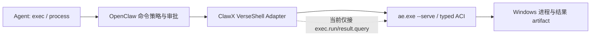

# VerseShell 能力审计与实施调度报告

> 审计日期：2026-07-27
>
> 审计对象：ClawX `C:\Users\27933\Desktop\clawx\ClawX-maturity-p0` 与 VerseShell `C:\Users\27933\Desktop\verseshell\verseshell`
>
> 当前裁决：`accept-for-controlled-development`，不具备 default-on、原生 shell 全量替代或 GA 资格
>
> 上游基线：VerseShell `1.0.0`，commit `c3983694407a9ddb23505e05fad4a9eae653b283`

## 1. 文件定位

本文是 VerseShell 在 ClawX 中的**能力差距审计、架构裁决和实施调度输入**，用于回答：

1. 上游能力是否真实存在，ClawX 是否已经使用；
2. 当前接入是否因裁剪导致能力缺失；
3. 哪些能力值得补齐，哪些能力会与现有系统重复或产生倒退；
4. 如何把 VerseShell 建成单一执行平面，同时不增加 Agent 的工具学习和智能路由成本；
5. 后续实现应按什么依赖顺序推进，如何验收和停止扩面。

本文不是以下权威的替代品：

| 权威 | 文件或目录 | 职责 |
|---|---|---|
| 当前发布/灰度状态 | `docs/dev/verseshell-foundation/STATUS.md` | 说明现在能否开启、是否可发布 |
| 能力审计与方向裁决 | 本文 | 解释差距、目标架构和实施顺序 |
| 实施约束与门禁 | `harness/specs/tasks/*.md` | 规定每个实施切片允许修改的范围与测试 |
| 正式任务排期 | `.agent-workbench/task-forest/` | 记录任务父子关系、状态、依赖和进度 |
| 单次会话续接 | `docs/dev/handoffs/LATEST.md` | 告诉下一会话从哪里继续，不作为长期架构真源 |

本文中的阶段是候选实施调度，不等于 Task Forest 已排期。Task Forest 只能在用户确认 proposal 后通过其 CLI 更新。

## 2. 系统背景

ClawX 是 Electron + React + OpenClaw Runtime 桌面应用。Agent 当前通过既有 `exec` 和 `process` 工具执行本地命令，由 OpenClaw 负责命令策略、allowlist、审批、环境清洗、会话和进程交互。

VerseShell 是 Rust 编写的 Agent-Computer Interface 运行时。它提供：

- typed JSONL ACI；
- capability 和 action-bound approval token；
- Windows Job Object 进程树超时终止；
- 有界 observation、语义 reducer 和结果 artifact；
- typed file/repo/test/transaction 操作；
- 可选 MCP 和 legacy eval 兼容面。

引入 VerseShell 的原始目的不是再增加一个 shell 工具，而是逐步替代 PowerShell、Git Bash 等原生 shell 作为 Agent 本地执行的**控制平面和进程承载层**。ClawX 仍然拥有用户授权和产品策略，VerseShell 拥有进程执行、生命周期、输出约束和底层审计。

目标不是让模型学习 26 个新工具，而是保持模型面对 `exec` / `process`，在内部统一进入 VerseShell。

## 3. 当前架构与已实现范围

当前已经实现：

- Electron 对 `ae.exe` 的路径、SHA-256、版本、协议和 operation catalog 进行验证；
- Gateway 只接受仓库定义的 `clawx-governed-exec-v1` profile；
- profile 只授予 `shell.exec`；
- OpenClaw 审批发生在 VerseShell 调用之前；
- `E_NEEDS_APPROVAL` 只允许用一次性 action token 在隔离进程中重试一次；
- governed 路径失败关闭，不回退 native shell；
- `exec.run` 返回有界 observation；
- `result.query`/`verseshell_result` 可以恢复有界 artifact 片段；
- 所有生产相关 flag 默认关闭，并有总 kill switch。

当前并未实现：

- VerseShell 作为所有本地命令的默认执行平面；
- 直接 argv 作为 ClawX 主路径；
- 请求级环境变量和 PATH prepend 的完整传递；
- stdin、后台进程、PTY/ConPTY、流式读取、主动取消和进程恢复；
- VerseShell 事务与 ClawX write journal 的统一；
- 26 个 operation 的全量模型侧暴露。

## 4. 版本与完整性审计

### 4.1 二进制结论

VerseShell 源码目录的 `target/release/ae.exe` 与 ClawX 的 `resources/bin/win32-x64/ae.exe` 完全相同：

| 项目 | 值 |
|---|---|
| 大小 | `14,446,592` bytes |
| SHA-256 | `63716c3f0589c0291443f770a0ede97d728fb842aa39f50ac230ee7b5175e884` |
| Cargo 默认 feature | `native` |
| 协议 | `verseshell.jsonl/v1` |
| catalog schema | `verseshell.operation-catalog/v1` |
| catalog count | `26` |
| catalog digest | `sha256:857eb12ca6b83da190764263a4e4a0181d3cd047926f0d404fc3a4c93c9f4848` |

结论：**ClawX 没有使用裁剪版二进制。问题在接入层，不在打包层。**

### 4.2 本轮重新核验的证据

- 上游 `operation_protocol_tests`、`aci_1_0_ops_tests`、`aci_1_0_closed_loop_acceptance` 共 22 项通过；
- 实际调用 `runtime.handshake` 和 `ops.list` 成功；
- 实际调用 `file.view`、`repo.summary` 成功，证明相关 operation 不是占位；
- `node --version` 直接 argv 成功；
- `pnpm --version` 裸命令直接 argv 返回 `E_EXEC_SPAWN`；
- `pnpm.cmd --version` 绝对路径直接 argv 成功；
- VerseShell 上游工作树在审计结束时保持干净。

### 4.3 继承的项目证据

`STATUS.md` 已记录 `pnpm verseshell:test`、focused OpenClaw tests、typecheck、manifest/package、comms replay/compare 等结果。本文不把这些历史证据冒充成本轮重新执行的结果。

当前仍缺少：已安装 Electron 包的真实启动、provider-backed Agent canary、长期运行、故障恢复和操作员 rollback 证据。

## 5. “残血版本”判定

准确描述是：

> **完整二进制、受限接入、上游生命周期能力未完成。**

具体分三层：

1. **上游有且 ClawX 已用**：`runtime.handshake`、`exec.run`、`result.query` 的主要契约；
2. **上游有但 ClawX 未用**：大部分 typed file/repo/test/transaction/meta operation；
3. **上游本身没有**：ConPTY、stdin 流式输入、后台进程生命周期、`start/poll/read/write/kill`、流式 observation。

因此不能通过“把 26 个 operation 全部打开”解决问题。真正阻止全量替代的是第三层，以及第一层仍存在的命令契约缺口。

## 6. 26 项能力处置矩阵

| 类别 | Operation | 当前状态 | 裁决 |
|---|---|---|---|
| 核心执行 | `exec.run` | 已接入，但仍包装原生 shell | 必须补全 |
| 结果恢复 | `result.query` | 已接入、flag 控制 | 保留并统一到现有工具体验 |
| 运行时契约 | `runtime.handshake` | 进程启动时内部使用 | 必须保留，不暴露给模型 |
| catalog | `ops.list` | 能调用，主路径未作为诊断面使用 | 接 Workbench/启动诊断，不暴露给模型 |
| observation | `ops.observation_recent`、`ops.observation_open_errors` | 未接入 | 解决 agent 隔离后内部接 telemetry |
| 删除恢复 | `file.remove`、`tx.restore` | 未接入 | 统一 write journal 后再评估 |
| 普通文件能力 | 除 `file.remove` 外的 8 个 file operation | facade 中仅部分声明，Agent 未调用 | 不新增模型工具，复用 ClawX 现有 read/edit/write/apply_patch |
| Repo | 3 个 repo operation | 未接入 | 不引入；搜索弱于现有 `rg`，git 输出已有 reducer |
| Test | 3 个 test operation | 未接入 | 不引入；发现规则过窄且 last-test 状态进程全局 |
| Transaction | `tx.begin/commit/rollback/status` | 未接入 | 上游完成 session 隔离且覆盖统一写入前禁止启用 |

数量核对：4 个核心/契约 + 2 个 observation + 2 个删除恢复 + 8 个普通 file + 3 个 repo + 3 个 test + 4 个 transaction = 26。

## 7. 主要问题与风险

### P0-1：当前 typed exec 仍是 shell-string 执行

`openclaw_runtime/src/agents/verseshell/shell-command.ts` 把命令包装为：

- Windows `cmd.exe /D /C`；
- PowerShell/pwsh `-Command`；
- Git Bash 或 `sh -lc`。

因此当前收益主要是二次授权、Job Object、输出压缩和 artifact，而不是 argv 隔离。shell quoting、管道、重定向和字符串解析风险依然存在。

### P0-2：Windows 命令解析不完整

上游直接使用 Rust `Command::new(argv[0])`。实测裸 `pnpm` 无法启动，而绝对 `pnpm.cmd` 可以。全量切换前必须支持：

- `PATH` 搜索；
- `PATHEXT`；
- `.exe/.com/.cmd/.bat`；
- 路径空格、Unicode 和工作目录；
- npm/pnpm/yarn/corepack shim；
- 明确的可执行文件解析结果和审计记录。

`.cmd/.bat` 本质仍需要 Windows batch interpreter。目标应是让它成为 VerseShell 管理的显式子进程，而不是安全和调度控制平面；常用包管理器可进一步解析到 `corepack` 或底层 Node 入口。

### P0-3：请求级环境没有进入 exec.run

ClawX 当前会构造清洗后的 `env` 和 `pathPrepend`，但 governed VerseShell 调用没有把它们发送给 `exec.run`；上游 `ExecArgs` 也没有 `env` 字段。插件环境 hook 对 `host=verseshell` 还会被跳过。

这会导致同一条命令在 gateway host 和 VerseShell host 上行为不同，是全量切换的硬阻塞。

### P0-4：现有 exec/process 功能会倒退

VerseShell 1.0 的进程路径是 stdin=null、stdout/stderr pipe、`CREATE_NO_WINDOW`，不是 ConPTY。当前 ClawX VerseShell branch：

- 等待 `exec.run` 完成后才返回；
- 不能真正 background/yield；
- 没有实时 `onUpdate`；
- `kill` 是 no-op；
- 无法通过 `process` 写 stdin、发送按键、轮询日志或终止任务。

在这些能力补齐之前把 VerseShell 设为默认 host，会造成明确的产品功能回归。

### P0-5：workspace jail 不能被描述成进程沙箱

VerseShell 会校验 typed file path 和 cwd，但 `exec.run` 的外部子进程仍可以访问工作区外资源。它不是 OS 级 filesystem sandbox。

所以 OpenClaw allowlist/approval、必要时的 sandbox 容器和操作系统权限仍是主安全边界，不能被 VerseShell workspace jail 替代。

### P1-1：状态型 operation 缺少会话隔离

VerseShell transaction 使用进程级全局 `Mutex<Option<TxState>>`；`test.summarize_last` 也使用进程级全局 last-test。ClawX process key 未包含 `agentId`，governed exec 调用当前也没有传入实际 agentId，因此 observation ledger 会退化成共享的 `openclaw` 身份。

在多 Agent 或同 workspace 并发下直接启用这些 operation，会造成状态串扰。

### P1-2：VerseShell transaction 覆盖范围不完整

transaction 只在 VerseShell typed file/builtin 写操作前调用 snapshot。通过 `exec.run` 执行的 git、编译器、脚本或 shell 写入不会进入 transaction。

ClawX 已有按 session 持久化的 write journal、stale-write guard、逐文件 mutation queue、destructive tier 和 `undo_write`。并行保留两套事务会产生双日志、回滚顺序冲突和错误的安全承诺。

### P2：工具面膨胀与学习成本

向模型暴露全部 26 个 operation 会增加工具定义 token、工具选择错误和调用轮次。多数 file/repo/test operation 弱于或重复 ClawX 已有工具。收益不足以覆盖学习和维护成本。

## 8. 我的理解与目标架构

### 8.1 “全量使用”的正确含义

全量使用应定义为：

> 所有本地进程创建、生命周期、输入输出、超时终止和 artifact 都经过 VerseShell；Agent 仍只使用 ClawX 的 `exec` 与 `process`，不需要在多个 host 或 26 个 operation 之间路由。

它不等于：

- 暴露全部 VerseShell operation；
- 删除 ClawX 的审批和工具治理；
- 宣称 VerseShell 是 OS sandbox；
- 立即移除所有解释器；
- 用 VerseShell 的简化 file/repo/test 实现替换更成熟的 ClawX 实现。

### 8.2 目标职责划分

| 组件 | 最终职责 |
|---|---|
| Agent 工具层 | 继续提供稳定的 `exec` / `process` 交互，不增加学习面 |
| OpenClaw | 命令理解、allowlist、用户审批、风险分级、环境清洗 |
| 审批后的规范化执行计划 | 固化 program/argv/pipeline/redirection/env/cwd/pty，避免审批内容与执行内容二次解析不一致 |
| VerseShell | 唯一的本地进程执行与生命周期服务、Job Object/ConPTY、输出 reducer、artifact、执行审计 |
| Electron | 二进制供应链验证、启动配置、kill switch 和产品诊断 |
| ClawX write system | 文件 mutation queue、stale guard、journal、undo 和写后诊断 |

关键设计是复用 OpenClaw 已经完成的命令审批解析，让它输出不可变的规范化执行计划，再交给 VerseShell。不要在审批后重新用另一套智能逻辑解析命令字符串。

### 8.3 原生 shell 的最终位置

普通命令、管道、重定向和进程交互应逐步转为 typed execution plan，由 VerseShell 直接创建进程。只有用户明确要求执行 PowerShell/Bash 脚本时，解释器才作为受控 payload 子进程存在。

这样 PowerShell/Git Bash 不再是 Agent 的默认控制平面。若要求物理上完全消除解释器，则需要实现完整 shell grammar 或要求 Agent 学习 VerseShell 语言，成本远高于当前收益，不作为本轮目标。

## 9. 实施调度

所有阶段严格串行。每次只推进一个 work package，不并行扩展 file/repo/test/transaction。

### G0：治理登记与新 Harness spec

目标：将本报告转化为正式、可验证的任务边界。

- 用户确认 Task Forest proposal；
- 在 `TF-0007` 下新增“VerseShell 单一执行平面与能力补全”；
- 初始状态设为 `review_needed`，不改变 `TF-0006`；
- 新建 Harness task spec，并引用 `gateway-backend-communication`；
- 运行 `pnpm harness context --spec <new-spec>` 后才能实现。

退出条件：父节点、non-goals、acceptance、touchedAreas 和 requiredTests 均明确。

### G1：规范化执行计划与直接 argv

目标：去掉普通命令对 `cmd /C`、PowerShell 和 Git Bash 包装的依赖。

上游 VerseShell：

- 实现 Windows `PATH + PATHEXT` resolver；
- `exec.run` 接收受限 env、stdin 模式和规范化 executable identity；
- 审计实际解析后的 executable；
- 保持 Job Object、超时和 artifact 行为。

ClawX：

- 让现有命令审批阶段产生规范化 execution plan；
- 将已批准 plan 原样提交 VerseShell；
- 保留 command string 作为兼容输入，但不在批准后重新解释；
- 不增加新的模型工具名。

最低兼容矩阵：`.exe/.com/.cmd/.bat`、npm/pnpm/corepack、路径空格、Unicode、cwd、env、非零退出、超时、超长 stdout/stderr、无输出成功。

退出条件：普通命令不再默认包装 shell；兼容矩阵全绿；无 native fallback。

### G2：进程生命周期与 ConPTY

目标：补齐 ClawX 现有 `exec/process` 的功能，不允许全量切换后倒退。

建议新增 VerseShell typed API：

- `process.start`；
- `process.poll`；
- `process.read`；
- `process.write`；
- `process.kill`；
- `process.list` 或等价的受限恢复接口。

必须覆盖：后台执行、stdin、PTY/ConPTY、流式输出、主动取消、超时杀进程树、进程退出保留、Gateway 重启后的可解释状态、每 session/agent 隔离。

退出条件：ClawX 当前 exec/process E2E 行为在 VerseShell host 上达到功能等价。

### G3：ClawX 单一执行平面切换

目标：所有本地 gateway 执行统一进入 VerseShell，模型不承担 host 路由。

- `exec` 前台执行映射到 `exec.run` 或 `process.start + wait`；
- `process` 映射到 VerseShell lifecycle API；
- artifact 查询并入现有 `process log/read` 体验，避免长期增加独立工具；
- 保持 sandbox/node 等非本地执行边界独立；
- 保持 kill switch 和失败关闭；
- native gateway shell 只作为开发期可显式选择的回滚基线，不在 governed 路径自动 fallback。

退出条件：真实 Agent 不需要选择 `host=verseshell`，且功能、授权和可恢复性无回归。该条件仍不自动授予 default-on。

### G4：真实 canary 与收益门禁

目标：证明收益大于集成和学习成本。

记录以下配对指标：

- 任务完成率；
- 平均工具调用轮次；
- provider 实际 input/output/cache tokens；
- 冷/热启动和 p50/p95 延迟；
- artifact 产生率、恢复率和额外调用数；
- 审批次数、拒绝准确性；
- background/PTY/cancel 成功率；
- native fallback 次数，目标为 0；
- 未授权写入、越权和敏感信息泄漏，目标为 0。

只有 provider-backed 配对数据才能支持 token/成本收益结论。启发式 token estimate 只能用于诊断。

退出条件：package/install、真实任务、outage、tamper、restart、approval deny、artifact recovery、kill-switch rollback 均有操作员证据，并由负责人给出继续/缩小/停止决定。

### G5：可选的删除恢复统一

目标：只有在明确需要目录级删除恢复时，评估 `file.remove + tx.restore`。

前置条件：

- transaction 按 workspace + session/agent 隔离；
- VerseShell 和 ClawX 只有一个 journal authority；
- exec 产生的外部写入边界被明确标记为不可事务化，不能宣称原子回滚；
- 目录、symlink、跨卷、冲突恢复和 restart 均有测试。

若不能统一 authority，则不引入该阶段。

## 10. 首个可执行工作包

在获得 Task Forest proposal 确认后，第一个实现工作包应严格限定为：

> **G1：审批后规范化执行计划 + Windows argv/PATHEXT + 请求级 env 契约。**

本工作包不包含：

- ConPTY 或后台任务；
- file/repo/test operation 接入；
- transaction；
- MCP；
- legacy eval；
- default-on；
- native fallback；
- UI 扩面。

建议的交付顺序：

1. 在 VerseShell 源码仓建立失败测试和协议字段；
2. 完成 resolver/env/执行计划支持并跑 Rust acceptance；
3. 生成新的 clean source commit 和 release `ae.exe`；
4. 更新 ClawX bundle、manifest、许可与对应源码定位；
5. 修改 ClawX adapter，复用审批后的规范化 plan；
6. 跑 focused unit、real-binary、typecheck、comms 和 Harness 门禁；
7. 更新 `STATUS.md`、README 和 evidence；
8. 经确认后更新 Task Forest、validate、export，并写 handoff。

## 11. 验收与硬性 NO-GO

以下任一项存在时，不得切换为默认执行平面：

- command string 仍默认通过 `cmd /C`、PowerShell 或 Git Bash；
- 请求级 env/PATH 行为与 gateway host 不一致；
- background、PTY、stdin、poll/log/write/kill 任一关键行为退化；
- Agent abort 无法终止前台任务；
- 多 agent/session 状态发生串扰；
- 将 workspace jail 宣称为 OS sandbox；
- governed 路径存在自动 native fallback；
- 未安装包、真实 provider canary 或 rollback 证据；
- 用估算 token 代替 provider 实际 usage 宣称收益；
- 为追求“能力全量”向模型暴露重复的 26 工具。

## 12. 明确不引入的内容

- 内部 `ae-mcp.exe` 依赖：`ae.exe --serve` 已提供 typed ACI；
- legacy eval 主路径；
- Bash transpiler fallback；
- `cap all` 或 permissive policy；
- governed exec 的 native fallback；
- 重复的普通 file/repo/test 模型工具；
- 在事务隔离和 authority 未统一前启用 tx operation。

## 13. Task Forest 候选提案

建议但尚未写入：

| 字段 | 建议值 |
|---|---|
| parent | `TF-0007` |
| title | `VerseShell 单一执行平面与能力补全` |
| kind | `task` |
| initial status | `review_needed` |
| purpose | 让所有本地 Agent 进程在不增加模型工具学习成本的前提下，经由安全、可审计、可恢复的 VerseShell 执行平面运行 |
| desired outcomes | argv/env 契约完整；exec/process 生命周期等价；单一执行平面；真实 canary 证据 |
| non-goals | 26 工具暴露、MCP 主路径、legacy eval、default-on、GA、解除 TF-0006 |
| fit | `aligned`，建议置信度 `0.90` |
| why this task | 直接服务于 TF-0007 的受控内部投用目标，并减少 native shell 和双执行平面的长期维护成本 |
| why not enough | 不提供联合系统 GA，也不替代 TF-0006 所需真实 corpus/live A/B/soak/product approval |
| validation | G1-G4 分阶段门禁、真实 package/provider canary、kill-switch rollback |

为遵守“一次只推进一个 ready 节点”，确认该提案时还需要决定：继续先执行当前 ready 的 `TF-0009`，还是把 VerseShell 节点提升为下一优先节点。未确认前保持 `review_needed`。

## 14. 审计裁决

1. ClawX 使用的是完整 VerseShell 二进制，不需要重新引入另一份“完整版”。
2. 当前安全适配是有效的 canary foundation，但还不是原生 shell 的功能等价替代。
3. 最大价值在统一进程执行、输出压缩、artifact 和生命周期，不在复制 file/repo/test 工具。
4. 最大阻塞是 execution plan、Windows resolver、env、stdin/PTY/background/cancel，不是 operation 数量。
5. 正确路线是扩展 VerseShell 的执行内核，再让 ClawX 现有 `exec/process` 无感全量使用。
6. 事务和删除恢复只有在 journal authority 统一后才值得引入。
7. 先完成 G1，再讨论 G2；禁止同时铺开 26 项能力。
