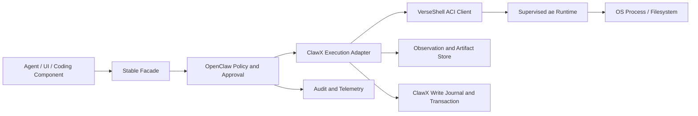

# VerseShell 基座化开发规划

版本：v1.0  
日期：2026-08-14  
适用范围：ClawX Electron、OpenClaw runtime、VerseShell runtime、coding 组件接入和后续 canary 发布。

## 1. 文档目标

本文件是交付给开发团队的实施规划，不是能力宣传稿。目标是把 VerseShell 从一个“可独立运行的结构化 shell”发展为 ClawX 的**本地 coding 执行基座**：

- 为文件、仓库、进程、测试、构建、Git、诊断和结果查看提供统一的执行契约。
- 保持模型侧工具面小而稳定，不把 VerseShell 的全部内部 operation 暴露给模型。
- 把策略、审批、workspace、写入事务、进程生命周期和结果工件放在明确的责任边界内。
- 让新增 coding 组件主要通过 adapter 和 facade 接入，而不是重复实现进程、超时、输出截断、审批和恢复逻辑。
- 在修复当前 P0 阻断问题之前保持 `default-off`，不把工程测试通过误判为产品可用。

本规划依赖以下现有文档：

- `docs/dev/verseshell-foundation/REAL-CAPABILITY-AUDIT.zh-CN.md`：真实能力和短板审计。
- `docs/dev/verseshell-foundation/CAPABILITY-AUDIT-AND-IMPLEMENTATION-PLAN.zh-CN.md`：已有能力差距和 rollout 方向。
- `docs/dev/verseshell-foundation/STATUS.md`：当前发布状态的权威来源。
- `harness/specs/tasks/verseshell-typed-aci-adaptation.md`：typed ACI 接入的任务边界和验收规则。

如果本文件与 `STATUS.md` 的当前状态冲突，以 `STATUS.md` 为准；如果实施需要改变现有安全边界，应先更新对应 harness spec 和规则，再修改代码。

## 2. 目标定位

### 2.1 VerseShell 应该成为什么

VerseShell 应该是一个**受监督的本地执行内核**，向上提供四类基础能力：

1. 统一输入：typed operation、结构化参数、明确的 workspace 和 deadline。
2. 统一执行：进程启动、argv、stdin、PTY、超时、取消、进程树回收和重启管理。
3. 统一输出：有界 observation、诊断、错误码、结果 artifact 和可恢复查询。
4. 统一治理挂点：能力 profile、审批 token、策略摘要、审计事件和 fail-closed。

VerseShell 不应成为所有产品逻辑的归属地。它不负责决定“用户是否允许操作”，也不负责取代 ClawX 的文件写入 journal、Git 业务语义或 UI 状态管理。

### 2.2 目标用户体验

对 agent 而言，基本 coding 工作流应收敛为：

```text
read_file -> search_content -> run_command -> result_query
```

这四个 facade operation 已存在于 `shared/verseshell/facade.ts`，应继续作为模型可见的稳定最小面。更多内部 operation 可以由 adapter 使用，但不能因为内部能力增加就同步扩大模型工具目录。

对 UI 和其他本地组件而言，应该能够复用同一套执行服务：

```text
组件请求 -> host/api facade -> policy + approval -> VerseShell ACI
          -> bounded observation + artifact -> 组件自己的语义结果
```

## 3. 非目标和硬边界

以下事项不属于本阶段目标：

- 立即删除 PowerShell、Git Bash 或现有 native terminal。
- 将 VerseShell 的 31 个 operation 全部暴露给模型。
- 允许模型选择 `host=verseshell`、capability、policy 或 approval token。
- 通过 MCP 作为 ClawX 内部主通道。
- 用 workspace jail 宣称已经具备 OS/container 级沙箱。
- 让 governed execution 在 runtime 故障时自动回退 native shell。
- 让外部 shell 的任意写入自动获得事务可回滚语义。
- 在没有真实 canary 证据时默认开启或宣称 GA。

## 4. 目标架构和责任分层



### 4.1 OpenClaw runtime

负责：

- agent、session、工具调用和命令策略。
- approval 分析和一次性 action-bound token。
- capability profile 的选择和 provenance。
- governed failure 的 fail-closed 决策。
- 对外的工具 schema 和模型可见 facade。

不负责：

- 直接拼接 shell string。
- 自己实现进程树 kill、输出截断或 JSONL framing。
- 接受模型传入的 `policy`、`capabilities`、approval 环境变量。

主要代码边界：

- `openclaw_runtime/src/agents/verseshell/`
- `openclaw_runtime/src/agents/agent-tools.ts`
- `openclaw_runtime/src/config/runtime-verseshell-foundation.test.ts`
- `shared/verseshell/types.ts`
- `shared/verseshell/facade.ts`

### 4.2 ClawX Electron/Main

负责：

- 解析并验证随包 runtime、版本、协议、catalog 和 binary digest。
- workspace canonical path、权限和用户作用域。
- 文件变更 journal、stale-write guard、mutation queue、undo/rollback。
- UI、诊断面板、日志和支持包。
- 通过 host-api 暴露给 renderer 的受控入口。

不负责：

- 在 renderer 中直接调用 `ae.exe` 或 Gateway HTTP。
- 把任意环境变量传给 VerseShell 以绕过审批。
- 把外部进程写入伪装成 VerseShell transaction 已经覆盖。

### 4.3 VerseShell runtime

负责：

- typed JSONL ACI 解码和响应。
- operation 参数校验、执行和语义错误。
- 进程生命周期、stdout/stderr 边界、artifact 生成。
- runtime 内部 capability enforcement 和 workspace path 检查。

不负责：

- ClawX 的产品级用户授权。
- OpenClaw 的最终 approval 决策。
- 替代 OS 级沙箱。
- 擅自扩大 capability 或自动降级到 native shell。

### 4.4 MCP 兼容层

MCP 只作为外部兼容 adapter。内部调用必须走 typed ACI/facade。MCP 的默认权限应为 deny，任意 eval 只能存在于明确的开发 profile；它不能绕过 OpenClaw policy、ClawX workspace 或 governed owner。

## 5. 统一契约

### 5.1 请求契约

沿用 `shared/verseshell/types.ts` 的 typed request：

```ts
type OperationRequest = {
  id: string;
  agent: string;
  op: string;
  args: JsonObject;
  timeout_ms: number;
  budget: { max_tokens: number };
};
```

未来应在内部 context 中补充以下不可由模型直接控制的字段：

```ts
type ExecutionContext = {
  requestId: string;
  traceId: string;
  workspaceId: string;
  canonicalCwd: string;
  agentId?: string;
  policyProfileId: string;
  policyProfileDigest: string;
  approvalToken?: string;
  deadlineAt: number;
  idempotencyKey?: string;
  source: 'agent' | 'ui' | 'system' | 'test';
};
```

`approvalToken`、capability、policy digest 和 binary identity 必须由 host/runtime 注入和验证，禁止从模型参数或任意用户环境变量读取。

### 5.2 观察结果契约

所有 operation 都返回 `verseshell.observation/v1`：

- `ok`：业务是否成功。
- `data`：结构化数据或有限文本，不返回无限日志。
- `error`：稳定错误码、可恢复性、提示和可选修复建议。
- `diagnostics`：工具、路径、行列、期望/实际值等结构化诊断。
- `meta`：耗时、profile、token estimate、effects、capabilities_used。
- `artifact`：通过 `result://sha256/...` 引用较大结果。

传输失败和业务失败必须分开：

| 类型 | 示例 | 处理 |
|---|---|---|
| 业务失败 | `E_NEEDS_APPROVAL`、命令退出码非零 | 返回 observation，保留语义错误 |
| 协议失败 | `E_ACI_PROTOCOL`、schema mismatch | 停止当前 process，fail-closed |
| 生命周期失败 | `E_ACI_PROCESS_EXITED`、timeout | 标记 transport/lifecycle 状态，不重放 effectful 请求 |
| 契约失败 | version、catalog、policy digest drift | 阻止执行，要求重新验证 |

### 5.3 Operation 分层

| 层级 | 典型 operation | 默认策略 | 是否允许自动重试 |
|---|---|---|---|
| R0 只读 | `file.view`、`repo.search`、`repo.summary`、`result.query` | allowlist | 仅在请求未发送或明确幂等时 |
| R1 进程 | `exec.run`、`process.start/poll/list` | policy + approval | 只读命令可重启后重试；不重放未知副作用 |
| R2 写入 | `file.patch`、`tx.commit`、受控生成器 | workspace precondition + approval + journal | 禁止自动重放，必须使用 idempotency/precondition |
| R3 高风险 | 网络、密钥、任意 eval、外部删除 | 默认 deny | 不进入基础 facade |

当前 release 只放行已有 governed profile 和明确的 `shell.exec`；R2/R3 要通过独立 profile、任务 spec 和真实验收后再启用。

## 6. Coding 组件接入模型

新增组件不得直接生成 shell string。每个组件必须实现一个 adapter，声明 canonical operation、输入 schema、效果等级、结果归一化和测试。

| Coding 组件 | 首选 canonical operation | VerseShell 提供 | 产品层负责 |
|---|---|---|---|
| 文件查看器/编辑器 | `file.view`、未来 `file.read_range`、`file.patch` | path 校验、读取边界、结果封装 | 编辑状态、journal、冲突提示、undo |
| 代码搜索 | `repo.search` | bounded matches、glob/path 约束、artifact | 搜索 UI、排序、跳转和缓存 |
| Git 状态和 diff | `repo.summary`、受控 `exec.run` | argv、超时、输出截断 | Git 语义、凭据、分支操作确认 |
| 测试/构建/lint | `exec.run` + command profile | 进程树、stdin、timeout、artifact | 任务编排、测试结果解析、失败导航 |
| 包管理器 | 受控 `exec.run` | argv 和 output budget | 网络权限、lockfile 策略、安装确认 |
| 诊断/环境探针 | `runtime.handshake`、`ops.list`、health API | 版本、能力、生命周期状态 | UI 展示、支持包、告警和 kill switch |
| 大日志/测试报告 | `result.query` | head/tail/slice/grep、artifact TTL | 展示分页、下载权限、敏感信息遮罩 |
| 交互式终端 | process lifecycle / PTY 内部接口 | PTY、cancel、kill、回收 | 终端 UI、用户直接控制和会话持久化 |

### 6.1 适配器接口建议

```ts
export interface CodingOperationAdapter<TArgs, TResult> {
  readonly id: string;
  readonly canonicalOp: string;
  readonly effect: 'read' | 'process' | 'write' | 'high-risk';
  readonly inputSchema: JsonSchema;
  validate(args: unknown): TArgs;
  execute(ctx: ExecutionContext, args: TArgs): Promise<Observation>;
  normalize(observation: Observation): TResult;
}
```

适配器只能使用 `VerseShellAciClient`、ClawX journal API 和 OpenClaw policy API；不得私自 spawn 子进程。这样新增 `cargo test`、`pnpm lint`、`git diff` 或自定义代码检查器时，进程边界和治理逻辑不会分叉。

## 7. 关键修复和优化策略

### 7.1 P0：恢复可启动、可验证、可重建

1. 修复 `verseshell-runtime/src/cache.rs` 的 `Instant` 下溢。推荐使用 `checked_sub` 或显式 `empty` 状态，不能依赖系统 uptime 大于一小时。
2. 加入重启后、短 uptime、`--agent`/非 agent、JSON/compact 的 server smoke test。
3. 统一 manifest、Cargo package、typed operation request、handshake 和 catalog digest。不能同时维护 manifest 1.0.0 与 runtime 0.3.0 的旧 `cmd` 协议。
4. 固定 source snapshot、patch、lockfile 和构建工具链，消除 dirty build input；CI 必须从干净 checkout 重建并比较 binary digest。
5. 修复 `governed-exec.real.test.ts`，审批拒绝必须返回 `E_NEEDS_APPROVAL`，不能因 runtime 先退出而变成未分类的 process-exit。
6. `cargo test --no-run` 必须成为真实门禁，不能只运行 TypeScript 和 bundle 测试。

### 7.2 P1：把 runtime 变成可靠的受监督服务

1. 将 process manager 生命周期明确为 `starting -> handshaking -> ready -> backoff/stopped/failed`。
2. 对每个请求绑定 request id、trace id、deadline 和 process key；任何响应 id 不匹配都视为协议错误。
3. 对 stdout、stderr、单行 JSON 和总 observation 设置独立上限；截断必须返回明确 metadata 和 artifact，而不是静默丢失。
4. 只对只读、幂等请求提供受控重试；写入和未知副作用请求禁止自动重放。
5. runtime 崩溃时映射为稳定生命周期错误，保留 exit code、signal、最后阶段和 restart attempt；不要把原始 stderr 直接交给模型。
6. 增加健康检查和 operator kill switch，但 kill switch 触发时必须 fail-closed，不能自动切 native shell。

### 7.3 P1：统一写入和恢复语义

写入能力分两步落地：

- 第一阶段只允许 `file.patch` 生成预览和 precondition，不直接提交；ClawX journal 是唯一 commit authority。
- 第二阶段才允许经过审批的 `tx.commit`，提交前保存基线 hash、变更列表和 operation id；提交后产生可审计 artifact。

外部命令例如编译器、脚本和 Git hook 的写入无法天然纳入 VerseShell transaction。开发团队必须在 adapter 中明确标记 `effects=['external_write']`，由 ClawX 决定是否允许、如何做快照和如何提示不可回滚。

### 7.4 P1：收紧 MCP 和兼容面

- 默认 capability 为 deny，禁止 `cap all`。
- `verseshell_eval` 仅在开发 profile，产品构建不打包或不注册。
- `verseshell_shell_exec` 必须转换为明确 argv，并经过与 governed exec 相同的 policy boundary；否则从产品路径移除。
- MCP 依赖必须在安装、打包和启动 smoke test 中验证。
- MCP 版本、runtime 版本和仓库兼容包版本必须单一来源，不能用环境中另一个 `0.6.0` 服务掩盖仓库 `0.3.1` 包缺失。

### 7.5 P2：面向 coding 工作流的针对性优化

这些优化必须建立在 P0/P1 稳定后：

- 对 `repo.search` 做 workspace-aware 索引和结果 fingerprint，避免重复扫描。
- 对 `exec.run` 建立 command profile，例如 test/build/lint/git，限制 cwd、环境变量、超时和可写目录。
- 对大测试日志默认返回摘要和 artifact；模型需要细节时通过 `result.query` 定向读取，不重复传输全文。
- 对频繁的只读查询增加短 TTL 缓存，但缓存键必须包含 workspace、revision、operation args 和 policy profile。
- 对多步骤 coding 任务使用 parent trace 和 child request id，记录“搜索、读取、修改、测试、结果查询”的因果链。
- 建立失败分类：编译错误、测试断言、工具缺失、权限拒绝、环境错误、runtime 故障，分别映射到可执行的 suggested action。
- 将 Git、测试、lint 和代码审查结果归一化为统一诊断模型，减少每个组件自己的日志解析器。

## 8. 分阶段交付计划

### Phase 0：止血和发布完整性

目标：没有 runtime panic，真实 server 和 governed suite 可重复验收。

交付物：

- cache 下溢修复和回归测试。
- 统一 1.0 typed ACI source/build/protocol。
- clean rebuild、manifest digest、handshake/catalog CI gate。
- `pnpm verseshell:test`、Rust compile/test、real probe 全绿。

退出条件：P0 全部关闭；失败时保持 `default-off`。

### Phase 1：稳定执行内核

目标：把 `VerseShellProcessManager` 和 `VerseShellAciClient` 变成唯一进程执行入口。

交付物：

- lifecycle、timeout、cancel、restart、backoff、request correlation。
- bounded observation、artifact、result query。
- 稳定 transport/lifecycle/contract 错误码。
- health、kill switch 和诊断事件。

退出条件：短命令、长命令、超时、取消、崩溃、重启、超大输出均有可审计结果；effectful 请求不被重放。

### Phase 2：只读 coding 基座

目标：先承载低风险、可重复的 coding 读取工作流。

交付物：

- `read_file`、`search_content`、`result_query` 的真实 facade 路径。
- repo summary、hash、bounded diagnostics。
- workspace path broker 和 revision-aware cache。
- UI、agent、support bundle 共用同一 observation contract。

退出条件：真实仓库中可完成“定位文件、搜索符号、读取上下文、查询测试报告”，无越界读取和敏感输出泄漏。

### Phase 3：受控进程和测试基座

目标：用统一 process plane 承载测试、构建、lint 和 Git 只读命令。

交付物：

- command profile registry。
- argv-only adapter，禁止 shell-string 拼接。
- test/build/lint/git 的结果归一化和 artifact 关联。
- timeout、resource、working-directory 和环境白名单。

退出条件：真实 paired task 中，VerseShell 与现有执行路径结果可比较；没有 native fallback 伪装成功。

### Phase 4：写入和事务协作

目标：让文件变更具备 precondition、journal、冲突和恢复语义。

交付物：

- `file.patch` preview、base hash、diff artifact。
- ClawX journal commit、undo、stale-write guard。
- external write 的明确标记和回滚限制。
- 审批、变更摘要和用户确认 UI。

退出条件：并发修改、失败提交、进程中止和用户撤销均有确定状态，不将不可回滚写入误报为可恢复。

### Phase 5：真实 canary 和逐步扩大

目标：用真实证据决定是否扩大到更多 agent、provider 和平台。

交付物：

- provider-backed paired A/B。
- 内部 cohort、soak、资源/延迟和恢复记录。
- artifact recovery、operator rollback、kill-switch drill。
- Windows x64 之外的平台构建和最小握手验收。

退出条件：`liveReady=true`、`productApproved=true`，且 `STATUS.md` 明确解除对应锁定；否则继续 default-off。

## 9. 任务拆分建议

| 任务 ID | 主要范围 | 依赖 | 负责人类型 | 必须验证 |
|---|---|---|---|---|
| VS-P0-01 | cache panic 修复 | 无 | Rust runtime | uptime/restart smoke |
| VS-P0-02 | 1.0 typed source/build 对齐 | VS-P0-01 | runtime + release | clean rebuild/digest |
| VS-P0-03 | governed real probe 修复 | VS-P0-01/02 | OpenClaw | approval/denial/retry |
| VS-P1-01 | lifecycle 和错误码 | VS-P0-03 | OpenClaw/runtime | crash/timeout/cancel |
| VS-P1-02 | observation/artifact 统一 | VS-P1-01 | runtime + shared | truncation/query/recovery |
| VS-P1-03 | MCP 默认 deny 和依赖验收 | VS-P0-02 | compatibility | install/start/security |
| VS-P2-01 | read/search facade adapter | VS-P1-02 | coding integration | real repo read/search |
| VS-P2-02 | command profile 和 test/build adapter | VS-P1-01 | coding integration | argv/policy/output |
| VS-P2-03 | diagnostics and trace correlation | VS-P1-01/02 | observability | request lineage |
| VS-P3-01 | patch preview/journal bridge | VS-P2-01 | ClawX main | precondition/undo |
| VS-P3-02 | external write policy | VS-P2-02 | security/product | no false rollback |
| VS-P5-01 | real canary evidence | all previous | release/operator | paired/soak/rollback |

每个任务必须有对应 harness spec 或更新现有 spec；涉及 renderer/Main/Gateway/OpenClaw 通信时，必须遵守 `gateway-backend-communication` 任务规范并运行 comms replay/compare。

## 10. 验收和质量门槛

### 10.1 必过门禁

```text
pnpm harness validate --spec <task-spec>
pnpm verseshell:test
pnpm run typecheck
pnpm run comms:replay
pnpm run comms:compare
git diff --check
```

涉及 Rust runtime 时增加：

```text
cargo test --manifest-path verseshell-runtime/Cargo.toml
cargo test --manifest-path verseshell-runtime/Cargo.toml --no-run
```

### 10.2 产品级指标

在建立基线前只记录，不宣称目标已经达成。进入 canary 前至少要有：

- handshake success、process crash、protocol mismatch、timeout、cancel 的分类统计。
- 未授权执行数为 0，native fallback 伪装成功数为 0。
- 结果截断必须有 artifact 和 omitted bytes，不能静默丢失。
- 只读请求的重启恢复率、写入请求的禁止重放率。
- 真实任务完成率、人工恢复时长、P95 启动和执行延迟。
- artifact 过期、丢失、查询和恢复的结果记录。
- MCP 使用量与 governed facade 使用量分开统计。

### 10.3 安全门槛

- 任何 `cap all`、任意 model-provided approval、未验证 binary、协议/catalog drift 都 fail-closed。
- workspace 之外访问、敏感输出、未声明 external write 都应被拒绝或显式标记。
- 任何 effectful 请求不得因为 transport restart 自动重复。
- kill switch 后不产生新执行，不自动降级 native shell。

## 11. 开发团队的实现原则

1. 先修稳定性和契约，再扩 operation；不要在 P0 runtime crash 未关闭时增加更多 facade。
2. 先稳定四个模型可见 facade，再通过 adapter 增加 coding 组件；内部 operation 数量不是产品能力指标。
3. 任何新组件先回答“谁拥有策略、谁拥有写入、谁拥有恢复”，再写代码。
4. 所有输出都要有边界；全文日志必须通过 artifact 和 `result.query` 获取。
5. 所有进程调用都使用 argv 和 command profile；shell string 只能留在明确隔离的用户终端场景。
6. 所有新能力都需要真实验收记录；单元测试、工程矩阵和模拟 provider 不能替代 live canary。
7. 优先复用 `shared/verseshell/types.ts`、`shared/verseshell/facade.ts`、`VerseShellAciClient`、`VerseShellProcessManager`，不要在各 coding 组件中复制协议和生命周期逻辑。

## 12. 最终路线判断

当前最合理的预期不是“把 VerseShell 做成更强的另一个 shell”，而是把它做成 ClawX 的**执行平面和结果平面**：

- OpenClaw 决定能不能做。
- ClawX workspace/journal 决定在哪做、怎样记录和怎样恢复。
- VerseShell 决定怎样受监督地执行、怎样限制输出和怎样报告结果。
- Coding adapter 决定具体的文件、搜索、Git、测试和构建语义。
- Facade 决定模型只看到哪些稳定能力。

按 Phase 0 到 Phase 3 完成后，VerseShell 才能成为“能串联 coding 组件的基础设施”；Phase 4 解决可恢复写入；Phase 5 才决定是否扩大真实用户范围。当前应继续 `default-off`，以 P0 修复和真实证据作为下一次放行的硬门槛。
