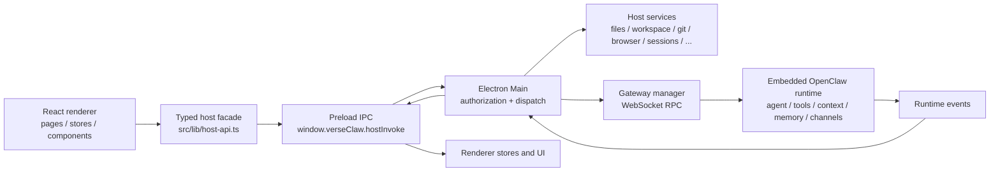

# Verse Claw 模块详解

> 本目录是 `README.md` 的模块化深入说明。根 README 负责产品定位、快速开始和入口导航；这里负责“当前代码到底实现了什么、哪些只是内部能力、哪些默认关闭、哪些仍然没有验收”。

## 当前快照

| 项目 | 当前事实 |
|---|---|
| 源码版本 | `0.4.9-alpha.0`（以根 `package.json` 为准） |
| 文档核对日期 | 2026-10-26 |
| 主验收平台 | Windows x64 controlled local workflow |
| 产品阶段 | alpha / controlled preview；不是 GA |
| 产品锁 | `liveReady=false`、`productApproved=false`、`defaultOn=false` 仍未因组件毕业或文档更新而改变 |
| 组件分类源 | `shared/dcs/component-disposition-catalog.ts`；当前 54 条 disposition 记录：13 default、12 advanced、24 internal、5 retired、0 experiment |
| 默认配置源 | `docs/dev/default-config-matrix.md` |
| 产品语义源 | `docs/clawx-product-semantics.md` |
| 架构源 | `docs/architecture-overview.md`、`src/App.tsx`、`shared/host-api/contract.ts`、`electron/services/`、`openclaw_runtime/src/` |

`ComponentFinalAcceptance/v1` 在 2026-10-25 的冻结候选上记录了 `components=53`；当前合并后的 catalog 已有一行增量，现为 54。历史验收仍然只证明它绑定的那个 commit/tree，不能自动外推到当前主树。本文只描述当前源码结构，不把历史验收机械升级成新的发布结论。

## 1. 系统边界

Verse Claw 不是“React 页面直接调用模型”的薄壳。普通桌面请求路径是：

关键事实：

- Renderer 的业务调用统一经过 `src/lib/host-api.ts` 和 `src/lib/host-api-client.ts`。
- 本地文件、终端、Git、工作区等操作可以由 Electron Main 自己完成，不必穿过 Gateway。
- 运行时型操作通过 Main 持有的 WebSocket 连接发 Gateway JSON-RPC。
- 事件通过 Host event facade 回到 Zustand store，页面不直接建立 Gateway 连接。
- `shared/host-api/contract.ts` 是 Renderer、Preload 与 Main 的类型化共享契约。
- 普通请求不是“WS → HTTP → IPC 三级统一 fallback”。IPC 是桌面 facade 的入口；只有 Gateway 绑定服务再使用 Main 持有的 WS。HTTP 是特定服务/Gateway 的传输实现，不是普通 Host API 的全局降级链。

更完整的调用图、一次聊天轮次与数据所有权见 [架构导读](../architecture-overview.md)。

## 2. 文档分区

| 大模块 | 详细文档 | 你会在其中看到 |
|---|---|---|
| LLM、供应商、模型选择 | [LLM 与模型交互](llm-and-models.md) | 供应商账户、OAuth/API Key、协议、fallback、流式返回、工具循环、推理强度、能力自描述、用量与成本 |
| 会话、分支、恢复 | [会话与连续性](sessions.md) | JSONL 会话树、generation、标签/置顶/分组、archive/restore/delete、checkpoint、compaction、handoff/fork、长会话 coordinator |
| 上下文与记忆 | [上下文与记忆](context-and-memory.md) | DCS、Context Runtime Kit、Context Orchestrator、6,000 字符预算、健康评分、Role/Runtime Memory、候选审核 |
| 工作区与编码执行 | [工作区与编码执行](workspace-and-coding.md) | Workspace 模型、preflight、权限模式、文件/终端/Git/预览/评审、写保护、auto verify |
| 项目知识库 | [知识库](knowledge-base.md) | Wiki、Inbox、Draft、Steward、Proposal、Source Set、OKF、SEKB、Runtime Lessons、Knowledge Bot、治理与检索 |
| 多智能体与任务 | [多智能体与任务](multi-agent-and-tasks.md) | Agent/Persona/Role 区分、9 个内置角色、路由、团队、波次调度、subagent 准入、Task Ledger、Task Loop、ClawGraph |
| Verse 系列组件 | [VerseGit / VerseShell / VerseBrowser](verse-tools.md) | VG、VS、VB 的职责、所有权、能力数量、默认状态、安全边界与验收缺口 |
| 资源、观测与恢复 | [资源与可观测性](resources-and-observability.md) | ResourceFabric、BackgroundWorkGate、资源追踪、预算、tracing、问题聚合、session activity、Doctor/support bundle |
| 集成与产品表面 | [集成与页面地图](integrations-and-surfaces.md) | 渠道、Scheduled、Skills/MCP、Inbox、远程任务、Code Review、Office/VerseConf、媒体、Settings、路由 |
| 工程与验证 | [开发与验证](development-and-validation.md) | 仓库层次、命令、Harness、i18n/contract、Agent Dev、数据与证据边界 |
| 全部组件分类 | [组件清单](component-inventory.md) | 当前 54 条 disposition、用户入口、owner、节点与内部/退役分组 |

## 3. 成熟度标签怎么读

| 标签 | 含义 | 不应误解为 |
|---|---|---|
| `default` / `baseline` | 在该受控预览范围内是正常产品路径 | 不等于 GA、公开发布或跨平台已验收 |
| `advanced` | 有用户入口，但属于高级/受监督能力 | 不等于所有配置下都默认开启或无人监督可用 |
| `internal` | 有实现或内部 API，没有独立用户产品入口 | 不等于没有代码，也不等于可直接暴露给模型 |
| `shadow` / `experiment` | 观测、候选或限时实验 | 不等于拥有写回、路由或执行权威 |
| `retired` | 已退役，保留兼容形状或回滚来源 | 不等于“当前可用能力” |
| `landed-unwired` | 代码已落地但有意的产品接线仍缺失 | 不等于端到端产品完成 |
| `agent-driven` | agent 执行并生成证据 | 不等于 real-human evidence；两者不能混写 |

当前 `default`/`advanced` 只说明组件在产品语义里的位置，不解除发布边界。任何默认值变更仍必须由对应 owner、默认矩阵、证据和回滚条件共同证明。

## 4. 五类容易混淆的“状态”

后续文档会反复使用这五个区分：

1. **源码存在**：文件、类型、按钮或 API 存在。
2. **运行时可达**：真实执行链能从入口到达该能力。
3. **效果被验证**：工具实际执行、写入或外部调用产生可回读证据。
4. **产品默认开启**：普通用户路径无需实验开关。
5. **发布获批**：允许公开分发、GA 或对外发布。

一个绿色单测只能证明有限范围；一个按钮渲染成功不等于运行时效果；一个安装包存在不等于安装升级已验收；agent 驱动产物也不能标成真人数据。

## 5. 当前产品边界速查

- **聊天**：有流式响应、工具活动、审批、消息队列、checkpoint、模型覆盖和长会话绑定；普通 Chat 不会自动变成 Task Loop。
- **上下文**：Workspace Context 与只读 context tools 在声明条件下默认开启；VToken 已退役；Runtime Memory 注入和 SEKB 自动写回不默认开启。
- **知识**：读取与持久写入分开；Inbox → Draft → Steward/Review → Proposal → explicit apply 是受治理写路径。
- **记忆**：只有单一产品概念；Role cards、Runtime facts、candidate queue、embedding 和 Dreaming cache 是不同内部数据域，不是多套用户记忆。
- **工作区**：文件、终端、浏览器、Git 与评审都在现有 workspace/panel 所有权下；不是多个独立 IDE 后端。
- **多智能体**：RoleContract 是权限与角色边界；有路由、团队模板、写集/工具冲突调度和 subagent 准入；不存在默认开放 Agent Mesh 或无限并行写。
- **系统资源**：合作式调度与观测，不是 Job Object/cgroup 内核沙箱；前台工作不会被后台 shed 静默杀掉。
- **VerseGit**：仓库语义与证据中间件，默认关闭、landed-unwired；不替代 executor、Task Ledger、approval 或 harness。
- **VerseShell**：受控 typed ACI/执行基座，默认关闭；外部 MCP adapter 与内部执行路径不是同一个权威。
- **VerseBrowser**：契约方法数不等于当前驱动能力数；桌面驱动只公布当前快照允许的动作。
- **Dreams**：已退役；`/dreams` 会回到 Chat。
- **Image Generation**：有开发者/测试入口，不是当前正式产品导航。

## 6. 快速开始与本地数据

当前开发前置、初始化步骤、平台包和本地数据位置以根 README 为准。核心路径：

- Electron `userData`：桌面设置、日志、本地导出等。
- `~/.openclaw` 或 `OPENCLAW_CONFIG_DIR`：运行时配置、会话、SQLite state 等。
- 会话 transcript：JSONL。
- 知识 Wiki：`memory-wiki` vault。
- 知识治理 metadata：本地 knowledge 目录与 `openclaw-state` SQLite 的 governance 表。
- 资源观测：运行时/进程采样与 shadow envelope，不是外部 APM。

没有单独的数据库服务器依赖。但“本地存储”不等于“离线执行”：在线模型、渠道和外部工具仍会接收配置允许发送的内容。

## 7. 推荐阅读顺序

1. 先读 [架构导读](../architecture-overview.md)。
2. 再读 [产品语义](../clawx-product-semantics.md) 和 [默认配置矩阵](../dev/default-config-matrix.md)。
3. 按问题阅读本目录的大模块。
4. 需要判断某组件是 default/advanced/internal/retired 时，查 [组件处置矩阵](../dev/component-disposition-matrix-20261021.md)。
5. 需要判断实际测试证据时，查 `artifacts/`、`harness/specs/fixtures/` 和对应 task spec；不要从 README 文字反推验收。