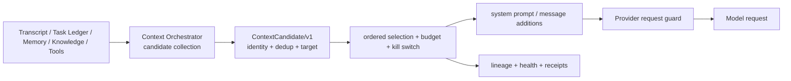

# 上下文、Working Context 与记忆

> 面向问题：模型这一轮到底看到了什么？新 context 候选由谁选择？工作上下文、长期记忆、知识库有什么区别？哪些内容会被注入，哪些只会显示在诊断里？

## 1. 四个概念先分开

| 概念 | 目的 | 当前 owner / entry |
|---|---|---|
| 模型上下文 | 本次 provider 请求的 prompt/messages/tool schemas | Context Orchestrator → PromptPlan → provider request |
| Workspace Context | 最近动作、工具/资源注册表等有界工作现场 | DCS/working-memory/tool-registry sources |
| Memory | 可审核、可失效的 accepted facts/cards | Role Memory + Runtime Memory，经单一 `/memory` 投影 |
| Knowledge | 项目 Wiki、规则、经验与可引用来源 | Knowledge review/retrieval authority |

Knowledge 不是 Memory。Task Ledger Working Context 也不是长期 Memory。Session transcript 也不是上下文本身；每次 turn 只选择其中相关且有界的部分。

## 2. Context 控制平面

### 2.1 组成



关键实现：

- `openclaw_runtime/src/context-engine/context-orchestrator.ts`
- `openclaw_runtime/src/context-engine/context-candidate.ts`
- `openclaw_runtime/src/context-engine/assembler.ts`
- `openclaw_runtime/src/context-engine/turn-injection-budget.ts`
- `openclaw_runtime/src/context-engine/context-health-monitor.ts`
- `openclaw_runtime/src/agents/provider-transport-fetch.ts`
- `shared/types/context-item.ts`

### 2.2 Context Runtime Kit

Context Runtime Kit（CRK）拥有：

- immutable owner references；
- selectors；
- checksums；
- prompt bundle lifecycle；
- resource revisions。

它不负责：

- 接纳/排序 context candidates；
- 编译 PromptPlan；
- 生成 provider request；
- 授予工具权限。

CRK 是上下文资源生命周期库，不是第二个上下文投影权威。

### 2.3 Context Orchestrator

每轮生产路径只应有一个最终选择 authority。候选先收集，再按稳定顺序排序、去重，最后统一记账。

当前 channel precedence：

1. `knowledge`
2. `working_memory`
3. `tool_registry`
4. `cvk_addition`
5. `vtoken`
6. `memory_pilot`

VToken 虽然保留兼容 channel 和源码，但当前生产装配被 `VTOKEN_RETIRED` 永久关闭；它不会因配置重新启用。

候选包含：

- 稳定 candidate id；
- authority object id + version + deterministic content digest 形成的 dedup key；
- target：`system_prompt` 或 `message`；
- channel；
- requested/applied chars；
- disposition/reason；
- source/turn/session/run/request/workspace identity。

先 dedup 后 charge，避免同一 authority object 被重复计费。

## 3. 6,000 字符 turn budget

默认 `TURN_INJECTION_CHAR_BUDGET = 6000`，可按配置覆盖：

```json
{
  "runtime": {
    "contextBlock": {
      "injectionBudget": {
        "totalChars": 6000,
        "dropAlertRatio": 0.1,
        "channelDecay": {
          "memory_pilot": 1,
          "vtoken": 2
        }
      }
    }
  }
}
```

预算行为：

- overflow 会 truncate 或 drop；
- 每次实际请求都有 requested/applied/drop/fallback counters；
- source flag 或 kill switch 关闭时，不查询 source、不产生 candidate、不 charge、不注入；
- context enhancement kill switch 是 fail-closed：剩余增强路径直接 no-op，但 agent turn 继续以基线 prompt 运行。

关键配置：

- `runtime.contextEnhancement.killSwitch`
- `VERSE_CONTEXT_ENHANCEMENT_KILL_SWITCH`
- `runtime.contextBlock.injectionBudget.*`

## 4. Context sources 与默认状态

| Source | 作用 | 当前状态/边界 |
|---|---|---|
| Knowledge | 项目 Wiki、规则、经验、显式引用 | 读取可受 scope 控制；不授予持久写权限 |
| Working memory | 最近行动、任务状态、有界工作现场 | Workspace Context 默认 on，可单一开关关闭 |
| Tool registry | 当前工具/资源摘要 | 与 working memory 合并到 Workspace Context |
| CVK addition | embedded context assembly 的 bounded message replacement | 受 kill switch 和预算 |
| VToken | 旧 token packing | **retired**，生产装配和 bridge inert |
| Memory pilot | accepted Runtime Memory 的受限注入 | 默认 `injectPilot=false` |
| COMPASS | DCS 内部 candidate source | internal，直接 pre-reply prompt injection 已退役 |
| C6 context ladder | 内部显式 assembler 请求 API | internal，不是普通用户 toggle |
| DCS fact tools | context read/search/understand 工具 | disposition default；自动发现需 workspace/FactService/permission 健康，env 可回滚关闭 |
| Native file memory | 原生文件记忆检索 | read-only 内部来源，不归 `/memory` 面板管理 |

Workspace Context 是一个用户概念，覆盖两个内部 implementation flags：

- `runtime.contextBlock.working_memory.enabled`
- `runtime.contextBlock.tool-registry.enabled`

用户入口在 `Settings → General`。Developer DCS 面板是诊断面，不是正常用户开关。

## 4.5 默认 tool-result 截断的可回读引用

默认的 oversized / aggregate tool-result 截断仍由原有阈值和 head+tail 预算决定，不会因为引用投影改变触发时机。变化仅在 replacement 已经获得可用 ArchiveHandle 时发生：模型可见提示会包含 archive_uri、checksum、byte_length 和 context_archive_recall 指令，而不是只写“more characters truncated”。

约束：

- archive 创建或校验失败时退回原来的 truncation notice，不伪造可回读性，也不阻断 turn；
- 引用文本仍受单条 maxChars / aggregate 预算约束；
- lifecycle metadata 继续保存 archiveHandle，prompt 投影不新增持久化 authority；
- 该行为不等于启用 observation masking、Tool Search 或更改 compaction 默认值。

回读保留开关为 `runtime.contextFamily.archiveRecallRetention.enabled`，默认关闭。显式启用后，只有已经通过 checksum 与当前 session 校验的 `context_archive_recall` 成功结果获得来源标记；标记必须带非空、非空白的 call-id 和非负安全整数分页 offset，缺失绑定不能通过 ID 重写获得保护。pruner 和 tool-result replacement 保护 `ageTurns < 4` 的结果，所有保护文本合计最多 16,000 字符。单条/aggregate 预算优先，容纳不了时沿原有裁剪路径；普通工具、用户文本、assistant reasoning 与未回读 archive 不获得额外保护。

年龄从消息序列的后续 assistant 轮推导，重复投影不刷新窗口。相同 archive 页只保护最近一次回读，已经裁剪过的投影不凭残留 metadata 重新获得保护；实现不新增 timer、持久队列或重复注入。达到第四轮或关闭开关后恢复旧路径。完整摘要 compaction 与硬上下文溢出继续由已有 owner 决定，这不是无限保留或无损摘要承诺。

内部 session replay 和 precheck 保留最小已校验来源，调用 ID 规范化同步携带该绑定；原本不匹配的来源不会因 ID 重写变成有效。转换前选择来源，`convertToLlm` 后按最终可见文本规划保留与截断，再移除仅用于规划的标记，provider 消息不包含 `details`。最新回读页无法满足预算或已被裁剪时，不转而保护同页的旧回读。

开启保留时，回读原文仅放在模型可见 `content`，`details` 只保留分页诊断和小型来源标记，以通过现有 8 KiB transcript 元数据上限。评测实际执行 guarded write、磁盘重载和重放，并保留 JSONL。共享计划按实际截断结果核算预算，不为完整保留项预扣 notice；空间不足时从最旧项开始释放保护重新规划，直到恢复无保留的既有路径。

单条上限按每个结果分别判断，多个回读共享 16,000 字符与 aggregate 剩余空间。转换器补入的可见提示也接受最终预算检查；已有 observation-masking 替换在开启保留时通过正常转换和标记移除，保持内部来源不进入 provider 消息。

eval 入口：`openclaw_runtime/node_modules/.bin/tsx --expose-gc scripts/context-inline-spill-eval.mts --mode deterministic --out D:/tmp/context-inline-spill-eval`。四臂为 `baseline`、`reference-visible`、`recall-stable` 和 `retention-off`，最后一臂必须实际丢失回读证据；工具调用由 agent 驱动，不声称模型自主选择 recall。`--mode live` 按显式 endpoint/model 与进程环境凭据执行第三方模型对照，只提供模型可见文本，不把 oracle 答案或隐藏 details 放入请求。

结果分别记录质量、主上下文字符/token 代理、真实 provider usage、各阶段延迟、成本或 not-run、scope/stale、refs resolution 和原始 transcript。5000 次重复投影的 GC 后 heap 增长门限为 2 MiB，只代表该投影路径的工程测量。当前可回读的 curated 证据与来源索引位于 `harness/specs/fixtures/context-inline-spill/`。

评测经过真实 replay、pruner、precheck 和 provider projection helper，原始 transcript 保存各边界输入与输出。提供方答案不能解析时，失败结果继续保留脱敏原始响应、HTTP 状态和已返回 usage，避免把已消耗 token 错写成未知。

## 4.1 会话起始注入（`session_start` 通道）

一次会话起始最多有四个来源：startup memory 文件、长会话 continuity pack、handoff 稿件、fork 继承上下文。今天它们各自带预算、各自出诊断，"这个会话为什么以这段文字开场"没有单一答案。

`shared/types/session-start-injection.ts` 的 `buildSessionStartInjectionPlan` 给出这个答案：一份 `SessionStartInjectionPlan/v1`。

| 字段 | 含义 |
|---|---|
| `stage` | 计划服务的会话阶段（来自只读 stage 投影） |
| `budgetChars` / `charsApplied` / `charsRemaining` | 单一字符预算与实际占用 |
| `items[]` | 每个来源的 `included`、`charsRequested`、`charsApplied`、`reason`、`detail` |
| `stageExcluded` | 该阶段根本不咨询的来源（显式记录，避免"看不见的省略"） |

优先级（先计费者先得，后者先被降级）：`continuity-pack` → `handoff-draft` → `startup-memory` → `fork-inheritance`。

阶段选择：

| stage | 咨询的来源 |
|---|---|
| fresh / compacted / restored | continuity pack + startup memory |
| forked | continuity pack + fork 继承 |
| handedOff | continuity pack + handoff 稿件 |
| resumed | continuity pack |
| continued | 无（会话已有历史） |
| unknown | 无（fail-closed） |

预算行为：`budget-drop`（完全丢弃，记请求量）、`budget-partial`（部分保留，detail 写明被截掉的字符数）。**不存在静默截断。**

接线与开关（A2b / TF-0642）：

`session_start` 是 turn injection 的正式通道，排在 `knowledge` 之后、`working_memory` 之前（priority 95，不按轮次衰减）。开关默认关闭：`runtime.contextBlock.sessionStartInjection.enabled`，可用 `VERSE_SESSION_START_INJECTION` 覆盖（env 的 off 优先于配置的 on）。

| 条件 | 行为 |
|---|---|
| 开关关闭（默认） | startup prelude 仍按原样拼进本轮 user body；编排器只记一条 `flag-off` 来源决策，prompt 字节不变 |
| 开关打开 | 同一段 owner 文本改由 `ContextCandidate/v1` 承载（channel `session_start`、target `system_prompt`），经去重、同一 turn ledger 计费、按计划 `charsApplied` 截断后进入 system prompt |
| kill switch（`runtime.contextEnhancement.killSwitch`） | 与其余增强通道一起切断，lineage 记 `kill-switch` |
| stage 为 `unknown` / `continued` | 不注入（fail-closed / 该阶段不咨询任何来源） |

边界（仍然成立）：

- **只有一份装配**：计划与 candidate 由 `openclaw_runtime/src/context-engine/session-start-injection.ts` 一处产出；`startup-context.ts`、`context-candidate.ts`、`turn-injection-budget.ts` 都不认识这个计划，`tests/unit/session-start-injection-shadow.test.ts` 以源码扫描守住。
- `LoopContextPack` 与 startup-context 是**投影来源**，不是第二权威。
- 计划本身不带正文（正文在 `SessionStartInjectionRequest.texts` 与 candidate 里）；它只描述意图与尺寸，且不新建来源——每个 `sourceId` 都对应已存在的 owner。
- 不新建写入面：计划是 lineage，不是 state。
- 不改变 compaction 时机与 turn injection 总量上限。
- CLI runner 路径未接线，其行为字节不变。

事实映射：`openclaw_runtime/src/context-engine/session-start-injection-facts.ts` 只把已有 owner 的输出转成事实，自身不做 I/O；"owner 说没有" 与 "没问过 owner" 分别记为 `empty` 与 `not-available`。

## 4.2 上下文丢弃归因（`DiscardAttribution/v1`）

TF-0138 的结论是：丢弃决策本身已经实现，缺的是**活过一次 attempt**。候选表存在内存 Map 里，
attempt 结束即删除；唯一形状正确的落盘载体按 `turnId` / `attemptIndex` / `modelCallIndex` 键控，
而会话 JSONL 里没有这三个字段，所以两源无法 join。

本叶只写归因行，不改变任何决策：

| `discardClass` | 生产触发点 | 行里写什么 |
|---|---|---|
| `budget-drop` | turn injection 账本的 drop / truncate | channel、reason、requested/applied 字符数 |
| `skipChannels` | candidate 的 skip / duplicate | channel、reason（`flag-off` / `kill-switch` / `empty` …） |
| `limitHistoryTurns` | embedded attempt 的历史截断 | 前后消息数、`limit` |
| `compaction` | compaction safeguard 的 chunk 丢弃 | chunk/消息/token 数、预算与 `firstKeptEntryId` 边界 |
| `archived` | 无生产实例（spike 实测为零） | 仅 builder 支持；不伪造生产者 |

规则：

- **只归因**：先有决策，再从决策已产的数写一行；不改预算、不改阈值、不改 prompt 字节。
- **轮次身份**：`turnId` + `attemptIndex` + `modelCallIndex`（有则写），否则行不可 join、没有价值。
- **零 payload**：只写计数、枚举 reason、id 与 candidate 自带的 digest；`reason`/`unitRef` 还会被截断到 160 字符并抹掉
  `sk-…`、`Bearer …`、`api_key=…` 一类凭据形状。
- **失败不致命**：写失败吞掉（诊断不得打断一轮），每轮上限 128 行，文件超过 16 MiB 停止追加。
- **开关**：测试运行器之外默认开启（避免测试写进真实状态目录）；`VERSE_CONTEXT_DISCARD_ATTRIBUTION=0` 关闭、`=1` 强制开启。落盘位置 `<stateDir>/context-discards.jsonl`。

非目标：不自动再注入被丢内容、不改 compaction 触发点、不复活 TF-0129。
## 4.3 checkpoint-first 新上下文（`sessions_new_context`，默认关闭）

普通 reset 会把当前窗口直接丢掉，既无摘要也无恢复点。本原语把顺序倒过来：**先归档、证明归档可读、再重置**。

1. 惰性读取当前会话 transcript（不用工具就不读）。
2. 写 `ContextArchive/v1`（sha256 + payload，文件权限 0600）。
3. 重新读文件，比对 archiveId / 长度 / digest，并用库内 payload 重算 digest。
4. 只有前三步全部通过，才把 reset 排到本轮结束之后。

任一步失败都返回 `refused` 与原因，reset 回调根本不会执行——最坏情况是"什么都没发生"。
工具返回的只有 archiveId / 字符数 / digest / 时间戳，绝不返回 transcript 正文。

开关：`runtime.contextBlock.checkpointedContextReset.enabled` 或 `VERSE_CHECKPOINTED_CONTEXT_RESET=1`，默认关闭。
关闭时**工具根本不注册**（不是执行时再拒绝），所以模型工具清单与 system prompt 字节不变。

非目标：不实现无摘要丢弃、不允许跨会话重置、不改自动 compaction 阈值。
## 4.4 缓存边界修剪的 shadow would-trim（默认关闭）

cache-TTL pruner 是**真改**：TTL 过期后它会重写旧的 tool result。此前没有"只看不改"的读数，
所以"是否安全、是否值得"只能靠打开开关去试。

本叶只加测量，不加改动：

- `buildWouldTrimReport` 对副本跑真实 pruner，产出 `WouldTrimReport/v1`：每项 `ownerRef`
  （`msg:<index>:<tool>:<digest>`）、index、toolName、before/after/saved 字符数、soft-trim/hard-clear，
  以及总量、估算 token 与投影摘要。**不含任何 message 正文。**
- GO/NO-GO：无修剪或 0 项 → NO-GO；保存比例 < 1% → NO-GO；否则 GO 并给出实测节省。
- 开关 `runtime.contextPruning.wouldTrimShadow`（默认 false）只决定是否记录报告。报告放在
  runtime 状态 `lastWouldTrim`，不发送、不落盘；pruner 的返回值与 cache-TTL 判定不变。
- 报告在 cache-age 早退**之前**生成，因此刚触发的轮次也能看到"会修剪什么"；但真正是否修剪仍由原逻辑决定。

非目标：不实现服务端 `cache_edits`、不改任何 compaction 阈值、不默认开启。
## 4.5 上下文折叠：ContextHandle 与有界展开（`context_expand`，默认关闭）

长材料不再只有"整段塞进 prompt"或"生成摘要"两条路。`context-folding-rlm` 支线把它们接成一条受控读面：

```text
owner 资源 -> ContextHandle/v1 -> bounded context_expand -> 父会话只持有 handle + 有界 excerpt
```

- **ContextHandle/v1**（`shared/types/context-folding.ts`）：`handleId`（由 owner、scope、resourceId、selector、checksum、revision 决定，`cfh_` 前缀，可重算）、`owner`、`scope`（workspaceId + sessionId，永不从 session 回退到 workspace）、`selector`（full / lines / chars）、`checksum`、`freshness`、`estimatedChars`、`allowedExpansion`、`revision`。handle 只是读引用，不授予任何工具、写入或跨 scope 权限。
- **`context_expand`**（`openclaw_runtime/src/agents/tools/context-agent-tools.ts` → `context-engine/context-folding/expand.ts`）：三种模式 `excerpt` / `search` / `aggregate`，字符与字节上限分别不超过 20000 / 65536；检查顺序固定为 scope → 模式允许 → range 包含 → freshness ttl → owner 解析 → checksum → 有界读取。已接入的 owner：`workspace-file`、`block-store`、`context-archive`；其余 owner 返回 `owner_unavailable`，不伪装。
- **显式诊断**：`workspace_mismatch`、`session_mismatch`、`stale_checksum`、`missing_resource`、`ambiguous_selector`（glob、目录或多个同 id block）、`expired`、`expansion_not_allowed`、`limit_exceeded`、`scope_violation`（路径穿越）。任何一项都返回 `ok:false` 加 diagnostics，没有静默回退。
- **搜索到展开的读面**：flag 开启时 `context_search` 的每条结果附带一个会话内 handle；模型随后用 `context_expand` 读有界 excerpt 或先 `aggregate` 只看体积。flag 关闭时 `context_search` 输出与基线逐字节相同。
- **`context_fold` 子任务回传**：`context_fold` 通过现有 `sessions_spawn` 启动单层 isolated child，只向 child 下发重新 scope 的 handles、显式工具清单、workspace scope 和预算。child 的完成结果必须是一个 `ContextFoldResult/v1`，含 summary、structuredOutput、evidenceRefs、unresolvedClaims、blockers、failedAttempts、child identity 与 usage；父会话只接收经校验和预算裁剪的投影，缺证据、身份不匹配、重复 delivery、超时/取消状态或 transcript 形状字段均显式拒绝。
- **Host API**：`sessions.contextFoldingStatus` 返回 flag 状态、来源（env / config / default）、限制与 `disable-only` 回退说明；`sessions.contextFoldProjection` 校验 `ContextFoldResult/v1` 并裁到父视图预算，拒绝任何携带 transcript 形状字段的结果。两者均为只读，不触碰 Gateway。

开关：`runtime.contextBlock.contextFolding.enabled`，或环境变量 `VERSE_CONTEXT_FOLDING`（显式 env 值双向覆盖配置，所以回退只需关闭开关）。默认关闭；关闭时不注册任何新工具，prompt、工具清单、compaction 与 subagent 行为与基线一致（`tests/unit/context-folding-result.test.ts` 以 clean-HEAD 基线做字节级比对）。

非目标：不引入任意 Python REPL / pip / shell，不默认开启递归深度大于 1 的子代理，handle、摘要与 FoldedResult 都不是任务验收或 Memory/Knowledge/Task Ledger 的写入权威。

## 5. Context health

`ContextHealthMonitor v1` 是确定性、无 LLM 的四维评分：

| 维度 | 权重 | 说明 |
|---|---:|---|
| injection pressure | 20% | 预算截断/丢弃是否过多 |
| structural fidelity | 30% | compaction 摘要是否保留必要结构 |
| goal alignment | 30% | SessionGoal objective 的语言覆盖 |
| information novelty | 20% | 与近期注入文本的 8-gram Jaccard novelty |

规则：

- 分数 0–100；
- 低于阈值会附 reason；
- `noDataDimensions` 明确哪些维度没有数据；
- “没有数据”不能用 100 分伪装成“完美”；
- 评分可投影到 observability scorecard，但不自动改变模型行为；
- v1 不调用 LLM，也不新增持久行为。

告警阈值：

- injectionPressure、structuralFidelity、goalAlignment `< 70`；
- informationNovelty `< 50`。

## 6. 长期连续性与长会话 context pack

显式 coordinator session 在发送前排一个 `ContinuityContextPack/v1`，来源包括：

- Task Ledger Working Context；
- CompressionArtifact metadata；
- current model-visible accepted Memory refs；
- typed Knowledge refs；
- binding revision / session generation；
- active Task Ledger node。

只有 accepted、未过期、未被撤销/替代、scope 匹配、fresh 的 refs 才可能进入 pack。Pending/candidate/derived cache/unverified model claims 被排除。

pack 是现有 owner 的 projection，不创建：

- 第二 task list；
- 第二 memory store；
- 第二 injection authority。

原始历史保存在 owner refs 后，按需展开，而不是把全部长会话塞入每次 prompt。

## 7. Memory 的单一产品概念

用户入口：`/memory`。

`shared/memory/control-plane.ts` 是机器可读 `MemoryControlPlaneManifest/v1`。产品界面把多个内部域投影成一个 review surface，但它们仍各有存储和写入路径：

| 数据域 | Owner | 检索/注入 | 删除/失效 |
|---|---|---|---|
| Role memory card | role-memory governance | accepted-only | tombstone/review |
| Runtime fact | Runtime Memory store | accepted-only | TTL/eviction/invalidation |
| Runtime timeline/episode | Runtime Memory store | accepted-only | session/run lifecycle / invalidation |
| Candidate | candidate queue | never / not injectable | reject/tombstone/stale |
| Embedding index | embedding provider | derived internal | source delete/model change rebuild |
| Native file query | native retrieval | transient internal | request-bounded |
| Dreaming cache | derived cache | internal derived | repair/reset/input change |

### 7.1 Accepted

Accepted 视图显示：

- Role cards；
- accepted Runtime facts；
- scope；
- source；
- timestamps；
- sensitivity；
- evidence count；
- 当前是否 model-visible。

### 7.2 Candidates

Candidates 包括：

- persisted Role proposals；
- Runtime fact candidates。

每个 candidate 都必须是：

- `retrievable=false`
- `injectable=false`
- `modelVisible=false`

Candidate 持久化不等于接受。

### 7.3 操作

- **Approve**：交给 Role Memory review 或 `memory.proposeFacts.confirm`，不直接写 card/fact。
- **Delete**：交给对应 owner；Role card tombstone，Runtime fact invalidated with `retracted`。
- **Export**：从同一 surface projection 生成 owner-neutral JSON，写到 Electron `userData/exports/memory`，脱敏 secret/secret-adjacent 内容，并返回精确字节的 SHA-256。
- **Remember this**：调用既有 gatekeeper/policy/evidence/conflict path；可以被接受，也可以成为 persisted candidate；UI 不绕过审核。

### 7.4 关闭语义

- 关闭 Role Memory 会关闭 Role 读写 gate 和 Role prompt retrieval，但不删除已有 card。
- Runtime capture/persist/provider/injection pilot 是独立 flags。
- 关闭 `/memory` 的 Role/Runtime gate 不代表关闭所有 native OpenClaw memory source。
- Runtime Memory 默认 injection pilot 为 false；candidate 列表不是模型可见列表。

## 8. Memory policy 与证据

Memory proposal 的治理包括：

- scope（global/workspace/project/session/run）；
- sensitivity（public/workspace/secret-adjacent/secret）；
- evidence refs；
- confidence；
- conflict detection；
- duplicate detection；
- merge/reject/supersede/needs-review；
- TTL；
- owner-specific invalidation。

Memory policy 会拒绝或要求 review 的典型场景：

- 角色写 workspace/user scope；
- 角色写 project scope；
- trace/session summary 覆盖已有记忆；
- system 写 global；
- 无 evidence 的高重要内容；
- secret/secret-adjacent 内容不当暴露。

## 9. Task Ledger Working Context

Task-scoped working context 是任务运行的工作集，不是长期 Memory。

八个字段：

- Objective
- Constraints
- ConfirmedFacts
- Decisions
- OpenRisks
- ActiveFiles
- Evidence
- NextAction

每次变更是 versioned proposal：

- proposalId；
- field；
- value；
- version；
- evidence refs；
- issuedAt/expiresAt；
- sensitivity；
- trust；
- actor；
- policy digest。

只有 accepted proposal 进入当前 projection。Evidence 只存 refs，不允许 raw payload 常驻。接受后的字段可以生成 `MemPromotionCandidate/v1`，但是否晋升长期 Memory 仍走 Memory owner，而不是 Task Ledger 直接写入。

## 10. 产品默认与退役状态

来自 `docs/dev/default-config-matrix.md` 的当前锁定事实：

| 能力 | 默认 |
|---|---|
| Workspace Context | on，可由单一 Settings toggle 关闭 |
| working-memory / tool-registry 内部 flags | on |
| DCS Fact tools | auto（prerequisites 健康），env override off |
| Context enhancement kill switch | off |
| Runtime Memory injection pilot | false |
| Runtime Memory shadow/provider/persist | false |
| SEKB master | false |
| SEKB auto writeback | off |
| VToken assembly/bridge | retired / always off |
| Browser private network | deny |

这些默认值由测试锁定，不能通过改 README 翻转。

## 11. 可观测与诊断

Context 相关诊断：

- candidate source/id/channel/target；
- dedup key；
- selected/omitted；
- requested/applied chars；
- budget reason；
- kill switch hits；
- source query count；
- ContextOrchestrator chars added；
- RequestEnvelope/lineage/receipt；
- ContextHealth scorecard；
- injection receipts（Memory）；
- problem aggregation。

看到“context candidate 被产生”不代表它被注入；看到“已注入”也不代表 provider 实际使用或据此产出正确结果。

## 12. 当前缺口

- Workspace Context 的默认开启只覆盖声明过的受控路径，不是所有插件/backend。
- DCS Fact tools 依赖 workspace、FactService 与 permission 健康。
- Runtime Memory 注入仍是 diagnostics/opt-in 边界。
- SEKB 自动写回未开放。
- VToken 退役后不能通过旧环境变量恢复。
- Long-session 连续压缩/剪枝/摘要树策略未默认启用；需要新的 live-provider fidelity/safety/cost/latency 证据。
- Context health 是启发式确定性评分，不是语义真值。
- 不同 backend 的 context budget/compaction 消费能力不同；configured 与 effective 必须分开读。

## 13. 源码索引

- `openclaw_runtime/src/context-engine/`
- `openclaw_runtime/src/agents/embedded-agent-runner/extensions.ts`
- `openclaw_runtime/src/agents/embedded-agent-runner/run/attempt.ts`
- `openclaw_runtime/src/runtime-core/memory-*.ts`
- `openclaw_runtime/src/memory/`
- `electron/services/memory-api.ts`
- `shared/memory/control-plane.ts`
- `shared/task-ledger-working-context.ts`
- `shared/types/context-item.ts`
- `shared/types/context-runtime-kit.ts`
- `shared/types/memory.ts`
- `src/pages/Memory/index.tsx`
- `docs/dev/context-orchestrator.md`
- `docs/dev/memory-control-plane.md`
- `docs/dev/default-config-matrix.md`
- `docs/dev/vtoken-retirement-decision.md`

延伸阅读：[Context Runtime Kit](../context-runtime-kit/README.md)、[产品语义](../clawx-product-semantics.md)、[上下文权威边界 ADR](../dev/adr/2026-08-16-context-authority-boundaries.md)。

## 14. Inline/Spill 真实任务收益评测（agent 驱动外循环）

机制证据（引用可见、回读可达、窗口内有界保留）不等于任务收益。为回答“真实收益是否存在”，
`scripts/context-inline-spill-benefit-loop-eval.mts` 建立一个可复算的评测：

- **模型自主决策**：harness 只执行模型返回的 function call，是否回读、何时回读、分页多少由模型决定；
  脚本不替模型发起 recall。
- **真实组件**：`truncateOversizedToolResultsInMessages`、`pruneContextMessages`、
  `createContextArchiveRecallTool`、`ArchiveHandle` 校验与 archive 存储全部是生产实现。
- **四臂对照**：`baseline-no-reference`、`reference-visible`、`recall-stable`、
  `retention-off`（负对照）使用同一语料、oracle 与评分器。第二轮原始请求确认：两压力臂的
  archive URI/session 不同，且原始工具历史独立附加，当前不能视为严格的单变量对照。
- **冻结口径**：指标定义、B1–B7 判据、失败分类与判定输出以
  [inline-spill-benefit-quantification](../../harness/specs/rules/inline-spill-benefit-quantification.md) 为准，
  运行前不得改阈值。

第二轮 live 覆盖 96 次运行（4 臂 × 8 任务 × 3 次）：`decision.status=mechanism-only`。
recall-stable 证据任务 11/18，通过 B1/B2/B5；B3/B4/B6 未通过，token 相对
reference-visible 增长 38.62%。原始请求、逐次记录、复算与实验限制见
[收益评测交付记录](../../harness/specs/fixtures/context-inline-spill-benefit/DELIVERY.md)。

第三轮按[输入修复任务](../../harness/specs/tasks/inline-spill-real-benefit-eval-round3.md)推进：协议工具输出只来自当轮生产投影，正文不重复列出回读结果；两压力臂使用同一 archive/session 身份，主上下文按实际发送的 input JSON 计量。第三轮结果单独封存，不重写第二轮数据；B1–B7 与语料、压力和输出预算保持冻结，任务收益仍以新实测判定。

第三轮实测已完成：96次运行/360次provider调用，24对初始请求相同，原始历史回退和oracle泄漏均为0。`decision.status=mechanism-only`；recall-stable证据0/18，token相对reference-visible增长59.61%。原评分器B3=true仅来自一个控制任务差异，不表示证据还原收益。53次响应因900输出token预算返回incomplete，下一步需处理评测页预算与模型工具说明的适配，详见[第三轮交付记录](../../harness/specs/fixtures/context-inline-spill-benefit-round3/DELIVERY.md)。

2026-11-08 从封存请求、响应与归档重新复算，两轮 84 份证据清单和 1605 个归档均通过。收益判定为 NO-GO，TF-0749 保持 in_progress/80：B2/B4/B5/B6 未通过，第三轮证据任务的保留正向配对为 0。本轮新增 provider 调用为 0；完整复算与页适配实验设计见[收益证据复核](../../harness/specs/fixtures/context-inline-spill-benefit-closeout-20261108/REPORT.md)。
2026-11-13 第五轮低推理对照已执行：96 次运行、438 次 provider 调用，436 次 completed、0 次 incomplete。stable 证据 0/18、控制 6/6，B1/B5 通过，B2/B3/B4/B6 失败；token 相对 reference-visible 增长 94.88%，判定 mechanism-only/NO_GO。原始记录保留 dirty 候选身份限制和 2 次 transport error，详见[第五轮真实收益证据](../../harness/specs/fixtures/context-inline-spill-benefit-round5/REPORT.md)。TF-0749 的收益目标未因此完成。

第六轮按[clean 候选复核任务](../../harness/specs/tasks/inline-spill-real-benefit-eval-round6.md)
执行。冻结设计先于候选单独提交，保持 900 输出 token、低推理、8 轮、5500 字符页
和原 B1–B7 阈值。`--freeze` 在 provider 请求前拒绝 dirty、预算变更和源码漂移，
结束后再次绑定 commit/tree 与源码；逐调用记录、归档和 SHA256 可由
`scripts/context-inline-spill-benefit-round6-verify.mjs <run-directory> <output.json> --seal`
复验。B2/B3 使用证据任务配对，控制配对与原目标归档选择单独报告。
`incomplete` 的 token 全部记录并判该次运行失败，8 轮耗尽记 `loop_budget_exceeded`。
冻结设计与第五轮原始字节封存包位于
`harness/specs/fixtures/context-inline-spill-benefit-round6/`。

第六轮 clean 候选 `eb93671ab` 已完成 96 次运行、399 次调用：394 completed、5 transport error、0 incomplete。
stable 证据 3/18、控制 6/6，证据保留正向配对 3、反向 0；B3/B4/B5/B7 通过，B1/B2/B6 失败，
判定 no-benefit/NO_GO。成功回读率 17/18（94.44%）低于 95%，任务收益 McNemar p=0.25，
总 token 相对 reference-visible 增长 87.78%。verifier 接受 clean 候选并核验 555 个归档；
详见[第六轮收益复核](../../harness/specs/fixtures/context-inline-spill-benefit-round6/REPORT.md)。


[第四轮评测](../../harness/specs/tasks/inline-spill-real-benefit-eval-round4.md)要求每次回读显式提供 1–5500 的 `max_chars`，缺失或超界参数返回 `invalid_arguments`。工具说明引导模型用 `offset + content.length` 翻页，取得精确值后输出最终 JSON。页尺寸与 6000 字符生产投影预算共同校验，收益按原 96 次样本与 900 输出 token 预算实测。

第四轮 96 次实测、367 次模型调用已完成：最大序列化页 5944 字符，超页为 0；stable 证据正确率 0/18、控制有效 null 为 3/6，56 次响应耗尽 900 输出 token。B1–B6 均未通过，判定为 NO-GO，token 相对 reference-visible 增长 51.56%。[第四轮报告](../../harness/specs/fixtures/context-inline-spill-benefit-round4/REPORT.md)提供完整配对、原始请求/响应与复算命令。

复算：

```powershell
$env:TEMP='D:\tmp'; $env:TMP='D:\tmp'
openclaw_runtime/node_modules/.bin/tsx scripts/context-inline-spill-benefit-loop-eval.mts --mode deterministic --out D:/tmp/context-inline-spill-benefit
$env:CONTEXT_INLINE_SPILL_API_KEY='<owner provided>'
$env:CONTEXT_INLINE_SPILL_BASE_URL='http://127.0.0.1:3065/v1'
$env:CONTEXT_INLINE_SPILL_MODEL='space-bunny'
openclaw_runtime/node_modules/.bin/tsx scripts/context-inline-spill-benefit-loop-eval.mts --mode live --out D:/tmp/context-inline-spill-benefit
```

边界：

- 这是 agent 驱动的评测器外循环，不是 Electron/Gateway 的完整产品回合；Gateway 审批、system prompt、
  bootstrap 与多 agent 编排不在覆盖内。
- deterministic 模式使用脚本策略，只能证明 harness 自身正确，不能当作模型自主性的证据。
- 费用只有 provider 返回计费单位时才记录，否则 `not-run`；token 用量逐次记录。
- 结论只覆盖该语料与该模型，不外推为产品质量、GA 或发布批准。
