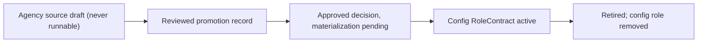

# Agency Role Promotion Control Plane Implementation Plan

> **For agentic workers:** REQUIRED SUB-SKILL: Use superpowers:subagent-driven-development (recommended) or superpowers:executing-plans to implement this plan task-by-task. Steps use checkbox (`- [ ]`) syntax for tracking.

**Goal:** Add a reviewable, auditable path that turns an immutable Agency draft into a new config-backed `RoleContract`, without allowing the imported draft or maturity metadata to grant runtime authority.

**Architecture:** Keep Agency source entries immutable and permanently non-runnable. A Main-owned control plane reads an explicitly selected Agency repository, creates a persisted review record with source fingerprint, tool-hint dispositions, candidate contract, evidence qualification, and human decision, then materializes a separate config role through the existing `agents.roles` registry path. Lifecycle and evidence qualification are governance metadata only; tools, filesystem/network access, commands, model, effort, output schema, and handoff remain explicit `RoleContract` fields.

**Tech Stack:** Electron Main, React 19, TypeScript, Vite, Vitest, Playwright Electron E2E, `electron-store`, OpenClaw config JSON, `react-i18next`, pnpm 11.2.2, Harness specs.

## Global Constraints

- `RoleContract` remains the only legal runtime role channel.
- `canSpawnAgencyDraft()` must continue to return literal `false` for every Agency draft state.
- Promotion creates a new config role; it never mutates an Agency draft into a spawnable object.
- Lifecycle is `draft -> reviewed -> active -> retired`; evidence qualification is the independent axis `unverified -> scenario-verified -> release-qualified`.
- Lifecycle or evidence qualification must not implicitly grant tools, filesystem/network access, commands, memory writes, background execution, model access, or handoff authority.
- Agency `toolHints`, prose, runbooks, and source metadata are advisory only. Every real tool is selected and confirmed by a human reviewer.
- Renderer calls must use `src/lib/host-api.ts`; no direct IPC or Gateway HTTP/WebSocket calls.
- Main owns source-directory reads, persistence, OpenClaw config writes, reconciliation, and retirement.
- New user-visible text must exist in `shared/i18n/locales/{en,zh,ja,ru}/agents.json`.
- New user-visible behavior must have Electron Playwright coverage.
- Use existing surface/input/status tokens from `src/styles/globals.css`; do not introduce a nested-card layout.
- The selected Agency source root is user-provided through the existing typed dialog API. Never hardcode a developer machine path or commit the third-party corpus.
- No new dependency is required.
- Review `README.md`, `README.zh-CN.md`, and `README.ja-JP.md` after the user-visible flow changes.
- Run communication replay/compare because this plan changes the Renderer/Main host-api path.

---

## Why This Is The First Slice

The source proposal combines governance, tool sequencing, shared memory, background memory, self-editing, execution factories, provider fallback, and UI. The current repository already has separate owners for most of those concerns:

- `RoleContract`, role registry, role spawning, model fallback declarations, resource scheduling, runbooks, dynamic DAG, verifier, synthesizer, and Typed Blackboard already exist.
- Role Memory already has proposal-first writes, gatekeeper decisions, conflicts, versions, audit, restore-as-proposal, and Context Pack injection.
- DCS already defines `ContextBlock`/`BlockStore`, but production producer coverage is still incomplete.
- Runtime memory self-edit descriptors exist but explicitly are not wired to effects.
- Generic tool descriptors/executor references and parallel execution already exist.

The first product gap is therefore not another memory/tool subsystem. It is the missing controlled bridge between an imported Agency candidate and an ordinary config `RoleContract`.

## Open-Source Reference Map

Use these repositories as design references, not as code or architecture to transplant:

| Reference | Read for | Apply here | Do not copy |
|---|---|---|---|
| `C:/Users/27933/Desktop/verseshell/agency-agents-main/divisions.json` | Stable catalog grouping | Division labels and source validation | Division metadata as runtime authority |
| `C:/Users/27933/Desktop/verseshell/agency-agents-main/tools.json` | Machine-readable source catalog conventions | Source metadata preview | Tool installation entries as ClawX tools |
| `C:/Users/27933/Desktop/verseshell/agency-agents-main/strategy/runbooks.json` | Stable runbook slugs and rosters | Evidence references and future scenario selection | Runbook prose as permission or spawn policy |
| Agency candidate Markdown files | Source name, prompt, description | Immutable source fingerprint and review preview | Direct runtime prompt activation |
| `C:/Users/27933/Desktop/verseshell/letta-main/letta/schemas/agent.py` | Persisted state and pending approval separation | Decision state separate from runtime contract | Letta `AgentState` as a replacement for ClawX agents |
| `C:/Users/27933/Desktop/verseshell/letta-main/letta/schemas/tool_rule.py` | Explicit approval as a distinct concern | Human confirmation semantics | Tool sequencing in this slice |
| `C:/Users/27933/Desktop/verseshell/letta-main/letta/helpers/tool_rule_solver.py` | Rules are solved against available tools/history | Keep sequencing as a separate runtime project | A second ClawX tool loop |
| `C:/Users/27933/Desktop/verseshell/letta-main/letta/schemas/block.py` | Stable block identity and metadata | Inform later DCS/Memory work | A parallel block store |
| `C:/Users/27933/Desktop/verseshell/letta-main/letta/services/block_manager.py` | Version/history and connected-agent consequences | Inform later history/reconciliation work | Letta ORM/DB schema |
| `C:/Users/27933/Desktop/verseshell/letta-main/letta/groups/sleeptime_multi_agent_v4.py` | Foreground/background separation | Inform a separately gated background-memory project | Maturity-triggered background execution |
| `C:/Users/27933/Desktop/verseshell/letta-main/letta/services/tool_executor/tool_execution_manager.py` | Central execution ownership | Confirm reuse of current ClawX tool execution owners | A new executor factory |

## File And Ownership Map

**Runtime-domain files**

- Create `openclaw_runtime/src/agents/agency-role-promotion.ts`: pure review, tool-hint disposition, validation, and materialization logic.
- Modify `openclaw_runtime/src/agents/agency-draft-catalog.ts`: make the draft lifecycle immutable and add source identity fields.
- Modify `openclaw_runtime/src/agents/agency-role-importer.ts`: compute repository-relative source paths and SHA-256 fingerprints.
- Create `tests/unit/agency-role-promotion.test.ts`: domain invariants and materialization tests.
- Modify `tests/unit/agency-role-importer.test.ts`: source identity and permanent non-spawnability tests.

**Main/control-plane files**

- Create `electron/services/role-promotion-store.ts`: normalize and persist bounded review/audit records in `electron-store`.
- Modify `electron/services/roles-api.ts`: list drafts, preview a review, record review, approve/materialize, reconcile, and retire.
- Modify `tests/unit/roles-api.test.ts`: persistence, idempotency, config materialization, recovery, and retirement.

**Typed bridge files**

- Modify `shared/host-api/contract.ts`: wire types and five role actions.
- Modify `src/lib/host-api.ts`: typed renderer facade.
- Modify `tests/unit/host-api-facade.test.ts`: action/payload routing.

**Renderer files**

- Create `src/components/agents/AgencyRolePromotionPanel.tsx`: source selection, search, draft detail, tool mapping, evidence, review, approval, and retirement.
- Modify `src/components/agents/RolesOrchestrationPanel.tsx`: mount the unframed promotion section beside existing role management.
- Create `tests/unit/agency-role-promotion-panel.test.tsx`: renderer state and boundary tests.
- Modify `shared/i18n/locales/en/agents.json`.
- Modify `shared/i18n/locales/zh/agents.json`.
- Modify `shared/i18n/locales/ja/agents.json`.
- Modify `shared/i18n/locales/ru/agents.json`.
- Create `tests/e2e/agency-role-promotion.spec.ts`.

**Policy and documentation files**

- Modify `harness/specs/rules/agency-role-promotion-boundary.md`.
- Modify `harness/specs/tasks/agency-role-promotion-control-plane.md`.
- Modify `docs/superpowers/specs/2026-07-12-agency-role-promotion-control-plane-design.md`.
- Modify `docs/multi-agent-orchestration/phase-constraints/agency-role-promotion-control-plane.md`.
- Modify `docs/multi-agent-orchestration/goal-mode-start-prompt-agency-role-promotion.md`.
- Modify `docs/role-first-design.md`.
- Modify `docs/multi-agent-orchestration/README.md`.
- Modify `docs/multi-agent-orchestration/acceptance-and-test-matrix.md`.
- Modify `README.md`.
- Modify `README.zh-CN.md`.
- Modify `README.ja-JP.md`.

---

### Task 1: Establish The Harness Contract

**Files:**
- Modify: `harness/specs/rules/agency-role-promotion-boundary.md`
- Modify: `harness/specs/tasks/agency-role-promotion-control-plane.md`
- Read: `docs/superpowers/specs/2026-07-12-agency-role-promotion-control-plane-design.md`
- Read: `docs/multi-agent-orchestration/phase-constraints/agency-role-promotion-control-plane.md`

**Interfaces:**
- Consumes: scenario `gateway-backend-communication` and existing rules `contract-first-boundary`, `renderer-main-boundary`, `host-api-fallback-policy`, `i18n-locale-coverage`, and `docs-sync`.
- Produces: task spec id `agency-role-promotion-control-plane` and rule id `agency-role-promotion-boundary`.

- [ ] **Step 1: Verify and update the boundary rule**

Keep the checked-in rule aligned with these enforceable requirements:

```markdown
---
id: agency-role-promotion-boundary
title: Agency Role Promotion Boundary
type: rule
appliesTo:
  - agency-role-promotion-control-plane
pathPatterns:
  - openclaw_runtime/src/agents/agency-*
  - electron/services/roles-api.ts
  - electron/services/role-promotion-store.ts
  - shared/host-api/contract.ts
  - src/lib/host-api.ts
  - src/components/agents/*Role*Promotion*
---

# Agency Role Promotion Boundary

## Rule

Agency source entries are immutable review inputs. Only a separately materialized,
validated config RoleContract may enter the runtime role registry.

## Requirements

- canSpawnAgencyDraft returns false for every Agency draft.
- Lifecycle and evidence qualification do not derive runtime permissions.
- Tool hints require an explicit mapped or waived disposition.
- Approval records include source fingerprint, reviewer, decision time, evidence
  references, candidate contract digest, and materialization status.
- Main owns source reads, persistence, config writes, reconciliation, and retirement.
- Renderer uses the typed roles host-api facade only.

## Validation

- pnpm exec vitest run tests/unit/agency-role-importer.test.ts tests/unit/agency-role-promotion.test.ts tests/unit/roles-api.test.ts
- pnpm contract:check
- pnpm i18n:lint
```

- [ ] **Step 2: Verify and update the task spec**

Declare all touched areas from the file map, `requiredProfiles: [fast, comms]`, the five existing boundary rules plus the new rule, and these acceptance criteria:

```yaml
acceptance:
  - Agency drafts remain permanently non-runnable.
  - Review records preserve lifecycle and evidence qualification as independent axes.
  - Every tool hint is explicitly mapped or waived before approval.
  - Approval materializes a separate validated config RoleContract.
  - Approval retries are idempotent and interrupted materialization is reconcilable.
  - Retirement removes the materialized config role and preserves its audit record.
  - Renderer uses typed host-api calls and four-locale i18n.
  - Electron E2E covers source selection, review, approval, pending refresh, and retirement.
```

- [ ] **Step 3: Resolve the task context**

Run:

```bash
pnpm harness context --spec harness/specs/tasks/agency-role-promotion-control-plane.md
```

Expected: the reading list includes the new rule, `gateway-backend-communication`, contract/renderer boundaries, i18n, docs sync, and touched subsystem guidance.

- [ ] **Step 4: Validate the spec structure**

Run:

```bash
pnpm harness validate --spec harness/specs/tasks/agency-role-promotion-control-plane.md --no-diff
```

Expected: PASS with no missing rule, profile, test, or path declaration.

- [ ] **Step 5: Commit**

```bash
git add harness/specs/rules/agency-role-promotion-boundary.md harness/specs/tasks/agency-role-promotion-control-plane.md
git commit -m "docs(harness): specify agency role promotion boundary"
```

---

### Task 2: Add Immutable Source Identity And Pure Promotion Logic

**Files:**
- Modify: `openclaw_runtime/src/agents/agency-draft-catalog.ts`
- Modify: `openclaw_runtime/src/agents/agency-role-importer.ts`
- Create: `openclaw_runtime/src/agents/agency-role-promotion.ts`
- Modify: `tests/unit/agency-role-importer.test.ts`
- Create: `tests/unit/agency-role-promotion.test.ts`

**Interfaces:**
- Consumes: `AgencyDraftRoleEntry`, `RoleContract`, `normalizeRoleContract()`, and `validateRoleContract()`.
- Produces:

```typescript
export type AgencyEvidenceQualification =
  | "unverified"
  | "scenario-verified"
  | "release-qualified";

export type AgencyToolHintDisposition = {
  hint: string;
  disposition: "mapped" | "waived";
  selectedTools: string[];
  reviewerNote: string;
};

export type AgencyPromotionCandidate = {
  contract: RoleContract;
  toolHintDispositions: AgencyToolHintDisposition[];
  evidenceQualification: AgencyEvidenceQualification;
  evidenceRefs: string[];
};

export type AgencyPromotionValidation = {
  ok: boolean;
  issues: Array<{ path: string; message: string }>;
  contract: RoleContract;
};

export function suggestAgencyToolMappings(
  entry: AgencyDraftRoleEntry,
): Array<{ hint: string; candidateTools: string[] }>;

export function validateAgencyPromotionCandidate(
  entry: AgencyDraftRoleEntry,
  candidate: AgencyPromotionCandidate,
): AgencyPromotionValidation;

export function materializeAgencyRoleContract(
  entry: AgencyDraftRoleEntry,
  candidate: AgencyPromotionCandidate,
): RoleContract;

export function fingerprintRoleContract(contract: RoleContract): string;
```

- [ ] **Step 1: Write failing importer identity tests**

Add assertions that repository imports expose a relative path and stable SHA-256 fingerprint:

```typescript
expect(codeReviewer?.sourceRef).toEqual({
  relativePath: "engineering/engineering-code-reviewer.md",
  sha256: expect.stringMatching(/^[a-f0-9]{64}$/),
});
expect(canSpawnAgencyDraft({ ...codeReviewer!, status: "draft" })).toBe(false);
```

Also replace tests that construct `"reviewed"` or `"active"` draft statuses. The draft catalog status becomes literal `"draft"`; governance lifecycle belongs to promotion records.

- [ ] **Step 2: Run importer tests and verify failure**

Run:

```bash
pnpm exec vitest run tests/unit/agency-role-importer.test.ts
```

Expected: FAIL because `sourceRef` is missing and `AgencyDraftStatus` still admits non-draft values.

- [ ] **Step 3: Implement immutable source identity**

Change the catalog declaration to:

```typescript
export type AgencyDraftRoleEntry = {
  id: string;
  status: "draft";
  source: "agency";
  sourceRef?: {
    relativePath: string;
    sha256: string;
  };
  // Preserve all current descriptive and candidate fields.
};

export function canSpawnAgencyDraft(_entry: AgencyDraftRoleEntry): false {
  return false;
}
```

In the repository importer, hash the exact Markdown bytes with `createHash("sha256")`, retain the normalized `/` relative path, and pass both into the imported entry. Do not hash absolute paths.

- [ ] **Step 4: Write failing promotion-domain tests**

Cover all hard boundaries:

```typescript
it("does not derive tools or permissions from lifecycle or qualification", () => {
  const candidate = makeCandidate({
    contract: {
      ...draft.roleCandidate!,
      name: "agency-code-reviewer",
      tools: [],
      permissions: { filesystem: "read", network: "none", commands: [] },
    },
    evidenceQualification: "release-qualified",
    evidenceRefs: ["artifact://role-eval/code-reviewer"],
    toolHintDispositions: draft.toolHints.map((hint) => ({
      hint,
      disposition: "waived",
      selectedTools: [],
      reviewerNote: "No runtime tool required for the first release.",
    })),
  });

  const role = materializeAgencyRoleContract(draft, candidate);
  expect(role.tools).toEqual([]);
  expect(role.permissions).toEqual({
    filesystem: "read",
    network: "none",
    commands: [],
  });
  expect(canSpawnAgencyDraft(draft)).toBe(false);
});
```

Add cases for duplicate/missing hint dispositions, mapped hints without selected tools, waived hints without reviewer notes, invalid tool identifiers, evidence-qualified candidates without evidence refs, invalid contracts, and exact union/deduplication of confirmed tools.

- [ ] **Step 5: Run promotion tests and verify failure**

Run:

```bash
pnpm exec vitest run tests/unit/agency-role-promotion.test.ts
```

Expected: FAIL because the module does not exist.

- [ ] **Step 6: Implement the pure promotion module**

Use a conservative suggestion table only for preview:

```typescript
const TOOL_HINT_SUGGESTIONS: Record<string, string[]> = {
  read: ["read"],
  search: ["glob", "grep"],
  grep: ["grep"],
  glob: ["glob"],
  write: ["write", "edit"],
  edit: ["edit"],
  bash: ["bash"],
  shell: ["bash"],
};
```

Suggestions never enter `contract.tools`. `materializeAgencyRoleContract()` must use only `selectedTools` from `"mapped"` dispositions, normalize the candidate, add source tags such as `agency-source` and `agency-source:<division>`, and return the validated separate object. It must throw the combined validation messages when validation fails.

`fingerprintRoleContract()` must SHA-256 hash a recursively key-sorted JSON serialization of the normalized contract. Arrays retain order; object keys are sorted; absolute source paths and governance metadata are excluded. Tests must prove semantically identical objects with different key insertion order produce the same digest.

- [ ] **Step 7: Run the focused domain tests**

Run:

```bash
pnpm exec vitest run tests/unit/agency-role-importer.test.ts tests/unit/agency-role-promotion.test.ts
```

Expected: PASS.

- [ ] **Step 8: Commit**

```bash
git add openclaw_runtime/src/agents/agency-draft-catalog.ts openclaw_runtime/src/agents/agency-role-importer.ts openclaw_runtime/src/agents/agency-role-promotion.ts tests/unit/agency-role-importer.test.ts tests/unit/agency-role-promotion.test.ts
git commit -m "feat(roles): add immutable agency promotion domain"
```

---

### Task 3: Define The Typed Host Contract Before Main Or UI

**Files:**
- Modify: `shared/host-api/contract.ts`
- Modify: `src/lib/host-api.ts`
- Modify: `tests/unit/host-api-facade.test.ts`

**Interfaces:**
- Consumes: existing `RoleConfigRoleSummary`, `RoleConfigPermissions`, and `DialogOpenPayload`.
- Produces these wire contracts:

```typescript
export type AgencyRoleLifecycle = "draft" | "reviewed" | "active" | "retired";
export type AgencyRoleEvidenceQualification =
  | "unverified"
  | "scenario-verified"
  | "release-qualified";
export type AgencyRoleMaterializationStatus =
  | "not-started"
  | "pending"
  | "complete"
  | "failed";

export type AgencyRoleSourcePayload = { sourceRoot: string };
export type AgencyRoleDraftPayload = AgencyRoleSourcePayload & { draftId: string };
export type AgencyRoleToolHintDisposition = {
  hint: string;
  disposition: "mapped" | "waived";
  selectedTools: string[];
  reviewerNote: string;
};
export type AgencyRoleCandidatePayload = RoleUpsertConfigRolePayload & {
  outputFormat: "markdown" | "json" | "text";
  outputSections: string[];
  handoffTo: string[];
  handoffFrom: string[];
  requiresReview: boolean;
  riskProfile: "low" | "medium" | "high" | "critical";
};
export type AgencyRoleReviewPayload = AgencyRoleDraftPayload & {
  reviewer: string;
  candidate: AgencyRoleCandidatePayload;
  toolHintDispositions: AgencyRoleToolHintDisposition[];
  evidenceQualification: AgencyRoleEvidenceQualification;
  evidenceRefs: string[];
  comment: string;
};
export type AgencyRoleDecisionPayload = {
  reviewId: string;
  reviewer: string;
  comment: string;
};
export type AgencyRoleDraftSummary = {
  id: string;
  status: "draft";
  sourceDivision?: string;
  sourceAgentName: string;
  roleName: string;
  displayName: string;
  description?: string;
  capabilityHints: string[];
  toolHints: string[];
  handoffHints: string[];
  sourceRef: { relativePath: string; sha256: string };
  roleCandidate: AgencyRoleCandidatePayload;
  validationIssues: Array<{ path: string; message: string }>;
  toolMappingSuggestions: Array<{ hint: string; candidateTools: string[] }>;
};
export type AgencyRolePromotionRecord = {
  id: string;
  draftId: string;
  sourceRef: { relativePath: string; sha256: string };
  lifecycle: AgencyRoleLifecycle;
  evidenceQualification: AgencyRoleEvidenceQualification;
  evidenceRefs: string[];
  reviewer: string;
  reviewedAt: string;
  decision?: "approved" | "retired";
  decidedBy?: string;
  decidedAt?: string;
  comment: string;
  candidate: AgencyRoleCandidatePayload;
  toolHintDispositions: AgencyRoleToolHintDisposition[];
  contractSha256: string;
  materializedRoleName?: string;
  materialization: {
    status: AgencyRoleMaterializationStatus;
    error?: string;
  };
};
export type AgencyRoleListResult = HostSuccess & {
  drafts: AgencyRoleDraftSummary[];
  reviews: AgencyRolePromotionRecord[];
};
export type AgencyRolePromotionPreviewResult = HostSuccess & {
  persisted: false;
  validation: {
    ok: boolean;
    issues: Array<{ path: string; message: string }>;
  };
  contractSha256: string;
  role: RoleConfigRoleSummary;
};
export type AgencyRolePromotionResult = HostSuccess & {
  record: AgencyRolePromotionRecord;
  pendingRuntimeRefresh: boolean;
};
```

The `roles` module actions become:

```typescript
roles: {
  upsertConfigRole: (payload: RoleUpsertConfigRolePayload) => RoleUpsertConfigRoleResult;
  agencyCatalog: (payload: AgencyRoleSourcePayload) => AgencyRoleListResult;
  previewAgencyPromotion: (payload: AgencyRoleReviewPayload) => AgencyRolePromotionPreviewResult;
  reviewAgencyPromotion: (payload: AgencyRoleReviewPayload) => AgencyRolePromotionResult;
  approveAgencyPromotion: (payload: AgencyRoleDecisionPayload) => AgencyRolePromotionResult;
  retireAgencyPromotion: (payload: AgencyRoleDecisionPayload) => AgencyRolePromotionResult;
};
```

- [ ] **Step 1: Write failing facade tests**

For each new action, assert exact module/action/payload forwarding:

```typescript
await hostApi.roles.agencyCatalog({ sourceRoot: "C:\\agency-agents-main" });
expect(hostInvoke).toHaveBeenLastCalledWith(expect.objectContaining({
  module: "roles",
  action: "agencyCatalog",
  payload: { sourceRoot: "C:\\agency-agents-main" },
}));
```

Repeat for preview, review, approve, and retire.

- [ ] **Step 2: Run facade tests and verify failure**

Run:

```bash
pnpm exec vitest run tests/unit/host-api-facade.test.ts
```

Expected: FAIL because the five facade methods do not exist.

- [ ] **Step 3: Add the shared contract and facade methods**

Keep all wire types JSON-safe and preserve the exact field names declared in the Interfaces block. Main maps runtime `RoleContract` fields into `AgencyRoleCandidatePayload`; the shared contract must not import runtime source modules.

- [ ] **Step 4: Run contract and facade checks**

Run:

```bash
pnpm exec vitest run tests/unit/host-api-facade.test.ts
pnpm contract:check
```

Expected: both PASS.

- [ ] **Step 5: Commit**

```bash
git add shared/host-api/contract.ts src/lib/host-api.ts tests/unit/host-api-facade.test.ts
git commit -m "feat(host-api): define agency role promotion contract"
```

---

### Task 4: Implement Main-Owned Persistence, Materialization, Recovery, And Retirement

**Files:**
- Create: `electron/services/role-promotion-store.ts`
- Modify: `electron/services/roles-api.ts`
- Modify: `tests/unit/roles-api.test.ts`

**Interfaces:**
- Consumes: Task 2 domain functions, Task 3 wire types, `withConfigLock()`, `readOpenClawConfig()`, and `writeOpenClawConfig()`.
- Produces:

```typescript
export type RolePromotionStore = {
  list(): Promise<AgencyRolePromotionRecord[]>;
  get(id: string): Promise<AgencyRolePromotionRecord | undefined>;
  put(record: AgencyRolePromotionRecord): Promise<void>;
};

export function createRolePromotionStore(): Promise<RolePromotionStore>;
```

- [ ] **Step 1: Write failing service tests for catalog and preview**

Test an explicit fixture directory rather than the developer checkout. The fixture must contain `divisions.json`, `tools.json`, `strategy/runbooks.json`, and one Markdown candidate. Assert:

```typescript
const catalog = await rolesApi.agencyCatalog({ sourceRoot: fixtureRoot });
expect(catalog.drafts[0]).toMatchObject({
  status: "draft",
  sourceRef: {
    relativePath: "engineering/code-reviewer.md",
    sha256: expect.stringMatching(/^[a-f0-9]{64}$/),
  },
});

const preview = await rolesApi.previewAgencyPromotion(validReviewPayload);
expect(preview).toMatchObject({
  success: true,
  validation: { ok: true },
  persisted: false,
});
```

Also assert missing manifest files, nonexistent directories, missing draft ids, and changed source fingerprints return readable errors.

- [ ] **Step 2: Write failing service tests for review and approval**

Assert `reviewAgencyPromotion()` persists lifecycle `"reviewed"` without writing `agents.roles`. Then assert `approveAgencyPromotion()`:

1. stores an approved decision with materialization `"pending"`;
2. writes a separate config role through the same validation/normalization path as manual config roles;
3. marks materialization `"complete"` and lifecycle `"active"`;
4. is idempotent when repeated with the same `reviewId`;
5. rejects a second review that targets an occupied built-in or config role name.

- [ ] **Step 3: Write failing recovery and retirement tests**

Seed a record with `decision: "approved"` and `materialization.status: "pending"`.

```typescript
const reconciled = await rolesApi.agencyCatalog({ sourceRoot: fixtureRoot });
expect(reconciled.reviews[0]).toMatchObject({
  lifecycle: "active",
  materialization: { status: "complete" },
});
```

Then retire it and assert the config role is removed while the record remains with lifecycle `"retired"` and the source draft remains non-runnable.

- [ ] **Step 4: Run service tests and verify failure**

Run:

```bash
pnpm exec vitest run tests/unit/roles-api.test.ts
```

Expected: FAIL because only `upsertConfigRole` exists.

- [ ] **Step 5: Implement the bounded promotion store**

Use `electron-store` with:

```typescript
{
  name: "agency-role-promotions",
  projectName: "Verse Claw",
  defaults: { records: [] }
}
```

Normalize every record on read, cap retained records at 2,000, and serialize writes through a module-local promise queue. Invalid rows are skipped; store read failure returns an empty list and does not grant authority.

- [ ] **Step 6: Refactor config role writes into shared private helpers**

Inside `roles-api.ts`, extract private helpers:

```typescript
function toConfigRole(payload: RoleUpsertConfigRolePayload): ConfigRoleEntry;
async function writeConfigRole(role: ConfigRoleEntry): Promise<void>;
async function removeConfigRole(name: string): Promise<boolean>;
async function hasEquivalentConfigRole(
  name: string,
  contractSha256: string,
): Promise<boolean>;
```

Add a non-runtime metadata tag `agency-contract:<first-12-digest-chars>` to the materialized config role so reconciliation can identify the exact reviewed candidate. Do not put lifecycle or evidence qualification into `RoleContract`.

- [ ] **Step 7: Implement catalog, preview, review, and approve**

Required decision order:

```text
reviewAgencyPromotion:
  re-import source -> match draft id + source fingerprint
  -> pure validation -> persist reviewed record -> return

approveAgencyPromotion:
  load reviewed record -> re-import source -> verify fingerprint unchanged
  -> persist approved/pending decision
  -> write config role under withConfigLock
  -> persist active/complete record
```

If config write fails, persist `materialization.status: "failed"` with a sanitized message. A retry returns the record to `"pending"` and repeats the idempotent config write.

- [ ] **Step 8: Implement reconciliation and retirement**

`agencyCatalog()` reconciles approved pending/failed records only when the exact digest tag exists in config. It must never infer approval from role name alone.

`retireAgencyPromotion()`:

```text
load active record -> persist retirement decision marker
-> remove exact materialized config role under withConfigLock
-> persist lifecycle retired
```

Reject retirement if the config role at that name no longer carries the reviewed digest tag; this avoids deleting a user replacement.

- [ ] **Step 9: Run focused Main tests**

Run:

```bash
pnpm exec vitest run tests/unit/roles-api.test.ts tests/unit/agency-role-promotion.test.ts tests/unit/agency-role-importer.test.ts
```

Expected: PASS.

- [ ] **Step 10: Commit**

```bash
git add electron/services/role-promotion-store.ts electron/services/roles-api.ts tests/unit/roles-api.test.ts
git commit -m "feat(roles): persist and materialize agency promotions"
```

---

### Task 5: Build The Review Surface

**Files:**
- Create: `src/components/agents/AgencyRolePromotionPanel.tsx`
- Modify: `src/components/agents/RolesOrchestrationPanel.tsx`
- Create: `tests/unit/agency-role-promotion-panel.test.tsx`

**Interfaces:**
- Consumes: `hostApi.dialog.open()`, all Task 3 `hostApi.roles` methods, and the existing role-config visual conventions.
- Produces: `AgencyRolePromotionPanel` with test ids `agency-source-select`, `agency-source-path`, `agency-catalog-search`, `agency-draft-list`, `agency-promotion-review`, `agency-promotion-approve`, and `agency-promotion-retire`.

- [ ] **Step 1: Write failing renderer tests**

Mock the typed facade and cover:

```typescript
it("selects a directory and lists immutable Agency drafts", async () => {
  dialogOpenMock.mockResolvedValue({
    canceled: false,
    filePaths: ["C:\\agency-agents-main"],
  });
  agencyCatalogMock.mockResolvedValue({
    success: true,
    drafts: [draftSummary],
    reviews: [],
  });

  renderPanel();
  fireEvent.click(screen.getByTestId("agency-source-select"));

  expect(await screen.findByText("Code Reviewer")).toBeVisible();
  expect(agencyCatalogMock).toHaveBeenCalledWith({
    sourceRoot: "C:\\agency-agents-main",
  });
});
```

Add tests that verify:

- search filters by display name, division, and role name;
- a hint cannot be submitted until mapped or waived;
- mapped tools are explicit input values, not silently accepted suggestions;
- scenario/release qualification requires at least one evidence ref;
- review must complete before approve is enabled;
- an active promotion exposes retirement;
- no direct `window.electron.ipcRenderer` call is introduced.

- [ ] **Step 2: Run renderer tests and verify failure**

Run:

```bash
pnpm exec vitest run tests/unit/agency-role-promotion-panel.test.tsx
```

Expected: FAIL because the component does not exist.

- [ ] **Step 3: Implement source selection and catalog browsing**

Use the existing dialog facade:

```typescript
const result = await hostApi.dialog.open({
  title: tt("roles.agencySelectSource", "Select Agency Agents source"),
  properties: ["openDirectory"],
});
```

Keep the chosen path in component state for this slice. Display it as truncated read-only text with a tooltip. Render an unframed two-column section on desktop and one column on mobile: compact searchable list on the left, selected draft review editor on the right.

- [ ] **Step 4: Implement the review editor**

Initialize the candidate from `draft.roleCandidate`, but keep these controls explicit:

- name, display name, description, role prompt;
- effort, risk profile, filesystem, network, command allowlist;
- output format and sections;
- handoff `to`, `from`, and requires-review toggle;
- each source hint with a segmented `Map` / `Waive` choice;
- mapped tool ids input or waiver reason;
- evidence qualification select, evidence refs, reviewer, and comment.

Show validation issues inline by `path`. Tool suggestions appear as selectable preview chips; selecting them only edits the form and does not call Main.

- [ ] **Step 5: Implement review, approval, retry, and retirement states**

Use icon-plus-text command buttons for Review, Approve, Retry, and Retire. Approval requires a confirmation dialog that states the config role name and exact filesystem/network/tool scope. Retirement requires confirmation and explains that the audit record remains.

Never label a draft itself active. Render lifecycle badges only from `AgencyRolePromotionRecord`; render evidence qualification as a separate badge.

- [ ] **Step 6: Mount the panel**

In `RolesOrchestrationPanel.tsx`, mount the new section after config role management and before Role Memory:

```tsx
<AgencyRolePromotionPanel onRoleMaterialized={() => void loadRoles()} />
```

Keep state and host calls inside the focused component so the existing 3,000+ line panel does not absorb another workflow.

- [ ] **Step 7: Run renderer tests**

Run:

```bash
pnpm exec vitest run tests/unit/agency-role-promotion-panel.test.tsx tests/unit/roles-orchestration-panel.test.tsx
```

Expected: PASS.

- [ ] **Step 8: Commit**

```bash
git add src/components/agents/AgencyRolePromotionPanel.tsx src/components/agents/RolesOrchestrationPanel.tsx tests/unit/agency-role-promotion-panel.test.tsx
git commit -m "feat(roles): add agency promotion review surface"
```

---

### Task 6: Complete Four-Locale Copy And Electron E2E

**Files:**
- Modify: `shared/i18n/locales/en/agents.json`
- Modify: `shared/i18n/locales/zh/agents.json`
- Modify: `shared/i18n/locales/ja/agents.json`
- Modify: `shared/i18n/locales/ru/agents.json`
- Create: `tests/e2e/agency-role-promotion.spec.ts`

**Interfaces:**
- Consumes: renderer test ids from Task 5 and the existing `installIpcMocks()` E2E fixture.
- Produces: locale key subtree `agents.roles.agencyPromotion.*` and one complete mocked Electron workflow.

- [ ] **Step 1: Add the English source keys**

Include labels and messages for source selection, immutable draft state, search, candidate fields, mapping/waiver, evidence qualification, review issues, approval scope confirmation, pending runtime refresh, materialization failure/retry, active state, retirement, and source-changed errors.

- [ ] **Step 2: Mirror meaningful translations in Chinese, Japanese, and Russian**

Keep the exact same key tree in all four files. Do not use English placeholders in non-English locale files.

- [ ] **Step 3: Run i18n checks**

Run:

```bash
pnpm i18n:lint
pnpm exec vitest run tests/unit/i18n-lint.test.ts
```

Expected: PASS with zero missing, extra, or hardcoded display-string findings.

- [ ] **Step 4: Write the Electron E2E workflow**

Mock:

```typescript
dialog.open -> selected fixture root
roles.agencyCatalog -> one draft, no reviews
roles.previewAgencyPromotion -> valid non-persisted preview
roles.reviewAgencyPromotion -> reviewed record
roles.approveAgencyPromotion -> active/complete record + pendingRuntimeRefresh
roles.retireAgencyPromotion -> retired record
gateway roles.list -> built-in roles, then the promoted config role
```

The test must:

1. open Settings > Agents > Roles & Orchestration;
2. choose the Agency source;
3. select the draft;
4. map one tool hint and waive another with a reason;
5. add an evidence reference and choose `scenario-verified`;
6. submit review and assert the draft still reads Draft;
7. approve and assert Active plus pending runtime refresh;
8. inspect captured host calls for exact payloads;
9. retire and assert Retired.

- [ ] **Step 5: Build and run the focused Electron test**

Run from Windows:

```bash
pnpm run build:vite
pnpm exec playwright test tests/e2e/agency-role-promotion.spec.ts
```

Expected: PASS.

- [ ] **Step 6: Commit**

```bash
git add shared/i18n/locales/en/agents.json shared/i18n/locales/zh/agents.json shared/i18n/locales/ja/agents.json shared/i18n/locales/ru/agents.json tests/e2e/agency-role-promotion.spec.ts
git commit -m "test(roles): cover agency promotion workflow"
```

---

### Task 7: Document The Product Boundary And Follow-Up Tracks

**Files:**
- Modify: `docs/role-first-design.md`
- Modify: `docs/multi-agent-orchestration/README.md`
- Modify: `docs/multi-agent-orchestration/acceptance-and-test-matrix.md`
- Modify: `README.md`
- Modify: `README.zh-CN.md`
- Modify: `README.ja-JP.md`

**Interfaces:**
- Consumes: implemented API names and UI behavior.
- Produces: user and maintainer documentation that does not claim unimplemented capability.

- [ ] **Step 1: Update the role-first architecture**

Add the exact state diagram:



Document the independent evidence axis and state explicitly that neither axis changes permissions.

- [ ] **Step 2: Update orchestration acceptance documentation**

Add rows for source fingerprint stability, unresolved tool-hint rejection, permanent draft non-spawnability, separate config materialization, interrupted-write reconciliation, exact-digest retirement guard, four-locale UI, and E2E.

- [ ] **Step 3: Update all three READMEs**

Add one concise paragraph beside the existing Roles & Orchestration description: users can select an Agency Agents checkout, review a candidate, explicitly map or waive tool hints, attach evidence, approve a separate config role, and retire it while preserving audit history.

- [ ] **Step 4: Record intentionally separate follow-up projects**

In `docs/role-first-design.md`, list these projects without claiming implementation:

1. DCS production producer coverage and shared working-state integration using existing `ContextBlock`/`BlockStore` plus Typed Blackboard.
2. Role Memory effect wiring through the current proposal/gatekeeper/history path.
3. Background consolidation using current runtime memory ownership, with explicit enablement and budgets.
4. Tool sequencing/approval rules integrated into the existing tool loop and descriptors.
5. `RoleContract.model.fallback` consumption in `buildRoleSpawnParams()`.
6. Provider reliability/error normalization.

Each track requires its own harness task because each has a different authority owner and rollback surface.

- [ ] **Step 5: Commit**

```bash
git add docs/role-first-design.md docs/multi-agent-orchestration/README.md docs/multi-agent-orchestration/acceptance-and-test-matrix.md README.md README.zh-CN.md README.ja-JP.md
git commit -m "docs(roles): explain agency promotion governance"
```

---

### Task 8: Run The Full Acceptance Gate

**Files:**
- Verify all files in this plan.

**Interfaces:**
- Consumes: completed implementation and task spec.
- Produces: fresh acceptance evidence.

- [ ] **Step 1: Run focused unit coverage**

```bash
pnpm exec vitest run tests/unit/agency-role-importer.test.ts tests/unit/agency-role-promotion.test.ts tests/unit/roles-api.test.ts tests/unit/host-api-facade.test.ts tests/unit/agency-role-promotion-panel.test.tsx tests/unit/roles-orchestration-panel.test.tsx tests/unit/role-contract-drift.test.ts
```

Expected: PASS.

- [ ] **Step 2: Run contract, locale, type, and lint gates**

```bash
pnpm contract:check
pnpm i18n:lint
pnpm run typecheck
pnpm run lint
```

Expected: PASS. If lint encounters the documented temporary UV directory race, wait for the download process to finish and rerun lint once.

- [ ] **Step 3: Run communication regression gates**

```bash
pnpm run comms:replay
pnpm run comms:compare
```

Expected: PASS with no baseline regression.

- [ ] **Step 4: Run the Electron acceptance test**

```bash
pnpm run build:vite
pnpm exec playwright test tests/e2e/agency-role-promotion.spec.ts tests/e2e/role-management.spec.ts
```

Expected: PASS.

- [ ] **Step 5: Validate the task spec with the real diff**

```bash
pnpm harness validate --spec harness/specs/tasks/agency-role-promotion-control-plane.md
pnpm harness run --spec harness/specs/tasks/agency-role-promotion-control-plane.md --dry-run
```

Expected: validation PASS; dry-run selects the declared unit, contract, i18n, comms, build, and E2E gates.

- [ ] **Step 6: Inspect the final diff**

```bash
git status --short
git diff --check
git diff --stat
rg -n "canSpawnAgencyDraft|ipcRenderer\\.invoke|127\\.0\\.0\\.1:18789" openclaw_runtime/src/agents/agency-* src/components/agents/AgencyRolePromotionPanel.tsx src/lib/host-api.ts
```

Expected:

- no whitespace errors;
- `canSpawnAgencyDraft` still has a literal-false implementation;
- no new direct renderer IPC or Gateway URL;
- only intended files are modified.

- [ ] **Step 7: Commit any gate-driven corrections**

```bash
git add harness/specs openclaw_runtime/src/agents electron/services shared/host-api/contract.ts src/lib/host-api.ts src/components/agents shared/i18n/locales tests docs README.md README.zh-CN.md README.ja-JP.md
git commit -m "chore(roles): complete agency promotion acceptance"
```

Skip this commit when the working tree is already clean after Task 7.

## Exit Criteria

- Selecting an external Agency repository does not copy or activate its corpus.
- Every displayed source draft has a stable relative path and content fingerprint.
- Drafts remain non-runnable before and after review, approval, failure, retry, and retirement.
- A reviewed record captures exact candidate contract, tool-hint dispositions, evidence qualification, evidence refs, reviewer, comment, and digests.
- Approval creates one idempotent config role through the existing role registry path.
- Interrupted materialization is visible and recoverable without name-only inference.
- Retirement cannot delete a user replacement and preserves the audit record.
- UI behavior is localized in all four locales and covered in Electron.
- Harness, contract, i18n, unit, type, lint, comms, build, and E2E gates pass with fresh evidence.
