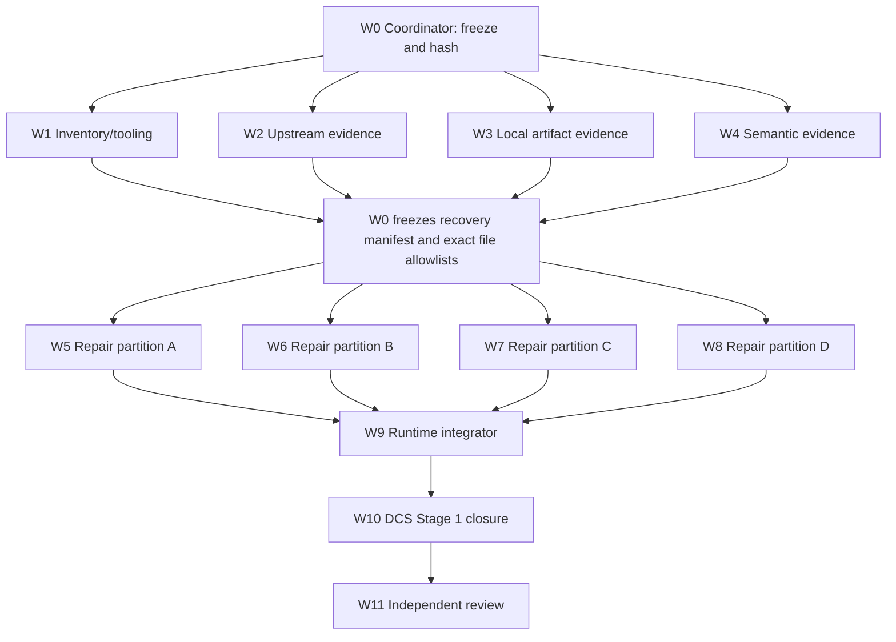

# DCS Stage 1 Recovery Orchestration Design

## Status And Authority

This document is an operational recovery design. It does not define DCS
behavior and must not be used as a parallel source of truth for DCS v1.6.
The DCS specification, final review, and Harness task specifications remain
authoritative.

The recovery starts from commit `623677ec6cda799fec6f305809ed4db37a514d70`.
The user's main workspace at `C:\Users\27933\Desktop\clawx\ClawX` is evidence
and must remain read-only throughout recovery.

## Goal

Recover the committed UTF-8-damaged pruned Runtime without losing local work,
restore a real green Runtime build as a separately reviewed baseline commit,
then complete and validate DCS Stage 1 on top of that clean baseline.

## Why The Work Is Split

The current problems have three different ownership domains:

1. Workspace preservation and change attribution.
2. Committed Runtime UTF-8/build baseline remediation.
3. DCS Stage 1 working-memory behavior and acceptance.

Combining them in one diff makes Harness touched-area validation meaningless.
They therefore produce separate commits and acceptance reports. DCS Stage 1
may depend on the Runtime remediation commit, but its task specification must
not claim ownership of the repaired Runtime baseline.

## Concurrency Architecture

Use one coordinator and isolated worker worktrees. No worker edits the user's
main workspace. No two write-enabled workers receive the same file.

Evidence workers may run together because they write only their own reports.
Repair workers may run together only after W0 publishes exact, pairwise
disjoint file allowlists. Integration, Stage 1 closure, and final review are
sequential gates.

## Repository And Branch Layout

All recovery work lives under `C:\dcs-recovery`:

| Window | Branch | Worktree |
| --- | --- | --- |
| W0 | `codex/recovery-coordinator` | `C:\dcs-recovery\coordinator` |
| W1 | `codex/runtime-utf8-inventory` | `C:\dcs-recovery\inventory` |
| W2 | `codex/runtime-utf8-upstream-evidence` | `C:\dcs-recovery\upstream` |
| W3 | `codex/runtime-utf8-local-evidence` | `C:\dcs-recovery\local-evidence` |
| W4 | `codex/runtime-utf8-semantic-evidence` | `C:\dcs-recovery\semantic` |
| W5 | `codex/runtime-utf8-repair-a` | `C:\dcs-recovery\repair-a` |
| W6 | `codex/runtime-utf8-repair-b` | `C:\dcs-recovery\repair-b` |
| W7 | `codex/runtime-utf8-repair-c` | `C:\dcs-recovery\repair-c` |
| W8 | `codex/runtime-utf8-repair-d` | `C:\dcs-recovery\repair-d` |
| W9 | `codex/runtime-baseline-integration` | `C:\dcs-recovery\runtime-integration` |
| W10 | `codex/dcs-stage1-final` | `C:\dcs-recovery\dcs-stage1` |
| W11 | no writes | review W9 and W10 diffs |

Workers branch from the same immutable recovery seed. Repair branches are
created only after the evidence commits have been integrated and the recovery
manifest is frozen. W10 branches from the accepted W9 Runtime baseline.

## Recovery Evidence Contract

The canonical inventory is a machine-readable JSON document with:

- base commit and repository-relative path;
- original blob SHA-256 and byte length;
- every malformed byte range and bounded byte context;
- candidate replacement bytes and evidence source;
- confidence: `exact`, `corroborated`, or `unresolved`;
- post-repair SHA-256;
- assigned repair partition;
- focused tests required by the file's ownership domain.

An automated repair may apply only an `exact` entry whose current preimage hash
matches the manifest. A manual repair requires at least two independent forms
of evidence and is recorded as `corroborated`. `unresolved` entries block
integration. Multiple byte repairs in one file are applied against the
original bytes in descending offset order, followed by a full-file hash check.

Upstream snapshots are evidence, not replacement trees. Whole-file upstream
copies are forbidden unless the file is proven byte-for-byte identical outside
the damaged ranges. The replacement character `U+FFFD`, lossy decoder output,
guessed punctuation, guessed CJK text, and empty compatibility shells are
forbidden.

## Worker Write Boundaries

W1 owns the scanner, manifest schema, tests, and inventory report. W2-W4 own
only reports under separate evidence directories. W5-W8 own only paths listed
in their frozen allowlist plus their partition result report. W9 owns
integration-only conflict resolution, Runtime build-contract repair, and the
Runtime acceptance report. W10 owns only the DCS Stage 1 task's exact
touchedAreas. W11 is read-only.

Every write-enabled worker must stop if:

- a required edit falls outside its allowlist;
- its branch contains unexpected changes;
- a preimage hash differs from the frozen manifest;
- recovery evidence is ambiguous;
- a fix would require changing Renderer, Electron Main, Gateway transport,
  COMPASS, or another forbidden Stage 1 owner.

## Integration Gates

The Runtime baseline is accepted only when:

1. all tracked textual Runtime sources decode as strict UTF-8;
2. the manifest contains zero unresolved records;
3. every repair has a matching evidence record and pre/post hash;
4. generated Runtime assets are excluded from the source repair commit;
5. focused tests for affected owner domains pass;
6. Runtime type/lint checks selected by scoped policy pass;
7. `pnpm --dir openclaw_runtime build` exits 0;
8. independent review reports Critical 0 and Important 0.

DCS Stage 1 is accepted only after the Runtime baseline commit is fixed, then
all commands and evidence required by
`harness/specs/tasks/dcs-stage1-working-memory-handler.md` pass against the
actual final diff.

## Rollback

No recovery action rewrites the user's main branch or working tree. Each worker
produces reviewable commits. A bad repair is removed by omitting or reverting
that commit on the integration branch, never by resetting the source
workspace. The immutable backups, base bundle, tracked patches, untracked-file
archive, and hash inventory remain available until Stage 1 acceptance is
complete.

