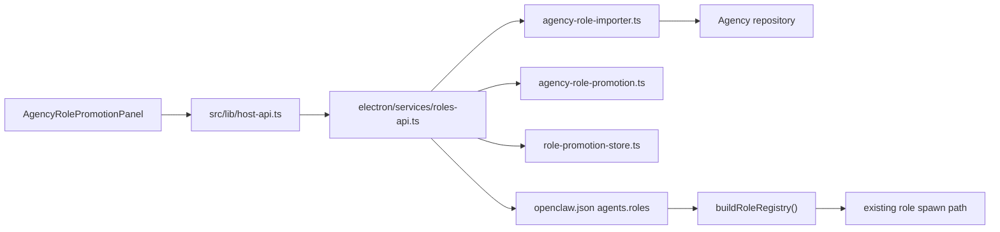

# Agency Role Promotion Control Plane Design

> Status: Approved for implementation planning
>
> Date: 2026-07-12
>
> Binding implementation plan: `docs/superpowers/plans/2026-07-12-agency-role-promotion-control-plane.md`
>
> Binding phase control: `docs/multi-agent-orchestration/phase-constraints/agency-role-promotion-control-plane.md`

## 1. Objective

Build a controlled path that converts an immutable Agency Agents source draft
into a separate config-backed `RoleContract`.

The feature is successful when an operator can:

1. select a local Agency Agents repository;
2. inspect a source candidate and its immutable source fingerprint;
3. explicitly map or waive every tool hint;
4. edit and validate the candidate runtime contract;
5. attach evidence and record a human review;
6. approve materialization into `agents.roles`;
7. retry interrupted materialization safely;
8. retire the exact materialized role while retaining audit history.

The feature is not a general Role self-evolution framework. It does not add
ToolRule execution, shared memory, memory self-editing, sleeptime agents, a new
tool executor, or automatic runbook qualification.

## 2. Problem Statement

ClawX already imports Agency-like content into `AgencyDraftRoleEntry` and
correctly prevents it from spawning. The missing product capability is the
review and materialization bridge.

The original proposal suggests that maturity should unlock tools, memory
writes, self-editing, and background execution. That coupling is rejected.
Governance labels must describe evidence and lifecycle; they must never become
an authority source.

The approved model is:

```text
Agency source draft (always non-runnable)
  -> persisted review record
  -> explicit human approval
  -> separate config RoleContract
  -> existing role registry and spawn path
  -> guarded retirement
```

## 3. Binding Invariants

### 3.1 Runtime authority

- `RoleContract` remains the only runtime role authority.
- `canSpawnAgencyDraft()` returns literal `false` for every Agency draft.
- Agency Markdown, tool hints, handoff prose, division metadata, runbook prose,
  lifecycle, and evidence qualification cannot grant tools or permissions.
- A promoted role enters runtime only through `openclaw.json -> agents.roles[]`
  and the existing `buildRoleRegistry()` path.
- No second role registry, spawn path, permission evaluator, or tool executor is
  permitted.

### 3.2 Governance

Lifecycle and evidence qualification are independent:

```text
lifecycle: draft -> reviewed -> active -> retired
evidence:  unverified -> scenario-verified -> release-qualified
```

Lifecycle answers where the review/materialization process is. Evidence
qualification answers what evidence has been attached. Neither modifies:

- `tools`;
- `permissions.filesystem`;
- `permissions.network`;
- `permissions.commands`;
- model selection;
- effort;
- memory access;
- background execution;
- handoff authority.

### 3.3 Source integrity

- The source root is selected explicitly through the existing typed dialog API.
- Main reads the source repository. Renderer does not read arbitrary files.
- Repository-relative paths and SHA-256 content fingerprints identify source
  candidates.
- Absolute developer paths are not persisted in runtime contracts or source
  digests.
- Approval must fail when the source fingerprint no longer matches the reviewed
  record.

### 3.4 Tool hints

Every source tool hint has exactly one disposition:

- `mapped`: contains one or more explicitly selected stable ClawX tool ids;
- `waived`: contains no selected tools and has a non-empty reviewer reason.

Suggestions are UI assistance only. Suggested tools never enter the candidate
until the operator selects them.

### 3.5 Persistence and recovery

- Main owns review records, decisions, materialization, reconciliation, and
  retirement.
- Approval persists a pending decision before writing OpenClaw config.
- Config materialization is idempotent.
- Reconciliation requires the exact reviewed contract digest, not role name
  alone.
- Retirement removes only the config role carrying the exact reviewed digest.
- Store read failure degrades to no review authority, never implicit approval.

## 4. Architecture



### 4.1 Runtime domain

`openclaw_runtime/src/agents/agency-role-promotion.ts` is pure logic. It owns:

- conservative mapping suggestions;
- disposition validation;
- candidate validation;
- normalized contract digest;
- creation of a separate materialized `RoleContract`.

It does not read files, write config, persist audit records, or spawn roles.

### 4.2 Main control plane

`electron/services/roles-api.ts` owns host actions:

- `agencyCatalog`;
- `previewAgencyPromotion`;
- `reviewAgencyPromotion`;
- `approveAgencyPromotion`;
- `retireAgencyPromotion`.

`electron/services/role-promotion-store.ts` owns bounded audit persistence.
Main reuses `withConfigLock()`, `readOpenClawConfig()`, and
`writeOpenClawConfig()` for role config changes.

### 4.3 Typed bridge

The contract is declared first in `shared/host-api/contract.ts`, implemented in
Main, and exposed through `src/lib/host-api.ts`.

Renderer must not call:

- `window.electron.ipcRenderer.invoke(...)`;
- Gateway HTTP;
- Gateway WebSocket;
- Node filesystem APIs.

### 4.4 Renderer

`AgencyRolePromotionPanel.tsx` owns this workflow instead of expanding the
already large `RolesOrchestrationPanel.tsx`.

The panel provides:

- source-directory selection;
- searchable draft catalog;
- source and validation details;
- candidate contract editor;
- tool-hint mapping/waiver controls;
- evidence and reviewer controls;
- review, approve, retry, and retire commands.

The source draft always displays as Draft. Active/Retired labels belong to the
promotion record, not the draft.

## 5. Data Flow

### 5.1 Catalog

```text
select directory
  -> hostApi.roles.agencyCatalog({ sourceRoot })
  -> Main validates required Agency manifests
  -> importer returns draft summaries + source fingerprints
  -> Main reconciles exact-digest pending records
  -> UI displays drafts and review history
```

### 5.2 Review

```text
edit candidate + dispositions + evidence
  -> previewAgencyPromotion
  -> pure validation, no persistence
  -> reviewAgencyPromotion
  -> re-import and verify source fingerprint
  -> persist reviewed record
```

### 5.3 Approval

```text
approve reviewed record
  -> verify reviewed source and candidate digest
  -> persist approved/pending
  -> write separate config RoleContract under config lock
  -> persist active/complete
  -> refresh existing role list
```

### 5.4 Failure and retry

If config write fails, the record is retained with a sanitized failure. Retry
returns it to pending and repeats the idempotent write. If config already
contains the exact digest tag, reconciliation finalizes the record.

### 5.5 Retirement

Retirement checks role name and exact contract digest tag. A user-authored
replacement at the same name is not deleted. Successful retirement removes the
config role and retains the record as `retired`.

## 6. Required Reference Ledger

Agents must inspect references before changing the owning round. A final report
that only lists paths without explaining the learned contract is insufficient.

### 6.1 ClawX references

| Address | Required learning |
|---|---|
| `C:/Users/27933/Desktop/clawx/ClawX-role-promotion/AGENTS.md` | Repository rules and required gates |
| `C:/Users/27933/Desktop/clawx/ClawX-role-promotion/openclaw_runtime/AGENTS.md` | Runtime subtree constraints |
| `openclaw_runtime/src/agents/role-contract.ts` | Authoritative runtime contract and validator |
| `openclaw_runtime/src/agents/role-registry.ts` | Existing config role materialization path |
| `openclaw_runtime/src/agents/role-spawn.ts` | Existing spawn authority and permission context |
| `openclaw_runtime/src/agents/agency-draft-catalog.ts` | Permanent draft non-spawn boundary |
| `openclaw_runtime/src/agents/agency-role-importer.ts` | Existing source normalization |
| `electron/services/roles-api.ts` | Existing config role write owner |
| `electron/services/orchestration-presets-api.ts` | Main-owned bounded electron-store pattern |
| `shared/host-api/contract.ts` | Typed host contract source |
| `src/lib/host-api.ts` | Renderer facade |
| `src/components/agents/RolesOrchestrationPanel.tsx` | Current role management UI |
| `tests/e2e/role-management.spec.ts` | Electron host mock and role UI test pattern |
| `docs/role-first-design.md` | Current architecture baseline |

### 6.2 Agency Agents references

| Absolute address | Required learning |
|---|---|
| `C:/Users/27933/Desktop/verseshell/agency-agents-main/divisions.json` | Source divisions and catalog metadata |
| `C:/Users/27933/Desktop/verseshell/agency-agents-main/tools.json` | Source tool-install catalog, not ClawX runtime tools |
| `C:/Users/27933/Desktop/verseshell/agency-agents-main/strategy/runbooks.json` | Stable runbook slugs and roster evidence references |
| `C:/Users/27933/Desktop/verseshell/agency-agents-main/engineering/engineering-code-reviewer.md` | Representative candidate structure |
| `C:/Users/27933/Desktop/verseshell/agency-agents-main/testing/testing-reality-checker.md` | Representative verification candidate |
| `C:/Users/27933/Desktop/verseshell/agency-agents-main/security/security-penetration-tester.md` | High-risk candidate requiring conservative permissions |

Agency references provide source data and review context. They do not define
ClawX runtime permissions, tool ids, or activation rules.

### 6.3 Letta references

| Absolute address | Required learning |
|---|---|
| `C:/Users/27933/Desktop/verseshell/letta-main/letta/schemas/agent.py` | Persisted state and pending approval separation |
| `C:/Users/27933/Desktop/verseshell/letta-main/letta/schemas/tool_rule.py` | Explicit approval as a distinct rule concept |
| `C:/Users/27933/Desktop/verseshell/letta-main/letta/helpers/tool_rule_solver.py` | Tool sequencing belongs in the execution loop, outside this phase |
| `C:/Users/27933/Desktop/verseshell/letta-main/letta/schemas/block.py` | Stable block identity for a separate memory project |
| `C:/Users/27933/Desktop/verseshell/letta-main/letta/services/block_manager.py` | History and versioning patterns for a separate memory project |
| `C:/Users/27933/Desktop/verseshell/letta-main/letta/groups/sleeptime_multi_agent_v4.py` | Foreground/background ownership separation |
| `C:/Users/27933/Desktop/verseshell/letta-main/letta/services/tool_executor/tool_execution_manager.py` | Central execution ownership, not a reason to add a second ClawX executor |

Letta is a design comparison. Its database, AgentState, block manager, tool
loop, and background-agent implementation are not copied into ClawX.

### 6.4 Proposal and binding documents

| Address | Role |
|---|---|
| `C:/Users/27933/.codex/attachments/c80f0e36-1692-45db-a755-ae7730931d95/pasted-text.txt` | Original proposal; informative, not authoritative |
| `docs/superpowers/specs/2026-07-12-agency-role-promotion-control-plane-design.md` | Authoritative design decisions |
| `docs/multi-agent-orchestration/phase-constraints/agency-role-promotion-control-plane.md` | Authoritative round boundaries |
| `docs/superpowers/plans/2026-07-12-agency-role-promotion-control-plane.md` | Task and TDD order |
| `harness/specs/tasks/agency-role-promotion-control-plane.md` | Machine-readable task gate |
| `harness/specs/rules/agency-role-promotion-boundary.md` | Machine-readable hard boundary |

When the original proposal conflicts with this design, this design wins.

## 7. Development Rounds

Implementation is split into six ordered rounds. The exact allowed files,
required references, tests, and exit criteria are binding in:

`docs/multi-agent-orchestration/phase-constraints/agency-role-promotion-control-plane.md`

The rounds are:

| Round | Deliverable |
|---|---|
| R0 | Preflight, Harness context, baseline, reference ledger |
| R1 | Immutable source identity and pure promotion domain |
| R2 | Typed Host API contract and facade |
| R3 | Main persistence, materialization, recovery, retirement |
| R4 | Review UI and four-locale copy |
| R5 | Electron E2E, docs sync, full acceptance gate |

No round may start until the previous round's exit criteria pass.

## 8. Acceptance Standard

The implementation is accepted only when:

- Agency drafts remain non-runnable across all states and failure paths.
- Every repository candidate has a stable relative source path and SHA-256.
- Every tool hint is mapped or waived explicitly.
- Evidence qualification never changes runtime authority.
- Approval creates a separate validated config role.
- Approval retry is idempotent.
- Interrupted materialization is reconciled by exact digest.
- Retirement cannot delete a user replacement.
- Renderer uses typed Host API only.
- All user-visible text exists in English, Chinese, Japanese, and Russian.
- Focused unit, contract, i18n, typecheck, lint, comms, build, Electron E2E,
  Harness validation, and diff checks pass with fresh evidence.
- The final report includes the reference ledger, RED -> GREEN evidence,
  acceptance checklist, and explicit non-goal checklist.

## 9. Explicit Non-Goals

- No maturity field added to `RoleContract`.
- No maturity-driven permission release.
- No Agency Markdown runtime activation.
- No automatic tool grant.
- No shared Memory Block store.
- No Role Memory effect wiring.
- No Role persona or memory self-edit.
- No sleeptime/background Role execution.
- No ToolRule solver or sequencing.
- No new tool executor factory.
- No provider fallback or provider error refactor.
- No automatic runbook execution or scoring.
- No bulk promotion of the Agency corpus.
