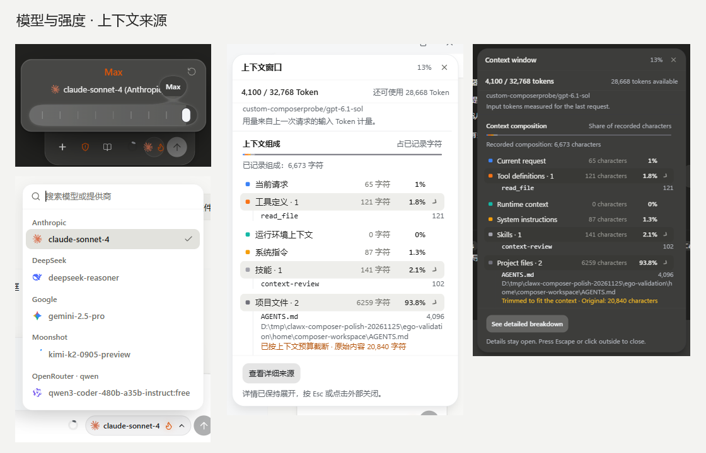

# 模型卡片与上下文来源面板

模型卡片与强度滑块紧凑排列，文字预览覆盖模型行且允许点击穿透。搜索输入取消内框与阴影；长模型列表向上展开，底部停在卡片边界内，上下文入口可直接点击。上下文入口显示无填充圆环，详情使用2px组成线，标题与用量固定，文件来源独立滚动。

产品候选为 `85cb2ac55fa1aeb6565836e575401d41268827ec`。按用户2026-11-25指定路径，使用 **ego-browser** 验证实际Renderer构建：四语、明暗主题和1280/375px共 **16组全部通过**。模型搜索选择、键盘强度调整、恢复Auto、来源键盘展开/收起、相邻菜单切换和减少动态效果均有实操记录。截图回读确认窄屏边界、表格对齐及固定头部。

来源链使用agent创建的真实文件、生产运行时报告生成器与SQLite写入器，并在隔离Node进程执行生产Main函数 `getSessionContextSnapshot`。浏览器测试桥把其返回值交给真实Renderer；导航与模型设置使用已有mock Host通道。文件更新后，用量从 **3,600变为4,100 Token**，系统提示字符数从 **6,474变为6,531**，TOOLS.md记录字符数从 **2,059变为2,116**。两阶段原文件、数据库和哈希均保留。历史SQLite快照显示 **32,275 / 1,000,000 Token**，生成日期保留为 **2026年7月14日23:22（Asia/Shanghai）**。

本候选147项定向单测、Web/Test类型、Renderer构建、定向lint、四语、contract、通信回放/比较、重复资源检查和所选Harness校验通过。Main源码与已通过完整类型及生产Main构建的 `b17b939acff92fecf79cdbbf41ad225a8b42fa7a` 相同。1,413个构建文件已同步主目录并逐项核对。

Carbon两次CLI调用、8次允许的模型请求，共84,917 reported tokens。第一轮直接改写两份CSS；第二轮达到时限，保留在临时目录的写入和未完成编辑请求由Codex复核后落实。原始回执与恢复修改记录分别保存，最终源码哈希可回读。本次接力新增Carbon调用数为0。

原r12构建内存溢出、r14夹具加载失败、未派发r15撤回、ego-r1测试类型90秒超时和浏览器首次遮挡失败均保留在 `original-failures/`。ego-r2采用Renderer优先顺序，测试类型在1200MiB Go内存限制下76.719秒通过。Electron回归spec随代码更新，本轮前端实际执行路径为用户指定的浏览器验收。

执行 `py -3 verify.py --repo D:/ClawX --from-git` 可检查候选源码、原始检查日志、16组测量、SQLite来源链、Carbon产物和构建文件。浏览器任务空间及本批Node服务已关闭，清理回执为 `ego-owned-cleanup.json`。
