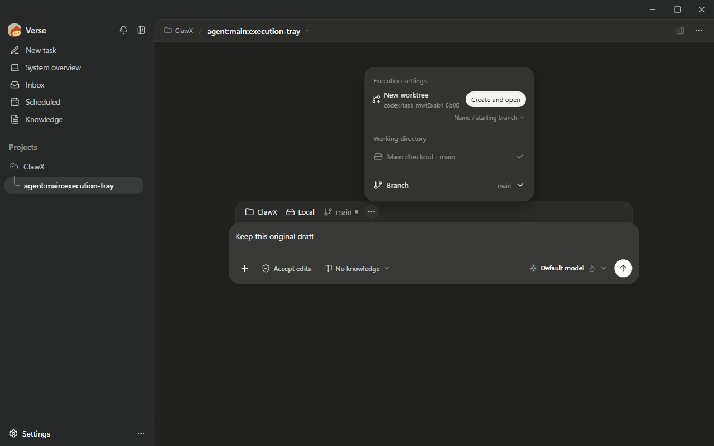
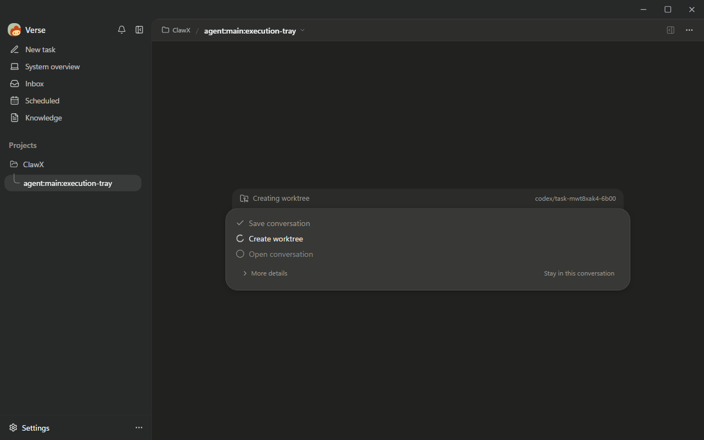
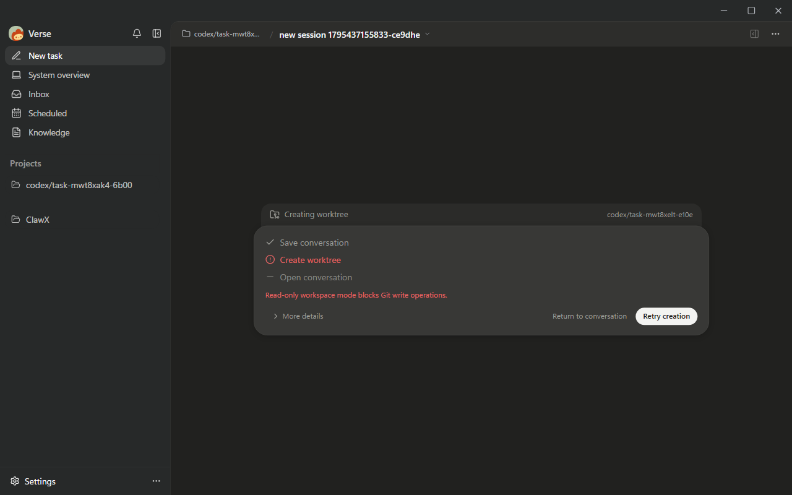

# 执行托盘与工作树创建进度

已按用户两张参考图及Carbon决策，统一输入框上沿的项目、执行目录、分支与更多设置。空会话和已有会话共用一个入口；任务行并入同一托盘，输入区采用22px圆角、灰阶实底与轻描边，设置浮层从托盘上方展开。

打开执行设置后直接点击“创建并打开”，无需输入配置即可生成唯一分支并建立真实Git工作树。改名和起点按需展开，已有工作树与分支在同一面板选择。切换前保存原会话草稿，新工作树以空会话开始，切回后恢复原草稿。

创建期间，进度卡原位替换输入框，按实际await依次显示“保存会话→创建工作树→打开会话”。不显示无法测量的百分比；“留在当前会话”会等待Git创建结算，再恢复原草稿并保留“打开工作树”入口。失败原因就地显示，可重试创建或打开已创建目录。权限、审批与运行禁切保持原Host语义。

85项定向测试全部通过，5条不同Electron旅程的最新结果通过。真实Git旅程核对新分支、目录、文件内容、新会话身份、两次点击零输入创建、原草稿往返恢复、只读拒绝后授权重试、创建后留在原会话及运行禁切。任务旅程覆盖任务验收、审批、断连、四语、明暗与窄窗。截图中的创建阶段由agent测试夹具暂停真实Host调用来稳定捕获，放行后执行真实Git并读取产物。所有Electron批次无残留，源码guard通过。

完整类型、四语、契约、通信回放与比较、构建和Harness通过。最终生产构建 `22d328d85`，界面验收候选 `69663b2543f171c8cf8c4ff220c877b33835322a`；源码一致，后续仅完善截图等待与说明。构建已同步主目录，1412个输出文件逐一核对。

Carbon共3轮、6次请求、实际看9张图片，reported tokens合计84377。复核判断整体结构和材质达标，提出3项必修：恢复按钮对比、实色禁用态和中性失败边框。三项均按精确值落实，并通过Electron明暗、悬停和禁用状态检查。设计原文分别见 `DESIGN.md`、`PROGRESS-DESIGN.md`、`VISUAL-REVIEW.md`。

原始日志、失败回执与旧构建备份位于 `D:/tmp/carbon-worktree-ux-20261123-01a203cc`。逐批候选见JSON记录；运行 `python verify.py` 可核验文件哈希和候选身份。
