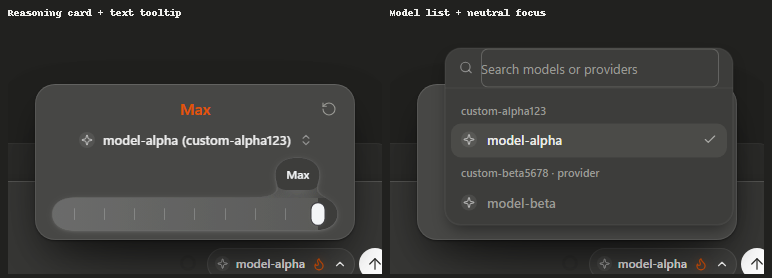

# 会话模型选择器与强度卡片

模型入口先显示当前强度、当前模型、重置按钮和 Preview Slider。点击模型行后，Rare UI 选择层从该行展开，强度标题、滑块及 Tooltip 隐藏且不可交互。头像浮层改为四语强度文字。模型切换沿用现有会话写入，强度与重置沿用 Agent 设置。

Carbon 实际查看三份参考与四种初版状态的拼图，集中规划卡片比例、提供商层级和搜索焦点。Low 档一次CLI调用、两次守卫POST，reported tokens **29,359**。规划与落实见 [返回规划](carbon/returned-plan.md) 和 [调整记录](carbon/applied-design.json)。实际图像读取回执保留了1232×1070图像、返回JPEG和像素差异。

卡片高度从180px收紧到156px；桌面宽320px、375px窗口内宽294px。标题16px，底部重复强度文案移除，文字Tooltip与模型行分离。搜索框蓝色outline已移除，键盘焦点使用中性灰。

128项定向单测通过，6条Electron旅程通过；16组四语×明暗×1280/375px、减少动态效果、模型保存与失败保留、松手提交和重置均有记录。完整无缓存Main/Web/Test类型、四语、契约、通信回放与比较、定向lint、所选Harness验证及构建通过。UI旅程使用typed Host/Gateway快照并由agent驱动真实Electron渲染。角色切换、组件关闭后的重置回调及拖动失焦保存边界另有定向回归，见scope-and-pointer-regressions.json。

生产源码与构建：`db928f5110f657574c7abfc36bfc9e9ed2db30c9`。已整合主目录最新运行图标提交`49aa08031a2a1a1f88d16a7bf6bc9911b1ae9989`，**1,413**个构建文件同步至D:/ClawX并逐项核对。旧构建及原滑块前置代码保存在D:/tmp；原有workspace配置修改与未跟踪任务规范保留。

原始失败和未启动命令单列保留，见original-failures.json与raw/。本轮工作根为`D:\tmp\clawx-model-effort-picker-20261124`。执行`py -3 verify.py --repo D:/ClawX --from-git`可核对证据、源码、构建和图像读取绑定。
