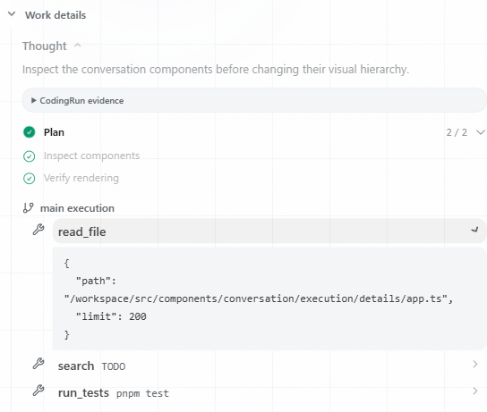
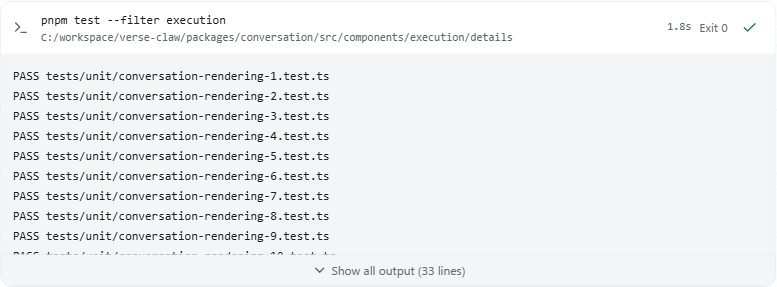
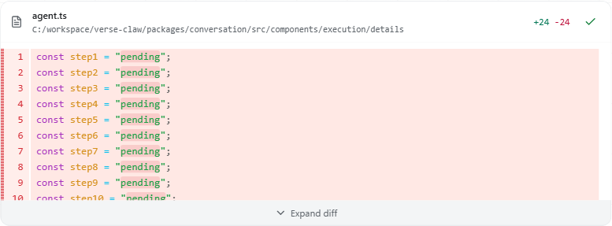
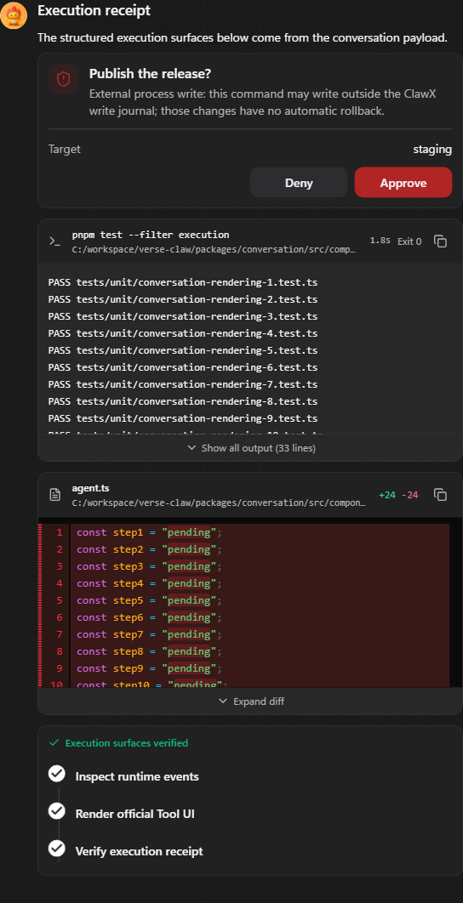

# 对话输出展示优化 · 2026-10-29

> 这是第一轮历史记录。后续增量见[第二轮优化](round-2/README.md)、[第三轮 Git 变更卡片修复](round-3/README.md)、[第四轮输入区列宽及运行时批准修复](round-4/README.md)与[第五轮工具调用 CallChip 优化](round-5/README.md)；当前验证以第五轮为准，原报告与截图保留用于对比。

本轮为 agent 驱动的 Windows 源码构建验证；截图使用自动化测试数据。

对话正文仍由 `ChatMessage → AssistantMarkdown` 呈现；处理过程由 `TurnSummaryCard` 统一折叠，内部复用 `ExecutionGraphCard`、`RunMutationDiffs` 和 `RunTerminalSurfaces`。模型返回的结构化卡片经 `AgentInteractionRenderer` 复用相同 diff/终端组件。

调整了摘要换行和展开提示、工具目标预览与明细留白、文件名/路径/统计/复制的层级，以及长差异和输出的折叠预览。保留完整详情和复制内容，修复代码缩进与末尾换行被 trim 去除的问题，补齐四语控件文案。

验证：17 项定向测试、6 项 Electron E2E（0 失败/跳过/重试）、前端及测试类型检查、四语检查、构建、隔离工作树的 Harness 校验和 dry-run 均通过。定向 ESLint 为 0 错误，9 条既有告警与 HEAD 基线一致。完整数据、源码哈希与图片哈希见 [report.json](report.json)。源码改动保留在工作区，未发布。

