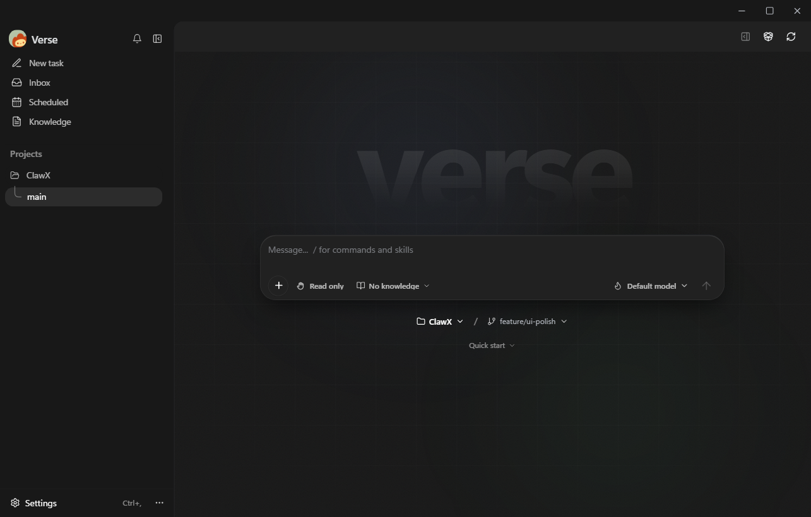
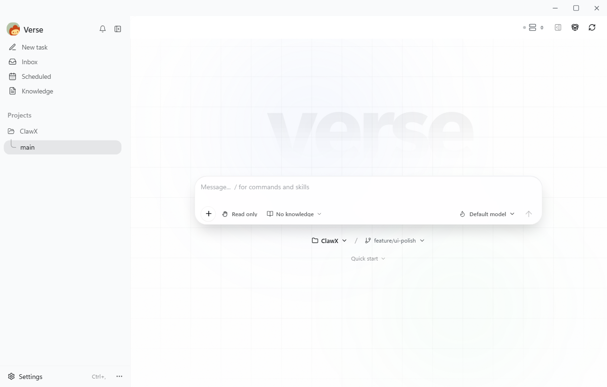
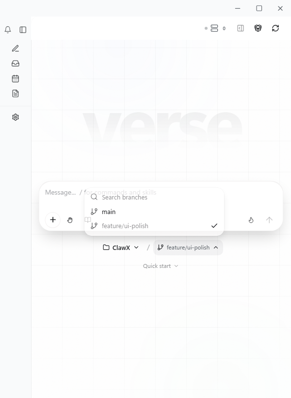

# 空会话项目与分支入口

2026-11-06 · driven_by: agent · actor: codex-chat-welcome-polish

项目选择改为无外框的“项目 / 分支”行；空会话不再重复显示完整 Git 状态条。三个快捷小卡片收进“快捷开始”，键盘可展开，输入时收起且不移动输入框。分支选择支持搜索、切换后刷新、读取失败重试与 detached HEAD；网关离线时本地选择器仍可用。Git 拒绝切换时保留当前分支并显示错误。项目选择先走当前会话的保存流程。

干净本地候选 `bfe2f3c467d386a79a0249f447876032abda7ad0`：21/21 单测、6/6 Electron、构建、前端类型、四语、局部 lint 全部退出 0；源码守卫通过。本轮 changed-path Harness 相对前一轮验证提交通过，dry-run 通过；lint 为 0 错误 / 3 警告。21 个输入文件与 D:/ClawX 当前内容哈希一致，changes.patch 仅记录本轮相对交接基线的增量。

这是 UI 开发范围验证。Electron 数据和分支切换为隔离的 agent 夹具，未对开发仓库执行 checkout；未宣称整仓验收或发布就绪，TF-0783 的历史残差保留。

