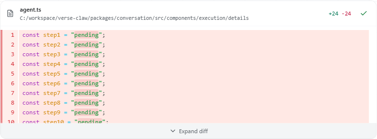
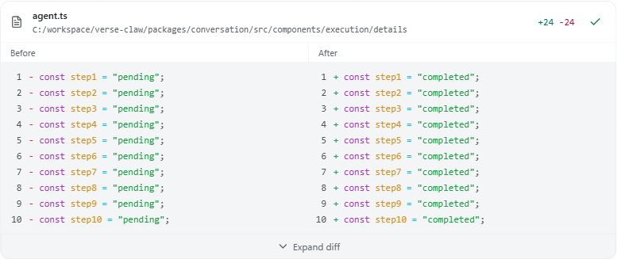
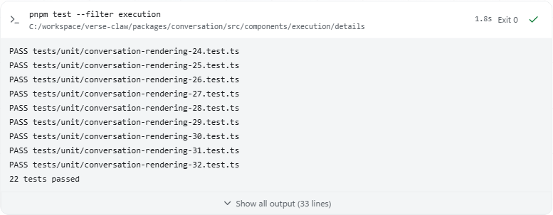
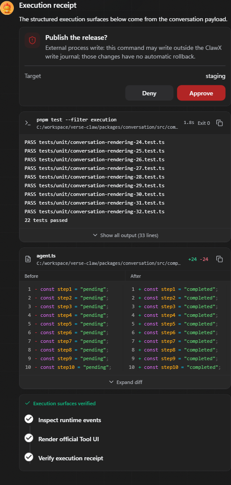

# 对话输出优化 · 第二轮

2026-10-29，agent 驱动的 Windows Electron 验证，使用自动化测试数据。

长文件替换现在同时预览修改前后，使用中性底色和明确的增删标记。预览按完整行对齐，支持键盘滚动。终端从最后的执行结果开始展示；回看旧日志时，新输出不会抢走阅读位置。完整差异、原始输出及复制内容仍保留。

验证：19 项定向测试、6 项 Electron E2E（0 失败/跳过/重试）、前端与测试类型检查、四语检查、构建、隔离工作树 Harness 校验及 dry-run 通过。定向 ESLint 0 错误，9 条既有告警不变。改动未提交或发布。源码和图片哈希见 [report.json](report.json)。

## 文件差异：改前与改后

## 终端：先看到执行结果

## 窄窗口与深色

