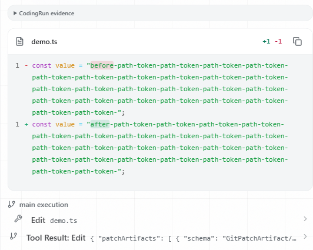

# Git 变更卡片宽度修复 · 2026-10-29

> 第三轮增量验证。前两轮见[第一轮](../README.md)与[第二轮](../round-2/README.md)。

本轮为 agent 驱动的 Windows 源码构建验证；截图使用自动化 Electron 历史，不代表真实模型质量或产品验收。

## 定位

对话内的 Git/文件变更卡片由 `RunMutationDiffs → CodeDiff` 渲染。此前外层只设置了 `w-full`，中间层没有显式限制 `max-width` / `min-width`，预览态也没有为超长不可断行 token 提供换行；窄窗口下长行会顶到或视觉上越过会话内容列的右缘。

## 修复

- `RunMutationDiffs` 与每个文件卡片补齐 `w-full`、`min-w-0`、`max-w-full` 和局部裁切边界。
- `CodeDiff` 的根容器、内容区、滚动区和 Pierre 渲染器统一继承内容列宽度。
- 预览态使用 wrap 排版，长 token 在卡片内换行；只有用户显式展开后才在差异区域内横向滚动。
- Electron 回归用例加入超长替换行，并在 640px 宽度下断言卡片左右边界不超过会话详情列。

## 验证

- 126 项定向单测、9 项 Electron E2E（0 失败/跳过/重试）通过。
- 前端与测试类型检查、四语检查、构建通过。
- 定向 ESLint 0 错误，5 条既有 react-refresh 告警。
- 隔离工作树 Harness validate 与 dry-run 通过。

尺寸 532 × 425，截图哈希与完整源码哈希见 [report.json](report.json)。源码改动保留在工作区，未提交、未发布。
