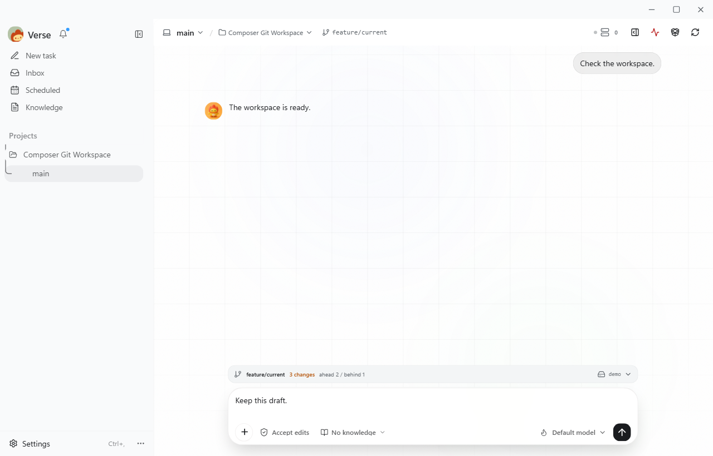
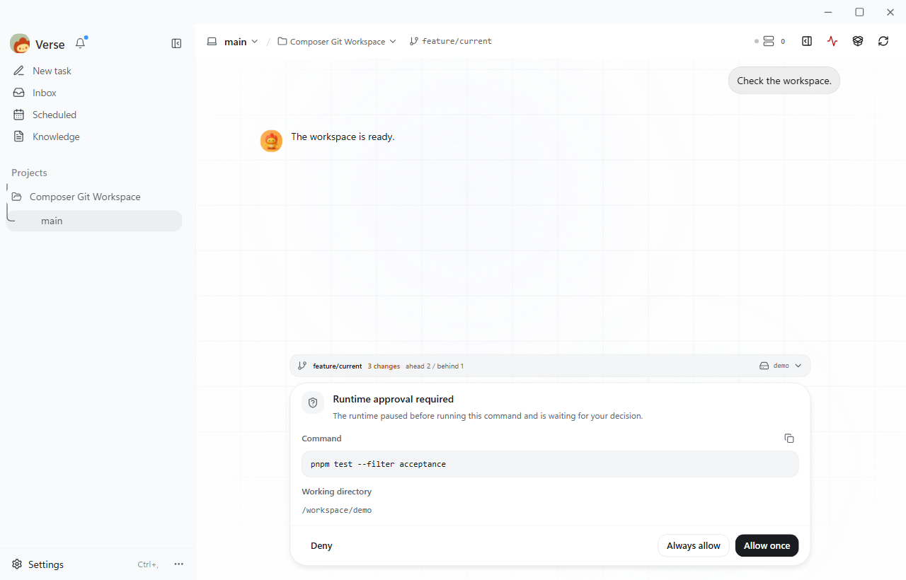

# 输入区列宽与运行时批准修复 · 2026-10-29

> 第四轮增量验证。前序见[第一轮](../README.md)、[第二轮](../round-2/README.md)与[第三轮](../round-3/README.md)。

本轮为 agent 驱动的 Windows 源码构建验证；截图使用自动化 Electron 历史，不代表真实模型质量或产品验收。

## 定位

1. **Git 变更条比输入框宽**：输入区使用 `max-w-[768px]`，但 `ComposerGitStrip` 外层仍使用 `max-w-4xl`。在高 DPI 或宽窗口下，变更条会撑到会话列之外。
2. **运行时批准看起来像居中弹窗**：当前源码的 `RuntimeApprovalPrompt` 已改为输入区替换，但缺少一个同时覆盖 Git strip、输入框与批准面板的回归断言。附图中的居中 Dialog 对应改动前的版本，需要以当前构建验证。

## 修复与回归

- Git strip 外层改为与 `ChatInput` 相同的 `max-w-[768px]` 居中列。
- 新增非空会话的 Electron 回归：批准面板出现时，Git strip、原输入框和批准面板的 x/宽度均一致；批准面板位于 strip 下方。
- 同时断言没有 `role=dialog`、没有 `.verse-claw-dialog-overlay`，原输入框隐藏，拒绝后草稿恢复。
- 回归用例额外在 960px 宽度验证 Git strip 与输入框仍对齐。

## 验证

- 6 文件 / 134 项定向单测通过。
- 11 项 Electron E2E 通过（0 failed / skipped / flaky）。
- `typecheck:web`、`typecheck:test`、`i18n:lint`、`build:vite` exit 0。
- 定向 ESLint 0 errors / 4 条既有告警。
- 隔离工作树 Harness validate 与 dry-run 通过。

完整尺寸、图片和源码 SHA-256 见 [report.json](report.json)。源码改动保留在工作区，未提交、未发布。
