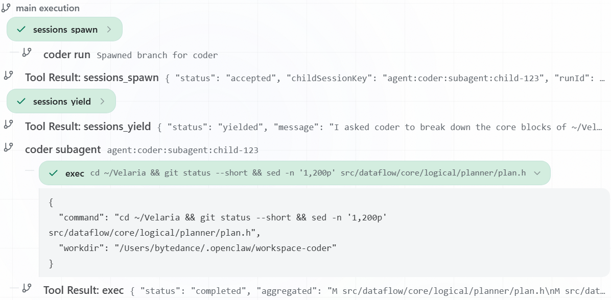
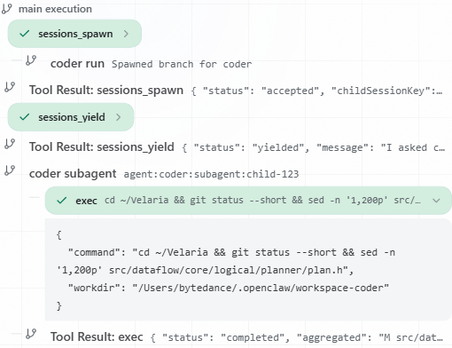
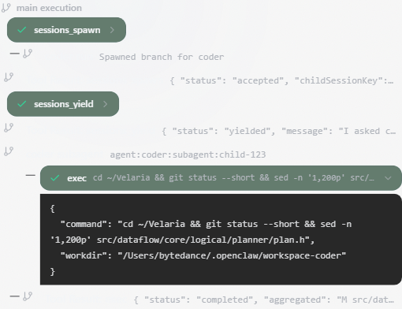

# 工具调用 CallChip 优化 · 2026-10-29

> 第五轮增量验证。前序见[第一轮](../README.md)、[第二轮](../round-2/README.md)、[第三轮](../round-3/README.md)与[第四轮](../round-4/README.md)。

本轮为 agent 驱动的 Windows 源码构建验证；截图使用自动化 Electron 历史，不代表真实模型质量或产品验收。设计参考：[ReactBits CallChip](https://www.reactbits.dev/micro/call-chip?status=done)。

## 实现

- 新增 `CallChip` 本地组件，保留参考组件的状态填充、完成勾选、失败红色状态和计时表达；图标复用项目已有 lucide，不引入 Hugeicons 依赖。
- 对话执行图中的工具调用改成紧凑芯片：图标、工具名、目标/命令摘要、状态填充、耗时和展开箭头。
- 流式 `ToolStatusBar` 复用同一芯片，避免“运行中”和“已完成”出现两套工具视觉。
- 运行时工具事件在提供时间戳时计算 `startedAt` / `durationMs`；没有可信时长的历史记录不显示计时，避免伪造耗时。
- 芯片保持 content-width，并受 `max-width: 100%` 约束；640px 回归检查长 `exec` 芯片不会溢出执行图滚动区。

## 验证

- 6 文件 / 136 项定向单测通过。
- 11 项主 E2E 与 1 项 CallChip 窄屏 E2E 均通过测试断言，0 失败/跳过；完整命令在 teardown 时因另一个并行工作流改写 tracked source 触发 source-mutation guard，故进程退出码为 1。
- 工具执行面用例额外重复 3 次通过，确认键盘滚动断言已稳定。
- `typecheck:web`、`typecheck:test`、`i18n:lint`、`build:vite` exit 0；新 CallChip 文件定向 ESLint 0 findings。

完整图片与源码哈希见 [report.json](report.json)。源码改动保留在工作区，未提交、未发布。
