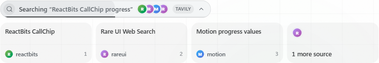

# Web Search + horizontal progress · 2026-10-29

> Seventh visual increment. Previous rounds: [1](../README.md), [2](../round-2/README.md), [3](../round-3/README.md), [4](../round-4/README.md), [5](../round-5/README.md).

This is agent-driven Windows source-build evidence using a seeded Electron history. It does not claim a live provider response, human review, or product acceptance. Design reference: [Rare UI Web Search](https://www.rareui.com/components/websearch).

## Implementation

- Added a local Rare UI Web Search adaptation at `src/components/rareui/WebSearch.tsx`, retaining the reference pill, source cards, favicon stack, overflow card and collapse behavior.
- Replaced the reference circular globe ring with a left-to-right progress wash plus a 2px track, so the running state matches the project existing ReactBits CallChip language.
- Wired completed web_search runtime results into the existing Tool UI parser and renderer. Only provider-backed results become cards.
- Added English, Chinese, Japanese and Russian labels, including plural-aware source counts.

## Verification

- Focused unit path: 2 files, 15 tests passed. The wider targeted path: 4 files, 44 tests passed.
- typecheck:web, typecheck:test, i18n:lint, focused ESLint, build:vite and the targeted Electron E2E run exited 0.
- The Electron assertion checks data-progress-mode="horizontal" on both the wash and the 2px track, and the light/dark/narrow source grid remains within the message column.
- Harness --no-diff validation passed. The diff-aware Harness run remains blocked by unrelated pre-existing dirty files, not by this change.

See [report.json](report.json) for byte sizes and source hashes. Source changes remain local and uncommitted.
