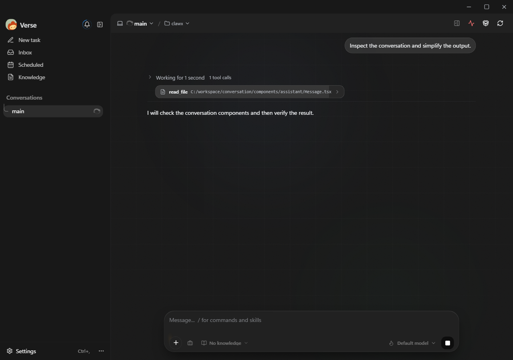
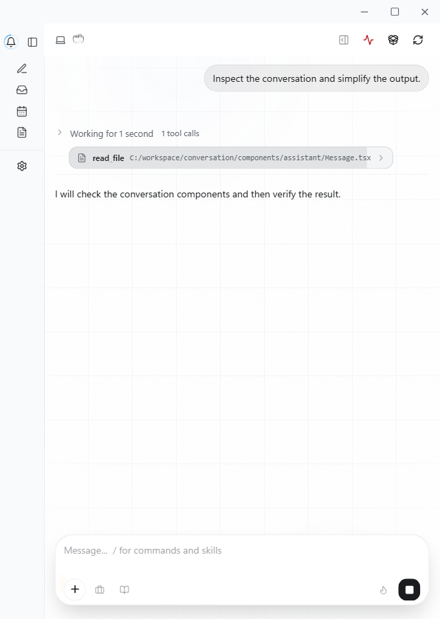

# 对话输出精简 · 2026-11-04

driven_by: agent · actor: codex-chat-output · realHumanEvidence: false

助手消息去掉头像与头像占位，进度说明和最终回复共用正文列。运行过程默认折叠，保留当前工具的进度填充动画；等待阶段保留 20px 粒子动画。两者按阶段切换，展开后不重复绘制同一工具。历史回写与流式答复去重。

被动的命令、差异、计划和测试结果归入可用键盘展开的处理详情。搜索默认保持紧凑入口，原有横向进度动画保留。问题、审批、失败命令和失败测试直接可见。已展开内容保持挂载，避免丢失复制和滚动状态。

- 单元测试：9 文件，198/198 通过，退出码 0。
- Electron 核心：4/4 通过，退出码 0。
- Electron 补充回归：12/12 测试体通过，worker 清理超过 90000ms，整批退出码 1；不能称为整批绿灯。
- Electron 状态与集成：3/3 + 2/2 通过，两批退出码均为 0。与补充回归合计覆盖 17 个不同场景。
- 前端类型检查、四语、局部 ESLint、Vite 构建与 Runtime 构建退出码均为 0；ESLint 保留 3 条既有告警。
- 测试类型检查退出码 2：已有长会话后端改动中 13 条类型错误，见 `typecheck-test.log`。
- 完整 Harness changed-path 校验退出码 1：已有 4 个不属于本任务的改动。使用同一 Harness 归属校验函数核对本轮 27 个源码/规范/测试路径，0 个未覆盖；未使用 `--no-diff`。

截图由 agent 在真实 Electron 窗口中使用种子历史和运行时事件生成，已检查浅色、深色、640px 窄窗与完成态。完成态截图中的侧栏快照警告来自现有 mock 环境。所有动画由已有状态驱动，不假造执行结果。

这是未提交工作树的 UI 开发验证，不是冻结候选、打包发布或真实模型质量验收。本轮没有执行需要 provider 的 Space Bunny 验收，仅将其两个依赖头像的定位器改为正文定位器。

本地 Task Forest 已写入 TF-0783（review_needed / 95），CLI 校验通过。应用后的大体积历史 HTML 导出未完成并被中止；图与提案已回读确认，旧导出尚未刷新。该记录不需要真人复核，剩余自动化门禁由 agent 在干净候选中继续处理。

原始结构化结果见 `unit.json`、`electron-*.json`；命令、源码哈希和边界见 `report.json`。`SHA256SUMS` 覆盖本目录全部产物（不包含清单本身）。

