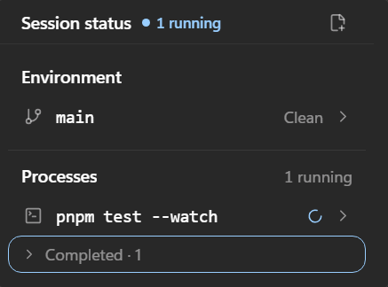
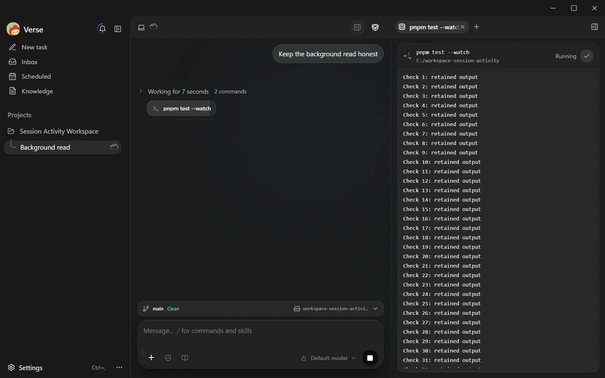

# 对话、会话状态与进程区统一 · 2026-11-05

driven_by: agent · actor: codex-chat-output · realHumanEvidence: false

本轮继续精简输出：摘要最多显示两项计数，不再显示思考数量；成功工具行降低背景强调；同一次历史工具调用与结果合并到一个可展开入口，未匹配结果保留。展开过程不再重复显示主 Agent 执行标题，诊断入口使用轻量文本并放到末尾。

会话状态区改为单一平面分组，去掉多层卡片与状态胶囊。已完成进程默认折叠，运行中和失败进程不受旧的最后六条截断影响。独立进程页复用对话终端，统一状态、字体、边框、复制和滚动；回看早期日志时保留位置，回到底部后继续跟随。原有粒子和工具填充动画保留。

验证：

- 7 个单测文件，95/95 通过，退出码 0。
- 7 个 Electron 场景的最终独立运行退出码 0：进程完整流程、工具结果合并、未知状态与成功空读取、工具卡片样式、完成态折叠和短对话。
- 实时摘要的初次交互断言通过，但该批 worker 清理超时；最后独立复跑遇到 90000ms 超时及工作树 diffSha256 变化。因此不宣称全部 E2E 通过。未放宽超时或禁用源码守卫。
- 前端类型、四语、局部 ESLint 和构建退出码 0；终端组件有 4 条既有导出方式告警。
- 全测试类型检查仍受其他会话的后端改动影响，退出码 2；完整 Harness 归属检查退出码 1，列出的无关文件见 `harness.log`。本轮 29 个文件使用实际 Harness 归属校验函数检查，0 个未覆盖。

截图由 agent 在真实 Electron 窗口内使用种子历史和运行时事件生成。已回读浅色、深色、窄窗、展开态截图，并验证完整输出复制及滚动行为。本轮未执行真实 provider 或发布验收。

Task Forest 的 TF-0783 续记提案保存在本地临时目录；图锁占用导致读取/保存不能完成，未改写状态或清除锁。没有将任务标为 done，也不等待真人数据或 verdict。

`report.json` 包含精确命令、退出码、时间、异常和源码哈希；`SHA256SUMS` 覆盖本目录全部产物（清单本身除外）。之前的证据目录保持原样。

