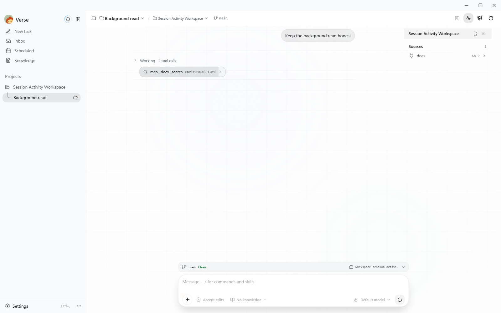
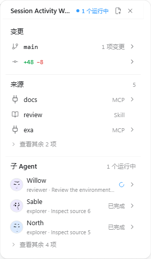
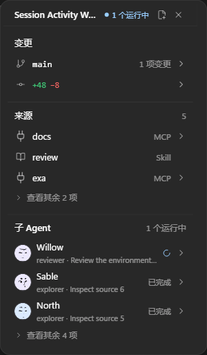
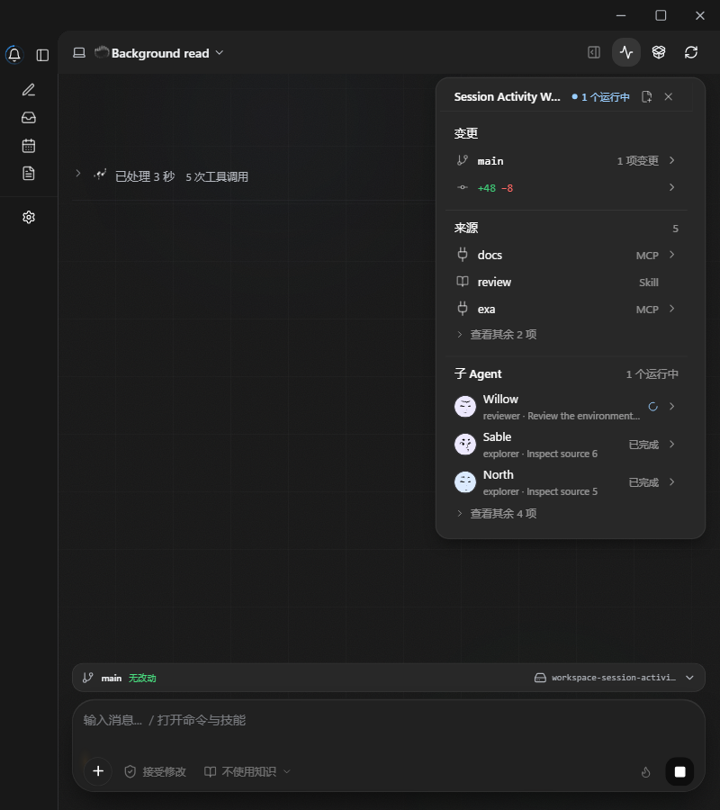
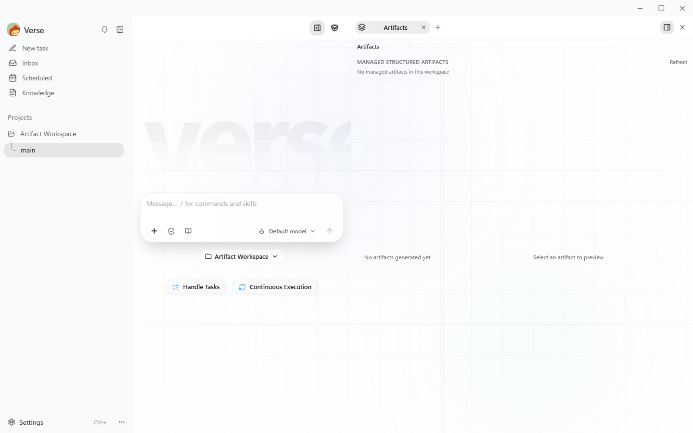
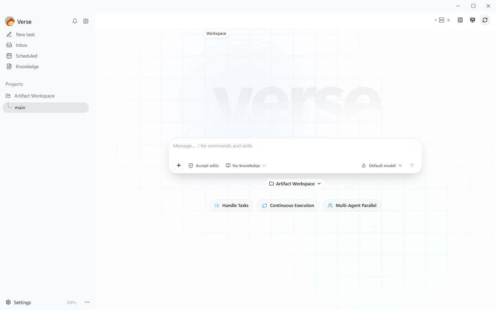

# 会话环境与工具空间 · 第 9 轮

最终冻结验收见 [frozen/report.json](frozen/report.json)：本地候选 `2bfa639a31d20b5a3ce3d184271bb2c818f54e5a` / tree `ab81194e87ae234743ea1ef6e43fe09778a06236`，dirty=false。重新构建、259 项单测、7 个 Electron 场景、前端类型、四语与局部 lint 均退出 0，源码守卫通过。六张新截图位于 frozen/。该提交只保存在独立验证仓库，未作为共享主线集成提交；整仓门禁残差仍保留。

下方与根目录 report.json 保留冻结前开发验证的原始状态，没有回填成干净候选。

driven_by: agent · actor: codex-session-environment-relay · realHumanEvidence: false

空环境默认隐藏；变更、已观察到的 MCP/Skill 使用、子代理或进程活动触发入口。自动展开与会话并排，手动打开为浮层；手动收起按会话保持，支持 Escape、外部点击和关闭按钮。摘要每组先显示三项，更多内容按需展开。子代理点击后才打开独立页签。工具空间的收起保留挂载内容、当前页签和宽度状态。

最终验证：17 个独立进程共 259/259 单测；7/7 Electron 场景，两个批次均 exit 0、0 跳过、源码守卫通过。前端类型、四语检查和局部 lint 均 exit 0；lint 的 5 条警告与接力前一致。构建沿用前一会话在同一固定源码副本上成功的构建，命令与退出码见 build-provenance.json。

全测试类型仍 exit 2，31 条诊断，见 test-types.log；整仓 Harness exit 1，包含本任务外的并行改动。本轮 29 个文件的归属校验通过，运行时代码与测试和验收副本一致。四个 README 在冻结后增加了其他任务说明，双侧哈希均保留。这里只确认本 UI 开发范围，未宣称整仓验收或发布就绪。

本次接力修正了测试启动竞态：IPC 替身安装后重新加载页面，确保会话首次读取使用固定数据。早期并行单测出现加载超时，单 worker 批次只产出 15/17 文件且退出 1；最终逐文件使用新进程，逐项要求 exit 0 与原有断言，不放宽 30 秒测试预算。早期失败报告单独保留。

## 截图

