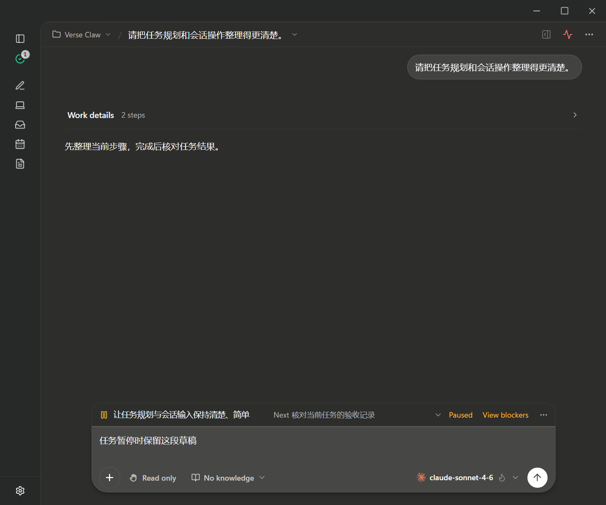
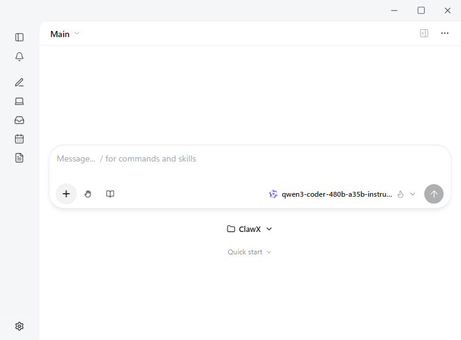

# 任务规划与输入框续修

模型名称保留原文，仅在输入框可用宽度不足时单行省略；悬停和模型列表保留完整标识。任务首次读取失败时显示就地刷新，刷新期间保留反馈并禁用重复请求；空任务在成功读回后收起。

任务暂停且存在阻塞时，即使原先已隐藏任务条也会重新显示账本入口。读取恢复和状态变化保留输入草稿；本轮计划完成继续读取持久任务的验收状态，验收后只自动折叠一次，用户仍可展开回执。完成状态在本次渲染中同步，持久化显示偏好使用独立 effect。

161 项不同定向测试的最新结果通过，最终任务组件另行复验 25 项；同一构建的 5 条 Electron 旅程全部通过，无重试、跳过或失败。旅程覆盖任务读取恢复、规划执行、暂停提示、验收折叠、草稿保留、知识菜单、排队恢复、圆形按钮、明暗主题、窄窗及四语。完整类型检查通过，完成折叠修正后的前端类型复验通过。Lint 为 0 个错误和 3 个既有警告；四语、契约、错误边界、构建和隔离检出的 Harness 检查通过。

最终生产候选 `8fcb221c49f2b4909609ed5c0c53df3c6096137a`；单测及类型检查的逐批候选对应关系见 `checks.json` 和 `unit-tests.json`。Electron 清理通过，残留进程为空，验证期间源码无变化。主目录 `D:/ClawX/dist` 和 `dist-electron` 已同步此构建，1412 个输出文件逐一核对一致。

本轮沿用 Carbon 已完成的设计指导，新增 Carbon 调用为 **0**。界面截图、输入及运行事件由 agent 驱动。

原始日志及失败回执保存在 `D:/tmp/task-ux-followup-20261123-01a203cc`。首次 Harness 在主目录检测到原有未跟踪的活动铃铛规范，随后在隔离检出通过。构建备份位于该原始记录目录的 `previous-main-build`。运行 `python verify.py` 可核对本包文件与候选。
